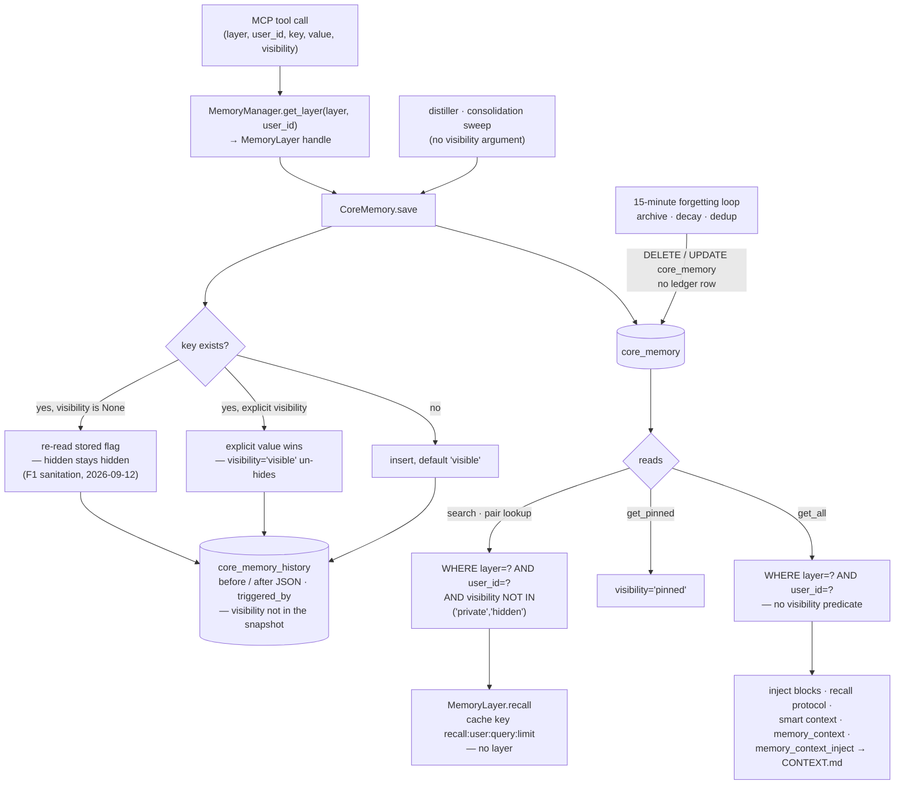

## 1. Executive Summary

a-memory is a four-tier local agent memory in plain SQLite, reached through an
MCP server, whose long-term facts carry a `visibility` flag that search
excludes in SQL and that an automatic re-save cannot reset. The weak side is
everything that reads around search: the session-start and context builders
read facts through `get_all`, which carries no visibility predicate, so the
invariant written beside the search query — *"C8: private facts never leave the
store via recall"* — holds for that query and not for what reaches the prompt.

It describes itself as "4-tier agent memory with hybrid search and a real
knowledge graph — all in plain SQLite files. Zero cloud. Zero external APIs."
The tiers are an L1 reflex buffer persisted per layer and user, an L2 session
store, L3 episodes and L4 core facts, with an L0 journal that captures raw
input before distillation.

**Visibility is four states, and an absent argument keeps the stored one.** A
fact is `visible`, `pinned`, `private` or `hidden`, validated on write
(`core/memory.py:99-101`). A save that passes no visibility re-reads the
stored flag before updating (`:106-118`), under a comment that records the bug
and its date:

> "a 'hidden' row re-saved with the same canonical key would otherwise be back
> to 'visible' — F1 sanitation, 2026-09-12"

The writers that never pass a visibility are the ones that matter: the
distiller and the consolidation sweep re-upsert by canonical key, and the rule
keeps their output under an operator's flag. An explicit argument overrides it.
The MCP write tool takes `visibility` and forwards it
(`mcp_server/tools/memory.py:37`, `:86`, `:89`), and
`test_resave_preserves_operator_visibility` asserts that `visibility="visible"`
clears a hidden flag (`tests/test_lifecycle/test_c8_tails.py:127-129`). The
quarantine holds against automatic writes; the agent can lift it.

**Search filters, and the context builders do not.** `search` selects
`visibility NOT IN ('private','hidden')` (`core/memory.py:414`), the
superseded-pair lookup inside it does the same (`:457`), and `get_pinned`
selects only `pinned` (`:353`). `get_all` (`:333-347`) selects every row for
the layer and user by importance. Six builders read it and render `key=value`:

- `features/inject.py:165-170`, the rehydrate block after a compaction
- `features/inject.py:221-228`, the important-facts block
- `features/recall.py:62-64`, the recall protocol's marker axis
- `features/smart_context.py:51-56`, the smart-context candidate list
- `mcp_server/tools/ops.py:97-98`, the `memory_context` tool
- `mcp_server/tools/ops.py:244-245`, `memory_context_inject`, which also
  writes the text to a `CONTEXT.md` file (`:267-278`)

The second has a filter that does nothing. It keeps facts where
`getattr(f, "visibility", "visible") == "visible"`, and `CoreEntry`
(`core/memory.py:34-44`), built by `_row_to_entry` (`:498-510`), has no
`visibility` field. The default answers every time, so pinned, private and
hidden facts above the importance threshold all pass. A private fact the search
tests prove absent from recall is injected at session start.

**Scope is carried by the handle.** `MemoryManager.get_layer(layer_type,
user_id)` builds a `MemoryLayer` whose `EpisodicMemory` and `CoreMemory` are
constructed with that layer (`core/__init__.py:38-54`, `:122-132`), and every
read on those two classes begins `WHERE layer=? AND user_id=?`. The MCP tools
take `layer` and `user_id` as arguments and resolve a handle from them, so the
binding is a property of the Python API rather than of the agent surface. One
cache sits in front of it and drops the layer. `MemoryLayer.recall` keys its
results `recall:{user_id}:{query}:{limit}` (`:81`) in a `MemoryCache` that
`AppContext` hands to every handle (`mcp_server/context.py:22-23`). A recall on
the agent layer within 300 seconds of the same query on the user layer returns
the user layer's facts.

**Every `CoreMemory` mutation appends a before-and-after row, and the ledger is
never rewritten.** `_record_history` writes "one A2.2 ledger row with full
before/after row JSON" from save and delete (`core/memory.py:121`, `:129`,
`:368`), and no production statement updates or deletes
`core_memory_history`. The ledger's reach stops at those two methods. The
15-minute forgetting loop archives and deletes rows directly
(`lifecycle/forgetting.py:194-219`, `:597-600`, called from
`mcp_server/lifespan.py:61`), as do `forget(scope='recent')`, branch deletion
and the importance and kind updates. The row snapshot also omits `visibility`
(`core/memory.py:208-220`), so hiding a key leaves no ledger trace. Both the
ledger and the interval chain beside it sit under bare exception handlers that
log a warning and let the save commit.

## 2. Mental Model

A **fact** is a key and a value in one layer for one user, with an importance,
a kind, a source and a visibility. A fact is believed when it is stored and
`visible` or `pinned`. It stops being believed by deletion, by archiving, or by
being marked `private` or `hidden`, which hides it from search but not from the
context builders.

A **layer** is `user` or `agent`. A handle carries one layer and one user; the
MCP surface lets the caller name both.

**Hidden** is a flag a later automatic write inherits and an explicit write
can clear.

A **ledger row** is what `CoreMemory.save` or `delete` changed, with both
images and who triggered it. Writes that bypass those two methods leave none.

A **contradiction** produces two rows, not an overwrite: the distiller marks
the earlier `scope: earlier` and writes the new clause under `key::vN` with
`scope: later` (`lifecycle/distiller.py:413-456`), and search hides the earlier
one when its later version exists.

## 3. Architecture

| Area | Role |
| --- | --- |
| `core/__init__.py` | `MemoryManager`, `MemoryLayer`, the recall cache and the handle binding |
| `core/memory.py` | `CoreMemory`: save, the visibility rules, the ledger, the interval chain, search |
| `core/episodic.py` | L3 episodes, layer-scoped with `(layer, user_id)` indexes |
| `core/session.py`, `core/reflex.py` | L2 sessions and the L1 buffer persisted per layer and user |
| `shared/l0.py` | The L0 capture journal that the distiller and replay read |
| `lifecycle/distiller.py`, `lifecycle/consolidation.py` | Extraction into L4 and episode promotion |
| `lifecycle/forgetting.py` | Decay, archiving into `archived_memories`, restore |
| `features/inject.py`, `features/recall.py`, `features/smart_context.py` | The context builders |
| `features/staging.py` | Staged mutation proposals and their decide path |
| `features/history.py`, `features/versioning.py` | Ledger reads, rollback, snapshots |
| `rag/`, `graph/`, `wiki/` | Hybrid retrieval, the epistemic graph and wiki pages |
| `mcp_server/` | Tool registry, the per-process `AppContext`, the background loop |
| `alembic/` | Schema migrations |

### Deployment and ergonomics

Everything runs in one Python process over SQLite files in one data directory
(`MCP_MEMORY_DATA_DIR`, default `~/.mcp-ariel-memory`). No API key is required
to store or search. Embeddings and the spaCy NER model are optional extras,
and the privacy gate falls back to a regex tier without the model. The store
is ordinary SQLite and repairable by hand, and several scripts under
`scripts/` exist to do exactly that. Several processes may serve one base; the
background loop takes a per-base maintenance lock so only one runs
housekeeping (`mcp_server/lifespan.py:46-58`).

## 4. Essential Implementation Paths

**Write.** `memory_remember` (`mcp_server/tools/memory.py:29-94`) strips
secrets, checks the rate limit and an importance gate, captures an L0 row and
closes it as `routed_direct`, then calls `MemoryLayer.remember`
(`core/__init__.py:56-78`) and `CoreMemory.save` (`core/memory.py:80-133`).
The save path validates visibility, finds the row by `(layer, user_id, key)`,
preserves or overrides visibility, updates or inserts, appends a ledger row and
maintains the interval chain, then commits once.

**Extraction.** `distill_and_route` (`lifecycle/distiller.py`) classifies
clauses, applies the dialogic guard, a novelty gate against same-key rows
including hidden ones (`:390-405`), a semantic duplicate check and a conflict
check, and saves with `created_at` set to the source message time (`:444-460`).

**Retrieval.** `memory_recall` consults a layer-keyed tool cache
(`mcp_server/tools/memory.py:124`), then `MemoryLayer.recall`
(`core/__init__.py:80-96`), which consults its own layer-less cache and calls
`CoreMemory.search` and `EpisodicMemory.search`.

**Context assembly.** `build_inject_blocks` (`features/inject.py:74-252`) runs
at session start from the `session_started` hook
(`hooks/user_hooks.py:202-210`) and from an HTTP endpoint that takes the layer
from the request body (`mcp_server/endpoints/hooks.py:58-77`).
`build_smart_context`, `recall_protocol`, `memory_context` and
`memory_context_inject` are the other builders.

**Forget.** The `forget` primitive (`mcp_server/tools/primitives/forget.py`)
takes `exact`, `fuzzy`, `recent`, `episode_ids` or `undo`. The first, second
and fourth copy rows into a shadow archive before deleting, with a dry run that
writes nothing. `recent` purges with no archive and no preview. `undo` restores
from the archive through `ForgettingSystem.restore_entries`.

## 5. Memory Data Model

`core_memory` holds `layer`, `user_id`, `key`, `value`, `importance`,
`memory_kind`, `expires_at`, `source`, `metadata`, `visibility`, `created_at`
and `updated_at`, unique on `(layer, user_id, key)` (`core/memory.py:56-71`).
`source` is a documented provenance contract — `user_explicit`,
`staging_promotion`, `episode_promotion` or `manual` — which distinguishes a
fact a person stated from one promoted out of an episode.

`created_at` and `updated_at` are separable on insert: `created_at` takes the
caller's value, which the distiller, replay and import set to the source
message's timestamp, and `updated_at` is the write instant (`:189-197`). That
is the time a thing was said and the time it was stored. Neither is when the
fact held in the world.

`core_memory_temporal` keeps an interval per key with `valid_from` set to the
write instant (`:270-287`). `get_at_time` and `get_intervals` read it
(`:299-326`), and no production code calls either. A backfilled fact can carry
a `created_at` months earlier than its interval's `valid_from`.

`core_memory_history` stores `old_value`, `new_value`, both importances, a
16-character `commit_hash`, `triggered_by`, `created_at` and the two row
images as JSON (`:241-258`). The image is built by `_row_snapshot`
(`:208-220`) from key, value, importance, kind, expiry, source and metadata.
Visibility is not in it.

Archived rows go to `archived_memories` with eight columns. A restore reports
the destination columns the archive could not fill, read from the schema
rather than a hand-kept list (`lifecycle/forgetting.py:78-100`).

## 6. Retrieval Mechanics

`CoreMemory.search` (`core/memory.py:387-487`) splits the query on whitespace,
selects rows matching any token in key or value with the visibility predicate,
over-fetches ten times the limit and ranks by matched-token count, then
importance. Contradiction pairs are resolved at read time: an `earlier` row is
hidden when its `later` row is on the page or exists under the same key or
`key::vN`, and a private later version does not hide a public earlier one.
Expired facts stay in results with an `[EXPIRED]` prefix.

The multi-source retriever behind `dream` fuses RAG pages, wiki, episodes,
core facts, graph nodes and entity matches. Its episodic and core sources call
the same layer-bound classes, and its graph and entity reads filter
`epi_nodes` on `layer` and `user_id` (`rag/multi_source.py`).

The builders read differently from search. `build_inject_blocks` adds RAG hits
for the current text, the last day of L1, recent `diff_gap` episodes, the
scratchpad, a rehydrate block after a compaction, pending proposals,
disclosure triggers, the important block and the pinned block. Each is capped
at 400 characters and charged against a token budget. The scratchpad is read
with the layer fixed to `user` (`features/inject.py:141`), and proposals are
listed by user alone, so an agent-layer injection shows the user layer's
scratchpad and both layers' proposals. Query-independent blocks go first,
ahead of a `<cache:break>` marker, so a provider's prompt cache can hit the
prefix.

## 7. Write Mechanics

One save path handles both update and insert, keyed on `(layer, user_id, key)`.
There is no append-only fact table; the ledger is the record of what a key
held. The distiller is the main automatic writer, gated by a dialogic guard, a
same-key novelty gate, a semantic duplicate check and the contradiction split.
The hourly sweep drains staged dream output into proposals and promotes
high-weight episodes.

Staged proposals (`features/staging.py`) are the review lane. `propose`
absorbs a duplicate pending proposal and, for seven days, one whose key was
already rejected or expired (`:42-63`). Decided rows are purged after fourteen
days (`:127-146`). `decide` applies or rejects, reached through the
`memory_proposals` MCP tool with `approve=true|false`
(`mcp_server/tools/ops.py:848`), and `auto_apply_pending` applies
`session_close` and `dream` proposals that pass the promotion gate
(`features/staging.py:155-191`).

Two paths put a hidden fact back as visible. `memory_history(action='rollback')`
of a delete reinserts the old image through `save` with no visibility, which
on an absent key inserts `visible` (`features/versioning.py:120-156`). And
`forget(scope='undo')` restores from the archive with an `INSERT` that leaves
`visibility` to its default (`lifecycle/forgetting.py:504-539`).

### Operational cost

Writes are synchronous SQLite statements with no model call on the explicit
path. The distiller runs in hooks and replay, so extraction does not block the
MCP write. The 15-minute loop reads every `core_memory` row for decay
(`lifecycle/forgetting.py:158-192`), and a nightly pass enriches the graph.
Injection is bounded by a token budget of 2,000 by default and a 400-character
per-block cap.

## 8. Agent Integration

The MCP server registers a flat tool set — `memory_remember`,
`memory_recall`, `memory_context`, `memory_context_inject`, `memory_history`,
`memory_proposals` and others — and a primitive set of `think`, `dream`,
`forget`, `evolve`, `project`, `memory_hook` and `wake_up`. Every memory tool
takes `layer` and `user_id` as arguments. The agent can therefore write and
read either layer for any user id, set or clear `visibility`, decide its own
staged proposals, and roll back any ledger row by id.

`memory_history(action='get')` returns a ledger row with both JSON images by
`history_id` alone (`mcp_server/tools/ops.py:1492-1496`,
`features/history.py:47-55`), and `rollback` writes into the row's own layer
and user (`features/versioning.py:120-128`). Neither checks the `layer` and
`user_id` the call named. Ledger rows carry private and hidden values like any
other, since the table records no visibility.

## 9. Reliability, Safety, and Trust

**The visibility decision is written per query.** Three L4 queries carry it in
SQL; `get_all`, `get` and the two interval reads do not, and the six builders
that reach a prompt all use `get_all`. The Python-side check at
`features/inject.py:222` reads an attribute the entry object does not have.
The tests assert the exclusion on `search` and nowhere else, which is why it
held there. Putting the predicate in one admission function every read path
calls, as [MuninnDB](../muninndb/) does, would make a builder that forgot it
fail visibly.

**The ledger's guarantee is narrower than its docstring.** It is append-only
and complete for `CoreMemory.save` and `delete`. The forgetting loop's archive
deletes, `delete_older_than`, branch deletion, `deduplicate_core`, importance
decay, `importance_scheduler`, the quality and replay importance updates, and
kind reclassification all write `core_memory` directly. The archive path
records a `memory_transitions` row instead; the others record nothing in the
memory store.

**Failures are dropped, not counted.** `_record_history` "[d]egrades to a
warning so memory writes never fail on history", and `_record_temporal` is
"advisory, never fails a save". Both run inside the save's transaction under
`except Exception`, log at warning level and let the save commit. If the
interval `INSERT` fails after the `UPDATE` that closed the previous interval,
the key commits with no open interval, and nothing reconciles it.

**The recall cache crosses layers.** One `MemoryCache` with a 300-second TTL
backs every handle, and the recall key has no layer. The project fixed the
same class of defect in its multi-source retriever on 6 October 2026
(`d8ec04fedfd80bb76ee803e3d27a72397eae16f4`, issue #78), where the agent-layer
instance had answered with user-layer rows. That commit's message explains
that every unit test built the retriever explicitly, so the construction site
was never exercised.

## 10. Tests, Evals, and Benchmarks

2,014 test functions in 302 test files, with an `eval/` harness, hypothesis
property tests and chaos tests. I ran none of them.

The negative cases are specific. `test_visibility_pinned_and_private`
(`tests/test_lifecycle/test_c8_tails.py:73-90`) saves a pinned and a private
fact and asserts the private one's search returns `[]` while the pinned one is
found. `test_hidden_first_class_excluded_from_search` (`:133-149`) asserts a
hidden fact is absent, the same key made visible is found, and re-hiding
removes it. `test_episodic_and_core_sources_follow_the_instance_layer`
(`tests/test_rag/test_prod_wire.py:169-193`) writes one token into both layers
and asserts each layer's search returns only its own rows, and
`test_e2e_dream_respects_layer_isolation` (`tests/test_e2e_pipeline.py:158-170`)
asserts a user-layer dream finds nothing from the agent layer.

The gaps are adjacent to those cases. No test drives a private or hidden fact
through `build_inject_blocks`, `build_smart_context`, `recall_protocol` or the
two context tools; `test_inject_pinned_block` (`:152-186`) asserts only that a
pinned fact is present. No test exercises `MemoryLayer.recall` across layers
with a shared cache. `test_resave_preserves_operator_visibility` (`:104-129`)
asserts the explicit override as intended behaviour.

## 11. For Your Own Build

### Steal

Decide what a missing argument means and write it down. `visibility=None`
meaning "keep the stored flag" rather than "use the default" is what stops an
automatic re-upsert from resurrecting a suppressed key, and the dated comment
is what will stop it regressing.

Pair every exclusion test with a positive control in the same store. The
hidden-fact test makes the key visible and asserts it is found before hiding
it again, so a filter that excluded everything would fail.

Resolve contradictions into two rows with a read-time rule. `scope: earlier`
and `scope: later` with a `contradicts` reference keep both values and let
search show the current one.

### Avoid

Writing the privacy predicate beside one query. Six builders that render facts
into a prompt read through a method without it, and a seventh path filters on
a field the object does not carry.

A cache key that omits a dimension the query below it uses. The layer is in
the SQL and in the tool-level cache, and missing from the one between them.

A ledger documented as the mutation record when half the mutators bypass it,
and a row image that leaves out the trust field.

### Fit

This suits one operator running a local agent who wants facts, episodes, a
graph and a review queue in SQLite with no service to stand up. Walk away if a
private fact must never reach a prompt, if the agent must not be able to clear
a quarantine, or if the mutation ledger must be complete.

## 12. Open Questions

Whether `get_all`'s callers are meant to honour `private`. The one that tries
reads an absent attribute, which reads as intent; the distiller's same-key
select includes hidden rows deliberately and says why.

Whether the interval chain will get a reader. `get_at_time` and
`get_intervals` are tested and uncalled.

Whether `memory_history` is meant to be agent-facing as it stands. Its `get`
and `rollback` take a bare `history_id`, and `mcp_server/annotations.py:74-76`
marks the tool read-only although `rollback` and `snapshot_restore` write.

## Appendix: File Index

| Path | What to read it for |
| --- | --- |
| `core/memory.py:80-133` | The save path, the visibility rule and the ledger and interval calls |
| `core/memory.py:222-261` | The ledger append and its bare exception handler |
| `core/memory.py:333-357` | `get_all` with no visibility predicate, `get_pinned` with one |
| `core/memory.py:387-487` | Search: the visibility predicate, the C8 comment, the contradiction pair rule |
| `core/__init__.py:38-132` | The handle, the layer-less recall cache key |
| `features/inject.py:74-252` | The session-start assembler and the no-op visibility check |
| `mcp_server/tools/ops.py:79-297` | `memory_context` and `memory_context_inject`, the `CONTEXT.md` write |
| `mcp_server/tools/ops.py:1466-1520` | `memory_history`: get and rollback by id |
| `lifecycle/forgetting.py:158-219`, `:504-539`, `:597-600` | Decay, archive deletes outside the ledger, restore without visibility |
| `lifecycle/distiller.py:390-460` | The novelty gate over hidden rows, the contradiction split, `created_at` |
| `features/staging.py:32-262` | Proposals, the seven-day key guard, decide |
| `tests/test_lifecycle/test_c8_tails.py:73-186` | The visibility tests, positive and negative |
| `tests/test_rag/test_prod_wire.py:157-219` | The layer-isolation tests added with the retriever fix |

### Recorded searches

Run at the tree root of the pinned checkout with `/usr/bin/git grep`; its
extended regex has no `\b`, so the patterns below avoid it.

- `git grep -n -E '\.get_all\(' -- '*.py' ':!tests'` — ten hits: the six builders, two dashboard reads, `features/branches.py:81`, and `core/__init__.py:106` in `get_context`, which has no caller.
- `git grep -n -E 'visibility' -- '*.py' ':!tests' ':!core/memory.py' ':!alembic'` — reads at `features/inject.py:222` (the no-op), `lifecycle/distiller.py:398` and `mcp_server/tools/wiki.py:122`; writes through `core/__init__.py:77` and `mcp_server/tools/memory.py:86`, `:89`.
- `git grep -n -E '(UPDATE|DELETE FROM|DROP TABLE( IF EXISTS)?) core_memory_history' -- '*.py'` — the downgrade migration only.
- `git grep -n -E 'DELETE FROM core_memory[ "]' -- '*.py' ':!tests'` — `core/memory.py:371`, `:380`, `features/branches.py:157`, `features/compression.py:32`, `lifecycle/forgetting.py:600`, `:609`, two purge scripts and one migration; only `:371` is preceded by a ledger append.
- `git grep -n -E 'get_at_time\(|get_intervals\(|get_context\(' -- '*.py' ':!tests'` — definitions only.
- `git grep -n -E 'recall:\{' -- core` — `core/__init__.py:81`, no layer in the key.
- `git grep -n -F 'read_entries(user_id, "user")' -- features/inject.py` — `:141`.
- `git grep -n -i -E 'tombstone' -- '*.py' ':!tests'` — `features/staging.py:42`, `:128` and a docstring in `lifecycle/consolidation.py:193`; a seven-day guard keyed on a proposal's key, not a value.
- `git grep -n -E 'assert hits == \[\]' -- tests/test_lifecycle/test_c8_tails.py` — `:87`, `:142`, `:149`.
- `git grep -n -i -E 'arxiv|bibtex|@article|@misc|doi\.org' -- README.md docs` — no match; no paper.
- `git grep -n -i -E 'anthropic|machine learning|not (be )?used (for|to)' -- LICENSE NOTICE` — no match; the MIT text carries no rider.

## History

**2026-10-15** — [`598e2ab14bb02bdd1999ca443f159db4eeb4d80e`](https://github.com/Cipher208/a-memory/commit/598e2ab14bb02bdd1999ca443f159db4eeb4d80e) — 110 commits on. `negative_eval` gained, earned at the first pin: the C8 search tests asserted private and hidden facts absent ([section 10](#10-tests-evals-and-benchmarks)). Also wrong then: the `inject.py:222` filter reads a field `CoreEntry` lacks, so six builders are unfiltered, not five; the key lookup carries no predicate; an explicit `visibility` lets the agent un-hide; the ledger covers only `CoreMemory.save` and `delete` ([section 1](#1-executive-summary)). The recall cache key omits the layer at both pins ([section 9](#9-reliability-safety-and-trust)). Overtaken: `created_at` carries source time, the multi-source retriever binds its layer (`d8ec04f`), forget gained dry run and undo. Screened from a full clone: ten files, two auto-run surfaces, one build-time execution point, `pyproject.toml` and `uv.lock` inside the cooldown, `AGENTS.md`, `CLAUDE.md` and `.cursorrules` read as data. Nothing was installed, built or run.

**2026-09-19** — [`32edbb91da0f54ad25b157e13bf6867c0a409526`](https://github.com/Cipher208/a-memory/commit/32edbb91da0f54ad25b157e13bf6867c0a409526) — `trust_state` re-tested against the narrowed line. `core/memory.py` and `core/__init__.py` are byte-identical to the previous pin, so what follows is a correction to this report rather than drift. The mark stands: `visibility` is a validated four-value state, three L4 queries carry it in SQL — `search` (`:407`), the key lookup (`:450`) and the pinned-injection read (`:348`) — and a re-save with no visibility re-reads the stored flag, so a hidden key stays hidden. The report said private and hidden are excluded from *both* read paths. There are more than two, and the predicate is written per query rather than once.

`get_all` (`:328-334`) selects every row for the layer and user ordered by importance and takes no visibility clause. `features/inject.py:222` adds the test in Python; five production callers do not — `features/inject.py:165-170` (the compaction block, twenty lines from the one that does), `features/smart_context.py:51-56`, `features/recall.py:62-64`, `core/__init__.py:106-108` and `mcp_server/tools/ops.py:93-94`, which writes the facts string into a `CONTEXT.md` snapshot. Each renders `key=value`, so a private or hidden fact above the importance threshold reaches a prompt or a file through any of them — which the comment at `core/memory.py:406` says cannot happen: *C8: private facts never leave the store via recall.* It is true of the query it is written beside. The distiller is the one deliberate exception and says so: hidden rows stay in its novelty-gate select (`lifecycle/distiller.py:244-250`) so a paraphrase aimed at a quarantined key is suppressed too, and it compares against the value without emitting it.

One open question is now answered: `hidden` is reachable from the agent-facing tools — `visibility` is an argument on the MCP write tool (`mcp_server/tools/memory.py:37`, `:78`), which makes the quarantine asymmetric in the useful direction, since the re-save rule means the agent can hide a key and not unhide it. Section 1, section 9, the matrix rows and the open questions were rewritten. Screened again first; nothing was installed and no suite was run.

**2026-09-16** — [`32edbb91da0f54ad25b157e13bf6867c0a409526`](https://github.com/Cipher208/a-memory/commit/32edbb91da0f54ad25b157e13bf6867c0a409526) — first reading, at a commit dated 16 September 2026. Screened before opening, from a shallow clone: eight files scanned, two auto-run surfaces, one build-time execution point, no unpinned surfaces and two dependency files inside the seven-day cooldown. Nothing was installed, built or run.
