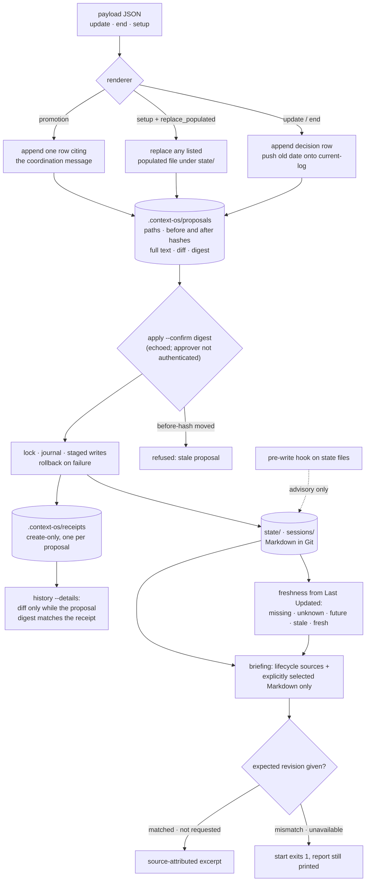

## 1. Executive Summary

Context OS is a convention with a kernel under it: Markdown state files in
known places, a routing table that tells an agent which to read, and a Python
package that turns every change to those files into a reviewed proposal and
applies it as one transaction with a receipt. The receipt is the audit record.
The decisions table is append-only in three of the kernel's writers and
replaceable in the fourth, setup.

The convention is `state/current.md` for what is happening, `state/decisions.md`
for what was decided and what was rejected, `state/blockers.md`, `sessions/`
for per-day notes, `projects/` and `references/` for the rest, plus a
`ROUTING.md`. The kernel, `contextos`, parses each file's `**Last Updated:**`
line, validates a proposal, and applies every changed file together under a
lock with rollback.

It earns two marks. `audit_log`, because each apply publishes a create-only
receipt naming every path it changed with its before and after hashes, and
nothing in the package removes one. `negative_eval`, because a briefing test
fills the workspace with a file the routing table says to load and asserts it
stays out of a briefing that did not select it.

The continuity benchmark is the thing to take away. Its `handoff` baseline is
**information-equivalent** — one note with every answer — and the full
`contextos` profile is made harder by an older session full of superseded
ideas. An answer scores only if the quote it cites occurs in the file it cites,
and the scorer carries its own negative controls. The project has committed
model trials, and they show a well-written handoff note doing as well as the full layer.

## 2. Mental Model

Three layers live in one directory, and a fourth sits outside it.

**The files** are what an agent reads: state, sessions, projects, references,
skills. They are Markdown with a `**Last Updated:**` line, shipped as templates
— `state/current.md` arrives holding `[Most important thing right now]`.

**The kernel** is what changes them. A JSON payload is rendered into a
proposal: the target paths, the hash of each file before, the full text and
hash after, and a unified diff. `apply` takes the proposal and the exact digest
printed by `propose`, re-checks every before-hash against disk, writes all
files under `.context-os/apply.lock` with a journal for rollback, and publishes
a receipt as its commit point.

**The harness adapters** are how an agent reaches both: hooks in shell,
PowerShell and Python; bundles with a lockfile; first-class adapters for seven
hosts plus Devin cloud sessions.

**The curator** works on a different store. `/dream` reads the host's own
auto-memory directory — a path recorded in `.context-os/memory-directory`,
kept as its own local Git repository — and writes a proposal artifact.
`/dream-apply` walks it item by item, retiring files to `archive/` with a row
in `ARCHIVE.md`, and commits one tree whose digest was shown.

A decision is retired by convention, not by state. A later row says
*Supersedes: export-001* in its rationale; the first row stays, unmarked, and
nothing filters it from a read.

## 3. Architecture

| Area | Role |
| --- | --- |
| `contextos/kernel.py` | Freshness, path guards, the four content renderers, proposal shape and digest, the transaction and its receipt, `doctor`, hook reports |
| `contextos/continuity.py` | Read-only briefing over selected sources, and `history` over receipts |
| `contextos/coordination.py` | Messages between agents, claims with leases, promotion of a message into the decisions table |
| `contextos/attachment.py`, `materializer.py`, `workspace_*.py` | Split roots that keep a working repository read-only, generated agent configuration, workspace layout |
| `contextos/capabilities.py` | A read-only comparison of the described capabilities and skills of selected agents |
| `scripts/continuity-benchmark.py` | Prepares and scores the three scenarios; records and summarises trials |
| `scripts/dream/` | The curator's validator and prompts for the host's auto-memory directory |
| `adapters/`, `runtimes/` | Per-host adapters and the live conformance harnesses behind the first-class claims |

The kernel is a library behind a CLI, with no service and no index. Every
artifact it keeps sits under `.context-os/`, which `.gitignore` excludes, so
proposals, receipts and journals are local to one machine.

## 4. Essential Implementation Paths

- **Writers:** `contextos/kernel.py:1407-1458` (`render_update`,
  `render_end` and the decision append), `:1462-1519` (`render_promotion`),
  `:1535-1564` (`render_setup`), `:1340-1356` (`_advance_current`).
- **Path policy:** `contextos/kernel.py:2124-2157` (`_validate_change_path`):
  `end` may write the decisions table, `promotion` only the decisions table or
  today's session, `setup` anything under `identity/`, `projects/` or `state/`.
- **Apply and receipt:** `contextos/kernel.py:4096-4199`, `:4381-4466`.
- **Freshness and readiness:** `contextos/kernel.py:4685-4748`.
- **Briefing and history:** `contextos/continuity.py:56-139`, `:142-235`.
- **Benchmark:** `scripts/continuity-benchmark.py`,
  `tests/fixtures/continuity/{scenario,long-sequence,revision-invalidation}.json`,
  `tests/test_continuity_benchmark.py`, `docs/evidence/continuity-*`.
- **Curator:** `scripts/dream/validate-memory.py`,
  `.claude/commands/dream.md`, `.claude/commands/dream-apply.md`.

## 5. Memory Data Model

There is no record type. The unit is a file in a known place, and the schema
is a heading convention; two of the files carry more structure than that.

`state/decisions.md` is a table with four columns — Date, Decision, Context /
rationale, Rejected alternatives. Its header states the append rule and when to
fill the fourth column: *"when there was a real branch point — what else was
considered and why it lost; leave it blank when there was one obvious
option."* That keeps the road not taken. Review and supersession ride in the
rationale as text — *Review status*, *Reviewed by: … (self-reported)*,
*Supersedes: export-001* — and a test asserts both rows survive.

`state/current-log.md` holds dates under a required heading, newest first. It
records only the date `current.md` carried before its present one, not the
content that date described.

The receipt is the one structured record. Its fields are `proposal_id`,
`proposal_digest`, `approval_evidence` (a fixed string: *"host-mediated
confirmation; kernel does not authenticate the human approver"*),
`applied_at`, `runtime` with `runtime_identity: self-reported`,
`files_changed` as path and before and after hashes, the Git heads before and
after, and the invariants checked.

## 6. Retrieval Mechanics

Retrieval is a routing table plus a convention. `ROUTING.md` maps a kind of
task to the files to load, and the `context-start` skill reads *"today's
session file, or the most recent session when today's does not exist"*.

The kernel's read is the briefing, described in its first line as
*"Read-only, source-attributed continuity views over existing kernel
evidence."* It returns the fixed lifecycle sources plus Markdown files named
with `--source`, never one a routing file mentions. Each source carries a
freshness status, a SHA-256 of its normalised text, a raw-bytes hash and an
excerpt, all from one snapshot.

A caller can pass `--expect-source-revision PATH=SHA256`. Each selected source
then reports `matched`, `mismatch`, `unavailable` or `not_requested`, and
`start` exits 1 on any mismatch or unavailable source while printing the full
report. The briefing labels its own limit: *"Revision checks compare selected
source snapshots only; claim dependencies and host retrieval are not
verified."*

## 7. Write Mechanics

A change is a proposal. `create_proposal` renders the payload, builds one
change per file with its before hash, its full after text and hash, and a
diff, checks each path against the workflow's policy, and writes the document
exclusively under `.context-os/proposals/`. `apply` re-validates the shape,
recomputes the digest, requires `--confirm` to equal it, re-checks every
before hash against disk, and writes under a lock with a journal.

Three writers append. `render_end` reads the decisions table, strips its
trailing newline and adds one row per decision; it raises *decision log does
not exist* rather than creating the file. `render_promotion` does the same for
a coordination message and writes the message id into the rationale. The
update log gains the previous date under its heading when `current.md` rolls
over, and a missing heading is an error.

The fourth writer replaces. `render_setup` accepts a map of paths to complete
content under `identity/`, `projects/` and `state/`, and a populated file is
refused unless the payload lists it in `replace_populated`
(`contextos/kernel.py:1559-1560`, `:4156-4158`). With that listing, setup
overwrites `state/decisions.md` or `state/current-log.md` whole. The setup
skill asks for *"explicit approval"* first; the kernel sees only the list.

Apply does not compare old and new decision text. A proposal file written by
hand with a self-consistent digest is applied on the same checks, so
append-only holds for what the renderers produce rather than for what `apply`
accepts.

## 8. Agent Integration

The README lists Claude Code, Codex, OpenClaw, OpenCode, Cursor CLI, Devin CLI
and Hermes Agent as first-class, Devin cloud sessions too, and Cursor IDE as
experimental. Each first-class claim points at a live conformance harness under
`adapters/` and dated evidence under `docs/evidence/`. Hooks ship in three
languages and emit host-specific payloads. Devin's write advisory uses a
post-write event; the kernel's comment gives the reason, that the host injects
context only on session start, prompt submit and post-tool-use.

The pre-write hook names the five state files and tells the agent to use the
kernel instead. Its findings have severity `advisory`, and nothing blocks a
direct edit. The deny rules on `apply` that appear in the tree belong to
conformance fixtures (`adapters/devin/cli_lifecycle_conformance.py:42-61`),
not to any configuration a workspace ships.

Coordination is a claim with a lease: `_claim_order` groups live claims by
task and drops expired ones, so a stale holder loses its place rather than
blocking the queue (`contextos/coordination.py:1174-1179`).

The curator reaches the host's own memory. `/dream rot` asks the model to flag
auto-memory files that disagree with the state files or recent commits, and
`/dream-apply` asks the person per item through `AskUserQuestion`. The model
then applies the change with its own edit tool and runs the commit helper,
which commits one tree bound to a digest it printed.

## 9. Reliability, Safety, and Trust

**Audit log — awarded.** Every kernel apply publishes
`.context-os/receipts/<proposal_id>.json`, refuses an existing path, and treats
publication as the commit point; a refused apply leaves no receipt, which a
test asserts. The proposal file beside it keeps the diff, and
`history --details` shows it only while the proposal digest matches the
receipt. No code under `contextos/` removes a receipt. Its limits are stated by
its own reader: *"Local receipts may be missing or edited. Runtime is
self-reported; human approval is not authenticated."*

The decisions table does not carry this mark. Update, end and promotion only
append to it, but setup replaces it given one entry in `replace_populated`, so
a production path rewrites it. Git history is the control that covers that.

**Negative eval — awarded.** The briefing test puts a file in the workspace
that `ROUTING.md` tells the agent to load, selects a different one, and asserts
the first is absent while the second appears once and renders its content. The
benchmark's tests are stronger on the scorer than on retrieval: each wrong
answer must cost exactly one point, a right value with an unsupported quote
must fail, and a superseded record copied with its own matching revision check
must fail the record and revision layers.

**Trust state — withheld.** The five freshness values are derived at read time
from a `Last Updated` line, and readiness admits both `fresh` and `stale`; the
docstring gives the reason, that requiring a date on all three files *"would
report an initialized workspace as needing setup forever"*. The revision check
is derived too, from a hash the caller supplies, and it fails an exit code
without withholding a source.

**Human review — withheld.** `apply` requires the digest `propose` printed,
and the agent that ran `propose` can read and echo it. The kernel says so in
every receipt, and agent-lifecycle receipts add `"human_authenticated": false`.
`/dream-apply` asks through `AskUserQuestion`, which is a request to the model,
and the model performs the accepted edits and the commit.

**Tombstone — withheld.** A superseded decision stays as a row, and the
replacement says *Supersedes* in prose. The curator's `ARCHIVE.md` rows and its
`archive_tombstones` field are keyed on a memory file, not a value, and no
writer consults them.

**Scope enforced — withheld.** Directories partition content and path guards
bound what the kernel touches, but no read is filtered by a stored scope key,
and `--source` admits any Markdown file in the root.

**Bitemporal — withheld.** One date per file, and it is the review date.

## 10. Tests, Evals, and Benchmarks

**No paper.** Searched the README and `docs/` for `arxiv`, `bibtex`,
`@article`, `@misc` and `doi.org`, and the root for `CITATION.cff`: none.

The suites are large and mostly about hosts: live conformance harnesses for
Cursor, Devin, Hermes, OpenClaw and OpenCode account for most of the test
code. The kernel, continuity, benchmark, transaction and coordination suites
are where memory behaviour is tested. I read them and ran none.

The benchmark has three scenarios. The original asks four questions over a
synthetic project. The long sequence asks ten over six sessions of two
projects. The revision scenario asks two and scores four layers separately:
the retrieved record, the cited revision, the proposed value and the outbound
action. Every result carries a `scope` field saying what the number is not.

**Results are committed.** `docs/evidence/continuity-*` holds four dated runs
with every raw response, prompt hash and score. Two tests re-prepare each
prompt, check its hash, rescore every stored response with the current scorer
and require the published table to match exactly
(`tests/test_continuity_benchmark.py:277-306`).

What they show is modest, and the project says so. In the long-sequence runs
every profile chose all values correctly; the profiles differed only in
citations the scorer rejected. In the 2026-09-26 rerun those were 12 across 150
answers for the original handoff note, none for a note rewritten to keep each
status in one sentence, and 2 for the full layer. The run's README calls that
*"directional evidence, not a precise effect size."* The revision trials
scored perfectly for every model and profile, which their README calls *"a
ceiling result"*.

## 11. For Your Own Build

### Steal

Make your baseline information-equivalent. A context layer that beats an agent
with no facts has proved nothing; give the baseline every answer in one note
and see whether the structure helps.

Put the superseded idea in the full profile. Picking the current decision over
the stale one is what breaks in production, and a benchmark that omits stale
material cannot see it.

Score the quote, not the answer, and test the scorer. Mutate each answer and
require the score to drop by exactly one; keep a right value with a wrong quote
and require it to fail.

Commit the raw responses and make a test recompute the table from them. A
published number that a changed scorer would silently alter is caught on the
next run.

Make the receipt the commit point. A receipt published only after every file
is written, and refused if it exists, means the record of a change cannot
claim more than happened.

### Avoid

Calling a file append-only because the usual writer appends. If a setup or
migration path can replace it, the property belongs to the writer, and the
audit has to live somewhere that path cannot reach.

Treating an echoed digest as approval. It proves the confirmer saw the
proposal's digest, and the agent that created the proposal has seen it.

### Fit

This suits one person or a small team keeping durable project context in Git
and moving between coding agents, where a reviewed diff matters more than
automatic recall. Walk away if a correction must withhold the old value from a
read, if review must be by someone the agent cannot impersonate, or if the
audit must survive the machine.

## 12. Open Questions

- Freshness reads a self-reported `Last Updated` line. Is there a check that the
  line matches the file's last change in Git, or is a stale line
  indistinguishable from a fresh file?
- Should `apply` refuse a decisions-table change that does not extend the
  previous text, so append-only holds for setup and for a hand-written proposal?
- Receipts are gitignored, and `doctor` warns when they pass 30 days. Is the
  intended long-term record the receipt or the commit, and does anything link
  the two beyond `git_head_after`?

## Appendix: File Index

| Path | What to read it for |
| --- | --- |
| `contextos/kernel.py:1340-1356` | The update-log writer and its required heading |
| `contextos/kernel.py:1446-1458` | The decision append and the refusal to create the log |
| `contextos/kernel.py:1535-1564` | Setup: complete-file replacement behind `replace_populated` |
| `contextos/kernel.py:2124-2157` | Which workflow may write which path |
| `contextos/kernel.py:4096-4199`, `:4381-4466` | Apply, the receipt's fields and its create-only publication |
| `contextos/kernel.py:4703-4748` | Freshness and the readiness predicate |
| `contextos/kernel.py:6134-6157` | The advisory pre-write finding on state files |
| `contextos/continuity.py:56-139`, `:142-235` | Briefing with revision checks; history over receipts |
| `tests/test_continuity.py:47-56`, `:119-144`, `:245-264` | Unselected file stays out; exit status on a mismatch; supersession by convention |
| `tests/test_continuity_benchmark.py:31-70`, `:160-178`, `:277-306` | Revision layers and the superseded-copy case; scorer controls; rescoring committed trials |
| `docs/evidence/continuity-rerun-218-2026-09-26/README.md` | The run where a rewritten handoff note did as well as the full layer |
| `scripts/dream/validate-memory.py:1327-1447` | Archive rows keyed on a memory file |
| `.claude/commands/dream-apply.md:64-71`, `:156-164` | Per-item acceptance and the digest-bound commit |

### Recorded searches

Run at the tree root of the pinned checkout with `git grep`.

- `git grep -n -E 'decisions\.md|current-log' -- contextos` — the writers are `_advance_current`, `render_end`, `render_promotion` and the content-semantics check; setup reaches both files through `SETUP_ROOTS` rather than by name.
- `git grep -n -i -E 'append.only|startswith\(before' -- contextos/kernel.py` — one hit, the hook's advisory message; `apply` has no append check.
- `git grep -n -E 'unlink|rmtree|os\.remove' -- contextos` — staging, journals, locks, captures, a delivered coordination queue file and a migrated legacy host-state file; no receipt.
- `git grep -n -i -E '"deny"|deny.*apply' -- adapters runtimes components bundles .claude .opencode starter` — conformance fixtures under `adapters/` only.
- `git grep -n -i -E 'human_authenticated|does not authenticate' -- contextos` — the receipt writer and the recovery validators, each recording that approval is not authenticated.
- `git grep -l -i -E 'tombstone|reject(ed)?_values?|denylist|blocklist' -- contextos scripts adapters` — `scripts/dream/` only, where the rows are keyed on a memory file.
- `git grep -l -i -E 'valid_from|valid_to|valid_at|invalid_at|bitemporal|effective_(from|date)' -- contextos scripts` — no match.
- `git grep -n -E '"(retracted|disputed|unverified|quarantined|rejected|accepted|verified|superseded)"' -- contextos scripts/continuity-benchmark.py` — no match; no verdict state.
- `git grep -n -E 'scope|tenant|user_id|project_id' -- contextos/continuity.py` — the `source_scope` label only.
- `git grep -n -i -E 'arxiv|bibtex|@article|@misc|doi\.org' -- README.md docs` — no match; no paper.
- `git grep -n -i -E 'anthropic|machine learning|not (be )?used (for|to)' -- LICENSE` — no match; the MIT text carries no rider.

## History

**2026-10-15** — [`c3b91a3cc67f280352e8b8803cc1c6dd53a8dd19`](https://github.com/conorbronsdon/agent-context-os/commit/c3b91a3cc67f280352e8b8803cc1c6dd53a8dd19) — 168 commits on, version 1.2.0. Marks unchanged and re-grounded: `audit_log` on the receipt store, and `negative_eval` on the briefing's unselected-file test, both present at the first pin. Wrong then: the decisions table and update log were called append-only, though setup replaced either with one `replace_populated` entry ([section 7](#7-write-mechanics)). Overtaken: committed trials ([section 10](#10-tests-evals-and-benchmarks)), expected-revision checks ([section 6](#6-retrieval-mechanics)), the first-class host list. The curator over the host's auto-memory, unchanged since the first pin, is described in [section 2](#2-mental-model). Screened from a full clone: three auto-run surfaces, unchanged since the first pin, two instruction files read as data, nothing in the cooldown or executed at build. Nothing was installed, built or run.

**2026-09-19** — [`15b5acace6830e4cac58e56cf1a102ea6557e762`](https://github.com/conorbronsdon/agent-context-os/commit/15b5acace6830e4cac58e56cf1a102ea6557e762) — first reading, at the head of `main`. Screened with `scripts/screen_repo.py` before anything was read: three auto-run surfaces and an instruction file addressed to a reading agent, which was read as data; nothing was installed, built or run. Two marks. The reading covered the state-file conventions and their templates, the kernel's freshness computation and path guards, the proposal validation and the pending-write transaction, the decisions and update-log writers, the claim-and-lease coordination, the routing table and session loop, and the continuity benchmark together with the tests that guard its scorer. The bundle, component-manifest and adapter machinery was read as context rather than as subject. MIT. Four marks are withheld with reasons in section 9 — the freshness status is derived rather than stored, a superseded decision is a later row rather than a marked one, directories partition without a read predicate, and there is no approval state. The benchmark is the reason to read this repository: an information-equivalent baseline, a harder full profile seeded with superseded material, scoring that requires the cited quote to occur in the cited file, and four tests that keep the scorer honest.
