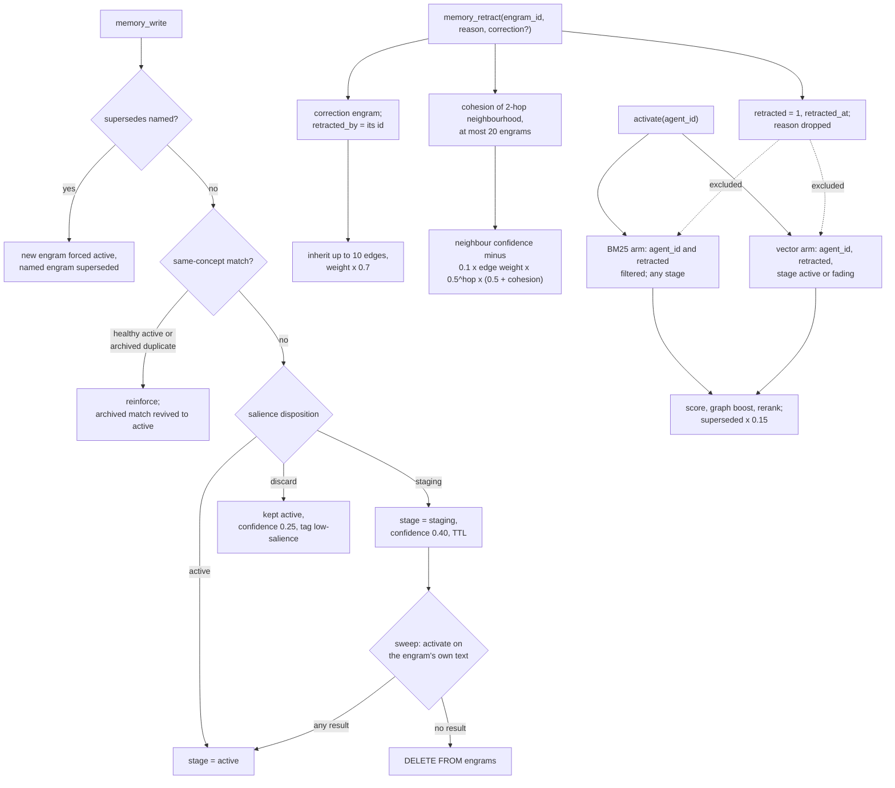

## 1. Executive Summary

AgentWorkingMemory (AWM) is a local, single-process memory service for coding
agents whose distinctive mechanism is retraction. A wrong engram is flagged and
excluded from every recall arm, a correction can take over its strong graph
edges, and its neighbours lose confidence by a penalty scaled to how tightly
their neighbourhood coheres. The weak side is the lexical arm on the default
SQLite backend, which admits staged, archived and superseded rows and cuts its
candidate window before the agent and retraction filters apply.

It runs on SQLite by default, with PGlite or Postgres selected by environment,
downloads three small ONNX models once, and needs no API key. Agents reach it
through an MCP server and a Claude Code plugin whose hooks checkpoint on
compaction and prime each prompt with recalled memories.

**The retraction module starts from a critique it quotes against itself.** The
header of `src/engine/retraction.ts` records it:

> "You need explicit anti-salience for wrong info. Otherwise wrong memories
> persist and compound mistakes."

It then cites the Continued Influence Effect (Carrillo et al., ICCM 2025) for the
claim that misinformation persists as a coherent narrative, and translates that
into one number. `computeNeighborhoodCohesion` walks the two-hop neighbourhood,
capped at 20 engrams, and scores it as graph density times a tag-overlap factor
(`src/engine/retraction.ts:217-310`). The contamination penalty on each
neighbour is then multiplied by `0.5 + cohesion`, so a dense cluster with shared
tags takes up to 1.5 times the base penalty and a sparse one half of it
(`:333`).

The docstring names a third regime, a cross-domain bridge whose weight is
reduced while the far side is spared, and it has no code. The propagation
writes confidence and no edge weight, and it applies one multiplier computed at
the source (`:33-34` against `:319-363`).

**The second thing worth taking is a metric**, section 10's `discardRegret`:
writes the salience filter would have discarded are kept, tagged
`low-salience`, and counted when something later reads them.

**The project grades its own numbers.** `docs/claims.md` lists every published
figure with what produced it and whether a stranger can reproduce it, and opens
its token-economics row with "it is the weakest claim on the page". Its
retrieval caveat says the ranker "never considers staged, retracted or superseded
rows", which the code supports for retracted rows only (section 6).

## 2. Mental Model

A memory is an engram, and an engram's standing is three separate things: a
**stage** (`active`, `staging`, `fading`, `archived`), a **retracted** flag, and
a `superseded_by` pointer. Only the flag is a belief state. Stage records how
established the engram is, and supersession records that it was replaced by
something newer without being wrong.

**Admission is scored, not decided.** Every write gets a salience score and a
disposition. `active` lands in recall. `staging` lands with a TTL and confidence
0.40, waiting for a sweep to decide whether it resonates with active memory.
`discard` is kept as well, at confidence 0.25 and tagged `low-salience`, which is
what makes discard regret measurable (`src/core/write-pipeline.ts:522-595`).
An explicit `memory_class: canonical` skips the filter. So does content opening
with an operator-configured stakeholder name followed by a verb such as "said",
a detector that ships empty and is off until `AWM_FEEDBACK_NAMES` is set
(`src/core/salience.ts`).

**A repeated fact reinforces instead of duplicating.** A write whose concept
matches a healthy active engram raises that engram's confidence. A match that
consolidation archived as a near-duplicate is reinforced and flipped back to
`active` (`src/core/write-pipeline.ts:299-316`). When the caller names the engram
a write replaces with `supersedes`, reinforcement is skipped and the new engram
is forced to `active`, so the replacement cannot land weaker than the fact it
retires (`:181`, `:325-340`).

**A belief stops being one in two ways.** Supersession, by id or by concept
match, leaves the old engram recallable at 0.15 of its score. Retraction is for
wrongness. The flag excludes the engram from recall and an `invalidation` edge
links the correction to it. The correction inherits up to ten of the retracted
engram's edges of weight 0.4 or more, at 0.7 of their strength, and the
cohesion-weighted penalty spreads to the neighbours.

**Forgetting is several mechanisms.** Decay lowers activation with age and
access. Consolidation archives the unused and fades the content of
idle-but-accessed engrams to 150 characters, never an unfinished task's body
(`src/engine/consolidation.ts:562`). The staging sweep and consolidation both
hard-delete staged engrams that never resonated.



## 3. Architecture

`src/core` holds the write side and the scoring helpers: `salience`,
`write-pipeline`, `embeddings`, `hebbian`, `decay`, `query-expander`,
`reranker`, `token-budget`, `recall-telemetry`. `src/engine` holds the
lifecycle: `activation`, `connections`, `consolidation` and its scheduler,
`eviction`, `staging`, `retraction`, `eval`. `src/storage` implements one
`IEngramStore` over `better-sqlite3` with FTS5, PGlite with pgvector and
tsvector, and Postgres, chosen by `AWM_STORE_BACKEND` or by what is on disk
(`src/storage/factory.ts:45-93`).

The engram table carries everything; associations, episodes, entity mentions
and aliases, checkpoints (`conscious_state`) and three event tables sit beside
it. A coordination layer for multi-agent setups adds `coord_*` tables for
agents, assignments, locks, mailboxes and decisions.

### Deployment and ergonomics

`npm install -g agent-working-memory && awm setup --global`, or the Claude Code
plugin, which shares `~/.awm/memory.db`. Nothing else has to run. Three ONNX
models download on first use: a bge-small embedder, a MiniLM cross-encoder
and flan-t5-small for query expansion. Recall falls back to BM25 alone when the
embedder is unavailable. No API key is needed to store or recall anything. The
HTTP API binds to loopback and refuses a non-loopback bind without
`AWM_API_KEY` (`src/index.ts:44-57`). The store is a single SQLite file,
readable with any SQLite client.

## 4. Essential Implementation Paths

**Write** — `memory_write` (`src/mcp.ts:234`) to `performWrite`
(`src/core/write-pipeline.ts:167`): salience, the reinforcement branches R1,
R1b, R2 and R3, then `createNewEngram` (`:520-600`).

**Recall** — `memory_recall` (`src/mcp.ts:398-448`) to
`ActivationEngine.activate` (`src/engine/activation.ts`): workspace resolution
`:228-230`, two BM25 passes `:315-317`, the vector arm `:379`, opt-in entity
paths `:435-530`, graph walk `:932-937`, supersession penalty `:1140-1145`,
confidence abstention after it.

**Session start** — `memory_restore` (`src/mcp.ts:769-931`): the checkpoint, the
last-written engram by id `:801`, a recall over the last context `:815-826`,
and consolidation when the agent was idle.

**Prompt priming** — `/hooks/prime` in `src/hooks/sidecar.ts:279-300`, wired to
`activate` with the server's `AGENT_ID` at `src/mcp.ts:1375-1382`.

**Retract** — `memory_retract` (`src/mcp.ts:584-615`) and `POST /memory/retract`
(`src/api/routes.ts:386-404`) to `RetractionEngine.retract`
(`src/engine/retraction.ts:66-125`): the flag `:79`, the correction and its
`invalidation` edge `:85-104`, `inheritNarrativeEdges` `:161-198`,
`computeNeighborhoodCohesion` `:217-310`, `propagateConfidenceReduction`
`:319-363`.

**Supersede** — `memory_supersede` (`src/mcp.ts:617-659`), the `supersedes`
argument on `memory_write`, and Form B on `POST /memory/supersede`. Form B
finds the newest active same-concept engram, then writes and supersedes inside
`withTransaction` (`src/api/routes.ts:465-500`, `src/storage/sqlite.ts:1099-1124`).

**Stage** — `StagingBuffer.sweep` (`src/engine/staging.ts:46-73`) on a timer in
both servers, and the staging sweep phase of consolidation
(`src/engine/consolidation.ts:778-802`).

**Measure** — `EvalEngine.computeMetrics` (`src/engine/eval.ts:28-108`), surfaced
by `memory_stats` and the HTTP metrics route.

## 5. Memory Data Model

An engram separates `concept` from `content`; supersession and reinforcement
match on the concept, case-folded and trimmed. It carries `salience`,
`confidence`, `tags`, `access_count`, `stage`, `memory_class`, `superseded_by`,
task fields, `origin_class`, `writer_session`, and `retracted`, `retracted_by`,
`retracted_at`.

`retracted_by` is a pointer, not an actor. `retract` writes null, then
overwrites it with the correction engram's id when the caller supplied
correction text (`src/engine/retraction.ts:79`, `:104`). No MCP tool or HTTP
route accepts the field; only `awm import` copies one from an import file
(`src/cli.ts:575`, `:736`). The `reason` that `memory_retract` requires is passed
into the engine and read by nothing, so why a memory was retracted is not
stored.

`valid_from` and `valid_to` are caller-supplied ISO dates on `memory_write`,
described as "temporal validity, not ingestion time" (`src/mcp.ts:282-285`).
Recall output renders `[valid until …]` (`src/core/format-recall.ts:21-22`,
`src/hooks/prime.ts:89`). No read path filters on either field, and nothing
expires an engram whose `valid_to` has passed. The installed guidance tells the
agent to set it "so the memory expires" (`src/adapters/common.ts:497-503`).

Optional `project`, `topic`, `source` and `session_id` arguments become prefixed
tags (`proj=`, `topic=`), so their quality depends on the agent supplying them.
`client=` is stamped from `AWM_CLIENT`, set by the launcher rather than the
caller (`src/core/write-pipeline.ts:537-552`).

## 6. Retrieval Mechanics

`activate` gathers candidates from two arms and merges them. The **lexical arm**
runs BM25 twice, once on the keyword-stripped query and once on the expanded
one. The **vector arm** takes the top 50 or more by cosine above a floor of 0.40
for targeted queries and 0.30 for exploratory ones. Scoring combines text
match, vector match, an ACT-R-style decay term, a Hebbian term and confidence.
A default-on graph walk adds a bounded boost to candidates already in the pool,
and a cross-encoder reranks the top of the list.

**By default, agent scope is in the SQL on both arms.** Every recall path calls
`activate` with `AGENT_ID` from the environment, and the lexical and vector
queries filter `agent_id` (`src/storage/sqlite.ts:706`, `:914`, `:539`).

**The model can lift that scope with one argument.** `memory_recall` declares
`workspace` as an optional tool parameter and resolves it as
`params.workspace ?? AWM_WORKSPACE` (`src/mcp.ts:419`, `:435`). `activate` then
widens the agent set to every name `coord_agents` lists under that workspace
(`src/engine/activation.ts:228-230`, `src/storage/sqlite.ts:724-728`). Nothing
checks that the calling agent belongs to the workspace it names, and agents
register themselves into a workspace through the coordination routes. The
parameter arrived in v0.7.0
([`0f198b6d2741b3ddecc332be7973151ef8c1f583`](https://github.com/CompleteIdeas/agent-working-memory/commit/0f198b6d2741b3ddecc332be7973151ef8c1f583)).

**The retracted flag is excluded on both arms and on every injection path.**
The same clauses carry `retracted = 0`, and the opt-in entity fetches and graph
injection re-check it in the engine (`src/engine/activation.ts:459`, `:519`,
`:1640`).

**Stage is read only by the vector arm.** The vector slim fetch takes `active`
and `fading` (`src/storage/sqlite.ts:854-855`). The FTS5 index is maintained by
triggers on every insert and update regardless of stage
(`src/storage/sqlite.ts:254-263`), and neither BM25 query filters stage or
`superseded_by`. Staged, archived and superseded engrams therefore enter the
lexical arm, superseded ones down-ranked to 0.15. `memory_recall` exposes
`include_staging`, default false, and passes it into the query object, where no
engine code reads it. A comment in the write pipeline states the archived case
outright: "archived != excluded from search".

**On SQLite the lexical arm filters after its window.** Both BM25 queries take
the top `max(limit × 5, 50)` FTS matches first and apply `agent_id` and
`retracted` to that window afterwards (`src/storage/sqlite.ts:699-709`,
`:907-918`). The inline comment records a 567-fold speedup and accepts the cost
for a "single agent dominant, low retracted rate" store. Another agent's rows
and retracted rows matching the same words consume a caller's window, so on a
shared database a LIMIT does not mean the same thing to every agent. PGlite and
Postgres put both predicates in the WHERE clause before the LIMIT
(`src/storage/pglite.ts:601-636`).

**Two reads do not apply the flag.** The store's `search`, documented as
"Diagnostic search (deterministic, not cognitive)", adds the retracted clause
only when the caller passes one (`src/storage/sqlite.ts:930-951`), and
`POST /memory/search` passes the field through untouched
(`src/api/routes.ts:508-539`). And `memory_restore` fetches the last-written
engram by id and prints it under **Last write** without reading the flag
(`src/mcp.ts:801`, `:891`). An engram written and then retracted in one session
is the first thing the next session is shown.

**Abstention distinguishes withheld from absent.** When the shape of the score
distribution falls below `require_confidence` (default 0.05), recall returns
nothing and the reply says `RECALL ABSTAINED` with how many were withheld. The
tool description argues the default from measured cost in both directions.

## 7. Write Mechanics

Writes are synchronous and local: salience is a rule-based score, the embedding
is computed in a worker, and nothing calls a hosted model. Onboarding is the
one extraction step, and it produces a file rather than writes (section 8).

**Correction has two shapes.** Supersession is for obsolescence. By id it
requires both engrams to exist and writes `superseded_by`, a `causal` edge, and
the old engram's confidence times 0.4 floored at 0.2. By concept, Form B does
the lookup and the write in one transaction, and the match excludes
superseded, retracted and non-active engrams (`src/storage/sqlite.ts:1099-1124`).
Retraction is for wrongness and carries the propagation in section 2.

**Neither checks ownership.** `memory_retract` and `memory_supersede` take an
engram id, load it by id, and act on it without comparing its `agent_id` with
the caller's (`src/engine/retraction.ts:73-79`, `src/mcp.ts:633-646`). In a
shared store an agent can retract or supersede another agent's memory if it
holds the id, and workspace recall returns ids.

**Nothing is keyed on a retracted value.** The flag marks a row. A later write
of the same content is a new engram, and the concept match that would reinforce
it skips retracted rows, so the wrong fact can be re-learned at full strength.

**Staged engrams are judged against their own text.** The sweep activates on
the staged engram's concept and content and promotes it on any result
(`src/engine/staging.ts:53-63`). The query is not told to exclude that engram,
and the lexical arm admits staged rows, so the engram is a candidate for its
own resonance check. Whether it clears `minScore: 0.3` against itself was not
established; no committed test calls `sweep`.

### Operational cost

The write path blocks on salience, one BM25 novelty check and an embedding.
Recall is local; the project's own profile puts the cross-encoder at 78% of a
warm recall (`docs/recall-latency.md`), which is why `limit` defaults to 3 and
sizes the rerank pool. The prompt hook injects up to eight compact results under
a token budget on every prompt. Consolidation runs on idle, and on restore after
more than five idle minutes, over the agent's whole active set.

## 8. Agent Integration

The MCP server registers 19 tools: write, recall, feedback, retract, supersede,
whoami, stats, checkpoint, restore, two onboarding tools, six task tools, and a
compress and retrieve pair for tool output. `AWM_INCOGNITO=1` registers none.
The agent decides when to write and recall. The plugin's `Stop` hook prints a
reminder to do both, `PreCompact` and `SessionEnd` checkpoint, and
`UserPromptSubmit` primes the prompt through the sidecar.

`onboard_scan` returns candidate memories from a project's docs to the agent,
which saves the ones it keeps with `memory_write`. The CLI form, `awm onboard`,
writes a pack and a review file for a person to edit before `awm import`
(`src/cli.ts:860-873`). That is an import-time edit, not a state memories wait
in.

## 9. Reliability, Safety, and Trust

**Trust state — awarded.** `retracted` is a discrete field that withholds an
engram from being treated as true without deleting it, and both recall arms
exclude it in SQL on all three backends. The two qualifications are the
diagnostic `search` and `memory_restore`'s **Last write**, both in section 6.

**Scope enforced — withheld.** The default read is agent-scoped in SQL on both
arms, and the agent can widen it by passing `workspace` to `memory_recall`,
which reads every agent registered under the name it supplies with no
membership check (section 6). That holds at `6b04ba62ac50b3123ab69a3fda2679da9ae9e611`
as well: the parameter at `src/mcp.ts:419`, its resolution at `:435`, the widening at
`src/engine/activation.ts:208-209` and the membership query at
`src/storage/sqlite.ts:673-677`. An isolation the caller can lift by an argument
does not earn the mark, however the default reads. Writes are unchecked too:
retract and supersede act across agents (section 7), and the HTTP API takes
`agentId` from the request body behind an optional bearer token.

**Negative eval — awarded**, per section 10.

**Audit log — withheld.** Three production paths run `DELETE FROM engrams`: the
staging sweep, consolidation's staging and forget phases, and eviction over the
staging budget (`src/engine/staging.ts:67`, `src/engine/consolidation.ts:665`,
`:800`, `src/engine/eviction.ts:48`). Retraction, supersession, fading and
confidence changes are updates in place. `activation_events` and
`retrieval_feedback` record reads. `staging_events` is created and read by
`getStagingMetrics`, and `logStagingEvent`, its only writer, has no caller. The
activity file `awm.log` is appended by some tools, among them supersede, write
and recall, and not by retract or any delete. It lives beside the store rather
than in it.

**Bitemporal — withheld.** `valid_from` and `valid_to` are set by the caller
independently of `created_at`, so the valid-time axis can precede the row, and
no read path queries either (section 5).

**Tombstone — withheld** (section 7). **Human review — withheld**: no memory
waits in a state, and the agent holds `memory_write` (section 8).

**The store used to live where an upgrade deletes it.** Until 0.15.8, `awm setup`
defaulted the database to `<packageRoot>/data/memory.db`, inside the installed
package, which `npm install -g …@latest` replaces. The default is
`~/.awm/memory.db`, the path the plugin and desktop launchers used. Re-running
setup copies an in-package store and its `-wal` and `-shm` sidecars to the safe
path and leaves the original in place (`src/adapters/common.ts:29-31`,
`:180-200`). The fix commit gives the reason it shipped: every container
assertion passed `--db-path` explicitly, so nothing exercised the default.

**The contamination penalty is the risk to watch.** Amplifying a penalty across
a dense cluster is the right direction, and the 0.5 and 1.5 bounds are a formula
choice, not a fit. `tests/engine/coherence-retraction.test.ts` asserts the
ordering, that a coherent cluster loses more confidence than a loose one, and
nothing measures whether the engrams it penalised were wrong. A mistaken
retraction propagates furthest where memory is most connected, and the reason
for it is not recorded.

## 10. Tests, Evals, and Benchmarks

**`tests/integration/memory-lifecycle.test.ts:190-232` earns `negative_eval`**
with both polarities on one activation:

```typescript
const foundRetracted = results.find(r => r.engram.id === wrong.id);
expect(foundRetracted).toBeUndefined();
const foundCorrection = results.find(r => r.engram.id === result.correctionId);
expect(foundCorrection).toBeDefined();
```

The correction is the positive control: an activation that returned nothing
fails the test.

The case beside it, `'excludes retracted by default in search'` (`:343-357`),
does not test the default. It passes `retracted: false` explicitly, and the
default it names returns retracted rows (section 6).

The agent-isolation case (`:384-406`) asserts that every result for agent A
belongs to agent A, which an empty result satisfies. No committed test asserts
that staged or archived engrams stay out of recall, or that a second agent's
rows cannot crowd the SQLite window.

**`src/engine/eval.ts` measures four dimensions**, and one is worth stealing:

```typescript
discardRegret: activeEngrams.filter(e =>
  e.tags.includes('low-salience') && e.accessCount > 0).length,
```

Discard regret counts the near-discards later accessed. It is the
false-negative rate of a write filter, which most systems cannot see because
the rejected material is gone. `memory_stats` reports it and nothing feeds it
back. The staging-accuracy dimension beside it computes promotion precision
from `staging_events`, which nothing writes, so it reports zero. The header
defers task impact to `TaskTrial` records; `TaskTrial` is a type with no
producer in the tree.

**The benchmark documentation grades itself.** `docs/claims.md` rates each
published number Public, Method public, Maintainer only or Not reproducible.
The headline retrieval figures run on a private store snapshot, and
`npm run bench:public` runs the same runner and hold-out code over a synthetic
corpus committed as `tests/realstore-eval/fixture-public.json`. LoCoMo and
LongMemEval harnesses are in `tests/`. The project retired LoCoMo in 0.13.x on
the argument that it rewards indiscriminate retention, which a salience filter
is built to refuse.

**I ran nothing.** No suite, benchmark or eval runner was executed for this
reading.

## 11. For Your Own Build

### Steal

- **Propagate a retraction past the fact.** Lower the confidence of what was
  connected to it, and scale the penalty by how tightly that neighbourhood
  coheres; correcting one node leaves everything inferred from it intact.
- **Bound the propagation and say so.** Twenty engrams, two hops, one batched
  fetch, computed at retract time with no schema change.
- **Let the correction take the wrong memory's place.** Inheriting the
  retracted engram's strong edges puts the correction where recall used to
  reach the wrong fact.
- **Keep near-discards and count discard regret.** Tag what the salience filter
  would have dropped and count how often it is later used.
- **Pair every must-not-retrieve assertion with a must-retrieve one** on the
  same result, so an empty answer fails.
- **Let an explicit `supersedes` outrank inference.** When the caller names the
  engram a write replaces, skip reinforcement and force the replacement active,
  or the correction lands weaker than the fact it retires.

### Avoid

- **Do not put a scope-widening argument on the agent's own tool.** A
  `workspace` parameter the model may pass, resolved without a membership
  check, makes agent isolation a default the agent can turn off.
- **Do not filter after a shared LIMIT.** A prefilter that cuts the index window
  before the tenant and status predicates trades correctness for speed on
  exactly the stores that have more than one tenant.
- **Do not let a stage exist on one arm only.** If the vector arm reads stage
  and the lexical arm does not, staging is a ranking hint, and a recall flag
  that names it needs a reader.
- **Do not drop the reason for a correction.** A required `reason` that nothing
  stores invites the agent to write one and leaves no record of it.
- **Do not let the session-start assembler bypass the recall predicates.** A
  context block built by id skips every status filter the search path carries.
- **Do not ship a docstring regime the code does not implement.** The
  cross-domain bridge reads as a third behaviour and is one multiplier.

### Fit

A fit for one developer's local coding agent that should forget as well as
remember: salience, staging, decay, fading, eviction and retraction form a
coherent set of forgetting mechanisms. A shared database for several agents is
a poor fit: any agent can widen its recall to a workspace it names, the SQLite
candidate window is shared, and writes cross agents unchecked. Anyone who needs
to explain later how memory reached its state should look elsewhere: deletes
are hard and corrections are updates in place.

## 12. Open Questions

- **Does a staged engram resonate with itself?** The sweep's query admits the
  engram it is judging; whether its score clears 0.3 against its own text, and
  so whether every staged engram is promoted, needs a run.
- **Were the cohesion bounds tuned?** 0.5 and 1.5 come from the formula
  `0.5 + cohesion`; no measurement of either is in the tree.
- **How large is the SQLite window loss in practice?** It depends on how many
  agents share a database and how many rows are retracted; nothing in the tree
  measures it.
- **Can associations cross agents?** Hebbian strengthening links engrams
  co-activated in one recall, and workspace recall mixes agents. If such edges
  form, a retraction's penalty reaches another agent's engrams. Not traced.

## Appendix: File Index

| Path | What to read it for |
| --- | --- |
| `src/engine/retraction.ts:3-37` | The critique, the four steps, the Continued Influence Effect derivation and the cost bound |
| `src/engine/retraction.ts:66-125` | `retract`: flag, correction, edge inheritance, cohesion, propagation |
| `src/engine/retraction.ts:217-363` | Cohesion score and the `0.5 + cohesion` multiplier |
| `src/engine/activation.ts:228-380` | Workspace resolution and the two candidate arms |
| `src/engine/activation.ts:1140-1145` | The supersession down-rank |
| `src/storage/sqlite.ts:683-739` | Multi-agent BM25 with its FTS prefilter, and workspace membership |
| `src/storage/sqlite.ts:845-951` | Vector slim fetch, single-agent BM25, and the diagnostic `search` |
| `src/storage/sqlite.ts:254-263` | FTS5 triggers, maintained regardless of stage |
| `src/core/write-pipeline.ts:167-345` | Reinforcement branches and the `supersedes` gate |
| `src/engine/staging.ts:46-73` | The staging sweep and its hard delete |
| `src/engine/eval.ts:28-108` | Metrics, `discardRegret`, and the staging precision that reads an unwritten table |
| `src/mcp.ts:584-659` | `memory_retract` and `memory_supersede` |
| `src/mcp.ts:769-931` | `memory_restore`, including **Last write** |
| `src/adapters/common.ts:29-31`, `:180-200` | The in-package store rescue |
| `tests/integration/memory-lifecycle.test.ts:190-232` | The paired retraction case |
| `tests/engine/coherence-retraction.test.ts` | Cohesion ordering and edge inheritance |
| `tests/core/supersedes-dropped-on-reinforce.test.ts` | The `supersedes` gate and the forced-active replacement |
| `docs/claims.md` | Every published number with its reproducibility rating |

### Recorded searches

Run at the tree root of the pinned checkout with `git grep`; each returned the
same at `6b04ba62ac50b3123ab69a3fda2679da9ae9e611`.

- `git grep -n -E 'logStagingEvent\(' -- src ':!src/storage'` — no match; the staging event table has no writer.
- `git grep -n -E 'includeStaging' -- src/engine src/core` — no match; the recall flag has no reader.
- `git grep -n -E 'retractEngram\(' -- src ':!src/storage'` — `src/engine/retraction.ts:79`, `:104` and the import path `src/cli.ts:575`, `:736`.
- `git grep -n -E '\.reason\b' -- src/engine/retraction.ts` — no match; the retraction reason is never read.
- `git grep -n -i 'bridge' -- src/engine/retraction.ts` — the docstring at `:33-34` only.
- `git grep -n -E 'validTo|valid_to' -- src/engine` — no match; no lifecycle path reads the validity window.
- `git grep -n -E 'TaskTrial'` — the type at `src/types/eval.ts:90` and the comment at `src/engine/eval.ts:12`.
- `git grep -n -E 'target\.agentId|oldEngram\.agentId' -- src` — `src/api/routes.ts:454` (an activity touch) and `src/storage/sqlite.ts:1956`; neither is an ownership check.
- `git grep -n -E 'DELETE FROM engrams' -- src` — one per backend, called from staging, consolidation and eviction.
- `git grep -n -i -E 'tombstone|blocklist|denylist' -- src` — no match.
- `git grep -n -i -E 'approv' -- src/mcp.ts src/api/routes.ts src/storage` — no match.
- `git grep -n -E 'sweep\(' -- '*.test.ts'` — no match.
- `/usr/bin/grep -n -i -E 'anthropic|machine learning|not (be )?used (for|to)' LICENSE NOTICE` — one hit, the NOTICE heading listing runtime model licences; no rider.

## History

**2026-10-15** — [`eb56cb353dae2e7f00c2e45b41d27ffc1f1198bc`](https://github.com/CompleteIdeas/agent-working-memory/commit/eb56cb353dae2e7f00c2e45b41d27ffc1f1198bc) — 44 commits on, 0.15.8 to 0.17.0. `scope_enforced` is withdrawn, wrong at the old pin too: `memory_recall` takes a `workspace` argument that widens recall to every agent registered under it, unchecked ([section 9](#9-reliability-safety-and-trust)). `trust_state` and `negative_eval` hold on byte-identical code. Overtaken: `supersedes` was dropped whenever reinforcement fired, archived duplicates could never be reinforced, fading cut unfinished task bodies, and the feedback detector shipped a staff name list ([section 2](#2-mental-model)). Eight claims were wrong at the old pin and are listed in the appendix's Known Limitations. The first entry's commit link pointed at the second reading's commit. Screened from a full clone: one plugin manifest, one `prepublishOnly` script, 14 floating ranges under a lockfile, both manifests inside the cooldown, `AGENTS.md` read as data. Nothing was installed, built or run.

**2026-09-19** — [`6b04ba62ac50b3123ab69a3fda2679da9ae9e611`](https://github.com/CompleteIdeas/agent-working-memory/commit/6b04ba62ac50b3123ab69a3fda2679da9ae9e611) — `trust_state` re-tested at an unchanged pin. Every anchor held, with a line-number correction: the pglite exclusions are at `:329`, `:347`, `:370`, `:399`, `:509`, `:538`, `:565`, `:584`, `:672` and `:695`, not the `:326`-`:577` set section 4 listed. The mark stands and is stronger than recorded — the clause appears fourteen times in each of the three backends, pglite, postgres and sqlite, which agree with one another, and it is composed into the SQL rather than applied to the rows afterwards, so a `LIMIT` means the same thing to every caller.

The record said *every* read path appends it. One does not: `search`, documented as *diagnostic / structural* rather than cognitive, opens on `agent_id` alone and adds the retracted clause only when the caller supplies one (`pglite.ts:593-613`, `postgres.ts:692-695`, `sqlite.ts:879-882`). Three independent backends omit it in the same place, so it is a decision — but the HTTP search route passes `retracted` straight through (`src/api/routes.ts:525-539`), so a client that leaves the field out gets retracted engrams back from a public endpoint. Second qualification: `retracted_by` is whatever string the caller passes, and the engine's own retraction path passes `null` (`src/engine/retraction.ts:79`), so the field records an assertion rather than a verified actor — which is why it bears on `human_review`, withheld here, and not on this mark. Re-read from a fresh clone; nothing was installed and no suite was run.

**2026-09-16** — [`6b04ba62ac50b3123ab69a3fda2679da9ae9e611`](https://github.com/CompleteIdeas/agent-working-memory/commit/6b04ba62ac50b3123ab69a3fda2679da9ae9e611) — re-read after 42 commits, at 0.15.8. The lifecycle integration test is byte-identical, and `src/storage/pglite.ts` changed only below line 1020 — percentile stats and a linked-feedback query — so the `retracted` predicate and the agent-scoped read at `:323` and `:329` are exact at both commits and all three marks hold unchanged. What the window contains is a data-loss fix, written up in section 9: the default store path was inside the installed npm package, where `npm install -g` deletes it on upgrade. The report carries it because where a memory store puts its file is a durability property of the memory system, and because the reason it shipped — every test passed `--db-path` explicitly, so the default was never exercised — is the generalisable half. The provenance tag `surface=` was also renamed to `client=`. Re-screened at this commit: one auto-run surface, one build-time execution path, one floating version, one manifest inside the cooldown. Nothing was installed, built or run.

**2026-09-09** — [`ed854014eae66d2960f50083f92dc9e04d2c93da`](https://github.com/CompleteIdeas/agent-working-memory/commit/ed854014eae66d2960f50083f92dc9e04d2c93da) — second reading, 51 commits on at `0.14.1`: 140 files, 37,891 insertions. Screened before reading: no auto-run surface, one build-time execution point, one unpinned surface with a lockfile 17 days old; nothing was installed and no suite was run.

The mechanism is untouched. `src/engine/retraction.ts`, `staging.ts` and `eval.ts` are byte-identical to the previous pin, and `src/storage/pglite.ts` moved by fourteen lines. All three marks hold on the same code, re-anchored, and the report gains the `capability_evidence` block it was written before. That block includes the observation that the negative case is paired: a retracted engram must not activate, asserted in the same populated result as a positive on the correction that replaced it, so an empty activation fails the test rather than passing it.

The reading's substance is elsewhere, and it is the benchmarks document. `docs/benchmarks.md` now carries a results table in which the project grades three of its own gauntlet runs **NULL**, with the reason attached to each: a re-run whose "baseline arm not retained"; a run at k=10 where "6/10 probes flip between identical runs", graded "NULL — fix probe determinism, not k". The completed two-arm run reports +7.0pp with Fisher exact two-tailed p = 0.31, and states its own epistemic status in a sentence this atlas has been asking for: *"Read it as consistent with the retrieval gains converting end-to-end, not as evidence that they do."* A per-probe table sits under it, including the one probe that got worse.

The commit log carries the same posture. `docs: both gauntlet arms complete — +7.0pp (p=0.31), and the multihop claim was wrong` retracts a claim the project had made about itself; this report never repeated it, so nothing here needed correcting.

One change is worth adopting rather than only recording. `0.14.1` distinguishes **withheld** from **absent** on the recall path. A bare empty array had been read as "no such memory" for candidates scoring 0.268 to 0.295 — well above the 0.05 floor that governs individual relevance — so recall now invokes an `onAbstain` callback carrying the reason, the candidate count, the top score, the confidence and the threshold. The tool description argues the default from measured cost in both directions: 0.05 "halves the rate of answering off-topic queries at zero cost to hit rate", and raising it is harmful because a miss sends the agent to read the codebase instead at roughly 2,106 tokens, so "0.20+ cut net tokens saved by 25%". `tests/engine/abstention-reporting.test.ts` is 137 new lines behind it.

**2026-08-09** — [`f129a697982c81efd6d488152408a586d7f5f4b0`](https://github.com/CompleteIdeas/agent-working-memory/commit/f129a697982c81efd6d488152408a586d7f5f4b0) — first reading. Screened before reading; the tree was read, never installed, and no test was run.
