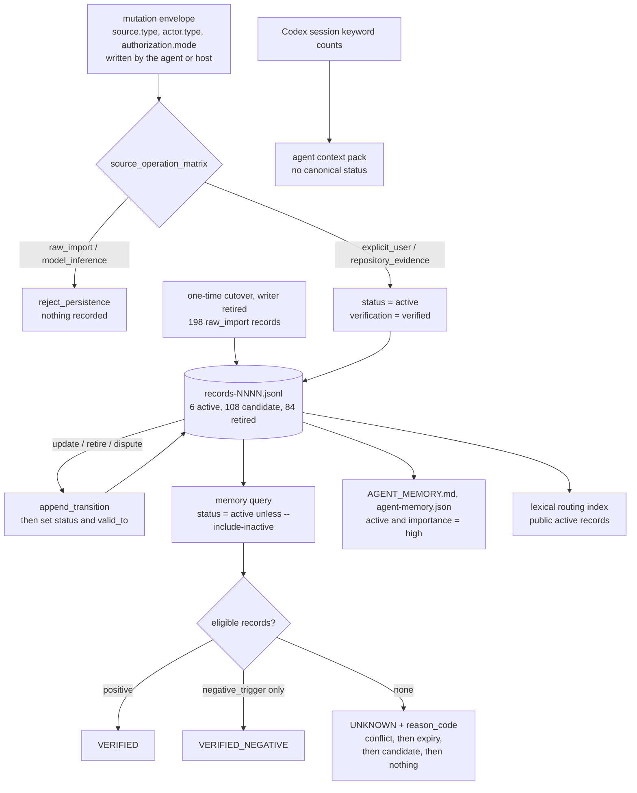

## 1. Executive Summary

AgentDatabase is one person's data warehouse for their own agents, and its
memory runtime under `OpenAIDatabase/` is a canonical store of sharded JSONL
records driven by a CLI. What is notable is the read side's epistemics: a
status that keeps candidates, disputes and retirements out of answers, two
time axes the CLI queries separately, and an abstention that returns
`UNKNOWN` with a reason code. What is weak is that none of the lifecycle has
run on the live data, the admission gate trusts a source label the writing
agent supplies, and the benchmark scores a ranker that is not the store's
query path.

The repository carries no licence file for its own code, so the default is
all rights reserved; the licence-named files in the tree belong to vendored
skills and one vendored release. Documentation is largely in Chinese. The
README calls the live `data/` directory *"活运行态"*, running state rather than
a fixture.

**The record schema is wide and every field is typed.** One memory carries
`statement`, `kind`, `status`, `scope {type, key}`, `valid_time {from, to}`,
`recorded_time {recorded_at, recorded_by, transitions}`, `source {type, ref,
observed_at, evidence_hash}`, `sensitivity {classification,
credential_present, handling, public_repository_allowed}`, `conflict {state,
with, resolution}`, `supersession {supersedes, superseded_by, reason}`,
`verification`, a `memory_key`, `negative_triggers`, and a content `hash`
with its canonicalization named, `openai-memory-json-v1`.

**Three mechanisms carry the report.** Abstention is an answer:
`retrieval_decision` returns `VERIFIED`, `VERIFIED_HISTORICAL`,
`VERIFIED_NEGATIVE`, `VERIFIED_WITH_NEGATIVE_BOUNDARY` or `UNKNOWN`, and an
`UNKNOWN` comes with one of `unresolved_conflict`, `retired_or_expired`,
`candidate_or_unverified` or `insufficient_evidence` and the
`missing_conditions` that would have permitted an answer. A claim can be
disputed without being adjudicated: `disputed` takes it out of answers and
decides nothing. And the 160-case gold set carries `expected_ids`,
`forbidden_ids`, `hard_negative_ids`, `should_abstain`,
`stale_or_retired_trap` and an `as_of` naming both time axes, with
abstention and forgetting categories, twenty cases each.

**Two findings cut the other way, both from the repository's own data.**
All 198 live records have `source.type: "raw_import"` and
`recorded_by: "importer"`, a source the mutation policy refuses for every
operation, because the store was filled by a one-time cutover that predates
the policy. Nothing has superseded anything, no conflict has been raised, and
no record carries a transition. And the committed gold reports show 1.0 on
all eight categories for `deterministic_eligible_scope_alias_ranker.v1`,
which is `predict` in `scripts/evaluate_memory_gold_benchmark.py:226`: a
filter on scope, alias, authorization, verification, status and validity
over a two- or three-row state per case, written in a schema the canonical
store does not use. The store's own `query_records` is never called by it.

## 2. Mental Model

A claim becomes a durable memory by passing an admission matrix indexed by
the source type the mutation envelope declares. `explicit_user` and
`repository_evidence` may add, update, retire and dispute; `raw_import` and
`model_inference` map to `reject_persistence` for all four. The declaration
is a string: `explicit_user` must arrive with actor type `user_via_agent`
and authorization mode `explicit_user_zero_human`, and the documented host
flow has the agent convert a user command such as `记住：<fact>` into that
envelope itself. What the gate refuses is an envelope that says it holds an
inference (`scripts/memory_mutation.py:243-256`).

An admitted `add` or `update` enters as `active` and `verified`
(`scripts/memory_mutation.py:367`, `:381`). There is no verb that promotes a
`candidate` and none that resolves a `disputed` record, so the 108 candidates
from the cutover can become answerable only as a new record.

A memory stops being a belief by transition, never by deletion. `retire` sets
the status, closes `valid_time.to` and appends a transition row; the
forgetting policy names the semantics, `"retirement_semantics":
"retrieval_exclusion_not_history_deletion"`. `dispute` moves a record to
`disputed` with `conflict.state: unresolved`, which every current read
excludes, so a contested claim stops answering without anyone deciding who
was right. An `update` retires its target with a transition, points
`superseded_by` forward and writes the successor with `supersedes` naming the
old record.

When nothing survives eligibility, the read says why. The abstention branch
checks the excluded counts in a fixed order in code, so a conflict outranks
an expiry, which outranks an unverified candidate, which outranks nothing
found (`scripts/memory_forgetting.py:256-271`).

## 3. Architecture

Nothing runs as a service. The store is files:
`data/memory/records/records-0001.jsonl` and its manifest; a generated boot
view, `data/memory/AGENT_MEMORY.md` and `data/memory/agent-memory.json`;
`data/memory/active/`, which holds the 278-record legacy store the cutover
read (`scripts/plan_memory_shards.py:17`); `data/memory/candidates/` with one
file per June 2026 extraction run; `data/memory/curation/core_profile_review.json`
as the human curation layer; and `secret_refs/`, which holds references
rather than secrets.

Operating it means running Python scripts: `memory.py` for validate, build,
query, import, export, doctor, benchmark, mutate and apply; a family of
`build_memory_atlas_*` scripts and `atlasctl.py` for a derived public view.
That view, Memory Atlas, was retired on 30 September 2026: the README states
that its container, API and three timers were stopped and its code kept, and
the weekly recurring-prompt analysis lost its schedule the same day because
its source data had stopped on 10 July 2026. A dynamic-profile workflow runs
every third day and writes a derived `DYNAMIC_PROFILE.md` from three derived
files; it writes no canonical record.

Automation C is the write path for machine-authored changes, described as a
settlement protocol: a branch prefix `automation-c/memory-`, exactly one
non-draft pull request, zero issue mutations, no direct write to the default
branch, a required CI check, and a terminal state of
`PR=0/Issue=0/non-main=0`. `memory mutate --apply` refuses to run on any
other branch (`validate_transaction_branch`,
`scripts/memory_mutation.py:607`), and the transaction it builds records
`manual_approval_required: False`.

The live data directory is runtime state and a mirrored artifact at once.
`data/WHERE_IS_THE_DATA.md` tells future agents in bold not to re-upload the
mirror, records that 691 files matched by git blob sha on 2026-07-23, and
points at `data/MIRROR_STATUS.json` carrying `status:
MIRRORED_DO_NOT_REUPLOAD`. A signpost for the next agent with a
machine-readable twin is a pattern any agent-operated repository can copy.

## 4. Essential Implementation Paths

**Admission** — `validate_envelope` (`scripts/memory_mutation.py:187-334`)
against `config/memory-mutation-policy.json`. The envelope carries operation,
source, actor, authorization, target, `valid_time`, sensitivity, a reason, a
base commit and an idempotency key. The policy is read: the matrix value for
the declared source and operation decides admission, and
`source_requirements` supplies the actor type, authorization mode, allowed
scopes and whether an evidence hash is required. `validate_policy` pins two
invariants beside it, that `raw_import` and `model_inference` map to
`reject_persistence` throughout. `authorization.ref` and `source.ref` are
checked for form only (`:69-76`).

**Transition** — `scripts/memory_lifecycle.py:360-391`. `append_transition`
records the before and after of the status and the validity bound with the
actor and the reason, then mutates the record and revalidates the chain.

**Projection** — `project_record_at` and `projection_is_effective`
(`scripts/memory_lifecycle.py:394-433`). The first reconstructs status and
validity bound as of a record time by replaying transitions backwards, and
marks the audit incomplete for a retired record with no transition and no
successor; the second tests the validity interval against a valid time.

**Eligibility and abstention** — `query_records`
(`scripts/memory.py:1007-1140`) and `retrieval_decision`
(`scripts/memory_forgetting.py:224-308`). The forgetting policy file is a
declaration the code checks for drift: `validate_policy` compares each block
with a literal and raises on any difference (`:55-140`), and the behaviour it
describes is written in `query_records` and `retrieval_decision`.

**Measurement** — `scripts/build_memory_gold_benchmark.py` generates the 160
cases from a fixed seed and a config; `scripts/evaluate_memory_gold_benchmark.py`
scores its own `predict` against them and writes the reports under
`data/derived/evaluation/memory_gold/reports/`.

## 5. Memory Data Model

`sensitivity` is a four-field object: a `classification` (134 live records
are `sensitive`, 64 are `private`, none `public`), a `credential_present`
boolean, a `handling` instruction, and `public_repository_allowed`. A record
carries its own publication decision, which is what lets a derived public
view be built from it without a second policy. On the live shard every
record says `redacted_summary` and `public_repository_allowed: true`.

`negative_triggers` is on every live record and holds sentences about when
not to use it. On the live shard it is one sentence, the same on all 198:
*"Do not overgeneralize beyond the cited source and validity period."* The
CLI query returns it with the record (`scripts/memory.py:1158`); the boot
view `AGENT_MEMORY.md` renders statement, kind, confidence, scope, validity
and citation and leaves it out (`:394-447`).

`source` carries `type`, a `ref` precise enough to locate the original
inside a zip inside an export, conversation id included, an `observed_at`
and an `evidence_hash`. On the live shard `observed_at` and
`recorded_time.recorded_at` are both the cutover instant, and
`valid_time.from` is the legacy record's own date.

`hash` names its `canonicalization` beside `algorithm` and `value`, so the
content hash can be recomputed by someone else, and the boot index pins each
active record by `record_sha256`.

`kind` is enumerated in policy as `answering_rule`, `preference`,
`decision`, `project_context`, `workflow`, `security_boundary`, `fact` and
`negative_trigger`. The live store holds the first seven and none of the
eighth.

## 6. Retrieval Mechanics

The read path is a scan with filters and no embedding. `memory query`
accepts `--id`, `--key`, `--kind`, `--scope`, `--tag`, `--keyword`,
`--as-of`, `--recorded-as-of`, `--include-inactive` and `--limit`. A
`--keyword` query first builds an in-process lexical n-gram index over the
shards and, when the routing is provably complete for the keyword, scans only
its candidates (`scripts/memory.py:1268-1286`); results come back in record
order with no ranking. The boot handshake carries a second lexical index, of
public active records only, for agents that read one shard over the GitHub
Contents API with a commit-scoped ETag cache (`scripts/memory.py:502-506`,
`:631`, `scripts/memory_retrieval.py:351-502`).

**Status and validity are enforced on the read path.** With no `--as-of`,
`query_records` drops a record whose projected status is not `active` or
whose validity has closed, and counts the exclusion under the reason it will
report (`scripts/memory.py:1084-1094`). `--include-inactive` returns those
records marked `retrieval_eligible: false`, and `retrieval_decision` reports
them as audit-only and never answer-eligible. With `--as-of`, `active` and
`retired` records effective at that time answer as historical only.

**The record-time axis fails closed on the live shard.** `--recorded-as-of`
requires `--as-of`, and a matched retired record with no transition and no
successor raises `recorded_time_history_incomplete`
(`scripts/memory.py:1078-1079`, `scripts/memory_lifecycle.py:413-417`). The
84 retired imports are such records, so a record-time query that matches any
retired import refuses to answer rather than guessing when it was retired.
`tests/test_memory_lifecycle.py:255-282` asserts exactly that case.

**Scope is stored and filterable, and the caller decides it, which is why
`scope_enforced` is withheld.** `parse_scope` accepts `TYPE` or `TYPE:KEY`
and the filter applies only when `--scope` is passed; the boot view and the
routing index take no scope, and `route_lexical_index` treats scope as
optional. On the live shard the question does not bite yet: all six active
records are `global:owner`, and the 192 conversation-scoped records are all
candidate or retired.

## 7. Write Mechanics

**Writes are explicit, transactional and idempotent.** Nothing is extracted
in the background into the canonical store. A mutation is a CLI invocation
with an envelope and a `transaction_id` derived from the idempotency key;
replaying it is detected by comparing the last transition's transaction id
and returns idempotent rather than double-applying. Envelope size, statement
size and list length are capped in policy. `--apply` requires the plan's
exact base sha and idempotency key, the exact Automation C branch, and a
lifecycle assessment with no unresolved conflict or duplicate.

**An update must change something.** `normalize_statement(expected) ==
normalize_statement(target)` raises `mutation_update_has_no_new_fact`, an
update to a non-active target is refused, a second retire is refused, and a
dispute of a retired record is refused. Each refusal is a stable error code
carrying no record content.

**The store accepts one replacement path.** `write_canonical_plan` installs a
whole new shard set atomically and refuses to replace an existing store
unless the call is an admitted mutation (`scripts/memory.py:907-926`).
`memory apply` never passes that flag, so it can only bootstrap an empty
store, and the retired cutover writer's error message points at it.

**None of it has run on the live data.** Zero of the 198 records carry a
transition, a supersession or a conflict. The producers are real and sit on
a documented CLI subcommand, so this is a lifecycle attested by tests and a
synthetic benchmark rather than by any record in the store.

## 8. Agent Integration

The agent's entry point is a file. `data/memory/AGENT_MEMORY.md` lists the
six active high-importance records, and `data/memory/agent-memory.json`
holds an `active_index` of the same six, each with id, kind, confidence,
importance, scope, validity, shard and `record_sha256`, beside the lexical
routing index and the mutation, lifecycle and forgetting contracts.

`build_agent_context_pack.py` assembles a second entry point, described in
its output as the long-term memory and RAG entry for any ChatGPT, Codex or
future agent. Its memory items do not come from the canonical store. They
come from `codex_agent_recommendations.json`, written by
`sync_codex_memory_data.py`, which counts keyword hits in Codex sessions and
emits a statement from a fixed table in code whenever its count is above
zero, at `high` confidence from three hits up
(`scripts/sync_codex_memory_data.py:75-83`, `:636-690`). A session
mentioning "GitHub" counts toward *"OpenAIDatabase 是 durable memory
source"*. The committed pack holds five such items generated on 10 July
2026. None of them carries a status, a validity interval or a source type
the mutation policy would see.

There is no MCP server and no tool registry: an agent reads files and runs
the CLI. The Codex skills registry under `CodexSkills/` is a mirror and
governance ledger for local skills, procedural rather than declarative
memory, and holds most of the repository's files.

## 9. Reliability, Safety, and Trust

**Trust state, bi-temporal, audit log and negative eval are awarded**, each
on the evidence in the frontmatter records, and each holds at
[`8514923810b38b861aa308feca47f43df34f2a20`](https://github.com/LinzeColin/AgentDatabase/commit/8514923810b38b861aa308feca47f43df34f2a20)
as well: the trees under `OpenAIDatabase/scripts`, `config`, `tests`,
`data/memory` and `data/derived/evaluation` are identical at both commits.

**Tombstone — withheld.** The design has a first-class negative memory:
`kind: negative_trigger`, governed by a policy block requiring
`verification_state: verified`, at least one trigger, a validity interval,
an authority source of `explicit_user` or `repository_evidence`, and two
rules, `"infer_from_absence": false` and `"positive_assertion_allowed":
false`. `retrieval_decision` gives it its own knowledge state,
`VERIFIED_NEGATIVE`, and a mixed result gets
`VERIFIED_WITH_NEGATIVE_BOUNDARY`. That is a negative belief, and the rubric
asks for a record of a rejected value that later writes consult. A refused
admission records nothing, and `add` checks only for an active duplicate on
the same key and scope (`scripts/memory_mutation.py:438-455`). The live store
holds no `negative_trigger` record.

**Scope enforced — withheld**, per section 6.

**Human review — withheld.** The six active records are the legacy records a
person marked `accepted_core_distilled` in curation, which the cutover's
`active_gate` turned into `active` (`config/memory.profiling.json:110-114`).
That gate ran once, and its writer raises `legacy canonical writer retired`
(`scripts/migrate_memory_records.py:632`). No reachable path promotes a
candidate, an admitted mutation lands `active` with
`manual_approval_required: False`, and `memory.py` never reads the curation
file, so an override there is an edit to text the query path does not see.

**The admission gate is a label check.** The matrix is real and validated on
load, and it does stop an agent that writes `model_inference` from
persisting anything. It cannot stop an agent that writes `explicit_user`,
because actor type, authorization mode and reference are fields of the same
envelope and nothing ties them to a message the user sent. The mutation
document says the trusted host converts the user's command into the
envelope; the trust sits in that host, not in the store.

**The gate cannot retro-apply.** Every live record entered as `raw_import`
through the cutover. A store whose entire content its own admission rules
would refuse is in an honest and awkward position, and nothing marks those
records as grandfathered beyond `recorded_by: "importer"`.

**Sensitivity is carried per record and the publication boundary is derived
from it.** `public_active_records` admits a record to the routing index only
with `credential_present: false`, `public_repository_allowed: true` and a
public handling value, and runs a credential scan over the statement
(`scripts/memory.py:363-380`). The README adds that distillations of
external commercial products are private-only, *"一个字节都不进本仓"*, not one
byte enters this repository, and the claims about a private sibling
repository are unverifiable from this tree and reported as claims.

## 10. Tests, Evals, and Benchmarks

No paper and no citation file. I ran nothing; every figure below is read
from committed artifacts.

`OpenAIDatabase/tests/` holds 756 test functions in 95 files, with a test
per mechanism: `test_memory_lifecycle.py`, `test_memory_mutation.py`,
`test_memory_forgetting.py`, `test_memory_cli.py`,
`test_memory_gold_evaluation.py`, `test_memory_snapshot_recovery.py` and
`test_memory_retrieval_performance.py` among them. The read-path negative
cases are in `test_memory_forgetting.py:195-260` and
`test_memory_lifecycle.py:149-221`, and both pair each exclusion with a
record the same query returns.

**The gold set is the artifact.** 160 cases in eight categories, twenty
cases each: extraction, cross-session, temporal, update, abstention,
forgetting, conflict and cross-agent, generated by
`build_memory_gold_benchmark.py` from the seed `PAM1-GOLD-20260716-v1` and
committed as JSONL with a schema. Each case carries `expected_ids`,
`forbidden_ids`, `hard_negative_ids`, `should_abstain`,
`abstain_conditions`, `stale_or_retired_trap`, an `as_of` naming both time
axes, and `source_definition_refs` crediting LongMemEval, LoCoMo and FAMA.
The committed reports carry hard gates rather than one score:
`abstention_precision` and `abstention_recall` at 0.9,
`current_state_accuracy` at 0.92, `critical_stale_use_count` at exactly 0, a
FAMA floor of 0.95, a cross-profile pass count and a dataset-size ceiling.

**The result is 1.0 on all eight categories with every gate passing, and it
measures the evaluator's own ranker.** `predict`
(`scripts/evaluate_memory_gold_benchmark.py:226-292`) receives a case's
`state`, `query` and `as_of` and filters on scope, alias overlap,
`authorization`, `verification_state`, status, valid time and record time,
then scores the survivors. The states are two or three rows each, in a shape
with a string `scope`, an `authorization` field and an `agent_id` that the
canonical record does not have. Nothing in the evaluator imports
`memory.py`, `query_records` or `retrieval_decision`; from
`memory_forgetting` it takes only the FAMA scoring. Each case's target and
hard negative are built from the same topic tuple and differ along scope,
validity or status, the axes `predict` filters on.

The repository is open about part of this. Each case's `gold_provenance`
records `human_approval_claimed: false` and names the curator, validator and
tested-algorithm roles separately, and the reports record
`gold_label_dependency_count: 0` and `llm_judge: null`, which states that
the labels do not feed the predictor. The independence that is missing is
the other one: the cases are built along the predictor's own axes, and the
predictor is not the system under test.

So the scaffolding is strong and the discriminating power is unmeasured.
Pointing the same cases at `query_records` would need the case states
written as canonical records, which is the experiment the schema makes cheap
and the tree does not run.

## 11. For Your Own Build

### Steal

**Make abstention an answer with a reason code.** `UNKNOWN` plus a reason code
and the `missing_conditions` that would have permitted an answer
tells a caller whether to resolve a conflict, refresh a fact or verify a
candidate.

**Let a claim be disputed without being adjudicated.** `disputed` plus
`conflict.state: unresolved` removes a contested record from answers while
deciding nothing, which avoids forcing a judgement at the moment there is
least information.

**Write the transition into the record, keyed by the transaction.**
`append_transition` captures `from_status`, `to_status`, `valid_to_before`,
`valid_to_after`, the actor and the reason before the record changes, and
the transaction id doubles as the idempotency key.

**Fail a record-time query closed when the history is missing.** A retired
record with no transition and no successor makes `--recorded-as-of` refuse,
instead of reconstructing a status from nothing.

**Pin a policy file to the code instead of pretending it configures it.**
The forgetting policy is checked block by block against literals, so the
JSON a reviewer reads cannot drift from the behaviour the code implements.

**Give a record its own publication decision**, and **name the
canonicalization beside the hash.**

**Leave a signpost for the next agent with a machine-readable twin.**
`WHERE_IS_THE_DATA.md` and `MIRROR_STATUS.json` say the same thing to a
person and to a program.

**Borrow the gold-case schema**, `forbidden_ids`, `hard_negative_ids`,
`should_abstain`, `abstain_conditions`, `stale_or_retired_trap` and a
two-axis `as_of`, and gate a release on `critical_stale_use_count == 0`.

### Avoid

**Scoring a ranker the store does not run.** A benchmark whose predictor
lives in the evaluator measures the evaluator; point it at the read path a
user hits.

**Treating a source label as provenance.** If the writer declares its own
source type, refusing `model_inference` refuses only the honest label. Bind
the declaration to something the writer cannot author, such as the
originating message.

**Letting the store predate its admission policy silently.** Every live
record was written by a source the policy refuses, and nothing marks them as
grandfathered.

**Giving agents a second memory entry point outside the governed store.**
The context pack's keyword-triggered statements reach agents with none of
the status, validity or provenance the canonical records carry.

**Shipping a schema whose optional halves are never populated.** `conflict`,
`supersession` and `recorded_time.transitions` are present on all 198
records and empty on all 198.

### Fit

This suits someone building a personal memory substrate they want to reason
about formally: provenance fields, validity intervals, an in-record audit
trail and a refusal semantics, driven from a CLI over a few hundred records.
The transferable parts are `append_transition`, `retrieval_decision`, the
gold-case schema and the mutation policy's matrix, each readable in
isolation.

It fits badly as a component. There is no licence, the documentation is
largely in Chinese, the read path is a file scan, the admission gate trusts
its caller, and a private sibling repository holds material this one only
points at.

## 12. Open Questions

- What does the gold set score against `query_records` once its case states
  are written as canonical records? The schema supports the experiment and
  no run in the tree performs it.
- Will the 198 imported records be re-admitted under the current policy, or
  stay a layer the rules do not describe? The 108 candidates have no
  promotion verb.
- What produces a `negative_trigger` record in practice? The kind is
  enumerated, the policy is written, the read path handles it, and no
  instance exists.
- Is the context pack meant to read the canonical store? It is the file the
  pack itself calls the long-term memory entry, and it bypasses every status.

## Appendix: File Index

| Path | What to read it for |
| --- | --- |
| `OpenAIDatabase/data/memory/records/records-0001.jsonl` | The 198 live records, one JSON object per line |
| `OpenAIDatabase/data/memory/agent-memory.json`, `AGENT_MEMORY.md` | The boot view, six active records, and the lexical routing index |
| `OpenAIDatabase/data/memory/active/active_memory.jsonl` | The 278-record legacy store the cutover read |
| `OpenAIDatabase/data/memory/curation/core_profile_review.json` | The human curation layer the cutover's active gate consumed |
| `OpenAIDatabase/config/memory-mutation-policy.json` | The source-to-operation admission matrix and per-source requirements |
| `OpenAIDatabase/config/memory-forgetting-policy.json` | Eligibility, abstention, negative memory and retirement semantics, pinned to code |
| `OpenAIDatabase/scripts/memory_mutation.py:187-334`, `:416-604` | Envelope validation, the four operations, idempotency |
| `OpenAIDatabase/scripts/memory_lifecycle.py:211-253`, `:360-433` | Transition chain validation, `append_transition`, projection |
| `OpenAIDatabase/scripts/memory_forgetting.py:55-140`, `:224-308` | Policy drift checks and `retrieval_decision` |
| `OpenAIDatabase/scripts/memory.py:339-380`, `:907-926`, `:1007-1140`, `:1262-1340` | Boot view selection, the guarded shard writer, `query_records`, `command_query` |
| `OpenAIDatabase/scripts/memory_retrieval.py:125-275` | The lexical index and router |
| `OpenAIDatabase/scripts/build_agent_context_pack.py`, `sync_codex_memory_data.py:75-83`, `:636-740` | The context pack and its keyword-signal memory items |
| `OpenAIDatabase/scripts/evaluate_memory_gold_benchmark.py:226-292`, `:384-500` | The evaluator's own `predict` and the scoring loop |
| `OpenAIDatabase/data/derived/evaluation/memory_gold/` | The 160 cases, their schema and the committed reports |
| `OpenAIDatabase/tests/test_memory_forgetting.py:195-260`, `test_memory_lifecycle.py:149-282` | The read-path negative cases and the fail-closed record-time case |
| `OpenAIDatabase/data/WHERE_IS_THE_DATA.md`, `MIRROR_STATUS.json` | The signpost for the next agent, and its machine-readable twin |

### Recorded searches

Run with `/usr/bin/git` in a full clone at
[`e9acee95271d828167d90f0985aaad3c9cb9f7dd`](https://github.com/LinzeColin/AgentDatabase/commit/e9acee95271d828167d90f0985aaad3c9cb9f7dd)
and at
[`8514923810b38b861aa308feca47f43df34f2a20`](https://github.com/LinzeColin/AgentDatabase/commit/8514923810b38b861aa308feca47f43df34f2a20),
with the same result at both.

- `git ls-tree -r --name-only <pin> | grep -i -E '(^|/)(licen[cs]e|copying)[^/]*$'` — 58 files: 57 under `CodexSkills/` and `OpenAIDatabase/data/releases/mediacrawler/UPSTREAM_LICENSE.txt`, a non-commercial licence for a vendored release. The eight root blobs are `.gitignore`, `AGENTS.md`, `HANDOFF.md`, `README.md`, `START-HERE.md`, `assemble_rk_results.py`, `ca1.json` and `checksums.txt`. No grant for this repository.
- `git rev-parse <pin>:OpenAIDatabase/scripts` (and `config`, `tests`, `data/memory`, `data/derived/evaluation`) — identical trees at both pins.
- `git grep -l -E 'CANONICAL_RECORDS_DIR|write_canonical_plan' <pin> -- OpenAIDatabase/scripts` — `memory.py` and `evaluate_memory_fault_reliability.py`, which writes only inside `tempfile.TemporaryDirectory`.
- `git grep -n -E '\["status"\][[:space:]]*=[^=]' <pin> -- 'OpenAIDatabase/scripts/memory*.py' OpenAIDatabase/scripts/migrate_memory_records.py` — `memory_lifecycle.py:389` (`append_transition`) and an unrelated acceptance file; the other status write is the literal `"active"` in `_new_record`.
- `git grep -n -E '"(promote|activate|approve|resolve)"' <pin> -- OpenAIDatabase/scripts/memory_mutation.py OpenAIDatabase/scripts/memory.py OpenAIDatabase/config/memory-mutation-policy.json` — no match.
- `git grep -n 'reason_priority' <pin> -- OpenAIDatabase/scripts` — one hit, the drift check at `memory_forgetting.py:100`.
- `git grep -n -E 'query_records|retrieval_decision|from memory import' <pin> -- OpenAIDatabase/scripts/evaluate_memory_gold_benchmark.py` — no match.
- `git show <pin>:OpenAIDatabase/data/memory/AGENT_MEMORY.md | grep -c -i negative` — 0.
- `git grep -c curation <pin> -- OpenAIDatabase/scripts/memory.py` — no match.
- `git grep -n -i -E 'tombstone|rejected_(value|statement|hash|fingerprint)|suppress' <pin> -- OpenAIDatabase/scripts OpenAIDatabase/config` — six hits, in visualization config, an alert pipeline and the recurring-prompt parser; none keyed on a memory value.
- `git grep -l -i -E 'FastMCP|mcp\.server|modelcontextprotocol|"mcpServers"' <pin> -- '*.py' '*.ts' '*.js' '*.json' '*.toml' ':!OpenAIDatabase/data' ':!CodexSkills'` — no match.
- `git grep -n -E 'datetime\.now|time\.time\(' <pin> -- OpenAIDatabase/scripts/memory_mutation.py` — no match; record time comes from the envelope.
- `git grep -n -i -E 'arxiv|bibtex|@article|@misc|doi\.org' <pin> -- README.md OpenAIDatabase/README.md START-HERE.md` and a tree search for `CITATION.cff` — no match; no paper.

## History

**2026-10-15** — [`e9acee95271d828167d90f0985aaad3c9cb9f7dd`](https://github.com/LinzeColin/AgentDatabase/commit/e9acee95271d828167d90f0985aaad3c9cb9f7dd), six commits on. The memory runtime did not move: the scripts, config, tests, store and evaluation trees are identical. What moved is context: the Memory Atlas web view was retired on 30 September 2026 and the weekly prompt analysis lost its schedule ([section 3](#3-architecture)). No mark moved. Ten claims were wrong at the previous pin and are corrected, among them the strength of the admission gate ([section 9](#9-reliability-safety-and-trust)), a reason order said to live in policy ([section 2](#2-mental-model)), what the gold benchmark scores ([section 10](#10-tests-evals-and-benchmarks)) and the context pack ([section 8](#8-agent-integration)). Screened from a full clone: one auto-run surface, 28 build-time execution points, 90 unpinned surfaces, none inside the cooldown. Nothing was installed, built or run.

**2026-09-19** — audited at the unchanged pin [`8514923810b38b861aa308feca47f43df34f2a20`](https://github.com/LinzeColin/AgentDatabase/commit/8514923810b38b861aa308feca47f43df34f2a20); nothing upstream moved. `human_review` is **withdrawn**, and the report's own third open question turned out to answer it. That question asked whether the canonical `memory query` path sees the curation overrides. It does not: `OpenAIDatabase/scripts/memory.py` contains the string `curation` zero times, and the only consumers are the analysis skill, `build_memory_migration_profile.py` and `migrate_memory_records.py`. So an override is a hand-written replacement of fields on a row already in the store, applied by a pipeline the query path never runs — authoring after the fact, on a surface most readers never see. The `original_statement_hash` written whenever the human text differs from the machine text remains the best idea in the file and keeps its credit. The other four marks stand. Screened again first; nothing was installed and no script was run.

**2026-09-16** — [`8514923810b38b861aa308feca47f43df34f2a20`](https://github.com/LinzeColin/AgentDatabase/commit/8514923810b38b861aa308feca47f43df34f2a20) — re-read at a commit dated 15 September 2026, 14 commits past the previous pin. A commit comparison across the range lists no anchored file among the changed ones, so every mark stands where it was tested and no line number moved. Screened before reading, from a full clone: one auto-run surface, 28 build-time execution points, 90 unpinned dependency surfaces and none inside the seven-day cooldown. Nothing was installed, built or run.

**2026-09-07** — [`85d54d9a1da37e1819ffd085808f94bf278a122b`](https://github.com/LinzeColin/AgentDatabase/commit/85d54d9a1da37e1819ffd085808f94bf278a122b) — re-read after 167 commits. The memory runtime did not move: `git diff --stat` over `memory_lifecycle.py`, `memory_mutation.py`, `memory.py`, the forgetting policy, the records shard, the curation file, the gold set and the skills is empty; the shard still holds 198 records as 6 active, 108 candidate and 84 retired; `append_transition` is still called at `memory_mutation.py:482,511,535`; the 160 gold cases and their committed reports are unchanged; 236 Python files; still no licence file. What did change sits beside the store: a `memory_atlas_private` pipeline under `OpenAIDatabase/scripts/` that captures local agent state named in `ops/memory-atlas/source-registry.json` — the Codex state database among its sources — into an encrypted private mirror, with 489 lines added across nine files for backup and hygiene contracts (commits of 20 to 30 August 2026); two refreshes of the recurring-prompt analysis under `behavior_intelligence/` (25 August and 1 September 2026); and a `MemoryAtlas/` web application at the repository root. None of it is read by the query path. Every mark stands on the same evidence.

**2026-08-20** — [`031939e5af4db5724f8eda129e63d4ef2463fb61`](https://github.com/LinzeColin/AgentDatabase/commit/031939e5af4db5724f8eda129e63d4ef2463fb61) — first reading. Screened before anything was read: one auto-run surface (`.githooks/`) and a long tail of build-time execution points inside vendored skill reference material under `CodexSkills/`; nothing was installed and no script was run. The record schema, both policy files and the full 198-record shard were read before any absence claim was written, which is how the empty `conflict` and `supersession` fields and the all-`raw_import` provenance were established. Marks: `trust_state`, `bitemporal`, `audit_log`, `human_review`, `negative_eval`. `tombstone` withheld — the `negative_trigger` kind is a verified negative belief rather than a value-keyed refusal record, and no instance exists in the store. `scope_enforced` withheld — the scope key is stored on every record and applied only when a caller passes `--scope`.
