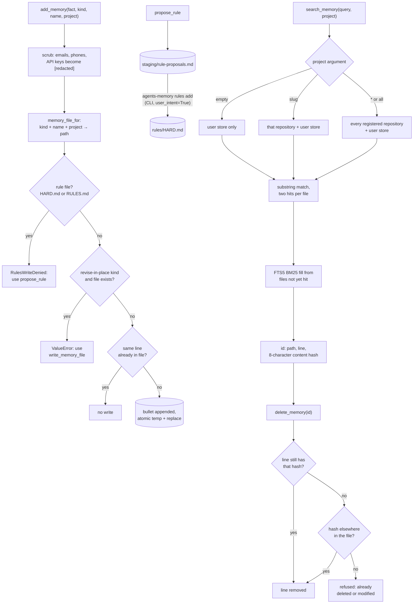

## 1. Executive Summary

`agents-memory` is a local markdown memory shared across Claude Code, Cursor,
Antigravity and Zed through one MCP server and a CLI, with an optional
self-hosted server that syncs the store between machines. Its folder path is
its schema, a search hit is an address the delete accepts, and the project
boundary is an argument the model fills in on every call.

Its claim is a **storage standard** rather than a store: `~/.agents/memory/` for
the person and `<repo>/.agents/memory/` for each repository, described in an
`abi/` directory of eleven specification files that a conforming implementation
is meant to follow. The layout spec states the design in three sentences, *"One
home per fact. Path encodes where it belongs. No dump files (`facts.md`,
`MEMORY.md`)"*. `abi/KINDS.md` then publishes a **mutability hint per kind** —
inbox, a new sequential file per tranche, revise in place, append-only, frozen —
and the decision rule is the sharpest one in it: *"Revise present tense when
the contract changes; new number when superseding"*. The same `KINDS.md` routes
a bare `project=` write and `kind=fact` to `<repo>/.agents/memory/facts.md`,
and the code does the same (`src/agents_memory/store.py:2401-2411`), so the
specification forbids the file its own default write fills.

**Strongest mechanism:** search and delete share an address that survives an
edit elsewhere in the file. `search_memory` returns
`user/notes/programming/chat-stores.md:12#a1b2c3d4` — path, line and the first
eight hex characters of a SHA-256 of the stripped line (`store.py:2008-2011`,
`:2237-2244`) — and `delete_memory` tries the line number first, then scans the
file for the hash and deletes the nearest match, refusing with *"already
deleted or modified"* when the hash is gone (`:2772-2791`). A recalled line is
a thing the agent can remove after lines above it have been removed, and
`test_delete_memory_shift_tolerance` asserts exactly that.

**Weakest:** the boundary is the caller's choice. An empty `project=` searches
the user store only, a slug adds that repository, and `project=*` or `all`
adds every registered one (`store.py:2129-2134`, `:2175-2205`). The MCP server
binds no session to a project, and `read_memory_file`, `get_project_memories`
and `get_related` reach any repository's files by id or slug. The hard-rule
gate has the same shape at a different layer: rules are proposed into a queue
only the person's CLI applies, while the model writes `USER.md`, which renders
into the same always-on context directly beneath them.

## 2. Mental Model

A memory is a bullet line in a file whose path says what kind of thing it is.
Kind, name and project resolve the file in `memory_file_for`
(`store.py:2387-2522`): concepts, entities and workflows in the user store;
research, plans, tasks, waves, roadmap, decisions and the
`proposed`/`implemented`/`rejected` note folders in a repository's store; a
staging inbox in each. Plans, tasks, waves, roadmap, decisions and lifecycle
notes are numbered `001-` files.

**There are no epistemic states.** `proposed`, `implemented` and `rejected` look
like a lifecycle and are directories: a note is *in* one of them, and moving it
is moving a file. `rejected` is *"Frozen after reject"* in `abi/KINDS.md`, and
`add_memory(kind="rejected", …)` appends to an existing rejected note, because
the kind is absent from `REVISE_IN_PLACE_KINDS` (`store.py:123-125`). Nothing
marks a fact doubtful, and nothing records a rejected value that a later write
consults. What the system models is **where a fact belongs and how it may
change**, which is a different axis from truth and an unusually well specified
one.

**Hard rules are a separate, gated layer.** `rules/HARD.md` in the user store
and an optional `projects/<slug>/RULES.md` overlay render into a
`<memory_rules>` block that reaches the MCP instructions, the first tool result
of each session and the always-on `AGENTS.md` the hosts load. The model's verb
is `propose_rule`, which appends to `staging/rule-proposals.md`; the store's
write, add and delete refuse the two rule paths; only
`agents-memory rules add|edit|remove|set`, which passes `user_intent=True`,
writes them (`rules.py:150-158`, `:333-379`; `rules_cli.py:126-136`).

Control is **hybrid and staged**: the agent files facts through MCP tools,
session logs are ingested into staging, and distillation — the model's
`distill_batch` decisions, or a keyword pass — promotes bullets into typed
files. The person owns the store in the most literal sense: it is markdown in
their home directory and their repositories.

## 3. Architecture

| Area | Role |
| --- | --- |
| `src/agents_memory/store.py` | Layout, kind routing, add, search, delete, staging, distillation, injection into hosts |
| `src/agents_memory/index.py` | The disposable FTS5 index, ranked fill, and `get_related` |
| `src/agents_memory/rules.py`, `rules_cli.py` | Hard rules: rendering, budget, the write guard, proposals, per-session delivery |
| `src/agents_memory/mcp_server.py` | The sixteen MCP tools |
| `src/agents_memory/ingest*.py`, `extract_openai.py` | Session-log extraction from six sources into staging |
| `src/agents_memory/remote/` | Sync server, client, merge, tombstones, epoch, the hybrid MCP |
| `abi/` | The specification: layout, kinds, MCP, ingest, injection, hygiene, remote |

**Persistence.** Markdown files, written whole through `_write`, which skips an
unchanged write and otherwise writes a thread-unique temp file and
`os.replace`s it (`store.py:275-300`). A line cache keyed by mtime serves
search. The FTS5 index under `~/.agents/memory/.index/` is rebuilt from the
tree and is never synced.

**Housekeeping.** `consolidate_repo_leaks`, `migrate_legacy_store`,
`purge_engine_repo_injection` and `ensure_staging_inbox` repair a store a person
also edits by hand, and `check.py` lints frontmatter and near-duplicate file
names.

### Deployment and ergonomics

`pip install agents-memory` (or `uv tool install`), an MCP entry per host, and
two directories of markdown. Fully local and offline; no API key is needed to
store anything, and no model is called anywhere in the package. The CLI and the
MCP server check PyPI at most once a day for a newer release unless
`AGENTS_NO_UPDATE_CHECK=1` or `CI` is set. The optional sync server is
`agents-memory remote serve`, a Starlette app with an SSE MCP mount; it binds
`0.0.0.0` by default and runs open when no `AGENTS_MEMORY_TOKEN` is set
(`remote/server.py:72-73`, `:632`).

## 4. Essential Implementation Paths

**Write.** `mcp_server.add_memory` → `store.add_memory` (`store.py:2591-2619`):
scrub the fact, refuse an empty one, resolve a path through `memory_file_for`,
refuse a rule file, refuse an append to an existing file of a revise-in-place
kind (`research`, `implemented`, `decision`, `adr`), then `_append_bullet`, which
returns without writing when the normalised line is already present
(`:2526-2557`). An unregistered project slug raises *"unknown project '…' —
register it first"*.

**The mutability contract.** The refusal names the alternative:
*"Cannot append to existing '…' for revise-in-place kind '…'. Revise this file
in place using write_memory_file(file_id='…', content=...)"* (`:2609-2614`).
`write_memory_file` overwrites any non-rule file the model names, so the
contract routes an edit to the whole-file writer rather than preventing one.
`concept`, `entity` and `workflow` are revise-in-place in `abi/KINDS.md` and
outside the enforced set.

**Ingest.** Six extractors — Cursor agent JSONL, Copilot, an OpenAI export,
Claude Code JSONL, Pi and Antigravity — read exported session logs into
`staging/ingest/<source>/captured.md`, dropping questions, acknowledgements and
how-tos, and capping bullets per source.

**Distillation.** `get_staging_inbox` returns un-distilled bullets grouped by
file. The model sends promote or discard decisions to `distill_batch`, which
calls `promote_bullet` per item — `add_memory`, then remove the bullet from
staging. `promote_bullet` returns whether the removal found the bullet, and its
one caller discards that value (`store.py:3139`), so the batch reports a
promotion whether or not staging was drained. `auto_distill` is deterministic:
noise patterns are discarded, lines containing *always*, *never* or *prefer*
are promoted into `notes/preferences/`, project lines into the project's
`notes/facts`, and rule proposals are skipped (`:3178-3305`). After an ingest
extract that leaves fifty or more staged bullets, that pass runs by default
(`:3363-3373`).

**Retrieval.** `search_memory(query, project, limit=20)` (`store.py:2265-2326`)
walks the scope's files, keeps at most two substring hits per file, takes one
per file first, fills from `search_hybrid` over files not yet hit, then tops up
with the remaining exact hits. Each hit is `{"id", "file", "line", "text"}`.

**Scope.** `resolve_search_project` maps `*` and `all` to every clone
(`:2129-2134`); `iter_memory_files` returns no project files for an empty
token, one clone for a slug and every clone for `*`, and always appends the
user store (`:2175-2205`). The FTS fill applies the same three cases in SQL:
no predicate, `d.project = ? OR d.project = ''`, or `d.project = ''`
(`index.py:259-267`). The CLI infers a slug from the working directory
(`__main__.py:376`); the MCP server does not.

**Delete.** `delete_memory` accepts `path:line#hash`, `path#hash`, a legacy
`path:line`, or a bare file path (`store.py:2730-2808`). A hash resolves as in
section 1. A legacy id deletes by position. A bare path that names a file
deletes the file through `delete_memory_file` (`:2740-2745`). A line removal
records a bullet tombstone for sync.

**Rules.** `rules.render_rules` composes global and overlay rules under a
budget of 30 lines and 2,000 characters globally and 10 lines per project;
an over-budget write is refused with a request to consolidate. `RuleDelivery`
prefixes the block onto the first tool result of a session and a project's
overlay onto its first project-scoped call, deduplicated by content hash.

**Sync.** With a remote configured, the hybrid MCP sends each search to the
server as well as to the local store, pushes after every write and pulls about
once a minute. Merge is a bullet union for ordinary markdown and last write
wins for singleton documents, rule files and staging, with conflicts logged to
`staging/sync-conflicts.md`. Deletions travel as tombstones in
`.tombstones.json`, keyed by file, path prefix, `PROJECTS.md` row or normalised
bullet, expiring after 90 days; a strictly newer write revives the key
(`remote/tombstones.py:1-23`). A vault epoch refuses a push from a client that
has not seen a replace with HTTP 409.

## 5. Memory Data Model

There is no schema object. The model is the filesystem, and `abi/` publishes it:

| Store | Folders |
| --- | --- |
| `~/.agents/memory/` | `concepts/`, `entities/`, `workflows/`, `projects/<slug>/`, `notes/<collection>/`, `events/chronicle/`, `staging/`, `rules/HARD.md`, `USER.md`, `PROJECTS.md` |
| `<repo>/.agents/memory/` | `facts.md`, `staging/`, `research/`, `plans/`, `tasks/`, `waves/`, `roadmap/`, `decisions/`, `notes/{proposed,implemented,rejected}/<class>/`, `rituals/baton.md` |

Note collections are *guides, not a closed set* — `programming/`, `finance/`,
`family/`, `preferences/` and others — with an instruction to add a folder when a
fact does not fit, which is the right posture for a store a person also edits.

**Identity** is `path:line#hash8`. The hash is over the line's text, so two
identical lines in one file share it, and the resolver picks the one nearest
the hinted line. An edited line has a new hash and its old id is refused rather
than redirected. The id is stable across deletions above it and not across an
edit of the line itself, which is the right failure: a changed fact is a
different fact.

**Frontmatter.** `frontmatter.py` lints a closed key set — relations (`refs`,
`supersedes`, `same_as`), card keys including `status`, and *"human pins"*
`provenance` (`human`, `agent`, `import`), `checked_at` and `pin_kind`. The
linter is the only reader of `status` and `provenance`; `get_related` returns
`supersedes` and `same_as` as relations, and no search excludes a superseded
file.

**Provenance** exists for ingested material, as a `source_path` and origin
label on a staging bullet, consumed by the promotion that deletes the bullet.
**Temporal:** none in the record; mtime and the sync stamps are all there is.
**Correction:** revise the file, or delete a line.

## 6. Retrieval Mechanics

Two legs. The **exact leg** lowercases the query and matches it as a substring
of each line, keeping two hits per file so one noisy file cannot fill the
limit. The **FTS leg** ORs the query's word tokens into an FTS5 `MATCH` over
title, headings and body with the `porter unicode61` tokenizer, orders by BM25
`rank`, and maps each document back to the first line containing any query
term (`index.py:226-293`, `store.py:2247-2262`). The FTS leg runs only when
`fts.sqlite` exists; the MCP server rebuilds it at start, and `search_hybrid`
and `get_related` rebuild it when it is missing.

**Scope is an argument.** The rubric's `scope_enforced` asks that a stored key
be applied as a filter on the read path; the key is applied, and the model
supplies it. An agent writing in repository A that calls
`search_memory(query, project="*")` reads every registered repository's
`.agents/memory/`, and nothing in the MCP server ties a session to a working
directory. Three other read tools take no scope at all:
`read_memory_file("project/<slug>/…")` returns any repository's file,
`get_project_memories(slug)` returns every markdown file under a slug's store,
and `get_related` ranks related documents across the whole index with no
project predicate (`index.py:360-369`). The mark is withheld.

**Two listers disagree about mirrors.** The sync server keeps each repository's
memory under `mirror/projects/<slug>/` inside its own user store
(`remote/sync_bundle.py:314-320`). The exact leg's user-store lister skips any
path containing `mirror` (`store.py:2158`); `rebuild_index` walks the same
tree and skips only `.index` and `export` (`index.py:151-152`), recording every
mirrored file with an empty project column — the value an unqualified search
admits (`index.py:267`). On the server's vault, once anything has built an
index there, an unqualified search's ranked fill can return mirrored
repository lines the exact leg excludes.

**Always-on context.** `always_on_body` (`store.py:1585-1613`) composes the
rendered hard rules, `USER.md`, the full `PROJECTS.md` registry — every
repository's slug, path, role and stack — and a staging-backlog alert, and
`sync_injection` writes it after every store write into `~/.agents/AGENTS.md`,
the Claude, Gemini and Zed slots, and an `alwaysApply` Cursor rule. A
repository's own `AGENTS.md` gets its card and its rule overlay. No project's
memory body is injected anywhere but its own repository.

**Failure modes.** The exact leg is literal, so *"prefer pnpm"* is not found by
*"package manager"*; the FTS leg's stemmed OR-match recovers some of that and
returns one line per document. The taxonomy does much of the work ranking
usually does: you find things because you know which folder they are in.

## 7. Write Mechanics

Every write is a bullet appended to a resolved path, synchronous, with no model
call in the package. Extraction runs only in the ingest pipeline, over exported
logs.

**Deduplication** is exact: `_already_has_fact` compares the normalised line
against every line of the target file, so the same fact filed twice under the
same kind and name is one bullet, and filed under another kind is two.

**Secrets.** `add_memory` and `propose_rule` run `scrub`, which removes fenced
code and replaces emails, phone-like digit runs, OpenAI, Anthropic, GitHub,
Google and AWS key shapes and JWT-shaped tokens with `[redacted]`
(`ingest_common.py:138-211`). `write_memory_file` does not scrub, so a
whole-file write is the unfiltered path.

**Conflict handling:** none locally. Two contradictory bullets coexist, and the
resolution mechanism is a person opening the file — which the ABI states
plainly for `implemented` notes: *"revise in place when code/paths change (facts
track reality)"*.

**Filtering of noisy input** is the strong part, and it is on the ingest side:
questions, acknowledgements and placeholder hostnames are dropped before
anything durable is written, with committed cases for each.

### Operational cost

No model call, no network unless a remote is configured. A write is a file
rewrite plus `sync_injection`, which rewrites the always-on files and host
bindings every time. A search reads every markdown file in scope through the
mtime cache and, with an index, one FTS query. Nothing bounds the store's size
except the person's discipline and the ABI's instruction not to dump transcripts
into it. Write-to-readable lag is zero for the exact leg; the FTS leg sees a
write after the next rebuild.

## 8. Agent Integration

Sixteen MCP tools: `search_memory`, `add_memory`, `read_memory_file`,
`write_memory_file`, `propose_rule`, `auto_distill`, `get_staging_inbox`,
`distill_batch`, `get_project_memories`, `delete_memory`, `list_projects`,
`inventory_projects`, `register_project`, `ignore_project`,
`sync_local_agents_md` and `get_related`. `abi/MCP.md` specifies the surface
for a conforming implementation, which is the part that makes this a standard
proposal rather than a tool.

Agency is high and unsupervised. The model chooses what to file, where, and
which projects a search reads; `add_memory`'s description instructs it to file
*"ALWAYS … immediately"* when the user states a preference or decision, and
`get_project_memories`'s to call it *"PROACTIVELY when starting work in a
repository"*. The refusals are structural: unknown project, missing `project=`
for a lifecycle note, empty fact, a second append to a revise-in-place file,
and any write to a hard-rule file.

## 9. Reliability, Safety, and Trust

**No trust model.** No status read by any filter, no confidence, no record that
something is doubted. The store cannot distinguish a fact the user stated from
one the model inferred or a keyword pass promoted out of a session log, which
for a store distilled from transcripts is the gap that matters most.

**The rule queue has open side doors.** Hard rules are the one place a model's
proposal waits for a person: `propose_rule` stages it, the MCP surface holds no
apply verb, the vault writers refuse the rule paths, and the CLI's
`rules add` consumes the matching proposal. The rubric's `human_review` test
asks whether the producer can clear or bypass the queue, and it can bypass it
by writing what it would have proposed to a file that reaches the same context
ungated. `write_memory_file("user/USER.md", …)` is accepted, and `USER.md`
renders into `always_on_body` directly after the rules block.
`add_memory(kind="rule", name=…)` writes `~/.agents/rules/<name>.mdc`
(`store.py:2485-2491`), and `bind_host_rules` links every `.mdc` there into
the Cursor, Gemini and Windsurf rule directories (`:706-722`);
`write_memory_file("rules/<name>.mdc", …)` lets the model set the file's
`alwaysApply` frontmatter as well. The model can also delete its own proposals from `staging/rule-proposals.md`. The mark is
withheld.

Two further doors, read and not exercised. `is_rules_path` compares resolved
path strings, so on a case-insensitive filesystem such as a default macOS
volume, `user/rules/hard.md` passes the guard and opens `HARD.md`
(`rules.py:129-147`). And the sync server's `PUT /api/v1/file` writes any path
under its store without the guard (`remote/server.py:539-577`).

**Tombstones are delete-sync markers.** A deleted bullet is recorded under its
file and normalised text, and merge consults it so another machine's push does
not resurrect it. Any newer local write of the same text revives it, the record
expires after 90 days, and no extraction or `add_memory` consults it. That is
the shape the rubric excludes from `tombstone`.

**Injection.** A memory is markdown filed by a model or promoted by a keyword
pass from a session log, and recalled as plain text with no fence. A hostile
line containing *always* in an ingested transcript can be promoted into
`notes/preferences/` without a model deciding, and come back on a later search.

**Deletion.** A line is removed from a file the user owns, with no copies to
chase locally; with sync, a tombstone carries the deletion to other machines
and the FTS index forgets it at the next rebuild. A bare file path given to
`delete_memory` deletes the whole file, and the tool's own description shows
only hashless ids (`mcp_server.py:239-246`), which delete by position.

**Concurrency.** `_write` is atomic per file and takes no lock, so two agents
filing into one file concurrently is last-write-wins over the whole file. Sync
adds a cross-process lock so a replace-pull and the background pull do not
interleave (`remote/lock.py`), and an epoch for replaced vaults.

**Remote exposure.** `collect_sync_bundle(include_projects=True)` serves the
user store, rules and every repository mirror in one payload, and the server's
`POST /api/v1/tool` runs any of the sixteen tools against that vault. With no
token configured, the middleware passes every request through.

## 10. Tests, Evals, and Benchmarks

Thirty-three test modules with 250 test functions, run by CI with pytest on
pull requests to `main`. I ran none of them.

**What earns `negative_eval`.** `tests/test_search_scope.py` populates a user
store and two registered repositories with one canary each and asserts, per
scope, which canaries must and must not come back: an unqualified search
returns the user canary and neither repository's, `project="alpha"` returns the
user and alpha canaries and not beta's, and `project="*"` returns all three
(`:63-82`). `test_scrubbed_secret_does_not_return_from_search` files a key
through `add_memory` and asserts the search returns `[redacted]` and not the key
(`:108-118`). Both are must-not-retrieve cases on a populated store with a
positive control in the same fixture. They cover the substring leg only: the
scope cases build no index, so the ranked fill — the leg where the mirror
mismatch in section 6 lives — is not asserted against a boundary.

`tests/test_extract_filters.py` asserts across six extractor fixtures that the
user's question, the assistant's acknowledgement and an example hostname stay
out of extracted output. Those keep material out of a write, not a retrieval.

`tests/test_stable_memory_ids.py` asserts the hash-anchored id round trip,
shift tolerance and a refused double delete; `test_mutability_contract.py` the
revise-in-place refusal through the store and through the MCP tool;
`test_rules.py` the vault writers' refusal of the two rule paths, the CLI's
`user_intent` requirement, and that `auto_distill` leaves proposals alone;
`test_remote_tombstones.py` and `test_remote_epoch.py` the sync deletions and
the epoch.

`test_distill_benchmark.py` asserts precision, recall and kind accuracy of at
least 0.90–0.95 over a curated dataset, against `classify_bullet_heuristic`,
a function defined in the test file itself (`:140`). It measures the test's
own classifier, not `auto_distill`.

**What I would want before trusting it:** the scope cases repeated with the
index built, and on a store holding `mirror/projects/`; a case asserting that
`write_memory_file("user/rules/hard.md", …)` is refused; and a case asserting
that a bare path given to `delete_memory` is refused rather than deleting the
file.

## 11. For Your Own Build

### Steal

- **Let the path be the schema, and publish it.** A table of kinds, one
  destination each, one home per fact, and an explicit *"no dump files"* rule.
  A reader can tell where a fact lives without reading any code, and a second
  implementation could conform.
- **Publish a mutability hint per kind.** Inbox, sequential, revise-in-place,
  append-only, frozen — behaviours attached to the type of thing rather than to
  the store, with the decision rule (*"revise present tense when the contract
  changes; new number when superseding"*) as a clear statement of supersession
  in a store with no supersession record.
- **Make the search result an address the delete accepts, and anchor it on
  content.** `path:line#hash8` is readable, survives deletions above it, and
  refuses rather than misfires when the line itself has changed.
- **Refuse the wrong write and name the right one.** The revise-in-place
  refusal returns the exact `write_memory_file` call to make instead.
- **Filter the ingest, and test the filter negatively.** Dropping the user's own
  question and the assistant's *"[ok]"* before anything is stored is the cheapest
  quality mechanism available.

### Avoid

- **Do not let the model choose the scope.** A default that narrows is good;
  a wildcard on the same argument undoes it. Bind the scope to the session's
  working directory, as this project's CLI does, and leave the wildcard off the
  model's surface.
- **Do not gate one always-on file and leave its neighbours writable.** A
  proposal queue for hard rules closes nothing while `USER.md` and agent rule
  files reach the same context through the ordinary write tool.
- **Do not compare paths as strings on a case-insensitive filesystem.** Compare
  with `os.path.samefile` or by inode.
- **Do not overload one verb's argument shape.** A missing `:line` turning a
  line delete into a file delete is one dropped suffix from data loss.
- **Do not return a receipt nobody reads.** `promote_bullet` reports whether
  staging was drained and its caller drops the value.

### Fit

This suits one developer who works across several editors, keeps their own
notes, and wants the agent's memory to be files they can read, diff and
commit. Within that shape it is a carefully specified markdown store whose
taxonomy is better thought through than many that ship a database. Walk away
if more than one person writes to the same store, if repositories must not see
each other's memory, or if you need memory that can be wrong in a way the
system records.

## 12. Open Questions

- Does anything consume `abi/` besides this implementation? Whether a second
  conforming implementation exists decides whether this is a standard or a
  well-documented tool.
- Does any deployed sync server hold an FTS index over its vault? The
  mismatch in section 6 needs one, and the server builds it only through
  `get_related` or a search helper rebuilding a missing file.
- How large does a store get before the full scan is felt? Nothing in the
  repository reports a store size or a search latency.
- `docs/design/history-and-shared-memory.md` plans an append-only history of
  accepted changesets, named devices and revert as a new record. It is a
  design, and none of it is in the code at this commit.

## Appendix: File Index

- **Specification:** `abi/LAYOUT.md`, `abi/KINDS.md`, `abi/MCP.md`, `abi/INGEST.md`, `abi/INJECTION.md`, `abi/HYGIENE.md`, `abi/REMOTE.md`, `abi/WHY.md`
- **Store and layout:** `src/agents_memory/store.py` — `always_on_body` `:1585`, `line_content_hash` `:2008`, `resolve_memory_path` `:2038`, `write_memory_file` `:2085`, `resolve_search_project` `:2129`, `iter_memory_files` `:2175`, `search_memory` `:2265`, `memory_file_for` `:2387`, `add_memory` `:2591`, `delete_memory` `:2730`, `distill_batch` `:3114`, `auto_distill` `:3178`
- **Index:** `src/agents_memory/index.py` — `rebuild_index` `:141`, `search_hybrid` `:226`, `get_related` `:296`
- **Rules:** `src/agents_memory/rules.py` — `is_rules_path` `:137`, `assert_agent_write_allowed` `:150`, `add_rule` `:365`, `propose_rule` `:424`; `src/agents_memory/rules_cli.py:126-136`
- **Agent surface:** `src/agents_memory/mcp_server.py`, `src/agents_memory/remote/hybrid_mcp.py`, `src/agents_memory/remote/tool_dispatch.py`
- **Sync:** `src/agents_memory/remote/server.py`, `client.py`, `merge.py`, `sync_bundle.py`, `tombstones.py`, `lock.py`
- **Tests:** `tests/test_search_scope.py`, `test_stable_memory_ids.py`, `test_mutability_contract.py`, `test_rules.py`, `test_extract_filters.py`, `test_remote_tombstones.py`, `test_distill_benchmark.py`

### Recorded searches

Run at the tree root of the pinned checkout with `git grep`.

- `git grep -n -E 'is_rules_path|_refuse_rules_write\(' -- src ':!src/agents_memory/bundled'` — the definition, the guard, and its calls in `write_memory_file`, `add_memory`, `delete_memory_file` and `delete_memory`; nothing on `USER.md` or `~/.agents/rules/*.mdc`.
- `git grep -n -E 'USER_MD|USER\.md' -- src/agents_memory/rules.py` — no match.
- `git grep -n -E 'user_intent=True' -- src` — the docstrings and four calls in `rules_cli.py:126-136`, the only writers of the rule files.
- `git grep -n -E 'isatty' -- src/agents_memory/rules_cli.py src/agents_memory/rules.py` — no match.
- `git grep -n -E 'session|cwd|project_slug_for_cwd' -- src/agents_memory/mcp_server.py` — no match; the MCP server binds no project.
- `git grep -n -E 'mirror' -- src/agents_memory/index.py` — no match; the index does not skip mirrors.
- `git grep -n -E 'promote_bullet\(' -- src` — the definition and one caller, which discards the removal flag.
- `git grep -n -E 'blocked_bullet_norms|file_blocked\(' -- src` — only `remote/client.py`, `remote/server.py` and `remote/sync_bundle.py`; no local write consults a tombstone.
- `git grep -n -i -E 'valid_(from|to|until)|effective_(from|at)|observed_at|event_time' -- 'src/*.py'` — no match; no valid-time field.
- `git grep -n -E '"(verified|disputed|candidate|trusted|superseded|unverified)"' -- 'src/*.py'` — no match.
- `git grep -n -E 'fm\.get\("status"\)|\["status"\][[:space:]]*(==|!=|in)' -- 'src/*.py'` — no match; `status` is linted, never filtered on.
- `git grep -n -i -E 'audit|append_only|appendonly|journal' -- 'src/*.py'` — one hit, SQLite `journal_mode=WAL` at `index.py:47`; no mutation log.
- `git grep -n -i -E 'embed' -- 'src/*.py'` — one hit, an unused `EMBEDDINGS_DB` path constant at `index.py:30`.
- `git grep -n -i -E 'openai\.|anthropic|chat\.completions|urllib\.request|httpx|requests\.' -- 'src/*.py'` — the sync client, the PyPI update check and an OpenAI-export reader; no model call.
- `git grep -n -i -E 'anthropic|machine learning|not (be )?used (for|to)' -- LICENSE` — no match; the MIT text carries no rider.

## History

**2026-10-15** — [`f9149259e3097914fa4c4776b60cdbb12d85d0d6`](https://github.com/Lolaplex/agents-memory/commit/f9149259e3097914fa4c4776b60cdbb12d85d0d6) — 28 commits on, version 1.1.0 to 1.2.0. `scope_enforced` is withdrawn: the model picks each search's scope and `project=*` reads every repository ([section 6](#6-retrieval-mechanics)); at the previous pin the empty default read every repository. `negative_eval` holds on a must-not-retrieve case added in 1.1.1 ([section 10](#10-tests-evals-and-benchmarks)); at the previous pin it rested on extractor output only. Overtaken: hash-anchored ids, an unqualified search confined to the user store, a refused append to a revise-in-place file, hard rules behind a proposal queue, sync tombstones and epochs. Ten claims wrong at the previous pin are corrected in place. Screened from a full clone: four files, no auto-run or build-time execution, nothing inside the cooldown, one unpinned manifest, `AGENTS.md` and `CLAUDE.md` read as data. Nothing was installed, built or run.

**2026-09-18** — re-read at the same commit; nothing upstream has moved. Both
marks stand, each with a qualification the record did not carry.

`scope_enforced`: the key does reach the query, and earlier than most — the slug
selects the *file set* before any content is read, at
`iter_project_memory_files`'s `if slug and p.slug != slug: continue`
(`store.py:2022-2026`). The clause to read is `if slug and`. `search_memory`
declares `project: str = ""` (`:2086`), so an omitted project disables the
filter rather than narrowing to a default, and neither caller supplies one by
itself. The CLI calls `search_memory(query)` with no project
(`__main__.py:352`), and the dispatch path forwards
`str(arguments.get("project") or "")` from the tool call
(`remote/tool_dispatch.py:314-316`), so the agent decides per call whether the
search is scoped at all.

`negative_eval`: the assertions are sound and non-vacuous —
`tests/test_extract_filters.py` runs three fixtures, each pairing `assertIn` on
material that must survive with `assertNotIn` on the user's question, the
assistant's acknowledgement noise and an example hostname (`:36-38`, `:46-48`,
`:55-58`). What they assert about is the *extractor's output*, not a query
result: this is a must-not at the boundary where text becomes memory, the same
shape as [Tycho](../tycho/)'s snapshot case rather than
[ELAI](../elai/)'s retrieval case. Both shapes earn the mark in this atlas;
naming which one a report holds is what keeps the corpus comparable. No marks
change.

**2026-09-09** — [`a60babbb713f1c3818a3fdc85144a8bd1d5884d3`](https://github.com/Lolaplex/agents-memory/commit/a60babbb713f1c3818a3fdc85144a8bd1d5884d3) — second reading, at `v1.1.0`. The previous pin is not an ancestor of `main` and the compare API reports no common ancestor between them, because `a2c7812a` is a root commit in a history the project replaced. The content survived the replacement: `a2c7812a^{tree}` is `2ad78f1d`, byte-identical to the tree of `98d77b38` on `main`, so what the previous reading described is still readable and the drift that matters is the 76 commits from there to here — 122 files, 9,950 insertions. Screened before reading: no auto-run surface, no build-time execution, one manifest inside the seven-day cooldown, and two files addressed to a reading agent, read as data; nothing was installed and no suite was run.

Both marks survive on the same mechanisms. `scope_enforced` still rests on `if slug and p.slug != slug: continue` in `iter_project_memory_files`, and its evidence record gains line numbers. `negative_eval` still rests on `tests/test_extract_filters.py`, whose three fixtures assert the user's question, the assistant's acknowledgement and an example hostname stay out of extracted output.

One published quotation was wrong at this commit and is corrected. The report showed a literal no-op — `if project: pass` under the comment *"still include user layer so cross-cutting facts remain findable"* — and praised it as a statement of intent. That branch is gone. The behaviour it described is unchanged: `iter_memory_files` extends the project chunks with `iter_user_memory_files()` unconditionally, and the docstring now carries the rule the comment used to.

New material, and the reason the scope mark's wording is narrowed to the read path: a `remote/` package with a sync server, client, merge, locality, a hybrid MCP surface and bundled sync hooks. `collect_sync_bundle(include_projects=True)` ships the user store, the rules and every stored project mirror in one payload, behind a Bearer-token middleware that passes through unauthenticated when no token is configured. Tests went from fifteen files to twenty-six, four of them covering the remote path.

**2026-08-20** — [`a2c7812a667a46792a26ea719ad7ea83f875b202`](https://github.com/Lolaplex/agents-memory/commit/a2c7812a667a46792a26ea719ad7ea83f875b202) — first reading, at version 1.0.0, on a repository whose history is a single commit titled `.agents/memory v1`. Screened before anything was read: no auto-executing surface, no build-time execution, `pyproject.toml` and `requirements.txt` both inside the seven-day cooldown, one unpinned surface, and `AGENTS.md` and `CLAUDE.md` addressed to a reading agent and recorded as data; nothing was installed and no test was run. The line-numbered id and the revise-in-place return string were established by reading `store.py` against the ABI it implements.
