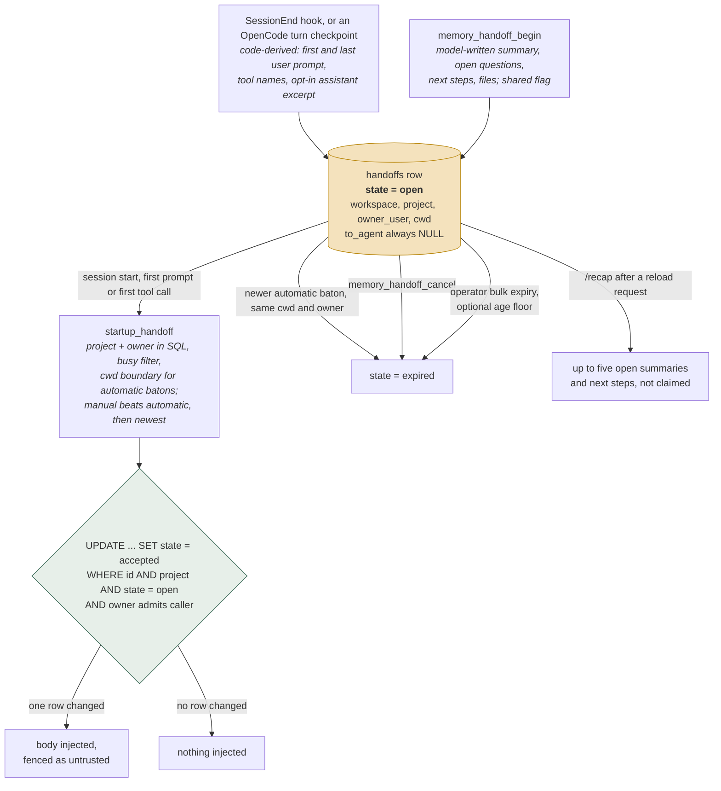
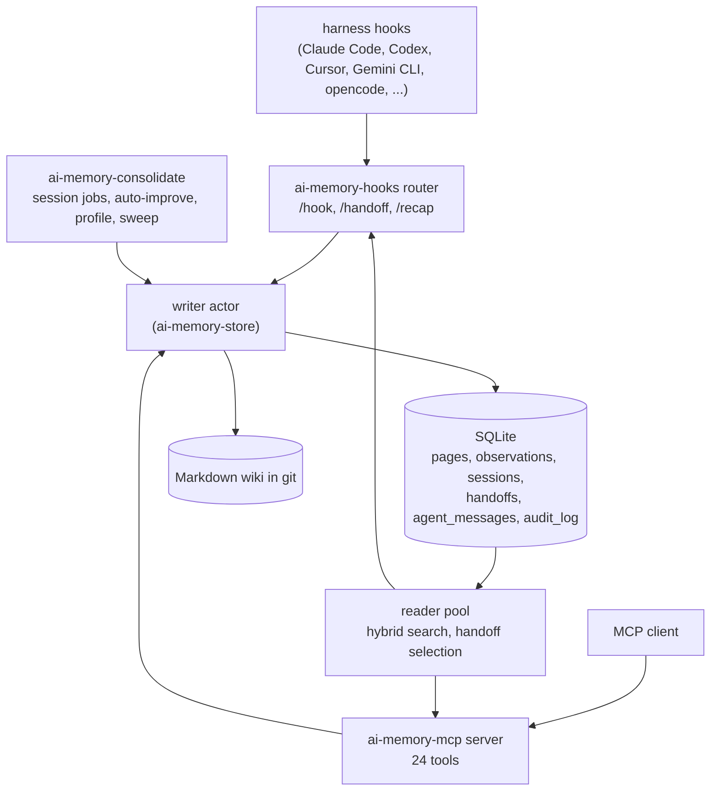

## 1. Executive Summary

ai-memory is a memory server for coding agents. Hooks in each harness record
the session without a model call, the end of the session writes a rule-based
summary page into a git-tracked Markdown wiki, and SQLite indexes it. Its
distinctive part is the
**handoff**: a single-use baton that the end of one session writes and the start
of the next claims, so a task interrupted in Claude Code can be resumed in
Codex. The delivery is the strong half. A claim is one compare-and-set on
`state = 'open'` inside the receiving project, filtered by operator and
directory, and only the session that wins it receives the body. The content is
the weak half. An automatic baton holds the session's first and last user
prompt and the names of the tools it used, `to_agent` is never written, and
nothing expires a baton because it is old.

For anyone treating this as a reference design for cross-agent handoff, the
split matters. What the first agent *learned* reaches the second only if the
first agent writes a manual handoff through `memory_handoff_begin`, or if
assistant capture is opted into on both the hook and the server. The
`open_questions` field of an automatic baton is the last user prompt with a
label in front of it. Addressing is by workspace, project, owner and working
directory; the typed sender and recipient on the record route nothing.

The system carries one mark, `negative_eval`: committed tests assert that
another operator's, a cancelled and a superseded baton are not delivered, with
the positive delivery beside each. `scope_enforced` is withheld, because
`memory_query` takes a `global` argument that searches every project, and on a
deployment that does not distinguish operators no predicate narrows it.

The record type, last changed in `handoff.rs` on 21 August 2026:

```rust
pub enum HandoffState { Open, Accepted, Expired }

pub struct NewHandoff {
    pub workspace_id: WorkspaceId,
    pub project_id: ProjectId,
    pub from_session_id: Option<SessionId>,
    pub from_agent: AgentKind,
    pub to_agent: Option<AgentKind>,
    pub cwd: Option<PathBuf>,
    pub summary: String,
    pub open_questions: Vec<String>,
    pub next_steps: Vec<String>,
    pub files_touched: Vec<String>,
    pub owner_user: Option<String>,
}
```

## 2. Mental Model



The pages are the long-term memory and the handoff is a message slot. The two
share a project boundary and little else: pages are searched, versioned and
consolidated, while a handoff is claimed exactly once and never searched.

## 3. Architecture

Eleven crates, in lines of Rust including their tests:
`ai-memory-cli` (147,853), `ai-memory-store` (81,286), `ai-memory-mcp`
(69,291), `ai-memory-hooks` (45,588), `ai-memory-consolidate` (42,826),
`ai-memory-wiki` (22,324), `ai-memory-web` (20,381), `ai-memory-llm`
(19,216), `ai-memory-workstream` (15,254), `ai-memory-core` (14,005) and
`ai-memory-test-support` (75). Seven companion packages sit beside them,
among them a TypeScript SDK, a relay, an importer, a desktop app and a wiki
sync.



`ai-memory-core` holds the model types (`handoff.rs`, `observation.rs`,
`actor.rs`, `ids.rs`). `ai-memory-store` holds every SQL statement: `ops.rs` for
writes, `reader.rs` for reads, and `project_authz.rs` and `grants.rs` for the
per-project access check.

## 4. Essential Implementation Paths

### Who writes a handoff, and from what

There are two producers. The **automatic** one runs at `SessionEnd`, and for
OpenCode at every completed root turn, inside the hook router
(`crates/ai-memory-hooks/src/router.rs:4520-4610`). It calls no model. The
summary is `Started: <first prompt>` and `Last: <last prompt>`, each capped at
1,500 characters, and gains `Latest assistant response:` only when assistant
capture is enabled on both the hook and the server. `open_questions` comes from
`derive_open_questions` (`:4630-4690`): `Unresolved question: <last prompt>` if it
ends in a question mark, a fixed two-line warning if the session ended during
file work without a `Stop`, otherwise `Continue from: <last prompt>`.
`next_steps` is one line, `Tools used: …`, and `files_touched` is always empty.

The **manual** producer is the MCP tool `memory_handoff_begin`
(`crates/ai-memory-mcp/src/server.rs:5421-5523`). Every prose field is the
model's, passed through the sanitizer and capped; `from_session_id` is
hard-coded to `None` and `from_agent` to `Other` (`:5487-5489`). The store
re-bounds every field at 16 KiB and 256 list items as a backstop
(`crates/ai-memory-store/src/ops.rs:4319-4371`).

So the record that carries what the first agent learned is the model-written
one. The automatic baton carries what the *user* asked, which is useful context
for a resumed task and is not the same thing.

### How a handoff is addressed

`to_agent` is never assigned a value. Both producers write `None`
(`router.rs:4602`, `server.rs:5489`), no reader filters on it, and its only
consumer is the CLI listing, which prints "any agent" when it is empty
(`crates/ai-memory-cli/src/commands/handoffs.rs:75`). `from_agent` on a manual
baton is `Other`. The searches are in the appendix. The project's design note
`docs/design-handoff-offer-not-claim.md` states the consequence itself — a
pending baton goes to whichever session starts next in the project, *"whatever
its harness or purpose"* — and records the decision of 2 October 2026 not to
make `to_agent` load-bearing, in favour of an offer mode.

The address that is enforced has four parts. **Workspace and project** are in
the `WHERE` clause of every agent-facing handoff read. **Owner**: on a deployment
that distinguishes operators, a handoff belongs to its creator unless created
with `shared: true` (`server.rs:5470-5482`), and the owner predicate is in SQL
on selection and inside the claim's `UPDATE` (`reader.rs:13248-13257`,
`ops.rs:4669-4707`). **Directory**: an automatic baton reaches a session whose
cwd lies at or below its own, by path components rather than `LIKE`
(`reader.rs:13284-13296`); a manual baton is project-wide whatever cwd it
carries (`:13259-13279`). **Liveness**: the baton of a session that is still open
and captured anything in the last ten minutes is not offered
(`router.rs:82`, `reader.rs:7233-7243`).

A model can move each part only within limits. A `workspace`/`project` pair
names the project, through the same resolver as every other tool, and on a
restricted project needs a grant. `shared: true` widens a new baton to the whole
project. `any_owner: true` on list, accept and cancel requires the admin
capability, which every level holds on a single-operator deployment and which
the stdio transport skips (`server.rs:3591-3611`); on such a deployment every
baton is unowned, so the flag changes nothing there. Omitting `cwd` on
`memory_handoff_accept` makes every automatic baton in the project a candidate,
which lifts the directory boundary and not the project one.

### What the receiving session reads

The hook path is the one most handoffs take (`router.rs:1571-1836`). It
resolves the project from the hook's cwd and markers, checks read access
(`:1614`), selects with `startup_handoff` (`:1649`), asks the admission chain
for `HandoffAccept` under a timeout, and claims inside `accept_startup_context`.
The rendered Markdown is returned only when `acceptance.handoff_accepted` is
true (`:1781`), and it opens with an untrusted-memory notice and fences
(`router.rs:2661-2731`). That offer mode is opt-in: with
`claim_handoff_on_session_start = false` the session gets a notice carrying the
id, sender and age and none of the stored text (`:1854-1867`), and the default
is to claim (`crates/ai-memory-cli/src/config.rs:5421`).

The claim itself is `accept_handoff_in_transaction`
(`crates/ai-memory-store/src/ops.rs:4533-4748`). It refuses a receiver session
in another project, of another agent kind, already holding a baton, or already
ended. It re-reads the row with `state = 'open'` in scope and refuses if the
source session became busy since selection. Then it runs one `UPDATE … SET
state = 'accepted' … WHERE id AND workspace AND project AND state = 'open'`
with the owner clause appended (`:4669-4707`). Zero changed rows returns `false`, and
every caller treats `false` as "deliver nothing".

`memory_handoff_accept` (`server.rs:5624-5729`) takes the same route, by id
through `handoff_by_id_in_scope` with an `Open` filter, or by selection through
`latest_open_handoff`. `memory_handoff_list` returns open rows only
(`:5588`). The context assembler that reaches a prompt without a claim is
`/recap`, injected as `UserPromptSubmit` context after a reload request
(`crates/ai-memory-hooks/src/recap.rs:71-155`). It applies scope, read access
and the owner filter, and lists up to five *open* batons without a directory
boundary or the busy filter. An accepted or expired handoff reaches an agent by
none of these reads. The web API lists every state for a person
(`crates/ai-memory-web/src/routes/api.rs:999`), and the unscoped
`handoff_by_id` has no production caller.

### What ends a handoff

Four statements write `expired`, and none of them runs on a clock
(`ops.rs:4392`, `:4832`, `:4888`, `:4947`). A new automatic baton expires older
open automatic batons from the same cwd and owner whose sessions have ended
(`:4384-4421`). A claimed automatic baton expires older automatic batons that
were eligible for the receiving directory (`:4774-4839`). `memory_handoff_cancel`
expires one by id (`:4929-4983`). `expire_open_handoffs` expires every open
baton in a project, optionally only those older than a number of days, and is
reachable only from an admin route and the CLI (`:4868-4926`,
`crates/ai-memory-mcp/src/admin.rs:3092-3136`).

Two consequences follow. Manual batons are exempt from both automatic sweeps,
since each requires `from_session_id IS NOT NULL`, so one written by mistake and
never cancelled waits indefinitely. And the selection key puts manual before
automatic, then newest (`reader.rs:13298-13319`), so a months-old manual baton
outranks a fresh automatic one at the next session start. The doc comment on
`HandoffState::Expired` reads *"Aged out (decay sweep)"*
(`crates/ai-memory-core/src/handoff.rs:27`); no decay sweep touches the table.

### Capture without a model call

`ObservationKind` maps the harness lifecycle directly — `SessionStart`,
`UserPrompt`, `PreToolUse`, `PostToolUse`, `PreCompact`, `PostCompaction`,
`Notification`, `Stop`, `SessionEnd`, `Other` — and observations are recorded as
they arrive (`crates/ai-memory-core/src/observation.rs`). This is
[zero-LLM capture](../../patterns/zero-llm-capture/) with the compaction
boundary in its vocabulary, so material the harness is about to discard is
recorded on the way past. Assistant output is captured only when the hook is
installed with `--capture-assistant` and the server sets `capture_assistant`,
which defaults to false (`crates/ai-memory-cli/src/config.rs:445`, `:1372`).

### Generation-based supersession of pending work

When newer observations arrive for a session, its older pending consolidation
job is marked `superseded` with *"superseded by a newer observation
generation"* instead of racing to write a stale page
(`crates/ai-memory-store/src/session_consolidation.rs`), and
`newer_generation_supersedes_older_pending_work` (`:738`) asserts that the first
generation does not run. Supersession here applies to queued jobs, not to
memories.

### Retention as a scored decision

`decay.rs` computes `salience · exp(−λ·age) + σ · log(1 + accesses) ·
exp(−μ · days_since_access)` (`crates/ai-memory-store/src/decay.rs:1-9`), with
separate rates for age since update and for days since last access, as the
[decay and reinforcement](../../patterns/decay-and-reinforcement/) pattern asks.
The forget sweep evicts cold episodic pages to a decay marker, hard-deletes TTL
pages and old markers, and prunes observations of consolidated sessions only
when `observation_retention_days` is set, which defaults to zero.

## 5. Memory Data Model

Markdown pages in git are canonical; SQLite holds versions (`supersedes`,
`is_latest`), `expires_at`, `salience`, `superseded_at` as the decay-eviction
marker, and `valid_from`/`valid_to` windows. Observations, sessions, handoffs,
cross-project `agent_messages`, workstreams, auto-improvement proposals and
profile candidates are separate tables.

What is absent, and why each near-miss does not carry a mark:

- **No trust state on a page.** Supersession, expiry and decay are lifecycle
  columns; nothing marks a page candidate, verified or disputed. The handoff
  states describe delivery, not belief.
- **No bi-temporal validity.** `valid_from` is the page version's own
  `created_at` and `valid_to` its successor's, and entity-link windows inherit
  the same ingestion timeline
  (`crates/ai-memory-store/migrations/V62__page_ingestion_windows.sql`,
  `V56__entity_link_validity.sql`). `as_of` answers what the store knew then.
- **No value-keyed tombstone.** `purged_sessions` and `purged_scopes` refuse to
  recreate a purged session id or scope, which is keyed on a record.
  `auto_improve_rejections` stores a normalized fingerprint and renders it into
  the next model prompt as advice; nothing compares a new proposal against it.
  The profile harvester leaves a topic alone when a ledger row's page is gone,
  until any candidate newer than the removal arrives, from a prompt, a curated
  page or a stack signal (`crates/ai-memory-consolidate/src/profile.rs:1201-1290`).
- **The `do_not_answer_from` tag appears once,** in a store test fixture that
  asserts ranking (`crates/ai-memory-store/src/lib.rs:2552`); no read path
  filters on it.

## 6. Retrieval Mechanics

`memory_query` runs a hybrid search per project: FTS5, entity, graph, an
optional vector stream and an observation-evidence stream, fused by RRF and
adjusted by page authority (`crates/ai-memory-store/src/reader.rs:6611-7108`).
Single-project calls also union the reserved `_global` preferences scope.

The arguments decide the scope. `workspace` and `project` name one project;
`scopes` names several; `global: true` searches every project in every
workspace (`crates/ai-memory-mcp/src/server.rs:646-653`, `:2734-2779`), and
`memory_query_global_searches_all_projects` (`:13392`) pins that behaviour. The
global branch calls `search_pages_with_meta` with the viewer, and
`readable_repository_filter` returns an empty predicate when there is no viewer
(`reader.rs:117-138`, `:2685`). An install without database users, and any
stdio client, has no viewer, so one model argument returns pages from every
project. On a deployment with users, restricted projects drop out of the
union; open projects, the default, stay in it. `include_expired`,
`include_superseded` and `as_of` lift the expiry and version filters on the same
call.

Handoffs are not part of this path. They are selected and claimed as described
in section 4, never ranked against a query.

## 7. Write Mechanics

Hooks capture observations. The session end writes a rule-based
`sessions/<id>.md` page, then stamps the session ended and inserts the automatic
handoff in one transaction, so a failed handoff insert rolls the end stamp back
(`ops.rs:4274-4314`). Consolidation
and auto-improvement rewrite pages through the wiki crate. Auto-improvement
proposals are approved automatically unless `[auto_improve] require_approval`
is set (`crates/ai-memory-cli/src/config.rs:1702`); when it is, they wait under
`/admin/pending-writes` for an admin. `memory_write_page` writes pages directly
and never enters that queue.

Every handoff insert, refresh, claim, cancel and expiry appends an `audit_log`
row (`ops.rs:4410`, `:4442`, `:4497`, `:4709`, `:4736`, `:4971`), as do page
writes, purges and grant changes. The table is not append-only: moving a
project between workspaces rewrites `workspace_id` on its audit rows
(`crates/ai-memory-store/src/ops.rs:7148`).

Admission webhooks, configured by an operator, can refuse a write, a handoff
begin or a handoff claim. A refused automatic claim leaves the baton open for
the next session rather than consuming it.

## 8. Agent Integration

Lifecycle hooks are installed for Claude Code, Codex, Cursor, Gemini CLI,
opencode, Devin, Grok, Kimi Code, Kiro CLI, Copilot CLI and further harnesses;
`AgentKind` names 26 agents plus `Other` (`crates/ai-memory-core/src/ids.rs`).
Most receive the handoff in their `SessionStart` context; Kimi Code receives it
on the first prompt and Grok after the first tool call (`ids.rs:468-527`). The
MCP server registers 24 tools, including the four handoff verbs and a
cross-project message queue (`memory_message_send`, `_list`, `_pop`,
`_cancel`) whose rows are addressed to a recipient project and popped once
(`crates/ai-memory-store/migrations/V64__agent_messages.sql`). At session start
the inbox appears as a count only.

`install-mcp --session-aware` routes MCP calls through a local stdio bridge
that carries the native session id, which is what lets `memory_handoff_accept`
answer `consumed_by_hook` instead of `none_pending`.

## 9. Reliability, Safety, and Trust

**`negative_eval` is earned.** `named_proxy_operators_stay_isolated`
(`crates/ai-memory-mcp/tests/suite/handoff_identity.rs:264-285`) has alice begin
a baton over HTTP, asserts bob's accept returns nothing, and then that alice's
returns it. `handoff_cancel_expires_open_handoff_and_clears_briefing_count`
(`server.rs:18822-18938`) asserts a pending count of one, cancels, then asserts
zero and a null accept.
`session_start_passes_receiving_cwd_to_auto_handoff_cleanup`
(`router.rs:15823-15924`) asserts the newest parent baton is delivered at session
start, the older specific one is absent, and it is left `expired`.
`global_union_never_leaks_a_foreign_projects_pages` (`server.rs:10985-11071`)
pairs a reserved global page that must surface with a foreign project's page
that must not.

**`scope_enforced` is withheld.** Every agent-facing handoff read carries the
project and owner predicates, and the `/recap` assembler does too. The page
query does not hold the same line: `global: true` is a model argument that
removes the project predicate, and nothing replaces it without a viewer.

**`audit_log` is withheld** on the project-move rewrite in section 7, and
**`human_review`** because the approval queue covers auto-improvement only and
is off by default, while `memory_write_page` and consolidation write pages
directly. `trust_state`, `bitemporal` and `tombstone` are covered in section 5.

Strengths:

- **An atomic, single-use claim**, delivered only to the session whose `UPDATE`
  changed the row, with the owner predicate inside the same statement.
- **Owner, directory and liveness boundaries** on automatic delivery, each with
  a test.
- **The injected handoff is fenced as untrusted**, and the no-claim notice
  carries metadata only.
- **Zero-LLM capture** around the compaction boundary, and double opt-in for
  assistant output.
- **Generation-based cancellation** of superseded consolidation jobs.

Gaps:

- **The automatic baton carries prompts, not findings**, and lists no files.
- **`to_agent` is decorative**: a baton cannot be held for a particular harness.
- **No age-based expiry**, and manual batons outrank automatic ones, so a stale
  manual baton wins the next session start.
- **`/recap` lists open batons from sibling directories and busy sessions**,
  which the session-start path would withhold.
- **`memory_query global=true`** crosses every project on a default install.

## 10. Tests, Evals, and Benchmarks

The tree carries 6,544 `#[test]` and `#[tokio::test]` functions, and CI runs the
workspace under `cargo nextest`. The handoff tests are thorough on delivery:
ownership, cross-workspace isolation, sibling directories, races between two
claimants, a receiver claiming twice, refused admission and the busy filter
each have one or more cases. I ran none of them.

`docs/benchmarks/` commits LongMemEval-S retrieval reports produced by the
in-repo `ai-memory-eval retrieval` harness; the 3.1 release report gives
`hit@5` 0.951 for zero-LLM FTS with the observation stream and 0.940 with local
embeddings. These are the project's own runs, not reproduced here. They measure
page retrieval and say nothing about handoffs: no evaluation of a task resumed
from a baton in another harness is committed, and `git grep -i handoff` over
`evals` and `docs/benchmarks` returns nothing.

No test asserts that a baton of a given age is not delivered, because nothing
withholds one by age. No test exercises a non-empty `to_agent`.

## 11. For Your Own Build

### Steal

- **Claim with one compare-and-set and deliver only on a changed row.** Put the
  scope and the owner predicate inside the `UPDATE`, so a refused caller and a
  lost race are the same zero-row outcome.
- **Bound automatic delivery by directory and by liveness**, so a parallel
  session's baton is not handed to its neighbour.
- **Fence the injected baton as untrusted data**, and make the no-claim notice
  metadata only.
- **Capture around the harness's compaction boundary** without a model call.
- **Cancel superseded pending work by generation.**

### Avoid

- **Deriving "open questions" from the last user prompt.** Have the ending
  agent, or a deterministic pass over the session's tool results, state what
  is unresolved, and label the field by where it came from.
- **A recipient field nothing writes or reads.** Either route on it or drop it.
- **Expiry only by supersession.** A baton needs an age limit, and a manual one
  should not outrank a newer automatic one indefinitely.
- **A second context assembler with weaker filters** than the claim path.
- **A model-facing `global` search flag** on a store that holds several
  projects.

### Fit

Borrow the claim path in `ops.rs:4533-4748` and the selection rules in
`reader.rs:13259-13319` for any handoff between agents that share a store. Do
not borrow the automatic baton's content, the unused addressing field, or the
expiry policy.

## 12. Open Questions

- Should a manual baton expire, or lose to a newer automatic one after some
  age?
- Should `/recap` apply the directory and busy filters the session-start path
  applies?
- Has a task resumed in another harness been measured end to end?
- Does `SkipAdmissionChain` leave a record when exercised?

## Appendix: File Index

- **Handoff model:** `crates/ai-memory-core/src/handoff.rs`,
  `crates/ai-memory-core/src/ids.rs` (`AgentKind`, injection points).
- **Handoff writes and claims:** `crates/ai-memory-store/src/ops.rs`
  (`insert_handoff_row`, `checkpoint_session_handoff`, `end_session_with_handoff`,
  `accept_handoff_in_transaction`, `expire_same_cwd_auto_handoffs`,
  `expire_superseded_auto_handoffs`, `expire_open_handoffs`, `cancel_handoff`).
- **Handoff reads:** `crates/ai-memory-store/src/reader.rs` (`startup_handoff`,
  `open_handoff_for`, `list_handoffs`, `handoff_by_id_in_scope`,
  `is_handoff_candidate`, `handoff_selection_key`).
- **Hook delivery and production:** `crates/ai-memory-hooks/src/router.rs`
  (`fetch_and_accept_handoff_at`, `build_auto_handoff`, `derive_open_questions`,
  `render_handoff_markdown`), `crates/ai-memory-hooks/src/recap.rs`,
  `crates/ai-memory-hooks/src/synth.rs`.
- **MCP surface:** `crates/ai-memory-mcp/src/server.rs` (`memory_handoff_*`,
  `memory_query`, `require_admin_capability`), `crates/ai-memory-mcp/src/admin.rs`.
- **Access:** `crates/ai-memory-store/src/project_authz.rs`,
  `crates/ai-memory-store/src/grants.rs`, `crates/ai-memory-core/src/actor.rs`.
- **Schema:** `crates/ai-memory-store/migrations/V02__handoffs.sql`, `V39`,
  `V41`, `V48`, `V52`, `V56`, `V59`, `V62`, `V64`, `V68`, `V75`.
- **Retention and consolidation:** `crates/ai-memory-store/src/decay.rs`,
  `crates/ai-memory-store/src/session_consolidation.rs`,
  `crates/ai-memory-consolidate/src/profile.rs`,
  `crates/ai-memory-consolidate/src/auto_improve.rs`.
- **Tests:** `crates/ai-memory-mcp/tests/suite/handoff_identity.rs`,
  `handoff_admission.rs`, `crates/ai-memory-store/tests/suite/handoff_ownership.rs`,
  `multi_session.rs`.
- **Benchmarks and docs read as claims:** `docs/benchmarks/*.md`,
  `evals/README.md`, `docs/ARCHITECTURE.md`, `docs/design-handoff-offer-not-claim.md`,
  `README.md`.

### Recorded searches

Checked with `git grep` against the checkout at the pinned revision, from the
tree root; the same searches were run at
`74d2d31ebd8cca656c49f31563fac53e0b61c5cf` where the text says so.

- `git grep -n 'to_agent' -- 'crates/*/src/*.rs' 'crates/*/src/**/*.rs'` — production writers are `router.rs:4602` and `server.rs:5489`, both `None`; the insert at `ops.rs:4467`; reads only in `handoffs.rs:75` and the admin metadata listing at `reader.rs:6155-6200`. At the previous pin the production writers were `router.rs:3123` and `server.rs:3563`, both `None`.
- `git grep -n -E 'to_agent: Some|to_agent = Some|"to_agent": *"' -- .` — one match, `docs/design-handoff-offer-not-claim.md:170`, in the option the note records as not pursued; no code or test sets a value.
- `git grep -n -E "UPDATE handoffs SET state = 'expired'" -- crates` — `ops.rs:4392`, `:4832`, `:4888`, `:4947`; at the previous pin `ops.rs:2623`, `:2959`, `:3015`, `:3074`. None is called from a scheduler or sweep.
- `git grep -n -E 'expire_open_handoffs|cancel_handoff\(' -- crates` — production callers `admin.rs:3136` and `server.rs:5845`; the rest are tests.
- `git grep -n 'handoff_by_id(' -- crates` — every caller is inside a `#[cfg(test)]` module or a test suite.
- `git grep -n -A4 '\.list_handoffs(' -- 'crates/*/src/**'` — `recap.rs:138` and `server.rs:5588` pass `Some(HandoffState::Open)`; the web API passes the request's state; the two `None` callers in `router.rs` are tests.
- `git grep -n -i 'do_not_answer_from'` — one match, `crates/ai-memory-store/src/lib.rs:2552`; at the previous pin one match, `lib.rs:2305`.
- `git grep -n -w 'audit_log' -- 'crates/*/src/*' 'crates/*/src/**'` — inserts at `ops.rs:5310`, `grants.rs:206` and `users.rs:1012`; the update at `ops.rs:7148`; no delete. The update was at `ops.rs:4225` at the previous pin.
- `git grep -n 'normalized_fingerprint' -- 'crates/*/src/**'` — written at `crates/ai-memory-store/src/auto_improve.rs:1474`, rendered into the prompt at `crates/ai-memory-consolidate/src/auto_improve.rs:1539`, counted at `reader.rs:13086`; no comparison against a new proposal.
- `git grep -n -i 'handoff' -- evals docs/benchmarks` — no match.
- `git grep -n -E 'valid_from' -- 'crates/*/src/**'` — every writer sets it from a page version's `created_at`.
- `git grep -n -i -E 'arxiv|bibtex|@article|@misc|CITATION|doi\.org' -- README.md docs` — related-work citations in `README.md:208`, `docs/comparison.md` and `docs/research-2026-landscape.md`; no paper for this system.
- `git show 74d2d31ebd8cca656c49f31563fac53e0b61c5cf:crates/ai-memory-mcp/src/server.rs | sed -n 1930,1951p` and `git show 74d2d31ebd8cca656c49f31563fac53e0b61c5cf:crates/ai-memory-store/src/reader.rs | sed -n 1693,1720p` — the global branch called `search_pages_with_meta(query, limit, cutoff)`, whose `WHERE` carried no project or viewer predicate.
- `git ls-tree -r --name-only 74d2d31ebd8cca656c49f31563fac53e0b61c5cf docs/benchmarks` — `README.md` and three LongMemEval-S reports dated 2026-09-01.

## History

**2026-10-18** — [`995e35d5866973c3176709261e924a67e3c76158`](https://github.com/akitaonrails/ai-memory/commit/995e35d5866973c3176709261e924a67e3c76158) — re-read 2,137 commits on; `handoff.rs` is byte-identical and the handoff path was read at both pins ([section 4](#4-essential-implementation-paths)). `negative_eval` added, and present at the previous pin too. `scope_enforced` withdrawn: `memory_query` `global=true` removes the project predicate, with no viewer filter at the previous pin and none without a viewer at this one ([section 6](#6-retrieval-mechanics)). Wrong at the previous pin: `to_agent` was never written, so a handoff was not addressed to a harness; no handoff expired by age; LongMemEval-S reports were committed. New since: per-project grants, operator-owned batons, turn checkpoints, `/recap`, cross-project messages. Screened before reading: two auto-run surfaces, two build-time execution points, 22 dependency files inside the cooldown. Nothing was installed, built or run.

**2026-09-14** — [`74d2d31ebd8cca656c49f31563fac53e0b61c5cf`](https://github.com/akitaonrails/ai-memory/commit/74d2d31ebd8cca656c49f31563fac53e0b61c5cf) — re-read, 791 commits past the previous pin across 443 files. The mark stands and now carries an evidence record. Most of the scope work in the range is repair of the same class of slip: a capture-only marker that reset the scope to default, an active-project fallback inferred rather than seeded from disk, a startup seed reaching the write path, and an OKF pending exclusion applied globally instead of per project root — each narrowing an ambient default rather than widening a query. The wiki is now an Open Knowledge Format bundle, which is worth recording against the two other OKF implementations in this atlas for how differently it lands. In [OpenLore](../openlore/) and [MCP-Memory](../mcp-memory/) the `status`, `verified` and `stale_after` families are validated on write and read by nothing. Here `crates/ai-memory-core/src/okf.rs` derives `stale_after` from the existing `expires_at` written by the TTL machinery and carries it verbatim, and a `forget-sweep` command acts on that expiry — so the OKF frontmatter is a serialization view over state the system already maintains rather than a second vocabulary beside it. The enforcement is a sweep rather than a read-path filter, which is the honest limit on that comparison. Screened again first; nothing was installed and no suite was run.

**2026-07-28** — [`5d3c08344cf40d23cbf06c47f6b6300bdb96d1e3`](https://github.com/akitaonrails/ai-memory/commit/5d3c08344cf40d23cbf06c47f6b6300bdb96d1e3) — first reading.
