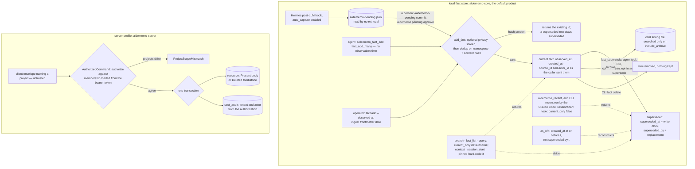

## 1. Executive Summary

AideMemo is a Rust working memory for coding agents with two stores that share
a name and not a rule. The default product is a local fact graph behind a CLI,
a stdio MCP server, a Python SDK and native bindings, in which a fact carries an
observation time beside its record time and a supersession stamp every default agent
read withholds. Beside it sits a server profile whose mutations cannot reach a
backend without a server-owned project authorization, and whose audit rows take
tenant and actor from the bearer token. The weak side is that the default local
deployment applies neither identity rule: its namespace and actor are whatever
the call says. Nothing local marks a fact disbelieved or records when it stopped
holding.

It is dual-licensed MIT OR Apache-2.0 and describes itself as "[p]ortable
working memory for coding agents and orchestrators".

**The server's rule is a type.** `AuthorizedCommand` is a "[c]ommand paired
with server-owned authorization context", and its only constructor returns
`DomainError::ProjectScopeMismatch` "when the untrusted envelope selects a
different project". `MutationCommand`, the single argument
`CommandStore::execute` accepts, holds an `AuthorizedCommand<()>` as a field, so
a backend adapter cannot be handed a mutation whose project came from the
request (`crates/aidememo-domain/src/command.rs:190-256`). The adapters write
the resource, receipt, change entry and audit row in one transaction, and the
receipt's tenant and actor come from the authorization
(`crates/aidememo-store-local/src/lib.rs:432-560`). The project's own server
document calls this profile "a workspace-only engineering contract", not the
hosted deployment (`docs/SERVER_SSOT.md`).

**The local store's rule is an argument.** Every MCP read tool resolves its
namespace as the call's `source_id`, falling back to `AIDEMEMO_SOURCE_ID`, so an
explicit argument widens or switches the installed scope and an omitted one with
no environment reads everything
(`crates/aidememo-cli/src/cmd/mcp_tools.rs:791-810`). The server's rule
reappears in one local mode: `aidememo mcp-serve` with a token-bindings file
injects the bound `source_id` and `actor_id` into every call and refuses a
different value (`crates/aidememo-cli/src/cmd/mcp_serve.rs:279-347`). The
shipped `.mcp.json` and the installers configure stdio, which does not.

**A local fact can stop being current without being deleted.**
`fact_supersede` stamps `superseded_at` with the write clock and names the
replacement; search, list and query default `current_only` to true, and the
context, session-start and pinned assemblers hard-code it
(`crates/aidememo-core/src/lib.rs:1034-1067`,
`crates/aidememo-cli/src/cmd/mcp_tools.rs:354-361`). `observed_at` records when
a fact was observed or decided, separately from insertion, and the `since` and
`until` windows read it while `as_of` reads the record axis
(`crates/aidememo-core/src/search.rs:171-205`). Supersession says a fact was
replaced, not that it is wrong, and `observed_at` is when something was seen or
said, not an interval over which it held.

**The context path the Claude Code plugin uses misses both filters.** Its
SessionStart hook runs `aidememo recent --last 7d`, and the CLI `recent` lists
with `source_id: None` and `current_only: false`
(`plugins/claude/scripts/aidememo-session-start.py:13-15`,
`crates/aidememo-cli/src/cmd/recent.rs:74-85`). A superseded fact from any
namespace in the store, written in the last week, is injected at session start.

## 2. Mental Model

A **fact** is the local unit: typed text attached to entities, with an optional
namespace and actor the writer supplies.

A fact is **current** until something supersedes it, and **superseded** facts
are history: kept, hidden from default reads, returned by `current_only: false`
and by `as_of` queries that predate the supersession.

**Time** is an observation stamp beside the record clock. `observed_at` is
when the thing was observed or decided, set from frontmatter or a CLI flag;
`created_at` and `superseded_at` are when the store learned and retired it.
Nothing records when a fact stopped being true.

A **detection** from the Hermes capture hook in pending mode is not yet a fact.
It waits in a JSONL file until a person commits or discards it.

A **server resource** is either present or a deletion tombstone, and every
change to it carries an audit row whose actor the server derived.

**No local fact is ever judged wrong**, only replaced. There is no rejected
state, and deletion removes the row.

## 3. Architecture

| Area | Role |
| --- | --- |
| `crates/aidememo-core` | The local engine: facts, entities, relations, search, supersession, archive, ingest, privacy screen |
| `crates/aidememo-cli` | The binary: CLI, stdio MCP, HTTP MCP (`mcp-serve`), daemon, pending review, installers |
| `crates/aidememo-python`, `-napi`, `-nif`, `-ffi` | Native bindings over the core |
| `crates/aidememo-domain` | Server types: authorization binding, mutation, receipt, audit entry, conformance fixture |
| `crates/aidememo-service` | Authorize, fingerprint and execute; scoped reads and visibility projection |
| `crates/aidememo-server` | The server binary: REST, HTTP MCP, search projections |
| `crates/aidememo-store-local`, `-store-postgres` | The two `CommandStore` adapters |
| `crates/aidememo-client` | The replica cache that follows the server's change feed |
| `plugins/claude`, `plugins/hermes` | Hooks, skills, slash commands and the pending capture log |

The two halves meet in two places only. `--remote-profile` routes the handoff
tools to an authenticated server, and `aidememo replica` keeps a separate cache
of server state; the local fact store is not a replica of the server.

### Deployment and ergonomics

The default is one binary and one local SQLite file, with no network and no
model API: `.mcp.json` runs `aidememo mcp` over stdio. Semantic search uses a
local model2vec model; a privacy filter, external embedders and rerankers are
opt-in sidecars. Registered projects select different store files, which is the
practical isolation boundary for a single user. The store is a SQLite database
of JSON records, readable with ordinary tools. The server profile needs its own
binary, provisioned tenants, actors, memberships and bearer tokens, and SQLite
or PostgreSQL.

## 4. Essential Implementation Paths

**Local write.** `AideMemo::add_fact` screens content, inserts, and optionally
auto-supersedes older decisions and conventions on the same entity
(`crates/aidememo-core/src/lib.rs:817-893`, `:930-936`). The SQLite adapter
returns the existing id when the namespace holds the same content hash
(`crates/aidememo-core/src/sqlite_store.rs:193-194`, `:1776-1785`). The MCP
`aidememo_fact_add` builds its input with `observed_at: None`
(`crates/aidememo-cli/src/cmd/mcp_tools.rs:3501-3515`). The CLI parses
`--observed-at`, but dispatches through a registered daemon with a
`DaemonFactAdd` that has no field for it
(`crates/aidememo-cli/src/main.rs:695-722`, `:3229-3237`).

**Supersession.** `fact_supersede` at `crates/aidememo-core/src/lib.rs:1034-1067`;
the MCP tool at `crates/aidememo-cli/src/cmd/mcp_tools.rs:3721`; the atomic
auto-supersede at `crates/aidememo-core/src/lib.rs:839-893`.

**Local retrieval.** The filter chain in BM25 search applies namespace, event
window, `as_of` and `current_only` in that order
(`crates/aidememo-core/src/search.rs:76-85`, `:164-205`). MCP defaults are at
`crates/aidememo-cli/src/cmd/mcp_tools.rs:354-361` and `:1032-1035`; `recent`
at `:1443-1477`.

**Context assembly.** `aidememo_context`, `aidememo_session_start` and
`aidememo_pinned_context` (`crates/aidememo-cli/src/cmd/mcp_tools.rs:2370`,
`:618`, `:554`). The Claude Code hooks at `plugins/claude/hooks/hooks.json`; the
Hermes first-turn injection at `plugins/hermes/src/hermes_aidememo/hooks.py:167-207`.

**Pending review.** Capture at
`plugins/hermes/src/hermes_aidememo/capture_adapter.py:121-133`; commit at
`crates/aidememo-cli/src/cmd/pending/mod.rs:280-297` and
`plugins/hermes/src/hermes_aidememo/slash.py:288-312`.

**Server mutation.** `command` at `crates/aidememo-server/src/lib.rs:412-451`
→ `CommandService::execute_prepared` at `crates/aidememo-service/src/lib.rs:163-196`
→ `execute_transaction` at `crates/aidememo-store-local/src/lib.rs:432-560`.

**Server reads.** `changes`, `materialized_changes`, `snapshot` and `search` at
`crates/aidememo-server/src/lib.rs:485-662`; the service's scoped reads and
participant visibility at `crates/aidememo-service/src/lib.rs:207-427`.

**Local scope binding.** `bind_request_identity` and `enforce_identity_field` at
`crates/aidememo-cli/src/cmd/mcp_serve.rs:279-347`.

## 5. Memory Data Model

**Local.** `FactRecord` carries `id`, `content`, `fact_type`, `entity_ids`,
`tags`, `source`, an optional `source_id` and `actor_id`, `source_confidence`,
`relevance_score`, `created_at`, `updated_at`, `observed_at`, `superseded_at`,
`superseded_by`, access counters and `pinned`
(`crates/aidememo-core/src/types.rs:431-490`). The SQLite table stores the
record as JSON beside a `content_hash`, unique per namespace. Relations carry a
`scope_source_id`. Search sessions and feedback have their own tables. There is
no status field beyond the supersession stamp, and no table records mutations.

**Server.** `CanonicalResource` holds a `ProjectScope`, a `ResourceRef`, a
revision and a `ResourceState` of `Present { body }` or `Deleted`
(`crates/aidememo-domain/src/command.rs:258-282`). `ssot_audit` holds tenant,
project, project sequence, command id, operation, resource kind and id, actor
and commit time; the bodies live on `ssot_changes`
(`crates/aidememo-store-local/src/lib.rs:1160-1195`). `RecordStatus` —
`Active`, `Suspended`, `Archived` — governs tenants, projects and actors, not
memories (`crates/aidememo-domain/src/record.rs:6-16`). `ActorKind` separates
`Human`, `Agent` and `Service`, and `display_name` is annotated
"[h]uman-readable label; never used for authorization" (`:18-36`).

## 6. Retrieval Mechanics

Local search runs BM25 first and falls back to semantic HNSW when lexical
evidence is weak or the query is CJK; `bm25_only` skips the model. Results are
ranked with time decay on `observed_at` or `created_at`; by default
decisions, conventions, patterns, preferences, lessons and errors are exempt
(`crates/aidememo-core/src/config.rs:401-413`). `aidememo_query` composes search,
entity resolution, traversal and recent facts in four modes, and
`aidememo_context` adds pinned facts and personalisation.

Superseded facts drop out of every default agent read but one. `recent` lists
with `current_only: false` on both the MCP tool and the CLI, labelling each
superseded fact with `superseded_by`
(`crates/aidememo-cli/src/cmd/mcp_tools.rs:1134-1136`). Archived facts sit in a
cold file that search reads only on `include_archive`.

The namespace filter is an equality on `source_id`
(`crates/aidememo-core/src/search.rs:164-169`), applied when the call carries
one. Global tools — overview, doctor — refuse a call that carries a namespace,
so a scoped identity cannot reach them
(`crates/aidememo-cli/src/cmd/mcp_tools.rs:1323-1330`, `:1399-1405`).

The server answers search from a lexical or semantic projection rebuilt from the
scoped project snapshot, keyed by scope, with `at_least_seq` refusing a request
ahead of the snapshot (`crates/aidememo-server/src/lib.rs:625-720`). Handoff
records are visible only to their sender and receiver, on reads and on the
change feed (`crates/aidememo-service/src/lib.rs:362-399`).

## 7. Write Mechanics

Local writes are explicit: the agent calls `aidememo_fact_add` or
`fact_add_many`, an operator runs the CLI or `aidememo ingest` over a markdown
wiki, or a person commits pending detections. Nothing calls a model on the
default write path. An optional privacy screen calls a local sidecar before
persistence. Writes are synchronous.

Deduplication is exact: the unique index on namespace and content hash makes an
identical re-add return the existing id, merging entity links. When that row is
superseded the re-add is absorbed into hidden history, while a paraphrase
creates a current fact. Edits rewrite content in place and are refused when the
new text duplicates another fact in the namespace.

The Claude Code UserPromptSubmit hook previews candidate facts and tells the
model to save durable ones itself; nothing is written. In Hermes, capture runs
after each LLM call in `pending` or `direct` mode, off by default.

Server writes go through typed routes for facts, sessions, handoffs and
contexts, and a raw route for `custom.*` resources. The fingerprint covers "the
real project, precondition, operation, and payload"; a retry with the same body
replays the receipt and a different body is refused.

## 8. Agent Integration

The stdio MCP server registers 29 tools, from search, query and context to
supersede, archive and edit; it has no delete
(`crates/aidememo-cli/src/cmd/mcp_tools.rs:4580-4612`). A build with the
`analytics` feature adds an unlisted `aidememo_analytics_query` that runs SQL
over a DuckDB mirror of all facts with no namespace predicate (`:4688-4730`).
The CLI installs MCP configuration for several agents, with optional
`--source-id` and `--actor-id` written into the server environment.

The Claude Code plugin injects pinned facts, an overview and recent facts at
startup, resume and compaction. The Hermes plugin injects recent facts on the
first turn, starts a workflow pack when a message looks like a ticket, and reads
the namespace for that pack from the message text
(`plugins/hermes/src/hermes_aidememo/hooks.py:59-66`, `:176-190`).

The server exposes REST and a ten-tool HTTP MCP surface whose tools re-enter the
REST router with the caller's bearer, with tool lists scoped by role.

## 9. Reliability, Safety, and Trust

**The server's identity discipline holds on every path read.** Tenant and actor
never come from the request; project selection is checked against membership
on every read and write; the HTTP MCP layer adds no second path. `display_name`
is barred from authorization by annotation.

**The local default has no identity discipline.** `source_id` and `actor_id`
are arguments. An installed `AIDEMEMO_SOURCE_ID` is a default, not a bound, and
an agent passing a different namespace reads it. Bound-token `mcp-serve` closes
this for HTTP clients, except for `aidememo_analytics_query` in builds that
compile it.

**Supersession is a replacement marker, not a belief state.** The agent sets it
through `aidememo_fact_supersede`, with no review, and the replacement may be
any live fact in the hot store. `superseded_at` says a fact was replaced, never
that it is disbelieved, and nothing marks a fact disputed or wrong, so the
filter that withholds it from default reads is not a trust state.

**Time is not bitemporal.** `observed_at` is when a fact was observed or said,
written by ingest, the CLI and pending approval, and read by `since` and
`until` (`crates/aidememo-core/src/types.rs:459-468`,
`crates/aidememo-core/src/search.rs:171-189`). It is not a validity interval,
and `as_of` reads `created_at` and `superseded_at`, both record time
(`:191-205`).

**Deletion.** CLI `fact delete` removes the row and keeps nothing; the next
identical write creates a fresh current fact. Server deletions keep a tombstone
keyed on the resource. `delete_tenant_data` erases a tenant's audit rows along
with everything else and is called by nothing in the tree; the CLI subcommand
for it returns an error (`crates/aidememo-store-postgres/src/lib.rs:427-494`,
`crates/aidememo-cli/src/cmd/postgres.rs:115-130`). Both schemas give the audit
table a foreign key to projects, and PostgreSQL's cascades on delete.

**Review gates one producer, not the agent.** With `auto_capture.enabled`, the
Hermes post-LLM hook appends detections to `aidememo-pending.jsonl`, which no
retrieval reads, and only the CLI `pending review`, `approve` and `reject` and
the `/aidememo-pending` slash command drain it; no agent tool does
(`plugins/hermes/src/hermes_aidememo/capture_adapter.py:121-133`,
`crates/aidememo-cli/src/cmd/pending/mod.rs:280-297`). The capture is opt-in,
and the same agent writes active facts directly with `aidememo_fact_add` and
`aidememo_fact_add_many`, so review does not gate the producer's own writes. An
approval records nothing about who approved: committed facts carry the tags
`auto-recorded` and `aidememo-pending-review`, no actor and no namespace.

## 10. Tests, Evals, and Benchmarks

Unit and integration tests cover both halves. The domain crate's conformance
fixture "describes outcomes, not I/O" and each adapter runs it: create, replay,
actor conflict, body conflict, stale revision, update, delete and change-feed
cursors. The SQLite contract test asserts the audit count beside it.

The local MCP tests carry the retrieval negatives.
`fact_list_defaults_current_only_true` asserts a superseded fact is absent by
default and present on request.
`scoped_read_tools_do_not_expose_neighbouring_source_content` asserts
beta-namespace content stays out of eight alpha-scoped read paths while alpha
content comes back. The bound-token router test asserts a beta token cannot
fetch an alpha fact and that override attempts at top level and inside a batch
are refused. `fact_list_as_of_hides_facts_superseded_before_the_cutoff` covers
the record axis; the `since` parser test is a smoke check, as its comment says.

No test drives the Claude Code session-start hook against a store holding
superseded or foreign-namespace facts. No test covers the daemon path dropping
`--observed-at`.

`docs/MEASUREMENTS.md` is the project's ledger of retrieval and agent-UX
numbers; it notes the LongMemEval and LFM scripts behind some of them were
removed, with results kept as historical evidence. No benchmark was reproduced
here, and I ran none of the tests.

## 11. For Your Own Build

### Steal

**Make the authorized scope a different type from the requested one.** A
constructor that refuses a mismatched envelope, and a store that accepts only
the authorized type, leave no unscoped path to forget.

**Bind identity at the transport, and refuse rather than overwrite.**
`mcp-serve` writes the token's namespace into every call and answers a
conflicting one with an error, so a misconfigured client fails loudly instead
of silently writing elsewhere. Global tools refuse a scoped identity outright.

**Stamp observation time apart from insertion time, and give each its own
parameter.** `since`/`until` and `as_of` answer different questions, and the
code says which column each reads.

**Pair a must-not assertion with a must-return in the same call.** The scoped
read test checks alpha content present and beta content absent per tool, so a
filter that returns nothing cannot pass.

### Avoid

**A scope that the call may override.** An environment default that an
argument replaces is a convenience, not a boundary; the same product shipping
both a bound and an unbound transport invites a reader to assume the stronger.

**A context assembler that bypasses the read defaults.** The session-start hook
calls a listing command whose defaults differ from the agent's tools, and that
is where superseded and foreign facts leak.

**Two write paths with different field sets.** A daemon shortcut that drops
an argument the direct path honours is a silent data loss no test sees.

### Fit

For one developer with a store per project, the local half is a capable,
model-free working memory, and its unenforced namespace matters little. For a
shared store across teams, apps or users, use bound-token `mcp-serve` or the
server profile, and do not rely on stdio or the bindings for isolation. A
reader who needs correctable beliefs — a rejected value that stays rejected —
will not find it here.

## 12. Open Questions

Whether the server profile is meant to replace the local store or sit beside it;
`docs/SERVER_SSOT.md` describes local stores becoming read caches, which the
code at this pin does not do for facts.

Whether a Hermes agent can invoke a registered slash command itself, which
decides whether `/aidememo-pending commit all` is reachable from the producing
side.

Whether superseding and then re-adding identical content is meant to stay
hidden, or is an accident of the dedup index.

## Appendix: File Index

| Path | What to read it for |
| --- | --- |
| `crates/aidememo-domain/src/command.rs:190-256` | A scope the caller cannot assert, carried by the only mutation type |
| `crates/aidememo-domain/src/command.rs:307-326` | An audit record whose tenant and actor are server-derived |
| `crates/aidememo-store-local/src/lib.rs:432-560` | Resource, receipt, change and audit in one transaction |
| `crates/aidememo-service/src/lib.rs:207-427` | Scoped server reads and participant visibility |
| `crates/aidememo-cli/src/cmd/mcp_serve.rs:279-347` | Bound-token identity injection and refusal |
| `crates/aidememo-cli/src/cmd/mcp_tools.rs:791-810` | The local namespace: argument first, environment second |
| `crates/aidememo-core/src/types.rs:431-490` | The local fact record and its time fields |
| `crates/aidememo-core/src/search.rs:164-205` | Namespace, event-window and as-of predicates |
| `crates/aidememo-core/src/lib.rs:817-893`, `:1034-1067` | Auto-supersede and supersede |
| `crates/aidememo-cli/src/cmd/recent.rs:74-85` | The listing the Claude Code hook injects |
| `crates/aidememo-cli/src/cmd/pending/mod.rs:280-297` | Committing a pending detection |
| `crates/aidememo-cli/src/cmd/mcp_tools.rs:5179-5300`, `:6190-6229` | The negative retrieval tests |
| `crates/aidememo-domain/src/conformance.rs` | One fixture, every server backend |

### Recorded searches

Run at the tree root of each pin with `git grep -n -E`; the results were
identical at both.

- `'(DELETE FROM|UPDATE) ssot_audit' -- crates` — `crates/aidememo-store-postgres/src/lib.rs:467` only, inside `delete_tenant_data`.
- `'delete_tenant_data|backup::delete_tenant' -- crates ':!crates/aidememo-store-postgres/src'` — no match; no caller.
- `'"observed_at"' -- crates/aidememo-cli/src/cmd/mcp_tools.rs` — `:1123` only, an output field; no MCP tool reads it as input.
- `'tombstone|blocklist|denylist|suppress|rejected_' -- crates/aidememo-core/src` — one test name in `sync.rs`; no rejected-value record.
- `'pending|approve' -- plugins/hermes/src/hermes_aidememo/tools.py` — no match; no pending tool for the agent.
- `'source_id: None|current_only: false' -- crates/aidememo-cli/src/cmd/recent.rs` — `:78` and `:83`.
- `'observed_at' -- crates/aidememo-cli/src/main.rs` — parsed at `:697-702` and used at `:858`; absent from `DaemonFactAdd` at `:3229-3237`.
- `'"aidememo_[a-z_]+" =>' -- crates/aidememo-cli/src/cmd/mcp_tools.rs` — 30 arms, the last behind `#[cfg(feature = "analytics")]`; no delete tool.
- `-i 'anthropic|machine learning|not (be )?used (for|to)|artificial' -- LICENSE LICENSE-MIT LICENSE-APACHE` — no match; no rider.
- `-i 'arxiv|bibtex|@article|@misc|doi\.org' -- README.md docs COMPARE.md` — related-work citations only; no paper about AideMemo.

## History

**2026-10-15** — [`21f7d1a848210e0e65414a2e46b46ec1b433b8e0`](https://github.com/taeyun16/aidememo/commit/21f7d1a848210e0e65414a2e46b46ec1b433b8e0) — 21 commits on: clippy cleanups, a removed semantic cache in the server worker, dependency bumps; no mechanism moved. The first reading covered only the server profile and was wrong at its pin about the default local store. `negative_eval` gained, earned then on committed MCP tests ([section 10](#10-tests-evals-and-benchmarks)). It did not describe `observed_at`, supersession or the Hermes pending queue; each is a near-miss for its mark ([section 9](#9-reliability-safety-and-trust)). Also wrong then: one store behind the command trait, and the server's scope given as the system's ([section 3](#3-architecture)). Screened from a full clone: two auto-run surfaces, two lockfiles inside the cooldown, five build-time execution points, five unpinned surfaces; `AGENTS.md` and `CLAUDE.md` read as data. Nothing was installed, built or run.

**2026-09-16** — [`58b803cc6b717fbf6559303e0d3f08e8b75673d4`](https://github.com/taeyun16/aidememo/commit/58b803cc6b717fbf6559303e0d3f08e8b75673d4) — first reading, at a commit dated 16 September 2026. Screened before opening, from a shallow clone: two auto-run surfaces, five build-time execution points, five unpinned dependency surfaces and twenty-seven dependency files inside the seven-day cooldown, with `Cargo.lock` present. `AGENTS.md` and `CLAUDE.md` are addressed to a reading agent and were recorded as data. Nothing was installed, built or run, and no benchmark was reproduced — the measurement ledger is cited as the project's own record rather than as a verified result.
