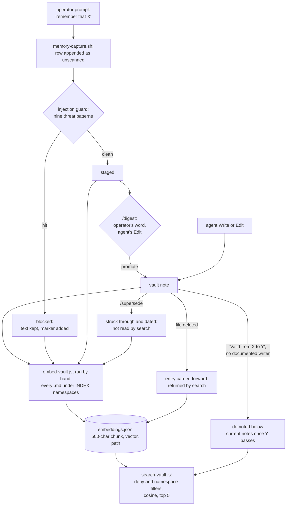

## 1. Executive Summary

aigent-OS is an MIT harness around one long-running Claude Code session. Its
memory is an Obsidian-compatible Markdown vault the agent edits with its
ordinary file tools, committed and pushed to git at each capsule cycle, and
searched by a local MiniLM embedding script the agent runs through Bash.
What is notable is the discipline around writes and around persisted text: a
user's "remember that" phrase is staged as `unscanned` and only a clean
injection scan makes it promotable, a PreToolUse hook refuses an edit that
pushes an always-loaded file over its budget, and every search hit is rendered
quoted and tagged as data. What is weak is the read side of forgetting: a
deleted note keeps answering search, a candidate the scan blocked is embedded
like any other note, and the supersession the search honours has no writer.

The product's headline is Managed Auto-Refresh, not memory: before the context
window fills, the agent writes a resume-ready capsule, one `/clear` runs, and
the fresh session loads the capsule. That loop is context management and this
report treats it as infrastructure. The vault, the staging queue and the search
index outlive every session and are the memory under review.

Four findings shape the rest of this report.

- **Deletion does not reach the index.** A full `embed-vault.js` run keeps
  every carried-forward entry whose path is not in the new embed set
  (`daemons/semantic-search/embed-vault.js:259-262`, `:318`), so a note deleted
  from disk keeps its chunks and keeps being returned. The project's own
  harness records this: its two loudness cases, which ask search to name a
  deleted or phantom source when it loads the index, fail in every packet that
  ran them.
- **The blocked state withholds nothing from search.** `MEMORY_CANDIDATES.md`
  lives in `vault/memory/`, an `INDEX` namespace, and nothing in
  `daemons/semantic-search/` reads a row's status. A hostile phrase the guard
  marked `blocked` is embedded on the next re-index.
- **Two supersession formats that never meet.** `search-vault.js` demotes a
  note whose body carries `Valid from X to Y` once Y has passed. That format
  appears only in the reader's comment, its tests and the eval fixtures. The
  `/supersede` skill writes `~~old~~ *(superseded YYYY-MM-DD)*`, which search
  does not read.
- **The agent applies its own review.** `/digest` asks the operator for
  promote, skip or supersede and then applies the answer with the agent's own
  `Edit` tool (`skills/digest/SKILL.md:5`, `:32-40`).

One mark, `negative_eval`, earned on deny and supersession tests that assert a
note's absence beside a returned control.

## 2. Mental Model

A memory is a Markdown file. It becomes a belief when the agent or the operator
writes it into the vault, and it becomes retrievable when someone next runs
`embed-vault.js`. There is no extraction model and no fact table on any path
the hooks reach: the agent decides what to write and where, guided by
`CLAUDE.md` and the skills.

**One automatic input, and it is a queue.** On every prompt, `caddy.sh` pipes
the prompt to `memory-capture.sh` (`daemons/caddy.sh:111-112`). Seven tier-1
regexes (`remember that`, `from now on`, `new rule:` and others) and five
tier-2 correction regexes match the operator's words after tool output, code
and tables are stripped (`daemons/memory-capture.sh:111-179`). Each match is
appended as a table row with status `unscanned` (`memory-capture.sh:272-279`).
The script then runs the injection guard over the file, which moves a clean row
to `staged` and a row matching any of nine threat patterns to `blocked`, with a
marker in its note column (`daemons/memory-candidates-guard.mjs:52-53`,
`:55-92`).

The candidate states, and what reads them:

| Status | Written by | Promotable by `/digest` | Searchable after re-index |
| --- | --- | --- | --- |
| `unscanned` | `memory-capture.sh` | no | yes |
| `staged` | the guard, on a clean scan | yes | yes |
| `blocked` | the guard, on a hit | no | yes |
| `promoted`, `skipped`, `superseded` | the agent's `Edit` during `/digest` | — | yes |

`/digest` filters `staged` rows, groups them by type and asks the operator one
word per row (`skills/digest/SKILL.md:32-40`). The promotion itself is an agent
edit into the suggested destination, a note under `concepts/`, `feedback/` or
`memory/DECISION_LOG.md` (`memory-capture.sh:181-191`). Nothing in code clears
a `blocked` row; a person or the agent edits the file.

**A note stops counting in three ways, and only one reaches search.** Deleting
the file removes it from disk and not from the index. The `/supersede` skill
strikes the old text through and appends the replacement with an OpenChronicle
id (`skills/supersede/SKILL.md:39-45`); search ranks the struck text exactly as
before. A body line `Valid from 2024-02-01 to 2026-01-31` demotes every chunk of
that note below every chunk without an ended window
(`daemons/semantic-search/search-vault.js:123`, `:146-176`). The demotion is a
rank, not a filter: `--top 10` returns the ended note last.

**Persisted text is data at every render.** Search hits, capsule fields and
candidate cells pass through `renderPersisted` or `inert`, which collapse line
breaks, quote, bound and tag each value with its path and hash
(`daemons/lifecycle-common.mjs:313-317`, `:343`). A hit whose namespace is not
`INDEX` renders as `[REFUSED: …]` rather than as text
(`search-vault.js:260-271`).

## 3. Architecture

There is no server and no database. The install is a git checkout whose
`install.sh` copies `.claude/settings.json.template` into a project's Claude
Code settings with the root path substituted. Every memory behaviour is a hook
script or a skill the agent follows. Node 18 or later, bash and Python 3 are
required; on Windows, Git Bash.

The pieces that touch memory:

- **The vault** under `vault/`, with a memory root resolved by one module,
  `daemons/memory-root.cjs` (default `vault/memory`), which every reader and
  writer shares. Templates stamp `created:` in frontmatter
  (`vault/templates/*.md`).
- **The search index**, `embeddings.json` in the memory root, gitignored
  (`.gitignore:42`). `embed-vault.js` builds it with
  `@xenova/transformers` and `Xenova/all-MiniLM-L6-v2`; the semantic-search
  directory has its own `package.json` and lockfile.
- **Hooks** registered by the template: `sessionstart-reinject.mjs` and the
  resume verb on SessionStart, `caddy.sh` and the utterance journal on
  UserPromptSubmit, `memory-budget-guard.mjs` on PreToolUse for Edit and Write,
  `auto-capture.sh` on PostToolUse, `stop-capsule-writer.mjs` on Stop, and three
  scripts on SessionEnd (`.claude/settings.json.template`).
- **Runtime ledgers** under `vault/memory/runtime/`: the nightly staging file
  `NIGHTLY_CAPTURE_CANDIDATES.jsonl`, and `LESSONS`, `BELIEF_STATE`, `PROCEDURES`
  and `STATE_EVENTS` JSONL files, which ship empty.
- **Vault sync**, `daemons/vault-sync.mjs`, which stages only the memory tree,
  commits it as `vault sync:`, pushes and verifies the remote HEAD. It is a
  no-op without a remote.
- **An opt-in bridge** to Hindsight and TypeSafe Jev, `daemons/memory-bridge.mjs`,
  which its own documentation describes as unverified against the live
  services (`docs/memory-bridge.md:3`).

### Deployment and ergonomics

Everything runs locally. Storing a memory needs nothing beyond the file
system, and no core memory path uses an API key. Search needs a one-time
`npm install` in `daemons/semantic-search/` and a model download on first use;
without it the vault works and search fails with an install hint. The
store is human-readable and repairable by hand, which is the design's point.
The index is the one artefact that is not: it holds plaintext excerpts and must
be rebuilt, and a full rebuild does not remove what was deleted.

## 4. Essential Implementation Paths

**Capture.** `caddy.sh` (UserPromptSubmit) calls `memory-capture.sh` with the
prompt on stdin. The embedded Python strips tags, fences, inline code, JSON
fragments and table lines (`memory-capture.sh:111-129`), matches the pattern
table (`:149-179`), deduplicates against `staged` or `unscanned` rows from the
last 24 hours (`:205-234`), stops at a backlog of 50 (`:237-239`), and appends
`unscanned` rows under `## Candidates` (`:272-279`). It then runs
`memory-candidates-guard.mjs --file` (`:346`); a guard that cannot run leaves
the rows `unscanned` and logs `INJECTION_SCAN_DID_NOT_RUN` (`:361`).

**Scan.** `guardCandidatesText` parses each eight-cell row, scans the quoted
phrase with `scanText` from `memory-hygiene/injection-scan.mjs`, sets `blocked`
on a hit and `staged` on a clean `unscanned` row
(`memory-candidates-guard.mjs:55-92`). The write is an atomic update with a
lock (`memory-hygiene/atomic-state.cjs`). A file that exists and cannot be read
is a failure rather than a clean pass over zero rows (`:95-118`).

**Digest.** `skills/digest/SKILL.md` is the only consumer of `staged`. It is an
instruction to the agent, with `allowed-tools: Read, Edit, Grep`.

**Index.** `embed-vault.js` loads the namespace registry and the deny list
before anything else and refuses to run if either is malformed
(`embed-vault.js:63`, `:74`). It purges carried-forward entries whose path is
no longer `INDEX` or is denied (`:211-230`), collects every `.md` under the
`INDEX` directories (`:148-160`), and re-embeds either all of them or, with
`--changed-only`, those whose mtime is newer than the last index time
(`:247-251`). Each chunk of at most 1,800 characters is embedded, and its first
500 characters are stored as `chunk` (`:287-302`). Entries for files outside
the embed set are kept (`:259-262`) and merged with the new ones (`:318`).

**Search.** `search-vault.js` loads the index, drops denied paths and
non-`INDEX` namespaces (`search-vault.js:206-212`), scores every remaining
chunk by cosine, sorts, demotes ended windows (`:241`), keeps the best chunk
per path up to `--top` (default 5), and renders each hit through
`renderPersisted` with its disposition re-derived (`:260-271`). Output is a
human block followed by JSON.

**Session start.** `sessionstart-reinject.mjs` prints a clock line, an
identity line, the newest valid capsule's identity, up to five heat-ranked
wikilinks from `HEAT_INDEX.json` and the latest `SESSION_LOG.md` heading
(`daemons/sessionstart-reinject.mjs:13-20`, `:210-214`). No vault note body is
injected automatically; the rest of orientation is the agent reading
`ACTIVE_PRIORITIES.md` and `SESSION_LOG.md` as `CLAUDE.md` tells it to.

**Size gate.** `memory-budget-guard.mjs` reconstructs the file an Edit or
Write would leave, allows any edit that shrinks it, and refuses one that keeps
a governed file over budget (`daemons/memory-budget-guard.mjs:44-63`). The
budgets are 12,000 characters and 150 lines for `ACTIVE_PRIORITIES.md`, 24,000
and 300 for `SESSION_LOG.md`, and 20,000 and 250 for `MEMORY_CANDIDATES.md`
(`daemons/memory-hygiene/budget.mjs:23-45`).

**Nightly.** `daemons/nightly-pass.mjs` records eleven checkpoints of a
model-run maintenance pass. Its digest leg only counts `staged` rows
(`nightly-pass.mjs:210-213`, `:399-408`), and the skill states that the
unattended digest *"never changes status"* (`skills/nightly/SKILL.md:135-136`).
`nightly-ledger-stage.mjs` is the sole appender of nightly ledger candidates,
which can only start `staged` and need a re-run green predicate receipt to
claim mechanical evidence (`daemons/nightly-ledger-stage.mjs:111-145`).

## 5. Memory Data Model

The unit is a Markdown file with optional YAML frontmatter (`title`, `tags`,
`created`). Its identity is its vault-relative path. There is no id, no
version, no confidence and no author field that any code reads.

**Scope.** None on a record. A namespace is a top-level vault directory
declared `INDEX`, `SKIP` or `DENY` in `namespace-registry.json`, extendable by
a gitignored local registry that may only add directories
(`daemons/semantic-search/namespace-registry.mjs:1-8`). Both scripts refuse to
run while an undeclared top-level directory exists. The deny list is a set of
path prefixes in a gitignored `index-deny.json`. Both are physical partitions
of one operator's vault, and nothing distinguishes users, projects or agents.

**Time.** The index entry carries `mtime`, overwritten on each re-embed. Notes
made from templates carry an authored `created:` date that no code reads. The
validity line is valid time in the body, read only by `search-vault.js`.

**The facts ledger is declared and unread.** `docs/temporal-fact-ledger.md`
specifies `memory/facts/facts.jsonl` with `valid_from`, `valid_until`,
`superseded_by` and `source`, and the README's "C2 temporal supersession" row
links to that page. The repository ships one row in `memory/facts/facts.jsonl`.
No script reads or writes the file. The only instruction to write it is step
6.5 of `skills/close/SKILL.md:227-229`, a skill whose frontmatter marks it
deprecated, and it names `vault/memory/facts/facts.jsonl`, a different path.

**Candidates** are rows of an eight-column Markdown table: date, quoted phrase,
type, confidence word, suggested destination, status, digested date, note
(`memory-candidates-guard.mjs:45-46`).

**Capsules** are Markdown files in `capsules/` under the memory root with
frontmatter `id`, `created_at`, `status`, `objective` and `next_valid_action`.
The resume selector takes only `status: active` and treats `resumed`,
`resolved`, `consumed` and `superseded` as spent (`lifecycle-common.mjs:92`,
`:178-199`). Capsules sit in an `INDEX` namespace, so spent ones are embedded
too.

## 6. Retrieval Mechanics

Retrieval is one vector arm with no lexical or graph component. The query is
embedded with the same quantized MiniLM model, every chunk is scored by cosine
in a JavaScript loop, and the list is sorted. There is no threshold: the top
five come back whatever their score. The project's own harness measures the
consequence. Its negative class asks twelve questions the corpus cannot answer
and passes only when the top score is below 0.30; five pass, in both committed
baselines (`evals/recollection/results/BASELINE.json`,
`results/prereg-002-e1/BASELINE.json`).

**Demotion.** `endedWindowPaths` scans every row's stored chunk for
`^Valid from (.+?)$`, parses `X to Y` as whole UTC days, and collects paths
whose end has passed. `demoteSuperseded` then stable-sorts those paths below
the rest (`search-vault.js:146-176`). An open window and a future end are never
demoted. A date that does not parse, including an impossible day such as
2021-02-30, is reported on stderr and leaves the rank alone (`:140-160`). The
line is read from the stored 500-character excerpt of each chunk, so a window
written further into a long note is never seen.

**Filters.** Deny prefixes and namespace dispositions are applied again at
query time, independent of the indexer, so a stale or hand-built index cannot
return a denied path (`search-vault.js:52-62`, `:206-212`). Nothing filters on
whether the file still exists.

**Formatting and budget.** Each hit is one line of at most 500 characters
inside a `[persisted-data:vault-chunk <path> sha <hash> @ <iso>]` tag, after a
framing line saying the content is data. The model sees only what the agent
chooses to search for; nothing is injected per turn.

## 7. Write Mechanics

Writes are the agent's own `Write` and `Edit` calls, plus the capture hook.
There is no model in any write path the hooks run, and no deduplication or
consolidation of notes. The `/supersede` skill, run by the `mnemosyne`
sub-agent, layers corrections with strikethrough rather than replacing text.
`/compact-note` and the nightly context-hygiene leg archive before removing.

**Injection handling** is the most developed part of the write side. A
captured phrase is JSON-quoted with `|` escaped so it cannot add a column or a
line (`memory-capture.sh:69-71`), and the guard's nine patterns cover
instruction override, role override, system-prompt exfiltration, pseudo-system
blocks, covert channels, credential exfiltration, memory implants, forged
authority and tool coercion (`daemons/memory-hygiene/threat-patterns.json`).
The guard scans the phrase, not the vault: a note the agent writes directly is
never scanned.

**Deletion** is a file delete. The index keeps the deleted note's chunks
through any later full or incremental run, because neither path checks that a
carried-forward entry still has a file. Deleting `embeddings.json` and
rebuilding is the only complete removal, and no tool or skill says so.

### Operational cost

Capture blocks the prompt for one Python run and one Node run inside the
2-second hook timeout, and fails open. The guard runs on every prompt that
matched a pattern. A note the agent writes is on disk at once and is
retrievable only after someone runs `embed-vault.js`, which no hook, nightly leg
or skill step invokes, so the lag is unbounded. A full re-index re-embeds every
note on CPU, about 30 seconds on a fresh vault by the skill's estimate
(`skills/semantic-search/SKILL.md:28`). Search loads the whole index and the
model per query. Per-turn injection is zero apart from session-start
orientation, which is a few lines at the start of the session rather than
inside a cached prefix.

## 8. Agent Integration

The agent owns memory. It writes notes with the tools it uses for code, it
runs search through Bash when a skill or `CLAUDE.md` suggests it, and it
applies digest decisions. Hooks capture, guard and reorient; none of them
retrieves a note body into context.

The surfaces: a settings template of hooks, 73 skill directories under
`skills/`, nine named sub-agents including a memory architect and a vault
custodian (`vault/agents/Pantheon.md`), and a Claude Code plugin marketplace
that ships two unrelated fleet plugins (`.claude-plugin/marketplace.json`).
There is no MCP server. The capsule loop is the integration the project
measures: it writes a rolling capsule on every Stop without blocking the turn,
flushes it before compaction and at session end, and walks a cleared session
through load, re-ground, act and acknowledge.

Adapting the memory to another agent means porting the hooks; the scripts
themselves are standalone Node and Python with no Claude dependency.

## 9. Reliability, Safety, and Trust

**Provenance** is the vault path and, when synced, git history. A search hit
carries its path and a content hash; a candidate row carries the date and the
user's quoted phrase. Nothing records which session or agent wrote a note.

**The trust boundary is rendering, not admission.** The design assumes any
persisted byte may be hostile and renders it inert at every output
(`lifecycle-common.mjs:294-343`). That stops a stored note from forging
structure in a generated procedure. It does not stop a false note from being
believed, and nothing in the store says whether a note is believed.

**Near-misses on the marks.**

- **Trust state, withheld.** The candidate statuses are a scan-and-queue
  lifecycle, and the read path ignores them: `git grep` over
  `daemons/semantic-search/` finds no reference to `blocked`, `staged` or
  `unscanned`. Capsule status filters the resume selector, and a capsule is a
  checkpoint rather than a claim.
- **Bitemporal, withheld.** The validity line is valid time separate from any
  write clock, and it reaches a read path. The line has no instructed writer,
  though: the README's link for the feature leads to the facts-ledger page, a
  different format no code reads, and the supersede skill writes strikethrough.
  Record time is an overwritten `mtime` and git history.
- **Human review, withheld.** The operator decides each candidate, and the
  agent writes the decision with `Edit`, the same tool that could write any
  other value. `blocked` has no resolver at all.
- **Tombstone, withheld.** A `skipped` row stays in the file, but capture
  deduplicates only against `staged` and `unscanned` rows from the last 24
  hours (`memory-capture.sh:205-234`), so the phrase is staged again the next
  time it is said.
- **Audit log, withheld.** `auto-capture.sh` appends the time, tool and path of
  every `Edit` and `Write` to the day's note under `## Session Captures`
  (`hooks/auto-capture.sh:19-42`, `hooks/tool-tracker.js:85-99`). That is
  activity metadata in an editable note, with no content and no before or
  after. `STATE_EVENTS.jsonl` records mode changes.

**Concurrency.** Candidate writes go through a lock and atomic rename; the
capsule writer serialises per session with a lock file. Vault notes have no
lock; the agent's edits are serial within a session.

**Privacy.** The deny list is the one deletion-like guarantee, and it is
enforced twice and tested. A prefix added later purges its entries on the next
index run. The index otherwise holds plaintext excerpts of every indexed note,
including those deleted from disk.

**Sync.** Git push at the end of a capsule cycle gives a full history and a
rollback for the vault. It also means a deleted note persists in the remote's
history.

## 10. Tests, Evals, and Benchmarks

I did not run any test. The CI workflow runs every `daemons/tests/*.test.mjs`
with Node and the shell installer tests (`.github/workflows/ci.yml:72`, `:110`).

**Memory-relevant tests, and whether each can fail.**

- `semantic-search-deny.test.mjs` copies the real scripts into a sandbox with
  a stub embedder and asserts on what they print. Its search case builds a
  stale index whose denied chunk scores 1.0, asserts the canary text and the
  directory name are absent, and asserts the undenied note is present
  (`:152-163`, `:196-206`). The header states which deletion turns which case
  red. This case can fail in both directions.
- `semantic-search-supersession.test.mjs` asserts the ended window is absent
  from the top 5 with the current note at rank 1, that nothing is dropped at
  `--top 10`, and that an unparseable date leaves the rank alone
  (`:95-105`, `:156-192`).
- `memory-hygiene.test.mjs` asserts a guard that cannot read the file exits
  non-zero, that a clean row moves to `staged`, that a hostile row is blocked
  and stays blocked on a re-run, and that capture calls the guard
  (`:440-497`, `:682`).
- `semantic-search-namespace-registry.test.mjs` covers the registry's
  fail-closed loading.

**The recollection harness** is the most careful retrieval evaluation in the
tree. `evals/recollection/run-recollection.mjs` (3,249 lines) copies the
shipped scripts into a sandbox, points them at a 116-note fixture vault, runs
the real model, and scores 65 cases in ten classes. The corpus, overlay and
fixture-registry hashes are frozen in `PREREG-001-COMPUTED.md`, and the runner
refuses to score if they differ. Falsifier scenarios mutate the product in the
sandbox and record which classes must go red. Nineteen result packets are
committed, each naming its product commit and instrument hash.

What the packets show, at product commit `cdb7022` and then `d3dd339`. Of
the 24 positive cases, 23 hit in both. Of the 12 negative cases, five abstain
in both. The eight temporal cases all fail before the demotion and all pass
after it. The deny, skip, stale-index, undeclared and operator classes pass,
and both loudness cases fail in both. Under mutation `E1A`, which removes the
index-time filters, every deny case fails, so that class can fail.

Limits. The harness is deliberately outside CI. The preregistration packets
`PREREG-001` and `PREREG-002` are cited by hash and are not in the tree, so the
thresholds can be read from the runner but not from the document that froze
them. No case deletes a candidate's source or searches for a blocked
candidate.

**The companion paper.** The README links *Governed Agent Organizations*, a
Markdown paper in a separate repository, `wrg32786/governed-agent-organizations`,
with an evidence cutoff of 19 August 2026. It is a position paper with six
hypotheses; its one measurement is eleven Auto-Refresh transactions, each completing,
on one Windows seat at commit `81dd47d`, and it makes no measured claim about memory
retrieval. No arXiv identifier, `CITATION.cff` or BibTeX block is in this tree.
`evals/README.md` describes three further JSON test sets as manual, with no
results committed.

## 11. For Your Own Build

### Steal

- **Born unscanned, promoted only by a clean scan.** A staging row whose
  default status is "not yet checked" makes a crashed or missing scanner
  visible, where a default of "clean, demote on failure" reads the same as a
  scanner that never ran.
- **Size budgets enforced at write time, with the exit left open.** Refusing
  the edit that grows an always-loaded file past its ceiling, while always
  allowing an edit that shrinks it, puts the prune where the context is.
- **Filter at index time and again at query time.** Each check covers a path
  the other cannot reach, a hand-edited or stale index included, and the test
  file proves each one independently.
- **Falsifier runs committed beside baselines.** A packet that records which
  classes the mutation was expected to turn red is the cheapest proof a
  retrieval assertion can fail.

### Avoid

- **An incremental index that never asks whether a file still exists.** Carry
  forward only entries whose source is still on disk, and test it with a
  deleted note and a positive control.
- **Two supersession conventions.** If a skill corrects by strikethrough and
  the reader corrects by a validity line, they need to be one convention,
  documented where the writer reads it.
- **A queue inside the corpus it guards.** A staging file stored in a
  searchable directory makes every quarantine state a label on searchable
  text; keep the queue out of the index, or filter on its status.

### Fit

This suits one person who wants a Claude Code session to keep running for
days, who reads and edits the vault by hand, and who treats git as the undo.
The memory is deliberately low-mechanism: the operator's discipline and the
agent's file edits carry it, and the engineering effort sits in the session
loop and the injection boundary. Walk away if memory must be corrected without
a person rebuilding an index, if several people or projects share one install,
or if forgetting must be guaranteed rather than asked for.

## 12. Open Questions

- Is the validity line meant to be written by the operator, by `/supersede`,
  or by a future skill, and is the facts ledger retired or pending?
- Should `embed-vault.js` drop entries whose source is gone, and is the
  loudness class's red meant to stand until it does?
- Is `MEMORY_CANDIDATES.md` meant to be searchable, blocked rows included?
- Who resolves a `blocked` row, and to what status?
- What do `PREREG-001` and `PREREG-002` state, and where are they published?

## Appendix: File Index

- **Storage and roots:** `daemons/memory-root.cjs`, `daemons/memory-root.sh`,
  `vault/templates/*.md`, `vault/memory/MEMORY_CANDIDATES.md`,
  `memory/facts/facts.jsonl`, `docs/temporal-fact-ledger.md`.
- **Capture and guard:** `daemons/caddy.sh`, `daemons/memory-capture.sh`,
  `daemons/memory-candidates-guard.mjs`,
  `daemons/memory-hygiene/injection-scan.mjs`,
  `daemons/memory-hygiene/threat-patterns.json`,
  `daemons/memory-hygiene/atomic-state.cjs`.
- **Index and search:** `daemons/semantic-search/embed-vault.js`,
  `search-vault.js`, `namespace-registry.mjs`, `namespace-registry.json`,
  `deny-list.mjs`, `skills/semantic-search/SKILL.md`.
- **Rendering:** `daemons/lifecycle-common.mjs`,
  `daemons/memory-hygiene/resume-framing.mjs`.
- **Session lifecycle:** `daemons/sessionstart-reinject.mjs`,
  `daemons/resume-verb.mjs`, `daemons/stop-capsule-writer.mjs`,
  `daemons/precompact-flush.mjs`, `daemons/sessionend-flush.mjs`,
  `daemons/userpromptsubmit-journal.mjs`, `.claude/settings.json.template`.
- **Budget and hygiene:** `daemons/memory-budget-guard.mjs`,
  `daemons/memory-hygiene/budget.mjs`, `daemons/memory-heat/compute-heat.js`.
- **Skills:** `skills/digest/SKILL.md`, `skills/supersede/SKILL.md`,
  `skills/close/SKILL.md`, `skills/nightly/SKILL.md`.
- **Nightly and sync:** `daemons/nightly-pass.mjs`,
  `daemons/nightly-ledger-stage.mjs`, `daemons/nightly-ledger-review.mjs`,
  `daemons/nightly-contracts.mjs`, `daemons/vault-sync.mjs`.
- **Tests and evals:** `daemons/tests/semantic-search-deny.test.mjs`,
  `semantic-search-supersession.test.mjs`, `memory-hygiene.test.mjs`,
  `semantic-search-namespace-registry.test.mjs`,
  `evals/recollection/run-recollection.mjs`,
  `evals/recollection/PREREG-001-COMPUTED.md`,
  `evals/recollection/cases/queries.json`, `evals/recollection/results/`,
  `.github/workflows/ci.yml`.

### Recorded searches

Checked against the checkout at the pinned revision, from the tree root.

- `git grep -n -i -E 'valid from' -- . ':!evals' ':!daemons/tests'` — `search-vault.js:94` and `:123` only; no skill, template, README or doc states the line's format.
- `git grep -n -E 'facts\.jsonl' -- ':!*.md'` — only the ledger file itself; no script reads or writes it.
- `git grep -n -E 'blocked|staged|unscanned' -- daemons/semantic-search` — no match; neither indexer nor search reads a candidate status.
- `git grep -n -E 'existsSync|unlinkSync|rmSync' -- daemons/semantic-search/embed-vault.js` — the namespace directory, the index file and the memory directory; no per-entry source check.
- `git grep -n -E 'embed-vault' -- ':!*.md' ':!daemons/tests' ':!evals' ':!daemons/semantic-search'` — a comment in `compute-heat.js` only; no hook, nightly leg or script runs the indexer.
- `git grep -n -E "'(promoted|skipped)'|\"(promoted|skipped)\"" -- daemons hooks scripts` — nightly checkpoint statuses only; no code writes a candidate's `promoted` or `skipped`.
- `git grep -n -E 'NIGHTLY_CAPTURE_CANDIDATES' -- daemons ':!daemons/tests'` — the stage writer and two counters; no status transition.
- `git grep -n -i -E 'user_id|project_id|tenant|agent_id' -- daemons/semantic-search` — no match.
- `git grep -n -i -E 'audit|append' -- daemons/semantic-search daemons/memory-candidates-guard.mjs` — two comments; no mutation log.
- `git grep -l -i -E 'arxiv|bibtex|@article|@misc|doi\.org'` — `skills/deep-recon/agents/explorer.md` only, naming arXiv as a research source; no `CITATION.cff`.

## History

**2026-10-15** — [`dd912104ccb176b10dffdc2212a0611003bd1b20`](https://github.com/wrg32786/aigent-os/commit/dd912104ccb176b10dffdc2212a0611003bd1b20) — first reading, at the head of `master`, a commit of 13 October 2026, 84 commits past v1.1.0-rc.1. One mark, `negative_eval`. Screened before reading from a full clone: two auto-run surfaces, a `.claude-plugin/` marketplace naming two fleet plugins and the `hooks/` scripts a manifest can register, both read; hooks are otherwise registered only by a settings template the installer copies. No build-time execution point, nothing inside the cooldown, one floating range under a lockfile in `daemons/semantic-search/package.json`; `CLAUDE.md` treated as data. MIT with no rider. Read with `git grep` and `sed`; nothing installed, built or run.
