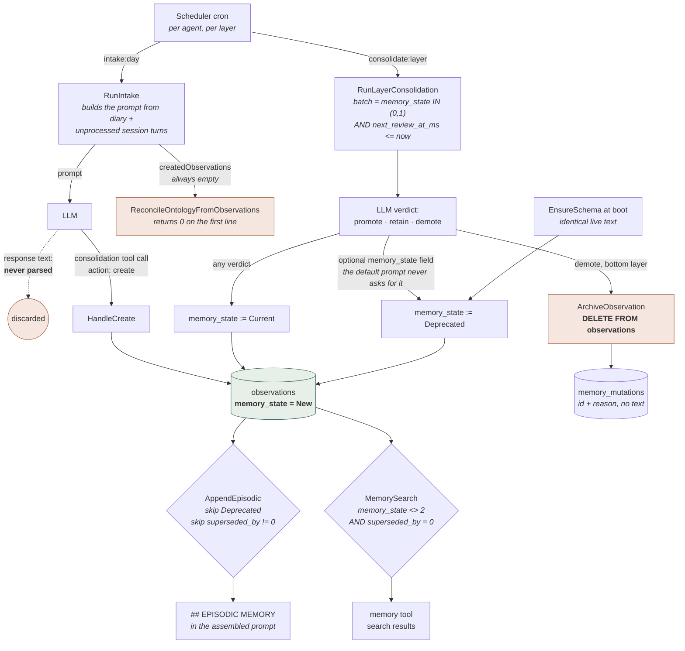

## 1. Executive Summary

Animus is a single-binary C++ agent runtime whose episodic memory carries a
three-valued `memory_state` that four read paths use to withhold a memory
rather than to discount it. The semantic half beside it is weaker: an ontology
whose unique key and search arm ignore the agent and whose evidence link
nothing writes. Around both, the tool dispatcher, the Lua bridge and the
default-layer seeding step outside the boundaries the code comments describe.

It is one daemon. `animusd` owns an `AgentKernel` that holds every store, the
tool registry, the channel adapters, a Drogon HTTP server serving both the
admin API and the embedded SPA, a Lua 5.4 runtime, a cron scheduler and, when
peers are configured, a federation pull loop. Memory is not a library the
runtime calls; it is four stores the kernel constructs and hands to a context
provider that runs on every prompt assembly.

**The memory model is the part worth reading.** An observation is a line of
text living in one of seven layers named for durations — `day`, `week`,
`month`, `year`, `decade`, `century`, `millennium` — and it carries a
`memory_state` of `New`, `Current` or `Deprecated`. That state is not a score.
`ActiveMemoryProvider::AppendEpisodic` skips a `Deprecated` observation before
it can enter the prompt, unified search excludes it in SQL, and
`ListObservationsDueForReview` never puts it in front of the model again.
Ranking is a separate `weight` column. A system that collapses "how sure" and
"may this be acted on" into one float cannot express *I have this on record
and do not believe it*; Animus can. Four marks follow: `trust_state`,
`scope_enforced`, `audit_log`, and `negative_eval`, the last on a committed
search case asserting that a retired and a superseded observation stay out.

`human_review` is withheld. The Memory view is an authoring surface — a person
creates and edits layers, writes an observation into one, deletes one,
rewrites a layer's perspective text, and triggers intake and consolidation —
and `ActiveMemoryView.vue` shows the assembled block the agent will be given.
Every one of those verbs acts on a store the agent is already reading. Nothing
in `src/kernel/memory` holds an observation pending anyone's decision, and
`Deprecated` is a correction applied afterwards rather than a gate. The
codebase does have a real owner-approval gate, for agent-created API packages
(`src/kernel/tools/ApiTool.cpp:278-281`); memory does not use it.

**The weakness is in the wiring, not the design.** Six findings, each
checkable in one or two files:

- **A second agent gets no memory layers.** `CreateDefaultLayersForAgent`
  seeds the seven defaults with fixed ids 1 to 7 so that federated nodes
  converge on the same rows. `CreateLayer` returns any existing row with that
  id without comparing its agent (`src/kernel/memory/MemoryStore.cpp:416-424`,
  `:632-633`). Once one agent's defaults hold ids 1 to 7, the next agent's
  seeding returns those rows and inserts nothing, so its episodic block is
  empty and `create` has no layer to resolve.
- **Session tool sets are offered, not enforced.** `ToolSchemaService` gives
  the `consolidation` tool only to consolidation sessions, but
  `ToolExecutionService::Execute` resolves whatever handler the model names
  (`src/kernel/chain/ToolExecutionService.cpp:169`). `ConsolidationTool`
  applies its per-session action whitelist only when the session key carries
  one of three prefixes, so a call from any other session reaches every verb.
- **The Lua tool bridge does not inject `__agent_id`.** `ConsolidationTool`
  states the invariant — *"Agent ID is always from `__agent_id`
  (ChainRunner-injected), never from params. Agents must not be able to
  override their own identity"* — and `ToolExecutionService::InjectContext`
  upholds it. `LuaToolProxyCall` marshals the script's table straight into
  `call.arguments` and calls `handler->Execute(call)`, so a script passes
  `VerifyOwnership` for any agent it names, `ontology:delete` included.
- **Intake asks the model for JSON and then throws the answer away.**
  `IntakeFromDiary` discards the LLM's return value and `IntakeFromSessions`
  assigns it to a variable nothing reads. An observation appears only if the
  model calls the `consolidation` tool, and the pipeline counts rows before
  and after to learn how many.
- **`ReconcileOntologyFromObservations` is dead on arrival.** `RunIntake`
  passes the address of `createdObservations` to two functions that never
  push into it, and the reconciler's first line is
  `if (!m_ontologyStore || observations.empty()) return 0;`.
- **The ontology has one correction verb.** `ontology:delete` removes a whole
  entity from a review session, with a required motivation that is logged.
  `DeleteProperty` and `MoveEntity` have no caller outside their own file, all
  six `/api/v1/ontology/*` routes are `GET`, and a wrong property can only be
  overwritten.

The gap between the two halves is the report. The epistemic state, the
perspective guard and the full-row audit snapshot are carefully built; the
boundaries around them have holes a grep finds.

## 2. Mental Model

A memory here is an **observation**: one line of text, in one layer, belonging
to one agent. It has a `weight` (0–1, used for ranking), a `decay_rate` (used
only to shorten the interval before its next review), free-text `tags`, a
`source` string, and two fields that carry its epistemic standing.

```text
memory_state    New (0)         written, not yet reviewed
                Current (1)     a review pass looked at it and kept it
                Deprecated (2)  retired — merged away, judged stale, or a duplicate

superseded_by   0               this row is the live version
                <id>            a later revision replaced this text
```

Both are consulted before the text can reach a prompt. `AppendEpisodic` drops
a candidate on either condition
(`src/kernel/context/ActiveMemoryProvider.cpp:255-260`):

```cpp
// Skip retired observations
if (obs.memory_state == memory::MemoryState::Deprecated) continue;
// Skip superseded observations (only show current versions)
if (obs.superseded_by != 0) continue;
```

Unified search applies the same two conditions in SQL, with
`AND o.memory_state <> 2 AND o.superseded_by = 0` on both dialects
(`src/kernel/memory/MemorySearch.cpp:511`, `:545`).

The **layer** is the other axis, and it is time-shaped rather than
truth-shaped. `CreateDefaultLayersForAgent` seeds seven, each with its own
review cron, its own minimum age before an observation enters a review batch,
and its own token budget: `day` (review every two hours, 1-hour minimum age,
4,096 tokens) through `millennium` (reviewed yearly, 10-year minimum age,
16,384 tokens, and skipped by both the pipeline and the scheduler because it
is "functionally permanent"). The layer name is a `TEXT` horizon string the
header marks as *semantic hint for AI ("1 month"), NOT parsed*; the machinery
runs on `sort_order`, `cron_expr` and `evaluation_interval_seconds`.

**Movement between layers is LLM-judged, not time-based.** Time decides only
*when* a review happens. `next_review_at_ms` is set at write to
`now + evaluation_interval_seconds * 1000 * decay_rate`, and when it comes due
the model is shown the observation and asked for `promote`, `retain` or
`demote`. Promote moves it one `sort_order` up. Demote moves it one down —
**except from the bottom layer, where demote is deletion**
(`src/kernel/consolidation/ConsolidationPipeline.cpp:966-981`):

```cpp
int ConsolidationPipeline::ArchiveObservation(int64_t obsId, int64_t fromLayerId,
                                                const std::string& reason) {
    // Archive = delete from active layers (remains in mutation log)
    if (m_memoryStore->DeleteObservation(obsId)) {
```

The comment is half right. A row lands in `memory_mutations` with
`mutation_type = "archive"`, the observation id and the model's `reason` — and
`MemoryMutation` has no field for the text. `MoveObservation` stores
`previous_state = obs->text.substr(0, 200)` when it promotes or demotes;
`ArchiveObservation` stores nothing. The record of a deleted memory is a
foreign key to a row that no longer exists, plus a sentence of justification.

Who moves what: **the LLM proposes and the store disposes, with a person able
to intervene at either end.** The agent, inside a `consolidation:review:`
session, can `retire`, `revise`, `merge`, `promote` and `tag` its own
observations and delete its own ontology entities. The scheduled pipeline sets
`Current` on everything it reviews. A boot pass in `MemoryStore::EnsureSchema`
retires the newer of two live observations with identical text in the same
layer (`src/kernel/memory/MemoryStore.cpp:159-192`). A person, through the
admin UI, can author an observation, delete one, rewrite a layer's
perspectives, and force an intake or review run.

Alongside the observations sit three other durable shapes, and each has a
different theory of correction. **Ontology properties** inherit the state of
the observation they cite, when they cite one. **MemoryFiles** are verbatim
documents with a `superseded` boolean and a `content_mutable` policy flag.
**Layer perspectives** are three paragraphs of narrative per layer —
retrospective, current, future — regenerated wholesale, with no history.



## 3. Architecture

**One process, one database connection, no sidecars.** `AgentKernel`
constructs `MemoryStore`, `MemoryFileStore`, `OntologyStore` and `DiaryStore`
over a single shared `IDataStore*`, and each runs its own `EnsureSchema()` in
its constructor; there is no migration directory and no version table. Schema
evolution is a sequence of `if (!schema::ColumnExists(...)) ALTER TABLE`
blocks, a table-swap migration that rebuilds `memory_layers` under
`PRAGMA foreign_keys=OFF` to scope it by agent, and boot-time repairs: a
duplicate-layer cleanup followed by a unique index on `(agent_id, name)`, and
the duplicate-observation retire above (`src/kernel/memory/MemoryStore.cpp:139-192`).

`IDataStore` is a thin prepared-statement abstraction over two backends —
`SqliteDataStore` (default, one file) and `PgDataStore` (behind
`-DANIMUS_WITH_POSTGRESQL=ON`). Every insert in the memory stores reads its id
back through `INSERT ... RETURNING id`, because `LastInsertRowId()` and
`Changes()` are store-global and raced on a pooled PostgreSQL connection; the
interface marks both deprecated with the race written out. `SetPerspective`
returns the written row or `nullopt`, and all three callers propagate a
failure rather than report a regeneration that did not land.

`AGENTS.orm.md` states that *"All database access goes through `Store`
(defined in `include/animus_kernel/store/`)"*. That directory does not exist;
the abstraction is `IDataStore.h`, `SqliteDataStore.h` and `PgDataStore.h` at
the top level of `include/animus_kernel/`. Both `AGENTS.md` and
`AGENTS.orm.md` are addressed to a reading agent; they were read as data, and
nothing in either directed this review.

**Tables.** `memory_layers`, `observations`, `layer_perspectives`,
`memory_mutations`, `memory_files`, `memory_file_chunks`, `ontology_entities`,
`ontology_properties`, `ontology_mutations`, `ontology_search_docs`,
`consolidation_watermarks`, `consolidation_runs`, `diary_entries`. On SQLite
there are four FTS5 external-content virtual tables, each with after-insert,
after-delete and after-update triggers. `MemorySearch::EnsureSchema` backfills
any row missing from the index, testing membership against the `_docsize`
shadow table, and compares counts at startup to force a rebuild on divergence.
On PostgreSQL the same four get a `search_vector tsvector` column, a `gin`
index, a trigger function and a `WHERE search_vector IS NULL` backfill.

**Background work** is the kernel's cron `Scheduler`.
`ConsolidationPipeline::RegisterSchedules` cancels every prior
`consolidation`-tagged schedule at boot, then registers an intake schedule per
agent, a review schedule per enabled layer excluding `millennium`, and a
`session_report` schedule per agent. The session-report comment says
*"Offset by 30 minutes: shift cron minute by +30 (mod 60)"* and the code
assigns `reportSd.next_fire = reportCron`, unshifted
(`src/kernel/consolidation/ConsolidationPipeline.cpp:278-281`). Intake and
session reporting fire together.

Two SQLite-only triggers propagate observation state into the ontology:
`trg_ontology_sync_property_state` copies `NEW.memory_state` onto every
property whose `linked_observation_id` matches, and
`trg_ontology_orphan_property_on_observation_delete` nulls the link and sets
`memory_state = 2` on delete. **Neither exists on PostgreSQL.** The C++
equivalent, `SyncPropertyStatesFromObservations`, is called from `AgentKernel`
at construction and at the end of the reconciler that never runs.

**Federation** replicates memory between nodes. `AgentGlobalTables()` lists
the memory tables — layers, observations, perspectives, both mutation logs,
files and chunks, ontology entities and properties, diary — beside schedules
and configuration (`src/kernel/data/IdRanges.cpp:11-41`). `SyncStore` installs
`AFTER INSERT`, `AFTER UPDATE` and `AFTER DELETE` triggers on each that write a
node-local outbox. A peer pulls it and applies each record by last-writer-wins
on a `(unix_ms, origin_node)` pair, through a generic upsert or a
`DELETE FROM <table> WHERE id = ?` (`src/kernel/data/SyncStore.cpp:633-822`).
Each node allocates ids from `node_id << 40`, so independently written rows do
not collide; the default layers are the deliberate exception, pinned to ids 1
to 7. Replication is node-level: a configured peer's outbox reaches every
agent's rows on the receiving node. The pull loop runs only when `node.id > 0`
and peers are listed, and the triggers are installed on every node.

### Deployment and ergonomics

What has to be running: nothing but the binary. SQLite is the default and
needs no service. PostgreSQL is opt-in and adds a connection pool. Embeddings
are in-process llama.cpp over a GGUF model, and `EmbeddingService` documents
its own failure mode — *"When the model file is not found or loading fails,
the service operates in 'degraded mode' — `Embed()` returns `std::nullopt` and
callers fall back to keyword-based matching"*. No API key is required to store
anything; a provider key is required for consolidation, because every phase of
it is an LLM call.

Build: CMake, a C++20 compiler, libcurl, OpenSSL, SQLite3, jsoncpp and Drogon,
plus Node for the SPA. `-DANIMUS_ADMIN_UI_EMBED=OFF` skips the frontend.
**Nothing was built, installed or executed for this review.**

The store is inspectable and repairable by hand, which matters here: removing
a single ontology property, or giving a second agent its layers, has no API
and must be done in SQL or through the admin layer form.

Two figures in the project's own documentation disagree about the runtime's
footprint by a factor of eight. `README.md` says *"~64 MB baseline RAM (kernel
+ admin server) excluding embeddings model usage"*; `AGENTS.md` says the
runtime is *"designed to be lightweight (~8 MB RAM)"*. Nothing in the tree
measures either: `git grep -n -i -E 'getrusage|ru_maxrss|VmRSS|peak_rss' --
src scripts .github` finds nothing. Both numbers should be read as intentions.

## 4. Essential Implementation Paths

### Write: only a tool call creates an observation

```text
Scheduler fires "intake:day"
  ConsolidationPipeline::RunIntake(agentId, nullopt)
    m_store.CreateRun({phase: "intake", status: "running"})
    GetIntakeLayer(agentId)        ← lowest sort_order with intake_interval set
    IntakeFromDiary
      GetWatermark(agentId, "diary_entries")
      DiaryStore::ListByAgent(agentId, sinceMs, …, intake_batch_size)
      obsBefore = ListObservationsForLayer(layer).size()
      m_llmCallback(agentId, intakePrompt, userPrompt)      ← return value discarded
      obsAfter  = ListObservationsForLayer(layer).size()
      created   = max(0, obsAfter - obsBefore)
      SetWatermark(…)
    IntakeFromSessions                                       ← same shape, batched by tokens
    ReconcileOntologyFromObservations(…, createdObservations) ← vector is empty; returns 0
```

The only creator of an observation on the agent's path is
`ConsolidationTool::HandleCreate`, reached when the model emits a tool call:

```json
{"action": "create",
 "params": {"text": "...", "tags": ["..."], "weight": 0.8, "layer": "day"}}
```

`HandleCreate` resolves the layer through `ResolveLayer(layerName, agentId)`,
which lists only that agent's layers, then calls `CreateObservationForAgent`.
`CreateObservation` computes `next_review_at_ms` from the destination layer,
inserts with `RETURNING id`, and logs an `observation_created` mutation.

The default system prompt asks for something nothing parses. It requests
*"a JSON array where each element has: `text`, `tags`, `weight`"*
(`include/animus_kernel/consolidation/ConsolidationPipeline.h:66-72`); the user
prompt asks the model to *"call the consolidation tool with action `create`"*.
A model that obeys the system prompt produces nothing; a model that obeys the
user prompt produces observations. The committed intake test settles which
contract is intended — its fixture comment reads *"the LLM creates
observations via the consolidation tool DURING the callback (no return-value
parsing)"* — and the system prompt contradicts it.

### Consolidation: intake, review, perspectives

**Review** (`RunLayerConsolidation`) batches
`ListObservationsDueForReview(agentId, layerId, now)` —
`memory_state IN (0, 1) AND next_review_at_ms <= ?`, so deprecated
observations are never shown again — renders each as
`ID <n>: <text> [weight=<w>]`, and parses the model's verdicts
(`src/kernel/consolidation/ConsolidationPipeline.cpp:872-877`):

```cpp
if (explicitState.has_value()) {
    m_memoryStore->SetObservationMemoryState(obsId, *explicitState, reason);
} else if (action == "retain" || action == "promote" || action == "demote") {
    // Reviewed observations are current by default unless the model explicitly deprecates.
    m_memoryStore->SetObservationMemoryState(obsId, memory::MemoryState::Current, reason);
}
```

That is where `New` becomes `Current`: any verdict promotes an unreviewed
observation to reviewed. `Deprecated` arrives on this path only through an
optional `memory_state` field in the verdict, and the default
`consolidation_prompt` documents `id`, `action` and `reason` without naming it.
On a stock install the pipeline's route to `Deprecated` depends on the model
volunteering a key nobody asked for. The mark rests on the tool path, where
`retire` is a first-class action.

**The source material is kept.** Promote and demote move a row; retire and
merge change a state. The exception is archive, above. Session turns are marked
processed rather than deleted, and diary entries are tracked by a watermark.

**Perspectives** (`RunPerspectiveRevision`) has two guards. It refuses to run
when a layer has no non-`Deprecated` observation, with the reason written out
— *"Generating perspectives from empty or fully-retired layers causes drift —
the LLM invents narratives from training context rather than reflecting on
data"* — and it refuses again when the stored perspective is newer than the
newest live observation
(`src/kernel/consolidation/ConsolidationPipeline.cpp:1012-1040`). When it does
run, it overwrites all six columns through an
`ON CONFLICT(layer_id) DO UPDATE ... RETURNING id` upsert, fails the run if no
row comes back, and logs a `perspective_revised` mutation with no prior text.

### Retrieval: two arms that never meet

`MemorySearch::Search(query, agent_id, domains, limit)` runs up to five
independent queries and concatenates them.

```text
observations   FTS5 bm25 | tsvector ts_rank   JOIN memory_layers  WHERE ml.agent_id=?
                                              AND memory_state <> 2 AND superseded_by = 0
ontology       FTS5 bm25 | tsvector ts_rank   over ontology_search_docs   (no agent filter)
memory_files   FTS5 bm25 | tsvector ts_rank   WHERE (agent_id=0 OR agent_id=?) AND superseded=0
diary          FTS5 bm25 | tsvector ts_rank   WHERE d.agent_id=?
sessions       substring scan over in-memory turns, skipping other agents
```

Each arm is capped at `max(limit, 20)`. Scores are mapped to `q/(1+q)`, where
`q` is `-bm25` on SQLite (FTS5's `bm25()` is negative, more negative better)
and `ts_rank` on PostgreSQL, so a better match always scores higher
(`src/kernel/memory/MemorySearch.cpp:27-43`). The union is sorted by that
number and truncated. There is no fusion and no cross-arm calibration: a
`ts_rank` and a BM25 become numbers on the same axis by two different
formulas.

The **context-assembly** path is separate and is where embeddings live.
`ActiveMemoryProvider::Provide` builds one `ContextBlock` at priority 30 from
temporal grounding, episodic observations, layer perspectives, the last three
diary titles, ontology entities, and memory-file chunks. `MemorySearch` is not
called from it.

### Update, delete, forget

```text
revise           ConsolidationTool::HandleRevise → MemoryStore::ReviseObservation
                   INSERT a new row (memory_state = New, superseded_by = 0,
                                     created_at_unix_ms copied from the original)
                   UPDATE the old row SET superseded_by = <new id>
                   LogMutation("revise")
retire           ConsolidationTool::HandleRetire → SetObservationMemoryState(Deprecated)
                   LogMutation("observation_state_changed", previous_state = "<int>")
merge            ConsolidationTool::HandleMerge
                   CreateObservation(merged text, tag union, weight by strategy)
                   SetObservationMemoryState(Deprecated) on every source
dedupe           MemoryStore::EnsureSchema, at boot
                   UPDATE observations SET memory_state = 2 on the newer of two
                   identical live rows — no mutation logged
archive          ConsolidationPipeline::ArchiveObservation → DELETE FROM observations
delete           MemoryManager::SqlDeleteObservation  → DELETE FROM observations
                   no mutation logged
ontology:delete  ConsolidationTool::HandleOntologyDelete → OntologyStore::DeleteEntity
                   requires motivation; refuses another agent's entity
                   properties go by ON DELETE CASCADE, children by ON DELETE SET NULL
                   LogMutation("delete_entity", full prior row)
```

`GetObservationHistory` walks `superseded_by` forward to the live version and
then backward through predecessors, and the `history` tool action exposes it
behind an ownership check. That is a real correction chain with a real reader.

### Schema and storage definitions

`src/kernel/memory/MemoryStore.cpp:60-330` (layers, observations, perspectives,
mutations, boot repairs), `src/kernel/memory/MemoryFileStore.cpp:72-200`
(files, chunks, FTS), `src/kernel/ontology/OntologyStore.cpp:184-290`
(entities, properties, mutations, two triggers),
`src/kernel/memory/MemorySearch.cpp:75-260` (four search indexes),
`src/kernel/data/SyncStore.cpp:420-530` (replication triggers).

## 5. Memory Data Model

**`observations`** — `id`, `layer_id` (FK, `ON DELETE CASCADE`), `agent_id
TEXT`, `text`, `weight REAL`, `decay_rate REAL`, `tags TEXT` (a JSON array as
a string), `source TEXT`, `created_at_unix_ms`, `updated_at_unix_ms`,
`last_evaluated_at_ms`, `next_review_at_ms`, `memory_state INTEGER`,
`superseded_by INTEGER`. One index: `(agent_id, layer_id, next_review_at_ms)`.

**`memory_layers`** — `agent_id`, `name`, `horizon TEXT`, `sort_order`,
`evaluation_interval_seconds`, `cron_expr`, two prompt columns,
`intake_interval` (nullable cron), `token_budget`, `enabled`, unique on
`(agent_id, name)`.

The seven defaults are seeded at fixed ids so that independently booted nodes
converge on identical rows. `CreateDefaultLayersForAgent` passes
`presetId = (&def - defaults) + 1`, and `CreateLayer` first runs
`SELECT id FROM memory_layers WHERE id = ?` with no agent predicate, returning
the existing row if one is found (`src/kernel/memory/MemoryStore.cpp:416-424`,
`:632-633`). The comment above it — *"a preset row that already exists (by id —
replicated copy or reseed ...) is KEPT, never duplicated"* — assumes one agent.

The first agent seeded takes ids 1 to 7. Every later agent's seeding finds
those ids taken, gets the first agent's rows back, and inserts nothing, and the
warning branch does not fire because the returned id is non-zero. `AgentManager`
calls this on agent creation and `ActiveMemoryProvider` on an empty layer list,
so a second agent has no layers on any path except the admin layer form. The
change arrived in `f551ead` (14 September 2026), and every test that seeds
defaults seeds a single agent.

**`ontology_entities`** — a tree. `parent_id` (`ON DELETE SET NULL`),
`root_category` (one of seven: persons, concepts, procedures, events,
locations, organizations, projects), `name`, `full_path`, `agent_id`. **The
unique index is `(root_category, full_path)` and does not include
`agent_id`.** That is the ontology's central scoping defect: `persons/simon` is
a system-global name. `FindByPath` has no agent predicate, so `EnsureEntityPath`
called for agent B on a path agent A already owns returns agent A's row, and
`CreateEntity` reinforces it — an insert that returns no row falls back to
`FindByPath` and returns whatever it finds
(`src/kernel/ontology/OntologyStore.cpp:419-423`):

```cpp
if (!stmt->Step()) {
    auto existing = FindByPath(entity.root_category, entity.full_path);
    return existing.value_or(OntologyEntity{});
}
```

**`ontology_properties`** — `entity_id` (`ON DELETE CASCADE`), `key`, `value`,
`value_type`, `memory_state`, `agent_id TEXT NOT NULL DEFAULT 'default'`,
`linked_observation_id` (`ON DELETE SET NULL`), unique on `(entity_id, key)`.

The `agent_id` column on that table **has no producer.** `SetProperty` binds
eight parameters on insert — `entity_id`, `key`, `value`, `value_type`,
`memory_state`, `linked_observation_id`, and two timestamps — and never
`agent_id`; the `UPDATE` branch does not touch it either. Its one consumer is
`AgentManager`'s agent-deletion cleanup (`src/kernel/admin/AgentManager.cpp:183`):

```cpp
{"ontology_properties", "agent_id"},
…
auto del = m_memoryStore->DataStore()->Prepare(
    std::string("DELETE FROM ") + c.table + " WHERE " + c.agent_col + "=?");
if (del) { del->BindText(1, id); del->ExecDML(); }
```

Every property in the database carries `agent_id = 'default'`. Deleting an
agent whose id is a hex string deletes **zero** properties; deleting an agent
whose id is literally `default` deletes **every property belonging to every
agent**.

The same loop has a second type error. `memory_files.agent_id` is
`INTEGER NOT NULL DEFAULT 0`, and the cleanup binds the agent's string id with
`BindText`, so `DELETE FROM memory_files WHERE agent_id = '<hex>'` matches
nothing and the agent's files — and, through the cascade that therefore never
fires, their chunks and embeddings — survive the agent.

**`memory_files`** — `source_path`, `file_type` (six kinds), `content`,
`content_mutable`, `agent_id INTEGER`, `superseded`, timestamps, `status`
(unprocessed/processed). `UpdateFile` enforces the mutability policy only when
neither the stored file nor the patch sets `content_mutable`, so a caller that
sets the flag in the patch bypasses it on an immutable file; the flag is
advisory.

**`memory_file_chunks`** — `file_id` (`ON DELETE CASCADE`), `source_path`,
`header_title`, `chunk_index`, `content`, `content_hash` (FNV-1a),
`start_line`, `end_line`, `embedding BLOB`, `embedding_dim`. The blob is a raw
`memcpy` of the float array with no endianness guard, so a database file is
not portable across architectures.

**Scoping.** `agent_id` appears on layers, observations, entities, properties,
diary entries, schedules, consolidation runs and watermarks, Lua scripts and
memory files. Its type is `TEXT` everywhere except `memory_files`, where it is
`INTEGER` and resolved through `AgentStore::GetById(...)->numeric_id`. The
two-representation split is the root of both cleanup bugs above and of a quiet
fail-open. When the lookup fails, `MemorySearch` falls back to
`std::stoll(agent_id)`; a hex id throws and leaves `numericAgentId = 0`, which
makes `(f.agent_id = 0 OR f.agent_id = ?)` match only global files. That
direction is safe. The same fallback in `MemoryTool::AgentIdToNumeric`
returns 0 for the same reason, and `HandleFileDelete`'s ownership check
`file->agent_id != agentNum` then permits deleting a *global* file.

**Provenance and temporality.** An observation records a `source` string
(`consolidation:intake`, `consolidation:merge`, or whatever the model passed)
and nothing about which channel, session or person it came from. Session turns
carry an author since `be6ffd4`, and that attribution does not travel into the
observation an intake run writes. Time is record time only:
`created_at_unix_ms`, `updated_at_unix_ms`, `last_evaluated_at_ms`,
`next_review_at_ms`. There is nowhere to record that a fact was true until
March.

## 6. Retrieval Mechanics

**Lexical.** Both dialects tokenize the query through one shared function,
`TokenizeSearchTerms` (`include/animus_kernel/SearchQueryText.h`), and both
convert it from AND to OR semantics — *"FTS5 MATCH with space-separated words
is implicit AND (all must match). We want OR (any word matches) for broader
recall"*. Tokens shorter than two characters are dropped and a fixed 53-word
stop list is applied. Three of those stop words are `recent`, `new` and
`latest`. A search for *the latest deployment notes* loses the only word
expressing recency, and there is no recency term anywhere in the ranking.

**Vector.** `AppendMemoryFiles` is the only vector arm. It embeds up to six
recent turns plus the session keywords, truncated to a 700-character budget
because *"the embedding service caps at ~190 tokens"*, then pulls
`GetChunksForAgent(agent.numeric_id)` — agent-scoped and `superseded = 0`
filtered in SQL — and computes cosine similarity against every chunk in
process. There is no index and no `k`; the scan is linear in the agent's chunk
count. Similarity ≥ 0.7 is *directly relevant* and fills
`memoryFileTokenBudget`; 0.3 to 0.7 is *ambient* and fills
`ambientContextLimit` only when the agent has `pad_context` on. A per-file cap
stops one document monopolising tier 1.

The fallback path does not embed, and says why:

> We do NOT compute embeddings on-the-fly here — that blocks prompt assembly for
> seconds or minutes. If cached chunks aren't available, keyword matching is
> used.

The two paths differ in what they can see. The cached path's SQL is
`WHERE mf.agent_id = ?`, so it never returns a global (`agent_id = 0`) file;
the keyword fallback keeps anything where
`file.agent_id == 0 || file.agent_id == agent.numeric_id`
(`src/kernel/context/ActiveMemoryProvider.cpp:770`). Turning the embedding
model on therefore hides the operator's shared files.

**Ontology retrieval has no agent filter.** `MemorySearch` rebuilds
`ontology_search_docs` on every call with the ontology domain enabled, which is
the default (`src/kernel/memory/MemorySearch.cpp:435-472`, `:571-572`).
`RefreshOntologyDocs` runs `DELETE FROM ontology_search_docs`, calls
`m_ontologyStore->ListEntities()` **with no arguments** — the unscoped overload
— and re-inserts a doc row for every entity and every property in the
database, whatever its state, then rebuilds the FTS5 index. The query that
follows has no `agent_id` predicate in either dialect. One agent's `memory`
tool search returns another agent's entity paths and property values, and
every search pays a full ontology rebuild.

The tool-side ontology reads are scoped. `ontology:list` calls
`ListEntities(category, agentId)` or `ListChildren(parentId, agentId)`, and
`ontology:get` fetches by id or path without a predicate and then refuses an
entity whose `agent_id` differs. `ActiveMemoryProvider::AppendOntology` calls
`ListEntities(std::nullopt, agent.id)`. Its handling of state is the
near-miss: a `Deprecated` property cannot cause an entity to be *selected*,

```cpp
if (p.memory_state == memory::MemoryState::Deprecated) continue;
```

but once the entity is selected for any reason, the rendering loop prints its
properties with the filter deliberately removed
(`src/kernel/context/ActiveMemoryProvider.cpp:563-566`):

```cpp
// Include all property states: Current, New, and Deprecated.
// Deprecated properties may still be relevant context for the agent.
```

A retired fact about a person is kept out of the prompt when it is the only
reason to mention them, and printed unlabelled when something else mentions
them.

**Failure modes.** Over-recall from OR semantics with no minimum-score floor.
Cross-arm score incomparability. A whole-ontology rebuild per query. Diversity
caps for files and not for observations. `MemoryTool`'s `inspect` action falls
back to the unscoped `ListLayers()` when `__agent_id` is empty, returning every
agent's layer perspectives (`src/kernel/tools/MemoryTool.cpp:455-458`); the
ChainRunner path always sets the key, and the Lua path does not.

## 7. Write Mechanics

**Every write is a tool call, an admin request, or a boot repair.** There is no
hot-path capture: a turn does not produce a memory, and the agent does not
block on extraction. Session turns accumulate with a processed flag and are
picked up by the next intake cron.

**The lag before a new memory is retrievable** is set by the intake schedule.
On the seeded defaults the `day` layer's `intake_interval` is `0 * * * *`, so a
fact stated in conversation becomes an observation up to an hour later, plus
one LLM round trip. Once written it is visible to `AppendEpisodic`, which reads
the table directly, and to FTS5, which is kept current by trigger.
`RegisterSchedules` reads the schedule set once, at `Start`, so a layer created
or enabled afterwards has no cron until the daemon restarts.

**Two passes are unbounded in the wrong dimension.** `RunPerspectiveRevision`
sends **every** observation in the layer, not the review batch:

```cpp
auto observations = m_memoryStore->ListObservationsForLayer(targetLayer.id);
…
for (const auto& obs : observations) {
    userPrompt << "- " << obs.text << "\n";
}
```

with no token budget, no cap and no filtering of deprecated rows out of the
prompt; they are only counted for the skip decision. A `century` layer that
has accumulated for a year is sent whole, in one request. And
`RefreshOntologyDocs` rewrites the entire ontology search index on every search
call.

**Deduplication** happens twice, both after the fact. The model can `merge`.
At boot, `MemoryStore::EnsureSchema` retires the newer of any two live
observations with identical text in the same layer and agent. Neither consults
a retired row: the boot query requires `memory_state <> 2` on both sides, so a
sentence the agent retired and the model later re-creates comes back as a live
`New` observation and stays live.

**Conflict handling** is `revise` plus `superseded_by`, keyed on the row. Two
agents cannot conflict on the tool path, because the ownership check refuses,
and one agent revising the same observation twice produces a chain. Nothing
consults superseded text before a later write, so an intake pass that
re-derives a corrected fact inserts it as a fresh `New` observation and the
correction is undone silently.

**Malicious input is not filtered.** Diary entries and session turns are pasted
verbatim into the intake prompt, and the model's tool calls are executed. The
fence that works is the action whitelist keyed to the session prefix:
`intakeActions` allows `create`, `ontology:upsert` and the two ontology reads
but not `retire`, `revise` or `ontology:delete`, so an intake run cannot remove
an existing memory (`src/kernel/tools/ConsolidationTool.cpp:119-152`).

### Operational cost

Synchronous cost on the read path: one embedding of ≤700 characters of session
text per prompt assembly, a linear cosine scan of the agent's chunks, and
several unindexed table scans (`ListObservationsForLayer` per enabled layer,
`ListProperties` per candidate entity, twice). The block is rebuilt every turn
and sits at priority 30, ahead of session history, so it moves on every turn
and defeats a provider's prompt-prefix cache for everything after it.

Deferred cost: one LLM call per intake source per batch, one per layer per
review fire, one per layer per perspective revision. On the seeded schedule
that is roughly 24 intake calls a day plus 12 review calls on `day`, 1 on
`week`, and fewer above, each carrying a full layer of observation text.

`ActiveMemoryProvider::Provide` writes eleven unconditional `std::cerr` traces
per prompt assembly, including
`[active-memory] Provide() entered, calling DetermineFlags...`. The stores use
a levelled logger (`ALOG_DEBUG`); the context provider does not.

## 8. Agent Integration

**Two tools.** `memory` — `search`, `pin`, `inspect`, `file_list`,
`file_browse`, `file_read`, `file_search`, `file_headings`, `file_write`,
`file_delete`. `consolidation` — nineteen actions, whitelisted by session key
prefix:

```text
consolidation:intake:<agent>         fetch_pending, create, ontology:upsert, ontology:list,
                                     ontology:get, perspective:generate, summary,
                                     memory_file:fetch_pending, memory_file:mark_processed
consolidation:review:<agent>         review, promote, merge, revise, retire, tag, history,
                                     perspective:review, perspective:generate, summary,
                                     ontology:list, ontology:get, ontology:delete
consolidation:session_report:<agent> fetch_pending, sessions:report, summary,
                                     ontology:list, ontology:get
any other key                        every action
```

**Agency.** Inside a review session the agent has near-total authority over its
own episodic memory: it can rewrite any observation's text, retire it, merge
two into one, move it between layers, regenerate the perspectives, and delete
its own ontology entities. It cannot delete an observation row and it cannot
cross the ownership check.

**The session boundary is in the schema, not the dispatcher.**
`ToolSchemaService::GetForSession` offers `consolidation` only to sessions of
type `consolidation`, because the tool declares
`session_types = {"consolidation"}`. Execution does not consult that list.
`ToolExecutionService::Execute` injects the context and calls
`m_tools.Find(call.name)` on whatever name the model returned
(`src/kernel/chain/ToolExecutionService.cpp:131-172`), and `ConsolidationTool`
decides intake, review or session-report mode by substring on the session key
(`src/kernel/tools/ConsolidationTool.cpp:115-117`). A call from an ordinary
session matches none of the three, so no whitelist applies. The upstream
commit that added the ontology verbs, `c5739bd`, says the same in its message:
*"live sessions bypass the per-session-type whitelists entirely and fall
through to the dispatch"*. Whether a given provider will return a call to a
tool it was not offered is outside this code.

**Scope on the ChainRunner path holds.** `ToolExecutionService::InjectContext`
parses the arguments and **overwrites** `__agent_id` with the session's agent
(`src/kernel/chain/ToolExecutionService.cpp:120-125`), so a model that names a
different agent in its own call has it replaced before dispatch.
`ConsolidationTool` refuses outright if the key is missing.

**It does not hold through Lua.** `LuaToolProxyCall` is reached whenever a
script calls `tools.<name>{...}` (`src/kernel/lua/LuaState.cpp:231-293`):

```cpp
Json::Value argsJson;
if (lua_gettop(L) >= 2) {
    argsJson = LuaToJson(L, 2);
}
…
ToolCall call;
call.name = toolName;
call.arguments = JsonToString(argsJson);
…
ToolResult result = handler->Execute(call);
```

`ToolExecutionService` is not in that path. In synchronous mode the handler is
invoked directly with the script's own table serialised whole, `__agent_id`
and `__session_key` included if the script wrote them. In coroutine mode the
same string is yielded to a host callback. A Lua script — a shipped channel
adapter under `scripts/`, or anything an operator registers through the admin
UI's Lua page — can call

```lua
tools.consolidation{ action = "ontology:delete", __agent_id = "<other agent>",
                     params = { id = 42, motivation = "x" } }
```

and the ownership check passes, because it compares the row's `agent_id`
against exactly the string the script supplied. The committed curation test
exercises the same shape from C++, calling `tool.Execute` with
`"__agent_id":"sable"` in the argument string. The Lua sandbox is otherwise
carefully built — `dofile`, `loadfile`, `require`, `debug` and `load` are nil'd,
`io` and `os` are replaced with restricted tables.

**The admin surface can create and delete an observation but not edit one.**
`MemoryManager` carries two parallel implementations: a legacy in-process
`unordered_map<string, MemoryObservation>` persisted to a JSON file, and a
`Sql*` family over `MemoryStore`. The routes dispatch between them on whether
the id string is all digits. `GET` and `DELETE` do this. `PATCH` goes
unconditionally to `PatchObservationFromBody`, which looks the id up in the
legacy map, and there is no `SqlUpdateObservation`. A `PATCH` against a real
observation id returns not-found from a store that has never held it.

## 9. Reliability, Safety, and Trust

Strengths, each with a location:

- **A discrete epistemic state that filters.** `MemoryState` is a column, and
  four call sites use it to exclude rather than to discount: `AppendEpisodic`,
  the search observation arm, `ListObservationsDueForReview` and
  `RunPerspectiveRevision`.
- **Two append-only mutation logs**, and `ontology_mutations` stores full
  before-and-after JSON of the row, so a property's prior value survives its
  overwrite and a deleted entity's last state survives its deletion.
- **Session-type action whitelists** on the consolidation tool, so the run that
  ingests untrusted text cannot retire, revise or delete anything.
- **`__agent_id` overwritten rather than merged** on the ChainRunner path.
- **A perspective pass that refuses to run on nothing**, with the drift failure
  it prevents written into the comment.
- **Write receipts from the statement.** `INSERT ... RETURNING id` on every
  memory insert, and a perspective write that reports failure when no row
  comes back.
- **Copy-on-write revision** that preserves the original `created_at_unix_ms`
  and exposes the chain through a `history` action.

Gaps:

- **Default-layer seeding serves one agent** (section 5).
- **Dispatch admits tools the session was not offered** (section 8).
- **The Lua bridge does not inject `__agent_id`** (section 8).
- **Ontology correction is entity-level only.** `ontology:delete` removes a
  whole entity from a review session.
  `git grep -n -E 'DeleteProperty\(|MoveEntity\('` finds no caller outside
  `OntologyStore`. All six ontology HTTP routes are `GET`, and `OntologyView.vue`
  makes only `apiGet` calls. A wrong property can be overwritten by
  `ontology:upsert` and not removed; a misplaced node cannot be reparented.
- **Deleting an entity orphans its children silently.** `DeleteEntity` removes
  the row and logs it; `parent_id ... ON DELETE SET NULL` moves every child to
  the root without a log row and without updating its `full_path`, and the
  properties go by cascade with no per-property entry. The tool's error text
  says *"children may exist — delete or move them first"*, and nothing checks.
- **The ontology namespace is global.** `UNIQUE(root_category, full_path)` has
  no `agent_id`, and `FindByPath` has no agent predicate, so `EnsureEntityPath`
  for one agent can return and then write into another agent's entity.
- **The ontology arm of unified search has no scope filter** (section 6).
- **`ontology_properties.agent_id` has no writer**, and agent deletion consumes
  it (section 5).
- **`linked_observation_id` has no reachable writer.** The only non-test
  producer is `ReconcileOntologyFromObservations`, which never runs;
  `ConsolidationTool::HandleOntologyUpsert` constructs an `OntologyProperty`
  without it. The README's *"evidence-driven property state linked to
  observations"* describes a link that is always null, so the two SQLite
  triggers have nothing to match on and `SyncPropertyStatesFromObservations`
  promotes every orphan from `New` to `Current` at boot, with no log row.
- **Deletion does not reach the derived copies on PostgreSQL.** The orphan
  trigger is SQLite-only, so a property citing a deleted observation keeps its
  old state and a dangling link until the next restart.
- **Federation trusts its peers.** The apply path is a generic upsert or delete
  keyed on a table whitelist and a row id, with no per-agent check and no
  exception for the two mutation logs; a peer's outbox is applied as written.
- **No provenance beyond a free-text `source`.** An observation written by a
  prompt-injected model and one authored by the operator in the admin UI are
  indistinguishable.
- **The migration tool cannot migrate memory.** `src/migrate.cpp` builds
  `SELECT <hardcoded column list> FROM <table>` per table, and its lists for
  `observations`, `memory_layers`, `memory_mutations`, `ontology_entities`,
  `ontology_properties`, `ontology_mutations` and `consolidation_runs` name
  columns those tables do not have — `importance`, `decay_factor`,
  `layer_type`, `retention_policy`, `entity_type`, `canonical`, `confidence`,
  `observations_processed`. Each fails `Prepare` and moves on.
  `layer_perspectives` is worse: its list is `{"layer_id",
  "updated_at_unix_ms"}`, both columns exist, so it succeeds and silently drops
  all six perspective texts.

## 10. Tests, Evals, and Benchmarks

Thirty-nine tests are registered with CTest, over 18,614 lines across
`tests/`. Four suites touch memory: `ConsolidationTests.cpp` (1,004 lines),
`MemorySearchTests.cpp` (219), `OntologyStoreTests.cpp` (154) and
`MemoryFileStoreTests.cpp` (111). Each is a hand-rolled `main()` with an
`Assert(bool, string)` that increments a counter. Nothing was compiled or run
for this review.

**`MemorySearchTests::TestRankingAndFiltering` carries the negative
assertions** (`tests/MemorySearchTests.cpp:124-195`). It seeds one layer with
a strong and a weak match for the same query, a retired observation, a
superseded one, and two identical observations, setting the retired and
superseded states by raw `UPDATE`. Through `MemorySearch::Search` it asserts
that both ranked matches are present and the stronger scores strictly higher,
that *"retired observation must not surface in search"*, that *"superseded
observation must not surface in search"*, and that the identical pair returns
once. The positive assertions read the same store, agent key and arm, so a
filter that excluded everything would fail the case. It asserts about content
and correction, not about a scope boundary.

**`ConsolidationTests::TestOntologyCurationVerbs`** drives the three ontology
verbs through `ConsolidationTool::Execute`: `ontology:delete` without an id and
without a motivation is refused, a call naming another agent is refused with
*"does not belong"*, the owning agent's delete succeeds, and the entity is
asserted absent from a following `ontology:list`
(`tests/ConsolidationTests.cpp:814-960`). Three more cases pin the perspective
write receipt, its propagation through the pipeline, and the `fetch_pending`
byte budget.

**`OntologyStoreTests::TestPropertyStateSyncAndOrphaning`** creates an
observation, links a property to it, sets the observation `Current`, asserts
the property followed, deletes the observation, and asserts the property
survives with a null link and `Deprecated`. It exercises the one path — a
property with a `linked_observation_id` — that no production code produces.

**The intake test encodes the tool contract.** `TestPipelineIntakeFromDiary`
uses a callback that writes an observation through
`CreateObservationForAgent` during the call and returns `[]`, standing in for
the model's tool call. It asserts the observation, a future review time and the
watermark. No case drives intake through a real `ToolRegistry`.

Five things are not asserted. No case checks that agent A's search cannot see
agent B's observation on any of the five arms, or that a second agent gets its
own default layers. None checks that a `Deprecated` observation stays out of the
block `ActiveMemoryProvider` builds while a live one in the same fixture is
present. And none checks that the ontology arm is scoped, or that
`animus-migrate` round-trips a populated memory database.

`ConsolidationTests.cpp.bak` is committed beside the live file, written against
an older schema and constructor; it is not referenced by `CMakeLists.txt` and
reads, on a first pass, like a second suite. All four memory suites build temp
databases with `mktemp(tmp)` and then append `.db` to the returned name, so the
file opened is not the one `mktemp` reserved.

**No paper and no external evaluation.** There is no `CITATION.cff`, no
`eval/` or `bench/` directory, and the only citation-shaped hits in `README.md`,
`docs/` and `ROADMAP.md` are in a vendored Cohere API reference. The README's
status table marks the memory rows Live; none is backed by a committed
measurement.

## 11. For Your Own Build

### Steal

- **Make the epistemic status a state and spend it on filtering.** A
  three-valued column that the context assembler and the search SQL *skip on*
  is worth more than a confidence float everything multiplies by, and it costs
  one `continue` and one predicate.
- **Refuse to regenerate a summary from nothing.** Two guards in
  `RunPerspectiveRevision` — skip when no live observation exists, skip when
  the summary is newer than the newest input — cost about fifteen lines and
  prevent the failure their comment names: the model inventing a narrative from
  training data when handed an empty layer.
- **Whitelist tool actions by session type, and enforce it at dispatch.** The
  run that ingests untrusted text gets `create` and not `retire`; the run that
  curates gets `retire` and `ontology:delete` and not `create`. Animus checks
  this inside the handler; check it where the tool call is resolved too, and
  default to refusing an unknown session.
- **Store the whole row, before and after, in the audit entry.**
  `ontology_mutations.previous_state` is a full JSON snapshot, so a bad
  overwrite or a deletion is recoverable from the log even though the table has
  no versions. The sibling `memory_mutations` stores 200 characters on a move
  and nothing on a delete.
- **Take the write receipt from the statement.** `INSERT ... RETURNING id` and
  an upsert that returns its row replace store-global row counts that a pooled
  connection makes meaningless, and the commit that did it records the failure
  it fixed.
- **Require a reason for a destructive verb.** `ontology:delete` refuses a call
  without `motivation` and writes it into the audit row.

### Avoid

- **A fixed id that ignores the key it is unique within.** A preset id chosen
  so that two nodes converge must be unique per agent, or the lookup that keeps
  it from duplicating must compare the agent; otherwise the second tenant
  inherits the first tenant's rows or none.
- **Asking a model for a format you do not parse.** If the system prompt
  requests a JSON array and the code only reacts to tool calls, the system
  works or fails on which instruction the model weights more, and no error is
  raised either way.
- **Inferring an effect by counting rows.** `obsAfter - obsBefore` reports 0
  for a model that produced nothing and for one whose tool calls all failed,
  and counts anything else writing to the same table. Have the writer return
  what it wrote.
- **An out-parameter nobody fills.** `createdObservations` is declared,
  `reserve`d, passed to two functions by pointer, and read by a third whose
  first line returns on empty. Grep for assignments, not for callers.
- **A scope column with no writer and a consumer that trusts it.**
  `DELETE FROM ontology_properties WHERE agent_id=?` against a column every row
  defaults to `'default'` is a no-op for most tenants and a catastrophe for
  one.
- **A privileged context injected on one call path and not the other.** If a
  tool trusts a field the framework promises to overwrite, every entry point
  must overwrite it. Animus writes the invariant in a comment above the code
  that relies on it and leaves it unenforced in a file three directories away.
- **A deduplication pass that cannot see retired rows.** Retiring a sentence
  and then healing duplicates only among live rows means the retired sentence
  can come back and nothing compares it.
- **A hardcoded column list in a migration tool.** When the list is a subset of
  the real columns, the copy succeeds and loses data.

### Fit

This is a hobbyist-to-small-operator system with a thoughtful memory design
inside it, and the two facts have to be weighed together. If you want one
binary on a small VPS running a long-lived agent that talks on IRC and
Telegram, remembers across restarts, can be inspected and corrected in a web
UI, and whose memory distinguishes *reviewed and kept* from *written and
unexamined* from *retired*, it is a strong starting point, and the C++ keeps it
cheap to run.

Walk away if you are running agents for other people, and check the layer
table before relying on a second agent of your own. The multi-tenancy is
declared everywhere and enforced on the observation read path only. Default
layers are seeded for one agent, the ontology has a global namespace, its
search arm has no filter, and its per-agent cleanup deletes nothing. Any Lua
script in the process can name whichever agent it likes, and the session
boundary on the consolidation tool is advisory at dispatch. Walk away also if you need the
ontology to be correctable at the property level, or if you need to leave
SQLite later, because the migration tool drops or skips the memory tables.

The episodic half — layers, states, revision chains, the review loop, the
perspective guards — is close to production-shaped for one agent. The semantic
half has one delete verb and no evidence link. Read them separately.

## 12. Open Questions

- Should the preset-id lookup in `CreateLayer` compare `agent_id`, or should
  only the first agent's defaults take fixed ids?
- Should the default intake system prompt be rewritten to the tool contract the
  intake test encodes, or should intake also parse the JSON array it asks for?
- Is `createdObservations` meant to be filled by a callback from
  `HandleCreate`, or should `ReconcileOntologyFromObservations` query the layer
  for observations newer than the run's start?
- Should `ontology_entities`' unique index include `agent_id`? The equivalent
  migration for `memory_layers` was written; the ontology's was not.
- What is the intended writer of `ontology_properties.agent_id`, given
  `AgentManager` deletes on it?
- Is `ToolExecutionService` meant to refuse a tool the session was not
  offered, or are ordinary sessions meant to reach `consolidation`, as the
  message of `c5739bd` implies?
- Is the Lua bridge's direct `handler->Execute(call)` deliberate — a trusted
  operator-installed script by design — or should it route through
  `ToolExecutionService` with the script's registered `agent_id`?
- Does `MemorySearch`'s ontology arm omit the agent filter because
  `ontology_search_docs` has no `agent_id` column, or because the join was
  overlooked?
- Should `ontology:delete` refuse an entity with children, as its error text
  implies, rather than orphan them?
- Which of ~8 MB and ~64 MB is the measured figure, and under what workload?

## Appendix: File Index

| Path | What to read it for |
| --- | --- |
| `include/animus_kernel/MemoryStore.h:18-22`, `:136-138` | The state enum and the layer-is-the-boundary invariant |
| `src/kernel/memory/MemoryStore.cpp:139-192`, `:416-432`, `:515-640`, `:1092-1104` | Boot repairs, preset layer ids, default seeding, the review batch predicate |
| `src/kernel/memory/MemorySearch.cpp:27-43`, `:435-650` | Score mapping, the ontology rebuild, the five arms |
| `src/kernel/context/ActiveMemoryProvider.cpp:225-330`, `:430-570` | Episodic filter, ontology selection and rendering |
| `src/kernel/consolidation/ConsolidationPipeline.cpp:425-560`, `:676-690`, `:840-990`, `:1010-1110` | Intake, the dead reconciler, review verdicts, archive, perspective guards |
| `src/kernel/tools/ConsolidationTool.cpp:99-200`, `:789-830`, `:1155-1395` | Identity, session whitelists, retire, the ontology verbs |
| `src/kernel/ontology/OntologyStore.cpp:184-290`, `:401-530`, `:556-725` | Schema, triggers, entity and property writes, the mutation log |
| `src/kernel/chain/ToolExecutionService.cpp:108-175` | Context injection and dispatch by name |
| `src/kernel/lua/LuaState.cpp:231-300` | The Lua tool bridge |
| `src/kernel/tools/MemoryTool.cpp:225-500` | Search, pin, inspect and its unscoped fallback |
| `src/kernel/data/SyncStore.cpp:420-530`, `:633-822`, `src/kernel/data/IdRanges.cpp:11-41` | Replication triggers, LWW apply, the replicated table list |
| `src/kernel/admin/AgentManager.cpp:80-90`, `:175-200` | Default layers on agent creation, agent-deletion cleanup |
| `src/kernel/admin/MemoryManager.cpp`, `src/kernel/admin/internal/AdminServerRoutesInterfacesSessionsMemory.inc` | Admin memory and ontology routes |
| `src/migrate.cpp` | Hardcoded column lists |
| `tests/MemorySearchTests.cpp:124-195`, `tests/ConsolidationTests.cpp:177-260`, `:814-960`, `tests/OntologyStoreTests.cpp` | The memory cases |
| `admin-ui/src/views/MemoryView.vue`, `OntologyView.vue`, `ActiveMemoryView.vue` | The admin surface |
| `README.md`, `AGENTS.md`, `AGENTS.orm.md`, `ROADMAP.md` | Documentation, read as data |

### Recorded searches

Run at the tree root of the pinned checkout with `git grep`.

- `git grep -n -i -E 'tombstone|retract|rejected_value|blocklist|denylist' -- src include` — no match; the only `denylist` hits in the tree are a file-path policy in the admin UI's locale strings.
- `git grep -n -i -E 'valid_from|valid_to|as_of|observed_at|effective_' -- src include admin-ui/src scripts` — no match.
- `git grep -n -E 'DeleteProperty\(|DeleteEntity\(|MoveEntity\(|UpdateEntity\(' -- src include admin-ui/src` — declarations, `OntologyStore.cpp` itself, and one caller outside it, `ConsolidationTool.cpp:1380` (`DeleteEntity`).
- `git grep -n -E 'linked_observation_id\s*=' -- src include` — the `SetProperty` update statement and the orphaning update; no assignment from a tool.
- `git grep -n -E '"ontology_properties", "agent_id"|"memory_files", "agent_id"' -- src` — `AgentManager.cpp:183`, `:191`.
- `git grep -n 'createdObservations' -- src include` — declared, reserved, passed by pointer twice, read once; no `push_back`.
- `git grep -n 'CreateDefaultLayersForAgent' -- src tests` — five production call sites in four files; every test caller seeds one agent (`agent1`, `ag`).
- `git grep -n -E 'DELETE FROM ontology_mutations|UPDATE ontology_mutations|DELETE FROM memory_mutations|UPDATE memory_mutations' -- src include` — no match.
- `git grep -n -E 'ontology_mutations|memory_mutations' -- src include` — schema, `LogMutation`, `QueryMutations`, the replicated table list in `IdRanges.cpp`, `migrate.cpp`.
- `git grep -n -E 'DELETE FROM " \+ rec\.table_name|INSERT INTO " << rec\.table_name' -- src` — `SyncStore.cpp`, the generic apply over the replicated list.
- `git grep -n -E '__agent_id' -- src/kernel/lua src/kernel/chain src/kernel/tools` — injected in `ToolExecutionService.cpp`, read by the tools; no hit under `src/kernel/lua`.
- `git grep -n -E 'm_tools\.Find\(call\.name\)|session_types' -- src/kernel/chain` — dispatch by name in `ToolExecutionService.cpp`; `session_types` read only in `ToolSchemaService.cpp`.
- `git grep -n -E 'memory_state <> 2|memory_state IN \(0, 1\)|MemoryState::Deprecated\) continue' -- src` — the search arms, the review batch, the boot dedupe, and the two `ActiveMemoryProvider` skips.
- `git grep -n -i -E 'approv|pending_review|quarantin|awaiting' -- src/kernel/memory src/kernel/ontology src/kernel/consolidation src/kernel/context` — no match.
- `git grep -n -i -E 'must not|should not' -- tests/MemorySearchTests.cpp tests/ConsolidationTests.cpp tests/OntologyStoreTests.cpp` — `MemorySearchTests.cpp:185`, `:189`; `ConsolidationTests.cpp:932`, plus non-retrieval cases.
- `git grep -n -i -E 'getrusage|ru_maxrss|VmRSS|peak_rss' -- src scripts .github` — no match.
- `git grep -n -i -E 'arxiv|bibtex|@article|doi\.org' -- README.md docs ROADMAP.md` — the vendored Cohere reference only.
- `git grep -n -i -E 'anthropic|not (be )?used (for|to)' -- LICENSE` — no match; the Apache-2.0 text carries no rider.
- `ls -d include/animus_kernel/store` — no such directory.
- `git grep -n 'api/v1/ontology' -- src/kernel/admin/internal/AdminServerRoutesInterfacesSessionsMemory.inc` — six routes, all `GET`.

## History

**2026-10-15** — [`67e5f15d47dbe66cbc61b09f275624775325ff36`](https://github.com/railstracks/animus/commit/67e5f15d47dbe66cbc61b09f275624775325ff36) — 167 commits on, v0.4.0 to v0.4.6. `negative_eval` is **gained**: a committed search case asserts a retired and a superseded observation stay out ([section 10](#10-tests-evals-and-benchmarks)). Overtaken: search withholds those rows and scores monotonically; `ontology:delete` exists; both broken memory suites were repaired; memory replicates between nodes; fixed-id default layers leave later agents with none ([section 5](#5-memory-data-model)). Wrong at the old pin: a lower BM25 never scored higher, ordinary sessions could reach `consolidation` ([section 8](#8-agent-integration)), an unlogged boot sync rewrote property states, and section 1's census described the first pin. Screened from a full clone: no auto-run or build-time execution, one unpinned surface behind a lockfile untouched for 94 days, `AGENTS.md` read as data. Nothing was installed, built or run.

**2026-09-19** — audited at the unchanged pin [`6d0e14fb12d460b71d8cf44e155b0504c5c3a780`](https://github.com/railstracks/animus/commit/6d0e14fb12d460b71d8cf44e155b0504c5c3a780); nothing upstream moved, so the correction is ours. `human_review` is **withdrawn**. The record opened with *"the Memory view is not a viewer"* and then listed create, author, delete, rewrite and trigger — every one of them an act on a store the agent is already reading. Viewing is not reviewing, and neither is authoring: the mark asks whether a memory waits in a state until an actor the producing agent cannot be resolves it. `src/kernel/memory` was searched at this pin for any such state and has none; `Deprecated`, which does withhold, is applied after the fact and keeps its credit under `trust_state`. The admin surface keeps every other credit the report gives it, including `ActiveMemoryView.vue` showing the reviewer the exact block the agent will be handed. The other three marks stand. Screened again first; nothing was installed, built or run.

**2026-09-16** — [`6d0e14fb12d460b71d8cf44e155b0504c5c3a780`](https://github.com/railstracks/animus/commit/6d0e14fb12d460b71d8cf44e155b0504c5c3a780) — re-read at a commit dated 12 September 2026, 121 commits past the previous pin. The repository moved 13,193 lines across 132 files and the memory did not: `src/kernel/memory` and `src/kernel/ontology` have identical tree hashes at both commits, and `include/animus_kernel/MemoryStore.h`, `src/kernel/context/ActiveMemoryProvider.cpp` and `admin-ui/src/views/MemoryView.vue` are byte-identical, so every line number and quotation behind the four marks is still exact. The one anchor that changed is the admin route listing a session's turns, and the change is a paging optimisation rather than a review one — it now fetches a page straight from the store instead of hydrating the whole session, so *"[o]pen cost scales with the page, not the session length"*. All four marks hold. Screened before reading, from a full clone: no auto-run surface, no build-time execution point, one unpinned dependency surface and none inside the seven-day cooldown; an agent-addressed instruction file was recorded as data. Nothing was installed, built or run.

**2026-09-01** — [`63c359dd2bbdb4cd4cac52ddb3d5b73292e418fa`](https://github.com/railstracks/animus/commit/63c359dd2bbdb4cd4cac52ddb3d5b73292e418fa) — first reading, at 405 commits and 1,427 files, on a docs commit dated 27 August 2026 refreshing `ROADMAP.md` for the 0.4 series. Screened before anything was read: **0 auto-run surfaces, 0 build-time execution paths, 1 unpinned surface** (`admin-ui/package.json`, 12 floating ranges behind a lockfile). `admin-ui/package-lock.json` and `yarn.lock` were both last touched on 12 July 2026, 50 days before this reading and well outside the seven-day cooldown — but nothing was installed, built or run regardless: no `cmake`, no `make`, no `npm`, no Lua, and no binary from the checkout was executed, including the committed `test_hkdf` executable at the tree root. `AGENTS.md` and `AGENTS.orm.md` are both addressed to a reading agent; both were read as data, both are ordinary architecture documents, and nothing in either directed this review — one of their claims (`include/animus_kernel/store/`) does not correspond to a directory in the tree and is recorded in section 3 as a documentation error rather than repeated. Four marks: `trust_state` on a `New`/`Current`/`Deprecated` column that three call sites filter on, `scope_enforced` on the layer's `agent_id` carried into the observation arm's SQL in both dialects, `audit_log` on `ontology_mutations` with full before-and-after row snapshots, and `human_review` on an admin surface that authors, deletes and adjudicates rather than displaying. `tombstone`, `bitemporal` and `negative_eval` were each examined and withheld — the near-misses are named in sections 2, 5 and 10. The four unwired mechanisms in section 1 were each traced from the field back to every assignment, not from the symbol to its callers.
