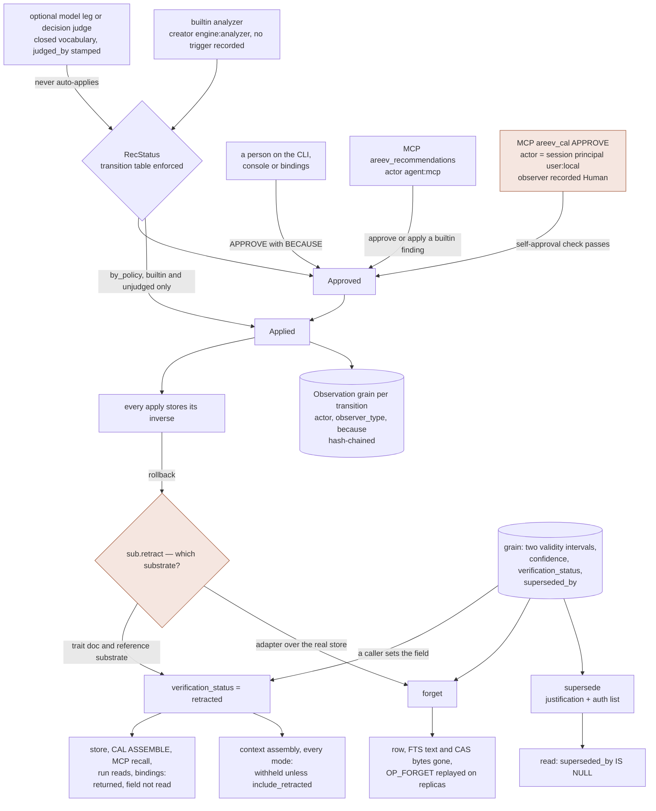

## 1. Executive Summary

Areev is a Rust runtime for governed, self-improving agents, built on a
content-addressed store of typed grains with one query language, CAL, over it
and a learning loop that turns recorded history into proposed changes. Its
correction model is unusually complete: world time and knowledge time are a
query parameter, supersession carries a justification, and `forget` clears the
text index and the attachment bytes and replicates. Two of its guarantees are
narrower than they read. A retracted grain is withheld at context assembly and
returned unpenalised on every other read surface, and the review queue the loop
fills can be cleared from the agent's own MCP tools.

The project describes itself as *"an open-source runtime for governed,
self-improving AI agents"*, and draws its cycle as run, record, propose,
evaluate, approve, apply, and measure the next runs.

**Two temporal axes, and the caller picks one.** `entity_at` takes an `Axis`:
`World` is *"What was true in the world at T"* over `valid_from`/`valid_to`;
`Knowledge` is *"What did the agent know at T"*, walking the supersession chain.
Both parse from the wire in every binding. Most bi-temporal systems store two
timestamps and query one; this one makes the question a parameter.

**Every review transition is recorded with a reason.** A transition writes an
Observation grain hash-chained to its predecessor, carrying the from and to
status, the actor, an observer type and a **mandatory** `because` capped at 500
characters. The transition table is enforced, and the one path that skips a
review is named where it is allowed: `Pending → Applied` requires `by_policy`,
*"the auto-apply actor, the only one permitted the reasonless `pending →
applied` jump."* A model-authored or model-judged proposal can never take it.

**Who may approve is weaker than how approval is recorded.** `Engine::review`
refuses an approval by the recommendation's creator, and by the principal that
triggered the run when the finding came from a model or an external analyzer.
Builtin analyzers record `engine:<analyzer>` as the creator and no trigger, so
the MCP server's `areev_recommendations` tool approves and applies their
findings as `agent:mcp`, which the project's own smoke test asserts. The MCP
server's `areev_cal` tool runs `APPROVE … BECAUSE` as the session principal. On
a default `areev serve --mcp` that is the owner, `user:local`, recorded as a
human. The `human_review` mark is withheld on that ground.

**Deletion is done properly, and the code says what that means.** `forget`
erases the row, clears the free-text index — *"a tombstone that leaves the text
findable is not a tombstone"* — reclaims the content-addressed attachment bytes,
and writes an op-log record that `import_bundle` replays, so an erasure reaches
replicas instead of diverging them.

**`verification_status` withholds at one door.** It is a four-value status held
apart from a `confidence` float and classified once, in
`areev_core::verification::Trust`, whose `is_actionable` is false for exactly
one value. Context assembly withholds a retracted grain in every rendering mode
and admits it only under an explicit `include_retracted` meant for audit reads.
The store does not filter, on purpose: the DSAR `subject_report` shares one
selector with erasure. Between them sit CAL's own `ASSEMBLE`, every MCP recall
tool, the declared memory reads of a workflow run, the bindings and the HTTP
server, and none of them reads the field.

The verb behind that status has **two incompatible definitions**. The
`OmsSubstrate` trait documents `retract` as *"Index-layer retraction
(`verification_status = retracted`)"* and *"Not destructive"*, and the in-memory
reference substrate implements that. The adapter over the real store declines —
*"No index-only retraction primitive exists; the honest mapping for undoing an
engine-created ADD is a tombstone of that grain"* — and calls `forget`. A
rollback erases on a real deployment and demotes in the engine's own tests.

The content hash a value-level tombstone would key on is not consulted on write.
The store names the forget-then-re-add scenario three times and solves its
concurrency half each time. The project's guarantees document asks whether the
re-assertion should be refused and declines for now, on a compliance ground:
*"May a rejection ledger keep a hash of content we just erased for someone?"*

Five marks: `trust_state`, `bitemporal`, `scope_enforced`, `audit_log` and
`negative_eval`. `tombstone` and `human_review` are withheld.

## 2. Mental Model

A memory is a **grain**: one of thirteen types under a versioned spec the code
calls OMS, content-addressed, and carrying more lifecycle metadata than most
records of its kind. `Fact`, `Event`, `State`, `Workflow`, `Tool`,
`Observation`, `Goal`, `Reasoning`, `Consensus`, `Consent`, `Skill`,
`Recommendation`, `Trigger` — and the enum carries its own migration hazard as a
comment, because `areev-store` indexes the type column as the ordinal:
*"inserting a variant mid-enum would silently renumber every stored row and
break type-filtered recall in every existing file."*

**Two axes describe a grain's standing and they are kept apart.**
`verification_status` is `unverified | verified | contested | retracted`, and the
comment records that it *"replaces deprecated `contradicted` boolean"* — widened
because a boolean could not say *contested*. Beside it sits `confidence: f64`.

**Correction has three moves, and the vocabulary distinguishes them.**
*Supersede* writes a successor, sets `superseded_by`, closes the record-time
interval, and carries a `supersession_justification` and a `supersession_auth`
list. *Retract* is the loop's inverse of an applied ADD, and its meaning depends
on which substrate answers. *Forget* erases.

**The loop above it is a proposal lifecycle.** An analyzer proposes a
`Recommendation` citing evidence by hash; a reviewer approves or rejects with a
reason; an apply stores its inverse; a later re-measurement can propose its own
revert. `RecStatus` is `Pending`, `Approved`, `Rejected`, `Applied`,
`RolledBack`, `Expired` and `Withdrawn`. The last is computed when every grain a
finding cited has moved, so a reviewer is not offered a finding whose evidence
is gone.

What the state machine does not decide is who stands on the reviewing side, or
where a caller-authored retraction stops. The diagram draws both.



## 3. Architecture

Seventeen crates, and the shape is a store with surfaces rather than a service.

- **`areev-cal`** (62,817 lines including tests) — the query language, and the
  largest crate.
- **`areev-store`** (29,819) — the content-addressed store over an embedded
  SQLite-compatible engine or Postgres: grains, triples, an OSP index for
  inbound traversal, `entity_latest` materialisation, an op log with a hybrid
  logical clock, a CAS for attachments.
- **`areev-run`** (28,525) and **`areev-run-core`** (6,734) — a workflow
  runtime with a journal, a credential broker, pause and resume, and plans that
  declare their memory reads.
- **`areev-loop`** (23,046) — analyzers, recommendations, the audit record, the
  optional model proposer, the decision-backend consumers, and a substrate trait
  third parties can implement.
- **`areev-core`** (19,921) — the grain types, the OMS wire format, authz
  primitives, pseudonymisation, and the decision-backend seam.
- **`areev-context`** (6,318) — budget-shaped context assembly and the priority
  model.
- **`areev-loop-adapter`** (3,132) — the loop's substrate trait over the real
  store, and the CAL governance host. Small, and where the two definitions of
  `retract` meet.
- Surfaces: **`areev-cli`**, **`areev-mcp`**, **`areev-server`**,
  **`areev-js`**, **`areev-py`**, **`areev-llm`**, **`areev-trigger`**, plus
  **`areev-conformance`**, **`areev-bench`** and a **`fuzz`** target.

### Deployment and ergonomics

*"Hooks, cron, CI, or your host invoke the loop; Areev runs no daemon."* A
memory is a file or a Postgres schema; the CLI, the MCP server and the bindings
all open it. The owner session is *"a local open with no principal asserted"*,
the implicit superuser, and `areev serve --mcp` opens one unless `--as` binds a
principal. That default matters in section 8.

The conformance crate runs its cases against the embedded store
(`crates/areev-conformance/tests/turso.rs`) and against Postgres
(`tests/pg.rs`), so the store's contract is tested against two engines rather
than asserted for both.

**Nothing here was built or run.** The screen found one committed git hook that
runs only if `core.hooksPath` is pointed at it, two `build.rs` files, three
unpinned dependency surfaces, and no dependency file inside the seven-day
cooldown. The tree was read rather than compiled. `AGENTS.md` and `CLAUDE.md`
were read as data. Benchmark figures in section 10 are the project's own.

## 4. Essential Implementation Paths

**Write** — a grain is serialised to the OMS format, hashed, and inserted with
its namespace, subject, predicate, object, both validity intervals and its
supersession pointers, with `INSERT INTO oplog(op_seq,hlc,op,hash,ns)` recording
the mutation.

**Supersede** — `UPDATE grains SET superseded_by=?1, svt=?2 WHERE seq=?3`
(`crates/areev-store/src/lib.rs:6608`). One statement closes the record-time
interval and points at the successor.

**Forget** — `crates/areev-store/src/lib.rs:6770` and the body that follows. A
chained Tier-2 authz audit record is refused first (`:6804-6834`). The
pre-transaction read takes only the `(ns, s, p)` key, because *"a concurrent
forget + re-add can move this hash to a new seq"* (`:6883`); the sequence is
re-resolved under the row lock. Then the row goes, the FTS postings go
(`:6951-6955`), the CAS attachments are reclaimed (`:7011`), and `OP_FORGET` is
written.

**Read** — CAL over hybrid recall: a vector query filtered by namespace and
optionally subject and predicate, a BM25 leg, graph traversal by relation with an
`In` direction served from the OSP index, and an optional reranker. Every gated
read passes the facade's `check_verb(Verb::Read, ns)` first.

**Time travel** — `entity_at(entity, t, axis)`. `Knowledge` walks the
supersession chain to what was current at `t`. `World` selects, among live
grains whose window contains `t`, the one that took effect most recently in world
time, ordering by `COALESCE(g.vf, g.created_at)` (`:8581-8620`).

**The loop** — an analyzer emits a `Recommendation` with a `dedup_key` computed
from the analyzer family, target and action kind, *"never author-chosen"*, a
template-rendered summary — *"never analyzer prose"* — a `metric_snapshot`, and
an `evidence_query` in CAL that regenerates the full evidence set when the cited
subset was truncated. A transition then writes the audit Observation.

**The model leg** — optional and additive: with no backend attached the stages
are the identity function. With one, a proposer, a separate GROUND call and a
separate VERIFY call run — *"proposer ≠ grounder"*. A garbled GROUND or VERIFY
response drops every draft, and the funnel counts verdicts and flags a failed
call separately, because *"a grounding pass that REFUSED every draft and one
that never answered are the same number of survivors and opposite problems."*

**The decision seam** — a host may install a *decision* backend, a model that
answers typed yes/no, choice and score questions with probabilities and no text.
The rule is in the module header (`crates/areev-core/src/decide.rs:21-23`):
*"A decision model may score and order; only code omits, gates, approves or
applies"*, and code that omits on a probability must check that the answer is
calibrated first. The loop uses it to ground drafts, widen its duplicate and
contradiction sweeps, and classify tool-failure causes. A recommendation a model
judged carries `judged_by` and never auto-applies.

## 5. Memory Data Model

`GrainCommon` (`crates/areev-core/src/types/grain.rs:164-190`) carries
namespace, user id, tags, confidence, source type, importance, temporal type,
four timestamps, content and embedding refs, a provenance chain, related-to
links, author and origin DIDs, origin namespace, `derived_from`, consolidation
level, success and failure counts, `superseded_by`, `verification_status`, an
invalidation policy, a supersession justification, a supersession auth list and
`created_at`.

**Bi-temporality is complete and queryable.** `valid_from` reaches the grain only
from a caller — the CAL and binding builders copy it from the supplied fields
(`crates/areev-cal/src/json_build.rs:871-886`) — and no writer defaults it to the
write clock. A grain without one answers world-time questions by its
`created_at`.

**`retracted` has no engine writer on a real deployment.** Model extraction
through `remember` stamps `unverified`, or `verified` on the facts a separate
grounding pass supports; nothing in production writes the withholding value. The trait
documents `retract` as setting it (`crates/areev-loop/src/substrate.rs:240-244`),
and the reference substrate does (`crates/areev-loop/src/reference.rs:290-301`).
The adapter over the real store declines
(`crates/areev-loop-adapter/src/substrate.rs:729-734`):

```rust
fn retract_op(f: &AreevFacade, hash: &str) -> WResult<()> {
    // No index-only retraction primitive exists; the honest mapping for undoing
    // an engine-created ADD is a tombstone of that grain.
    let h = Hash::from_hex(hash).map_err(we)?;
    f.with_store(|m| m.forget(&h)).map_err(we)
}
```

So `Engine::rollback` calling `sub.retract(h, …)` erases on the real store and
demotes in the engine's tests. Outside tests, the benchmark fixture and the
reference substrate, nothing in the tree writes `"retracted"`; that value is
caller-authored through the add builders.

**The consequence is split by surface, and the split is designed.** One
classifier, `Trust` (`crates/areev-core/src/verification.rs`), maps the four
values plus the non-OMS `"rejected"` and answers two questions: `is_actionable`
(`:19`), false only for `Retracted`, and `priority_delta` (`:27`), `-0.3` for
retracted and `-0.15` for contested. `ContextAssembler::select`
(`crates/areev-context/src/assembly.rs:792-845`) is the one selection the single
pass, census and timeline modes share. It collects every non-actionable hit
into a withheld set, drops any supersession chain touching one, and filters the
candidates before scoring. The decision judge is never shown a withheld grain
either (`:480-490`). `FormatPolicy::include_retracted` (`policy.rs:172`) is off
by default and exists for audit reads. `contested` keeps its penalty and is
never withheld.

Until 26 September 2026 the timeline and census modes ran selections of their
own. Timeline skipped the withheld filter, and the census section rendered a
prefix of its hits sized by the inner pass's count, so a dropped retracted grain
could shift into view.
[`86ed30e3bf938c67174d6d9e485e251b35c5cc82`](https://github.com/AreevAI/areev/commit/86ed30e3bf938c67174d6d9e485e251b35c5cc82)
routed every mode through `select` and added a test per mode. No in-tree caller
reached either mode before then: the two CLI commands passed default hints and
no census source.

**The store does not filter, and a conformance case pins that it must not.**
`store_recall_still_returns_retracted_grains`
(`crates/areev-conformance/src/cases/recall_purity.rs:95`) asserts store recall
returns a retracted grain and the DSAR `subject_report` discloses it, because
that report *"shares one selector with erasure, so filtering retraction inside
the store would make a DSAR under-disclose."*

**What lies between the two is the finding.** The assembler is reached by two
CLI commands, `recall --render` and `recall-hook`
(`crates/areev-cli/src/main.rs:2513`, `:3437`), and by the bench; only
`areev-cli` and `areev-bench` depend on `areev-context`. CAL's `ASSEMBLE`
displays the status as metadata. The MCP server's `areev_recall`,
`areev_search` and `areev_nearest` return store rows. A workflow plan's declared
`recall` read, the JS and Python bindings and the HTTP server never read the
field. On each of them a retracted grain reaches a model at full rank.

**The divergence in `retract` is outside the conformance kit by construction.**
The kit's `Backend` has two implementations, the embedded store and Postgres
(`crates/areev-conformance/src/lib.rs:92`, `:208`); the reference substrate
implements the loop's `OmsSubstrate`, a different trait. None of the seventeen
case modules calls `retract`. The one test that runs it on the real store,
`retracting_the_superseding_grains_restores_every_superseded_lesson`
(`crates/areev-loop-adapter/tests/adapter.rs:486`), asserts the post-condition
both implementations share — superseded members become heads again — and not
the one they disagree on, whether the retracted grain survives.

**The tombstone is the other near miss, and it is closer than most.** The store
is content-addressed, so the hash is the key a rejected-value tombstone needs.
What is absent is the consult. Three comments in `crates/areev-store/src/lib.rs`
— at the supersede recheck (`:6592`), inside `forget` (`:6883`) and in the
export path (`:7301`) — name the forget-then-re-add scenario and handle its
bookkeeping. Whether the re-assertion should be allowed is put in
`docs/memory-guarantees.md` under *"real gap, deliberately not implemented"*.
The document counts seven write paths and says a check that misses
`import_bundle` *"is bypassed by replication and is decorative"*. It names the
blocker as erasure: retaining a hash of erased content retains a derivative of
it.

The nearest mechanism is `add_if_novel` (`lib.rs:5013`), which checks the
`(ns, subject, relation, object)` key against live heads on one entry point. A
conformance case pins the opposite of a tombstone,
`reasserting_superseded_value_is_novel`: a superseded value written again is
accepted as new.

## 6. Retrieval Mechanics

One language over three arms. CAL compiles to a namespace-scoped vector query, a
BM25 leg, and graph traversal with `Out`, `In` or `Both`, where `In` is served
from the OSP index and *"only sees entity-valued relations"*.

**Scope is a predicate, before ranking**, on every arm, and the facade checks the
session's grants on the requested namespace before the store sees the query. An
id-addressed `get` resolves the grain and checks its namespace before returning
it (`crates/areev-cal/src/areev_facade.rs:2856-2860`).

**Scores are real and relative.** A recall score is rank-normalised reciprocal
rank fusion, or, under a reranker, the reranker's scores min-max normalised over
its pool. The project's own sweep found that a fixed `min_score` floor cuts
recall only when a second leg fires, and removed the floors its builtin
`ASSEMBLE` queries carried. The relevance floor with an absolute meaning is a
calibrated decision judgment, which only a calibrated backend may apply.

**Context assembly is budget-shaped and pseudonymised.** `areev-context` builds a
priority per candidate from a base by grain type, a score boost, a confidence
boost above 0.5, and the verification penalty, then fills a token budget.

**The failure mode is the one section 5 names.** Everything the store withholds,
it withholds by a predicate — a superseded grain by `superseded_by IS NULL`, a
foreign namespace by `ns = ?`, a forgotten grain by not existing. A retracted
grain is withheld by a set difference in the assembler, and nowhere else.

**Reading never changes belief, and a case pins it on both engines.**
`recall_never_mutates_belief` (`recall_purity.rs:30`) snapshots every field that
could drift, runs the read paths repeatedly, and asserts the snapshot and the
op-log length unchanged. The module header gives the reason: *"ranking by how
often a memory is retrieved makes a popular error indistinguishable from a
settled fact."*

## 7. Write Mechanics

Writes are synchronous and no model sits on the grain-write path. A model reaches
the store through the loop, as a proposal, or through a decision backend, as a
probability attached to one.

Until 2 September 2026 the bundle-import path wrote the grain row without its
BM25 postings, so a memory that had just imported answered `search_text` empty
until its next open. `insert_blob` (`crates/areev-store/src/lib.rs:11344`)
writes them, and `imported_grains_are_text_searchable_without_reopen` pins it on
both engines.

**Supersession is authorised, not merely recorded.**
`supersession_justification` and `supersession_auth` sit on the grain, so a
correction carries who permitted it and why.

**What a model may propose is a closed enum.** `DraftProposal`
(`crates/areev-loop/src/llm.rs:186`) has five variants — a lesson, a fact under a
model-chosen relation, a rewrite of a saved CAL query, field-level edits to a
workflow plan, and new source for a tool. Each is defined by what it cannot
carry: the model *"names the change but never names its own scope or its own
grader."* `plan_edit_allowed` (`crates/areev-loop/src/engine.rs:3138`) matches
only `edges.<i>.cond`, `edges.<i>.max_cycles` and `retries.<node>`, so a
topology change is not expressible. `safe_definition_body` (`:3058`) rejects a
query body containing a brace or `FORGET`, `PURGE`, `DROP` or `DEFINE`.

A definition rewrite is refused on the auto-apply path, because *"it changes what
every future context contains, so it requires a human APPROVE + APPLY with
BECAUSE"* (`:1500-1506`). Section 8 is about who that APPROVE can come from.

**Every apply stores its inverse**, and on the real store the inverse for an ADD
is a `forget`, so an undone recommendation is erased rather than demoted.

### Operational cost

No embedding pass on write unless the caller supplies one. No nightly
consolidation. The cost is the analyzers and triggers, which run when invoked,
and any model or decision calls a host attaches. The project reports its
decision reranker at about 0.4 seconds per recall and calls it a turn-level
refinement.

## 8. Agent Integration

A CLI, an MCP server, JS and Python bindings, an HTTP server, a workflow runtime,
and a substrate trait with a reference implementation the engine's own suite
runs against with no Areev dependency.

**Agency over memory is bounded by the grant model.** Policy is grant grains in
the file, credentials are host-side, and the default is refusal for any bound
principal. The owner session never meets it.

**Agency over the review queue is not.** The MCP server's
`areev_recommendations` tool takes `action: apply | approve | reject`, a hash and
a reason, and calls `Engine::review` with the literal actor `"agent:mcp"`
(`crates/areev-mcp/src/lib.rs:1225-1276`). `Engine::review`
(`crates/areev-loop/src/engine.rs:1544`) refuses an approval when the actor is
the recommendation's creator (`:1578`) or the principal that triggered the run
that authored it (`:1585`). The trigger is recorded only for model and external
findings: *"Builtin analyzers stay engine-only: deterministic output has no human
author"* (`:491-498`). So the agent can run `areev_loop` and then approve and
apply what it surfaced. The smoke test asserts the approval, reasoning that the
creator is `engine:<analyzer>`, *"so the agent reviewing it is not approving its
own proposal"* (`crates/areev-cli/tests/mcp_smoke.rs:738-743`).

**The second door is `areev_cal`.** The MCP server attaches the CAL governance
host to its executor (`lib.rs:275`), so `APPROVE <hash> BECAUSE "…"` and `APPLY`
run through `LoopGovernance`. That host takes the actor from the session
principal and the observer type from the principal's prefix
(`crates/areev-loop-adapter/src/governance.rs:137-155`,
`crates/areev-loop-adapter/src/lib.rs:227-231`). `serve --mcp` without `--as`
keeps the facade's owner principal, `user:local`
(`crates/areev-cal/src/areev_facade.rs:260`), which is not `agent:mcp` and whose
observer type is `Human`. An MCP client can therefore approve a recommendation
the `agent:mcp` identity triggered, and the audit row records a human.

The MCP server's own comment says the opposite — that *"an MCP agent can never
satisfy separation of duties by naming two labels for itself"*
(`lib.rs:310-318`). It holds for the run tools it sits above, which use
`run_identity()`, and not for the CAL tool beside them.

A host can close both doors: bind `--as` to a principal without the loop review
scopes. Serving `--profile memory` hides `areev_recommendations` but not
`areev_cal`. The default closes neither, so the agent that triggered a finding
can clear its review from its own tool surface.

**The capability gates in the substrate trait fail closed.** `put_blob` and
`get_blob` default to refusing — *"CAPABILITY-GATED: the default refuses, so a
loop can only carry code on substrates that explicitly opt in"* — and `retract`
defaults to unsupported.

## 9. Reliability, Safety, and Trust

**Provenance is a chain, not a field**: `provenance_chain`, `author_did`,
`origin_did`, `origin_namespace`, `derived_from`. Recommendations cite evidence
by hash and carry a CAL query that regenerates it.

**The op log is append-only; the review record above it is erasable.** The op
log has seven insert sites, no delete, and one update
(`crates/areev-store/src/lib.rs:2802-2809`, `crates/areev-store/src/pg.rs:151-162`).
That update runs at open and fills the `ns` column, added on 18 September 2026,
for rows where it is NULL, from the grain each row names. Tombstones keep NULL,
because *"the namespace is genuinely unrecoverable and a consumer must see that
rather than a guess."* No mutation's op, clock or hash is rewritten.

The loop's Observation audit grains are ordinary grains. `forget` refuses only a
chained Tier-2 authz record (`lib.rs:6804-6834`), and an age-based sweep may
purge the audit namespace under the store's retention floors and holds.

**The review record can misstate who decided.** The audit row's `observer_type`
comes from the principal's prefix, so an approval an MCP client makes through
`areev_cal` under the owner session is recorded as `Human` by `user:local`.

**Erasure is treated as a security property.** The comments make the standard
explicit on text and on attachment bytes, and name the file-level path as the
strong one: *"File-level crypto-erasure remains the strong path."*

**Uncertainty is represented in two registers and only the stronger one is
enforced.** `contested` costs a grain 0.15 of priority inside the assembler and
is never withheld; `retracted` is withheld there.

**The withholding is measured in both directions.** `honesty_metrics` M5
(`crates/areev-bench/src/bin/honesty_metrics.rs:259-333`) stores twelve live
and four retracted grains, counts the store returning all sixteen, and reports
two counts from assembly — retracted grains surfaced, live grains dropped. M6
(`:336-383`) asserts six write-to-readable legs, locally and on a replica after
import.

**Two marks withheld.** `tombstone`, because the content hash is not consulted
on re-add and the project has written down why not yet. `human_review`, because
the agent's MCP surface approves ([section 8](#8-agent-integration)).

## 10. Tests, Evals, and Benchmarks

**3,366 test functions** across the seventeen crates, a fuzz target, a
`deny.toml`, and a conformance crate whose cases take `b: &dyn Backend` and
report `b.name()` in every assertion message. The embedded runner needs no
external service; the Postgres runners need a database.

The negative cases are non-vacuous by construction. `forget_clears_head_row`
asserts the head exists before forgetting and then four absences.
`forget_new_head_does_not_resurrect_old` forgets the newer version and checks
the older one stays superseded while `get(&h1)` succeeds — *"old blob is still
readable, just not live"*. That is the withheld-versus-deleted distinction in
two lines.

`ns_scope` covers the leak directly: after seeding a value in another namespace,
it asserts the BM25 leg does not return it, under the message *"BM25 leg leaked
outside the scope"*. It also asserts that a malformed pattern refuses while an
unknown prefix answers empty. And `crates/areev-conformance/tests/pg.rs:234`
asserts `telemetry_access_stats(...).is_empty()` under *"scrubbed on forget"*.

**The withholding is tested in every mode.** Unit tests in `assembly.rs`
(`:3848`, `:3863`, `:3874`, `:3889`, `:3919`, `:3954`) assert that a retracted
grain is withheld from the body, the Knowledge Update section, the timeline and
the census section, that the opt-in admits it, and that a contested grain is
demoted and never withheld.

**What no test covers is where the gaps are.** No case calls `retract` against
both substrates. No test asserts that an MCP client cannot approve; the smoke
test asserts that it can.

**The benchmark harness ships; the run records do not.**
`crates/areev-bench/results/` holds one README, *"Results moved"*, pointing at
`AreevAI/areev-benchmark`. That address returns 404 to an unauthenticated
request, and the `AreevAI` organisation lists four public repositories without
it. The apparatus is in the tree: `crates/areev-bench/scripts/verify_run.py`
recomputes a run's tables from its transcripts and writes a `MANIFEST.md` with
the command, the git rev and a SHA-256 of every file, and
`crates/areev-bench/tests/golden/reproducibility.txt` pins the task-set digests.
What is missing is the run directories they verify, so the published figures
cannot be checked against their transcripts from either location.

The manifest design is worth naming. Regeneration compares the body
byte-for-byte except for a blockquote under the title, which survives, so a run
can record that the scorer moved after it ran. The script's docstring says why
the note is prose and never a number: *"every file is still checksummed, so a
note cannot make a changed transcript verify."*

**Decision reranking on LoCoMo retrieval**, measured by the project on 25
September 2026 and stated in `RESULTS.md` §9: over a lexical-floor pool of up to
64 turns, a calibrated decision backend raised hit@1 from 18.6% to 51.8% and
hit@20 from 49.3% to 65.9%, against an oracle positive control reaching the
pool's ceiling of 66.3%. Retrieval only, no reader or judge, one provider and one
model version. The file records that the first full run hit a parser tolerance
bug, and states those numbers too. Not reproduced here.

### A real workflow, paired, and three null results it exposed

`crates/areev-bench/EXPENSE.md` measures governed self-improvement on a private
corpus — one company's supplier invoices and the spreadsheet a person fills in
from them, 206 rows, none in the repository. Eight exploratory whole-run
comparisons were discarded because two runs differing only by a prompt header
scored 13.0% and 0.9%: *"the noise between runs was larger than the effect being
looked for."* So each held-out invoice is its own control, read twice under
prompts identical except that the learned rules are present or rolled back.

| Seed | Rules on vs rolled back | Noise floor, same state twice | p |
| --- | --- | --- | --- |
| 1 | 21 wins, 0 losses | 1 | <0.0001 |
| 2 | 32 wins, 0 losses | 1 | <0.0001 |
| 3 | 30 wins, 0 losses | 0 | <0.0001 |

Thirty invoices, 210 field trials per arm, McNemar's exact test over the
discordant pairs. The document reports against itself: absolute accuracy is low,
17% exact; three fields never move; and the running score during learning falls.

The three engine defects the run exposed are the sharper result, because each
*"produced a plausible null result rather than an error"*. Every human note in
every memory reached the model as an empty string, because the renderer's
fact-triple branch needed a relation an Observation lacks. A lesson could only
prevent, never start doing something, so a rule to *"validate all required
fields before submission"* passed every gate and changed nothing. And a failing
grader was indistinguishable from a model with nothing to say. **A proposal can
clear every gate the engine has and still be a no-op**, because no gate asks
whether the wording names an action the agent can take.

## 11. For Your Own Build

### Steal

- **Make the temporal axis a query parameter.** `entity_at(entity, t, axis)`
  with `world` and `knowledge` in the wire protocol turns "what was true" and
  "what did we believe" into two answerable questions.
- **Require the reason in the type.** `AuditRecord.because` is a `String`, not
  an `Option<String>`, capped at 500 characters.
- **Hash-chain the decisions, not just the data.** One Observation per
  transition, each pointing at its predecessor.
- **Write down what a tombstone has to clear.** *"A tombstone that leaves the
  text findable is not a tombstone"*, and the same for attachment bytes.
- **Route every rendering mode through one selection.** The timeline and census
  modes leaked a withheld grain until they shared `select`; one selection makes
  a withholding a property rather than a per-mode habit.
- **Withhold where the model reads and disclose where the person does.** One
  classifier answers "may this be acted on"; the assembler filters on it and the
  DSAR selector is required, by a conformance case, not to.
- **Let a probability reorder, never approve.** A decision answer carries whether
  it is calibrated, an uncalibrated one never omits, and a judged recommendation
  never auto-applies.
- **Never let the proposer name its own scope or its own grader**, and make the
  dangerous edits unmatchable rather than disallowed.
- **Report abstention in both directions**: grains surfaced that should have
  been withheld, and grains withheld that were held.
- **Pin that reading never writes**, and reopen the file so a buffered write
  cannot pass.

### Avoid

- **Separation of duties that exempts the deterministic producer.** A builtin
  finding has no author on record, so any actor may approve it — including the
  agent whose tool call triggered the run.
- **Two identities for one client.** The MCP server acts as `agent:mcp` on its
  loop tools and as the owner on its CAL tool, and the observer type follows the
  label, so an agent's approval is recorded as a human's.
- **Withholding in one crate and calling it a guarantee.** CAL `ASSEMBLE`, the
  MCP tools, run reads and the bindings hand a retracted grain to a model at
  full rank.
- **Documenting a trait method as one thing and implementing it as another.**
  The adapter's erasure is the better choice, and the trait should say so.
- **Computing the key a refusal needs and not consulting it.**

### Fit

Read it if you are building memory that has to survive a security review, or
have written `superseded_by` into a schema and not decided what a retraction is
as distinct from it. The three-verb vocabulary — supersede, retract, forget — is
worth taking on its own, and so is the decision seam's rule.

Adopt it carefully if the review queue is the property you need. The record of a
decision is strong; the gate on who may make it binds only when the host binds a
principal, and the default MCP server does not. The retraction it withholds at
the assembler reaches a model through CAL, the MCP tools and the bindings —
though a recommendation rolled back through the loop is erased outright on the
real store.

## 12. Open Questions

- **Will the withholding reach CAL and the MCP tools?** The guarantees document
  names `WITH include_retracted` as the likely CAL shape. Nothing in `areev-cal`,
  `areev-mcp` or `areev-run` reads `Trust`.
- **Should the MCP server's CAL governance act as the server's identity?** The
  run tools use `run_identity()`, which is `agent:mcp` for an owner session; the
  CAL executor takes the facade principal instead.
- **Which `retract` is the contract?** The adapter erases and the trait documents
  a demotion; a substrate-level conformance case would pin one.
- **May a rejection ledger keep a hash of erased content?** The project's own
  question, and the one blocking the tombstone. The op log holds every
  `OP_FORGET` hash, so the mechanism is cheap.
- **Will the run records be public again**, and do the published self-improvement
  numbers survive the scorer that replaced theirs?
- **Does any gate ask whether a lesson names an action?** The expense run showed
  a rule can clear every gate and change nothing.

## Appendix: File Index

| Path | What to read it for |
| --- | --- |
| `crates/areev-core/src/types/grain.rs:12-33`, `:164-190` | The thirteen grain types, the ordinal comment, `GrainCommon` |
| `crates/areev-core/src/verification.rs:10-27` | `Trust`, `is_actionable`, `priority_delta` |
| `crates/areev-core/src/authz.rs:1-16`, `:321-328` | The grant model, the fail-closed default, `observer_kind` |
| `crates/areev-core/src/decide.rs:1-31` | The decision seam and its rule |
| `crates/areev-store/src/lib.rs:40-99` | `OP_FORGET`, `Axis` and its wire spellings |
| `crates/areev-store/src/lib.rs:1932`, `:2802-2809` | The op-log schema and the `ns` backfill |
| `crates/areev-store/src/lib.rs:6770-7030` | `forget`, the Tier-2 refusal and the tombstone standard |
| `crates/areev-store/src/lib.rs:8581-8620` | The world-axis query |
| `crates/areev-context/src/assembly.rs:792-845`, `:3848-3975` | The shared selection and the withholding tests |
| `crates/areev-context/src/render.rs:234-241` | `adjusted_priority` and the verification penalty |
| `crates/areev-loop/src/recommendation.rs:676-765` | `RecStatus`, `can_transition_to`, `AuditRecord` |
| `crates/areev-loop/src/engine.rs:479-498`, `:1544-1600` | Creator and trigger recording, `review` and the self-approval block |
| `crates/areev-loop/src/substrate.rs:177-265`, `crates/areev-loop/src/reference.rs:290-301` | `retract` as documented and as the reference substrate does it |
| `crates/areev-loop-adapter/src/substrate.rs:729-734` | `retract_op` mapping it to `forget` |
| `crates/areev-loop-adapter/src/governance.rs:137-155` | CAL `APPROVE` acting as the session principal |
| `crates/areev-mcp/src/lib.rs:275`, `:310-326`, `:1190-1276` | Governance on the MCP CAL executor, `run_identity`, the loop and review tools |
| `crates/areev-cli/tests/mcp_smoke.rs:738-743` | The agent approving a builtin finding, asserted |
| `crates/areev-conformance/src/lib.rs:92`, `:208` | The two `Backend` implementations |
| `crates/areev-conformance/src/cases/supersede_forget.rs`, `ns_scope.rs`, `recall_purity.rs` | The negative cases |
| `crates/areev-bench/src/bin/honesty_metrics.rs:259-383` | M5 and M6 |
| `crates/areev-bench/RESULTS.md`, `EXPENSE.md`, `scripts/verify_run.py` | The project's figures and the verification apparatus |
| `docs/memory-guarantees.md` | The five decisions, including the two deliberately not built |

### Recorded searches

Run at the tree root of the pinned checkout with `git grep`.

- `git grep -nE 'UPDATE oplog|DELETE FROM oplog'` — `crates/areev-store/src/lib.rs:2806` and `crates/areev-store/src/pg.rs:162`, both the NULL-`ns` backfill; no delete.
- `git grep -c 'INSERT INTO oplog' -- crates/areev-store/src/lib.rs` — 7.
- `git grep -nE 'retract\(|fn retract|\.retract\b' -- crates/areev-conformance/` — no match.
- `git grep -nE 'impl Backend for' -- crates/areev-conformance` — `TursoBackend` and `PgBackend` only.
- `git grep -lE 'verification::Trust|include_retracted|is_actionable' -- '*.rs'` — `areev-core/src/verification.rs`, three files in `areev-context`, `areev-cli/src/corpus.rs` and `areev-bench/src/bin/honesty_metrics.rs`.
- `git grep -nE 'Trust::|include_retracted' -- crates/areev-cal crates/areev-mcp crates/areev-run crates/areev-server crates/areev-js crates/areev-py` — no match.
- `git grep -nE 'areev-context' -- 'crates/*/Cargo.toml'` — dependents are `areev-bench` and `areev-cli` only.
- `git grep -nE '"retracted"' -- '*.rs'` — the reference substrate, the benchmark fixture, tests and the classifier; no other writer.
- `git grep -nE 'with_governance' -- crates/areev-mcp/src` — `lib.rs:275` and `:473`; the MCP CAL executor carries the governance host.
- `git grep -n 'AuthzSet::owner("user:local")' -- crates/areev-cal/src` — `areev_facade.rs:260`, the default facade principal.
- `git grep -nE 'co_creators\.insert' -- crates/areev-loop/src/engine.rs` — one site, inside `if !matches!(rec.origin, Origin::Builtin)`.
- `git grep -nE '"tier2"' -- '*.rs'` — `authz.rs:428`, the CLI export check and the store's forget refusal; no loop audit grain carries it.
- `git grep -niE 'rejection ledger|rejected[_ ]value' -- 'crates/*.rs'` — no match.
- `git grep -cE '^[[:space:]]*#\[(test|tokio::test)' -- 'crates/*.rs'`, summed — 3,366; over `'*.rs'`, 3,418.
- `git grep -niE 'anthropic|machine learning|not (be )?used (for|to)' -- LICENSE-MIT LICENSE-APACHE` — no match; no rider.

## History

**2026-10-15** — [`34f0163c829364f8bc9f06feb6d237adcf4180b0`](https://github.com/AreevAI/areev/commit/34f0163c829364f8bc9f06feb6d237adcf4180b0) — 85 commits on, to version 1.12.2. Five marks, from six: `human_review` was wrong at the previous pin, because the agent's MCP tools approve and apply builtin findings and `areev_cal` approves as the owner, recorded as human ([section 8](#8-agent-integration)). Also wrong then: an op-log update said not to exist, a conformance kit said to run against the reference substrate, a verification script said to be absent, a `-0.3` said to apply outside the assembler, and store line anchors from an earlier pin ([section 9](#9-reliability-safety-and-trust)). Overtaken: every rendering mode withholds ([section 5](#5-memory-data-model)), a decision-backend seam arrived, the README was rewritten. Screened from a full clone: one committed hook, two build scripts, three unpinned surfaces, nothing inside the cooldown; `AGENTS.md` and `CLAUDE.md` read as data. Nothing was installed, built or run.

**2026-09-19** — re-pinned to [`5b6b29f3924ae02ecc2a366d7dbf16d56a7f77d6`](https://github.com/AreevAI/areev/commit/5b6b29f3924ae02ecc2a366d7dbf16d56a7f77d6), 23 commits on. All six marks stand. `human_review`'s anchors all moved and were re-verified, and the record gained the producer test it had been asserted without. The MCP server does call `.review(..., Decision::Approve, actor, ObserverType::Agent, ...)`, so the first reading of that line looks like an approve verb on the agent's own surface. But `Engine::review` raises `Error::SelfApproval` twice over, once when the actor created the recommendation and once when it triggered the run that authored it, and the MCP actor is the hardcoded literal `"agent:mcp"` rather than anything the model supplies. So the producing side is refused by construction.

What the design does not claim, and the record now says, is that this is separation of duties rather than a human gate: an agent may approve a recommendation from a run it did not trigger, and the audit row records `ObserverType::Agent` instead of refusing. Screened again first; nothing was installed and no suite was run.

**2026-09-16** — [`ebd9ad95f674ecf88aa45a600d7ce1712a528e51`](https://github.com/AreevAI/areev/commit/ebd9ad95f674ecf88aa45a600d7ce1712a528e51) — re-read at a commit dated 16 September 2026, 365 commits past the previous pin. All six marks re-tested against their mechanisms and held, with the anchors intact: the two withholding tests in `areev-context/src/assembly.rs` sit at the same lines, and the conformance cases the scope and negative-evaluation marks rest on are unchanged. The substantive change is to the evidence rather than the engine. The published run records — transcripts, manifests, `scripts/verify_run.py` and the pinned digests in `tests/golden/reproducibility.txt` — are no longer in this repository; `crates/areev-bench/results/` holds one README saying they moved to `AreevAI/areev-benchmark`, and that repository returns 404 unauthenticated, with the `AreevAI` organisation listing four public repositories and no benchmark among them. The report's account of the receipts is corrected accordingly.

Screened before reading, from a full clone so the dependency ages are the project's own: one auto-run surface, two build-time execution points, three unpinned dependency surfaces and thirty dependency files inside the seven-day cooldown. `AGENTS.md` and `CLAUDE.md` are addressed to a reading agent and were recorded as data. Nothing was installed, built or run, and no benchmark was reproduced.

**2026-09-02** — [`8b0f012671c1792204182fa2589426176a627ccf`](https://github.com/AreevAI/areev/commit/8b0f012671c1792204182fa2589426176a627ccf) — re-pinned 11 commits on, through v1.7.1. Screened before reading: no auto-run surface, two build-time execution surfaces, three unpinned surfaces, and nineteen dependency surfaces inside the seven-day cooldown, `Cargo.lock` and `Cargo.toml` at zero days. Nothing was built and nothing was run; `AGENTS.md` and `CLAUDE.md` were read as data.

**`trust_state` moves from withheld to awarded — five marks to six.** `areev_core::verification::Trust` classifies `verification_status` once, `is_actionable` is false for `retracted` alone, and `ContextAssembler::format` withholds every non-actionable hit by default, from the body and from the Knowledge Update section, under an opt-in `include_retracted` for audit reads. The mark's own line is usage — a state gets filtered — and one read path filters. The reach is the finding the report carries in its place: the assembler is reached by two CLI commands and the bench, while CAL `ASSEMBLE`, the MCP recall tools, the bindings and the server still hand a retracted grain to a model, and `areev-cal` is byte-identical to the previous pin. The store keeps returning retracted grains by design and a conformance case pins it, because the DSAR selector is shared with erasure.

The change arrived with `docs/memory-guarantees.md`, which works through five findings and records the two it deliberately did not build. Three of the five are the ones this report published — the ranked retraction, the unconsulted content hash, the abstention that was not measured — stated in the document's own words rather than the atlas's, which cites nothing. The tombstone stays withheld on the ground the document gives: a content hash of erased content is a pseudonymous identifier, so a refusal ledger may not survive an erasure obligation, and that is a compliance decision the maintainer declines to guess.

Also in range: `recall_purity.rs` pins on both backends that no read path writes a field or an op-log row; `insert_blob` writes BM25 postings, closing a replica text leg that answered empty until the next open; `honesty_metrics` gained M5, withholding reported in both directions, and M6, six write-to-readable legs. And `EXPENSE.md` publishes a paired McNemar measurement on a private invoice corpus that exposed three engine defects producing plausible null results, one of them that every human note had reached the model as an empty string.

Absence claims re-run. `rg -n retract crates/areev-conformance/` returns hits at this pin, all of them the *status* in `recall_purity.rs`; the claim was re-scoped to the verb and its command rewritten, and no case calls `retract`. The op-log greps hold; the seven insert sites moved to 5127, 5290, 5932, 6153, 8090, 8851, 9374. Counts: 185,265 Rust lines across seventeen crates, 270 commits, 2,575 test functions in `crates/` and 2,597 tree-wide, eleven conformance case modules. Line citations in `engine.rs`, `integration.rs`, `render.rs` and `corpus.rs` were re-resolved; the trait, reference substrate, adapter, grain and authz files did not move.

**2026-09-01** — [`e31adeb23c28c207e1802a4927ca2f1ba86ff2db`](https://github.com/AreevAI/areev/commit/e31adeb23c28c207e1802a4927ca2f1ba86ff2db) — re-pinned 17 commits on. Screened before reading: **no auto-run surface**, two build-time execution surfaces (`crates/areev-js/build.rs`, `crates/areev-py/build.rs`), three unpinned surfaces, and **twenty dependency surfaces inside the seven-day cooldown** — up from fourteen, and all but one at zero days, because a release landed the day before. Nothing was built and nothing was run; `AGENTS.md` and `CLAUDE.md` were read as data.

One published claim was **wrong when it was written**, not overtaken. Section 10 said `areev-bench` ships no committed result file, leaderboard or run artifact and that no performance claim could be checked. `crates/areev-bench/results/` held a LoCoMo run with per-question transcripts and three `selfimprove_aba` run directories at the previous pin as well as this one, each with a `MANIFEST.md` carrying a SHA-256 of every file — a benchmark-evidence discipline stricter than anything else this reading has compared it against, missed by a reading that took the crate's size for its output. Section 10 and the corresponding open question are rewritten. The error direction is the one that matters: a criticism of an absence that was not absent.

The mechanism the report is about did not move. `crates/areev-store/src/lib.rs`, `crates/areev-context/src/render.rs`, `crates/areev-cli/src/corpus.rs`, `crates/areev-mcp/src/lib.rs`, `crates/areev-core/src/types/grain.rs`, `crates/areev-core/src/authz.rs` and every file under `crates/areev-conformance/` are byte-identical between the two commits, so both sharp findings stand unchanged and re-verified: `retract` still means a non-destructive demotion in the trait doc (`substrate.rs:210-217`) and the reference substrate (`reference.rs:245-258`) and an erasure in the adapter (`loop-adapter/src/substrate.rs:645-650`), and `rg -n retract crates/areev-conformance/` still returns nothing across ten case modules. The read path still spends the status as `-0.3`. `rg -n 'UPDATE oplog|DELETE FROM oplog'` still returns nothing; `INSERT INTO oplog` still returns the same seven sites.

What moved is the loop. An optional model leg gained a **closed proposal vocabulary** — lesson, fact, query revision, plan revision, code revision — with the bounds enforced structurally rather than by prompt: the subject, target and grading evalset are all resolved from the store rather than named by the model. `plan_edit_allowed` matches only three threshold paths so a topology change is inexpressible; `safe_definition_body` refuses a brace or a `FORGET`/`PURGE`/`DROP`/`DEFINE` token; a definition rewrite is refused on the auto-apply path outright; and a code revision is refused an apply without the run id of an evaluation against the tool's own declared evalset. Sections 4, 7 and 11 carry it, and the diagram gains the model leg entering the same gate. `crates/areev-loop-adapter/tests/proposal_substrate.rs` is new and asserts five of those refusals by name.

Five marks, unchanged in both directions. `human_review` is better evidenced than it was — the new paths are categorically excluded from auto-apply — and nothing bears on `tombstone` or `trust_state`, whose evidence files did not change. One claim was tightened rather than corrected: the report said no query in the tree excludes on `verification_status`; CAL can express the predicate and a committed test writes it, so the claim is now scoped to the system's own recall and assembly paths, which is both runnable and the sharper version. Counts: 184,611 Rust lines across seventeen crates (was 181,665), 259 commits (242), 2,564 test functions in `crates/` (2,525) and 2,586 tree-wide (2,547), `areev-loop` 13,633 (12,095) and `areev-bench` 11,132 (10,141). No paper, no `CITATION.cff`.

**2026-08-31** — [`663caa8b0897f82a59a29dba0a7232639c55bc1f`](https://github.com/AreevAI/areev/commit/663caa8b0897f82a59a29dba0a7232639c55bc1f) — count audit at the same pin, alongside the `retract` reading below. Two figures were low. The `audit_log` evidence record said the oplog row is inserted at six sites; `grep` for `INSERT INTO oplog` in `crates/areev-store/src/lib.rs` returns seven — 5127, 5290, 5932, 6153, 8090, 8838, 9358 — and the record's citation list carried only four of them. Section 10's test-function count was 2,522; counting `#[test]` and `#[tokio::test]` across `crates/` on the same scope as the 181,665-line figure gives 2,525. Tree-wide, including `areev-sandbox/`, `fuzz/` and `examples/`, it is 2,547. "Never updated or deleted" holds: no `UPDATE oplog` or `DELETE FROM oplog` exists anywhere. No finding or mark changed.

**2026-08-31** — [`663caa8b0897f82a59a29dba0a7232639c55bc1f`](https://github.com/AreevAI/areev/commit/663caa8b0897f82a59a29dba0a7232639c55bc1f) — second reading at the same commit, correcting one claim about `retract`. The first reading traced the verb to the `OmsSubstrate` trait doc and the in-memory reference substrate, both of which define it as a non-destructive `verification_status = retracted`, and reported rollback as writing that status. `crates/areev-loop-adapter/src/substrate.rs:513-518` overrides it for the real store, rejecting the mapping in a comment — *"the honest mapping for undoing an engine-created ADD is a tombstone of that grain"* — and calling `forget`. A rollback on a real deployment therefore erases; the demotion is what the trait promises and what the test double does, and `crates/areev-loop/src/reference.rs:182` is the only automatic writer of `"retracted"` in the tree, which makes the status caller-authored in practice. `trust_state` stays withheld on the unchanged read-path evidence: the `-0.3` penalty at `crates/areev-context/src/render.rs:237-241` is still how the status is consumed and no query excludes on it.

Two findings added: the trait and its production implementation disagree about what `retract` means, and no case in `crates/areev-conformance/src/cases/` exercises it, so the multi-backend kit does not cover the one operation whose backends diverge. The re-add finding is unchanged and sharpened — the store names the forget-then-re-add scenario at three sites and solves the concurrency half at each.

**2026-08-30** — [`663caa8b0897f82a59a29dba0a7232639c55bc1f`](https://github.com/AreevAI/areev/commit/663caa8b0897f82a59a29dba0a7232639c55bc1f) — first reading, at 242 commits. Screened before reading: no auto-run surface, two build-time execution surfaces, three unpinned surfaces, and **fourteen dependency surfaces inside the seven-day freshness cooldown** including `Cargo.lock`, so nothing was built and nothing was run; `AGENTS.md` and `CLAUDE.md` were read as data. Five marks. The report is organised around the three correction verbs, because supersede, forget and retract have three different read-path consequences here and only two of them withhold — which is also why the two missing marks are the two about belief rather than about process.
