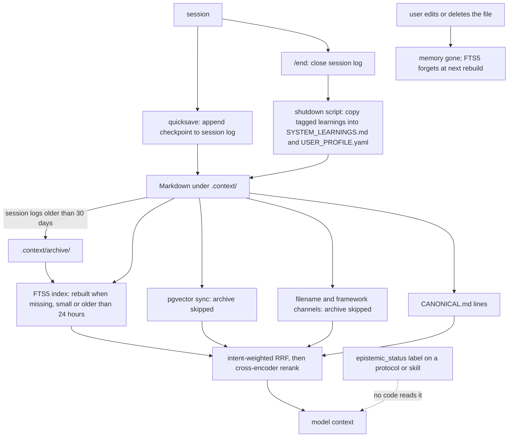

## 1. Executive Summary

Project Athena is a local-first personal memory layer: Markdown files under
`.context/` that a session routine writes and five retrieval channels read,
reached from Claude Code, Cursor, Gemini CLI or Antigravity. What is notable
is how it describes itself — a README table that marks each claim shipped,
partial or N=1 — and a written convention for labelling every mechanism
`code-enforced`, `agent-discretion` or `aspirational`. What is weak is that
no code reads that convention, no memory carries a status, and the action log
named as the system's black box has no caller.

**The table is the artifact to read.** The README section *"What's enforced in
code vs. by prompt"* opens with "Most AI-agent READMEs state every claim in the
same confident voice. This one doesn't." and grades five claims:

| Claim | Status |
| --- | --- |
| Storage & retrieval | ✅ Shipped |
| Portability | ✅ Shipped — "Structural — inspect the repo" |
| Governed autonomy | ✅ Shipped (partial) — "Ruin check blocks 14/16 destructive commands" |
| Compounding personalization | 🟡 N=1 evidence — "1,900+ sessions by the author; no multi-user study" |
| Anti-sycophancy | 🟡 Partial mitigation — "Claude Code only" |

The anti-sycophancy row carries its evidence in `docs/WHY_ATHENA.md:47`, which
cites user-memory profiles raising agreement sycophancy **+45%** on Gemini 2.5
Pro (Jain et al. 2025) atop a ~58% baseline (SycEval 2025), and then: "Athena
is *built on* that mechanism." Its defence is a meta-awareness gate injected by
a Claude Code hook, and the same paragraph states the limit: "the gate is
Claude-Code-only today."

**The convention behind the table is prose.** `examples/workflows/_shared.md:67-86`
defines it, names the failure it prevents — a protocol describing machinery in
the present tense "that **no code implements**" — and tells the reading agent
how to treat each label, down to "Do NOT assume it runs." Twenty of 586
Markdown files carry a label, six of them as an `epistemic_status:` frontmatter
key. No Python, shell or SQL file reads that key.

The convention also misfires in its own vocabulary. `AGENTS.md:219` labels the
`context_gate` invocation `code-enforced` "in Antigravity via `.agents/hooks.json`",
and no `.agents/` directory exists in the tree, nor does any file write one.

## 2. Mental Model

A memory is a Markdown file the user owns and can edit. It becomes one when the
agent writes it during a session — `quicksave` appends a checkpoint to the
session log, `/end` closes the log — or when the shutdown script copies tagged
learnings (`[S]`, `[U]`, `[V]`) into `SYSTEM_LEARNINGS.md`,
`USER_PROFILE.yaml` and `Session_Observations.md`.

There is no state machine. A memory has no status, no confidence and no
supersession pointer; it is believed for as long as it is on disk and
retrievable, and it stops being one when the user edits or deletes it. The
nearest thing to a demotion is location: `archive_manager.py` moves session
logs older than 30 days under `.context/archive/`. The bulk vector sync and
the filename and framework channels skip any path containing `/archive`; the
FTS5 channel indexes it.

The epistemic vocabulary sits on documents about the system — protocols,
skills, the README — rather than on memories. A protocol labelled
`aspirational` is retrieved and injected exactly as one labelled
`code-enforced`; the instruction to treat it differently is addressed to the
model.

## 3. Architecture

Python over a Markdown corpus. `src/athena/` holds the SDK: `boot/` and
`lifecycle/` for the session routine, `memory/` for the vector sync and
chunker, `tools/` for search, `core/` for governance and permissions,
`intelligence/` for the decision engines, and `mcp_server.py` with nineteen
tools. A second MCP server, `duckdb_mcp_server.py`, exposes DuckDB over files
on disk and touches no memory.

Retrieval needs nothing running: FTS5 lives in `.athena/exocortex_fts.db`, and
the canonical, filename and framework channels read files directly. The vector
channel needs a Supabase project with pgvector and an embedding key; without
one it contributes nothing and the other four carry the query. The
cross-encoder reranker is on by default in `smart_search`
(`src/athena/tools/search.py:1123`) and is a no-op unless the `rerank` or
`full` extra installed sentence-transformers.

`src/athena/core/athenad.py`, started by `scripts/launch_athena.sh`, watches the
workspace and maintains a SQLite catalogue in `.agent/inputs/athena.db` from
`core/schema.sql` — four tables, `files`, `tags`, `file_tags`, `links`. No
search channel reads it.

The live agent surface is split. `.agent/scripts/` holds twelve scripts and a
`security/` directory; the `/end` workflow invokes `.agent/scripts/shutdown.py`,
and that script invokes `.agent/scripts/supabase_sync.py`. Both exist in this
tree only under `examples/scripts/`, so a fresh clone runs the SDK path
(`athena --end`) or copies them first.

## 4. Essential Implementation Paths

**Capture** — `quicksave` (`src/athena/mcp_server.py:187-238`) gates on
permission, then `append_checkpoint` appends to the current session log.
`athena --end` calls `athena.boot.shutdown.run_shutdown`, which closes the log
and, when `SUPABASE_URL` is set, spawns `python -m athena.memory.sync --only
.context/memories/session_logs` with output sent to `DEVNULL`
(`src/athena/boot/shutdown.py:100-120`). `src/athena/memory/sync.py` has no
`__main__` block and no argument parser, so that process imports the module
and exits.

**Propagate** — `scripts/shutdown.py:530-620` copies `[S]` learnings into
`SYSTEM_LEARNINGS.md` and `[U]` learnings into `USER_PROFILE.yaml`, each by
reading the file and writing it back whole. At `:985-995` it starts
`.agent/scripts/supabase_sync.py` with output appended to a log.

**Retrieve** — `smart_search` (`src/athena/tools/search.py:1279-1286`) runs
`collect_canonical`, `collect_vectors`, `collect_fts_bm25`, `collect_filenames`
and `collect_framework_docs` in parallel, fuses by RRF with per-intent weight
tables (`:88-118`), and reranks.

**Gate** — the committed `.claude/settings.json` runs
`hook_meta_awareness_gate.py` on every prompt, `block_secrets.py` before
reads and writes, `block_ruin.py` before Bash, and `hook_stop_verify.py` at
stop. `src/athena/core/gate_meta.py` holds the classifier (`T1_INBOUND` at
`:14`) and `REMINDER_TEMPLATE` (`:202-218`).

**Audit** — `src/athena/auditors/` holds ten auditors and `audit_runner.py`.
`audit_staleness.py` flags a reference written before the file it points at was
last modified, by git author date (`:56-73`). Each auditor prints its report;
`audit_runner.py` overwrites `audit_state.json` and `audit_score.json`
(`:98`, `:311`). Nothing in the tree invokes `audit_staleness`.

**Frames** — `src/athena/intelligence/frame_ledger.py` and the MCP tools
`frame_open`, `frame_validate`, `frame_resolve` and `frame_status`
(`src/athena/mcp_server.py:762-952`) pre-register a problem frame with rival
hypotheses and priors, refuse one that fails a ten-rule contract, and score it
by Brier at resolution.

## 5. Memory Data Model

The unit is a file. The Supabase schema (`src/athena/memory/schema.sql`) has
`sessions`, `case_studies`, `protocols` and `document_chunks`, each a text body
with a 3,072-dimension embedding and a `created_at`;
`supabase/MASTER_SCHEMA.sql` defines eight tables. The FTS5 table is
`file_path`, `title`, `content`.

No table and no frontmatter key carries a status, confidence, supersession
pointer or validity interval that any reader consults. Protocol frontmatter
carries `status: ACTIVE`, `DRAFT` or `DEPRECATED` and, in six files,
`epistemic_status:`; neither key has a reader in code.

The staleness auditor is the one freshness mechanism, and it measures the right
thing: not whether a memory is old, but whether a reference is older than the
file it cites — a session log quoting a protocol that changed after the log was
written. That is [Kage](../kage/)'s idea applied to prose, using git dates
instead of hashes. It reports and changes nothing.

## 6. Retrieval Mechanics

Intent classification picks the RRF table. Under `PERSONALISED_DECISION`,
`user_profile` weighs 4.0 and `system_doc` is "Demoted" to 0.8; under the
system-knowledge table `protocol` weighs 3.5. Each constant carries a comment
explaining it, and no evaluation in the tree measures one.

The archive exclusion differs by channel. The filename and framework channels
skip any path containing `/archive` (`src/athena/tools/search.py:621-622`,
`:667-668`), and so does the bulk vector sync script
(`examples/scripts/supabase_sync.py:153-164`). The FTS5 index walks every
`.md` under `.context/`, `.agent/skills/` and `.agent/workflows/`
(`src/athena/tools/fts_search.py:112-129`), which includes
`.context/archive/`.

The FTS5 index rebuilds lazily. `search` rebuilds the production index when
`is_stale` finds it missing, under 100 files or 1,000 bytes, or older than 24
hours (`src/athena/tools/fts_search.py:201-221`). An edited or deleted memory is
therefore served from the stale index for up to a day, and a corpus under 100
files is re-indexed on every search.

Boot cost is tiered in the README: about 500 tokens for chat, 2K–10K for
`/start`, about 20K for `/ultrastart`. There is no scope key; the store is one
person's.

## 7. Write Mechanics

Writes are hot-path and model-driven. The agent appends checkpoints and writes
the session log; the shutdown script parses tags out of that log and rewrites
the profile and learnings files. No extraction model runs, so a memory is
exactly what the model wrote.

Correction is editing. Nothing is keyed on a rejected value, nothing records
what changed, and a wrong memory is fixed by changing the Markdown. Git
records the change if the user commits it; Athena does not.

`examples/scripts/canonical_gate.py` is a designed write gate for
`CANONICAL.md`: it classifies an entry `USER`, `SYNTH` or `EXTERNAL`, blocks
on nine prompt-injection patterns, prints near-duplicate neighbours and asks
for a disposition of ADD, UPDATE, INVALIDATE or NOOP. It prints the
disposition and does not write the store. No workflow, script or hook invokes
it.

The vector index is refreshed by `scripts/shutdown.py` calling the sync script
at `/end`. The SDK's own shutdown path spawns a module that does nothing,
silently, so a user on `athena --end` with Supabase configured has a vector
index that falls behind the session logs.

## 8. Agent Integration

Nineteen MCP tools, a CLI (`athena init`, `doctor`, `--end`), Markdown
workflows and skills, and four committed Claude Code hooks. `athena init --ide`
writes rule files for Antigravity, Cursor, Gemini and others
(`src/athena/cli/init.py:154-230`); those are prose. The gates exist as code
only where a hook runs them, which is Claude Code, and the README's
anti-sycophancy row says so.

The meta-awareness gate is a regex classifier, not a model call. Prompts asking
the model to interpret someone else's behaviour — "why did they…", "reading
between the lines", "left me on read", "ghosted" — fire it, and the hook prints
a nine-question interpreter kernel into context. A classifier that is a list of
patterns cannot itself be flattered.

## 9. Reliability, Safety, and Trust

**Audit log — not found.** The candidates do not record memory mutations:

- `core/flight_recorder.py` documents itself as an "Immutable Action Log" of
  every high-stakes tool call. `record_action` (`:18`) has no caller in the tree
  except the module's own `__main__` self-test.
- The auditors print reports; `audit_runner.py` overwrites its two JSON files.
- `PermissionEngine.audit_log` is an in-process list cut to its last 500
  entries (`src/athena/core/permissions.py:414`, `:706`).
- The frame ledger is append-only by construction — `_append` opens the file in
  append mode, `open` refuses a frame ID already registered, and resolution is a
  new event. Its records are problem frames, which no retrieval or boot path
  reads; it is a calibration instrument beside the memory, not a record of how
  the memory changed.
- `canonical_gate.py` appends its verdicts to `memory_security_log.jsonl`, but
  nothing invokes it and it never writes the store it gates.

**Trust state — not found, and every reader of the labels was checked.** The
document labels are read three ways. The convention tells the model how to
treat each one — prose. The Stop hook's decision-receipt check
(`.agent/scripts/hook_stop_verify.py:88-130`) blocks a final reply containing
`\bcode-enforced\b`, among nine engine-claim patterns
(`src/athena/intelligence/gto_engine.py:2683-2693`), unless it cites a receipt
or carries `[agent-estimate]`. That withholds a claim in the model's reply, not
a stored memory. No code reads `epistemic_status:`.

Three more vocabularies sit closer to memory and fail the same test. QA-451
defines `[VERIFIED]`, `[NARRATED, UNVERIFIED]` and `[INFERRED]` tags for claims
in case studies; they appear in no file but the protocol, and no code reads
them. `scripts/decision_ledger.py` moves a decision from `pending` to
`validated` or `refuted` by rewriting the file, and reads the status only to
count. `canonical_gate.py` parses `[trust:USER|SYNTH|EXTERNAL]` to print a
conflict warning, and has no caller.

**Scope, tombstone, human review — not found.** Supabase row-level security
grants `service_role` and denies `anon`; there is no owner key. The privacy
blocklist governs what the author publishes, not what the store remembers. No
memory waits in a state for a person.

**Bi-temporal — not found.** `smart_search --as-of`
(`scripts/core/smart_search.py:223-251`) restricts session logs to those whose
filename date is on or before a cutoff. That is one axis, the date of writing.

**Negative eval — awarded, narrowly.** One committed case on the FTS5 path
asserts that a document dropped from the indexed set is not returned after a
rebuild, with a positive control in the same index; the record above states
what it does not cover.

**The sycophancy citation is the thing to carry forward.** It should be read
beside [NornicDB](../nornicdb/)'s Kalman filter, which attacks the same problem
numerically, and [Recall](../recall-substrate/)'s Brier calibration, which
scores the writer. Athena attacks it with a regex classifier and a prompt
injection, and states in its own docs that the defence is Claude-Code-only.

## 10. Tests, Evals, and Benchmarks

**No paper.** `docs/REFERENCES.md` states that every DOI and arXiv ID was
verified against Crossref and arXiv on 4 October 2026, 32 of 32 and 28 of 28,
and `src/athena/tools/citation_verifier.py` implements the Crossref check.

There are 214 test functions in 50 files. The memory-relevant ones cover the
FTS5 engine (`tests/test_fts_search.py`), RRF fusion and temporal decay
(`tests/test_retrieval_reliability.py`), the frame ledger
(`tests/test_frame_ledger.py`), the archive script, and the strict evaluator
matcher (`tests/test_evaluator_matching.py`).

**A retrieval result is committed, and it was restated downward.**
`docs/BENCHMARKS.md` reports Hit@5 **0.569** (37 hits over 65 queries) and MRR@5 **0.472** on a
65-query gold set under strict identifier matching, beside the lenient
matcher's 0.892 and 0.769, which it withdraws as inflated. The gold set it
names, `.agent/eval/gold_set.json`, is not in the tree, so the figure cannot be
re-run from this repository.

`src/athena/eval/gold_personalisation.json` holds eighteen cases with
`required_facts` and `forbidden_generic_phrases`. The test that loads it
asserts only the classified intent; neither field has a reader.

The N=1 admission stands as the finding: 1,900+ sessions of use by the author,
no multi-user study, said so in the row where another project would write
"battle-tested". The README's own footer says "battle-tested solo across 2,100+
sessions", two figures for one claim on one page.

**I ran nothing.**

## 11. For Your Own Build

### Steal

- **Publish what is enforced in code and what is prompt, per claim.** A table
  with a status column costs one section and makes every claim in it checkable.
- **Restate a benchmark downward when you find the matcher was lenient, and
  keep the old number beside it.** The pair tells a reader more than either.
- **Name the literature that predicts your failure mode.** Citing the paper
  that says user-memory profiles raise agreement sycophancy by 45%, in the docs
  of a user-memory product, makes the defence assessable.
- **Audit for stale references, not only stale memories.** A note that cites a
  protocol changed after the note was written is wrong in a way no
  content-freshness check catches, and git dates make it a cheap scan.
- **Catch the interpretive question with a regex.** The prompts where
  personalization does most damage are lexically recognisable, and a
  deterministic classifier cannot be talked out of firing.
- **Gate the reply on receipts.** A Stop hook that refuses "Monte Carlo
  confirms" without a logged run ID turns a claim of computation into
  something checkable.

### Avoid

- **Do not stop a labelling convention at prose.** A label that changes
  nothing at read time is a comment. If `aspirational` should not be trusted,
  something on the read path has to see it.
- **Do not label a mechanism `code-enforced` without a check that the code
  exists.** `AGENTS.md:219` cites a hooks file that is in no tree.
- **Do not spawn a background job with its output discarded.** The shutdown
  vector sync runs a module with no entry point and reports "triggered".
- **Do not let one retrieval channel skip the exclusion the others apply.**
  The archive guard is a substring check repeated per channel, and the FTS5
  channel lacks it.
- **Do not name a logger nothing calls as the system's black box.**

### Fit

This suits one person who wants their context to outlive any model, will
curate Markdown, works in Claude Code, and wants an assistant built to disagree
with them. It is not multi-user, not scoped and has no correction semantics
beyond editing a file. Read the README table and `docs/WHY_ATHENA.md` whatever
you are building; they show the honest description and the persuasive one
written as the same paragraph.

## 12. Open Questions

- **Does the interpreter kernel change the answer?** The red-team probes in
  `.agent/eval/redteam_meta_probe.py` and their tests check that the classifier
  fires; whether the injected questions measurably change a reply was not
  traced.
- **Is `.agents/hooks.json` written by anything outside this tree?** It is
  cited as the Antigravity enforcement point and appears in no file here.
- **What copies `examples/scripts/` into `.agent/scripts/`?** The `/end`
  workflow depends on it, and neither `athena init` nor any script in the tree
  does it.

## Appendix: File Index

**The table and the convention** — `README.md` §What's enforced in code vs. by
prompt, `docs/WHY_ATHENA.md:40-49`, `examples/workflows/_shared.md:67-86`,
`AGENTS.md:219`, `examples/protocols/qa/QA-451-claim-evidence-coupling.md:53-77`

**Anti-sycophancy and stop gates** — `src/athena/core/gate_meta.py` (`T1_INBOUND`
`:14`, `REMINDER_TEMPLATE` `:202-218`, `classify` `:220`), the committed root
`.claude/settings.json`, `.agent/scripts/hook_meta_awareness_gate.py`,
`.agent/scripts/hook_stop_verify.py:88-130`,
`src/athena/intelligence/gto_engine.py:2683-2760`

**Retrieval** — `src/athena/tools/search.py` (weights `:88-118`, archive guard
`:621-622`, `:667-668`, FTS5 channel `:776-787`, channel set `:1279-1286`),
`src/athena/tools/fts_search.py`, `examples/scripts/supabase_sync.py:153-164`

**Write and shutdown** — `src/athena/mcp_server.py:187-238` (`quicksave`),
`src/athena/sessions.py`, `src/athena/boot/shutdown.py:100-120`,
`src/athena/memory/sync.py`, `scripts/shutdown.py:530-620`, `:985-995`,
`.agent/scripts/archive_manager.py`, `examples/scripts/canonical_gate.py`

**Audit candidates** — `src/athena/core/flight_recorder.py`,
`src/athena/auditors/`, `src/athena/core/permissions.py:414`, `:706`,
`src/athena/intelligence/frame_ledger.py:683-825`, `scripts/decision_ledger.py`

**Index and schema** — `src/athena/memory/schema.sql`, `supabase/MASTER_SCHEMA.sql`,
`supabase/migrations/`, `src/athena/core/schema.sql`, `src/athena/core/athenad.py`

**Tests and evals** — `tests/test_fts_search.py:154-174`,
`tests/test_retrieval_reliability.py`, `tests/test_frame_ledger.py`,
`tests/test_personalisation.py:214-228`, `src/athena/eval/gold_personalisation.json`,
`docs/BENCHMARKS.md`

**References** — `docs/REFERENCES.md`, `SAFETY.md`, `docs/CHANGELOG.md`

## Appendix: Recorded Searches

Run from the root of the checkout at the pinned commit with `git grep`, which
reads tracked files regardless of `.gitignore`.

| Claim | Command | Result at this pin |
| --- | --- | --- |
| Label coverage | `git ls-files '*.md' \| wc -l`; `git grep -l -E 'code-enforced\|agent-discretion\|aspirational' -- '*.md' \| wc -l` | 586 Markdown files; 20 carry a label |
| Frontmatter key use | `git grep -n -E '^epistemic_status:' -- '*.md'` | six files in frontmatter, two lines in a fenced example in `docs/SCHEDULED_TASKS.md` |
| No code reads the label | `git grep -n -i 'epistemic_status' -- '*.py' '*.sh' '*.sql' '*.ts' '*.json'` | no match |
| Every code read of a label | `git grep -n -E 'code-enforced\|agent-discretion\|aspirational' -- '*.py'` | docstrings and comments, plus one pattern in `gto_engine.py:2689` used by the Stop hook |
| Claim tags have no reader | `git grep -n -E 'NARRATED\|\[VERIFIED\]\|\[INFERRED\]'` | only `QA-451-claim-evidence-coupling.md` |
| Flight recorder has no caller | `git grep -n -E 'record_action\|flight_recorder'` | the module itself and a path constant in `system_pulse.py` |
| Auditors overwrite or print | `grep -n 'open(' src/athena/auditors/audit_runner.py` | `"w"` at `:98` and `:311` |
| Frame ledger is never retrieved | `git grep -n -E 'frames\.jsonl\|context/ledger'` | `frame_ledger.py:175` and tests only |
| Canonical gate has no caller | `git grep -n canonical_gate -- ':!examples/scripts/canonical_gate.py' ':!docs/CHANGELOG.md'` | no match |
| `.agents/hooks.json` is absent | `git grep -n -E 'hooks\.json\|\.agents/'`; `git ls-files \| grep hooks.json` | `AGENTS.md:219` only; no file |
| FTS5 indexes the archive | `grep -n -i archive src/athena/tools/fts_search.py` | no match; `_get_md_files` walks all of `.context/` |
| Shutdown sync module has no entry point | `grep -n -E '__name__\|argparse\|def main' src/athena/memory/sync.py` | no match |
| No scope key on a read | `git grep -n -i -E 'user_id\|tenant_id\|owner_id\|auth\.uid' -- src supabase` | no match |
| No tombstone | `git grep -n -i -E 'tombstone\|suppress(ed\|ion)_\|do_not_(store\|remember)' -- src scripts .agent` | no match |
| No second time axis | `git grep -n -i -E 'valid_(from\|to\|until)\|event_time\|effective_(from\|at)\|bitemporal'` | only `smart_search.py`'s `as_of` filename filter |
| Gold-set fields unread | `git grep -n -E 'forbidden_generic_phrases\|required_facts' -- ':!src/athena/eval/gold_personalisation.json'` | no match |

## History

**2026-10-13** — [`26b98486eeb728860fc7391326df4790927ee63b`](https://github.com/winstonkoh87/Athena-Public/commit/26b98486eeb728860fc7391326df4790927ee63b) — 66 commits on. `audit_log` withdrawn, wrong at the previous pin: `record_action` had no caller and the auditors print or overwrite ([section 9](#9-reliability-safety-and-trust)). `negative_eval` gained with the FTS5 engine in `b40027c80342dcccb3124741b69cc8f9ac1d7035` ([section 10](#10-tests-evals-and-benchmarks)). Overtaken: the 29 September README rewrite cut the validation table from six rows to five and moved the sycophancy citation to `docs/WHY_ATHENA.md`; FTS5 replaced the `athena.db` search channel. Wrong then: `epistemic_status:` was frontmatter in two protocols, not unused; `docs/BENCHMARKS.md` committed a retrieval result; 14 labelled files, not 13; 72,502 Python lines, not about 60,000. Screened from a full clone: ten files, two auto-run surfaces, one build-time execution point, one unpinned surface, one file inside the cooldown, `CLAUDE.md` and `AGENTS.md` read as data. Nothing was installed, built or run.

**2026-09-17** — [`f82e8f698e65dccbac3975fb508f790078b5a0b9`](https://github.com/winstonkoh87/Athena-Public/commit/f82e8f698e65dccbac3975fb508f790078b5a0b9) — re-pinned after 11 commits. The anchored flight-recorder module is byte-identical at both commits, so the mark stands on unchanged code and every line number here is exact at the new pin. Nothing was installed, built or run.

**2026-09-11** — [`f82e8f698e65dccbac3975fb508f790078b5a0b9`](https://github.com/winstonkoh87/Athena-Public/commit/f82e8f698e65dccbac3975fb508f790078b5a0b9) — re-read, 268 files and 15,759 insertions past the previous pin in a single commit. `audit_log` re-verified: ten auditors and `core/flight_recorder.py`, still a health-and-coverage audit rather than a mutation log, which is the limit the report already states. **The headline count is refreshed and the shape is unchanged**: the three-label convention appears in thirteen of 580 documents, against about eight of 569 at the previous pin — five more labels across eleven more files, so coverage grew with the corpus rather than ahead of it, and the frontmatter form is still unused.

**Retrieval gained a layer worth naming and worth doubting in the same breath.** `search.py` now classifies a query into an intent and applies a per-intent RRF weight table, so `user_profile` is boosted to 4.0 for one intent while `system_doc` is explicitly *"Demoted"* to 0.8, and `protocol` moves from 2.0 to 3.5 depending on which table applies. The reasoning is written into the comments beside each number. What is not there is any measurement: these are hand-set constants in exactly the class the project's own convention would label *agent-discretion* or *aspirational*, in a file the convention does not reach. Also new: `tools/personalisation.py`, which frames retrieval results as a synthesis instruction grounding downstream reasoning in the user's stated constraints, and `intelligence/gto_engine.py`. Screened before reading: ten findings; nothing was installed or run.

**2026-08-09** — [`2e4898e3bd28a79a58dc1b17437ace050bea2479`](https://github.com/winstonkoh87/Athena-Public/commit/2e4898e3bd28a79a58dc1b17437ace050bea2479) — first reading. Screened before reading; the tree was read, never installed, and no test was run.
