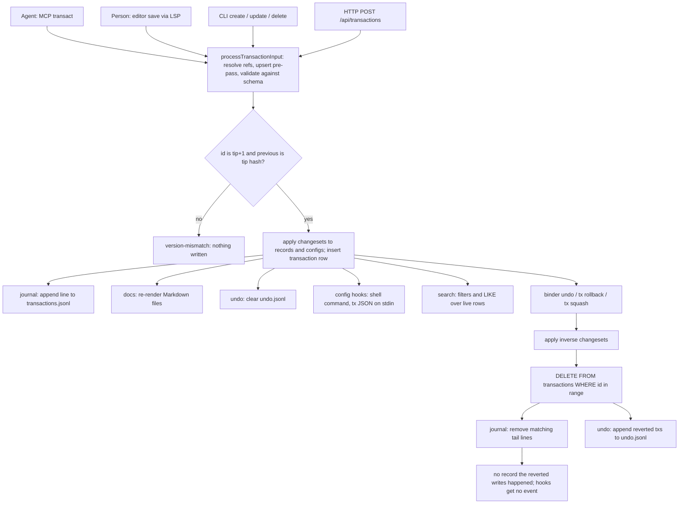

## 1. Executive Summary

Binder is a local-first database of typed records — *"The database for tools you
build with AI"* in its README — held in SQLite and rendered to Markdown files.
Editors reach it through an LSP, agents through a three-tool MCP server and the
CLI, and browsers through a loopback HTTP API. What is notable is the change
model. Every write is a transaction carrying the full prior value of every
field it touches, chained by SHA-256 to its predecessor, mirrored to a JSONL
journal that `binder journal verify` re-hashes, and invertible. What is weak is
that the history is rewindable and unattributed. `binder undo`, `transaction
rollback` and `transaction squash` apply the inverse and then delete the
transactions from the table and the journal. An agent's MCP write is recorded
under the same author, with no channel, as a person's editor save.

It is in scope as a store agents write into across sessions, not as a
dedicated memory system. The README lists *"Agent context and memory"* as one
of five uses, the default blueprint is a `Note` type, and the MCP `transact`
tool lets an agent create, update and delete any record it can describe. What a
record means is set by the workspace schema. That puts it beside the note
applications this atlas reads — [Joplin](../joplin/),
[SilverBullet](../silverbullet/), [Trilium](../trilium/) — and on the work side
of the [work-versus-belief boundary](../../families/#not-in-scope-conversation-window-management)
only when a workspace is configured as a tracker.

No mark is earned. The transaction log is the closest: hash-chained, complete
for forward writes and attributed to an author, and truncated by three CLI
commands, so `audit_log` is withheld on the append-only clause. Retrieval is a
SQL `LIKE` over text fields in insertion order. Nothing marks an agent's record
as unconfirmed, there is no scope key, and the one deletion test asserts
absence without a positive control. A model-call helper, `callLlm`, is defined
and has no caller, so the write path is model-free.

## 2. Mental Model

A memory here is a record of a schema type, and a record is true from the
transaction that creates it until a later transaction changes or deletes it.
There is no candidate state, no confidence and no supersession pointer. The
only epistemic machinery is the transaction log: it says who changed what, when,
from which value to which, and it lets the last N changes be taken back.

The life of a record:

- **Created** by a transaction with an `id` set-change; the changeset records
  every field's initial value (`packages/repo/src/changeset-applier.ts:56-63`).
- **Patched** by later transactions whose changesets carry old and new values,
  so each one can be inverted without reading the database
  (`packages/repo/src/model/transaction.ts:162-166`).
- **Deleted** by a transaction that clears every non-null field, recording its
  value, and removes the row (`packages/repo/src/changeset-processor.ts:1379-1401`,
  `packages/repo/src/entity-store.ts:184-194`). The record's content stays in
  that transaction for as long as the transaction exists.
- **Un-happened** by `rollback`, which applies the inverse of the last N
  transactions and then deletes them (`packages/repo/src/transaction-applier.ts:90-152`).
  The undo plugin keeps them in `undo.jsonl` for `binder redo` until the next
  forward commit clears that file.

The last transition is the one that matters for trust. Correction by a new
transaction leaves a record of the wrong value and of who replaced it.
Correction by undo leaves no record that the wrong value was ever written. The
docs describe the same log as *"an append-only linked list"* forming a
tamper-evident history (`docs/concepts/transaction.md:30`).

## 3. Architecture

A Bun workspace of three TypeScript packages. `@binder/repo` is the engine:
records, configs and transactions in SQLite through Drizzle, changeset
processing and filtering. `@binder.do/cli` holds the CLI, the LSP and MCP
servers, Markdown rendering and parsing, the HTTP server and the plugins.
`@binder/utils` is shared helpers. Two editor integrations under
`integrations/` launch `binder lsp`.

The store is one SQLite file, `binder.db`, under the workspace's data
directory, with three tables (`packages/repo/src/schema.ts:39-97`).
`records` and `configs` hold a JSON `fields` blob, a `tx_ids` list naming the
transactions that touched the row, and `tags`. `transactions` holds the hash,
the previous hash, the record and config changesets as JSON, the author, a
`fields` blob with message, source and channel, and `created_at`. The schema
itself lives in `configs`: a `Type` or field definition is an entity written by
transactions like any record.

Three commit subscribers run after every database commit, in registration
order (`packages/cli/src/runtime.ts:276-297`). The journal plugin reconciles
`transactions.jsonl` against the table. The undo plugin clears `undo.jsonl`.
The docs plugin re-renders the Markdown files whose navigation rules match the
changed records. Hooks declared in `.binder/config.yaml` run a shell command
per transaction with the transaction as JSON on stdin
(`packages/repo/src/local/plugin-loader.ts:54-76`).

### Deployment and ergonomics

Nothing has to run but the CLI: `npm install -g @binder.do/cli`, then `binder
init` with a blueprint. Node 22 or Bun, SQLite through `better-sqlite3` or
`bun:sqlite`, no network and no API key to store anything. The store is
repairable by hand three ways: as Markdown files, as a JSONL journal that
`binder journal repair --from-log` can rebuild the database from, and as plain
SQLite. The CLI sends usage telemetry — command names, durations, error chains,
MCP tool names, no record content — to PostHog when a key is configured, unless
`DO_NOT_TRACK`, `BINDER_TELEMETRY_DISABLED` or the global config turns it off
(`packages/cli/src/telemetry.ts:53-90`, `packages/cli/src/commands/mcp.ts:82-90`).

## 4. Essential Implementation Paths

**Write.** Every surface ends in `kg.update`
(`packages/repo/src/knowledge-graph.ts:604-616`). It reloads the record schema
inside the write transaction, because another process may have committed a
schema change, and calls `processTransactionInput`. That resolves keys and
references to uids, runs the upsert pre-pass, validates each field against its
definition and builds changesets with prior values
(`packages/repo/src/changeset-processor.ts:1608-1700`). `prepareApplyAndNotify`
then opens an `immediate` SQLite transaction, and `applyAndSaveTransaction`
refuses unless the new id is the tip plus one and `previous` is the tip's hash
(`packages/repo/src/transaction-applier.ts:67-88`). Subscribers fire after the
commit; a subscriber failure is reported and never aborts it.

**Hashing.** `transactionToCanonical` canonicalises the changesets against the
schema, drops empty ones and keeps `previous`, `createdAt`, `author`, tags,
message, source and channel. `hashTransaction` is SHA-256 of its JSON,
base64url-encoded (`packages/repo/src/model/transaction.ts:63-107`).
`verifyLog` walks the journal checking each `previous` and, with
`verifyIntegrity`, recomputes every hash against the schema as of that line
(`packages/cli/src/plugins/journal/integrity.ts:28-100`).

**Retrieval.** `kg.search` checks every filter key against the schema, resolves
relation filters to uids, compiles the rest with `buildWhereClause`, orders by
row id unless `orderBy` is given, fetches one row past the limit to set
`hasNext`, and expands includes (`packages/repo/src/knowledge-graph.ts:513-602`).
The MCP `search` tool passes filters and pagination straight through
(`packages/cli/src/mcp/tools/search.ts:36-50`).

**Correction and forgetting.** `$delete: true` on a key or uid builds the
clearing changeset, and `expandDeleteCleanup` removes the deleted uid from
every relation that points at it in the same transaction
(`packages/repo/src/changeset-processor.ts:1255-1357`). `kg.rollback(count)` is
the only path that removes a transaction. Its callers are `binder undo`
(`packages/cli/src/plugins/undo/commands.ts:45`), `transaction rollback` and
`transaction squash` (`packages/cli/src/commands/transaction.ts:259,340`), and
journal repair (`packages/cli/src/plugins/journal/sync.ts:141`).

**Markdown round trip.** The docs plugin renders records into files by
navigation rules and views. On save, the LSP's `syncDocument` extracts the
file's changes against the snapshot it rendered and submits them as one
transaction (`packages/cli/src/lsp/handlers/save-handler.ts:41-105`). List
items without a uid are matched to existing entities by a similarity score and
an auction assignment, which decides whether an edited line is an update or a
delete plus a create (`packages/cli/src/diff/entity-matcher.ts`,
`packages/cli/src/diff/auction-match.ts`).

## 5. Memory Data Model

A record is `id`, `uid`, a unique nullable `key`, a `type`, and a JSON fieldset
(`packages/repo/src/schema.ts:39-56`). Field definitions are config entities
with a data type — text, number, date, period, relation, option and others —
and attributes such as `required`, `only`, `allowMultiple` and `inverseOf`,
validated at write time (`packages/repo/src/data-type-validators.ts`). The
blueprints define the vocabulary a new workspace starts with: `default.yaml` a
`Note`, `personal.yaml` the PARA set of Area, Project, Task, Note and Resource,
`project.yaml` Task and Milestone (`packages/cli/data/blueprints/`).

Provenance lives on the transaction, not the record. A record's `tx_ids` names
every transaction that touched it, and each transaction carries `author`,
`createdAt` and optional `message`, `source`, `channel` and `tags`. Which of
those is set depends on the surface:

- **CLI** commands stamp `channel: "cli"` and take `--tx-source`,
  `--tx-message` and `--tx-tag` or their environment variables
  (`packages/cli/src/cli/options.ts:177-227`).
- **MCP** `transact` passes `author: config.author` and nothing else
  (`packages/cli/src/mcp/tools/transact.ts:101-105`).
- **LSP** saves pass `author: config.author` and nothing else
  (`packages/cli/src/lsp/handlers/save-handler.ts:93-96`).
- **HTTP** sets `author: config.author` and then spreads the request body over
  it, so a caller may supply any author, source or channel
  (`packages/cli/src/http/server.ts:133-136`).
- **Library** callers opened with a `clientId` get it as `source`
  (`packages/cli/src/workspace.ts:91-93`).

The only timestamp is the transaction's `createdAt`, which is record time.
Date and period fields exist as data types a schema may use; nothing in the
engine treats one as validity.

There is no scope key. A workspace is a directory with its own `.binder/` and
database, and every reader in the tree reads the whole workspace.

## 6. Retrieval Mechanics

Retrieval is structured lookup. A filter is a field and either a value or an
operator: `eq`, `not`, `in`, `notIn`, `contains`, `notContains`, `match`, `lt`,
`lte`, `gt`, `gte`, `range`, `empty`. Values are compared through JSON
extraction on the fieldset, with `json_each` for multi-valued fields
(`packages/repo/src/filter-entities.ts:255-376`). `match` and `contains` both
compile to `LIKE '%value%'` (`filter-entities.ts:341-344`). `$text` ORs a
`LIKE` across every text-typed field except id, uid, type and tags
(`filter-entities.ts:185-192,378-398`). A proposal document describes FTS5
`match`, a vector `similar` and a hybrid `search` operator
(`packages/repo/src/model/query-extension.md`); none is implemented, and the
README's roadmap lists full-text and semantic search as next.

Results come back in row-id order with a default limit of 50 and an opaque
cursor. Includes expand relation fields one level per nested spec, so an agent
can ask for `partOf(title,status)` in one call. There is no ranking, no recency
weighting, no token budget and no formatting for a prompt. The MCP tool returns
the records as structured content plus a one-line count.

Retrieval is entirely tool-mediated. Nothing reads the store on session start,
on a prompt or after compaction; the agent sees the workspace only when it calls
`search` or `schema`, or runs the CLI. Over-recall is the failure the substring
match invites: a `$text` of `"auth"` matches `"author"` in every text field.
Under-recall is the failure the schema invites, because a filter on an
undefined field is an error rather than an empty result.

## 7. Write Mechanics

Writes are explicit and synchronous. An agent calls `transact` with records and
configs; the tool builds a `TransactionInput`, calls `kg.update`, and returns
the transaction id, hash and counts. There is no extraction, no deduplication
beyond key uniqueness, no consolidation and no model call. `callLlm`
(`packages/cli/src/lib/llm.ts:126`) and its per-operation model config are
declared and nothing calls them.

The upsert pre-pass is the write behaviour an agent is most likely to trip
over. An input carrying both `type` and an existing `key` or `uid` is routed to
an update of that entity, refused only if the types differ
(`packages/repo/src/changeset-processor.ts:1608-1660`). An agent that writes
`{type: "Note", key: "auth-decision", …}` believing it is creating a note
overwrites the fields of the note already under that key. The tool's reply
reports *"1 record(s)"* either way.

Validation is the only filter on content. A value outside an `only` list, a
missing required field or a relation to the wrong type fails the whole
transaction. Nothing screens text for instructions, and nothing distinguishes a
record an agent inferred from one a person typed.

### Operational cost

A write blocks for one SQLite transaction plus the subscribers: the journal
check reads the journal's tail and appends a line, and the docs render
rewrites the affected Markdown files. A record is retrievable as soon as the
call returns. No background pass touches the store. When the journal holds
transactions the table lacks, `syncLogFromDb` clears the journal and rewrites
it from the whole table (`packages/cli/src/plugins/journal/sync.ts:157-198`),
which is a full pass over history on that commit. Nothing is injected per
turn, so there is no prompt-cache cost.

## 8. Agent Integration

The MCP server is three tools — `schema`, `search`, `transact` — and an empty
resource list (`packages/cli/src/mcp/tools/index.ts:6`,
`packages/cli/src/mcp/resources.ts:38`). The `transact` description teaches
create, update by key or uid, delete with `$delete`, and schema changes, and
tells the model to call `schema` first. The model therefore holds every verb
over every record and over the schema itself. It can add a field, change a
type's field list, or delete any entity, in one call. It cannot undo, roll back
or squash; those are CLI commands.

Four skills under `skills/` teach an agent the CLI, schema modelling, import
and building an HTTP app on a workspace. The examples add a journal with
day-to-year roll-ups and a task workflow. None of them tells an agent to record
what it learns, and no hook wires Binder into a harness's session lifecycle. An
adopter who wants a memory loop writes the prompt and the hook.

Adapting it to another agent is cheap at the transport — stdio MCP, a CLI with
`--format json`, a JSON HTTP API — and the work is in the schema. The design
expects a person to define types and fields first and the agent to fill them.

## 9. Reliability, Safety, and Trust

**Concurrency is handled properly.** Every write runs inside an `immediate`
SQLite transaction and re-checks the tip id and hash before applying
(`packages/repo/src/knowledge-graph.ts:425`,
`packages/repo/src/transaction-applier.ts:75-84`). An end-to-end test runs four
CLI updates and four colliding upserts as parallel processes and asserts every
exit code, the absence of a uniqueness error and the final value of each record
(`packages/cli/tests/concurrency.test.ts:15-60`).

**The log is complete for forward writes and rewritable by three commands.**
`rollbackTransaction` deletes the reverted range from `transactions`
(`transaction-applier.ts:141-150`), and `journalOnRollback` removes the
matching lines from the journal's tail
(`packages/cli/src/plugins/journal/handlers.ts:54-68`). `binder undo` asks for
no confirmation; `transaction rollback` and `squash` do. `squash` also replaces
the authors of the merged transactions with the newest one, and warns that it
will (`packages/cli/src/commands/transaction.ts:308-317`). The reverted
transactions survive only in `undo.jsonl`, which the next commit truncates
(`packages/cli/src/plugins/undo/handlers.ts:22-26`).

**Configured hooks do not close that gap.** The README's example hook appends
each transaction to `.binder/audit.log` with `jq`, which would be an external
append-only copy. Hooks subscribe through `onTransaction` only
(`plugin-loader.ts:58`), so a rollback produces no event. The file would hold
the undone transactions with nothing marking them reverted.

**Provenance cannot separate the agent from the person.** MCP and LSP writes
both carry `author: config.author` with no source and no channel, and CLI
writes carry `channel: "cli"`. A reviewer reading `binder tx log` sees an
agent's `transact` and a person's save as the same author on the same unlabeled
channel. The HTTP API lets any local caller name any author.

**Deletion is not erasure.** A deleted record's every field is in the deleting
transaction, in SQLite and in the journal, and `binder tx read` prints it. The
only way to remove the content is to roll back past the transaction that
created it, which removes everything after it too. A secret an agent writes
into a record is recoverable from the log after `$delete`.

**The HTTP API binds to 127.0.0.1 by default and has no authentication**
(`packages/cli/src/commands/http.ts:9,31`). `--host` or the config's `host`
widens it with nothing else changing. A `server.ts` in the static directory is
loaded and run as routes, workspace scripts in `.binder/scripts/` become
subcommands, and hooks run through a shell. Each is code a workspace carries,
which matters when a workspace is cloned from someone else.

**Uncertainty has no representation.** A schema can add a `status` field with
`only: [draft, confirmed]`, and nothing in the engine or the MCP tool reads it.

## 10. Tests, Evals, and Benchmarks

The suite is 2,224 `it` or `test` cases in 87 files. Unit tests sit beside each
module in `packages/*/src`, and end-to-end tests under `packages/cli/tests`
create a temporary workspace and drive the CLI, LSP, MCP and HTTP surfaces as
subprocesses. No workflow under `.github/` runs them, so the tree carries no
evidence of a passing run. I read the tests and ran none of them.

Memory-relevant coverage is good on mechanics. `transaction.test.ts` checks
that inversion is an involution. `knowledge-graph.test.ts` covers rollback,
version mismatch, and subscriber ordering and failure isolation.
`integrity.test.ts` covers chain breaks and hash mismatches, `sync.test.ts`
covers journal and database reconciliation, and the concurrency test is
described in section 9.

The one must-not-retrieve case is vacuous by the atlas's definition. `deletes
entity and cleans up inverse relations` deletes `task-create-api`, asserts a
`read` fails, and asserts `search type=Task` does not contain the key and the
project's `tasks` include does not either
(`packages/cli/tests/cli.test.ts:264-287`). Neither result is checked for a
record that should be there, and the include falls back to `[]`, so an empty
search or a broken include passes. Asserting that the same search also returns
`task-new`, created earlier in the file, would make it a negative retrieval
assertion; `negative_eval` is withheld until then.

There is no retrieval-quality test, no benchmark and no paper. The tree has no
`CITATION.cff` and no arXiv, DOI or BibTeX reference.

Tests I would want before trusting it as agent memory: a rollback that leaves a
record of itself, a provenance test that an MCP write and an LSP save are
distinguishable in `tx log`, an upsert test that the tool reply says *updated*
when it updated, and the deletion search with its positive control.

## 11. For Your Own Build

### Steal

- **Store the prior value in the change record.** A changeset of `["clear",
  old]` and `[old, new]` pairs makes every transaction invertible without
  reading the database, makes undo a pure function, and lets a reviewer see
  what a correction replaced.
- **Check the chain inside the write lock.** Requiring the tip id plus one and
  the tip's hash inside an `immediate` transaction turns every concurrent
  writer race into a refused write instead of a merge.
- **Keep the schema in the same log as the data.** Types and fields as config
  entities written by transactions means a schema change is reviewable,
  revertible and hashed with the records it affects.
- **Mirror the log to a line-oriented file and verify it independently.** A
  JSONL journal plus a verifier that recomputes each hash against the schema as
  of that line gives a recovery path that does not trust the database.

### Avoid

- **Undo by deletion in a log called append-only.** Revert by appending the
  inverse as a new transaction and keep the redo stack as a pointer. History
  then survives undo, and the hash chain keeps meaning tamper evidence.
- **Provenance set per surface by whoever remembered to.** Derive the channel
  from the entry point in one place, and refuse a caller-supplied author on any
  surface a model can reach.
- **Create that silently updates.** If a create may resolve to an existing
  entity, say so in the result the model reads.

### Fit

Binder suits a single person who wants agent-readable structured data they can
also edit as Markdown in their own editor — trackers, catalogues, notes — and
who values reverting an agent's bad batch over keeping a record that it
happened. It does not suit a memory that must be defensible: deletions keep
the content, undo erases the history, and the log cannot say whether the agent
or the person wrote a line. It is also not a retrieval system yet. Anything
beyond a few hundred records with a known schema needs the search the roadmap
promises. Treat it as a well-built typed store and bring your own memory policy.

## 12. Open Questions

- Whether the published npm build ships with a telemetry key, which decides
  whether telemetry is on by default for installed users; the key is a
  build-time define not in the tree.
- How the auction matcher behaves on a heavily reordered list: whether an
  edited anonymous item is ever matched to the wrong entity and written as an
  update to it. Running the editor round trip would answer it.
- Whether undo-by-deletion is the intended long-term model, given the roadmap
  item *"Transaction log compaction"* and the docs' append-only claim.
- Whether the end-to-end suite passes at this commit; nothing in the tree
  records a run.

## Appendix: File Index

- **Schema and storage:** `packages/repo/src/schema.ts`,
  `packages/repo/src/migrations/*.sql`, `packages/repo/src/entity-store.ts`,
  `packages/repo/src/transaction-store.ts`, `packages/repo/src/model/transaction.ts`,
  `packages/repo/src/model/changeset.ts`.
- **Write:** `packages/repo/src/knowledge-graph.ts`,
  `packages/repo/src/transaction-processor.ts`,
  `packages/repo/src/changeset-processor.ts`,
  `packages/repo/src/changeset-applier.ts`,
  `packages/repo/src/transaction-applier.ts`,
  `packages/repo/src/data-type-validators.ts`.
- **Read:** `packages/repo/src/filter-entities.ts`,
  `packages/repo/src/relationship-resolver.ts`,
  `packages/repo/src/model/query-extension.md`.
- **History, undo, journal:** `packages/cli/src/plugins/undo/*.ts`,
  `packages/cli/src/plugins/journal/*.ts`, `packages/cli/src/commands/transaction.ts`,
  `packages/repo/src/local/plugin-loader.ts`.
- **Surfaces:** `packages/cli/src/mcp/tools/*.ts`, `packages/cli/src/mcp/resources.ts`,
  `packages/cli/src/commands/mcp.ts`, `packages/cli/src/lsp/handlers/save-handler.ts`,
  `packages/cli/src/http/server.ts`, `packages/cli/src/cli/options.ts`,
  `packages/cli/src/workspace.ts`, `packages/cli/src/plugins/docs/index.ts`,
  `packages/cli/src/diff/*.ts`.
- **Unwired:** `packages/cli/src/lib/llm.ts`.
- **Tests:** `packages/cli/tests/cli.test.ts`, `packages/cli/tests/concurrency.test.ts`,
  `packages/cli/tests/mcp.test.ts`, `packages/repo/src/knowledge-graph.test.ts`,
  `packages/repo/src/model/transaction.test.ts`,
  `packages/cli/src/plugins/journal/integrity.test.ts`,
  `packages/cli/src/plugins/journal/sync.test.ts`.

### Recorded searches

Checked against the checkout at the pinned revision, from the tree root.

- `git grep -n -E '(delete|update)\(transactionTable\)' -- packages` — one hit, `packages/repo/src/transaction-applier.ts:143`, inside `rollbackTransaction`.
- `git grep -n -E 'rollback\(' -- 'packages/cli/src/*.ts' ':!*.test.ts'` — `undo/commands.ts:45`, `commands/transaction.ts:259,340`, `journal/sync.ts:141`; no MCP or HTTP caller.
- `git grep -n -E 'onRollback' -- packages/repo/src/local` — no match; `hooksToPlugin` registers `onTransaction` only.
- `git grep -n -E 'callLlm' -- packages` — the definition and a comment in `packages/cli/src/lib/llm.ts`; no caller.
- `git grep -n -E 'channel:' -- 'packages/cli/src/*.ts' ':!*.test.ts'` — `cli/options.ts:225` and the pass-through at `commands/transaction.ts:163`; nothing in `mcp/` or `lsp/`.
- `git grep -n -E 'author: config.author' -- packages/cli/src` — `change-extractor.ts:639`, `http/server.ts:134`, `save-handler.ts:94`, `transact.ts:102`.
- `git grep -n -i -E 'confirm' -- packages/cli/src/plugins/undo/commands.ts` — no match.
- `git grep -n -i -E 'embedding|vector|fts5|bm25' -- packages ':!*.test.ts'` — three lines of `packages/repo/src/model/query-extension.md`, a proposal; no code.
- `git grep -n -E '"similar"|similar:' -- 'packages/*.ts'` — no match.
- `git grep -n -i -E 'valid_?from|valid_?to|validFrom|validUntil|valid_?until' -- packages` — no match.
- `git grep -n -i -E 'SessionStart|UserPromptSubmit|PreCompact'` — no match.
- `git grep -n -i -E 'authorization|bearer|token' -- packages/cli/src/http packages/cli/src/commands/http.ts` — no match.
- `git ls-files .github/workflows` — empty.
- `git grep -l -i -E 'arxiv|bibtex|@article|@misc|doi\.org'` — no match, and no `CITATION.cff`.

## History

**2026-10-15** — [`e4066d750ac5c6918706f44b12daa261b261106e`](https://github.com/mpazik/Binder/commit/e4066d750ac5c6918706f44b12daa261b261106e) — first reading, at the head of `main`, a commit of 21 September 2026. No marks: `audit_log` withheld because three CLI commands delete transactions, `negative_eval` because the deletion test has no positive control. Screened before reading from a full clone: one auto-run surface (`.vscode/settings.json`, which sets only `binder.devMode`), one build-time execution point (`packages/cli/package.json` `prepublishOnly`), nothing inside the cooldown, and five unpinned surfaces, three of them workspace manifests without a lockfile beside them against the root `bun.lock`; `AGENTS.md` was treated as data. MIT with no rider. Read with `git grep` and `sed`; nothing was installed, built or run.
