## 1. Executive Summary

brain-mcp is a local recorder for coding-agent transcripts that serves them back
as citable recall. Claude Code deletes its own session files after a retention
window, and the recorder copies them first, byte-exact, along with Codex and Pi
sessions. Seven MCP tools then search the copies. The notable part is the
evidence contract: every hit carries a file, a line span and a sha256 that
re-hashes from the floor, and an empty result is an abstention that names what
was searched. The weak part is the one destructive verb. `redact` rewrites the
floor file and leaves the indexed text in DuckDB, so a redacted secret stays
searchable.

Memory here is the raw transcript, not anything extracted from it. There is no
model in the write path, no summarisation and no injection into a prompt. The
agent asks through `brain_search`, `brain_recent` or `brain_get`, and the
server's own instructions tell it to present recall as the person's dated words
with a citation, or to say it found nothing. That places it beside
[pond](../pond/) and [deja-vu](../deja-vu/) among transcript archives. It differs
from both in treating the floor of record as plain append-only files and the
database as a disposable cache.

The engineering is strongest on capture. Hooks and a 60-second poll-scanner feed
one ingest function under one file identity, so a missed hook is caught by the
scan and neither path double-ingests. A rewritten transcript opens a new
generation file rather than overwriting. A runaway that rewrote one session
thousands of times on the author's machine is answered by a cap of five
generations a day and a `degraded` health verdict. Default search excludes text
the harness injected under the user role, and two committed tests pin that
exclusion against a fixture that holds the injected rows.

It is weakest where the floor has to change. Redaction does not reach
`floor.raw_lines` or `derived.messages`, and the record tick derives only new
message ids. The README's claim that migrated v1 rows lose to floor-backed rows
is not implemented. And `brain_backup`, an MCP tool, writes the whole corpus to a
destination the model chooses.

## 2. Mental Model

A memory is one line an agent wrote into its own transcript, at the moment the
recorder copied it. Nothing in the system asserts that the line is true. The
claim it makes is narrower and checkable: *these bytes were at this position in
that file*. Recall is a pointer to those bytes plus an excerpt.

A line enters the floor in one of two ways. A Claude Code Stop hook spools the
lines added since the last turn, and a SessionEnd or PreCompact hook spools a
whole-file snapshot. Independently, the scheduled scan reads every watched
origin file, compares its size and a prefix hash against the recorded state, and
consumes whatever complete lines are new. A torn trailing line waits for the next
tick. Both paths end in `ingest_chunk`, which appends to the lake file, then the
manifest, then DuckDB, in that order.

A line never leaves the floor through the system. When an origin's prefix no
longer matches what was recorded, the recorder treats it as a rewrite and copies
the whole file into generation 2 beside generation 1. The index's live view reads
only the newest generation, and message rows derived earlier from the older one
stay in the table. When the agent deletes its file, the floor keeps the copy, and
the next tick logs an `origin_gone` event after re-hashing the copy against the
manifest.

Two derived labels shape what recall returns. `human_authored` is computed in
SQL from the line's flags and its text prefix: a slash-command wrapper, a task
notification, a compaction summary or a system reminder under `role=user` is
machine text. `is_subagent` marks sidechain lines and anything from a session's
own folder. Both are excluded from default search and both come back with one
flag. They classify who produced a line; they are not states a line moves
through.

The one exception to append-only is `redact`, a CLI verb that overwrites the
chosen lines of a lake file with a marker and logs the old span's hash. It is
meant for a credential pasted into a session. Its effect stops at the lake file.

```mermaid
%% caption: how a transcript line reaches the lake, the manifest and the search index, and the redaction that stops at the lake
flowchart TD
  A["Agent writes its transcript<br/>~/.claude, ~/.codex, ~/.pi"] --> H["Stop / SessionEnd / PreCompact hook<br/>spools a line delta or snapshot"]
  A --> S["60 s record tick: poll-scan<br/>size + prefix sha vs ingest_state"]
  H --> D["drain_tick<br/>applies a delta only if it extends the session"]
  D --> I["ingest_chunk"]
  S --> I
  S -->|"prefix differs"| G["new generation file<br/>old generation kept"]
  G --> I
  I --> L["lake/lane/session.jsonl<br/>append-only floor"]
  I --> M["manifest.jsonl<br/>chunk byte range + sha256"]
  I --> R["floor.raw_lines in DuckDB"]
  R --> V["derived.v_messages_all<br/>human_authored, is_subagent"]
  V -->|"anti-join on msg_id<br/>new rows only"| T["derived.messages + BM25 index"]
  T --> Q["brain_search / brain_recent<br/>excerpt from indexed text"]
  L --> C["citation sha256<br/>computed from the lake at read time"]
  C --> Q
  X["brain-mcp redact"] -->|"rewrites lines"| L
  X -->|"logs old span sha"| M
  X -. "never reaches" .-> T
```

## 3. Architecture

Everything runs on one machine as one Python package with two runtime
dependencies, `mcp` and `duckdb`. The process shapes are a stdio MCP server
(`brain-mcp serve`), a CLI, two bash hook scripts, and a scheduler entry that
runs `brain-mcp record` every 60 seconds. There is no daemon. The scanner's
docstring argues that a dead file-watcher "looks identical to a quiet day", so
the recorder polls, and its whole state is the glob result plus
`floor.ingest_state` (`brain_mcp/recorder/scanner.py:1-8`).

The floor is a directory tree under `BRAIN_HOME`, `~/.brain` by default and
`chmod 700` on creation (`brain_mcp/recorder/paths.py:73-82`). Line-oriented
transcripts live at `lake/<lane>/<session>.jsonl`, later generations at
`<session>.gN.jsonl`. Files inside a Claude Code session's folder are mirrored at
the same relative path under `lake/cc_sessiondir/`, and non-line files there are
captured whole as blobs (`brain_mcp/recorder/visit.py:294-343`). The manifest is
one JSONL file. DuckDB holds `floor.files`, `floor.witnesses`, `floor.raw_lines`
and `floor.ingest_state` (`brain_mcp/recorder/floor_db.py:20-83`), plus the
`derived` schema and its FTS index.

DuckDB allows one writer and refuses a read-only open while the writer holds the
file. The code's answer is to open, write one batch and close, with six retries
and a linear backoff on both sides (`brain_mcp/recorder/floor_db.py:98-134`). The
retries total about four seconds, and the FTS rebuild is commented at about ten
seconds at 74,000 rows (`brain_mcp/recorder/derived.py:5-7`). A search issued
during a rebuild on a large floor can therefore raise rather than wait. This is
read from the code and was not run.

### Deployment and ergonomics

`pipx install brain-mcp`, then `brain-mcp install cc`, which writes two hooks into
`~/.claude/settings.json`, prefetches DuckDB's `fts` extension, writes and loads a
LaunchAgent on macOS, and runs one scan tick as proof of capture
(`brain_mcp/recorder/cli.py:110-170`). Linux gets a printed instruction to write a
systemd timer, and Windows is out of scope. No API key is needed, and nothing is
sent anywhere except the one extension download, which the README states.

Two install-path details matter. `cmd_install` points the hooks at
`Path(__file__).resolve().parent.parent.parent / "plugin" / "scripts"`
(`brain_mcp/recorder/cli.py:113`), which is the repository root in an editable
install. `pyproject.toml` packages only `brain_mcp*` and declares no package
data, so from a wheel that path names a directory outside the package. The scan
would capture Claude Code sessions within a minute anyway, without the hooks. And
the Claude Code plugin ships the hooks and the server but no scheduler, while
`record` is the only caller of `drain_tick`, `scan_tick` and `derived.refresh`
outside `install` (`brain_mcp/recorder/cli.py:32-45`). A plugin-only install
spools and never drains until `brain-mcp record` runs. Neither was checked
against a built wheel.

The store is readable and repairable by hand. The lake is the agents' own JSONL,
the manifest is JSONL, and deleting `brain.duckdb` loses nothing the next
`record` cannot rebuild, except v1-migrated rows, which have no floor bytes.

## 4. Essential Implementation Paths

**Capture, hook side.** `plugin/scripts/brain-stream-on-turn.sh` counts complete
lines with `wc -l`, reads its offset from `offsets/cc_transcript/<sid>@<project>`,
writes the delta to a dot-prefixed temp file, renames it into the spool, and only
then advances the offset. A shrunk transcript resets the offset and ships the
whole file. The heartbeat file is touched first, so health reads its mtime rather
than a self-report. Every path exits 0, so a failure never blocks the agent.

**Capture, drain.** `drain_tick` (`brain_mcp/recorder/drain.py:66-143`) routes each
spool file to a floor key and applies a delta only when it starts at or before
the recorded line count. It skips the overlap, defers a gap for the scanner to
fill, and unlinks the spool file only after `ingest_chunk` returns. Snapshots
apply only their unseen tail.

**Capture, scanner.** `scan_tick` (`brain_mcp/recorder/scanner.py:67-146`) globs
each lane and groups Claude Code files by session uuid. The recorded path keeps
the bare key and any other path carrying the same uuid gets `<uuid>~<project>`
(`:115-122`). A uuid at one new path whose recorded path is gone is a move, and
updates `abs_path`. `visit_origin` (`brain_mcp/recorder/visit.py:234-291`) returns
`unchanged` on equal size, recomputes the prefix hash over the recorded byte
length, and either appends from the last offset or opens a new generation.
Per-file errors are caught and counted (`scanner.py:136-141`).

**Ingest.** `ingest_chunk` (`visit.py:92-198`) splits off a torn trailing line,
checks that the lake file's size equals the expected base offset, appends with
`O_APPEND`, and writes the manifest line. It then inserts `floor.files`,
`floor.raw_lines`, `floor.ingest_state` and a `floor.witnesses` row. Each raw line
carries its own sha256, `event_time` from the line's `timestamp`, and
`captured_at`. If the lake is longer than base plus chunk, it assumes a crash
replay and skips the append; if it is shorter, it raises.

**Derivation.** `derived.refresh` (`brain_mcp/recorder/derived.py:206-228`) runs the
dialect SQL, reshapes the table if its columns drifted, inserts view rows whose
`msg_id` is not yet present, and rebuilds the FTS index if anything was added.
The three dialect views and the union are at `:24-152`.

**Retrieval.** `api.search` (`brain_mcp/recorder/api.py:104-133`) calls
`derived.search_fts` (`derived.py:262-292`), which applies `scope_filters`
(`:231-259`) inside a subquery and filters BM25 rank outside it. `_citation`
(`api.py:60-73`) re-reads the lake file and hashes the cited line on every call.
`api.get` (`:138-160`) returns raw lines and compares them against
`expect_sha256`.

**Deletion receipt and restore.** `notice_gone` (`api.py:375-391`) is the writer,
run by `record`; `receipt` (`:394-428`) is the read-only half that `brain_health`
calls. `restore` (`:433-514`) plans every file of a session, refuses the whole set
on any conflict, writes through a temp file, and re-hashes after the write.

**Redaction.** `cmd_redact` (`brain_mcp/recorder/cli.py:227-251`) is the only
in-place write to the floor, described in section 9.

## 5. Memory Data Model

`floor.raw_lines` is keyed `(file_id, witness_gen, byte_offset)` and carries
`line_no`, `raw_line`, `line_sha256` of the original bytes, `n_bytes`,
`utf8_replaced`, `lane`, `agent`, `event_time` and `captured_at`
(`brain_mcp/recorder/floor_db.py:55-71`). `file_id` is
`sha256(machine_id:lane:key)[:32]`, so two machines pushing to one floor do not
collide (`brain_mcp/recorder/visit.py:38-45`, `machine.py:19-27`).
`floor.witnesses` is an observation log of size and growth verdict per visit,
and it is what the rewrite cap counts.

`derived.messages` has fourteen columns: `msg_id`, `agent`, `session_id`, `role`,
`model`, `text`, `event_time`, `captured_at`, `file_id`, `witness_gen`, `line_no`,
`human_authored`, `is_subagent` and `lake_file`, pinned by
`tests/test_derived_agents.py:96-105`. The Claude Code view extracts `cwd`
(`derived.py:40`) and the union does not carry it forward, so no project key
reaches the table search reads.

Scope is the machine and the user who owns `~/.brain`. Within it, the stored
dimensions are agent (claude-code, codex, pi, or a v1 source), session, role and
time. Time has two clocks: `event_time`, the line's own timestamp and nullable,
and `captured_at`, never null. They answer *when was this said* and *when did the
recorder hold it*, which is useful and is not a validity interval for a fact.

There is no correction chain, no supersession and no status column. Versioning
is the generation number on a file. A v1 import writes message rows with
`witness_gen = 0` and no floor bytes, and `_citation` returns them marked
`v1_derived` with no hash (`api.py:61-64`).

## 6. Retrieval Mechanics

Retrieval is DuckDB's `match_bm25` over `derived.messages.text`, ordered by rank
with an optional `min_rank`, or re-sorted by time when `order` is `time_asc` or
`time_desc`. There is no vector arm, no reranker and no query rewriting. v1's
embeddings and summaries were removed in 2.0.0b1, and the changelog gives the
reason: a claim that cannot carry a line-span citation is not one the server
makes.

The default filter keeps rows that are either not `role=user` or are
human-authored, and drops subagent rows (`derived.py:247-250`). `brain_recent`
shares the same filter. `brain_sessions` drops subagent rows and counts only
human-authored user turns (`api.py:190-209`). `agent`, `role`, `since` and `until`
narrow further, and a bare date for `until` includes the whole day.

The response shape is the contract. A hit is a 600-character excerpt, a rank and a
citation. Zero hits return `abstained: true`, the rank threshold, the lanes and
time range covered, the row count, and a hint that absence is evidence only about
what was searched (`api.py:119-126`). Every response carries `measured_at`, an
`instrument` string, and any agent directory present on disk but not watched.

The excerpt and the citation come from different places. The excerpt is the
indexed text in DuckDB; the citation's sha256 is recomputed from the lake file at
read time. Normally they agree. After a redaction they disagree, and a caller
that verifies with `brain_get` sees the marker while the excerpt shows the
original. After a rewrite, rows from both generations stay indexed, so the same
utterance can return twice with two citations.

There is no token budget and nothing is injected, so over-recall costs the agent
a longer tool result rather than a polluted prompt.

## 7. Write Mechanics

Writes are capture only, and they happen outside the agent's turn. The Stop hook
copies a delta into the spool in the time it takes `wc`, `tail` and `mv` to run.
Everything after that waits for the next `record` tick: drain, scan, refresh and
receipt. With the scheduler installed, a line is retrievable between a few
seconds and about a minute after the turn that wrote it, plus the time of the
FTS rebuild.

Deduplication is by identity and offset, not by content. Hook and scanner share
`floor.ingest_state` per floor key, so a delta that a scan has covered is
discarded and a gap is left for the scan, which
`test_hook_and_scanner_share_one_identity` asserts
(`tests/test_recorder_floor.py:158-174`). `derived.messages` dedups by `msg_id`,
which embeds the generation, so a rewrite indexes the new generation's lines as
new rows.

Nothing is filtered on the way in. A secret pasted into a session is copied into
the lake, into `raw_lines` and into `derived.messages`. `scan-secrets` exists to
find it afterwards, and its docstring says why: a bytes-forever floor "replicates
whatever it captured into every backup, forever"
(`brain_mcp/recorder/secrets.py:1-3`).

### Operational cost

No model is called on any path, so the write path costs file I/O and one DuckDB
batch. The expensive step is the FTS index, which DuckDB does not maintain
incrementally: `refresh` rebuilds it over the whole messages table on every tick
that added a row (`derived.py:223-226`). During active work that is once a
minute, over the whole corpus. The scanner reads last-seen sizes once per lane
per tick rather than opening DuckDB per file. The changelog measures that at
about 0.3 seconds for an unchanged tick over 3,046 files.

## 8. Agent Integration

Seven MCP tools are registered, six annotated read-only
(`brain_mcp/recorder/server.py:30-105`). The server's `instructions` tell the
model that everything is cited or abstained and that an `unknown` health lane is
never to be summarised as fine. The README carries a longer contract for the
model: present recall as the person's own dated words, one claim per citation,
and never fill an abstention with a guess.

The agent's agency over memory is read-only with one exception. `brain_backup`
copies `lake/` and `manifest/` to a `dest` argument, overwriting any file there
whose size differs, then re-hashes a sample of eight files (`api.py:551-585`).
The tool is not annotated read-only, and its docstring says it writes only
outside the floor, which is true. It also means the model can copy every
recorded session to any path the process can write.

`restore` is deliberately a CLI verb, because it writes into the agents' own
directories. The README says no MCP tool writes outside the floor. For restore
that holds, and `brain_backup` is the exception the sentence does not mention.

Adapting it to another agent means adding a lane row and a dialect view. Codex
and Pi lanes are scanner-only, and the hook contract is Claude Code's. The
`human_authored` rules are tuned to the injection formats of Claude Code and
Codex, and every Pi user row counts as human (`derived.py:148`).

## 9. Reliability, Safety, and Trust

**Provenance is the strongest property.** A citation can be checked with
`sed -n 'A,Bp' file | shasum -a 256` and no database, which
`test_sed_shasum_verifies_and_survives_append` runs and asserts stable under
append (`tests/test_recorder_floor.py:100-123`). The manifest records every
chunk's byte range and hash, so the receipt re-verifies a deleted origin's floor
copy chunk by chunk, and a tampered copy reports `verified: false`
(`tests/test_receipt_restore.py:49-61`). Health refuses to round `unknown` up to
`fresh`, and a capped rewrite turns a lane `degraded` with a reason
(`api.py:214-274`).

**Redaction stops at the lake file.** `cmd_redact` replaces lines A to B of a lake
file with `{"redacted":true,"reason":...}` and appends the old span's sha256 to
the manifest (`brain_mcp/recorder/cli.py:227-251`). It does not touch
`floor.raw_lines.raw_line` or `derived.messages.text`, and its closing message
tells the user to run `brain-mcp record`. `refresh` inserts only rows whose
`msg_id` is absent (`derived.py:215-220`), and the redacted lines keep their ids.
`brain_search` therefore keeps returning the secret as an excerpt, beside a
citation whose hash matches the marker. No statement under `brain_mcp/recorder`
updates or deletes either table outside the reshape migration, and no test
searches after a redaction.

**A redacted session that keeps growing would stop recording.** This follows from
the code and was not run. Redaction changes the lake file's length and leaves
`ingest_state.last_offset` unchanged. The origin is untouched, so its prefix hash
matches and the next visit appends at the old offset. `ingest_chunk` then
finds the lake shorter than expected and raises. If the lake grew by more than
the new chunk, it skips the append and writes manifest and index rows anyway
(`brain_mcp/recorder/visit.py:116-125`). The scanner catches the error per file.
`drain_tick` has no handler and `cmd_record` calls it first. A spooled delta for
that session would then abort every tick for every lane, and the spool file stays
to be retried (`drain.py:113-117`, `cli.py:38-40`).

**The secret scanner sees part of the floor.** `secrets.scan` globs `*.jsonl` at
the top of each lane directory (`secrets.py:92`). Session-folder files live in
nested directories under `lake/cc_sessiondir/`, and tool-result blobs are not
`.jsonl`, so neither is scanned; the DuckDB copies are never scanned either. The
changelog counts subagent transcripts as 72% of Claude Code's files on the
author's machine.

**v1 rows do not lose to floor rows.** The README says floor-backed rows win
over migrated v1 rows. `cmd_migrate_v1` inserts `v1:`-prefixed rows
with an anti-join against other v1 ids only (`cli.py:259-273`). Nothing in the
recorder compares a v1 row to a floor row, so both are searched.

**Privacy and backup.** The floor is `chmod 700`, nothing leaves the machine, and
`uninstall` keeps the floor and says so. Backup is pure-add by size, so a backup
taken before a redaction keeps the original, which the redact message states.

**Uncertainty is represented as coverage, not belief.** The system can say it
searched these lanes over these dates and found nothing above the threshold. It
has no way to say a recorded line was wrong, and does not try to.

**The marks, and the near-misses.**

`audit_log` is awarded. `manifest.jsonl` is opened `O_APPEND` by its only writer
(`brain_mcp/recorder/manifest.py:19-29`), and every write into the floor has a
line. Each chunk carries its byte range and hash, each blob its whole-file hash,
and each redaction the old span hash and reason; `restored`, `origin_gone` and
`rewrite_capped` are events beside them. [pond](../pond/) keeps a sync bookmark;
this log records each mutation, and the receipt replays it.

`negative_eval` is awarded for two read-path cases on populated stores, each with
a positive control. `test_role_user_returns_only_what_the_person_typed` asserts
the exact list of `role=user` giraffe hits over a fixture holding seven injected
giraffe rows. `test_injected_text_is_one_flag_away` retrieves all seven with
`include_machine=True` from the same load (`tests/test_human_authored.py:31-49`).
`test_subagent_text_is_out_of_default_search_and_in_on_request` asserts abstention
and then, in the same body, a verified hit with the flag set
(`tests/test_sessiondir.py:66-76`).

`scope_enforced` is withheld. The store is one corpus for one user, the `agent`
filter is a caller's option with no default, no project key reaches
`derived.messages`, and `brain_get` reads any file under `lake/`. There is no
context assembler.

`trust_state` is withheld. `human_authored` is computed from text prefixes by the
view on every refresh, and `verified` is computed per read. Neither is a stored
state that a transition moves, which the
[rubric](../../methodology/atlas-rubric/#explicit-trust-state) asks for.

`bitemporal` is withheld. `event_time` is when a line was written and
`captured_at` when it was copied; neither is the period a fact held.

`tombstone` is withheld. The redaction marker is keyed on file and line, and an
origin rewrite would copy the redacted value into the next generation.

`human_review` is withheld. No recorded line waits for anyone, and redact and
restore are CLI verbs that act at once.

## 10. Tests, Evals, and Benchmarks

55 pytest functions in eight files run in CI on Ubuntu and macOS with Python
3.11 to 3.13 and `-W error::SyntaxWarning` (`.github/workflows/test.yml`). The
shared `floor` fixture repoints every lane into a temp directory and refuses to
run if any lane names the real home (`tests/conftest.py:13-58`). The
changelog records that an earlier fixture scanned the developer's own
`~/.claude`. CI installs `.[dev,legacy]`, and `pyproject.toml` declares no
`legacy` extra.

What is tested is capture and the evidence contract. The suite covers byte
identity on first visit and after append, torn-line waiting, and a rewrite
opening generation 2 with generation 1 kept. It covers the manifest's presence,
citation stability under append, hook-drain reconciliation including gaps, and
one identity across hook and scanner. It covers session-folder capture, the
receipt including tampering, every restore rule, and two copies of one session
over twenty ticks. It covers the injected-text and subagent exclusions, date
windows, schema upgrades from 2.0.0 and from the b-series, and the secret
scanner's discrimination in both directions. The changelog states for each
release how many new tests fail against the previous one.

What is not tested is the destructive path and its aftermath: search after
`redact`, capture after `redact` on a growing session, `scan-secrets` over
session-folder files, and a v1 row duplicating a floor row. Nothing exercises
`brain_backup`, or a search racing an FTS rebuild.

There is no retrieval-quality evaluation and no benchmark, and none is claimed.
The changelog's figures, such as 41.1% of user rows being injected text across
the author's 30 newest sessions, measure one installation with no committed
corpus behind them. No paper is cited; an ADR from the v0.4.0 design mentions a
planned arXiv paper for a protocol the 2.x rebuild removed.

I read the tree and ran nothing, so no test outcome above was observed.

## 11. For Your Own Build

### Steal

- **Keep the bytes, derive the rest.** Store transcripts as append-only files
  with a hash manifest, and treat every database table as a cache you can
  delete. A schema change then costs a rebuild, not a migration of the only copy.
- **Two capture paths, one identity.** A hook for latency and a poll-scan for
  completeness, reconciled on a shared per-file offset and prefix hash, make a
  dead hook visible as staleness rather than as a quiet day.
- **A rewrite opens a generation.** When an origin's prefix stops matching, copy
  it whole beside the old copy, and cap how often that can happen per file per
  day, with the cap reported in health.
- **Cite or abstain, with coverage.** Return a re-hashable pointer with every hit,
  and make an empty result an object naming the lanes, dates and threshold
  searched. It gives a model something true to say when it finds nothing.
- **Label injected text at read time.** Classifying harness-injected user turns in
  a view, and filtering them by default behind an opt-in flag, keeps one copy and
  lets the rule change without re-ingesting.

### Avoid

- **A redaction that rewrites only the copy you think of as canonical.** Every
  derived store that holds the text, here a raw-lines table, a messages table and
  an FTS index, has to be part of the redaction. A search for the redacted value
  has to be the test.
- **Offsets kept beside a file that a second verb can rewrite.** If anything other
  than the appender changes the file, the appender's state has to change in the
  same operation, or the integrity check fires on the next write.
- **A scanner whose glob is narrower than the store.** A non-recursive glob over a
  tree that gained nested lanes reports clean over the part it cannot see.
- **A backup tool on the model's surface with a free destination.** Copying the
  whole corpus is a CLI decision. On the tool surface it is an exfiltration path
  for any instruction that reaches the model.

### Fit

This suits one developer on a Mac who uses Claude Code, Codex or Pi, wants
session history to survive the agent's cleanup, and wants recall they can audit
line by line. It assumes no server, no model and no API key, and the operator
cost is one LaunchAgent. It is the wrong choice if the requirement is memory
that learns, consolidates or corrects itself, because nothing here is extracted
or judged. It is also wrong where several projects or people must not see each
other's history, or where a pasted credential must be removable the same day.
For that case, deleting `brain.duckdb` after a redaction and running `record`
rebuilds the index from the lake, which the code permits and does not document.

## 12. Open Questions

- Does a wheel built from this commit contain `plugin/scripts`, so that
  `brain-mcp install cc` from PyPI writes hook paths that exist? Building the
  wheel would answer it.
- Does the separate `brain-marketplace` repository ship a scheduler with the
  plugin, or does a plugin-only install never drain its spool?
- After `redact`, does deleting `brain.duckdb` and running `record` produce an
  index without the secret? The code suggests so, since raw lines are re-read
  from the lake, but v1-migrated rows would be lost with the file.
- How long does an FTS rebuild take at the author's corpus size, and how often
  does a concurrent `brain_search` exhaust its four seconds of retries?
- The first commit in the history is dated 4 March 2026 and the GitHub metadata
  dates the repository to 10 January 2026. Was the history rewritten?

## Appendix: File Index

**Storage and schema.** `brain_mcp/recorder/floor_db.py` (schema, lanes,
connection discipline), `brain_mcp/recorder/paths.py` (layout, generation
naming), `brain_mcp/recorder/manifest.py`, `brain_mcp/recorder/machine.py`.

**Write path.** `plugin/scripts/brain-stream-on-turn.sh`,
`plugin/scripts/brain-stream-on-sessionend.sh`, `plugin/hooks/hooks.json`,
`brain_mcp/recorder/drain.py`, `brain_mcp/recorder/scanner.py`,
`brain_mcp/recorder/visit.py`.

**Derivation and retrieval.** `brain_mcp/recorder/derived.py`,
`brain_mcp/recorder/api.py` (search, get, recent, sessions).

**Health, receipt, restore, backup.** `brain_mcp/recorder/api.py:214-585`.

**CLI and MCP.** `brain_mcp/recorder/cli.py`, `brain_mcp/recorder/server.py`,
`server.json`, `plugin/.mcp.json`.

**Secrets.** `brain_mcp/recorder/secrets.py`.

**Unreached by the recorder.** `brain_mcp/ingest/`, `brain_mcp/config.py`, and the
`Makefile` targets for embed, summarize and the v1 server.

**Tests.** `tests/conftest.py`, `tests/test_recorder_floor.py`,
`tests/test_human_authored.py`, `tests/test_sessiondir.py`,
`tests/test_receipt_restore.py`, `tests/test_duplicate_sessions.py`,
`tests/test_derived_agents.py`, `tests/test_secrets_scan.py`.

### Recorded searches

Run at the tree root of the pinned commit.

- `git grep -n -E "UPDATE|DELETE|DROP" -- brain_mcp/recorder` — no statement
  updates or deletes `floor.raw_lines` or the text of `derived.messages`; the
  hits are the reshape migration, `floor.files` path updates and the
  `ingest_state` upsert.
- `git grep -n -E "redact" -- brain_mcp/recorder tests` — `cmd_redact`, restore's
  marker check and the secrets note; the one test redacts and then restores, and
  no test searches afterwards.
- `git grep -n -E "manifest\.append" -- brain_mcp/recorder` and
  `git grep -n -E "write_bytes|os\.replace|shutil\.copy|unlink|rmtree" -- brain_mcp/recorder`
  — every write into the floor sits beside a manifest append; the other writes
  are restore targets, backup copies, settings, the plist and spool unlinks.
- `git grep -n -E "try:|except" -- brain_mcp/recorder/drain.py brain_mcp/recorder/cli.py`
  — no handler in `drain.py`; the three in `cli.py` wrap the fts check, the
  prefetch and reading plugin hook files.
- `git grep -n -E "cwd|project" -- brain_mcp/recorder/derived.py brain_mcp/recorder/api.py`
  — `cwd` is extracted in `dialects.v_cc` and used for the resume hint, and is
  absent from `derived.v_messages_all` and every filter.
- `git grep -n -E "glob\(|rglob\(" -- brain_mcp/recorder/secrets.py` — one
  non-recursive `glob("*.jsonl")`.
- `git grep -n -E "v1:|v1_derived" -- brain_mcp/recorder` — the import, its
  anti-join against v1 ids, and the citation branch; no comparison to floor rows.
- `git grep -n -E "from \.\.?(ingest|config)|brain_mcp\.(ingest|config)" -- brain_mcp/recorder`
  — no output.
- `git grep -n -E "drain_tick\(|scan_tick\(|refresh\(" -- brain_mcp plugin` —
  callers only in `cli.py`, in `record` and one scan in `install`.
- `git grep -n -E "package-data|package_data|data-files|include-package-data|plugin|legacy" -- pyproject.toml`
  and `git ls-files | /usr/bin/grep -i -E "manifest\.in|setup\.(py|cfg)"` — no
  output from either.
- `git grep -n -E "approve|review|pending" -- brain_mcp/recorder` — only the
  receipt's pending count.
- `git grep -n -i -E "arxiv|bibtex|@article|@misc|citation\.cff|doi\.org"` — one
  hit, the ADR's planned paper.

## History

**2026-10-15** — [`78d8a4fd7fbc879a0c75f431052af1b9b5618eaf`](https://github.com/mordechaipotash/brain-mcp/commit/78d8a4fd7fbc879a0c75f431052af1b9b5618eaf) — first reading, at the head of `main`, version 2.1.1, a commit dated 4 October 2026. MIT, no rider. Screened from a full clone before reading: one auto-run surface (`server.json`, an MCP registry manifest naming `brain-mcp` on PyPI), two build-time execution points (`Makefile`, `tests/conftest.py`), and one unpinned manifest (`pyproject.toml`, no lockfile); none inside the cooldown. `plugin/hooks/hooks.json` registers Stop, SessionEnd and PreCompact hooks and fires only once installed as a plugin. Two marks, `audit_log` and `negative_eval`. Nothing was installed, built or run.
