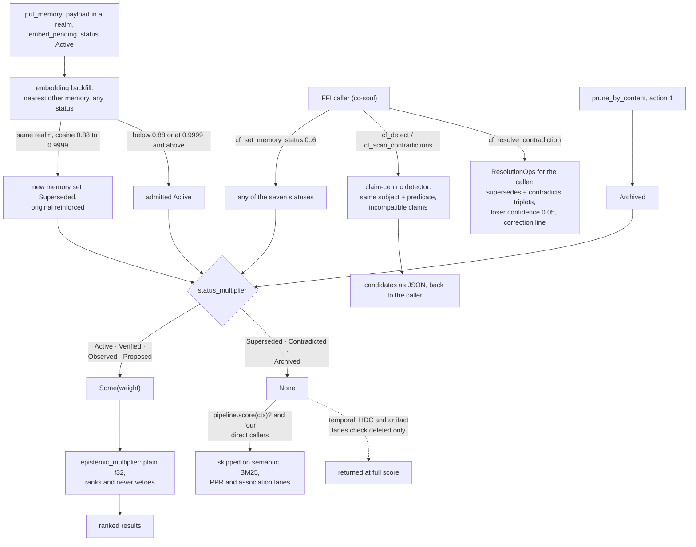

## 1. Executive Summary

chitta-field is a Rust memory substrate for an AI companion daemon whose
excluding statuses return `None` rather than a low weight, so its scored recall
lanes drop a superseded, contradicted or archived memory as control flow and
the compiler makes every caller handle it. Its contradiction detector compares
claims, not text, and its op log stamps the embedding lineage into each segment
header. The weak side is history: the log is pruned behind every snapshot, a
broken hash chain only warns, and the veto stops at the scored lanes.

It is "the backing store for the cc-soul daemon", designed, in the README's
words, "around the constraints of shared NFS storage, multiple concurrent
writers, and sub-millisecond in-process recall". What the agent asks of it is
decided in that other repository.

**A veto is an `Option`, not a zero.** `status_multiplier` maps the seven
memory statuses to a scoring factor, and three of them do not have one:

```rust
MemoryStatus::Superseded | MemoryStatus::Contradicted | MemoryStatus::Archived => None,
```

The scoring pipeline is documented so that any factor returning `None` "vetoes
the memory (excluded from results)" (`src/scoring/mod.rs:88-90`), and
`StatusFactor` is in the default pipeline, so semantic and BM25 recall drop the
memory through `pipeline.score(&ctx)?`. The graph lanes call the helper
directly and each spells the exclusion out: `.is_some()` as a filter predicate
(`src/store/recall.rs:735`), a `None => continue` arm (`:955-958`), an
`is_none() => continue` guard (`:1074`) and a `?` (`:1101`). A zero weight is a
number any later normalisation or blend can multiply back up; `None` is not a
number, and a sixth caller cannot ignore it and still compile.

The veto belongs to the lanes that call it. `recall_temporal`, `recall_hdc` and
`recall_artifact` skip only `deleted` memories and return an archived or
contradicted one at full score (`src/store/recall.rs:1142-1197`, `:1228-1275`,
`:2424-2460`).

**Where a memory came from weights it and never withholds it.**
`EpistemicStatus` is `UserStated | ToolDerived | ModelInferred |
AutonomousSynthesis`, under the comment "[h]ow a memory was obtained —
orthogonal to confidence." Its helper returns a plain `f32`, so provenance can
rank a model-inferred memory below a user-stated one and can never suppress it.
Two axes, two return types, and the signatures carry the policy.

**Contradiction is about claims, not text.** The detector's header:

> "Design: claim-centric, not text-centric. Two memories contradict when they
> make incompatible claims under overlapping scope (same subject+predicate),
> not merely when they are semantically similar."

It runs when the FFI caller asks — `cf_detect_contradictions` for one memory,
`cf_scan_contradictions` for a realm — and returns candidates as JSON.
Resolution returns `ResolutionOps` "for the C++ caller to apply": a
`supersedes` and a `contradicts` triplet, the loser's confidence set to 0.05,
and a correction line to store (`src/contradiction.rs:122-133`, `:295-337`).
Nothing in this tree sets `Contradicted` except the generic
`cf_set_memory_status`. The reconcile pass that runs in-tree is a different
detector: a six-word content prefix shared by two memories of different kinds
(`src/organ/reconciler.rs:72-112`).

**The write path is an op log, and the log is not kept.** Every mutation is an
`Op`, appended to the writer's segment and chained as
`H = SHA256(seqno || op_type || prev_hash || payload)` with a CRC per record.
The V3 header carries a `vector_space_id`, and replay skips segments stamped
with a foreign one and moves sealed ones to `segments/foreign/`
(`src/log.rs:535-551`, `:749-766`). Every full snapshot then deletes the
segments it certifiably covers, and the maintenance thread takes one whenever
the WAL passes 16 MB or 20,000 records by default
(`src/store/maintenance.rs:1438`, `:1468-1503`; `src/ffi.rs:317-355`). On
replay a chain mismatch prints a warning and resets the chain head
(`src/log.rs:1129-1143`). The chain detects a rewrite in the log a process
still holds; it does not refuse one, and it does not outlive the next
checkpoint.

Two marks, `trust_state` and `negative_eval`. A committed test asserts that the
three excluding statuses stay out of semantic recall beside an active memory
that must come back ([section 10](#10-tests-evals-and-benchmarks)).

## 2. Mental Model

A **memory** is a payload in a realm with a status that can veto it on the
scored lanes and an epistemic status that only weights it.

It becomes **Superseded** in three ways. The embedding backfill searches the
nearest other memory before upserting a new vector, and when it lies in the
same realm at cosine between 0.88 and 0.9999 the *new* memory is marked
Superseded and the original reinforced (`src/store/maintenance.rs:72-117`). An
exact restatement at 0.9999 or above, and a paraphrase below 0.88, are admitted.
The caller can set any status through `cf_set_memory_status`
(`src/ffi.rs:3049-3065`). And `prune_by_content` with action 1 archives every
memory whose text contains a pattern (`src/store.rs:2150-2189`).

A **contradiction** is two claims about the same subject and predicate, found
on request and resolved by the caller, who decides whether the loser is
demoted, marked or deleted.

A **correction** stored as `[correction]` with a `NOT:` line is keyed on the
bigrams of the wrong phrase (`src/store.rs:967-1000`). When two of its bigrams
recur in a turn, `correction_check` returns it ahead of fuzzy recall
(`src/store/keyed.rs:58-118`). That is a read-time counter to a repeated
mistake. No write path consults the index, so the wrong phrase can be stored
again.

**Deletion** is an op and a flag; the next full snapshot leaves deleted
memories out, and the segments holding their ops are pruned with the rest.



## 3. Architecture

A library: a `staticlib` and an `rlib` with a C FFI, opened in-process by the
daemon. The data directory holds one segment file per writer process, full
snapshots with their sidecars, a manifest of snapshot families, and a
`scoring.json` read at open.

| File | Role |
| --- | --- |
| `src/store.rs`, `src/store/` | The store split into recall, maintenance, organs, keyed lanes and tests |
| `src/ffi.rs`, `src/ffi/` | The C surface, the maintenance thread and the startup lanes |
| `src/log.rs` | Segments, chaining, replay, the lineage fence |
| `src/wal_certificate.rs` | Which sealed segments a snapshot family covers |
| `src/ops.rs` | The mutation vocabulary, seventy-one `Op` variants |
| `src/scoring/` | The pipeline, the factors, and where a veto is an `Option` |
| `src/contradiction.rs` | Claim atoms, claim scope, candidates and resolution ops |
| `src/organ/` | Cortex, triplets, constraints, epistemic debt, the reconciler |
| `src/hdc.rs`, `src/hnsw.rs` | Hyperdimensional codes and the ANN index |

### Deployment and ergonomics

Nothing has to run besides the embedding process: the store is files in a
directory, and the README targets a shared NFS mount with several writers. The
embedding model is fixed at build time — `build.rs` writes the dimension, model
id and text-format version into constants from environment variables,
defaulting to `bge-large-en-v1.5` at 1,024 dimensions — and the lineage fence
exists because those can change between builds. The store is binary and not
repairable by hand; `migration/extract_to_jsonl.py` is the escape hatch.

## 4. Essential Implementation Paths

**Write.** `put_memory` appends `PutPayload` and indexes the payload with an
empty vector; `backfill_embedding`, called when the daemon supplies the vector (`src/store/maintenance.rs:26-130`), appends
`UpdateMemoryContent`, runs the cosine dedup, upserts the vector, and calls
`encode_memory`, which assigns the cortical code and updates the encoder
(`:814-850`).

**Status.** `set_memory_status` appends an `UpdateState` op
(`src/store.rs:2611`); `status_multiplier` (`src/scoring/mod.rs:163-172`) is the
one place a status becomes a veto.

**Retrieval.** `recall_semantic_ctx` and `recall_keyword_ctx` score through the
pipeline (`src/store/recall.rs:212-680`, `:1809-1920`); `ppr_lane` and
`expand_associations` call the helper directly (`:683-1019`, `:1020-1140`);
`recall_temporal`, `recall_hdc` and `recall_artifact` do not.

**Contradiction.** `src/ffi/organs.rs:1670-1822` builds a transient
`ContradictionIndex` per call; `reconcile_pass` (`src/store/organs.rs:478`)
logs the prefix heuristic's pairs as `conflict_score` triplets.

**Checkpoint and prune.** `save_full_snapshot_certified` writes the snapshot
family, commits the manifest and calls `prune_certified_wal`
(`src/store/maintenance.rs:1032-1450`, `:1468-1503`).

## 5. Memory Data Model

A payload plus a state: version, chunk hash, deleted flag, strength, decay
rate, confidence, access count and timestamps, pin, tier (`0=L1 hippocampus,
1=L2 cortex, 2=L3 archive`), a retrieval history, an embed-pending flag, a
staged flag, and the two statuses. Pinning is exemption from decay.

Triplets carry `valid_from_ms` and `valid_to_ms`, and the triplet store keeps
an ingestion time per entry and a supersession map, with `query_as_of` on world
time and `query_believed_at` on ingestion time (`src/organ/triplet.rs:888-934`).
The two clocks coincide: `add_triplet` stamps `valid_from_ms = now_ms()`
(`src/store.rs:2579`), and `assert_constraint` stamps its own `now`
(`src/store/organs.rs:677`).

`EpistemicDebt` under `src/organ/epistemic_debt.rs` records an unresolved
question with competing hypotheses, a discriminating test, a fragility score
and an `Open | Resolved | Deferred` status. `EpistemicDebtFactor` would boost
a memory with open debt, and every recall call site builds its scoring context
with `has_open_debt: false` (`src/store/recall.rs:397`, `:558`, `:1866`), so the
factor is always 1.0.

## 6. Retrieval Mechanics

The cortical lane encodes each embedding as 64 active features from a dictionary
of 16,384 atoms, chosen by a product-key encoder of two 128-centroid half-dictionaries,
and recall is an intersection over those feature ids. The README calls this
recall "without a learned ANN index for the hot path"; the dictionary itself is
learned, updated online with a learning rate of 5e-4 on every encode
(`src/organ/cortex.rs:33-38`, `:183-211`; `src/store/maintenance.rs:847`).

Beside it sit semantic HNSW, BM25, HDC, temporal, triplet and symbol-graph
lanes, a PPR lane injected into semantic recall, and association spreading.
The scoring decomposition reports each multiplier separately, so a result can
be explained rather than just ranked.

Realm is optional on every lane that takes it. The BM25 lane drops a payload
from another realm when one is asked for, with the comment "the BM25 lane must
not leak other projects' memories" (`src/store/recall.rs:1847-1852`); with
`None` it reads every realm. Tag selection is global, and the test that pins it
says so: "Callers must scope the selected payloads" (`src/store/tests.rs:11-12`).

## 7. Write Mechanics

Append an op, update the in-RAM state, checkpoint on a budget. Each writer
appends to its own segment; replay merges all writers' ops by a per-writer
monotone effective timestamp, then instance id, then sequence number
(`src/log.rs:568-571`, `:604`). That is the cross-writer order, and it is a
wall-clock merge, not a chained one.

The maintenance drain is documented as preserving each access timestamp and
count (`src/ops.rs:17`), which keeps a batch pass from erasing the signal decay
depends on.

## 8. Agent Integration

A library with a C FFI; the agent-facing daemon is cc-soul, a separate project.
Every status, contradiction resolution, compaction and prune verb is an
exported `extern "C"` function, so what the agent can reach is decided by what
the daemon exposes, which this tree does not show.

## 9. Reliability, Safety, and Trust

The CRC is integrity, the lineage fence is correctness under model change, and
the veto is policy on four lanes.

The hash chain is evidence while the log exists. Replay recomputes it and, on a
mismatch, prints "chain record warning … resetting chain" and continues. A
segment covered by a committed snapshot family is deleted through
`audited_remove`, which logs the unlink to stderr
(`src/store.rs:424-431`). So `audit_log` is withheld: the record of mutations
is pruned behind every checkpoint, and nothing reads past ops except replay and
peer sync.

`tombstone` is withheld. The correction lane is keyed on the wrong value and
consulted on reads only; the cosine dedup supersedes a near-duplicate whatever
the neighbour's status, and admits an exact restatement of a contradicted
claim. `bitemporal` is withheld because valid time on triplets and constraints
is the write clock. `scope_enforced` is withheld because realm is an optional
argument and `None` reads every realm. `human_review` is withheld: `witness_memory`
promotes a candidate on a witness-kind string the caller passes, staged
memories are promoted on first recall, and no state waits for an actor.

The multipliers are unbounded. `scoring.json` is deserialised into
`ScoringConfig` with no range check (`src/scoring/config.rs:336-357`); only
`CHITTA_REPLICATION_MAX` is validated. The defaults run from 0.65 to 1.15 for
status and 0.75 to 1.0 for epistemic status, and nothing stops a file setting
Proposed above Verified.

## 10. Tests, Evals, and Benchmarks

345 `#[test]` functions across the Rust tree, three benches, and a Python WAL
replica soak script. Nineteen full-snapshot magic constants, V1 to V22 with
gaps, are accepted on load. I read the tests; I ran none, and nothing was built.

`test_recall_excludes_invalidated_statuses` is the negative evaluation. Four
memories share one embedding and one realm; three are set to Superseded,
Contradicted and Archived, and `recall_semantic` with k=20 must return the
active one and none of the others (`src/store/tests.rs:1594-1615`). The active
memory is the positive control, so an empty retriever fails.
`test_windowed_recall_gates_by_time_ranks_by_semantic` asserts that an
out-of-window memory pointing in the query's own direction is absent while an
in-window one is first (`:69-100`). `test_tag_selection_realm_contract` asserts
that realm-scoped semantic and keyword hits carry the requested realm (`:11-40`).

What is not asserted: that the temporal, HDC or artifact lanes withhold a
vetoed status, which they do not; and that a chain mismatch is refused, which
it is not.

## 11. For Your Own Build

### Steal

Return `None`, not `0.0`, when a state excludes. A zero weight survives
normalisation, re-ranking and blending; an `Option` forces every caller to
handle the exclusion, and the compiler checks that they did.

Keep "how it was obtained" and "whether to believe it" in different types. A
multiplier that can never be a veto is a design decision enforced in a return
type instead of a review comment.

Detect contradiction on claims, not similarity. Two sentences about the same
subject and predicate that disagree are what you want; two sentences that
sound alike are what cosine gives you.

Stamp the embedding lineage into the log header and skip what does not match.
A model or dimension change without a fence returns wrong neighbours instead of
failing.

### Avoid

Putting the veto in a helper that only some lanes call. The type makes each
caller handle `None`; it cannot make a lane call the helper, and three here do
not.

Calling a write-ahead log an audit trail. If segments are deleted behind a
checkpoint, the history of a memory is its current state.

A hash chain that warns and continues. Detection that does not stop replay or
mark the state is a log line.

### Fit

This suits a single companion daemon that needs fast associative recall over
one person's memories on shared storage, and that will drive contradiction
resolution itself. Walk away if you need a retained history of what changed, a
scope the library enforces, or a correction that refuses the wrong value at
write time.

## 12. Open Questions

How cc-soul drives the contradiction loop: which candidates it resolves,
whether it applies the returned ops as triplets and a confidence change, and
whether it ever calls `cf_set_memory_status` with Contradicted.

Whether the temporal and HDC lanes are meant to return vetoed statuses, or
were added after the scoring pipeline and never wired to it.

Whether anything feeds `has_open_debt`; the debt store is populated through its
own ops, and the factor that reads it is passed `false` on every path.

## Appendix: File Index

| Path | What to read it for |
| --- | --- |
| `src/scoring/mod.rs:88-172` | The veto documented, the default pipeline, and `status_multiplier` beside `epistemic_multiplier` |
| `src/state.rs:58-77` | Two orthogonal enums, and the comment that says so |
| `src/store/recall.rs:1142-1275` | Temporal and HDC recall, which check `deleted` and not status |
| `src/store/maintenance.rs:72-117` | The cosine dedup that supersedes the newer memory |
| `src/contradiction.rs:1-10`, `:122-133`, `:295-337` | Claim-centric detection and the ops returned to the caller |
| `src/organ/reconciler.rs:72-112` | The in-tree reconcile heuristic |
| `src/store/keyed.rs:58-118` | The correction lane keyed on the wrong phrase |
| `src/log.rs:11-30`, `:535-551`, `:1129-1143` | The chain, the lineage fence, and the warning on a break |
| `src/store/maintenance.rs:1438`, `:1468-1503` | Checkpoint and certified WAL pruning |
| `src/ffi.rs:317-355` | The maintenance thread's WAL-budget checkpoint |
| `src/store/tests.rs:1594-1615` | The must-not-retrieve test |
| `src/ops.rs:14-89` | The mutation vocabulary |

### Recorded searches

Run at the tree root of the pinned checkout with `git grep`.

- `git grep -nE 'audited_remove\(' -- src ':!src/store/tests.rs'` — segment pruning at `src/store.rs:489` and `src/store/maintenance.rs:1499`, snapshot-family pruning at `src/store.rs:548-596`, the janitor at `:708`.
- `git grep -nE 'replay_from_offset\(' -- src ':!src/store/tests.rs'` — peer sync at `src/field.rs:1067` and two coverage checks; no reader of past ops for history.
- `git grep -nE 'MemoryStatus::Contradicted' -- src ':!src/store/tests.rs'` — the FFI setter, encode, decode and the veto; nothing in `src/contradiction.rs` or `src/organ/reconciler.rs`.
- `git grep -nE 'status_multiplier\(' -- src` — the definition, `src/scoring/factors.rs:184` and four calls in `src/store/recall.rs`.
- `git grep -nE 'set_memory_status\(' -- src` — three production callers and the tests at `src/store/tests.rs:1605-1607`, `:1628-1629` and `:1880`, all of which recall through `recall_semantic` or none; no test sets a status and calls a temporal, HDC or artifact lane.
- `git grep -nE 'has_open_debt: ' -- src` — the field and four constructions, all `false`.
- `git grep -nE 'let valid_from_ms|valid_from_ms: now' -- src ':!src/organ/triplet.rs'` — `src/store.rs:2579` (`now_ms()`) and `src/store/organs.rs:677` (`now`).
- `git grep -nE '\.clamp\(|fn validate' -- src/scoring/config.rs` — no match.
- `git grep -nE 'correction_key_idx\.read' -- src` — `src/store/keyed.rs:82` only, on the read path.
- `git grep -nE 'fn (approve|review|confirm)[a-z_]*\(' -- src` — no match.
- `git grep -cE 'realm: Option<&str>' -- src/store/recall.rs` — 15.
- `git ls-files | grep -iE 'licen|copying'` — no match; `Cargo.toml` declares `license = "MIT"`.
- `git grep -niE 'arxiv|bibtex|@article|@misc|doi' -- README.md` — references to prior literature on sparse representations and product keys; no paper by the project.

## History

**2026-10-15** — [`5e8b30ed755aa62409ce413385f58edd04039131`](https://github.com/genomewalker/chitta-field/commit/5e8b30ed755aa62409ce413385f58edd04039131) — 31 commits on, all startup, snapshot, index-loading and WAL work. `audit_log` withdrawn: segments covered by a snapshot were deleted at the previous pin through `compact_wal`, and the maintenance thread checkpoints and prunes on a WAL budget at this one ([section 9](#9-reliability-safety-and-trust)). `negative_eval` added on a status-exclusion test present at both pins ([section 10](#10-tests-evals-and-benchmarks)). Also wrong then: the contradiction detector does not set Contradicted, and project clearing does not touch memories ([section 2](#2-mental-model)). The veto is per lane. Screened from a full clone: two files, no auto-run surfaces, `build.rs` as one build-time execution point, nothing inside the cooldown. Nothing was installed, built or run.

**2026-09-19** — [`c5e0ff0e218d5bd60a3a5d98507b17b1bf97f533`](https://github.com/genomewalker/chitta-field/commit/c5e0ff0e218d5bd60a3a5d98507b17b1bf97f533) — `trust_state` re-tested against the narrowed line, which this system answers at the type level: a status that excludes returns `None` and one that admits returns a weight, so the filtering question and the ranking question are different return types. The mark holds. `status_multiplier` is now at `src/scoring/mod.rs:164-172` and the vocabulary at `src/state.rs:58-67`, both unchanged in substance.

The three anchors into `src/store.rs` are dead: the file was split, and the call sites are in `src/store/recall.rs`. Re-mapping them raised the count — the record named three enforcement sites and there are five, each handling the `None` a different way: `.is_some()` as a filter predicate (`:735`), a `match` with a `None => continue` arm (`:955-958`), an `is_none() => continue` guard (`:1074`), and two `?` early returns (`:1101`, `src/scoring/factors.rs:184`). That variety is the argument for the `Option`: a zero would have let a sixth caller ignore it and still compile. `epistemic_multiplier` (`:175-181`) still returns a plain `f32` and still cannot veto. Screened again first; nothing was installed and no suite was run.

**2026-09-16** — [`f3176e587dced64dd3a6a663a40a58e3802b0a10`](https://github.com/genomewalker/chitta-field/commit/f3176e587dced64dd3a6a663a40a58e3802b0a10) — first reading, at a commit dated 16 September 2026. Screened before opening, from a shallow clone: two files scanned, no auto-run surfaces, one build-time execution point, no unpinned surfaces and one dependency file inside the seven-day cooldown. Nothing was installed, built or run.
