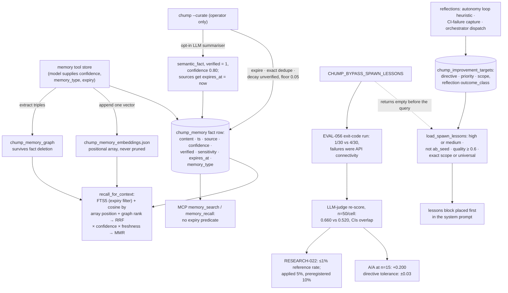

## 1. Executive Summary

Chump is a Rust multi-agent fleet coordinator whose optional built-in agent
keeps two memories: a SQLite fact table searched by FTS5, embeddings and an
entity graph, and a store of reflection-derived lessons placed first in every
system prompt. What is notable is the evaluation around them: each cognitive
faculty has an environment flag that switches it off, the lesson injection was
A/B tested against its flag, and a second analysis asked whether the agent ever
echoes what it was given. What is weak is that the memory A/B cannot carry its
label: the first run measured API failures, and the re-score missed the A/A
tolerance the project's own directive sets before a result may be cited.

The project describes itself as "a multi-agent fleet coordinator + gap
registry" that works with any coding agent, and places memory in "the built-in
agent" lane, which it calls optional. Applications and every memory crate are
AGPL-3.0-only; eight library crates are Apache-2.0 (`NOTICE`).

**The ablated memory is the lesson store, not the fact table.**
`CHUMP_BYPASS_SPAWN_LESSONS` returns an empty list at the top of
`load_spawn_lessons`, which reads `chump_improvement_targets` joined to
`chump_reflections` (`src/reflection_db.rs:503-627`). The FTS table
`chump_memory`, which the memory tool writes and `recall_for_context` reads, is
not touched by that flag. A reader carrying EVAL-056's result to the fact store
is carrying it to a different mechanism.

**The A/B, as its own write-up records it.** EVAL-056's status line reads "NO
SIGNAL (CIs fully overlapping)". The cells were 1/30 and 4/30 correct, scored
by exit code and output length, and the write-up attributes the failures to
API connectivity rather than to lessons. The directive's rule 6 prohibits that
scorer as primary and bars its results from validated labels
(`docs/process/RESEARCH_INTEGRITY.md:104-109`).

The same file carries the re-score under an LLM judge: 33/50 with lessons
against 26/50 without, intervals overlapping, labelled a confirmed null. Its
calibration line gives an A/A run at n=15 per cell with a delta of +0.200. Rule
5 of the directive says an A/A delta should be within ±0.03 before results are
cited (`:101-103`). By the project's own rule, neither run is citable as
evidence that lessons do or do not help.

**The mechanism check holds under either threshold.**
`REMOVAL-001-addendum-RESEARCH-022.md` reports that all five null-validated
modules were referenced in at most 1% of agent outputs, below "the
preregistered 5%" threshold. The preregistration,
`docs/eval/preregistered/RESEARCH-022.md:20-27`, states the threshold as 10%
and specifies a regex stage followed by an LLM stage; the analysis applies 5%.
The result is below both figures, so the conclusion stands and the word
"preregistered" does not describe the threshold used.

**Half the write-ups are private.** Thirty-nine of the 78 markdown files at
the top of `docs/eval/` are stubs pointing to a private companion repository,
and the directive tells contributors not to state magnitudes, model names or
per-eval IDs publicly. The other thirty-nine are public, including EVAL-101, a
null on the whole cognition stack, and EVAL-102, which lists the protocol
violations that make EVAL-101 uncitable and has no results.

One mark, `negative_eval`, on the lesson read path. The fact table carries
none: no scope key, no validity interval, no supersession, no mutation record,
and a `verified` integer whose only writers are the two LLM summariser paths.

## 2. Mental Model

A **fact** is a row the agent chose to store. The memory tool takes content,
an optional confidence, an optional `memory_type` from a five-value enum and an
optional expiry in hours, all supplied by the model
(`src/memory_tool.rs:859-892`, `:936-1010`). Nothing reviews it. It ends one of
three ways: its expiry passes, an exact duplicate with a higher `verified` or
confidence wins the dedupe, or the summariser consumes it.

**`verified = 1` means an LLM summary wrote the row.** The two summariser
paths are the only writers of that value in the tree; they insert a
`semantic_fact` at confidence 0.80 with the comment "the summarizer is the
verification step", and set `expires_at` to the current time on every episodic
source row (`crates/chump-memory-db/src/memory_db.rs:561-638`, `:720-788`). A
verified row is exempt from decay, wins dedupe against any unverified copy and
carries a 0.25 weight in the reranker. A fact the user dictated and the model
stored is unverified; a model's summary of old episodes is verified.

**Decay is a ranking input, not a state.** For unverified rows,
`decay_unverified_confidence_on_conn` multiplies confidence down by age and
floors it at 0.05, "so a decayed memory still surfaces in retrieval (just
heavily down-weighted) rather than vanishing" (`memory_db.rs:272-303`). It runs
only inside `curate_all`, whose one caller is the `--curate` mode of the binary
(`src/main.rs:19792-19821`); no plist, script or loop in the tree invokes it.

A **lesson** is a directive extracted from a reflection. Reflections are
written by the autonomy loop after each task from a heuristic
(`src/autonomy_loop.rs:1370-1380`), by CI-failure capture
(`src/ci_lesson.rs:233`) and by the orchestrator once per dispatch outcome
(`crates/chump-orchestrator/src/reflect.rs:319-383`). A lesson reaches a prompt
when it is high or medium priority, its reflection is not an A/B seed, the
reflection's outcome class scores at least the quality threshold, and its
scope matches the domain hint or is universal. The default threshold of 0.6
admits pass and success only. Ranking is directive frequency over recency. No
path retires a lesson; the one delete removes A/B seeds (`src/main.rs:19837`).

A **causal lesson** has a `stale` column that the read path filters
(`src/counterfactual.rs:86-111`). Its only writer is `memory_curate`
(`memory_db.rs:895-910`), and that function's only caller is a test, so in a
running deployment no causal lesson becomes stale.

A **bypass flag** turns one faculty off at its single injection point, so its
absence can be measured (`src/env_flags.rs:225-300`).

## 3. Architecture

| Area | Role |
| --- | --- |
| `crates/chump-memory-db/src/memory_db.rs` | Fact insert, load, keyword search, rerank, expiry, dedupe, decay, both summarisers, and an unused second curation pass |
| `crates/chump-db-pool/src/db_pool.rs` | The production schema for every memory table, and the pooled connection |
| `src/memory_tool.rs` | The agent's store and recall tool, the embeddings file, and the hybrid `recall_for_context` |
| `src/memory_graph.rs`, `src/memory_graph_tool.rs` | Triple extraction, associative recall and the graph tool |
| `src/reflection_db.rs`, `src/reflection.rs` | Reflections, improvement targets and the spawn-lesson loader |
| `src/agent_loop/prompt_assembler.rs` | Where lessons enter the system prompt |
| `crates/mcp-servers/chump-mcp-memory/src/main.rs` | Four MCP tools over the same database file |
| `src/memory_brain_tool.rs` | A markdown wiki under `CHUMP_BRAIN_PATH` the agent reads and writes |
| `scripts/coord/lib/peer-memory.sh` | The duty-officer peer's episode memory, written with the `sqlite3` CLI |
| `src/env_flags.rs` | The four bypass flags |
| `docs/eval/`, `docs/process/RESEARCH_INTEGRITY.md` | Write-ups, preregistrations and the binding methodology |

The production `chump_memory` table is created with four columns
(`crates/chump-db-pool/src/db_pool.rs:95-115`) and gains confidence,
`verified`, sensitivity, expiry and type through `ALTER TABLE` at startup
(`:466-482`). The fuller `CREATE TABLE` in `memory_db.rs:74-96` is compiled only
under `cfg(test)`.

Four components resolve the database path four ways. The pool reads
`CHUMP_MEMORY_DB_PATH` and falls back to the working directory
(`db_pool.rs:15-22`). The MCP server reads `CHUMP_MEMORY_DB`, then
`CHUMP_REPO` or `CHUMP_HOME` (`chump-mcp-memory/src/main.rs:53-66`). The
orchestrator writes to `<repo_root>/sessions/chump_memory.db`
(`reflect.rs:274-276`), and the peer shell reads `CHUMP_MEMORY_DB` or a path
relative to the script. An operator who moves the database with the pool's
variable leaves the MCP server and the orchestrator on another file, and each
creates an empty one rather than failing.

### Deployment and ergonomics

Everything is local. Storing a fact needs no API key: the SQLite file is
created on first use. Semantic recall needs an embedding endpoint, by default
`http://127.0.0.1:18765`, served by a Python script whose requirements are
unpinned (`scripts/setup/requirements-embed.txt`), or the `inprocess-embed`
build feature. Without one, recall falls back to keyword search. The
summariser needs an LLM provider and `CHUMP_MEMORY_LLM_SUMMARIZE=1`. The store
is a readable SQLite file plus a JSON array of vectors; the array cannot be
repaired by hand, because nothing in it names the row a vector belongs to.

## 4. Essential Implementation Paths

- **Fact capture.** `MemoryTool::execute` "store" truncates to 500 characters,
  calls `memory_db::insert_one`, appends one vector to the embeddings file, and
  stores extracted triples keyed to the newest row matching any of the text's
  words (`src/memory_tool.rs:936-1010`, `memory_db.rs:171-195`).
- **Fact recall into context.** `recall_for_context`
  (`src/memory_tool.rs:525-755`), called by the Discord handler
  (`src/discord.rs:614`) and the local OpenAI-compatible window when hybrid
  recall is enabled (`src/local_openai.rs:870`).
- **Fact recall by tool.** The tool's "recall" action uses `keyword_search`
  only (`src/memory_tool.rs:1012-1047`, `memory_db.rs:1004-1034`); the autonomy
  loop uses `keyword_search_reranked` (`src/autonomy_loop.rs:460`,
  `memory_db.rs:1150-1184`).
- **Curation.** `curate_all_async` from `--curate`
  (`src/main.rs:19792-19821`, `memory_db.rs:796-814`). `memory_curate`
  (`:855-925`) is a second pass with a 0.0 floor, a hard-deleting episodic
  summariser and the causal-lesson stale writer; it has no caller outside its
  test.
- **Lesson write.** `save_reflection` (`src/reflection_db.rs:1168-1206`) from
  the autonomy loop and CI capture; `SqliteReflectionWriter::write` from the
  orchestrator (`crates/chump-orchestrator/src/main.rs:282`).
- **Lesson injection.** `prompt_assembler.rs:140-169` calls
  `load_spawn_lessons` with the tool hint or first perceived entity as domain
  and prepends the block to the base system prompt. `chump --briefing <GAP-ID>`
  returns the same lessons plus CI lessons to an external agent
  (`src/briefing.rs:348-352`, `:879-881`).
- **MCP surface.** `fts_search`, `like_search` and `handle_episode_search`
  (`chump-mcp-memory/src/main.rs:139-179`, `:234-278`).
- **Evaluation.** `src/env_flags.rs:225-300` for the flags,
  `scripts/ab-harness/run-binary-ablation.py` for the sweep,
  `docs/eval/EVAL-056-memory-ablation.md` for the result.

## 5. Memory Data Model

`chump_memory` holds `content`, `ts`, `source`, `confidence` defaulting to 1.0,
`verified` defaulting to 0, `sensitivity` defaulting to `'internal'`,
`expires_at`, and `memory_type` defaulting to `'semantic_fact'`. All three FTS
triggers exist, so the mirror follows inserts, deletes and updates.
`sensitivity` is `'internal'` on every row: no caller sets another value
and nothing reads it.

`chump_improvement_targets` holds `reflection_id`, `directive`, `priority`,
`scope` and `actioned_as` (`db_pool.rs:353-364`). `scope` is a tool or domain
name such as `patch_file`, not a user, project or tenant; NULL means
universal. The parent `chump_reflections` row carries `outcome_class`,
`error_pattern` and `hypothesis` (`:338-352`).

`chump_episodes` carries `happened_at`, defaulted to the insert time, with a
`repo` column; `chump_memory_graph` holds subject, relation and object with an
optional `source_memory_id`; `chump_causal_lessons` holds a lesson, a
confidence and the `stale` integer (`:47-57`, `:191-215`, `:585`).

Four near-misses, each named so the dash can be checked:

- **Trust state.** `verified` gates decay and weights ranking, never a read.
  The quality gate withholds lessons by the reflection's outcome class, which
  records how a task went, not whether the lesson is believed; it is fixed when
  the reflection is written. The causal `stale` flag is filtered and has no
  live writer.
- **Scope.** No fact row carries a scope key; per-repository separation is a
  file path. The lesson `scope` is topical and an empty domain returns every
  lesson. Episode search filters by `repo` only when the caller passes one.
- **Bi-temporal.** `happened_at` is the only time on an episode and defaults
  to the write time; nothing records validity separately from recording.
- **Audit.** `chump_tool_calls` is hash-chained, records tool calls rather
  than memory mutations, and `record_call` deletes all but the newest 200 rows
  (`src/introspect_tool.rs:15-53`). Curation, dedupe and summarisation record
  only counts in a log line.

## 6. Retrieval Mechanics

`recall_for_context` expands the query with entities related through the
graph, takes FTS5 matches with an expiry filter, scores every live fact by
cosine against the query vector, ranks facts linked to the query's entities in
the graph, and fuses the three by reciprocal rank. The fused score is
multiplied by confidence and by a freshness factor, optionally blended with a
BM25 proxy when `CHUMP_MEMORY_RERANK=1`, diversified by MMR over token
trigrams at λ 0.7, and cut to 4,000 characters (`src/memory_tool.rs:270-316`,
`:417-498`, `:520`).

**The vector for a fact is found by position.** `load_memory` returns the live
rows ordered by id with expired rows excluded, and the code pairs
`embeddings[i]` with `entries[i]` (`:615-621`). The array is appended to on
store and extended only when it is shorter than the row list (`:599-613`).
Nothing removes a vector when expiry, dedupe or the summariser deletes a row,
or when the summariser sets `expires_at` and `load_all` stops returning it
(`memory_db.rs:140-153`). After the first such removal every later fact is
scored by its neighbour's vector, and because the array is then longer than
the row list the extension never runs. A store whose embedding call failed
shifts the array the same way.

The MCP tools read the same table without the expiry predicate
(`chump-mcp-memory/src/main.rs:139-179`). A row the summariser has consumed is
hidden from the agent's own recall and returned to any MCP client until an
operator runs `--curate`.

Graph triples are never deleted with their fact, so a removed fact's entities
keep expanding queries; `recall_for_context` drops the dangling ids only when
it maps the final ranking back to live rows.

Lessons are retrieved without a query: ranking is per-directive count divided
by one plus age in weeks, and the block is placed before the base system
prompt (`src/reflection_db.rs:570-585`, `prompt_assembler.rs:164-169`).

## 7. Write Mechanics

Fact writes are synchronous tool calls. An embedding request and a triple
extraction follow in the same call; an embedding failure is swallowed.
Lessons are written at task completion, at CI-failure capture and at each
orchestrator dispatch outcome, from heuristics rather than a model call unless
`reflect_via_provider` is enabled.

The summariser clusters `episodic_event` rows by source and age bucket, at
least five per cluster and 30 days old, at most three clusters per pass
(`memory_db.rs:439-447`). The only producer of `episodic_event` rows is a
model that chose that type when storing. The output's `source` is
`summary::<cluster_id>`, which names a source and an age bucket, not the rows
consumed. Once the next expiry pass deletes them, the summary is the only
account of them and cannot be traced back to them.

The duty-officer peer appends an episode per judgment tick through the
`sqlite3` CLI and feeds the five newest into its next prompt
(`scripts/coord/duty-officer-loop.sh:339-342`, `:405-418`).

Cost is bounded on the read side: five lessons by default, 20 at most, and a
4,000-character fact budget. The lessons block sits at the head of the system
prompt, so any new lesson that changes the ranking invalidates a provider's
prompt-prefix cache for the whole prompt.

## 8. Agent Integration

Inside the built-in agent the model holds `memory` (store, recall),
`memory_brain` (read, write, append, list and search files) and the graph
tool. No surface offers forget, correct or retire. Bring-your-own agents reach
facts through the MCP server's four tools and lessons through
`chump --briefing`. The duty-officer peer reaches the database through an
allowed `sqlite3` command.

## 9. Reliability, Safety, and Trust

The peer's prompt states that `chump gap reserve`, `chump gap set`,
`chump dispatch` and `broadcast.sh` "are the only mutating commands in your
allowlist" and that it has no path to deletes. The allowlist also grants
`Bash(sqlite3*)` and `Bash(cat*)` (`duty-officer-loop.sh:354-360`). `sqlite3`
executes any SQL against any database file the process can open, including a
`DELETE` on `chump_memory`, and the `sqlite3` shell's `.shell` and `.system`
commands run arbitrary programs. That last property belongs to the CLI, not to
this tree, and was not exercised for this reading.

The research-integrity directive carries the controls a reader would ask
for. Rule 5
requires an A/A run per series and a tolerance before citing; rule 6 bans the
exit-code scorer; rule 8 blocks closing an eval gap without a cross-judge audit,
a reasoned waiver or a declared single-judge scope (`RESEARCH_INTEGRITY.md:101-127`). EVAL-102's
public table of the ways EVAL-101 broke protocol is the directive working as
written. The memory label is where it was not applied: EVAL-056 is marked
"COVERED+VALIDATED(NULL)" on a re-score whose A/A delta is more than six times
the tolerance.

The disclosure policy is a commercial choice with a specific effect: half of
the write-ups can be checked from the public tree, and the directive forbids
restating the private half's magnitudes. A reader citing Chump's
cognitive-architecture findings from this repository is citing the public half
and the method.

## 10. Tests, Evals, and Benchmarks

The eight core memory files hold 226 test functions. `memory_db.rs` tests expiry, dedupe
precedence, decay skipping verified rows and respecting the floor, rerank
ordering, cluster selection and both summariser paths. No test covers the
pairing of vectors to rows across a deletion, and no MCP test seeds an expired
row.

The lesson path is pinned by negative cases with positive controls in the same
test, run through a helper that makes the assembler's two calls:
`scope_hint_filters_unrelated_lessons_in_assembled_block`,
`quality_threshold_filters_failure_lessons_end_to_end` and
`spawn_lessons_excludes_low_priority_and_ab_seed`
(`src/reflection_db.rs:3283-3340`, `:3231-3274`, `:2552-2581`).
`stale_edges_excluded_from_lesson_generation` asserts the same of an in-memory
causal graph whose invalidation function has no product caller
(`src/counterfactual.rs:1220-1234`, `:677`).

`MEM-010-results.md` reports entity-resolution precision of 1.000 on 30 pairs
against `tests/entity_resolution_accuracy.rs`. `MEM-008-fixture-spec.md`
specifies a 15-question multi-hop fixture; `lesson-effectiveness-2026-05-05.md`
is an audit with zero rows in every bucket.

## 11. For Your Own Build

### Steal

Build the off-switch at the injection point. One flag per faculty, read in one
function, checked before the database is touched, makes every faculty
measurable and makes a null result interpretable as "this path was empty".

Ask the mechanism question beside the outcome question. Whether accuracy moved
and whether the model ever repeats what it was given fail in different ways,
and a faculty that fails both has a weak case.

Write the citation rule down and apply it to your own results, including the
reason a run cannot be cited. EVAL-102's violation table is the form.

### Avoid

Pairing vectors to rows by array position. Key the vector by row id, or store
it in the row, or rebuild the array whenever a row is deleted.

Calling a model's own summary verified. If a flag exempts rows from decay, its
writer should be something the producing model cannot be.

Resolving one database path in four places. Derive it once and pass it, or
fail when the file does not exist instead of creating an empty one.

Restating a preregistered threshold from memory. Quote the file.

### Fit

Read this for its experiment design, not for its memory. The fact store is
conventional and has a correctness defect on its semantic arm; the lesson
store is the part with tests and the part that was measured. A team that
already has a memory and wants to know whether it helps will get more from
`env_flags.rs` and the directive than from either store.

## 12. Open Questions

Whether the vector misalignment occurs in deployments. It needs a deletion
after embeddings exist, which happens on any `--curate` run that expires or
dedupes a row; running it was out of scope.

Whether EVAL-102 has run. Its result file reads pending; the outcome, if it
exists, may be in the private repository.

What the private decision matrix concluded for the modules other than
`belief_state`. `REMOVAL-003-design.md` is public and `src/belief_state.rs` is
an inert stub that cites it; `neuromodulation.rs` and `blackboard.rs` are full
implementations, and spawn lessons are on by default.

## Appendix: File Index

| Path | What to read it for |
| --- | --- |
| `src/reflection_db.rs:503-627` | The lesson loader, its gate, its scope rule and the bypass |
| `src/agent_loop/prompt_assembler.rs:140-169` | Lessons placed first in the system prompt |
| `src/memory_tool.rs:525-755` | Hybrid fact recall, and the positional embedding pairing |
| `crates/chump-memory-db/src/memory_db.rs:272-303` | Decay and the floor that keeps a fact retrievable |
| `crates/chump-memory-db/src/memory_db.rs:561-638` | The summariser that writes `verified = 1` |
| `crates/chump-db-pool/src/db_pool.rs:95-115`, `:338-364`, `:466-482` | Production schema for facts and lessons |
| `crates/mcp-servers/chump-mcp-memory/src/main.rs:139-179` | MCP search without the expiry predicate |
| `src/env_flags.rs:225-300` | Four faculties, four off-switches |
| `docs/eval/EVAL-056-memory-ablation.md` | Both runs, the caveats and the A/A line |
| `docs/eval/preregistered/RESEARCH-022.md` | The 10% threshold and the two-stage detector |
| `docs/process/RESEARCH_INTEGRITY.md` | A/A tolerance, scorer ban, cross-judge rule, disclosure |
| `src/reflection_db.rs:3283-3340` | The negative case on the lesson block |

### Recorded searches

Run at the tree root of the pinned checkout with `git grep`; each was also run
at `631fcaa7f56ef6fa567cbc0ea9859d1b4bec4263` with the same result.

- `git grep -n -w 'memory_curate' -- '*.rs' '*.sh' '*.py'` — the definition, its log and source strings, and one call at `memory_db.rs:2220` inside a test.
- `git grep -n -E 'verified\s*=\s*1|SET verified|verified:\s*Some' -- '*.rs' '*.py' '*.sh'` — one doc comment, `memory_db.rs:555`; the writes are the literal `1` in the two summariser inserts at `:613` and `:767`.
- `git grep -n -E -e '--curate\b' -- ':!.chump' ':!*.md'` — `src/main.rs` only; no scheduler invokes it.
- `git grep -n -E 'chump_memory_embeddings|save_embeddings\(|remove_file\(.*embed' -- '*.rs' '*.py' '*.sh'` — the path constant, two doc comments, the function and three appending saves; nothing truncates or rebuilds the array.
- `git grep -n -i 'expires_at' -- crates/mcp-servers/chump-mcp-memory/src/main.rs` — the `CREATE TABLE` column at `:86` only.
- `git grep -n -E 'stale\s*=\s*1' -- '*.rs'` — `memory_db.rs:854` and `:902`, both in `memory_curate`.
- `git grep -n -E 'invalidate_causal_edge|curate_causal_graph' -- '*.rs'` — definitions and tests in `src/counterfactual.rs` only.
- `git grep -n -i -E '\b(valid_from|valid_to|valid_until|invalid_at|superseded_by|supersedes_id|bitemporal)\b' -- '*.rs' '*.sql' '*.py' '*.sh' ':!.chump'` — no match.
- `git grep -l -i 'tombstone' -- 'src/*memory*' 'src/reflection*' src/counterfactual.rs crates/chump-memory-db crates/mcp-servers/chump-mcp-memory` — no match; the tree's hits are in coordination code.
- `git grep -n -i -E 'CREATE TABLE[^(]*(memory|lesson|reflection)[a-z_]*(event|audit|history|log|mutation)' -- ':!.chump'` — no match.
- `git grep -n -i -E '(pending|approved|rejected|quarantine)' -- crates/chump-memory-db src/memory_tool.rs src/reflection_db.rs src/reflection.rs crates/mcp-servers/chump-mcp-memory src/counterfactual.rs src/memory_graph.rs crates/chump-orchestrator/src/reflect.rs` — three incidental comment and assertion hits; no review state.
- `git grep -l -F 'moved to a private repository' -- 'docs/eval/*.md'`, top level only — 39 files match, in a directory holding 78.
- `git grep -n -E 'CHUMP_MEMORY_DB\b|CHUMP_MEMORY_DB_PATH' -- ':!.chump/state.sql'` — the pool reads the second, the MCP server and the peer shell the first.
- `git grep -n -i -E '"(forget|delete|remove|retire|correct|update)"' -- src/memory_tool.rs src/memory_brain_tool.rs src/memory_graph_tool.rs crates/mcp-servers/chump-mcp-memory` — no match; no memory surface offers a removal or correction verb.
- `git grep -n -E 'DELETE FROM chump_(improvement_targets|reflections|memory_graph)' -- '*.rs' '*.py' '*.sh'` — `clear_ab_seed_lessons` at `src/reflection_db.rs:1503` and `:1510`, the A/B seeding script, and a test.
- `git grep -n -E 'sensitivity' -- '*.rs'`, outside `memory_db.rs`, `db_pool.rs` and the MCP server — only unrelated uses in `src/neuromodulation.rs` and `crates/chump-verify`; no reader of the column.
- `git grep -n -i -E 'arxiv|bibtex|@article|@misc|doi\.org' -- README.md` — no match; no paper.

## History

**2026-10-12** — [`c532a7fa50f9a7ff4a0e5ee163f9aee408e0a1d1`](https://github.com/repairman29/chump/commit/c532a7fa50f9a7ff4a0e5ee163f9aee408e0a1d1) — 910 commits on; every memory file is unchanged, `docs/eval/` changed by one line, and the duty-officer peer's episode memory is new ([section 7](#7-write-mechanics)). `negative_eval` gained, earned at the first pin on lesson-block tests ([section 10](#10-tests-evals-and-benchmarks)). Wrong then: the ablated memory is the lesson store, not the fact table; retrieval has a vector arm ([section 6](#6-retrieval-mechanics)); EVAL-056 was presented as credible under controls its own directive says it fails; the 5% threshold is preregistered as 10%; 39 write-ups are public, not four; the test count omitted `tokio::test` ([section 1](#1-executive-summary)). Screened from a full clone: 99 files, three auto-run surfaces, three build-time execution points, seven unpinned surfaces, five files inside the cooldown, `CLAUDE.md` and `AGENTS.md` read as data. Nothing was installed, built or run.

**2026-09-16** — [`631fcaa7f56ef6fa567cbc0ea9859d1b4bec4263`](https://github.com/repairman29/chump/commit/631fcaa7f56ef6fa567cbc0ea9859d1b4bec4263) — first reading, at a commit dated 15 September 2026. Dual-licensed AGPL-3.0 and Apache-2.0. Thirty-nine of the eighty-three documents under `docs/eval/` are stubs recording that the content moved to a private repository; the figures quoted here come from the write-ups that remain public. Screened before opening, from a shallow clone: eighty-eight files scanned, three auto-run surfaces, two build-time execution points, six unpinned surfaces and sixty-nine dependency files inside the seven-day cooldown, with `CLAUDE.md` and `AGENTS.md` read as data. Nothing was installed, built or run.
