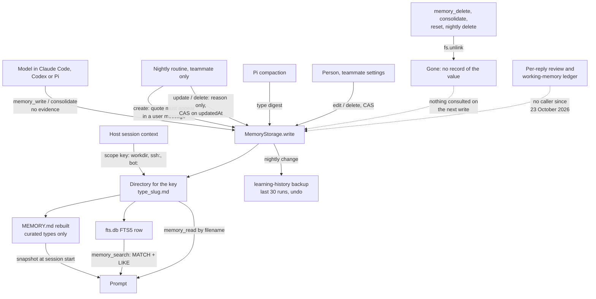

## 1. Executive Summary

Cindy is a desktop agent host from XD Inc. that runs Claude Code, Codex and Pi
as harnesses, plus persistent "teammate" agents (Bots) reachable from chat apps.
Its memory, called Maker Memory in the code, replaces the harnesses' own
auto-memory with Markdown shards under one of four types, a `MEMORY.md` index
the host rebuilds and injects at session start, and an FTS5 table per store
behind an in-process `cindy_memory` MCP server. What is notable is where the
boundary lives: the host derives every store's key from the session, never from
a tool argument. A teammate's memory is also tidied by a nightly routine that
admits a new memory only on a verbatim user quote and records every change for
undo. What is weak is correction: a memory has no state and no history, a
delete unlinks the file, and the undo trail keeps 30 runs.

The design is Claude Code's auto-memory with the index moved out of the model's
hands. The model writes `<type>_<slug>.md` through `memory_write`, and
`MemoryStorage.rebuildIndex` regenerates `MEMORY.md` from every shard's
frontmatter after each mutation, so the index cannot drift from the files
(`packages/maker-core/src/memory/storage.ts:509-553`). The FTS5 table is a
derived index too, rebuilt from the files whenever a store opens
(`packages/maker-core/src/memory/store.ts:109-132`).

Four findings shape the rest of this report.

- **Scope is a directory, chosen by the host.** `withStore` takes
  `memoryScopeKey` or `workingDir` from the session context and never from a
  tool argument (`packages/lizi-mcps/src/memory/_shared.ts:55-73`), and each key
  maps to its own directory and `fts.db`. The mark is withheld because the
  boundary is physical, and because `session_search`, registered in the same
  server, returns account-wide history to an ordinary session.
- **The background writer checks its evidence; the foreground writer does
  not.** A nightly memory create is applied only if its quote appears in a
  user message with that id
  (`apps/desktop/src/main/maker-ipc/botNightlyLearning.ts:472-473`). A model
  `memory_write` carries no evidence at all, and nightly updates and deletes
  need only a reason.
- **Forgetting leaves nothing behind.** `memory_delete` unlinks the shard and
  rebuilds the index (`storage.ts:420-445`); no record of the value survives to
  stop the model writing it again.
- **A whole layer is declared and unwired.** The per-reply learning review and
  the working-memory ledger it maintained have had no caller since commit
  [`9672a99bc98f1415f90ccdf1d597e99833fff503`](https://github.com/makecindy/cindy/commit/9672a99bc98f1415f90ccdf1d597e99833fff503)
  (23 October 2026), and the product
  rules say so; only the ledger's deletion cleanup is wired.

One mark, `negative_eval`, from a deletion case run through the real MCP
server against a populated store with a kept memory as control.

## 2. Mental Model

A memory is a file. Its identity is the filename, `<type>_<slug>.md`, where the
slug is `[a-z0-9_-]{1,64}` supplied by the writer and the type is one of
`user`, `feedback`, `project`, `reference` or `digest`
(`packages/maker-core/src/memory/types.ts:17-29`). The frontmatter holds
`title`, `description`, `type` and `updatedAt`; nothing records who wrote it,
from what, or how sure anyone is. A shard is believed from the moment it lands:
the next session's index lists it and the next search can return it.

The four curated types are what the model is taught to write. The injected
rules ask for a `**Why:**` and `**How to apply:**` on feedback, absolute dates,
and no code facts, git history or task state
(`packages/maker-core/src/memory/system-prompt.md`). `digest` is the host's own
type: Pi writes a compaction summary under it, `memory_search` can find it, and
`rebuildIndex` leaves it out of `MEMORY.md`, so it never reaches a prompt
unasked (`storage.ts:533-545`, `packages/maker-core/src/agents/pi/index.ts:3836-3855`).

A memory changes in three ways and dies in one. `mode: 'update'` replaces the
body and keeps the old title or description if the new ones are empty;
`append` concatenates; `memory_consolidate` writes a target and unlinks the
sources (`storage.ts:346-418`, `store.ts:260-333`). Death is `fs.unlink`, by
the model's `memory_delete`, a person's settings page, a nightly delete, a
consolidation, or a reset of a whole store. There is no superseded, archived or
rejected state, and no record that a value was ever removed.

Teammate memory adds one actor. A built-in routine runs once a night per
teammate, reads the owner's conversations since its watermark, and asks an
auxiliary model for a JSON plan. The host applies a create only if the quote it
cites is found in a user message with that id, applies an update or delete only
to a shard whose full body the model was shown and whose `updatedAt` has not
moved, and records each change's before and after so a person can undo it
(`botNightlyLearning.ts:441-502`). The model proposes; the host checks the
quote and the version; nobody reviews before the change lands.

## 3. Architecture

Cindy is a pnpm monorepo. The memory engine is `packages/maker-core/src/memory`:
`MemoryStorage` for files, `MemoryFts` for one better-sqlite3 FTS5 table,
`MakerMemoryStore` as the facade over both, and `MakerMemoryManager` as a pool
of stores keyed by scope. The MCP surface is
`packages/lizi-mcps/src/cindy_memoryMcpServer.ts` with tool modules under
`packages/lizi-mcps/src/memory/`. The Electron main process in `apps/desktop`
injects the SQLite factory, the owner-scoped data root, the teammate storage
resolver and the history search; `apps/cindy-headless` wraps the same MCP
factory for a headless runner (`apps/cindy-headless/src/memory-provider.ts`).

A store is opened lazily on first `getStore(scopeKey)`: the manager resolves the
signed-in owner's root, derives a directory name from the key, opens
`fts.db` beside the shards and pools the result
(`packages/maker-core/src/memory/manager.ts:518-723`). Teammate scopes resolve
to `memories/` inside the teammate's Home under `<ownerRoot>/bots/` (`apps/desktop/src/main/maker-host/maker-memory-host.ts:108-112`), copying shards from the legacy
location once and writing a receipt. Opening a store rebuilds both derived
indexes from the files (`store.ts:109-132`).

The owner boundary is enforced harder than anything else in the subsystem. If
the account is unknown, `getStore` throws `memory:not-ready` rather than
writing to a temporary directory; every store operation re-checks the owner key
before and after each await, and a sign-out mid-write aborts with the derived
index marked dirty for repair (`manager.ts:320-405`, `storage.ts:399-445`). The
comments cite more than twenty review rounds on one pull request, #2388, for
these guards.

Two more stores sit beside memory. The `messages` table and its `messages_fts`
shadow back `session_search` (`apps/desktop/src/main/maker-host/session-search.ts`),
and `searchChatHistoryHybrid` adds a sqlite-vec arm over the same messages
for the sidebar and the `cindy_helper` history tools
(`apps/desktop/src/main/localDb/chatHistorySearch.ts`). Cloud companions upload each
teammate's memory files to Cindy's Chat Server as preference values, with a
`null` tombstone when a file disappears locally
(`apps/desktop/src/main/companion-cloud/host.ts:96-107`,
`apps/desktop/src/main/companion-cloud/uploader.ts`).

### Deployment and ergonomics

Nothing runs besides the desktop app. The store is Markdown on local disk plus
a SQLite file that can be deleted and regenerated, so it is readable and
repairable by hand; editing a shard outside the app is picked up the next time
the store opens. Storing needs no API key. `memory_review` and nightly learning
call an auxiliary model, which needs a configured provider. Install is the
desktop app; nothing in the memory path leaves the machine unless a teammate is
a cloud companion.

## 4. Essential Implementation Paths

**Write through MCP.** `memory_write` validates type, slug, title and
description with zod (`packages/lizi-mcps/src/memory/write.ts:36-52`), then
`withStore` resolves the scope from the session context and calls
`MakerMemoryStore.write` (`_shared.ts:44-112`). `MemoryStorage.writeFile`
refuses a `create` over an existing file, rejects bodies over 8,192 bytes,
stamps `updatedAt`, writes the file, rebuilds `MEMORY.md` by reading every
shard, and returns a soft warning over 2,048 bytes per shard or 4,096 for the
index (`storage.ts:346-418`, `types.ts:128-135`). The facade then re-reads the
shard and upserts its FTS row, logging rather than failing if that errors
(`store.ts:193-212`).

**Retrieval.** `memory_search` escapes the query into one FTS5 phrase, ranks
`MATCH` hits by `bm25`, and merges a `LIKE` scan over title, description and
body for CJK substrings that `unicode61` cannot split, reserving one slot for a
LIKE-only hit when the MATCH results fill the limit
(`packages/maker-core/src/memory/fts.ts:90-207`). `memory_read` takes a
filename, rejects `..`, `/` and `\`, and requires the `<type>_<slug>.md` shape
(`storage.ts:286-291`, `:591-599`).

**Context assembly.** Claude Code and Codex resolve the scope key at session
start, open the store, and inject the static rules plus a snapshot of
`MEMORY.md` (`packages/maker-core/src/agents/claude-code/index.ts:1792-1803`,
`packages/maker-core/src/agents/codex/index.ts:3764-3775`). A teammate's
runtime builds the same snapshot from its `bot:` scope and omits the rules
(`apps/desktop/src/main/maker-ipc/botProfileRuntime.ts:581-597`). The snapshot
is taken once; a write mid-session is visible through the tools and not in the
injected index until the next session.

**Correction and forgetting.** `memory_delete` and `memory_consolidate` are the
model's verbs (`packages/lizi-mcps/src/memory/delete.ts`,
`consolidate.ts`). A person edits or deletes teammate memories in settings
through `botMemoryService`, which compares `updatedAt` and refuses a stale
save with `BOT_MEMORY_CHANGED`
(`apps/desktop/src/main/maker-ipc/botMemoryService.ts:273-358`). Workdir
memory has no per-item UI: settings offers a reset of every store
(`apps/desktop/src/renderer/components/settings/MemorySection.tsx:211-230`).

**Nightly learning.** `runNightlyLearning` is called only by the routine
service (`apps/desktop/src/main/routines/service.ts:169`), on a cron of
`30 3 * * *` by default
(`apps/desktop/src/main/bot-autonomy/nightlyLearningRoutine.ts:30-46`).
`runLocked` reads up to 60,000 characters of owner turns, sends the teammate's
memories, skills, candidates and declined titles to the auxiliary model,
validates the JSON against `nightlyLearningSchema`, and applies memory
operations before skill operations (`botNightlyLearning.ts:312-580`,
`apps/desktop/src/main/maker-ipc/botNightlyLearningPlan.ts:16-81`).
`revertNightlyLearningItem` undoes or redoes one change and refuses if the live
content no longer matches the recorded side (`botNightlyLearning.ts:592-631`).

**LLM review.** `memory_review` sends every record's full body to the auxiliary
model and returns up to 200 words of suggestions; it changes nothing
(`manager.ts:900-963`, `packages/lizi-mcps/src/memory/review.ts`).

**Unwired.** `reviewTeammateLearning` in
`apps/desktop/src/main/maker-ipc/botLearningReview.ts` has no importer outside
its tests. The working-memory ledger in `botWorkingMemory.ts` has a writer only
in that review; its readers `readWorkingMemoryNoteForSession` and
`createWorkingMemoryRefreshRegistry` have no caller, and the optional
`readWorkingMemoryNote` and `peekWorkingMemoryRefresh` dependencies are never
supplied. Its deletion pruner is wired
(`apps/desktop/src/main/maker-ipc/register.ts:11327-11328`).

## 5. Memory Data Model

The record is `MemoryRecord`: filename, slug, frontmatter and body, plus the
file's byte size (`types.ts:60-71`). `bodyLength` is added only for imported
shards whose whitespace must survive exactly. There is no id beyond the
filename, no author, no source, no confidence and no status field; `updatedAt`
is the only time, and every write overwrites it.

`meta.json` in each directory records the key the store was opened for and its
creation time; the manager uses it to tell a teammate directory from a project
directory with a similar name before a global reset
(`manager.ts:150-168`). `MEMORY.md` and `fts.db` are derived and are skipped
when legacy shards are migrated.

Scope keys come in three shapes (`storage.ts:79-136`):

| Key | Directory | Produced by |
| --- | --- | --- |
| absolute working directory | `sanitizeWorkdir(path)` under `<ownerRoot>/maker-memory/` | `resolveMemoryScopeKey`, after folding a linked git worktree to the main checkout plus the same subpath |
| ``ssh:<encoded host>:<remote path>`` | ``ssh-<host>-<sha256 prefix>`` | `buildMemoryScopeKey` for remote sessions |
| ``bot:<encoded id>`` | `memories/` in the teammate's Home under `<ownerRoot>/bots/` | `buildBotMemoryScopeKey`, set by the host for a teammate session |

A subdirectory of a repository is its own scope: the resolver keeps "isolate by
cwd" and only swaps a worktree root for the main root
(`packages/maker-core/src/memory/scope-resolver.ts`). A session opened in
`/repo/apps/a` and one in `/repo` do not share memory.

Nightly learning keeps its own state per teammate: a watermark, pending turn
counts, up to 30 runs with their items, up to 20 skill candidates, up to 40
declined candidate titles, and skill usage counts
(`apps/desktop/src/main/maker-ipc/botNightlyLearningState.ts:20-22`,
`:40-63`). Each run's before and after snapshots go to
`learning-history/<runId>.json`; runs past the 30th are dropped and their
files removed (`botNightlyLearningState.ts:151-163`).

## 6. Retrieval Mechanics

Retrieval is lexical and tool-mediated. The only automatic injection is the
index at session start: one line per curated shard, its filename, title and
description, grouped by type. The model decides when to search or read.

Search is phrase-exact. `escapeFtsQuery` wraps the whole query in quotes, so
`AND`, `OR` and prefix syntax are inert and a multi-word query matches only the
exact phrase (`fts.ts:248-250`). The LIKE fallback compensates for Chinese text
and, as a side effect, for any exact substring. LIKE hits carry no score and
sort after every MATCH hit. The `type` filter applies on both arms. Limits
default to 10 and cap at 50.

The injected index has no hard ceiling. `index-size-exceeded` is a warning
returned to the writer at 4,096 bytes, and the prompt tells the model to judge
whether to consolidate (`system-prompt.md`). A store that grows past the soft
limit is injected whole into every new session.

`session_search` is a second recall surface in the same server, over raw
messages. For a teammate session it adds `m.session_id IN` the teammate's
linked and delegated sessions, derived from the caller's session row, and a
model-supplied `sessionId` only narrows inside that set
(`session-search.ts:83-102`, `apps/desktop/src/main/localDb/botHistoryScope.ts:16-39`).
For an ordinary session the caller scope is `unscoped` and the query searches
all history in the account, across every working directory. The host can also
widen a teammate's main task to account history for the owner's own turns
(`apps/desktop/src/main/mcp-integrations/mcp-providers.ts:570-588`).

## 7. Write Mechanics

Most memories are written by the model in the turn, through tools, on its own
judgement guided by the injected rules. A user message starting with
`Save in memory:` or `记到 memory:` is a manual trigger the prompt asks the
model to honour. Nothing filters what the model writes beyond the schema: no
secret scan, no source check, no quote. A prompt-injected instruction in tool
output can produce a `memory_write` like any other.

The nightly writer is the careful one. It sees only completed owner turns with a
user input that did not come from automation, IM channel turns only when the
host stamped the sender as the owner, and nothing from subagents, private
replies or group lanes (`botNightlyLearning.ts:109-160`). A create needs
`hasLearningEvidence`: a message with the cited id, role `user`, whose text
contains the quote (`apps/desktop/src/main/maker-ipc/botLearningReviewPlan.ts:59-70`).
An update or delete needs a full-body snapshot the model was shown and an
unchanged `updatedAt`, and no evidence. A merge deletes its sources only if the
kept shard's update landed.

Deduplication is by name. A `create` with an existing filename returns
`ALREADY_EXISTS`, and the prompt tells the model to read and update instead.
Two shards saying the same thing under different slugs coexist until someone
consolidates them; `memory_review` suggests merges and leaves the action to the
model.

### Operational cost

A model write is synchronous inside the tool call: one file write, one full
re-read of every shard to rebuild `MEMORY.md`, one FTS upsert. It is
retrievable by search immediately and appears in the index from the next
session. Writes within one process are serialized per directory; the code says
it does not protect against another process or an external editor
(`storage.ts:17-19`). Opening a store lists every shard several times and
rebuilds the FTS table in full.

The nightly routine makes at most one auxiliary-model call per teammate per
night, with a 120-second timeout and 8,000 output tokens, and skips the call
when no owner turn arrived (`botNightlyLearning.ts:385-420`). Its input
includes up to 40,000 characters of memory bodies and 30,000 of skills, so its
cost grows with the teammate's store. `memory_review` sends the whole store on
each call. Per turn, the injected index sits in the system prompt and changes
only between sessions, which keeps it inside a prompt-prefix cache.

## 8. Agent Integration

The MCP server exposes two entry tools, `list_tools` and `call_tool`, and
registers `memory_list`, `memory_read`, `memory_search`, `memory_write`,
`memory_delete`, `memory_consolidate` and `memory_review` behind them, plus
`session_search` when the host supplies a history search
(`cindy_memoryMcpServer.ts:130-138`). Claude Code receives it as an SDK server
per query; Codex reaches it through an HTTP bridge whose tool calls resolve the
thread's context at call time; a Pi teammate gets a typed `bot_memory` tool
that routes to the same `call_tool`
(`packages/maker-core/src/agents/pi/cindy-bridge-source.ts:3504-3580`).

Turning Maker Memory on switches each harness's native auto-memory off, and the
prompt tells the model to ignore instructions to write memory through other
channels (`manager.ts:443-493`). Teammate memory is independent of that global
switch and is governed by the teammate's own `memory` capability.

Compaction is handled per harness. Pi writes each compaction summary as a
`digest`; Claude Code and Codex compact natively, and a flush controller that
would prompt a save before compaction only logs threshold crossings
(`packages/maker-core/src/memory/flush-controller.ts`). Adapting the store to
another agent means implementing the session context the MCP layer reads; the
engine has no Electron dependency.

## 9. Reliability, Safety, and Trust

Provenance is absent from the record. A shard does not say whether the model,
the nightly routine, a person, an import or Pi compaction wrote it. Nightly
creates carry their evidence only in the transient plan; the shard keeps none,
and deleting the source message leaves the memory in place. The nightly run
record names the change and the model's reason, for 30 runs.

Correction is overwrite. An update replaces the body; the previous value
survives only if the nightly routine made the change. A person can undo a
nightly change and is refused if the memory was edited since, which is the one
place the system protects a later human edit from an older machine decision.

Scope leaks are closed on the memory path and open beside it. The scope key is
derived from the host session on every surface the model reaches: the MCP
tools, Pi's facade, and the session-start index. No tool takes a scope, and
`memory_read` cannot step outside the directory. `session_search` returns
messages from every working directory to an ordinary session.

Concurrency inside one process is handled with a per-directory mutation queue
and compare-and-swap for settings and nightly edits. A second app instance, or
the headless runner pointed at the same data directory, is outside that queue.
FTS failures are logged and repaired on the next open.

Deletion stops at the local directory for a workdir store. For a cloud
companion it propagates as a `null` preference value keyed on the filename;
what the Chat Server keeps is not in this tree.

## 10. Tests, Evals, and Benchmarks

The memory engine has unit tests for FTS behaviour, scope keys, the worktree
resolver, digests, the review fallback, concurrency and the owner guards
(`packages/maker-core/src/memory/*.test.ts`,
`packages/maker-core/src/memory/__tests__/fts.test.ts`).
`manager.scope.test.ts` asserts that a store fails closed when the account is
unknown and that a reset on one owner's root leaves the other's files.

`packages/lizi-mcps/src/__tests__/botMemoryChain.test.ts` is the strongest file.
It runs a real manager, real better-sqlite3 and a real MCP server over an
in-memory transport, and a fake model turn calls `call_tool`. The deletion case
writes `keep-me` and `delete-me`, deletes one, then asserts the list equals
`['keep-me']`, the next session's index lacks the deleted title and contains
the kept one, and `memory_read` returns `NOT_FOUND`
(`botMemoryChain.test.ts:408-464`). Another case writes one memory per teammate
in the same project directory and asserts each list equals exactly its own
slug (`:300-329`). This earns `negative_eval`. It does not assert
`memory_search` after a delete, and it tests teammate scopes, not two workdirs.

`apps/desktop/src/main/maker-host/__tests__/sessionSearch.test.ts` checks the
Bot predicate against a mocked database client, asserting SQL text and
parameters; it would pass against a database that returned anything. The
nightly tests cover the observe-then-promote rule, a refused undo after an
edit, and a skipped merge source (`botNightlyLearning.test.ts:115-201`).

No paper and no benchmark ship with the tree, and no retrieval-quality test
exists. I ran nothing; the counts above are from reading the files.

## 11. For Your Own Build

### Steal

- **Derive the scope key on the host and make it the only way to name a
  store.** A tool schema with no scope argument cannot be widened by the
  model, and a store keyed by directory fails closed when the key is unknown.
- **Generate the index from the records.** Letting the model maintain a
  table of contents beside the files guarantees drift; rebuilding it after
  every mutation costs one directory scan at this size.
- **Gate background creates on a verbatim quote from a user message.** The
  check is a substring test against the message the plan cites, done by the
  host, and it keeps the background model from inventing preferences.
- **Record before and after per background change and refuse an undo that
  would overwrite a later edit.** That makes an automatic tidy reversible
  without a review queue.

### Avoid

- **Hard delete as the only forgetting.** Without a value-keyed record of what
  was removed, the next turn that hears the claim can write it again, and
  nothing will notice.
- **Gating one writer and not the other.** The careful nightly path and the
  unchecked tool path write to the same files with the same standing.
- **An evidence check on create only.** An update or delete with a free-text
  reason can rewrite a memory the evidence rule would never have admitted.
- **A recall tool with a wider scope than the memory beside it.**
  `session_search` reaching every project undoes, for raw history, the
  isolation the shards have.

### Fit

This suits a single person running several coding agents on one machine who
wants them to share a small, legible, per-project notebook and is willing to
prune it. It needs nothing beyond the app and degrades gracefully: the files
are the truth and every index rebuilds. It does not suit memory that must be
audited, corrected with history, or held to a provenance standard, and it will
not stay small on its own; the index is injected whole and the only bound is a
warning. Teams wanting background curation should read the nightly routine,
whose checks are the strictest in this repository's memory path and which covers teammates only.

## 12. Open Questions

- Whether the per-reply review and working-memory ledger will be removed or
  rewired; the product rules call the ledger legacy and keep only its cleanup.
- What the Chat Server does with a teammate's memory values, whether it keeps
  history, and how a conflict between two computers' edits is resolved
  (`apps/desktop/src/main/companion-cloud/merge.ts` describes the client side).
- Whether the headless runner and the desktop app can open the same data
  directory at once, which the in-process queue would not serialize.
- How large real `MEMORY.md` files grow before users consolidate, since the
  injection has no hard cap.
- Whether Cindy Learn, a separate skill-installation flow that stages a
  distilled Skill until a person applies it in `learn:apply`, belongs with this
  subsystem; this reading did not trace it in full
  (`apps/desktop/src/main/learn-host/`).

## Appendix: File Index

- **Storage and schema:** `packages/maker-core/src/memory/types.ts`,
  `storage.ts`, `fts.ts`, `store.ts`, `manager.ts`, `scope-resolver.ts`.
- **MCP surface:** `packages/lizi-mcps/src/cindy_memoryMcpServer.ts`,
  `packages/lizi-mcps/src/cindy_memoryToolRegistry.ts`,
  `packages/lizi-mcps/src/memory/*.ts`,
  `apps/cindy-headless/src/memory-provider.ts`,
  `apps/cindy-headless/src/codex-memory-bridge.ts`.
- **Context assembly:** `packages/maker-core/src/memory/system-prompt.md`,
  `packages/maker-core/src/agents/claude-code/index.ts`,
  `packages/maker-core/src/agents/codex/index.ts`,
  `packages/maker-core/src/agents/pi/index.ts`,
  `packages/maker-core/src/agents/pi/cindy-bridge-source.ts`,
  `apps/desktop/src/main/maker-ipc/botProfileRuntime.ts`.
- **Teammate memory and nightly learning:**
  `apps/desktop/src/main/maker-ipc/botMemoryService.ts`,
  `botNightlyLearning.ts`, `botNightlyLearningPlan.ts`,
  `botNightlyLearningState.ts`, `botLearningReviewPlan.ts`,
  `apps/desktop/src/main/bot-autonomy/nightlyLearningRoutine.ts`,
  `apps/desktop/src/main/routines/service.ts`,
  `apps/desktop/src/main/routines/nightlyLearningIpc.ts`,
  `docs/product-rules/bot-routines.md`.
- **History search:** `apps/desktop/src/main/maker-host/session-search.ts`,
  `apps/desktop/src/main/localDb/botHistoryScope.ts`,
  `apps/desktop/src/main/mcp-integrations/mcp-providers.ts`.
- **Unwired:** `apps/desktop/src/main/maker-ipc/botLearningReview.ts`,
  `botWorkingMemory.ts`, `docs/product-rules/cindy-bots-runtime.md`.
- **Cloud companions:** `apps/desktop/src/main/companion-cloud/host.ts`,
  `uploader.ts`, `merge.ts`.
- **Tests:** `packages/lizi-mcps/src/__tests__/botMemoryChain.test.ts`,
  `packages/maker-core/src/memory/manager.scope.test.ts`,
  `apps/desktop/src/main/maker-host/__tests__/sessionSearch.test.ts`,
  `apps/desktop/src/main/maker-ipc/__tests__/botNightlyLearning.test.ts`,
  `scripts/test-workspaces.config.mjs`.

### Recorded searches

Checked against the checkout at the pinned revision, from the tree root, with
`git grep`.

- `git grep -n -i -E 'tombstone|blocklist|denylist|rejected_?value|forget_?list' -- packages/maker-core/src/memory packages/lizi-mcps/src/memory apps/desktop/src/main/maker-ipc ':!*.test.*'` — no memory hit; the matches are message, outbox, queue and cloud-sync tombstones keyed on records or files.
- `git grep -n -E '\bdeclined\b' -- 'apps/desktop/src/main/**' ':!*.test.*'` — the declined skill-candidate titles are written at `botNightlyLearning.ts:646` and read at `:405` and `:557`, the nightly observe filter; no memory or skill writer outside nightly learning reads them.
- `git grep -n -E '\b(valid_?from|valid_?to|valid_?until|validFrom|validTo|validUntil|effectiveAt|effective_at|expiresAt|expires_at)\b' -- packages/maker-core/src/memory packages/lizi-mcps/src/memory apps/desktop/src/main/maker-ipc/botNightlyLearning.ts apps/desktop/src/main/maker-ipc/botNightlyLearningState.ts apps/desktop/src/main/maker-ipc/botMemoryService.ts apps/desktop/src/shared/botMemory.ts` — only the scope-resolver cache expiry at `scope-resolver.ts:105-151`.
- `git grep -n -E 'status|verified|candidate|confidence' -- packages/maker-core/src/memory/types.ts packages/maker-core/src/memory/storage.ts packages/maker-core/src/memory/fts.ts` — no match.
- `git grep -n -E 'evidence|messageId' -- packages/maker-core/src/memory ':!*.test.*'` — no match; shards keep no source.
- `git grep -n -E 'appendFile|audit|_log\b|history' -- packages/maker-core/src/memory packages/lizi-mcps/src/memory ':!*.test.*'` — one hit, the prompt's "Git history" line.
- `git grep -n -E 'MAX_RUNS|MAX_DECLINED|keptRuns|fs.rm\(historyPath' -- apps/desktop/src/main/maker-ipc/botNightlyLearningState.ts` — runs capped at 30 with their backups removed, declined titles at 40.
- `git grep -n -E "botLearningReview(\.js)?'" -- . ':!*.test.*' ':!**/__tests__/**'` — no match; the per-reply review has no importer.
- `git grep -n -E 'readWorkingMemoryNote|peekWorkingMemoryRefresh|createWorkingMemoryRefreshRegistry|isWorkingMemoryFreshForSession|renderWorkingMemory' -- . ':!*.test.*' ':!**/__tests__/**'` — interface declarations and optional calls in `makerSendTransaction.ts`, `messageDeleteHandler.ts` and `sessionAgentSwitchHandler.ts`, and the definitions in `botWorkingMemory.ts`; nothing supplies or calls them.
- `git grep -n -E 'readBotWorkingMemory|working-memory\.json|WORKING_MEMORY_FILE' -- . ':!*.test.*' ':!**/__tests__/**'` — read only by `botLearningReview.ts:140`, and named as legacy in `docs/product-rules/cindy-bots-runtime.md:258`.
- `git grep -n -E 'searchSessions' -- ':!*.test.*'` — one host implementation, `searchSessionsWithBotScope`, wired at `mcp-providers.ts:570-588`.
- `git grep -n -i -E 'secret|redact|sanitiz|inject' -- packages/maker-core/src/memory packages/lizi-mcps/src/memory ':!*.test.*'` — no content filter on the write path.
- `git grep -l -E 'embedding' -- packages/maker-core/src/memory packages/lizi-mcps/src/memory apps/desktop/src/main/maker-ipc/botNightlyLearning.ts` — no match; the memory read path has no vector arm.
- `git grep -n -i -E 'arxiv|bibtex|@article|@misc|CITATION|doi\.org' -- README.md README.zh-CN.md docs/ ':!docs/legal/**'` — no paper; the hits are unrelated uses of "elicitation" and citation stripping. No `CITATION.cff`.
- `ls .gitmodules` — absent.

## History

**2026-10-26** — [`82d44ec3eedb923e268ae963114a09849ee62655`](https://github.com/makecindy/cindy/commit/82d44ec3eedb923e268ae963114a09849ee62655) — first reading, at the head of `main`, from a shallow clone (`--depth 1`) with images, video and PDFs excluded by sparse checkout; history and dates from the GitHub API. One mark, `negative_eval`. Screened before reading: two auto-run surfaces. One is a `.gitattributes` Git LFS filter, which the machine's global LFS configuration ran at checkout to fetch five sqlite-vec binaries, never executed; the other is a DCO `prepare-commit-msg` hook, inactive with `core.hooksPath` unset. Also four build-time execution points (root `postinstall`, three `build.rs`); 73 surfaces inside the cooldown, inflated by the shallow clone; 41 unpinned surfaces; `CLAUDE.md` and `AGENTS.md` read as data. Nothing installed, built or run.
