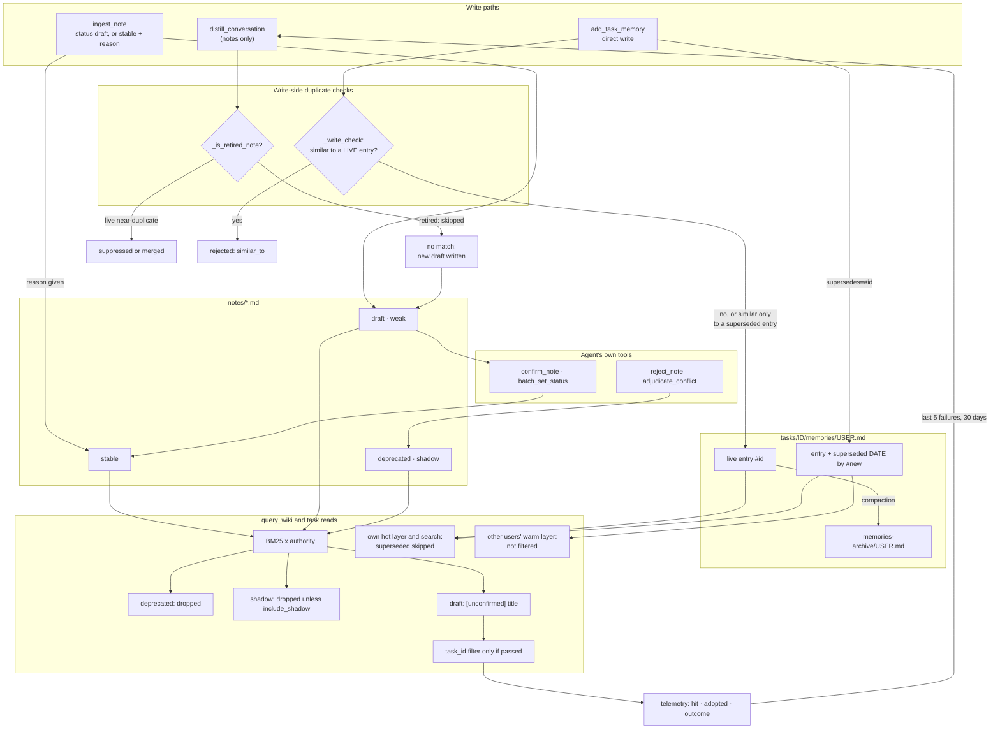

## 1. Executive Summary

CodeWiki-Plus is a documentation generator that grew a file-backed knowledge
base, and its strongest mechanism is one read path that treats three values of
one field three ways. In `handle_query_wiki` a `deprecated` note hits
`continue` and leaves the result set, a `draft` note is returned under an
`[unconfirmed]` prefix, and everything else is weighted by an authority
multiplier clamped to 0.7–1.3. Its weakest point is the write side of the same
lifecycle: every check that would stop a retired claim coming back is written
to skip retired material.

It began as a fork of FSoft-AI4Code's CodeWiki and kept that project's
Tree-sitter parsing, dependency graphs and Mermaid validation. The README's
comparison table puts "None" in the upstream column against knowledge
management, knowledge trust, task memory and search. Everything this report
covers is the fork's own addition.

**Two memory kinds share one root.** Notes are markdown files with
frontmatter, entering as `draft` and reaching `stable` through `confirm_note`.
Task memories are timestamped entries in a per-user file, written directly by
`add_task_memory` with no confirm gate. The task-manager docstring explains the
asymmetry: task-scoped progress knowledge carries bounded, task-lifetime noise
cost, while notes enter the shared, retrieval-indexed base.

**Retirement is honoured on read and ignored on write.** `_is_retired_note`
exists so that distillation's dedup and conflict searches skip deprecated
notes; its docstring says a retired note winning would merge a fresh draft
into dead knowledge. The consequence is that a claim someone rejected, when
extracted again from a later conversation, finds nothing to match and lands as
a new draft. The task-memory write check does the same with superseded
entries. That is why `tombstone` is withheld, and section 9 gives the anchors.

Two marks hold: `trust_state`, on the exclusion of deprecated and shadow
notes, and `negative_eval`, on paired must-not cases. `scope_enforced` is
withheld because the only note scope is a filter the caller may omit.
`audit_log` is withheld because the event streams record use rather than
mutation. `human_review` is withheld because confirm, reject and adjudicate
are all the agent's own tools.

## 2. Mental Model

Think of it as two stores with different admission rules under one
`repowiki/` directory, with git as the ledger beneath both.

The **note store** is shared and indexed. A note is proposed by distillation or
`ingest_note`, lands as `draft` with confidence `weak`, and is returned by
queries with an `[unconfirmed]` badge. It becomes ordinary material when
`confirm_note` sets `stable`, or arrives as `stable` directly when the caller
supplies a reason. Retiring it is `deprecated` plus `shadow`, and the query
paths drop it.

The **task-memory store** is per task and per user. An entry is a
timestamped markdown block with a short persistent id. Correcting one does not
edit its text: a `> [superseded 2026-09-18 by #a3f2]` line is inserted under
its heading, the caller's own context and search skip it, and the file keeps
both.

A **retirement** in either store is a property of one record. Nothing keyed on
the retired content survives to be consulted when the same content is written
again, and the write paths deliberately look past retired records.

Around both sits a **usage record**: `hit` when a document is served,
`adopted` when the agent cites it, `outcome` when the agent reports whether the
work succeeded. The last five failures in thirty days go into the prompt that
writes the next notes.



## 3. Architecture

| Area | Role |
| --- | --- |
| `codewiki/src/store.py` | `KnowledgeStore`: atomic writes, sidecar locks, git auto-stage, task index, task-memory append, supersession and search |
| `codewiki/src/retrieval.py` | BM25 kernel and `_doc_authority`, the type, status, confidence and source offsets |
| `codewiki/mcp/tools/note_query.py` | `handle_query_wiki` and its five modes; the status skip, the draft label, the shadow gate, the task filter |
| `codewiki/mcp/tools/note_writer.py`, `note_lifecycle.py`, `note_ingest.py` | Status vocabulary, the locked frontmatter rewrite, confirm, reject, batch status, ingest |
| `codewiki/mcp/tools/task_manager.py` | Task CRUD, layered loading, the write check, compaction, task-memory search |
| `codewiki/mcp/tools/distill_conversation.py`, `note_consolidation.py` | Distillation into draft notes, dedup and conflict recall, the negative-example payloads |
| `codewiki/mcp/tools/telemetry.py`, `outcome_report.py` | Per-user JSONL usage streams and the outcome tool |
| `codewiki/mcp/tools/conflict_case.py` | Conflict cases between two pages, flagged and adjudicated by tool |
| `codewiki/mcp/registry.py` | The 53 tool schemas |

### Deployment and ergonomics

It is a Python package with an MCP server, a CLI and hook scripts copied into
an IDE's configuration directory. The model is the IDE's own; the README's
first difference from upstream is "zero-config, IDE model driven". Storage is
plain markdown and JSONL under `repowiki/`, readable by hand, and every write
through `atomic_write` is staged into git (`codewiki/src/store.py:99-124`).
An optional gated auto-push, off by default, commits under a `codewiki:`
prefix (`codewiki/src/git_sync.py:1-30`).

The server and CLI call `maybe_self_update` on start
(`codewiki/mcp/server.py:212-214`, `codewiki/cli/main.py:78-80`). Its module
docstring describes a detached child that queries PyPI at most daily and
pip-installs patch and minor releases automatically, opting out through
`CODEWIKI_NO_AUTOUPDATE` or `autoupdate=false`
(`codewiki/utils/self_update.py:1-30`). An installation therefore runs
whatever minor release was published last, whatever its age.

## 4. Essential Implementation Paths

**Note query.** `handle_query_wiki` resolves the corpus from the session or
`repo_path`, returns early for the `overview`, `directory`, `detail` and
`check` modes and for `by_file`, and otherwise runs BM25
(`codewiki/mcp/tools/note_query.py:797-892`). Building each note entry, it
drops `deprecated`, labels `draft` and attaches a trust tier and the stamped
`task_id` (`:1025-1053`). The optional filters follow: origin, then `task_id`
(`:1139-1145`), then the shadow gate (`:1153`, `:1168-1169`), then open-conflict
annotation (`:1175-1186`).

**Note lifecycle.** `ingest_note` writes `draft` by default; `stable` requires
a `reason`, and an `evidence` object of `test_ref`, `commit_ref` or
`reviewed_by` promotes confidence to `strong`
(`codewiki/mcp/tools/note_ingest.py:289-337`). `confirm_note`, `reject_note`
and `batch_set_status` go through `_apply_status_to_file`, a locked YAML
round-trip that appends a `verified` entry and records a `reject_reason`
(`codewiki/mcp/tools/note_writer.py:120-263`).

**Task memory.** `handle_add_task_memory` runs `_write_check` unless the
write supersedes something, validates the `supersedes` ref with a dry run,
appends, then writes the marker
(`codewiki/mcp/tools/task_manager.py:828-929`). `supersede_memory` inserts
the line under the target's heading inside a locked read-modify-write
(`codewiki/src/store.py:1269-1341`). `search_memories` scores one task's
entries and skips superseded ones (`codewiki/src/store.py:1343-1420`).

**Distillation dedup.** `_find_existing_note`, the BM25 recall and
`_find_conflict_candidates` each skip a note for which `_is_retired_note` is
true (`codewiki/mcp/tools/distill_conversation.py:424-435`, `:537`, `:697`,
`:748`).

**Telemetry.** `record_hit` merges a same-day hit into an existing line and
rewrites the user's file; `record_adopted` and `record_outcome` append
(`codewiki/mcp/tools/telemetry.py:148-196`, `:199-214`, `:285-321`).
`recent_outcome_failures` feeds the distillation and consolidation payloads
(`:351`, `codewiki/mcp/tools/distill_conversation.py:1880-1894`,
`codewiki/mcp/tools/note_consolidation.py:468-478`).

## 5. Memory Data Model

A **note** is a markdown file whose frontmatter carries an OKF `status`, a
`confidence_level`, a `verified` list of `{by, at}` entries, an optional
`task_id`, an optional `reject_reason`, and under `metadata` an optional
`reason` and `verification` block for a stable direct write. A note type
also feeds the authority multiplier, ranking decision above pitfall and
procedure, above lesson and architecture, above workaround
(`codewiki/src/retrieval.py:474-481`).

A **task memory** is an entry inside `tasks/<task_id>/memories/<user_id>.md`:

```
### 2026-09-18 14:30 #a3f2

<content>
```

The id is four base36 characters checked against the ids in the file
(`codewiki/src/store.py:360-372`). The heading time is the append clock:
`format_memory_entry` accepts an `at` override whose docstring describes
distillation passing a conversation's `captured_at`, and
`append_task_memories_direct`, the only function that forwards it, has no
caller (`codewiki/src/store.py:375-397`, `codewiki/mcp/tools/task_manager.py:456-483`).

The **user id** is a namespace, not an identity. `resolve_user_id` takes
`CODEWIKI_USER`, then a repo-local pin, then git email or name, then a cache
and the login name, and its docstring says it is "Not an auth mechanism — a
namespace" (`codewiki/src/config.py:296-349`). Tool responses echo the id and
which rung produced it.

No field records when a fact became true apart from when it was written; a
note's `date` and an entry's heading are both write times.

## 6. Retrieval Mechanics

`handle_query_wiki` scores notes, wiki pages and raw sources with BM25,
expands through wikilinks, and multiplies each score by `_doc_authority`.
That factor is arithmetic over frontmatter: note type, status (draft −0.25,
stable +0.05, deprecated −0.35), confidence (strong +0.10, weak 0.0, shadow
−0.30) and a −0.20 penalty for `raw/sources/`, clamped to 0.7–1.3
(`codewiki/src/retrieval.py:470-530`).

Four things act on the result set and they are different in kind:

1. **Exclusion by status.** `if note_st == "deprecated": continue`
   (`codewiki/mcp/tools/note_query.py:1034-1035`). The `check` mode and the
   `by_file` timeline carry the same skip (`:465`, `:676`). No argument
   returns a deprecated note.
2. **Exclusion by confidence, overridable.** Shadow results are dropped unless
   the caller passes `include_shadow=true` (`:1153`, `:1168-1169`). A
   rejected note is shadow as well as deprecated, so it is excluded twice.
3. **The label.** A draft's title becomes `[unconfirmed] <title>` and the
   entry carries `note_status: draft` (`:1036-1038`).
4. **The weight**, which the comments call a status gate and implement as an
   offset. A deprecated note never reaches the offset; the `continue` removes
   it first.

The **task filter** is applied only when the caller passes `task_id`, and only
to notes; wiki pages and sources pass unconditionally (`:1139-1145`). The
`check` and `by_file` paths return before it (`:880-892`). Task memories have
their own search, scoped to one named task and to the caller's own files
unless `include_others=true` (`codewiki/src/store.py:1343-1365`).

Distillation's near-duplicate recall runs with `apply_authority=False` and
`apply_usage=False` (`codewiki/mcp/tools/distill_conversation.py:672-686`).
The comment in `retrieval.py` gives the reason: a migration that dropped old
notes to `shadow` would otherwise blind conflict detection
(`codewiki/src/retrieval.py:491-495`).

## 7. Write Mechanics

**Notes.** Capture stores a raw transcript, distillation proposes notes
(`distill_conversation` writes no task memories; its response declares
`memories_skipped_reason: channel_exclusive`), and ingest writes them. The
ingest response for a draft says to call `confirm_note` after review. A
`stable` ingest must carry a `reason`, and the comment beside the check calls
that reason an "intent declaration — visibility/friction/attribution, NOT a
verification mechanism" (`codewiki/mcp/tools/note_ingest.py:289-307`).
`batch_set_status` refuses a transition whose source is not `draft`, recording
`"reason": "not draft"` per skipped file (`codewiki/mcp/tools/note_lifecycle.py:282-288`).

**Task memories.** `add_task_memory` is the only channel (the hook registry
records this as ADR-0014). Before writing it compares the new text with the
last ten live entries and the compaction summaries and rejects a difflib
ratio above 0.85, returning `similar_to`
(`codewiki/mcp/tools/task_manager.py:731-825`). The comparison set is built
from live entries only (`:770`), so text matching a superseded entry is
accepted. A write that names `supersedes` skips the check entirely.

**Compaction.** When the hot layer crosses 40 entries or 24 KiB,
`get_task_context` returns a `compaction_action` telling the agent to
dispatch an async subagent that runs prepare, writes a summary and submits,
with a `gate` field saying no user confirmation is needed
(`codewiki/mcp/tools/task_manager.py:1169-1212`). Submit appends the
originals to `memories-archive/<user>.md`, rewrites the caller's own file and
deletes a converged legacy file (`:1370-1400`).

**The stated invariants.** The task-manager docstring lists constraints that
must hold, including that per-user files are append-only and that "nobody
ever rewrites another user's file" (`codewiki/mcp/tools/task_manager.py:1-48`).
The second holds in the code read here: compaction collects only the caller's
own and legacy files. The first is a description of the common case:
supersession inserts into an existing entry and compaction rewrites the file.

## 8. Agent Integration

Fifty-three MCP tools are registered in one file
(`codewiki/mcp/registry.py`). The memory verbs are `capture_conversation`,
`distill_conversation`, `ingest_note`, `confirm_note`, `reject_note`,
`batch_set_status`, `consolidate_notes`, `flag_conflict`,
`adjudicate_conflict`, `query_wiki`, `report_outcome`, `stamp_evidence`, and
the task verbs `create_task`, `get_task_context`, `add_task_memory`,
`search_task_memories`, `compact_task_memories`, `delete_task` and
`set_session_task`.

A SessionStart hook injects the team doctrine page and asks the user which
task to bind; a SessionEnd hook captures the transcript in a detached
subprocess (`codewiki/hooks/task_session_start.py:1-45`). Session bindings
under `.meta/task_bindings/` tell a capture which task it belongs to.

## 9. Reliability, Safety, and Trust

**Trust state — awarded, on the exclusion.** `deprecated` is dropped from all
three note read paths with no override, and `shadow` is dropped from the
default query. Both are discrete values of frontmatter fields, written by
`reject_note` together (`codewiki/mcp/tools/note_lifecycle.py:162-170`). The
draft label is the middle answer, returned and marked rather than hidden.

**Tombstone — withheld.** The supersession marker is keyed on an entry, and
`deprecated` is a status on a note. Neither is consulted by a later write.
`_is_retired_note` is applied in all three of distillation's duplicate
searches so that a retired note is never a match
(`codewiki/mcp/tools/distill_conversation.py:424-435`, `:537`, `:697`, `:748`).
`_write_check` builds its comparison set from live entries only
(`codewiki/mcp/tools/task_manager.py:770`). Retracted sources are skipped by
the source-ingest duplicate checks in the same way
(`codewiki/mcp/tools/source_ingest.py:443`, `:592`). Each retirement removes
the retired record from the one search that could refuse its return.

**Scope enforcement — withheld.** The note query's only scope is the
`task_id` argument. When the caller omits it, every note in the corpus is
eligible; when it passes one, any task's notes are returned; the `check` and
`by_file` paths ignore it (`codewiki/mcp/tools/note_query.py:852`, `:880-892`,
`:1139-1145`). Task memories are addressed by a caller-named `task_id`, and
the user split is a namespace the caller's environment chooses. The project
describes per-user files as *git-level conflict isolation*, and loading is
layered: other users' files reach the caller as a summary and two recent
entries (`codewiki/mcp/tools/task_manager.py:265-268`, `:425-437`).

**Audit log — withheld.** The append-mode writers in the package are the
server's lifecycle log, a `.gitignore` append and two telemetry events (see
Recorded searches). The telemetry streams record use and outcome, and
`record_hit` rewrites the whole file to merge a same-day hit
(`codewiki/mcp/tools/telemetry.py:148-196`). Status changes rewrite note
frontmatter in place; the `verified` list grows, and `reject_reason` is
overwritten. The project's ledger is git: `atomic_write` stages every write,
and the conflict module says "the ledger is git".

**Human review — withheld.** `confirm_note`, `reject_note`,
`batch_set_status` and `adjudicate_conflict` are registered tools the
producing agent holds (`codewiki/mcp/registry.py:1312`, `:1358`, `:1418`,
`:1508`), and `ingest_note` writes `stable` given any reason. `_trust_tier`
returns `human-reviewed` when a `verified` entry's `by` starts with `human:`,
a string the caller supplies (`codewiki/mcp/tools/note_query.py:30-43`). The
tier is attached to results and nothing reads it. `knowledge_loop.py` imports
it only as a compat re-export.

**Bi-temporal — withheld.** Every timestamp is a write time (section 5).

**Retired entries in other users' context.** `_render_warm_author` takes
another user's two most recent entries without the superseded filter the
caller's own hot layer applies (`codewiki/mcp/tools/task_manager.py:293-318`).
A teammate's retired entry reaches the context block with its marker line as
text; degraded to a one-line hint, the marker is the line shown.

**The outcome signal is self-assessed.** `report_outcome`'s header says
collection timing is caller-owned: the agent reports at the natural end of a
task, *"the only moment it can honestly judge the result"*
(`codewiki/mcp/tools/outcome_report.py:12-14`). That is an argument for when
to ask, and it leaves the grader and the graded as one party. The verdict is
validated as binary: `result must be 'success' or 'failure' (binary, no
grading)` (`:66`).

## 10. Tests, Evals, and Benchmarks

The README cites the upstream paper, *CodeWiki: Evaluating AI's Ability to
Generate Holistic Documentation for Large-Scale Codebases*
([arXiv:2510.24428](https://arxiv.org/abs/2510.24428)), with a BibTeX entry
(`README.md:883-893`). It evaluates documentation generation and does not
cover the memory layer. Design documents under `docs/` include studies of
other memory systems and papers.

The `negative_eval` mark rests on four cases, each pairing an absence with the
presence it is measured against on one populated fixture. The strongest is
`test_search_skips_superseded_and_annotates`: supersede a JWT conclusion with
an OAuth2 one, search, and assert the replacement present and the retired
text absent (`tests/test_task_manager.py:1586-1620`). The others cover the
`task_id` filter, the `by_file` deprecated skip and the shadow gate (see the
evidence record).

The main path's deprecated `continue` is asserted by
`tests/okf_regression_test.py:674-680`, a script run with `python` that
pytest's `python_files = ["test_*.py"]` does not collect. The authority tests
exercise the multiplier, not the exclusion. No test re-extracts a rejected
claim, which is the case section 9 turns on.

`tests/conftest.py` executes at pytest collection, which matters only to
someone running the suite. I ran nothing.

## 11. For Your Own Build

### Steal

- **Three answers to an uncertain claim.** Dropped, labelled, weighted:
  `deprecated` leaves, `draft` is returned under a badge, the rest is ranked.
  Each is applied to a different value rather than one answer to all.
- **Put the retirement marker in the document.** A blockquote naming the date
  and the successor survives a diff, a copy, and a reader outside the tool.
- **Record the third event.** Retrieval logs stop at served. Seen, cited, and
  whether the work succeeded is a chain, and only the third link can feed a
  negative example.
- **Exempt the dedup recall from authority weighting.** Similarity used for
  conflict detection must not inherit a confidence penalty.

### Avoid

- **Skipping retired records in the duplicate check.** It is the natural
  reading of "dead knowledge is not a match", and it makes every retirement
  reversible by the next extraction. Keep the retired text where the write
  path can see it, and refuse or flag a match against it.
- **A reason field as a gate.** A required free-text reason on a direct
  `stable` write is friction the writer clears by typing.
- **Two read paths with one predicate.** The caller's hot layer filters
  superseded entries and the teammate warm layer beside it does not.
- **Rewriting a usage log to keep it small.** A same-day merge turns an
  append-only stream into a mutable file.

### Fit

Study it if you are bolting a knowledge base onto a tool that writes
documents, or deciding what retrieval should do with an unconfirmed claim. It
does not fit a deployment that needs a rejected claim to stay rejected,
per-user read isolation, or a review step the authoring agent cannot perform.

## 12. Open Questions

- Was skipping retired notes in dedup chosen over flagging a match against
  one, given that the docstring weighs only the merge-into-dead-knowledge
  case?
- Should the warm layer apply `entry_is_superseded`, or is a teammate's
  retired entry meant to arrive with its marker as text?
- `append_task_memories_direct` and the `at` parameter it forwards have no
  caller since distillation stopped writing task memories. Is the dialogue-time
  heading meant to return through `add_task_memory`?

## Appendix: File Index

| Path | What to read it for |
| --- | --- |
| `codewiki/mcp/tools/note_query.py:797-892` | Query entry, mode early returns, the task and repo arguments |
| `codewiki/mcp/tools/note_query.py:1025-1053` | The deprecated skip, the draft label, the trust tier |
| `codewiki/mcp/tools/note_query.py:1135-1186` | Origin, task, shadow and open-conflict filters |
| `codewiki/src/retrieval.py:470-530` | The authority multiplier |
| `codewiki/mcp/tools/note_writer.py:120-263` | The locked status rewrite and `verified` append |
| `codewiki/mcp/tools/note_ingest.py:289-337` | Stable direct write: reason and evidence |
| `codewiki/mcp/tools/distill_conversation.py:424-435`, `:530-540`, `:690-700`, `:745-750` | `_is_retired_note` and the three dedup skips |
| `codewiki/mcp/tools/task_manager.py:1-48` | The stated invariants |
| `codewiki/mcp/tools/task_manager.py:293-318`, `:350-443` | Warm and hot layered loading |
| `codewiki/mcp/tools/task_manager.py:731-825` | The write check over live entries |
| `codewiki/src/store.py:1225-1420` | Append, supersede, task-memory search |
| `codewiki/mcp/tools/telemetry.py:148-396` | Hit merge, adopted and outcome appends, failure feed |
| `codewiki/utils/self_update.py:1-30` | Automatic upgrade from PyPI |
| `tests/test_task_manager.py:1586-1620` | Superseded entry absent from search, replacement present |

### Recorded searches

Run at the tree root of the pinned checkout with `git grep`; the first four
were also run at `4b826918d6fd4d954064190683a9455bb40805ff` with the same
result apart from line numbers.

- `git grep -n -E '_is_retired_note\(|entry_is_superseded\(' -- 'codewiki/*.py'` — the definitions, the three distillation skips (`distill_conversation.py:537`, `:697`, `:748`), the hot-layer, write-check, window and compaction partitions in `task_manager.py`, and the supersede and search reads in `store.py`; none in `_render_warm_author`, and none that refuses a write because it matches retired material.
- `git grep -n -E "open\([^)]*['\"]a['\"]" -- 'codewiki/*.py'` — `mcp/server.py:167` (process lifecycle log), `mcp/tools/team_layout.py:131` (`.gitignore`), `mcp/tools/telemetry.py:213` and `:319` (adopted and outcome); no mutation log.
- `git grep -n -E 'trust_tier' -- 'codewiki/*.py'` — two definitions (`note_query.py:30`, `note_writer.py:87`), the re-export at `knowledge_loop.py:53`, one assignment at `note_query.py:1044`; no reader.
- `git grep -n -E 'task_id' -- codewiki/mcp/tools/note_query.py` — the argument read at `:852`, the stamp at `:1053`, the filter at `:1141-1144`; no default from a session binding.
- `git grep -n -E 'append_task_memories_direct|append_memories\(' -- 'codewiki/*.py'` — the definition at `task_manager.py:456`, its call into the store at `:481`, the `add_task_memory` append at `:880` with no `at`, and the store method; no caller of `append_task_memories_direct`.
- `git grep -n -i -E 'valid_from|valid_to|valid_at|valid_time|effective_(from|at)' -- 'codewiki/*.py'` — no match.
- `git grep -n -E 'retracted' -- codewiki/mcp/tools/source_ingest.py` — the duplicate and name checks skip retracted entries (`:443`, `:521`, `:592`, `:656`) and the retract handler writes the status (`:937-938`).
- `git grep -n -i -E 'arxiv|@article|@misc|doi\.org' -- README.md docs` — the upstream CodeWiki paper at `README.md:883-893` and `:1297`, and citations of other papers in design studies under `docs/`; no paper about the memory layer.
- `git grep -n -i -E 'anthropic|machine learning|not (be )?used (for|to)' -- LICENSE` — no match; the MIT text carries no rider.

## History

**2026-10-15** — [`e06cd5badeba259f716dadf272bcf1433ff3f231`](https://github.com/mambo-wang/CodeWiki-Plus/commit/e06cd5badeba259f716dadf272bcf1433ff3f231) — 612 commits on, version 5.10.1 to 5.15.0. Three marks withdrawn, each wrong at the first pin: `tombstone`, `scope_enforced` and `audit_log` ([section 9](#9-reliability-safety-and-trust)). Also wrong then: shadow notes were already excluded by default, `ingest_note` already accepted `stable`, and the README cited the upstream paper. Overtaken: distillation writes no task memories, so entry headings carry the append clock ([section 5](#5-memory-data-model)); a stable direct write requires a reason; compaction is delegated to a subagent; the server updates itself from PyPI ([section 3](#3-architecture)). Screened from a full clone: six files, no auto-run surface, `tests/conftest.py` at collection, `pyproject.toml` and `uv.lock` inside the cooldown, `AGENTS.md` read as data. Nothing was installed, built or run.

**2026-09-19** — [`4b826918d6fd4d954064190683a9455bb40805ff`](https://github.com/mambo-wang/CodeWiki-Plus/commit/4b826918d6fd4d954064190683a9455bb40805ff) — first reading, at the head of `main`, version 5.10.1 on PyPI. Screened with `scripts/screen_repo.py` before anything was read: no auto-run surface, one build-time execution path (`tests/conftest.py` at pytest collection), two dependency manifests inside the seven-day cooldown, and an `AGENTS.md` addressed to a reading agent which was read as data. Nothing was installed, built or run. Five marks.

The reading covered the store facade and its entry format, the note lifecycle and its confirm gate, the query path's three-way treatment of status, the authority multiplier, the task-memory layout and its supersession marker, the telemetry chain and the negative-example feedback, and the two test cases the `negative_eval` mark rests on. The documentation generator the project grew out of — the Tree-sitter toolchain it inherited from upstream CodeWiki — was read as context rather than as subject. MIT, with the upstream's copyright line retained and the fork relationship stated in the README.

Two findings worth carrying: `_trust_tier` is imported by `knowledge_loop.py` and never called there, so the OKF trust tier is a label on a query result rather than an input to anything; and the `human-reviewed` tier is earned by a `verified` entry whose `by` field begins with the string `human:`, which the writer supplies, so `human_review` is withheld on both grounds.
