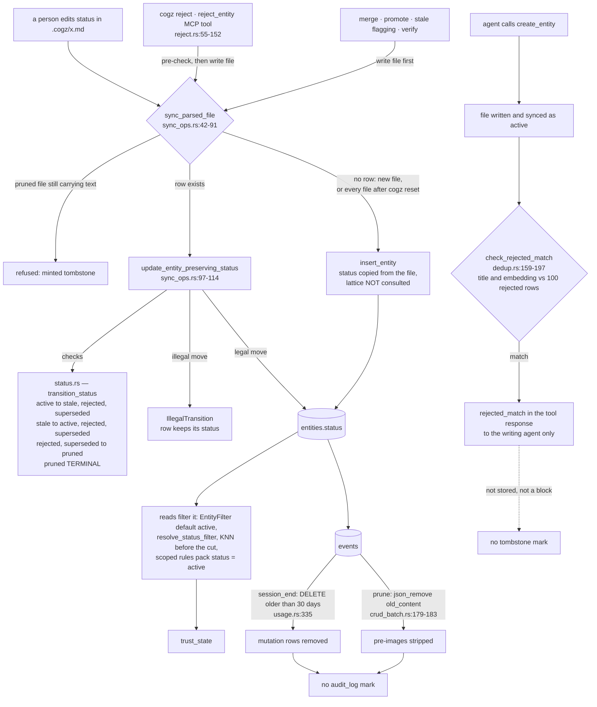

## 1. Executive Summary

CogZ is a local-first memory for coding agents in Rust, with markdown files as
the record and a SQLite database as a rebuildable projection. Its entity status
is a five-value lattice with a terminal state, and every update of an existing
row passes through it, including a person's hand edit at sync. Rejection is a
verb on both the CLI and the agent's tool surface, and a later matching write is
warned with the prior verdict and not refused. The weak side is durability: the
lattice holds only while the projection does, and the event log is pruned at 30
days.

It describes itself as "[l]ocal-first, code-aware engineering cognition for AI
coding agents", giving an agent "persistent memory, contextual retrieval, and
continuous cognition about a software repository".

**The lattice is enforced on updates.** `src/storage/status.rs` opens with the
legal moves in its doc comment — active to stale, rejected or superseded; stale
to active, rejected or superseded; rejected and superseded to pruned; pruned
terminal — and `transition_status` implements that table, returning a typed
`IllegalTransition` naming both ends. Five production paths call it:
`update_status` (`src/storage/crud.rs:232`), the file-sync update
`update_entity_preserving_status` (`src/files/sync_ops.rs:103`), duplicate
merging (`src/consolidate/merge.rs:280`), observation promotion
(`src/consolidate/promote.rs:265`) and stale flagging
(`src/index/stale_flagging.rs:158`). The rejection writer pre-checks it before
touching the file (`src/files/reject.rs:96`). The sync path is the one that
matters, because the markdown is canonical. When a person edits `status:` in a
file, the sync compares it with the stored row and refuses an illegal move, with
the comment that this "prevents silent divergence between the canonical file and
DB."

**What it does not cover is a row with no predecessor.** The insert branch of
`sync_parsed_file` (`src/files/sync_ops.rs:83-88`) writes whatever status the
file carries, and every file takes that branch after `cogz reset`, which deletes
the database (`src/commands/mod.rs:356-391`) before `cogz index` rebuilds it.
A claim rejected through the tool and hand-edited back to `active` is refused at
the next sync and becomes active at the next rebuild. The one status the insert
branch guards is `pruned`: a file claiming it while carrying a title or body is
refused as "an attempt to mint a terminal record through the parse path"
(`src/files/sync_ops.rs:48-61`).

**Rejection closes as a warning.** `reject_entity_file` writes
`status: rejected` and an optional `rejected_reason` into the canonical file,
syncs it and records an `entity_rejected` event. It is reached from `cogz reject`
(`src/commands/mod.rs:580-606`) and from the `reject_entity` MCP tool
(`src/mcp/tools.rs:58-67`). On every MCP write, `check_duplicate` then runs a
second pass, `check_rejected_match` (`src/consolidate/dedup.rs:159-197`), which
compares the new entity's title and embedding against up to 100 rejected entities
of the same type. A hit is returned in the tool response with the old id, the
similarity and the recorded reason. Its own comment states the policy: "Surfaced
to the writer, never a block." The new entity has been written and synced as
`active` before the pass runs, and nothing stores the match.

**The event table is telemetry.** `record_event` holds the only production
`INSERT INTO events`, and edit events carry the pre-image as `old_content`. Three
production statements then change the table. `sweep_old_telemetry` deletes every
event older than 30 days, mutation and telemetry rows alike, at each session end
(`src/storage/usage.rs:310-339`, called from `src/hooks/lifecycle.rs:495-504`).
`tombstone_entity_with_timestamp` strips `old_content`, `new_content` and `title`
from the entity's event payloads when it prunes, on the stated ground that
"pruning hides the record, so its text must not survive inside the audit log"
(`src/storage/crud_batch.rs:175-183`). And the cascade delete nulls `entity_id`
on every event of a removed entity (`:198-204`). The sweep's own doc comment calls
the table "derived telemetry", which is what the code makes it.

## 2. Mental Model

CogZ is a filesystem of record with a disposable index. The markdown under
`.cogz/` is canonical, can be committed so a team shares it, and is the only
thing `cogz reset` keeps. The SQLite database is a projection that sync and
index derive from the files, plus tables of derived state — delivery usage,
access counts, knowledge drift, git co-change terms — that are "disposable and
rebuilt from agent activity, never from canonical files".

The status lattice lives on the projection side and is checked by comparing a
file's declared status with the row it would replace. That makes it a guard on
motion, which is the right shape for a lattice, and it means the guard needs the
previous row to exist. Writers that originate in the program — reject, merge,
promote, stale flagging, verify — write the file first and let sync apply the
lattice. The two DB-only writers keep to legal moves by their `WHERE` clauses:
the batch stale-marking `UPDATE`s match `status = 'active'`
(`src/storage/crud_batch.rs:37`, `:99`) and the tombstone matches
`status IN ('rejected', 'superseded')` (`:154`).

## 3. Architecture

| Area | Role |
| --- | --- |
| `src/files/` | The canonical layer: frontmatter parsing, file-to-row sync, the rejection writer |
| `src/storage/` | Schema and migrations, CRUD, the status lattice, embeddings, events, usage and access tables |
| `src/search/` | Hybrid FTS5 and vector retrieval, graph expansion, co-change terms, an answer-coverage silence gate |
| `src/context/` | Context-pack assembly: baseline rules and knowledge, scoring, compression, token budget |
| `src/consolidate/` | Dedup and the rejected-match pass, NLI contradiction with a numeric-slot gate, promotion, merging |
| `src/index/` | Code indexing, stale flagging, knowledge drift, verification, re-anchoring after moves |
| `src/mcp/` | Fifteen MCP tools over stdio |
| `src/hooks/` | Lifecycle handlers, delivery tracking, write-back nudges |
| `src/doctor/` | Integrity checks, the review queue, observation pruning |
| `benchmark/` | Retrieval, pack, drift, consolidation and tombstone checks against built binaries |

### Deployment and ergonomics

One binary, installed by script or as an OCI image declared in `server.json`.
`cogz configure` writes hook and MCP entries for five harnesses. Embedding,
code-embedding and NLI models download on first use unless disabled; every model
runs locally.

## 4. Essential Implementation Paths

- `src/storage/status.rs:1-46` — the lattice, `transition_status` and `VALID_STATUSES`.
- `src/files/sync_ops.rs:42-91` — `sync_parsed_file`: the pruned guard, the update branch, the insert branch.
- `src/files/sync_ops.rs:97-114` — `update_entity_preserving_status`, the lattice on the file path.
- `src/commands/mod.rs:356-391` — `run_reset`, which deletes the database and keeps the files.
- `src/files/reject.rs:55-152` — rejection: pre-check, file write under a lock, sync, event.
- `src/consolidate/dedup.rs:83-197` — the active dedup pass and the rejected-match pass.
- `src/mcp/entity_helpers.rs:192-200` — the write response carrying `rejected_match`.
- `src/storage/query.rs:17-45` and `src/mcp/helpers.rs:185-202` — the default status and its resolver.
- `src/storage/embeddings.rs:288-318` — the status filter inside the KNN subquery.
- `src/storage/usage.rs:310-339` — the 30-day telemetry sweep over events.
- `src/storage/crud_batch.rs:146-207` — the tombstone, the payload scrub, the cascade.
- `src/index/verify.rs:40-120` — verification, which reactivates stale knowledge.

## 5. Memory Data Model

An entity is a markdown file with frontmatter carrying `id`, `title`, `type`,
`status`, `created_at`, `updated_at` and `references`; any other key is folded
into a JSON `properties` column, together with a `_semantic_hash` that drift
compares instead of raw bytes. File-backed types are observation, rule and
knowledge. Code entities — function, class, file, module — are derived from the
source tree with deterministic UUID v5 ids and managed by the index.

`src/volatility.rs` splits the file-backed entities in two. `living` entities,
which are rules and most knowledge, are claims about current code and carry
`verified_against`, a list of `uuid=hash` pairs for the code they describe.
`record` entities, which are observations and knowledge in dated categories, are
"immutable dated history" exempt from drift. Time is single-axis: `created_at`
and `updated_at` are write stamps, `verified_against` holds content hashes rather
than times, and the commit timestamps on co-change rows describe code history.
No bitemporal mark applies.

There is no scope key. Separation is one database per repository checkout, a
reasonable choice for a local tool and not a stored predicate any read enforces.

## 6. Retrieval Mechanics

Search fuses FTS5 and vector KNN, expands across the edges table, and adds
co-change terms mined from `git log`, then assembles a context pack under a
token budget. A silence gate weighs IDF-weighted coverage of the query's terms
in the top results and silences the answer when coverage falls below a floor.

The status filter reaches every layer. `search::resolve_status_filter` runs
first (`src/search/hybrid.rs:67`) and passes the result to FTS, KNN and graph
expansion. `knn_search_with_filters` puts it inside the KNN subquery so
"stale/rejected/superseded embeddings" cannot starve active results in a bounded
window. The general entity query has no clause in its base SQL — `WHERE 1=1`
at `src/storage/query.rs:35` — and is closed by its callers: `EntityFilter`'s
`Default` sets active, and the MCP resolver maps a missing field to active and
the literal `all` to no filter. Widening takes a word, and forgetting the field
narrows. The edit-scoped rules pack pushed at `file_save` hard-codes
`e.status = 'active'` (`src/storage/graph_queries.rs:165`), with a test that a
stale rule is left out.

Ranking reads access counts, how often an entity has been delivered, as a score
input (`src/context/baseline.rs:64`). The delivery outcomes, `hit` and `miss`,
are read only by the doctor.

## 7. Write Mechanics

`create_entity` writes the file, syncs it, then runs two dedup passes. The
active pass compares the title exactly and fuzzily, then embedding similarity,
against up to 100 active entities of the type, and logs that "duplicates of
older {entity_type} entities may be missed" when the cap is reached. The
rejected pass repeats the comparison against up to 100 rejected entities, the
most recently updated, with no cap warning. NLI contradiction checking follows,
with a numeric-slot gate that decides number-against-number cases symbolically
before deferring to the model. Every flag is returned in the tool response.

A secret scanner runs at the MCP write and again at the sync boundary, because
"canonical files can also arrive by hand edit or git pull"; a matching file stays
on disk as a retained sync error and never reaches FTS or embeddings.

Knowledge is the only type the MCP surface edits in place; observations and
rules change by supersession, though a person can edit any file. Consolidation
at session end promotes an observation with enough supporters to a rule and marks
the source `superseded`, and merges confirmed duplicate observations the same
way. Knowledge is "flagged, not auto-merged (human-curated)".

Pruning is a CLI action, `cogz doctor --prune-observations --confirm`. It turns
a rejected or superseded observation older than 90 days into a tombstone with an
empty title and body, in the file and the row, and hard-deletes the oldest
tombstones past a count of 1,000. Rules and knowledge are never pruned.

## 8. Agent Integration

Fifteen MCP tools: `create_entity`, `update_knowledge`, `verify_knowledge`,
`reject_entity`, `query_entities`, `search`, `get_context`, `get_callers`,
`get_impact`, `find_orphans`, `suggest_observations`, `get_status`,
`list_entities`, `consolidate` and `capture_event`. Hooks inject a context pack
at `session_start` and `prompt_submit`, push the rules that reference a saved
file at `file_save`, credit delivered entities the agent touched at
`post_tool_use`, and run consolidation and the telemetry sweep at `session_end`.

Write-back is nudged rather than automatic. Mining passes over the event and
usage tables propose observation drafts, and the hook surfaces them at the moment
they apply, because, as the module says, measured adoption shows the agent never
pulls `suggest_observations` on its own. The lifecycle comment records why
nothing is written for the agent: auto-created observations "flooded
.cogz/observations/ with low-value entries."

## 9. Reliability, Safety, and Trust

**Rejection is advisory at the next write.** A rejected row is keyed on the row,
and the rejected-match pass reaches it by value — title and embedding — which is
the half of a tombstone a row status alone does not give. The other half is
missing. The pass
runs after the new entity is active, its result goes only to the writing agent,
and it leaves no edge, property or event on the new entity. It also does not
outlive the row: pruning blanks a rejected observation's title and moves it to
`pruned`, out of the candidate set, after 90 days. No tombstone mark follows.

**Review belongs to whoever holds the tool.** The doctor and the session-end
notice print a review queue of stale and drifted knowledge, cleared by
verification, which `src/index/verify.rs:43` calls "operator attestation — 'I
checked, still true'". The same verification is the `verify_knowledge` MCP tool
(`src/mcp/tools_write.rs:178`), and rejection is `reject_entity`, both on the
agent's surface. Neither event records an actor. No human_review mark follows.

**The event log describes the last 30 days.** Mutation events — creations,
edits with their pre-images, rejections with reasons, merges, promotions — are
recorded, and the sweep deletes them with the telemetry rows they share a table
with. Pruning removes the pre-images of the pruned entity's edits at once. The
log answers what changed recently and why, and nothing older. No audit_log mark
follows.

The usage instrumentation records `pending`, `hit` and `miss` per delivered
entity, closing a delivery at the next boundary. It feeds the doctor's
dead-weight and hit-rate reports and is swept with the events after 30 days.

## 10. Tests, Evals, and Benchmarks

Tests live beside the code as `#[cfg(test)]` modules and `*_tests.rs` files, with
integration tests under `tests/`. The status module asserts each legal move and
that every move out of `pruned` fails (`src/storage/status.rs:105-110`).
`respects_status_filter` is the retrieval-level negative case with its positive
control, and `search_excludes_stale_by_default` with
`search_includes_stale_with_status_all` is the same pair at the hybrid-search
layer. `reject_tests.rs` covers rejecting an active and a stale entity, rejecting
twice, and refusing a code entity. `sync_rejects_pruned_file_with_content`
covers the minted-tombstone guard.

No test asserts that a hand-edited illegal status is refused at sync, and none
asserts what a rebuild does with one.

`benchmark/` holds Python harnesses run against a release build: retrieval and
pack metrics over versioned query sets, drift precision, reindex equivalence,
determinism, an NLI comparison, and `tombstone_check.py`. That one prunes a
rejected and a superseded observation on a fixture and asserts they leave search
while an active neighbour stays, and that `reset` plus `index` reproduces the
tombstone. None of it was run for this reading.

## 11. For Your Own Build

### Steal

Put the lattice on the file path, not beside it. Comparing the declared status
with the stored one at sync is what makes a hand edit subject to the same rules
as a tool call.

Refuse a terminal record that arrives with content. A `pruned` file carrying
text is either malformed or an attempt to mint a tombstone, and the parser is
the only place to catch it.

Filter status inside the KNN subquery, before the cut, so a filtered result set
fills with live rows instead of shrinking.

Consult rejected rows by value at write time. Matching a new claim's title and
embedding against what was ruled wrong, and returning the recorded reason, is
the input a tombstone needs; storing the hit and refusing on it is the rest.

### Avoid

Checking a lattice only against a projection the product tells people to
delete. If reset re-derives every row from files, the previous status has to
live in the files, or in a log that survives the reset.

Sharing one table between mutation events and per-prompt telemetry. A retention
sweep sized for the second deletes the first.

Putting the verb that clears the review queue on the agent's tool surface while
calling it operator attestation.

### Fit

This suits one developer or a small team keeping engineering memory beside a
repository, where the files are the source of truth and git is the history. Walk
away if a rejected claim must stay rejected against the next identical write, or
if you need to answer who changed a memory more than a month ago.

## 12. Open Questions

Whether a rebuild should carry the lattice. Recording the last legal status in
the file, or refusing a rebuilt row whose status could not have been reached,
would close the reset path.

Whether the rejected match will be stored. An edge or property on the new
entity naming the rejected one would let a reader see the re-assertion after the
tool response is gone.

Whether `entity_rejected` events will carry an actor, since both the CLI and
the agent produce them.

The `reject_entity` tool description says "Only `active` entities can be
rejected", and the lattice and `rejects_stale_entity_succeeds` allow `stale`;
which is intended is not stated.

## Appendix: File Index

| Path | What to read it for |
| --- | --- |
| `src/storage/status.rs` | The lattice, `VALID_STATUSES`, transition tests |
| `src/files/sync_ops.rs` | File-to-row sync, the lattice on update, the insert branch, deleted files marked stale |
| `src/files/reject.rs` | The rejection writer |
| `src/consolidate/dedup.rs` | Active dedup and the rejected-match pass |
| `src/storage/query.rs` | `EntityFilter`, its default, status-filtered queries |
| `src/storage/embeddings.rs` | The status filter inside KNN |
| `src/storage/events.rs` | The event vocabulary, `record_event`, `annotate_event` |
| `src/storage/usage.rs` | Deliveries, usage outcomes, the telemetry sweep |
| `src/storage/crud_batch.rs` | Batch stale marking, the tombstone, the payload scrub, the cascade |
| `src/commands/mod.rs` | `run_reset` and `run_reject` |
| `src/index/verify.rs` | Verification and stale reactivation |
| `src/search/graph_retrieval_tests.rs` | `respects_status_filter` |
| `tests/test_search.rs` | The stale exclusion pair at the search layer |
| `benchmark/tombstone_check.py` | Pruned rows leaving search on a built binary |

### Recorded searches

Run at the tree root of the pinned checkout with `git grep`.

- `git grep -n 'transition_status' -- src ':!*_tests.rs' ':!*/tests.rs'` — the definition, five production callers and the rejection pre-check.
- `git grep -n 'update_status(' -- src ':!*_tests.rs' ':!*/tests.rs'` — one production caller, `src/files/sync_ops.rs:203`.
- `git grep -n -E "SET status|status = \?[0-9]*," -- src ':!*_tests.rs' ':!*/tests.rs'` — `update_entity`, `update_status`, the two batch stale-marking statements and one test helper.
- `git grep -n '"rejected"' -- src ':!*_tests.rs' ':!*/tests.rs' ':!src/storage/status.rs'` — the rejection writer, its MCP response and the rejected-match candidate fetch.
- `git grep -n -i -E 'DELETE FROM events|UPDATE events' -- src ':!*_tests.rs'` — the sweep at `src/storage/usage.rs:335`, the scrub at `src/storage/crud_batch.rs:180`, the cascade at `:199` and `:248`, and `annotate_event` at `src/storage/events.rs:175`.
- `git grep -n 'rejected_match' -- src` — the dedup result, the pass, and one consumer, the MCP response at `src/mcp/entity_helpers.rs:199`.
- `git grep -n -i -E 'valid_(from|to|until|at)|effective_(from|at)|observed_at|occurred_at|event_time|as_of' -- src ':!*_tests.rs'` — no match.
- `git grep -n -i -E '\b(tenant|namespace|user_id|agent_id|project_id|workspace_id)\b' -- src ':!*_tests.rs'` — two UUID v5 namespace constants; no scope key.
- `git grep -n -i -E '"(pending|proposed|candidate|needs_review|approved|draft)"|approve|isatty|is_terminal' -- src ':!*_tests.rs'` — no match; no review state and no terminal check.
- `git grep -n -E 'entity_usage|deliveries' -- src ':!*_tests.rs' ':!src/storage/usage.rs' ':!src/storage/schema.rs'` — delivery bookkeeping and the doctor check; no ranking reader.
- `git grep -n -i -E 'arxiv|bibtex|@article|doi\.org' -- README.md docs` — no match.
- `git grep -n -i -E 'anthropic|machine learning|not (be )?used (for|to)' -- LICENSE` — no match; the MIT text carries no rider.

## History

**2026-10-15** — [`edb40d72e9208341bf7bc96d6eb23641801b61c3`](https://github.com/balaianu/CogZ/commit/edb40d72e9208341bf7bc96d6eb23641801b61c3) — 158 commits on, version 0.2.1 to 0.5.8. `audit_log` withdrawn: a 30-day sweep deletes events at session end and pruning strips pre-images ([section 9](#9-reliability-safety-and-trust)), and at the old pin the cascade already rewrote mutation rows. Wrong at the old pin: that the frontmatter path skipped the lattice and `transition_status` had one caller ([section 1](#1-executive-summary)), the batch-fetch anchors, and the census. Overtaken: `rejected` gained producers on the CLI and MCP surfaces and a write-time warning, `stale` gained exits to rejected and superseded, and contentful `pruned` files are refused, the last citing the atlas at the old pin in `ed78398f9e664bef3a5803ff9de746bf2c2ae41b`. Screened from a full clone: six files, one auto-run surface (`server.json`), no build-time execution, `Cargo.toml` and `Cargo.lock` inside the cooldown, `AGENTS.md` read as data. Nothing was installed, built or run.

**2026-09-19** — [`6d664c869e503b942f7728e108cd680cda84c936`](https://github.com/balaianu/CogZ/commit/6d664c869e503b942f7728e108cd680cda84c936) — `trust_state` re-tested against the narrowed line, and the record's universal claim — that every retrieval surface filters on the status — was worth pulling on. The hard-coded clauses are all still there and the anchors are re-mapped: the count queries at `src/storage/query.rs:291`, `:301` and a third at `:311`, the batch fetch at `src/storage/crud_batch.rs:33` and `:80`, the usage sweep now at `src/storage/usage.rs:276` and the doctor check at `src/doctor/checks.rs:301`, with a new one in `src/doctor/checks_analysis.rs:16`.

But the general entity query has no clause in its base SQL — `WHERE 1=1` at `:35`, with the predicate appended only when the caller supplies one. The omission is unreachable rather than absent: `EntityFilter::default()` sets `status: Some("active")` (`:17-21`), and the MCP path resolves the request field first — missing becomes active, the literal `all` becomes no filter, anything else matches literally (`src/mcp/helpers.rs:189-202`), mirrored in `search::resolve_status_filter`. So the accurate statement is not that every query carries the predicate but that widening takes a word a caller has to write, and forgetting the field narrows. The record and section 6 now say that. Screened again first; nothing was installed and no suite was run.

**2026-09-16** — [`3b8486d8fae8bb5e13922a5246ea5ed161bbdff5`](https://github.com/balaianu/CogZ/commit/3b8486d8fae8bb5e13922a5246ea5ed161bbdff5) — first reading, at a commit dated 16 September 2026. Screened before opening, from a shallow clone: three files scanned, no auto-run surface, no build-time execution point and no unpinned dependency surface, with two dependency files inside the seven-day cooldown and `Cargo.lock` present. `AGENTS.md` is addressed to a reading agent and was recorded as data. Nothing was installed, built or run.
