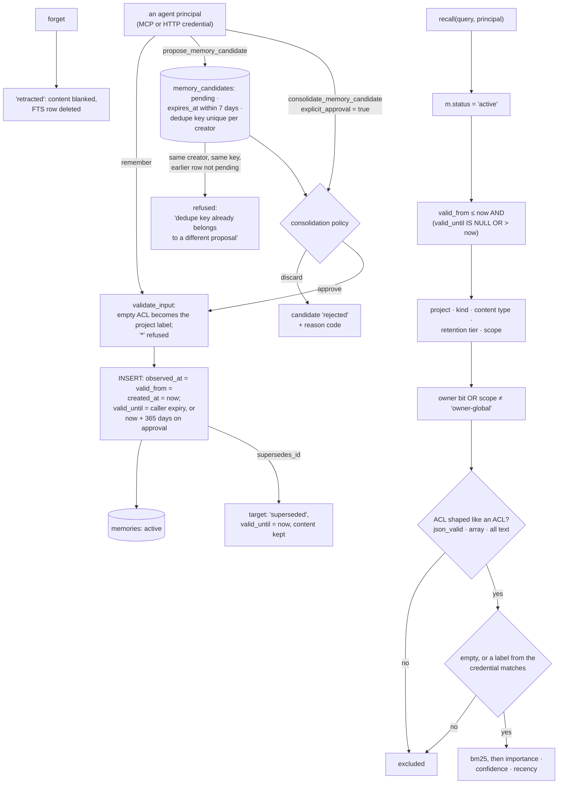

## 1. Executive Summary

Cortana is a local-first second brain in Rust whose native memory search
checks that each row's access list is a well-formed array of strings before
matching it, so a corrupted ACL excludes the row instead of falling through to
unrestricted. The weak side is time and review: the validity window opens at
the write clock, and the agent that proposes a memory can approve it through
its own MCP tool, or skip the queue and write directly.

It describes itself as "a local-first, agent-native second brain for people and
the AI agents that work with them", reachable through a Tauri desktop app, an
MCP stdio server, a loopback or explicitly secured HTTP API and a local-owner
CLI. Its product statement is a list of refusals before it is a list of
features:

> "It is not an unrestricted crawler, implicit backup service, agent harness, or
> hosted personal-data warehouse. A new installation starts query-only. Source
> authorization, validation, ingestion, reconciliation, recurring synchronization,
> model use, shared-agent access, and memory writes are separate explicit
> decisions."

**The search statement is where the care shows.** One SQL statement gates on the
active status, the validity window, project, kind, content type, retention tier
and scope, and on the principal's admin bit before owner-global rows are
reachable. Then, before it matches the row's access list, it checks that the
list is shaped like one:

```sql
AND json_valid(m.acl_json)
AND json_type(m.acl_json)='array'
AND NOT EXISTS (
  SELECT 1 FROM json_each(m.acl_json) AS memory_acl
  WHERE memory_acl.type<>'text'
)
```

Only a row that passes reaches the branch where an empty ACL means unrestricted
or a label match admits it (`crates/core/src/store.rs:2240-2268`). A lenient
application-layer parse turns a malformed ACL into an empty list, and an empty
list means everyone. Here the shape check and the match share a statement, so no
row is admitted on an ACL nobody validated. The writer closes the same branch
from its side: `normalize_acl` replaces an empty list with the project label and
refuses the reserved `*` (`crates/core/src/memory.rs:385-405`).

**A correction keeps the corrected row.** A write naming `supersedes_id` marks the
target `superseded`, keeps its content, and the replacement takes its place in
recall. Forgetting is different: it marks the row `retracted` and blanks its
content and provenance, leaving an id and a status.

**The time columns are one clock at write.** `memories` carries `observed_at`,
`valid_from`, `valid_until` and `created_at` separately, and the only product
writer binds the first, second and fourth to the same `now`
(`crates/core/src/store.rs:2051`). `valid_until` is documented as an "expiry for
short-lived working context" (`crates/core/src/memory.rs:264`), and the search
compares the window against the wall clock. The window answers "has this
expired", not "when was this true".

**The review queue is staging, not a gate.** Observations stage as candidates
with an expiry, rate limits and a reason code when a policy rejects them.
Promotion happens through consolidation, and the MCP
`consolidate_memory_candidate` tool accepts `explicit_approval: true` from the
agent that calls it. The same agent holds `remember`, which writes canonical
memory without a candidate at all.

## 2. Mental Model

A **capability** is off until somebody turns it on, one at a time.

A **memory** is a conclusion written by a principal, carrying an ACL that
principal may grant. It is `active`, `superseded` by a later row that names it,
or `retracted` by forget. Only `active` rows inside their expiry are in an
answer.

A **candidate** is a proposal. It is `pending` until it expires, is cancelled or
redacted, or is consolidated into `accepted` or `rejected`. An accepted
candidate becomes a memory with a retention expiry; a rejected one keeps its
reason code.

A **malformed access list** protects nothing, so it grants nothing.

Who moves a memory: any principal holding the memory scope whose labels cover
the row's ACL can write, supersede or forget it. Who moves a candidate: the same
principal, through consolidation, with a boolean it supplies.



## 3. Architecture

A Cargo workspace of four crates and a binary, with a Python connector package
and a Solid web UI served in the desktop shell.

| Path | Role |
| --- | --- |
| `crates/core/src/store.rs` | Schema, the gated recall and export, the candidate lifecycle, consolidation commits, forget |
| `crates/core/src/memory.rs`, `observation.rs` | Input validation, ACL normalisation, candidate validation and limits |
| `crates/core/src/consolidation.rs`, `classification.rs` | The versioned policy and the deterministic candidate classifier |
| `crates/core/src/auth.rs` | Principals, scopes and the ACL labels a credential carries |
| `crates/core/src/sync_engine.rs` | The device-to-device journal and bundle apply |
| `crates/mcp/src/mcp.rs` | The MCP tool surface |
| `crates/server/src/api.rs` | The HTTP API |
| `crates/retrieval/src/answer.rs`, `reflection.rs`, `memory_evaluation.rs` | Answer synthesis, reflection and the memory-evaluation lane |
| `src/main.rs` | The local-owner CLI |
| `apps/desktop/`, `apps/web/` | The Tauri shell and its UI |

### Deployment and ergonomics

One SQLite file holds documents, chunks, memories, candidates, the audit ring and
the sync journal. Nothing else has to run for memory: recall is FTS5 and the
consolidation policy is deterministic. Model use is one of the decisions the
owner turns on, and the memory path does not need it. The store is readable
with any SQLite client, and the memory rows are plain text and JSON columns.

## 4. Essential Implementation Paths

**Write.** `remember_scoped_with_axes` refuses `owner-global` to non-owners and
refuses session and principal scopes. `remember_in_transaction`
(`crates/core/src/store.rs:1872-2091`) then resolves the dedupe key, checks the
active-memory ceiling, applies supersession and inserts. The MCP handler narrows
the requested ACL to the caller's visible labels first
(`crates/mcp/src/mcp.rs:1073-1094`).

**Recall.** `recall_memories_with_axes_authorized`
(`crates/core/src/store.rs:2188-2310`) runs the strict FTS query, then an OR
fallback, under the full predicate, and re-checks `acl_allows` in Rust on every
row it keeps.

**Context assembly.** The MCP `context` tool (`crates/mcp/src/mcp.rs:531-555`),
HTTP `/v1/context` (`crates/server/src/api.rs:3108`) and the answer path
(`crates/retrieval/src/answer.rs:415-430`) all call the same recall with the
principal's labels.

**Export and its consumers.** `export_memories_with_axes_authorized`
(`crates/core/src/store.rs:4138-4228`) carries scope, the owner bit and the full
ACL predicate, and no status filter. Derived representations, reflection and
candidate classification read through it and drop non-active rows in Rust.

**Candidates and consolidation.** `propose_memory_candidate`
(`crates/core/src/store.rs:2317-2444`) admits a proposal.
`consolidate_memory_candidate_with_action` (`:2889`) classifies it, runs
`consolidation::evaluate`, and commits the candidate status, the memory, the FTS
row and the job in one transaction.

**Forget.** `forget_memory_scoped` (`crates/core/src/store.rs:3913-3954`).

## 5. Memory Data Model

`memories` (`crates/core/src/store.rs:517-539`) separates `content_type` from
`retention_tier` and both from `kind`, so how long a record is kept is a
different field from what kind of record it is. `scope` takes `workspace` or
`owner-global` on the write path; `session` and `principal` parse and are
refused until an identity binding exists.

`memory_candidates` (`:540-562`) carries the same ACL and provenance documents
plus `created_by`, `sensitivity`, `expires_at` and `rejection_reason`, so a
proposal's access list exists before it is promoted. A unique index on
`(project, scope, created_by, dedupe_key)` (`:6313-6316`) keeps one candidate
per key per creator, whatever its status.

The time columns are four, written from one clock. `observed_at`, `valid_from`
and `created_at` are bound to the same `now` in the insert (`:2051`).
`valid_until` is the caller's working-memory expiry, the policy's retention
ceiling on an approved candidate (`now + max_durable_days`, 365 by default;
`crates/core/src/consolidation.rs:334-342`), or `now` when the row is
superseded. A sync apply copies a peer's values verbatim, and the one migration
copies them between table shapes.

## 6. Retrieval Mechanics

The statement ranks by `bm25(memories_fts)`, then importance, confidence and
`updated_at`, over four times the requested limit. Rust re-scores the survivors
with `memory_relevance_score` before truncating. The strict query runs first and
the OR fallback only when it leaves room. Low confidence lowers a memory's rank;
nothing withholds it.

The validity gate takes `memory::now()` (`crates/core/src/store.rs:2225`, bound
at `:2282`), and no caller passes another moment, so recall cannot be asked
about a past date. `valid_from <= now` excludes a row only if a sync peer's
clock ran ahead.

## 7. Write Mechanics

An explicit `remember` is synchronous and lands in recall on commit. A proposal
waits until a principal calls consolidation from MCP, HTTP or the CLI. No
standing worker drains the job table; an owner's HTTP call with an enabled
policy spawns one recovery pass over queued jobs
(`crates/server/src/api.rs:4038-4050`). The automatic-retention branch is closed unless
`automatic_retention_release_authorized` is set, and that field is
`#[serde(skip_deserializing)]` (`crates/core/src/consolidation.rs:47-50`), so
neither the MCP tool nor the HTTP route's policy JSON can open it.

Dedupe is keyed on a caller-chosen string, at two levels. A memory write whose
key belongs to a superseded or retracted row is refused with "choose a new key"
(`crates/core/src/store.rs:1940`). A candidate whose key matches an earlier
candidate from the same creator, project and scope is returned as-is if that one
is pending and identical, and refused otherwise (`:2357-2388`). Neither check
reads the value, so a re-extraction under a fresh key, or by another principal,
walks past both.

### Operational cost

No model call sits on the memory write, consolidation or recall path in
`store.rs`; classification is deterministic. Recall is bounded by
`MAX_MEMORY_RECALL_LIMIT` (100) and the context builder's token budget. No
background pass rewrites the store; consolidation touches one candidate per
call.

## 8. Agent Integration

The MCP surface gives an agent holding the memory scope `remember`, `recall`,
`forget`, `export_memory`, the candidate verbs (propose, list, export, cancel,
redact, classify, consolidate), `reflect_memory` and
`inspect_memory_representations`. The `context` tool returns evidence and
memories in separate fields, and its description asks agents to call it before
answering questions about the user. Shared-agent access is one of the owner's
separate decisions, and a credential fixes the ACL labels the agent can read and
grant.

## 9. Reliability, Safety, and Trust

The ACL shape check and the credential-bound labels make scope the strongest
property here. Every memory read that returns content goes through the recall
or the export statement, and both carry the predicate. The point read by id carries
none and is reached only from the two forget handlers, which check `acl_allows`
before acting. They answer "memory not found" and "memory ACL denied"
differently, which tells a principal outside the ACL that an id exists.

Review is the gap. `explicit_approval` is a field of the MCP tool's parameters
(`crates/mcp/src/mcp.rs:217-223`) passed straight to the policy (`:1508`),
where it turns a low-confidence `review` into `approve`
(`crates/core/src/consolidation.rs:285-289`, `:328-331`). The HTTP route takes
the same boolean. A candidate needs nobody but its author.

Corrections are inspectable and forgetting is close to erasure. A superseded row
keeps its content and is returned by export with its status. A retracted row
keeps an id, a project, an ACL and timestamps; its content, provenance and FTS
entry are gone.

`audit_events` records principal, action, project, source, outcome and counts
for each operation, with no memory id, and is trimmed to a configured maximum
(`crates/core/src/store.rs:1534`). `sync_journal` records an object id, a
revision and a fingerprint per change, only once a device identity is adopted.
`sync_compact` deletes every acknowledged entry but the newest per object
(`crates/core/src/sync_engine.rs:492-505`). Neither answers what a memory said
before it changed.

## 10. Tests, Evals, and Benchmarks

1,047 Rust test functions, 107 of them in `store.rs`, plus the
memory-evaluation lane. I read the memory tests and the lane; I built and ran
nothing.

`native_memory_is_idempotent_acl_scoped_and_redactable`
(`crates/core/src/store.rs:9456`) is the negative case with its control on one
store. The `work` principal recalls one row, the `personal` principal running
the same query gets `is_empty()`, and after `forget_memory` the row's content is
empty and recall returns nothing.
`native_memory_supersession_deactivates_previous_fact_atomically` (`:10167`)
writes two rows that both match `current editor` and asserts that only the
replacement comes back. `owner_global_memory_is_hidden_from_acl_matching_non_owners`
(`:7658`) asserts the owner-global gate on recall and export.

`crates/retrieval/src/memory_evaluation.rs` defines sixteen required cases over
synthetic disposable stores. Three assert absence from recall: an expired
working memory, a forgotten one and another workspace's memory
(`:1229-1297`). `explicit-idempotent-recall` fails a retriever that returns
nothing. `tests/evaluation.rs:82-96` runs `cortana eval --memory` and asserts
`passed`, `unauthorized_exposures == 0` and that automatic retention stays off.
No case writes a `valid_from` earlier than its insert, because no input can.

## 11. For Your Own Build

### Steal

Validate the access list's shape in the statement that matches it, and
normalise an empty list at write so the unrestricted branch is unreachable from
the front door.

Take a principal's labels from its credential, not from the request, and let a
write grant only labels the writer can read.

Mark the superseded row and keep it. A status change and a `supersedes_id` make
a correction inspectable, and an exact-id assertion over two rows matching one
query proves recall honours it.

Keep the flag that opens automatic behaviour out of every deserialiser.
`skip_deserializing` on a release flag means no request body reaches it.

Start query-only, and make each capability its own decision.

### Avoid

Calling an expiry a validity window. Columns named `valid_from` and
`valid_until`, both stamped from the write path, read in a schema as event time
and cannot answer when something became true.

An approval boolean on the proposer's own tool. If the agent that wrote a
candidate can pass `explicit_approval: true`, the queue records a decision
nobody else made.

### Fit

This suits one owner running many agents over one local store, where the
boundary that matters is between those agents' credentials rather than between
truths and errors. Scope, redaction and the query-only posture are built for
that. Walk away if memories must carry when a fact held rather than when it was
written, or if a person must approve what an agent proposes before recall can
return it.

## 12. Open Questions

Whether `session` and `principal` scopes will ship, and whether their identity
binding will reach the recall predicate or sit beside it.

Whether `explicit_approval` is meant to reach the agent's tool surface. The MCP
tool description says "explicit approval remains separate", and the parameter
struct carries it.

Whether a rejected value is meant to be remembered. The candidate's unique key
blocks one creator's re-offer under one key; nothing keyed on content exists.

What `provenance_json` is for at read time. It is carried from candidate to
memory and cleared by forget, and no read gates on it.

## Appendix: File Index

| Path | What to read it for |
| --- | --- |
| `crates/core/src/store.rs:2188-2310` | Recall: the full predicate and the ACL shape check |
| `crates/core/src/store.rs:1872-2091` | The one memory writer, supersession, and the `now` binding |
| `crates/core/src/store.rs:517-562` | Memories and their staging table, side by side |
| `crates/core/src/store.rs:2317-2444` | Candidate admission, the dedupe guard and rate limits |
| `crates/core/src/store.rs:3913-3954` | Forget: retraction and redaction |
| `crates/core/src/store.rs:4138-4228` | Export: the ACL predicate without a status filter |
| `crates/core/src/consolidation.rs:215-355` | The policy, the approval boolean and the retention ceiling |
| `crates/core/src/memory.rs:243-405` | Inputs, the expiry field and ACL normalisation |
| `crates/mcp/src/mcp.rs:1044-1165`, `:1486-1535` | `remember` and `consolidate_memory_candidate` on the agent's surface |
| `crates/core/src/store.rs:9456-9530`, `:10167-10217` | Negative recall cases with their controls |
| `crates/retrieval/src/memory_evaluation.rs:1207-1297` | The evaluation lane's absence cases |

### Recorded searches

Run with `git grep -n -E` at the tree root of the pinned checkout, and at
`9609d2ab5f916b2795500ed98c57dd2388592144` with the same result.

- `"'active',\?14,\?15,\?16,\?16,\?17,\?18,\?16,\?16"` over `*.rs` — one hit, `crates/core/src/store.rs:2051`; `observed_at`, `valid_from`, `created_at` and `updated_at` share `?16`, which is `now`.
- `'valid_from\s*[:=]|valid_from='` over `*.rs` — the field, the row reader, the `excluded` copy in the upsert, and struct literals inside `#[cfg(test)]` modules of `classification.rs`, `context.rs`, `derived.rs`, `reflection.rs` and `tests/provider_conformance.rs`; no product path sets it.
- `'consolidate_memory_candidate\(|supersede_memory_candidate\(|process_pending_memory_consolidation\('` over `*.rs` — the MCP tool, the HTTP route and its recovery pass, the CLI, the evaluation lane and tests; no scheduler.
- `"status='rejected'"` over `*.rs` — one writer, `store.rs:3429`; no reader on the memory or candidate write path.
- `'DELETE FROM (audit_events|sync_journal)'` over `*.rs` — `store.rs:1534`, `:5976` and `sync_engine.rs:498`; both logs are trimmed.
- `'explicit_approval'` over `crates/mcp crates/server src/main.rs` — the MCP parameter (`mcp.rs:222`, passed at `:1508`) and the HTTP request field (`api.rs:528`, passed at `:4023`).
- `'recalled\.is_empty\(\)'` over `crates/retrieval/src/memory_evaluation.rs` — three hits, `:1245`, `:1266`, `:1282`.
- `'recall_memories|export_memories|FROM memories'` over `apps src/cortana` — no match; every memory read goes through `store.rs`.
- `'arxiv|bibtex|@article|@misc|doi\.org'` (case-insensitive) over `README.md docs` — no match; no paper.
- `'anthropic|machine learning|not (be )?used (for|to)'` (case-insensitive) over `LICENSE NOTICE` — no match; the Apache-2.0 text carries no rider.

## History

**2026-10-15** — [`f26a1ac2b01bc903a86b0198d375c8e146ecbbde`](https://github.com/adea-ai/cortana/commit/f26a1ac2b01bc903a86b0198d375c8e146ecbbde) — 173 commits on, version 0.58.11 to 0.68.4, almost all in the web UI and release tooling; the memory schema, writer and recall did not move. `bitemporal` withdrawn: the only writer binds `valid_from` to the insert clock and recall compares against the wall clock, at both pins ([section 5](#5-memory-data-model)). `negative_eval` added, earned at both pins ([section 10](#10-tests-evals-and-benchmarks)). Also wrong then: a rejected candidate's key is consulted, approval is a caller boolean, the owner-global gate is the admin bit, and the architecture table's paths ([section 7](#7-write-mechanics), [section 9](#9-reliability-safety-and-trust)). The 2026-09-16 entry's sha is restored to the commit that reading pinned. Screened from a full clone: one auto-run surface (an inert git hook), one build-time execution point, three unpinned surfaces, fourteen files inside the cooldown, `AGENTS.md` read as data. Nothing was installed, built or run.

**2026-09-19** — [`9609d2ab5f916b2795500ed98c57dd2388592144`](https://github.com/adea-ai/cortana/commit/9609d2ab5f916b2795500ed98c57dd2388592144) — `trust_state` re-tested. Every anchor in this report pointed at `src/store.rs` and the file is now at `crates/core/src/store.rs` — the repository became a Cargo workspace since the previous pin, so thirteen citations across three marks and the file index were dead paths. They are re-mapped, with line numbers shifted by one or two.

The mark holds and is wider than recorded: `status='active'` is composed into a dozen reads in that one file — the counting read (`:1819`), the update guards (`:1832`, `:1880`), the upsert (`:1899`), the full-text search (`:2082`), a second count (`:2792`), the ACL lookup (`:3788`), the validity stamp (`:3808`) and the aggregate rollups (`:3825-3893`) — against the record's five. Two reads omit it, and both are the ones that should: the point read by id (`:3755-3762`) returns the row with its `status` column so the caller sees what it got, and `export_memories_with_axes_as_owner` (`:3992-4081`) carries the full ACL predicate but no status filter, because an export that dropped superseded rows would be a lossy backup. The record now says so rather than claiming the predicate is universal. Screened again first; nothing was installed and no suite was run.

**2026-09-16** — [`6b76a1dbd38a18a32c502e963f0d380f5b92d75f`](https://github.com/adea-ai/cortana/commit/6b76a1dbd38a18a32c502e963f0d380f5b92d75f) — first reading, at a commit dated 16 September 2026. Screened before opening, from a shallow clone: eighteen files scanned, one auto-run surface, one build-time execution point, three unpinned surfaces and ten dependency files inside the seven-day cooldown. Nothing was installed, built or run.
