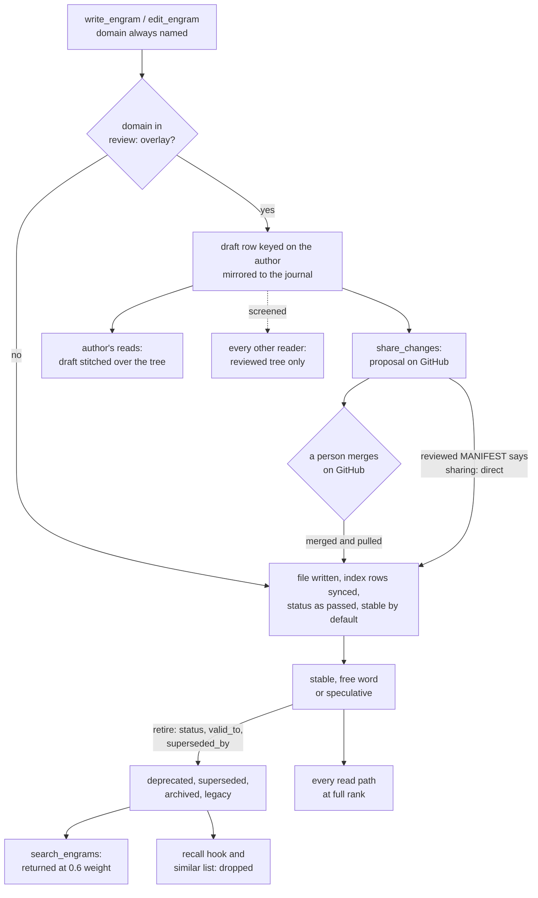

## 1. Executive Summary

Crystalline is a local-first knowledge store for coding agents, shipped as one
Rust binary. An engram is a markdown file with OKF frontmatter in a domain
folder. A daemon keeps a derived Turso or PostgreSQL index over those files
and serves them over MCP, a REST API and a web UI called Fluid. What is
notable is review mode: a domain can turn every write, the agent's included,
into a draft only its author sees, published only when a person merges the
proposal on GitHub. What is weak is retirement. A superseded engram stays in
every search at 0.6 weight, and the predicate that would confine search to
current knowledge has no caller.

The domain is the organising key, and it is required on every write. The
agent calls `write_engram`, `edit_engram` or `split_engram` with a domain, a
title and a body of `- [category] fact` observations and `- rel [[Target]]`
relations. The file is written, the index rows follow in the same call, and an
embed worker picks up the chunks afterwards. Reads are a hybrid search, a
graph neighbourhood ranked by PageRank, and a per-prompt hook that names up to
three engrams by address. Teams share a domain through a GitHub repository,
one proposal per share.

Four findings shape the rest of this report.

- **Review mode is a gate the agent cannot open.** With `review: overlay`,
  writes become `engram` rows keyed on the author's identity, screened from
  every other reader. The reviewed folder moves only on a pulled merge, the
  provider trait has no merge call, and the switch is a REST route for an
  owner or admin (`crates/engine/src/engine/review_mode.rs:402-445`).
- **Retirement filters only the unbidden paths.** The recall hook and the
  write receipt's similar list drop the four retired statuses. The agent's own
  `search_engrams` returns them faded (`crates/index/src/store.rs:1388-1400`).
- **Valid time is the caller's and record time is the system's.**
  `recorded_at` is a reserved key and `valid_from`/`valid_to` are settable
  only by a caller, never by the clock (`crates/engine/src/engine/mod.rs:8485-8498`).
- **The open defaults are wide.** HTTP MCP serves without a token unless
  `auth.mcp` is set, and a stdio session is the machine owner, so the
  scoping above binds authenticated HTTP accounts only.

Five marks: `trust_state`, `bitemporal`, `scope_enforced`, `human_review` and
`negative_eval`. Section 9 names the two withheld.

## 2. Mental Model

An engram becomes a belief when its write commits. There is no extraction
step, no model call on the write path and no candidate state the system
assigns. The status is whatever the writer passed, `stable` by default, and
the code treats `status` as free text with two recognised sets
(`crates/core/src/engram.rs:28-49`). The retirement set is `deprecated`,
`superseded`, `archived` and `legacy`. The speculative set is `draft`,
`proposed`, `idea` and `poc` (`crates/index/src/sweep/mod.rs:251`). Any other
word ranks and behaves like `stable`.

**An engram stops being a belief by being retired, not removed.** The
supersede recipe in the capture skill sets a retirement status, closes
`valid_to` at the real end date and writes `superseded_by`/`supersedes`
relations; REST's `retire_engram` does the same in one call
(`crates/engine/src/engine/attachments.rs:887-910`). What each reader then does
with it differs:

| Status | `search_engrams` | recall hook | similar list | contradiction scoring |
| --- | --- | --- | --- | --- |
| `stable`, `current`, any free word | full rank | eligible | eligible | eligible |
| `draft`, `proposed`, `idea`, `poc` | full rank | eligible | eligible | skipped |
| `deprecated`, `superseded`, `archived`, `legacy` | score x0.6 | dropped | dropped | skipped |

The anchors are `retired_factor` (`store.rs:1388-1400`), `RETIRED` in
`crates/cli/src/recall.rs:126-134`, the filter at
`crates/engine/src/engine/search.rs:249` and `eligible` at
`crates/index/src/nli/candidates.rs:73-85`. The design is stated in the docs:
the past stays addressable, *"softly faded in ranking"*. A model that searches
for a fact gets the superseded version back, labelled only by its `status`
field.

**Validity is a second, independent axis.** `valid_from` and `valid_to` are
never set by the clock; absence means unbounded. The agent bounds them through
`metadata` or `set_frontmatter`, and `recorded_at` is stamped with the write
date and refused as an override. Validity reaches retrieval only when the
agent writes a range filter, and the skill warns that such a filter skips
every unbounded engram.

**Review mode adds a third axis: whose row a reader sees.** In a domain with
`review: overlay`, a write lands as a row carrying the author's actor key.
The author's reads stitch their drafts over the reviewed tree, and everyone
else sees the tree alone (`crates/index/src/turso/search.rs:153-180`). A draft
leaves that state in three ways: a merged proposal folds it, the author
discards it, or an owner turns review off and folds or discards it.

## 3. Architecture

Eight crates build one binary (`docs/architecture.md`). `crystalline-core`
parses and emits engrams and holds the format rules. `crystalline-index` is
the store, with a Turso backend and a PostgreSQL backend held to a parity
suite. `crystalline-identity` holds accounts, roles, private-domain membership
and the `Scope` type. `crystalline-engine` is the shared engine, including the
review overlay and co-editing rooms. `crystalline-rest` and
`crystalline-service` expose it, and `crystalline-remote` talks to GitHub.

**Runtime.** The first `crystalline mcp` or `crystalline serve` takes an
advisory lock on the database and becomes the daemon. Later CLI commands and
stdio MCP sessions attach over a Unix socket or named pipe; with no daemon, a
CLI command opens the database briefly itself. The daemon binds
`127.0.0.1:7411` for MCP over HTTP, the JSON API and Fluid (`docs/security.md`).

**Persistence.** A file domain's markdown is the source of truth and the index
is derived, rebuilt by `crystalline reindex --full`. A virtual domain keeps its
engrams in the database, with nothing to rebuild from. Draft rows are primary
data too, so the engine mirrors each one under
`<state_dir>/overlays/<domain>/<actor>/<path>`, with a `.tombstone` sidecar for
a draft deletion (`crates/engine/src/overlay_journal.rs:1-45`). The journal is
per machine.

**Search stack.** The lexical arm uses no FTS5. It is a `LIKE` prefilter
capped at 5,000 candidates, scored in Rust with title x3, description x2 and
content x1; the module comment gives the reason as native FTS5 being
unavailable in Turso 0.6.1, and the workspace pins 0.8.1
(`crates/index/src/turso/search.rs:1-8`, `Cargo.toml:39`). The
vector arm is `min(vector_distance_cos(...))` per engram over every chunk, a
top-100 by exact scan (`:696-703`). PostgreSQL uses pgvector's `<=>` the same
way, and its HNSW index is unused by the query (`crates/index/src/postgres/search.rs:688`).
Embeddings default to `granite-embedding-97m-multilingual-r2`, run in-process
through candle (`crates/index/src/embed/models.rs:78-81`).

**Optional surfaces.** A local NLI model, mDeBERTa-v3, scores observation
pairs for contradictions when `evolve.contradictions` is `full`. GitHub team
domains, mounted domains from other Crystalline servers, OIDC and OAuth
sign-in, and a "Reflection" of human-facing documents beside the engrams are
all opt-in.

### Deployment and ergonomics

Installation is `brew install` and `crystalline install claude-code`, or a
`.deb`, an MSI or a container image. The first start downloads the embedding
model from Hugging Face once; `HF_ENDPOINT` or a pre-fetched directory avoids
it. No API key is needed to store or search, and nothing leaves the machine
unless GitHub, a remote embedder, a shared PostgreSQL or a remote server is
configured. The store is a folder of markdown with YAML frontmatter, readable,
diffable and repairable by hand, and the index can be thrown away. The cost is
operational surface: one binary, but with accounts, roles, OAuth, co-editing,
provisioning of skills and MCP servers into harnesses, and a long settings
registry.

## 4. Essential Implementation Paths

**Write.** The MCP tool `write_engram` (`crates/service/src/mcp.rs:2829`) calls
`Engine::write_engram_present` (`crates/engine/src/engine/write.rs:345`). It
builds a `DomainView` for the caller, which decides whether the write is a
draft, resolves the path from folder and title, and refuses a taken permalink.
`build_markdown` stamps `recorded_at` with the date, `generated` with actor,
model and time, and merges `metadata` minus the reserved keys
(`crates/engine/src/engine/mod.rs:8410-8498`). The file is written and
`reindex_file` updates the rows under the store lock, restoring the old bytes
if indexing fails (`write.rs:700-725`). `nudge_embed` hands the chunks to the
embed worker without waiting.

**Edit and retire.** `edit_engram` offers seven operations, among them
`set_frontmatter` over a fixed key list: `tags`, `status`, `valid_from`,
`valid_to`, `stale_after`, `source_date`, `resource`, `source_version`,
`sources`, `salience`, `verified` and `evolve_ack` (`mod.rs:175-200`).
`split_engram` moves named observations into a new engram linked by
`derived_from`/`split_into`, so one stale fact can be retired without its
neighbours. REST's `POST /api/v1/domains/{domain}/retire` calls
`retire_engram_as`, which sets the status, closes `valid_to` and writes the
relation pair (`crates/rest/src/engrams.rs:1300-1401`).

**Search.** `search_engrams` reaches `Engine::search_engrams_under`
(`crates/engine/src/engine/search.rs:42-170`). It computes the hidden domains,
narrows the domain list, sets the reading actor, settles the mode against
embedding coverage, embeds the query outside the store lock and calls
`store.search`. `run_hybrid` blends the two arms, adds the salience prior and
applies `retired_factor` (`turso/search.rs:446-560`).

**Context assembly.** Three paths put memory in front of the model without a
search call. The MCP server's instructions carry a routing block, one line per
visible domain from its MANIFEST's `## When to Use`. `crystalline prompt
system` emits the same block from a `SessionStart` hook. `crystalline hook
prompt`, a `UserPromptSubmit` hook, asks the running daemon for a hybrid
search under a one-second budget and prints up to three addresses above a
0.69 floor, never the same one twice per session (`crates/cli/src/recall.rs:1-60`).

**Graph.** `build_context` takes a `crystalline://domain/permalink` anchor or
glob, walks relations and links up to depth 3 under the same actor screen,
ranks the neighbourhood by personalised PageRank with damping 0.85, and puts
retired nodes last when the cap bites (`crates/engine/src/engine/context.rs:12-330`).

**Team share.** `share_changes` calls `Engine::origin_share_with`
(`crates/engine/src/engine/origins.rs:1598`). In review mode it stages the
author's drafts as a tree over the pinned base and opens or amends a
proposal. On a `sharing: direct` domain it commits instead and folds the
drafts into the folder (`:1690-1735`). `update_domain` pulls and converges.

**Maintenance.** `evolve_engrams` is a read-only sweep returning findings in
four families, each tagged `mechanical` or `judgment`. The NLI pass stores
scored pairs in `contradiction_pair` and `contradiction`, and `evolve` raises
`V302` from them; nothing changes a status on its own.

## 5. Memory Data Model

The `engram` table holds one row per engram per actor: domain, path,
permalink, title, type, status, `recorded_at`, `valid_from`, `valid_to`, the
legacy `timestamp`, description, metadata JSON, file stamps, `actor` and
`tombstone` (`crates/index/src/turso/migrations.rs:536-574`). An empty `actor`
is the reviewed base. Side tables hold observations and their tags, relations
with resolved targets, prose links, tags with a per-domain alias table, chunks
with embeddings per model, `engram_meta_value` for list-valued metadata,
attachments, reflections and the two contradiction tables.

**Scope.** The domain is a row in `domain`, and each engram row points at one.
Private domains, their owners and members live in the accounts database
(`crates/identity/src/auth_store.rs`), not on the engram. `Scope` is resolved
once per request: `Unrestricted` for the CLI, the control socket and stdio MCP;
`User` for an authenticated HTTP caller; `Anonymous` otherwise
(`crates/identity/src/scope.rs:53-70`).

**Provenance.** `generated: {by, model, at}` names the last writer: an agent
as `name/version`, a person as `human:name`, a job as `process:name`. It is
replaced on every write. `verified` is a list of `{by, model, at}` entries,
one per actor, each new verification replacing that actor's previous entry
(`crates/engine/src/engine/edit.rs:1059-1088`).

**Temporal fields.** `recorded_at`, `valid_from`, `valid_to`, `source_date`
and `stale_after` are plain ISO dates. `normalize_temporal_fields` rejects any
other shape and drops a sentinel far-future `valid_to` or far-past
`valid_from` (`crates/core/src/temporal.rs:53-120`).

**What is not modelled.** No row records a rejected value, no table records a
mutation, and no field distinguishes a candidate from a verified fact beyond
the free-text status.

## 6. Retrieval Mechanics

Hybrid is the default when embeddings cover the store, falling back to
lexical. Lexical scores are normalised by the query's top score; semantic
scores are clamped cosine at or above 0.78. An engram found by both arms
scores `0.4 * lexical + 0.6 * semantic`; one found by one arm keeps that
score times 0.85 (`crates/index/src/rank.rs:24-38`). A `salience` metadata
value from 0 to 10 adds a bounded lift at weight 0.15. A retired status
multiplies the total by `search.retired_weight`, 0.6 by default, and the code
states it is *"Never a filter"* (`store.rs:1388-1400`).

**Filters** are pushed into SQL on both arms: domain list, type, status, tags
with their alias class, a recorded-after date and `metadata_filters` with
`$eq`, ranges, `$in`, `$contains` and `$contains_any`. Promoted keys map to
columns, so a validity range is an indexed predicate (`turso/search.rs:995-1006`).
The search tool exposes no as-of parameter; the agent writes the range itself,
and a strict comparison excludes every engram whose bound is null.

**Context formatting.** Search returns a page of hits with snippet, status,
tags and a `crystalline://` link; `read_engram` returns the file and resource
links to attachments. The recall hook prints one line per engram, about 200
tokens for three, under a header telling the model to read before relying on
anything (`recall.rs:120-125`). The routing block is sized to survive
truncation: rules first, then one bullet per domain, then a single count.

**Failure modes.** A superseded engram outranks its successor when its text
matches the query better, since 0.6 times a strong match beats a weak current
one. A free-form retirement word such as `obsolete` is not in the set and
ranks at full strength, which the capture skill says outright. The vector arm
is an exact scan over every chunk of every visible engram per query, which
the project measures at 0.17 to 0.42 seconds on a 10,000-engram index
(`recall.rs:101-105`); the measurement note is not committed.

## 7. Write Mechanics

Every write is explicit, through a tool, the CLI or Fluid. Nothing in the tree
extracts memory from a transcript. The `Stop` hook asks the agent, once per
session after it gains substance, to propose captures and wait for a yes, and
to raise the salience of any recalled engram that proved key. The receipt of
every `write_engram` and content edit may carry `similar`: up to three
existing engrams nearest in meaning, with guidance to merge, supersede, link
or say they are unrelated.

**Deduplication** is advisory. The similar list, the `vocabulary` tool and the
evolve sweep's near-duplicate and semantic-twin rules surface duplicates; no
write is refused for one. A taken permalink is refused, and an overwrite
replaces the engram that owns it in place.

**Delete and correct.** `delete_engram` removes the file and its index rows,
and the tool description recommends a retirement status where history matters.
In a team domain a deletion is a local change to share; git upstream keeps the
old file. In a review-mode domain it becomes a tombstone row in the author's
draft. Conflicts between two engrams are a `V302` finding for a person or
agent to settle.

**Agent-generated content** gets no special handling. An agent's write is
`stable` unless it says otherwise, and the `model` it reports is recorded but
not verified.

### Operational cost

The write blocks on the file write and the index transaction, not on a model.
Lexical search sees a new engram as soon as the call returns. Semantic search
sees it after the embed worker processes its chunks, normally seconds on a
local model, longer while a re-embed is running. No background pass rewrites
the store. The NLI pass reads observation pairs of related current engrams
after each embedding pass, capped at 32 line pairs per engram pair. Per turn
the recall hook adds about 200 tokens when it has hits, and the routing block
is injected once per session and again after `/clear` or a compaction.

## 8. Agent Integration

The MCP server registers 30 tools and two prompts (`mcp.rs:2829-4092`). Six
collaboration tools are listed only when `github.enabled` is on; a read-only
instance lists the read tools alone. `crystalline install <harness>` registers
the server, writes the three hooks for Claude Code, Codex and Copilot, and
the session hook for Cursor, Kiro, Gemini CLI and Qwen Code. It copies five
skills — routing, capture, schema, collaboration and provisioning — and never
edits `CLAUDE.md` or `AGENTS.md`. The skills are served over MCP as a `skills`
tool and `skill://` resources to clients that did not install them.

**Agency.** The model holds the whole write surface: create, edit, split,
move, delete, retire through `set_frontmatter`, add and remove domains,
configure non-operator settings, share to GitHub, and provision artifacts a
domain ships into harnesses. Only `remove_domain` and `discard_changes` ask the
person first, through MCP elicitation where the client supports it. Operator
settings — network bind, database, `auth.*` — are refused through `configure`
over every transport (`crates/engine/src/settings.rs:239-360`, `:665`).

**Adaptation.** The format is OKF markdown, the integration is MCP plus a
shell hook per harness, and the CLI mirrors every tool, so wiring another
harness is a registration and a hook.

## 9. Reliability, Safety, and Trust

**Scope enforced.** One index holds every domain, and two predicates guard it.
`hidden_for(scope)` collects the private domains a caller may not see plus
unregistered and shadowed names (`crates/engine/src/engine/mod.rs:2918-2923`).
Search narrows to `d.name IN (...)` before embedding the query and answers a
hidden domain exactly as an unregistered one. The actor screen opens every
candidate leg with `tombstone = 0 AND (actor = ? OR (actor = '' AND NOT
EXISTS ...))`, so a reader sees base rows plus their own drafts.

Both run on search and the write advisory (`search.rs:50`, `:72`, `:204`,
`:235`), `build_context` and its graph walk (`context.rs:17`, `:92`),
`read_engram` (`read.rs:374`), `recent_activity`, `browse_domain` and
`list_domains` (`domains.rs:18`, `:965-1038`), `evolve_engrams`
(`evolve.rs:177`) and `vocabulary` (`schemas.rs:68`). The MCP routing block is
built by `routing_text_scoped` (`domains.rs:964`, `mcp.rs:4175-4180`), and
attachment links read through the caller's view (`mcp.rs:4220`). The
per-prompt recall hook goes through the daemon's search as the machine owner.
The limit is the defaults: stdio and the CLI are `Unrestricted`, and HTTP MCP
serves `Anonymous` callers without a token unless `auth.mcp` is set.

**Human review.** In a review-mode domain the agent's write cannot reach the
reviewed tree. It lands as a draft row other readers never see; `share_changes`
opens a proposal; the provider trait offers `create_proposal`,
`update_proposal` and `close_proposal` and no merge (`crates/remote/src/provider.rs:312-346`).
The skill-training harness fails any collaboration item that reaches the
merge endpoint. A person merges on GitHub and the pull folds the draft.

The switch itself is off the agent's surface. `set_review_mode` requires the
domain owner and is reached from `PUT /api/v1/domains/{domain}/review` and the
CLI only (`review_mode.rs:402-445`, `crates/rest/src/domains_admin.rs:2500-2640`).
The settings registry carries no review key, so `configure` cannot reach it.
`configure` with a domain turns a policy change into the author's draft, and
the share reads `sharing` off the reviewed folder (`origins.rs:1622-1628`).

Four limits. Review is opt-in per domain and needs a GitHub origin. A reviewed
MANIFEST declaring `sharing: direct` lets the agent's share commit and fold
with no person, which is a person's decision to make but removes the gate
entirely. A folder conflict, from an out-of-band edit meeting an upstream
change, is settled on the folder with content the caller supplies
(`origins.rs:2836-2866`). And the author's own reads show its drafts as if
reviewed, so the agent acts on unreviewed text in its own session.

**Trust state.** The retirement set is a stored, movable state that withholds
an engram on the paths where the model did not ask: the recall hook, the
write advisory, contradiction scoring, and the Reflection's loose-engram
listing (`crates/engine/src/engine/reflect.rs:357`). `search_engrams` returns
it faded. `current_only`, a predicate in both backends that keeps
`stable`/`current` engrams inside their validity window, is set only in a test
(`crates/index/tests/it/store.rs:5125`).

**Provenance.** `generated.by` comes from the session, but the `model` is
whatever the agent reports. `set_frontmatter` on `verified` accepts any actor
as the verifier, by design (*"A caller may name somebody else as the
verifier"*), so an agent can write `verified: human:alice`
(`edit.rs:1059-1088`). Nothing reads `verified` to admit or exclude an
engram; the evolve sweep reads it for its long-unverified rule.

**Withheld marks.** `tombstone`: the overlay's `.tombstone` and the `tombstone`
column are one author's deletion of one path, keyed on the path, and a
re-written fact walks past them. `audit_log`: the only change record is the
change bus, an in-memory ring of 512 events for live clients
(`crates/engine/src/changes.rs:20-25`); `log.md` is reserved by OKF and
*"never written by Crystalline"* (`crates/core/src/index.rs:23-26`). Team
domains have git history, which is a different mechanism.

**Data loss and concurrency.** Writes hold a per-file or per-draft lock and
restore the previous bytes if indexing fails. One process holds the database;
others attach. Draft rows are not rebuildable from files, which is why the
journal exists, and the journal is per machine: a second instance sharing the
PostgreSQL index cannot restore another machine's drafts.

**Documentation and code disagree on one point.** `docs/security.md` lists as
a known gap that an agent *"can change every key in the settings registry,
including `auth.mcp`, `service.http` and the database connection"*. At this
pin `configure` refuses every `operator_only` key, which includes those three
(`settings.rs:239-360`, `crates/service/src/mcp.rs:3309-3315`).

## 10. Tests, Evals, and Benchmarks

The suite is large and specific. `crates/service/tests` holds 146,759 lines,
most of it end-to-end through an in-process engine, REST server or MCP
session, with a deterministic `TopicEmbedder` standing in for the model. CI
runs `cargo nextest` over the workspace and a stress pass with
`--stress-count` (`.github/workflows/ci.yml:362-425`). The PostgreSQL tests
need a database; the Turso tests do not.

**Negative retrieval cases with controls.**
`an_authenticated_search_finds_the_callers_draft_and_nobody_elses` writes a
reviewed engram and one draft per account on the same topic, then asserts for
each account that its draft is present, the other's absent and the reviewed
engram present (`crates/service/tests/overlay/overlay_domains.rs:3801-3877`).
Its comment gives the reason: a predicate wrong in one direction would
pass the other two checks. `neighbours_are_the_near_ones_and_exclude_self_and_retired`
stores a superseded engram with the same text as a stable one and asserts an
exact one-element list (`crates/service/tests/engine/similar.rs:161-194`).
The visibility suites assert private-domain exclusion from search, listing,
routing and the graph walk.

**Weaker spots.** The REST visibility case asserts the stranger's search lacks
the secret without a search the stranger is expected to succeed on
(`rest_visibility.rs:464-470`). The recall hook's retirement cut is tested
against a hand-built search answer, not an index
(`crates/cli/src/recall.rs:596-616`).

**Evals.** `evals/skill-training` trains and scores the shipped skills with
SkillOpt against headless Claude Code sessions, scored deterministically on
tool calls and post-state, with committed train, validation and test item
splits. The evolve benchmark pairs every trigger with a must-not-trigger item.
No run outputs are committed. `evals/scale` generates a 10,000-engram corpus
and measures the product; its results live in a `research/` note absent from
the tree. `evals/nli` checks the candle NLI loader against Python logits.
There is no paper and no retrieval-quality benchmark.

## 11. For Your Own Build

### Steal

- **Make the write destination a required argument.** No default domain means
  an agent cannot write into the wrong place by omission, and the refusal
  teaches the fix.
- **Gate shared memory with a per-author overlay, not a status column.**
  Keying drafts on the author and screening every read leg with one
  anti-join keeps unreviewed text out of other readers' context without a
  second store, and the merge happens where the agent has no verb.
- **Read policy off the reviewed copy.** A share that reads `sharing` from the
  folder rather than the author's draft cannot be talked out of its own
  review step by the draft it is sharing.
- **Pair every must-not with a must-have.** Both the overlay test and the
  advisory test would fail on an empty result.
- **Reserve record time; let callers own valid time.** Making `recorded_at`
  unsettable keeps one axis honest whatever the agent writes into the other.

### Avoid

- **A retirement that fades instead of hiding on the main read.** A 0.6
  multiplier leaves a strongly matching superseded fact above a weakly
  matching current one, and a filter that would fix it with no caller
  is worse than none.
- **Trust records whose actor is an argument.** A `verified` entry the caller
  can attribute to a person is provenance in form only.
- **Wide defaults beside careful scoping.** The actor screen and private
  domains do nothing for an unauthenticated HTTP caller or a stdio session.

### Fit

Crystalline suits a person or a team that wants the agent's memory to be
reviewable files in their own repository, with GitHub as the place a change
is accepted. It is local, keyless and offline-capable, and the markdown is the
asset, so the index can be discarded. It assumes an operator willing to run
a substantial daemon with accounts, OAuth and provisioning, and to read a
large surface of settings. A single developer who wants a few facts
remembered will carry most of that surface unused. A team that needs facts
withheld once superseded, on every read, has to supply that discipline itself.

## 12. Open Questions

- Is `current_only` meant to back an as-of parameter on `search_engrams`, or
  is the agent-written range filter the intended interface?
- Should the recall hook's retirement cut also apply to the speculative set,
  which contradiction scoring excludes?
- Does the project intend `verified` to accept a named human from an agent
  session, or only from Fluid?
- What latency does the exact vector scan reach past 10,000 engrams, and is
  the unused HNSW index on PostgreSQL scheduled for the top-k rewrite?
- Does any deployment pair review mode with GitHub branch protection so the
  merging identity differs from the sharing one under `share_identity =
  instance`?

## Appendix: File Index

- **Format and schema:** `crates/core/src/engram.rs`, `crates/core/src/temporal.rs`,
  `crates/core/src/manifest.rs`, `crates/index/src/turso/migrations.rs`,
  `crates/index/src/postgres/migrations.rs`, `crates/index/src/store.rs`.
- **Write:** `crates/engine/src/engine/write.rs`, `crates/engine/src/engine/edit.rs`,
  `crates/engine/src/engine/mod.rs` (`build_markdown`, `SETTABLE_FRONTMATTER_KEYS`),
  `crates/engine/src/engine/delete.rs`, `crates/engine/src/engine/attachments.rs`
  (`retire_engram_as`).
- **Read:** `crates/engine/src/engine/search.rs`, `crates/index/src/turso/search.rs`,
  `crates/index/src/postgres/search.rs`, `crates/index/src/rank.rs`,
  `crates/engine/src/engine/context.rs`, `crates/engine/src/engine/read.rs`,
  `crates/engine/src/engine/domains.rs`.
- **Context injection:** `crates/cli/src/recall.rs`, `crates/cli/src/hook.rs`,
  `crates/core/src/prompt.rs`, `crates/service/src/mcp.rs` (instructions).
- **Scope and review:** `crates/identity/src/scope.rs`, `crates/identity/src/auth_store.rs`,
  `crates/engine/src/engine/review_mode.rs`, `crates/engine/src/overlay_journal.rs`,
  `crates/engine/src/engine/origins.rs`, `crates/remote/src/provider.rs`,
  `crates/rest/src/domains_admin.rs`.
- **Maintenance:** `crates/engine/src/engine/evolve.rs`, `crates/index/src/sweep/mod.rs`,
  `crates/engine/src/engine/contradictions.rs`, `crates/index/src/nli/candidates.rs`,
  `crates/engine/src/changes.rs`.
- **Agent surfaces:** `crates/service/src/mcp.rs`, `crates/engine/src/settings.rs`,
  `skills/*/SKILL.md`, `docs/learning-loop.md`, `docs/security.md`.
- **Tests and evals:** `crates/service/tests/overlay/overlay_domains.rs`,
  `crates/service/tests/engine/similar.rs`, `crates/service/tests/domains/visibility.rs`,
  `crates/service/tests/rest/rest_visibility.rs`, `crates/index/tests/it/store.rs`,
  `evals/skill-training/README.md`, `evals/scale/README.md`, `.github/workflows/ci.yml`.

### Recorded searches

Checked against the checkout at the pinned revision, from the tree root.

- `git grep -n -E 'current_only' -- crates` — readers in `turso/search.rs:852` and `postgres/search.rs:815`, the field in `store.rs:1138`, and one setter, `crates/index/tests/it/store.rs:5125`.
- `git grep -n -E 'is_retired_status\(|RETIRED\.contains' -- crates ':!*/tests/*'` — `search.rs:249`, `context.rs:319`, `reflect.rs:357`, `reflection.rs:758`, `store.rs:1392`, `sweep/mod.rs:887`, `:2296` and `recall.rs:258`; no search predicate.
- `git grep -n -o -i -E 'CREATE TABLE (IF NOT EXISTS )?[a-z_]+' -- crates ':!*/tests/*'` — no table named for a log, event, history or audit.
- `git grep -n -E 'LOG_FILE' -- crates ':!*/tests/*'` — reserved-name checks only; no writer of `log.md`.
- `git grep -n -i -E '/merge"|pulls/\{[^}]*\}/merge|fn merge_pull|fn merge_proposal|"merge_method"' -- crates ':!*/tests/*'` — no match.
- `grep -n 'fn ' crates/remote/src/provider.rs` — proposal operations are create, update, close, state, feedback and list; no merge.
- `grep -n -i 'review' crates/engine/src/settings.rs` — no match; review mode is not a settings key.
- `git grep -n -E 'fn set_review|set_review_mode' -- crates` — the engine method, the REST handler, the CLI dispatcher and a test; no MCP caller.
- `git grep -n -E 'hidden_for\(' -- crates ':!*/tests/*'` — the read paths listed in section 9.
- `awk '/key: "/{k=$0} /operator_only: true/{print k}' crates/engine/src/settings.rs` — 25 operator keys, `auth.mcp`, `service.http`, `database.backend` and `database.url` among them.
- `git grep -n -E 'retire_engram(_as)?\(' -- crates ':!*/tests/*'` — the REST handler and one engine caller; no MCP tool.
- `git grep -l -i -E 'arxiv|bibtex|@article|@misc|doi\.org|CITATION' -- .` — no citation; the matches are the words "elicitation" and "citation" in tool text. No `CITATION.cff`.
- `ls research` — absent; the scale harness's results note is not in the tree.

## History

**2026-10-15** — [`16689611c1f3d832486c6afb8d489b445c9354d6`](https://github.com/jordiboehme/crystalline/commit/16689611c1f3d832486c6afb8d489b445c9354d6) — first reading, at the head of `main`, the v0.26.0 release merge of 14 October 2026. Five marks: `trust_state`, `bitemporal`, `scope_enforced`, `human_review` and `negative_eval`. Screened before reading from a full clone: no auto-run surface; two build-time execution points (`crates/cli/build.rs`, `crates/service/build.rs`); six dependency surfaces inside the seven-day cooldown, among them `Cargo.lock` and `fluid/package.json`; one unpinned surface, the web UI's floating ranges behind a lockfile; `AGENTS.md` recorded as data. MPL-2.0 with no rider. Read with `git grep` and `sed`; nothing installed, built or run.
