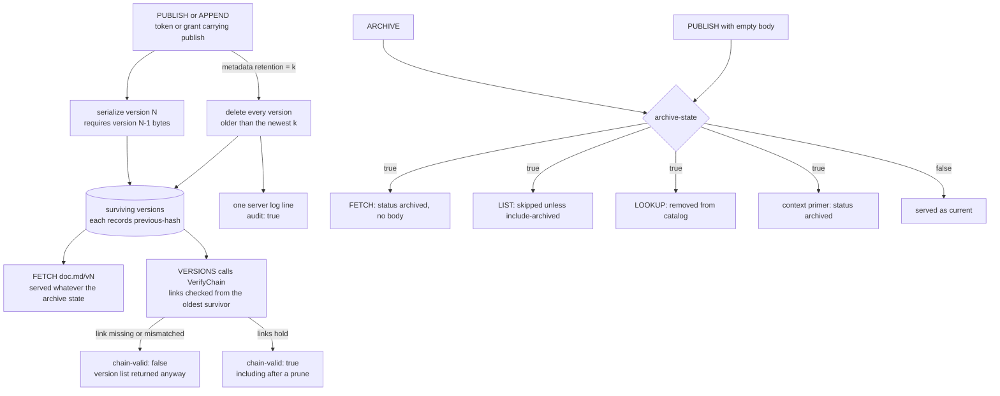

## 1. Executive Summary

Demarkus is versioned markdown served over QUIC and used as agent memory: every
content write appends a version that carries the hash of the one before it, and
the version-history response says whether that chain verified. What it buys is
capability scoping that filters every read row by row, and an archive state
that withholds a document from every current read while its history stays
fetchable. The weak point is the history's claim to completeness: a
`retention` key that any writer may put on any write deletes the oldest
versions, and the chain check starts from whatever survives, so a shortened
history verifies as intact.

The project describes itself as "memory for agents, knowledge for teams, a
second brain for you". The implementation is AGPL-3.0-only except `plugins/`,
which is MIT, with the protocol specification under CC0-1.0, stated in the
licence file rather than left to inference.

**The history is hash-chained and checked on the read.** `SerializeVersion`
refuses to write version N without version N−1's bytes — "previous version
bytes required for hash chain" — and records their SHA-256 as `previous-hash`
(`protocol/storefmt/format.go:32-40`). `VerifyChain` walks the versions on disk
oldest first and raises `ErrIntegrity` on a missing or mismatched link. The
VERSIONS handler calls it and returns `chain-valid: true`, or `false` with a
`chain-error` (`protocol/store/store.go:1632-1678`,
`server/internal/handler/handler.go:698-734`).

**Pruning is publisher metadata, and the chain check cannot see it.** A write
carrying `retention: N` deletes every version older than the newest N
(`protocol/store/store.go:1420-1422`, `:1429-1470`). The specification calls
version history append-only "with one exception" and requires the deletion to
be logged; the reference server writes one structured log line
(`server/internal/handler/handler.go:1154-1165`). `VerifyChain` compares links
from its second element on (`protocol/store/store.go:1656`), so the surviving
suffix reports `chain-valid: true`, and the conformance suite asserts exactly
that. The agent's own `mark_publish` accepts the key; the Claude Code and
Cursor plugins put a user prompt in front of it through a `PreToolUse` hook.

**Authorization is a capability the server cannot replay, applied per row.**
The server keeps `{hash, paths, operations, expires}` and never the raw token.
A read of a path some read token covers needs a matching token, and LIST and
LOOKUP filter each entry and row before paging and truncating, so a protected
document is neither shown nor counted (`server/internal/handler/handler.go:544-583`,
`:808-822`). The memory broker maps each verified identity to one world and
refuses any tool argument naming another.

**An archived document is withheld, not deleted.** ARCHIVE sets a sidecar
state that the catalog, listings, fetch and the session primer all consult, and
an empty-body PUBLISH clears it; the versions stay fetchable by number. That is
the one discrete status a document has. There is no validity window, and a
`rel-supersedes` relation is followed as a preferred edge without withholding
its target.

Three marks: `trust_state`, `scope_enforced`, `negative_eval`.

## 2. Mental Model

A **document** is markdown at a path. Each content write appends a
**version**, whose stored bytes begin with store-owned frontmatter — version
number, a legacy `archived: false`, and `previous-hash` — followed by publisher
metadata and the body. Publisher metadata is opaque except for a few keys the
server and tools read: `tags` and `importance` rank LOOKUP, `rel-<predicate>`
keys declare typed edges, and `retention` prunes.

A document is in one of two states. **Live** documents are served by FETCH,
LIST, LOOKUP and the `.context` primer. **Archived** documents answer FETCH
with `status: archived` and no body and drop out of the rest. ARCHIVE moves a
document to archived; PUBLISH with an empty body moves it back; a PUBLISH with
a body on an archived document is refused with `archived`. Neither transition
creates a version or touches stored bytes, so both leave the chain alone.

Nothing in the model distinguishes a believed version from a disbelieved one.
The newest live version is what FETCH returns. Correcting a memory means
publishing over it, and the replaced text stays in the chain until a retention
key prunes it.

A version dies only by retention. A write that declares `retention: N` removes
versions oldest first until N remain. Retention is never inherited by the next
write, so it applies only on writes that carry it.

## 3. Architecture

| Area | Role |
| --- | --- |
| `protocol/` | The Mark Protocol: requests, responses, grants, the specification's verbs |
| `protocol/storefmt/` | The stored-version format, the previous-hash link, metadata rules, `retention` |
| `protocol/store/` | The file store: versions, archive state, `VerifyChain`, pruning, the catalog walk |
| `protocol/publishpolicy/`, `protocol/contentcheck/` | Per-world publish policy, and the secrets and personal-data check |
| `server/internal/auth/` | Token loading, read authorization, the three-step authorize, the glob matcher |
| `server/internal/handler/` | Request handlers: per-row read filtering, the chain verdict, prune logging |
| `server/internal/catalog/` | The LOOKUP index and its ranking |
| `server/internal/filestore/`, `server/internal/knowledge/bucketstore/` | The file backend, and the object-bucket backend with commit log and checkpoints |
| `server/internal/fanout/` | WATCH streams, authorized per event |
| `knowledge/internal/broker/` | OAuth broker: a memory profile with one world per identity, a knowledge profile across worlds |
| `client/marktools/`, `client/mcpbind/` | The agent's MCP tools and their defaults |
| `client/token/` | Token minting, separating the raw secret from the persisted entry |
| `tools/demarkus-plugin/` | The plugin helper: provisioning, write gates, session guidance |
| `plugins/` | Agent plugins and their prompts, MIT |

### Deployment and ergonomics

The single-user path is a plugin that downloads `demarkus-server`,
`demarkus-mcp` and `demarkus-token`, spawns a local server over a directory of
markdown, and mints one token with `publish` and `archive` over `/**`
(`tools/demarkus-plugin/internal/provision/tokens/tokens.go:34`, `:95-96`).
Nothing else has to run and no model key is needed. The store is plain files:
each document's versions sit in a per-document directory as `v1`, `v2` and so
on, with an `archive-state` sidecar, readable and repairable by hand.

The team path is the knowledge server with its broker, deployed by a Helm
umbrella chart, storing worlds in a GCS bucket behind OIDC sign-on.

## 4. Essential Implementation Paths

- **Write.** `serveWrite` → `authorizeWrite`, which accepts an in-process grant
  or a token with `publish` and refuses every write without one
  (`server/internal/handler/handler.go:236-286`) → `handlePublish` → the
  backend's `WriteChecked` → `SerializeVersion`
  (`protocol/storefmt/format.go:32-40`) → version file, symlink swap, catalog
  update, then pruning if the metadata carries `retention`
  (`protocol/store/store.go:1420-1422`).
- **Prune.** `pruneVersions` removes the oldest versions through an `os.Root`
  and stops at the first failure (`protocol/store/store.go:1429-1470`). The
  bucket store applies the same rule to its log
  (`server/internal/knowledge/bucketstore/write.go:344-351`). `logPrune`
  records the range and token label (`server/internal/handler/handler.go:1154-1165`).
- **Archive.** `handleArchive` and `handleUnarchive` (`:835`, `:875`) →
  `filestore.SetArchived`, which writes the sidecar and removes or restores the
  catalog entry under one lock (`server/internal/filestore/filestore.go:158-184`).
- **Read.** `serveRead` opens one snapshot per request (`:188-217`).
  `handleFetch` authorizes and `serveDocument` answers an archived document
  with `status: archived` (`:384-438`). `readableEntries` and
  `filterReadableEntries` page LIST after authorization (`:544-583`), and
  `handleLookup` filters catalog rows before truncating (`:808-822`).
- **Integrity.** `handleVersions` → `VerifyChain` → `render.VersionsResponse`
  (`server/internal/handler/handler.go:698-734`, `protocol/store/store.go:1632-1678`,
  `protocol/render/versions.go:21-41`).
- **Authorization.** `RequiresReadAuth`, `AuthorizeReadHashed`,
  `authorizeHashed`, `matchesAnyPath` (`server/internal/auth/auth.go:140-178`,
  `:206-224`, `:241-248`).
- **Tenant gate.** `tenantWorldArgs` and `tenantGate`
  (`knowledge/internal/broker/gateway/mcp_tenant.go:24-40`, `:170-201`).
- **Session primer.** `Tools.Context` reads the hub, the newest journal entries
  and the roadmap through FETCH and LIST with the caller's read token
  (`client/marktools/context.go:30-74`).

## 5. Memory Data Model

A path, a body, publisher metadata, a version chain and an archive flag. The
store-owned keys `version`, `previous-hash` and `archived` are refused in
publisher metadata, so a writer cannot forge them
(`protocol/storefmt/meta.go:38-44`). The identity keys `agent` and `user` are
stamped by the writing surface and stripped from caller input
(`protocol/protocol.go:69-80`, `client/marktools/promote.go:384-392`).

The temporal fields are the file modification time and the version number.
LOOKUP's date filter compares `modified-after` and `modified-before` against
the modification time (`server/internal/catalog/filter.go:105-108`), and the
OKF `timestamp` key is stored opaquely.

The knowledge graph is derived from links in the markdown and from
`rel-<predicate>` keys. `rel-supersedes` is one of the relations that lookup
expansion prefers (`client/lookupexpand/lookupexpand.go:48`); it ranks the edge
and does not withhold the superseded document.

Per-world document quotas (`ErrDocumentQuota`) bound a knowledge world's size
(`server/internal/knowledge/bucketstore/write.go:61-72`).

## 6. Retrieval Mechanics

The server ranks. LOOKUP in catalog mode scores each entry by the distinct
query terms found in its tags or title, then orders by score, importance,
modification time and path (`server/internal/catalog/catalog.go:384-400`); a
body mode matches sections of the document text. The README places "lookup,
routing, graph traversal" in the agent. That holds for traversal and routing:
backlinks, the graph crawl and lookup expansion run in the client tools, over
documents the server has authorized for the caller.

Every current read honours two predicates. Read authorization runs per path for
FETCH and VERSIONS, per entry before LIST fills a page, and per row before
LOOKUP applies its limit, so an unreadable match neither appears nor displaces
a readable one. The archive state removes a document from LIST, LOOKUP and the
startup catalog walk, and FETCH returns `status: archived` without a body.

The session primer is the `.context` pseudo-document: the hub, the three newest
journal entries and the roadmap, each clipped at 4,000 bytes. It reads through
the same FETCH and LIST with the caller's token, and an archived hub ends it
with `status: archived`.

## 7. Write Mechanics

Publish under a token or grant that carries `publish` and a matching path glob.
A per-world publish policy checks required tag axes, fields and allowed values
with `warn`, `ask` or `block`; `ask` is refused on a non-interactive write
rather than held (`server/internal/writepolicy/policy.go:18-42`). The content
check always refuses a secret and blocks, warns on or ignores personal data by
policy. Each accepted write appends a version and updates the catalog.

**Retention deletes versions on the writer's say.** The key is publisher
metadata, "so any writer who may archive may set it"
(`protocol/storefmt/meta.go:33-36`). The agent's `mark_publish` passes it
through, its description warning that it "permanently deletes all but the
newest N versions" (`client/mcpfmt/tooltext.go:59`). Two producers set it
without asking: `mark_graph_publish` defaults to 20
(`client/mcpbind/mcpbind.go:35`, `:198`), and federation publishes its
checkpoint documents with 5 (`knowledge/internal/federation/federation.go:34`,
`:69`). The plugin helper's `retentionDecision` answers `ask` on a publish or
append carrying the key, which makes Claude Code or Cursor prompt the user, and
exempts the graph publish (`tools/demarkus-plugin/internal/gate/gate.go:95-123`).
The Cowork plugin runs no hooks and the broker's hosted clients run no plugin,
so on those surfaces the key reaches the server unprompted.

The deletion's record is a log line, not a stored event. `logPrune` emits the
path, the pruned range and the token label at `Info` with `audit: true`. The
change journal that feeds WATCH is a ring rewritten in place
(`server/internal/filestore/journal.go:30-33`).

### Operational cost

Writes are synchronous and model-free: no extraction, no embedding. A publish
is visible to FETCH on return; the specification allows LOOKUP and LIST on
another replica to lag by up to one second. No background pass rewrites
documents.

## 8. Agent Integration

The MCP tools are `mark_fetch`, `mark_list`, `mark_versions`, `mark_lookup`,
`mark_publish`, `mark_append`, `mark_archive`, `mark_graph`,
`mark_graph_publish`, `mark_backlinks`, `mark_explore`, `mark_discover`,
`mark_curate`, `mark_promote` and `mark_doctor`, with `mark_lookup_all` and
`mark_worlds` outside the memory broker. The agent writes and archives for
itself, and the plugins' session guidance tells it to record decisions, bug
lessons and journal entries without prompting.

The Claude Code and Cursor plugins register `PreToolUse` gates on publish and
append for tags, destination, retention and style; the Cowork plugin is
hook-free. The memory broker serves Claude Desktop, ChatGPT and Cursor over
OAuth, one world per identity.

## 9. Reliability, Safety, and Trust

**The chain report catches a rewritten predecessor and misses truncation.** A
version that has a successor and is rewritten breaks the next link, and the
conformance suite asserts the report. A prune from the old end is not reported,
because `VerifyChain` compares links from its second element on, and
`testRetention` asserts that a pruned history verifies
(`server/internal/storetest/conformance.go:532-534`). In the file store the
newest version's bytes are hashed nowhere: the committed tip-tamper case
replaces the whole file and is caught only as a missing `previous-hash`
(`:731-739`), so a body edit that keeps the frontmatter passes. The bucket store
checks each version against its commit-log record
(`server/internal/knowledge/bucketstore/read.go:320-358`). FETCH serves a body
without running the check, and VERSIONS returns the list when the verdict is
false.

**Read scope is opt-in per path.** `RequiresReadAuth` makes a path private only
when some read token's globs cover it, and a nil token store serves every read
(`server/internal/auth/auth.go:137-148`). The local plugin mints no read token,
so a local soul's per-project roots are path conventions inside one readable
store. The memory broker is the strict deployment: identity selects the world,
a cross-world argument is refused, and the tool list is deny-by-default.

**The token store holds only hashes.** `client/token/token.go:37-45` separates
`Raw` from the persisted `Entry`, and the server hashes the presented token
before lookup.

**Approval is a refusal or a prompt, never a queue.** A policy `ask` refuses
the write, and the plugin gate asks the user before the call. Nothing holds a
memory in a pending state, and `mark_curate` and `mark_promote` take a
proposal hash and an apply flag in the agent's own call.

## 10. Tests, Evals, and Benchmarks

The authorization suite covers loading, the three-step authorize, expiry,
recursive globs, the matcher, `RequiresReadAuth` and a nil store
(`server/internal/auth/auth_test.go:22-382`,
`server/internal/auth/authorize_read_test.go`).

Three committed cases assert that material stays out of a populated read, each
with a positive control beside it. `testHandleLookupReadAuthFiltering` seeds a
public and a protected document sharing a tag; without a token LOOKUP returns
one match, the protected path and title absent and the public path present, and
with the read token it returns both
(`server/internal/handler/handler_lookup_test.go:161-201`).
`testLookupArchiveLifecycle` asserts the exact set before an archive, the
survivor alone after it and under match-all, and both after unarchiving
(`server/internal/storetest/lookup.go:194-205`).
`TestMemoryGraphSourcesIsolated` asserts each tenant's backlinks name its own
source and none of the other tenant's
(`knowledge/internal/broker/gateway/mcp_tenant_test.go:343-361`).

`testRetention` asserts that pruning removes what it should, that numbering
continues past it, and that `VerifyChain` passes afterwards
(`server/internal/storetest/conformance.go:524-570`). The two tamper cases
assert a broken link and a stripped tip (`:731-755`). No test was run for this
reading.

## 11. For Your Own Build

### Steal

- **Report integrity on the read.** `chain-valid` in the response metadata
  costs one call and turns a silent corruption into a visible one.
- **Make the chain link a precondition of serialization.** A version cannot be
  written that skips its predecessor.
- **Filter authorization before the limit.** Checking each row before
  truncating keeps a protected document from displacing a readable one or
  revealing itself in a count.
- **Keep withheld state beside immutable versions.** An archive sidecar
  withholds a document from every current read without rewriting a byte the
  chain covers.
- **Refuse an unclassified tool by default.** The tenant gate's map must name
  every tool's world-bearing arguments, and a tool absent from it is refused
  before anything is provisioned.

### Avoid

- **A hash chain anchored at neither end.** If a prune or a head edit passes
  verification, the verdict describes what survived, not what was written.
  Record the first retained version and its predecessor's hash as store-owned
  state, and hash the head somewhere the head's writer cannot reach.
- **Destruction as an ordinary metadata key.** Putting deletion in the same map
  as tags hands it to every writer, and a guard in one harness's hook does not
  travel to the others.

### Fit

Reach for this if you want a self-hosted document store an operator can read
with `cat`, scoped by capability, with a tamper report a client can check. It
assumes the agent writes freely and a person curates by reading markdown. Look
elsewhere if the history must be complete by construction, or if the store must
know which of two versions is true.

## 12. Open Questions

- Should `VerifyChain` treat a history that does not start at version 1 as a
  finding unless the store recorded the prune that produced it?
- Should retention need a capability of its own, rather than running under any
  writer's publish?
- In the knowledge profile every readable world is visible to `mark_lookup_all`;
  is a person's view of a team's worlds meant to be bounded by anything but
  world policy?

## Appendix: File Index

| Path | What to read it for |
| --- | --- |
| `protocol/storefmt/format.go:32-40` | Serialization and the previous-hash requirement |
| `protocol/storefmt/meta.go:33-65` | The `retention` key, reserved keys, `ParseRetention` |
| `protocol/store/store.go:48-92` | The archive-state sidecar |
| `protocol/store/store.go:1420-1470` | Retention and `pruneVersions` |
| `protocol/store/store.go:1632-1678` | `VerifyChain` and where its comparison starts |
| `server/internal/handler/handler.go:348-372` | Read authorization on the canonical path |
| `server/internal/handler/handler.go:544-583`, `:808-822` | Per-entry and per-row filtering before paging and truncation |
| `server/internal/handler/handler.go:698-734` | The chain verdict on VERSIONS |
| `server/internal/handler/handler.go:1154-1165` | The prune log line |
| `server/internal/auth/auth.go:137-248` | Read-auth probe, authorize, glob matcher |
| `server/internal/filestore/filestore.go:158-184` | Archive state and catalog under one lock |
| `server/internal/catalog/catalog.go:384-400` | LOOKUP ordering |
| `knowledge/internal/broker/gateway/mcp_tenant.go:24-218` | The tenant gate |
| `client/marktools/context.go:30-74` | The session primer |
| `client/mcpbind/mcpbind.go:35`, `client/mcpfmt/tooltext.go:59` | The graph retention default, and the publish tool's metadata description |
| `tools/demarkus-plugin/internal/gate/gate.go:95-123` | The plugin's retention prompt |
| `server/internal/handler/handler_lookup_test.go:161-302` | Read-auth and archive cases on LOOKUP |
| `server/internal/storetest/lookup.go:194-205` | Archive lifecycle, exact sets |
| `server/internal/storetest/conformance.go:524-570` | Retention, and `VerifyChain` passing after a prune |
| `docs/SPEC.md` §9.1, §9.9 | The append-only rule and its retention exception |
| `LICENSE` | The AGPL / MIT / CC0 split |

### Recorded searches

Run at the tree root of the pinned checkout with `git grep`.

- `git grep -n 'VerifyChain(' -- '*.go' ':!*_test.go'` — the store, the two
  backends' views, the backend interface and one handler call at
  `server/internal/handler/handler.go:719`; FETCH does not call it.
- `git grep -n -E 'meta\["retention"\]|ArtifactMetadata\(' -- '*.go' ':!*_test.go'` —
  the CLI's confirmation, `client/generation/generation.go:36`,
  `client/marktools/graph.go:167` and the federation call at
  `knowledge/internal/federation/federation.go:69`.
- `git grep -n 'logPrune' -- '*.go' ':!*_test.go'` — the definition and its two
  callers in `handler.go`; no stored record of a prune.
- `git grep -n -i -E 'approv|quarantin' -- '*.go' ':!*_test.go'` — the policy
  `ask` comment and `ErrPolicyApprovalRequired`, which refuse a write, and one
  nudge regex; no pending state.
- `git grep -n -i -E 'tombstone|denylist|reject(ed)?_?(value|hash)' -- '*.go' ':!*_test.go'` —
  tenant deprovisioning in the broker and a comment in `handler.go`; nothing
  keyed on a rejected value.
- `git grep -n -i -E 'valid_?(from|to|until)|effective_?(from|at)|valid_?time' -- '*.go' ':!*_test.go'` —
  only `invalid_token` and `ErrInvalidToken`; no validity window.
- `git grep -n -E '"supersedes"' -- '*.go' ':!*_test.go'` — a comment in
  `client/graph/crawl.go` and `PreferredRelations` in
  `client/lookupexpand/lookupexpand.go:48`; no read withholds a superseded
  target.
- `git grep -n -E 'status[[:space:]]*(=|:)[[:space:]]*"(verified|rejected|candidate|disputed|superseded)"' -- '*.go' ':!*_test.go'` —
  no match.
- `git grep -n -i -E 'arxiv|bibtex|@article|@misc|doi\.org' -- README.md docs` —
  no match; no paper.
- `git grep -n -i -E 'anthropic|machine learning|not (be )?used (for|to)' -- LICENSE LICENSE-PROTOCOL plugins/LICENSE` —
  no match; no rider.

## History

**2026-10-15** — [`f57b348e94c23b8b4dad14830bf3598a05253ad2`](https://github.com/latebit-io/demarkus/commit/f57b348e94c23b8b4dad14830bf3598a05253ad2) — 119 commits on, dated 15 October 2026. `audit_log` withdrawn: a `retention` key any writer may set deletes the oldest versions and the chain check passes over it ([section 7](#7-write-mechanics), [section 9](#9-reliability-safety-and-trust)). `trust_state` and `negative_eval` added: the archive state filters every current read, and committed LOOKUP cases assert protected and archived documents stay out ([section 10](#10-tests-evals-and-benchmarks)). All three were equally true at the previous pin, as was the server ranking LOOKUP ([section 6](#6-retrieval-mechanics)). Overtaken: the broker moved into the knowledge server, WATCH arrived, and the migration tests and `demarkus-agent` were removed. Screened from a full clone: twenty-five files, one auto-run surface, one build-time execution point, four unpinned surfaces, thirteen inside the cooldown, `CLAUDE.md` read as data. Nothing was installed, built or run.

**2026-09-16** — [`dd22c38ad6f2738e5bccf32b31dbd9fc78bb7956`](https://github.com/latebit-io/demarkus/commit/dd22c38ad6f2738e5bccf32b31dbd9fc78bb7956) — first reading, at a commit dated 15 September 2026. Screened before opening, from a shallow clone: twenty-three files, one auto-run surface (a `.claude-plugin/` directory), one build-time execution point, four unpinned surfaces, sixteen dependency files inside the cooldown, and `CLAUDE.md` read as data. Nothing was installed, built or run.
