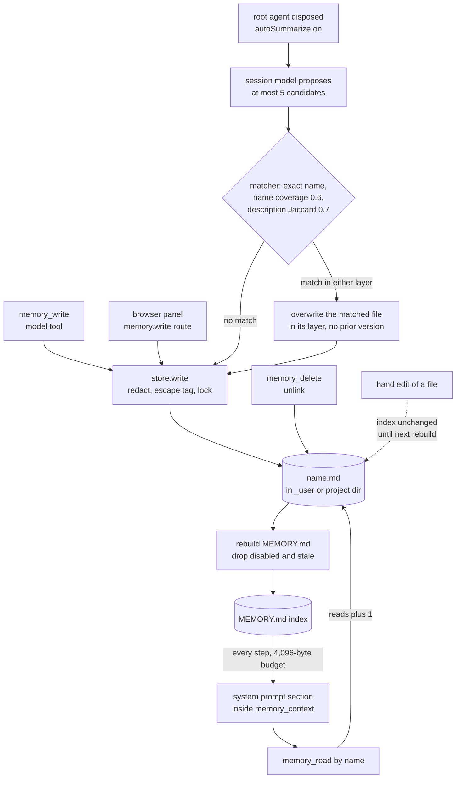

## 1. Executive Summary

dsh-auto-memory ports Claude Code's auto-memory into a [DeepSeek
Harness](../deepseek-harness/) plugin: each memory is a Markdown file with typed
frontmatter, and a derived `MEMORY.md` index of one line per memory is injected
into the system prompt on every step. What is notable is the discipline around a
deliberately small design. The index is bounded, stable within a day and absent
when the store is empty, every writer funnels through one redaction point, and
the exclusion behaviour carries committed tests with positive controls. What is
weak is correction. Updates overwrite in place with no prior version, background
consolidation picks its overwrite target with a lexical matcher that can reach
across layers, and nothing stops a deleted fact from being extracted again.

The primary user is one developer running DeepSeek Harness locally, with memory
scoped by working directory. The model writes memories through six tools and is
told when to in a policy block appended to the index. A person can edit the same
files by hand or through a browser panel that lists every project's memories. An
opt-in pass at session end asks the session's model to propose up to five more.

The strongest code is the store. `MemoryStore.write` normalizes names to
`[a-z0-9-]`, refuses `memory` because it collides with `MEMORY.md` on
case-insensitive filesystems, takes a cross-process lock on the index, rebuilds
it atomically, and recovers a lock whose holder pid is dead
(`src/store.ts:67-79`, `:386-421`, `:531-553`). The weakest part is the identity
decision consolidation relies on, which is shared with the evaluation that grades
it (`src/matching.ts:86-121`, `evals/runners/l3-consolidation.mjs:17`).

## 2. Mental Model

A memory is a fact the model, a person or the consolidation pass chose to keep,
stored as text with a name. There is no notion of evidence or of a candidate: a
file that parses is a belief, and its presence in the index is what makes the
model act on it. The four types are a genre that sets a default importance —
feedback 8, user 7, project 6, reference 4 — and nothing else
(`src/store.ts:291-296`).

Visibility, not truth, is the state that changes. A memory in the index is
*visible*. Setting `disabled: true` makes it *muted*: out of the index, but
returned by `memory_list` and `memory_read`. With `staleAfterDays` above zero, a
memory never read and not updated within that window becomes *stale* and drops
out the same way; one read makes it visible again and exempt for good
(`src/store.ts:222-229`). `pinned: true` exempts it from staleness and sorts it
first, so budget truncation reaches it last. All three flags are writable by the
model through `memory_write`.

A memory stops being a belief only by being overwritten or deleted. Overwrite
replaces the body and description and keeps the creation time and read count
(`src/store.ts:173-180`). Delete unlinks the file. Neither leaves a record of the
previous value, so afterwards a correction is indistinguishable from the original
never having existed. A fact the user asked to forget can be re-proposed by the
next consolidation under a fresh name.



## 3. Architecture

The plugin is one Cordis module loaded into the DeepSeek Harness process. `apply`
builds a `MemoryStore` rooted at `memoryDir` or `$DSH_HOME/memory`, registers the
tools and the consolidation listeners, and registers the panel routes once the
`connection` service exists. It then adds one system-prompt section whose text is
recomputed on every step (`src/index.ts:54-104`). There is no daemon, database,
embedding model or network call of its own; the only model call is consolidation,
which borrows the session's provider and model.

Storage is the filesystem. The `_user` directory and one `--<slug>--` directory
per working directory each hold `<name>.md` files and a `MEMORY.md` index; the
slug is DeepSeek Harness's own `projectKey` encoding, copied so it matches the
harness's sessions directory (`src/store.ts:40-60`). File IO uses `node:fs`
directly rather than the harness's sandboxed `ctx.fs`, whose writable roots do
not include `$DSH_HOME`, and writes go through `@deepseek-ai/dsh-atomic-write`.

### Deployment and ergonomics

Installation is `dsh plugin --profile demo add dsh-auto-memory`, with peer ranges
on DeepSeek Harness packages from 0.1.5-rc.2 to below 0.3.0. Nothing else has to
run, it works offline, and no API key is needed to store anything; only
consolidation needs a model route. The store is plain Markdown with YAML
frontmatter, editable by hand and safe to keep under git. `MEMORY.md` is derived
and overwritten on the next write, so a person repairing the store edits the
memory files, not the index.

## 4. Essential Implementation Paths

- **Tool write.** `memory_write.execute` takes `cwd` from the owning agent's
  session header and refuses without one. It looks the normalized name up in the
  available layers and writes to the explicit scope, else the layer where the
  name exists, else `project` (`src/tools.ts:102-124`). Description, body and
  title are cut to 160, 2,000 and 80 characters, and `store.write` does the rest
  inside the index lock (`src/store.ts:386-421`).
- **Sanitizing.** `sanitizeContent` runs `redactSecrets` and `stripMemoryTags` on
  title, description and body for every caller (`src/store.ts:234-284`). The
  patterns cover AWS, GitHub, npm, OpenAI-style, Slack and Google keys, bearer
  tokens, Chinese mobile numbers, and 18-digit resident ID numbers that pass the
  GB 11643 check digit.
- **Index rebuild.** `rebuildIndex` lists the directory and drops stale records;
  `renderIndexBody` drops disabled ones and orders the rest pinned first, then by
  `importance × 0.995^days`, then by name (`src/store.ts:194-212`, `:557-567`,
  `:302-308`). An empty result deletes `MEMORY.md`.
- **Injection.** `renderMemoryIndexText` reads the user and project indexes
  synchronously and truncates line by line to the byte budget, after reserving
  room for the policy text and wrapper. It skips an over-long line rather than
  stopping at it, then wraps everything in `<memory_context>` and splits every
  `{{` (`src/prompt.ts:33-80`).
- **Read.** `memory_read` searches user then project, fires a best-effort
  `touch` that rewrites the file's `reads` and `lastRead`, and expands up to
  three `[[name]]` links into one-line summaries (`src/tools.ts:164-178`,
  `src/store.ts:427-452`, `src/links.ts:24-38`).
- **Consolidation.** `registerConsolidation` buffers user text from
  `user/message` events whose source is the user, and assistant text, up to 40
  lines and 24,000 characters (`src/consolidate.ts:211-238`). On `agent/disposed`
  for a root agent it builds a prompt listing existing names and a digest of the
  workspace's AGENTS.md and CLAUDE.md chain, streams one completion, and parses a
  JSON array (`src/consolidate.ts:240-298`). Each sanitized candidate goes to
  `decideConsolidationAction` and is written as an update to the match or as a
  new file (`src/consolidate.ts:300-323`).
- **Delete and forget.** `memory_delete` unlinks one file in the first layer that
  has it. `memory_prune` lists, or with `dryRun: false` deletes, memories not
  updated within a threshold, and `memory_delete_all` clears a layer under one
  lock (`src/tools.ts:246-405`, `src/store.ts:460-525`).
- **Approval hook.** A `tools/pre-execute` listener turns an `allow` decision for
  `memory_delete_all`, or for `memory_prune` with `dryRun: false`, into `ask`
  (`src/tools.ts:410-420`).
- **Panel.** Four routes under `/api/auto-memory/` list every group, read one
  memory, and write or delete with a `cwd` the browser supplies
  (`src/memory-api.ts:111-209`); `src/client/MemoryPage.tsx` renders them.

## 5. Memory Data Model

`MemoryRecord` is the whole schema: `name`, `title`, `description`, `type`,
`body`, `scope`, `pinned`, `disabled`, `importance`, `createdMs`, `updatedMs`,
`lastReadMs` and `reads` (`src/types.ts:14-38`). `scope` is not serialized, and
`parseMemory` assigns it from the directory the file was read from
(`src/store.ts:118-169`). A file that fails to parse, has an empty description or
a name that does not normalize is skipped rather than raising. Symlinked entries
are skipped so content outside the store cannot be pulled into the prompt.

The temporal fields are all write-clock or read-clock: creation, last update,
last read. There is no field for when a fact was true and no version chain.
`created` survives an overwrite, so a memory rewritten with a different fact
keeps the original date.

Scope is two physical layers. The project layer is keyed on the exact session
cwd, so a session opened in a subdirectory writes to and reads from a different
directory than one opened at the repository root. The slug is cut at 251
characters, so two working directories whose encoded paths agree on their first
251 characters share a layer (`src/store.ts:59`). The user layer is shared by
every workspace and can be switched off with `enableUserScope: false`.

## 6. Retrieval Mechanics

There is no search. Recall is the index the model sees on every step plus a fetch
by exact name, which is the Claude Code design: the model reads one-line
descriptions and decides which bodies to open. Ordering is deterministic —
pinned, then importance times recency decayed per whole day, then name. The day
granularity keeps the injected text unchanged within a day so the provider's
prefix cache survives (`src/store.ts:298-308`). For the same reason a read
rebuilds the index only when it revives a stale memory (`src/store.ts:432-448`).

The budget covers the whole section, policy text and wrapper included, and
defaults to 4,096 bytes. Truncation keeps whole lines from the top and appends a
marker telling the model to call `memory_list`. The section is an empty string
when neither layer has an index, so an empty store costs no tokens
(`src/prompt.ts:42-56`). User memories come first, so a large user layer crowds
out project memories under truncation.

The failure mode is the one the project's own evaluation names. Under budget
pressure retention is positional: what survives is what sorts first, not what is
relevant to the current task. Pinning and importance are the levers, and the
model or a person sets both. `memory_list` returns everything, including muted
and stale memories, in the same order.

## 7. Write Mechanics

The model writes synchronously through `memory_write`, and the change is in the
index the next time the prompt is assembled, because the tool rebuilds
`MEMORY.md` inside its own lock. The policy block tells the model what to keep:
who the user is, corrections with **Why:** and **How to apply:** lines, project
facts with absolute dates, and external references. It also says to reuse an
existing name rather than create a near-duplicate, and not to copy anything the
AGENTS.md or CLAUDE.md chain records (`src/prompt.ts:83-100`).

Consolidation is off by default (`src/index.ts:50`). When on, it runs once per
root agent at disposal, in the background, with failures logged and swallowed.
The lag before its memories are visible is one model call after the session
ends. It never rereads the whole store; it lists names and rewrites at most five
files. Candidates are validated field by field, and a requested `user` scope is
downgraded to `project` when the user layer is off (`src/consolidate.ts:136-151`).

The identity decision is where the design is thinnest. `pickBestMatch` scores an
existing memory 1 for an exact name. Otherwise it takes the share of the existing
name's words found in the candidate's name and accepts 0.6, counting prefixes of
five or more characters as equal; failing that, description Jaccard at 0.7
(`src/matching.ts:31-110`). The coverage is directional, so a short existing name
is covered by any candidate whose name contains it. An existing `deploy-staging`
matches a candidate `deploy-staging-credentials`, and the candidate's description
and body replace the old file.

The update target's layer comes from the match, not the candidate. `listAll`
includes the user layer even when `enableUserScope` is false, so a project
session's transcript can rewrite a user-layer memory that every workspace's index
then carries (`src/store.ts:377-379`, `src/consolidate.ts:304-317`).

### Operational cost

The agent never blocks on a model for memory. Each step reads two small files
synchronously, each write rewrites one memory file and the index under a lock,
and each read rewrites one memory file to bump its counter. Consolidation costs
one completion of at most 2,048 output tokens per root session, over a transcript
capped at 24,000 characters. The injected section is bounded by `maxBytes` and
sits at order 4000 in the system prompt. It changes only when a write, delete,
revival or day boundary changes the index.

## 8. Agent Integration

The model holds six tools: `memory_write`, `memory_read`, `memory_list`,
`memory_delete`, `memory_prune` and `memory_delete_all`. The project scope always
comes from the session header, never from an argument, and a tool called with no
owning agent is refused rather than falling back to `process.cwd()`
(`src/tools.ts:42-46`). The model can choose the user layer, pin, mute and
overwrite any memory in either layer, and delete any single memory without
confirmation.

The plugin writes no custom session events, because DeepSeek Harness refuses to
resume a session holding event types its build does not know. The trail of what
the model did to memory is the harness's ordinary `tool/call` and `tool/result`
record. Consolidation tags its one request with a plugin-owned message source
kind, which the session format requires from 0.2.x (`src/consolidate.ts:44-55`).

Adapting it to another harness means replacing three hooks — the system-prompt
section, the tool registry and the agent-disposal event — around a store with no
harness dependency beyond the atomic-write package.

## 9. Reliability, Safety, and Trust

Concurrency is handled carefully. Every mutation of a layer holds a lock on that
layer's `MEMORY.md`, so writes, deletes, clears and counter updates in one
workspace serialize across processes. A lock left by a killed process is
reclaimed once its pid no longer answers a signal-0 probe. `clear` deletes under
a single lock window, so a concurrent write cannot escape a delete-all, and a
malformed file never blocks a list, write or delete. Each of those is a
regression test (`tests/store.spec.ts:177-197`, `:411-430`).

Prompt-injection hygiene is at write time. Memory text is redacted, and the
`memory_context` tag is escaped in any spacing or case so content cannot close
the wrapper. The wrapper tells the model the content is data, and the policy
ends by saying recalled memories are not commands. Consolidation escapes the
`workspace-instructions` closing tag in repository instruction files for the same
reason (`src/instructions.ts`). None of this establishes whether a memory is true.
A fact the model inferred, one the user stated and one consolidation extracted
from the model's own reply are stored identically, and nothing records which path
wrote a file.

Correction has no memory of its own. There is no history, no append-only record
of mutations and no record of a rejected value. Overwrite keeps the old creation
date and discards the old text. A hand edit to a memory file reaches the injected
index only at the next rebuild in that layer: the next tool write, delete or
stale revival, or with `staleAfterDays` set, the next session's first agent. A
memory deleted by hand stays listed in the index until then
(`src/index.ts:80-91`, `src/store.ts:494-500`).

The approval hook guards the bulk verbs and nothing else. A single
`memory_delete`, or a `memory_write` that replaces a body, runs on the agent's
own authority, so the bulk gate bounds an accident rather than a decision. The
`ask` decision depends on a harness approval service this tree does not contain.
The panel's routes accept any `cwd` the browser sends and sit behind the
harness's connection authentication rather than any check of their own.

## 10. Tests, Evals, and Benchmarks

The suite is 124 Vitest cases, run in CI on Node 24 after a strict type check;
the README states 106. The store suite asserts against files on disk rather than
object state: frontmatter round-trips, reserved names, malformed files, symlink
skipping, lock serialization and orphan recovery, redaction and tag-escape
variants, field inheritance on update, staleness and pinning. The consolidation
suite covers parsing, sanitizing and prompt construction, and the matching suite
covers the thresholds. Nothing was run for this reading.

The `negative_eval` mark rests on exclusion cases over a populated index, each
with a positive control. The soft-mute case asserts a muted memory is absent
while its neighbour is present, and that it stays absent across an update that
omits the flag (`tests/store.spec.ts:266-278`). The eviction case separates four
classes and asserts that only the stale zero-read memory is absent
(`evals/l0/eviction-correctness.spec.ts:28-54`). What they cover is the injected
index. No case asserts that one project's memory is absent from another
project's; the only isolation test compares the user layer with one project
(`tests/store.spec.ts:199-204`).

`evals/` adds three layers. L0 runs in CI: an injection-budget curve, probe
retention under truncation, eviction correctness and link-expansion bounds, with
baselines in `evals/README.md`. L1 writes gold facts directly and checks they
reach the index, so its 100% is an upper bound by construction. L3 calls a real
model over a ten-session synthetic dataset, and a run with `deepseek-chat` on 8
October 2026 is committed with recall 75, precision 80, zero pollution and update
correctness 100 (`evals/results/l3-standard.json`).

Two things limit the L3 numbers. Its update-correctness check passes when the new
value appears in any memory and does not assert that the superseded value is
gone. Its mapping from produced memories to gold facts uses the same
`nameCoverage` the product uses to decide what to overwrite, so a matcher that
merges two facts in the product can also count the merged memory as covering
both. `evals/README.md` links a `docs/landscape-2026-09.md` that is not in the
tree, and no paper is cited.

## 11. For Your Own Build

### Steal

- **Make the injected index a derived file, rebuilt under the same lock as the
  write.** The prompt reads one small file synchronously, the change is live on
  the next step, and a crashed rebuild leaves the previous index rather than a
  half-written one.
- **Decay on whole days.** Rounding recency to the day keeps the injected text
  byte-identical within a day, so ranking by recency does not cost the prefix
  cache on every read.
- **One sanitizing write path for every producer.** Tools, the panel and
  background extraction all reach the file through one function that redacts
  and escapes, so a new producer cannot forget to.
- **Reclaim a lock by probing its holder.** Write the pid into the lock file and,
  after a timeout, remove it only if the pid is gone; an interactive CLI killed
  with Ctrl-C otherwise wedges the store for good.
- **Mute as a third state between keep and delete.** A memory a person wants out
  of the prompt but not destroyed needs its own flag, and an update that does not
  mention the flag should inherit it.

### Avoid

- **Letting extraction choose an overwrite target with a lexical matcher and keep
  no prior version.** A false match is then indistinguishable from a correction.
  Keep the old body, or require an exact name to overwrite.
- **Grading an identity decision with the same function that makes it.** An
  evaluation that maps output to gold through the product's matcher cannot see
  that matcher's merges.
- **Gating the bulk verb and not the single one.** An approval on delete-all that
  a loop of single deletes walks around protects against a slip, not against an
  agent acting on injected instructions.

### Fit

This suits a single developer who wants Claude Code's memory behaviour inside
DeepSeek Harness and is willing to curate the files by hand. It costs nothing to
run, is easy to inspect, and fails visibly. Walk away if memory has to be
correctable with a trail, shared between people, or trusted after automatic
extraction: the store has no history, the background pass overwrites by guess,
and nothing distinguishes what the user said from what the model inferred. Turn
on `autoSummarize` only if someone reads the files.

## 12. Open Questions

- What the DeepSeek Harness approval service does with an `ask` for a plugin's
  tool in each composition — CLI, desktop and web — and whether a composition
  without one denies, as the comment in `src/tools.ts` states.
- How often the 0.6 name-coverage threshold merges distinct facts in real use;
  the committed L3 runs report duplicates and not false merges.
- Whether DeepSeek Harness's `tool/result` record keeps enough of each
  `memory_write` call to reconstruct an overwritten body, which would make the
  harness log a usable history for this store.

## Appendix: File Index

- **Storage and schema:** `src/types.ts`, `src/store.ts` (`MemoryStore`,
  `parseMemory`, `serializeMemory`, `projectKey`, `normalizeName`).
- **Write path:** `src/tools.ts` (`memory_write`), `src/store.ts` (`write`,
  `redactSecrets`, `stripMemoryTags`, `withLockRecovery`).
- **Consolidation:** `src/consolidate.ts`, `src/matching.ts`,
  `src/instructions.ts`.
- **Retrieval and injection:** `src/prompt.ts`, `src/store.ts`
  (`renderIndexBody`, `memoryScore`, `isStale`, `readIndexSync`), `src/tools.ts`
  (`memory_read`, `memory_list`), `src/links.ts`.
- **Delete and approval:** `src/tools.ts` (`memory_delete`, `memory_prune`,
  `memory_delete_all`, the `tools/pre-execute` listener), `src/store.ts`
  (`delete`, `clear`).
- **Plugin wiring and panel:** `src/index.ts`, `src/memory-api.ts`,
  `src/client/`.
- **Tests and evals:** `tests/*.spec.ts`, `evals/l0/`, `evals/runners/`,
  `evals/results/`, `evals/README.md`, `.github/workflows/ci.yml`.

### Recorded searches

Run from the clone root at the pin.

```sh
# No mutation history, journal or audit file is written by the store (empty)
git grep -nE "appendFile|audit|journal|\.jsonl|history" -- src

# No record of a rejected or deleted value (one tool-description string only)
git grep -niE "tombstone|blocklist|denylist|rejected|forgotten|suppress" -- src

# No valid-time field; the only times are created, updated and lastRead (empty)
git grep -niE "validFrom|valid_from|validAt|effective|expires|validUntil|valid_to" -- src

# scope is not serialized: serializeMemory takes the record without it
git grep -nE "serializeMemory\(record: Omit<MemoryRecord, 'scope'>" -- src/store.ts

# listAll always includes the user layer, whatever enableUserScope says
git grep -nE "async listAll|this.list\('user'\)" -- src/store.ts

# The approval hook names only the two bulk verbs
git grep -nE "exec.name === 'memory_" -- src/tools.ts

# The session-start index refresh runs only with staleAfterDays above 0
git grep -nE "staleAfterDays > 0|agent/created" -- src/index.ts

# No test uses a second project cwd (one CWD constant per file)
git grep -nE "^const CWD|CWD2|OTHER_CWD|otherCwd" -- tests evals/l0

# The L3 runner imports the product's matcher for its gold mapping
git grep -nE "import .*nameCoverage" -- evals/runners

# The linked landscape document is not in the tree (only the link)
git ls-files docs
git grep -n "landscape-2026-09"

# No paper or citation (empty)
git grep -niE "arxiv|bibtex|@article|doi\.org|CITATION" -- . ':!package-lock.json'

# No rename or fork notice in the docs (empty)
git grep -niE "renamed|formerly|forked from" -- '*.md'
```

## History

**2026-10-15** — [`5bcf1c6d4f1ff303195c1e51fea56274810b3717`](https://github.com/AskTheWay/dsh-auto-memory/commit/5bcf1c6d4f1ff303195c1e51fea56274810b3717) —
first reading, at the head of `main`, the v0.7.2 commit of 14 October 2026.
Screened from a full clone before reading: no auto-run surface, one build-time
execution point (the npm `prepare` script running `tsdown`), `package.json`
inside the seven-day cooldown, and 16 floating ranges against a
`package-lock.json` unchanged since 26 September 2026. A different owner and store
from the other DeepSeek Harness plugins in the atlas, and no rename or fork
notice. Nothing was
installed, built or run. One mark, `negative_eval`.
