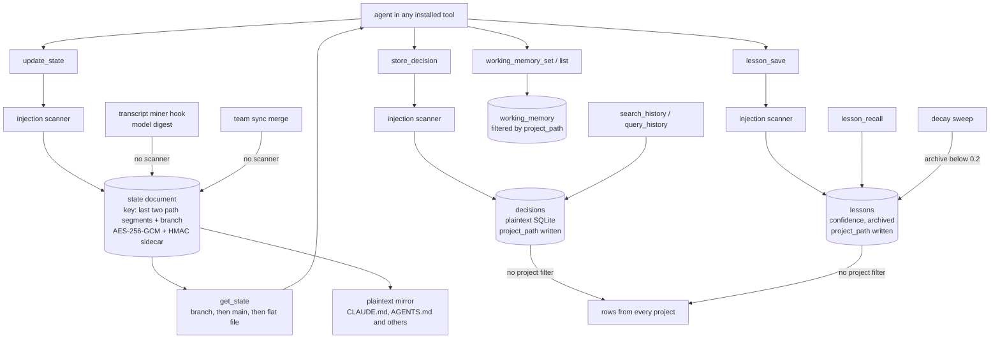

## 1. Executive Summary

EGC (Extended Global Context) is a local runtime for AI coding tools. `egc
install` registers a memory server and a command guard in every coding tool it
detects, writes a memory protocol into their instruction files, and installs
hooks. The memory server keeps project state as an encrypted Markdown document
per git branch, and keeps decisions and lessons as plaintext SQLite rows that
every project's searches return.

Four faculties ship together:

- **Memory** — the `egc-memory` MCP server and a set of lifecycle hooks
- **Guardian** — a command and write guard
- **Token Crusher** — an output filter
- **Session Mesh** — a bus that lets open sessions see and message each other

The repository also ships an optional library of skills, agents and commands.

The README promises that memory "lives in `~/.egc`, encrypted with AES-256-GCM,
kept per project and branch". **State documents** meet that at rest: a
project's context, decisions, things not to repeat, preferences and next steps
are encrypted per branch, with an HMAC sidecar and a read that falls back to
`main`. Three things qualify "per project". A document's key is the last two
segments of the project path, so `~/a/acme/api` and `~/b/acme/api` share one.
Every `update_state` mirrors part of the document in plaintext into the
project's instruction files. And the transcript miner and team sync write into
it without the injection scanner the MCP tools apply.

**Decisions and lessons** live in one plaintext SQLite database for the whole
machine. Each row records the project it was written from, through migrations
whose comments say "for per-project scoping", and no read applies it.
`query_history`, `search_history` and `lesson_recall` return rows from every
project.

One mark, `negative_eval`: committed cases assert that another project's
working memory, an expired entry and an overwritten decision stay out of the
results ([section 10](#10-tests-evals-and-benchmarks)).

## 2. Mental Model

An agent sees one memory server with three kinds of memory:

- **Project state** — the document `get_state` returns at session start and
  `update_state` merges into at the end, per branch. A user-wide global
  document is appended to every project's read.
- **History** — decisions stored one at a time and searched with BM25, and
  lessons with a confidence that rises when reinforced and decays when unused.
- **Working memory** — short-lived keys per project with a TTL, 24 hours by
  default and seven days at most.

Hooks write into the state document without the agent asking. At session end
and before compaction a model mines the transcript into decisions, things to
avoid, preferences and next steps. A prompt classified as "remember" is
appended verbatim to the active decisions. Nothing in the state document has a
status: an entry is in the document or it is not, and only a merge or a
consolidation removes one.

Lessons have one lifecycle field. `archived` is set by the decay sweep when
confidence falls below 0.2, cleared by reinforcement, and every recall
excludes it. It is derived from the confidence float rather than set by a
judgement, so it is a retention rule and not a trust state.

## 3. Architecture

| Component | Location |
| --- | --- |
| Memory server | `mcp/servers/egc-memory/src/index.ts` (tools, migrations, handlers), `search.ts` (FTS5), `branch-state.ts`, `encryption.ts`, `integrity.ts`, `sanitize.ts`, `working-memory.ts`, `propagate.ts`, `compress.ts`, `patterns.ts`, `session-bus.ts`, `mesh-transport.ts`, `write-queue.ts`, `sync/` |
| Memory hooks | `scripts/hooks/egc-memory-load.js`, `egc-memory-save.js`, `session-memory-miner.js`, `prompt-intuition.js`, `session-start.js`, `session-end.js`, registered in `hooks/hooks.json` |
| Hook-side state access | `scripts/lib/state-snapshot.js`, `branch-state.js`, `state-crypto.js`, `session-context-loader.js`, `state-consolidate.js` |
| Guardian | `mcp/servers/egc-guardian/`, with the prompt-injection scanner the memory sanitizer mirrors and the transcript miner in `intuition.ts` |
| CLI and installer | `scripts/egc.js`, per-tool hook writers in `scripts/lib/` |
| CLI state store | `scripts/lib/state-store/` at `~/.egc/egc/state.db`, holding telemetry and lesson and decision queries with no production caller |
| Dashboard | `dashboard/`, a local server for replay and cost summaries |

### Deployment and ergonomics

- **Install:** `npm install -g @egchq/egc && egc install`; the installer writes
  MCP configuration, hooks and instruction files into each detected tool.
- **Storage:** everything under `~/.egc`, with an encryption key and an
  integrity key at mode 0600.
- **Two databases.** The memory server opens `~/.egc/memory/state.db` and the
  CLI opens `~/.egc/egc/state.db`; a comment calls this a known divergence
  (`index.ts:392-396`) and `doctor` checks both locations.
- **Side effects in user repositories.** Before mirroring state into a
  project, the server writes a git clean filter into that repository's
  `.git/config` and `.git/info/attributes`. It withholds the mirror when the
  filter cannot be armed (`propagate.ts:47-71`, `scripts/lib/memory-filters.js`).
- **Model calls:** none in the memory server. The transcript miner calls a
  provider only when a key is set, and skips otherwise.
- **Hand-repairable:** the SQLite store yes; the state documents through the
  server, `egc export` (read-only) or `egc consolidate`, since they are
  encrypted.

The screen of this checkout found eight auto-run surfaces: Cursor rules,
`.githooks/`, Copilot instructions, `.mcp.json`, `.opencode/`, `hooks/` and its
manifest, and `.codex/config.toml`, whose MCP servers start through `npx`. It
also found three build-time execution points, among them a `preinstall` Node
version check, six unpinned surfaces, and three dependency files inside the
seven-day cooldown. It read `AGENTS.md`, `CLAUDE.md` and `GEMINI.md` as data.
The hook commands resolve an EGC install directory and run the project's own
scripts. Nothing was installed, built or run.

## 4. Essential Implementation Paths

- **Database** — `getDb` (`index.ts:404-431`): one file under `~/.egc/memory`,
  WAL, migrations under a PID-checked lock (`runMigrations`, `:251`).
- **State read** — `handleGetState` (`index.ts:1325-1358`): detect the branch
  or detached commit, resolve the branch file, then `main`, then the flat file
  (`branch-state.ts:245-298`), decrypt, verify the HMAC and warn on mismatch,
  append the scrubbed global document (`readGlobalAppendix`, `:1360-1381`).
- **State write** — `handleUpdateState` (`index.ts:1404-1478`): scan every
  free-text field, merge under `withStateMergeLock` (`:239-249`), encrypt,
  write the sidecar, re-scrub the merged document and mirror it
  (`propagateStateToTools`, `propagate.ts:453-474`).
- **Hook writes** — `applyMinedMemory` (`scripts/lib/state-snapshot.js:234-257`)
  appends a mined digest (`session-memory-miner.js:35-40`,
  `egc-guardian/src/intuition.ts:116-133`); `handleRemember`
  (`prompt-intuition.js:76-102`) appends the user's prompt.
- **Decisions** — `handleStoreDecision` (`index.ts:1902-1917`): scan, insert
  with `resolveProjectPath()`. `handleQueryHistory` (`:1919-1923`) runs
  `SELECT * FROM decisions ORDER BY timestamp DESC`; `search_history` runs
  `searchDecisions` (`search.ts:169-195`) or `searchDecisionsBySubstring`
  (`index.ts:179-191`).
- **Lessons** — `handleLessonSave` (`index.ts:1140-1172`) with
  `checkLessonText` (`:1179-1190`); `handleLessonRecall` (`:1205-1243`, through
  `searchLessons`, `search.ts:130-167`) with `presentLesson` (`:1195-1203`);
  `handleLessonReinforce` (`:1246-1263`); `runLessonDecaySweep` (`:712-726`).
- **Working memory** — `working-memory.ts:98` and `:111`, both filtered by
  `project_path`; the path comes from `resolveProjectPath(args.project_path)`.
- **Session start** — `egc-memory-load.js:39` and `session-start.js:509-537`.

## 5. Memory Data Model

**State documents** are Markdown with a header naming the project, encrypted
as a five-byte `EGC1:` magic, a random IV, the GCM tag and the ciphertext, and
paired with an HMAC-SHA256 sidecar. The path is
`~/.egc/state/<slug>/<branch key>.md`, or `detached--<commit>.md` for a
detached HEAD. `update_state` accepts `scope: global` for a machine-wide
document that every project's read appends.

**The slug is lossy.** `projectSlug` joins the last two path segments and
replaces anything outside `[a-zA-Z0-9-_]` with `_` (`branch-state.ts:17-20`).
Branch names get a hash suffix because "sanitization alone is not injective"
(`:26-27`); project paths get none. Two checkouts at `~/work/acme/api` and
`~/old/acme/api`, or `my.app` and `my_app` under one parent, read and write one
document. The test file pins the two-segment form and has no collision case.

**Decisions** (`index.ts:264`, `:332`): `id`, `context`, `decision`,
`timestamp`, `project_path`. Nothing in production updates or deletes them.

**Lessons** (`index.ts:291-301`, `:325`, `:354`): `id`, `content`, `context`,
`confidence` (0.7 by default), `last_reinforced`, `last_recalled`,
`created_at`, `tags`, `archived`, `project_path`, `author`. Reinforcing adds
0.15 and unarchives. The sweep removes 0.05 per week after 30 days without
recall and archives below 0.2 (`:651-654`, `:686-697`). Migration 9's comment
says it adds `author` to "lessons and decisions"; it alters `lessons` only
(`:351-354`).

**The producer test on `project_path`.** Both history tables gained the column
in migrations 6 and 7 (`index.ts:322-333`). `store_decision` and `lesson_save`
write it from the server's working directory (`:1910`, `:1162`). Across the
server, the column is read only by the working-memory and session-bus queries.
No decision or lesson read has a `WHERE project_path`, so `scope_enforced` is
withheld.

The memory server has no validity axis, no rejection record and no mutation
log, so `bitemporal`, `tombstone` and `audit_log` are withheld. The `AUDIT`
level of its rotating operational log has no caller, and the Guardian's
`~/.egc/audit.log` records denied commands, not memory writes.

## 6. Retrieval Mechanics

**Session start** has two readers of the same file. The MCP `get_state`
decrypts it. The `egc-memory-load` hook, registered at `SessionStart`, reads it
with `fs.readFileSync(path, 'utf8')` (`egc-memory-load.js:39`) and places the
result in `promptForAssistant`. It decrypts the global appendix through
`state-crypto` and the project document not at all, so the field carries the
`EGC1:` header and ciphertext bytes. Its tests use plaintext fixtures
(`tests/lib/branch-state.test.js:62-65`), a shape no production writer
produces. `session-context-loader.js` reads the same file correctly, and says
why: "encrypted content stays silent instead of leaking ciphertext".

**Prior-session summaries** are injected at session start by `session-start.js`.
`selectMatchingSession` prefers a summary whose `Worktree` matches the working
directory, then one whose `Project` name matches. Failing both it returns the
most recent summary from any project (`session-start.js:215-243`). That
summary is wrapped as "HISTORICAL REFERENCE ONLY" and injected.

**Intent hooks** inject sections of the decrypted state document on a resume
or history prompt, clipped to 1,600 characters, without the scrub the mirror
applies (`prompt-intuition.js:105-116`).

**Decision search** sanitises the query into an FTS5 match, ranks by BM25 and
normalises scores to [0, 1] against the best hit (`search.ts:169-195`). Without
FTS5 it matches every term by `LIKE` and scores each hit 1. `query_history`
pages through all decisions by time.

**Lesson recall** matches FTS5 over content, context and tags, keeps rows with
`archived = 0` and confidence above the minimum, stamps `last_recalled`, and
hands back any field that reads as an instruction as the blocked marker. The
substring fallback does the same over the top rows by confidence.

**Every project, every time.** None of these three reads is given the project.
An agent asking what was decided about authentication receives decisions from
every repository on the machine, in BM25 order. The search result carries no
field naming the project, since `searchDecisions` selects id, content, context,
date and score. `query_history` returns the column and does not filter on it.
Lessons are the same. The README's "what one agent learns, every agent knows"
holds across tools, and also across projects, which the migrations were
written to prevent.

## 7. Write Mechanics

**Sanitisation on the MCP tools.** `sanitize.ts` scans free text for
prompt-override and command-injection patterns, mirroring the Guardian
scanner. It applies to every free-text field of `update_state`, to
`store_decision`, to `working_memory_set`, and to `lesson_save`. Lessons are
checked field by field and with the fields read together, so a directive split
across fields is caught (`index.ts:1179-1190`). The same check runs on every
lesson read, so a row written by any other path comes back as data.

**Unscanned writes to the state document.** `applyMinedMemory` appends the
miner's decisions, things to avoid, preferences and next steps through the
hook library's own encrypt-and-write path (`state-snapshot.js:150-172`,
`:234-257`). Neither it nor `mineTranscript` calls a scanner. Team sync merges
a teammate's document after verifying its envelope and writes it without a
scan or an HMAC sidecar (`sync/TeamSync.ts:278-296`). `get_state` returns the
project document as stored. The mirror into instruction files is scrubbed
again before writing (`index.ts:1463-1474`); the agent's own read is not.

**Dedup.** A lesson identical in content and context to a live one reinforces
it instead of inserting. The miner skips a line the document holds verbatim.

**Arbitration.** SQLite writes go through one in-process queue; state merges in
the server and in the hooks take the same `.merge.lock` file, so a hook's
read-modify-write cannot drop a server merge.

**Observations and patterns.** Hooks record runtime events.
`compress_observations` turns raw observations into typed summaries by rule.
When they come from the CLI state database it stamps `compressed_at` and keeps
the event. When they come from `observations.jsonl` it overwrites the raw line
with the summary (`compress.ts:337-343`). `detect_patterns` counts repeated
commands and error signatures.

**Consolidation.** `egc consolidate`, and the session context loader on a
plaintext legacy file, layer dated entries by age after writing a backup
(`scripts/lib/state-consolidate.js`). The active queue and the context section
are never layered.

## 8. Agent Integration

- **24 memory tools:** project state, decisions, the session bus (announce,
  claim and release paths, peers, send, events, wait), working memory,
  lessons, patterns, compression, server health, and team init, sync and
  status.
- **Instruction files** in each tool carry a memory protocol that routes
  "remember this decision" to `update_state` and describes `store_decision` as
  searchable history that `get_state` does not return (`rules/common/memory.md:38-42`).
- **Mirrors.** Every `update_state` writes a block headed by a generated-data
  notice into up to twelve context files, each only where the file or its
  tool's directory exists: `CLAUDE.md`, `AGENTS.md`, `GEMINI.md`, Cursor and
  Windsurf rules, `llms.txt` and others (`propagate.ts:453-474`).
- **Session bus** calls act as the server process's own session inside the
  project it joined, and refuse another session id or project. Memory calls
  are not bound that way: `get_state`, `update_state` and the working-memory
  tools accept any `project_path` outside hidden home directories and system
  roots (`index.ts:540-578`).
- **Team sync** pushes and pulls through a git remote with a shared team key,
  merging only files that open as team envelopes for their path, and never
  deleting a local document.

## 9. Reliability, Safety, and Trust

**The encrypted path is careful.** Keys are read per call, so a changed home
cannot pair one key with another directory's file (`index.ts:438-453`). An
undecryptable file aborts a write rather than being overwritten; `force`
renames it to a timestamped backup; HMAC mismatches warn without blocking;
a link anywhere on a mirror or sync path is refused.

**Encryption at rest covers the files under `~/.egc/state`, not the memory.**
The same context, up to five decisions and up to five next steps are written
in plaintext into the project's existing context files on every update. The clean filter
keeps them out of commits, not off disk. Decisions and lessons sit unencrypted
in one database every project reads.

**Isolation between projects** holds for working memory, partitions state
documents by a lossy key, and is missing for history and for the session-start
summary's fallback. On a machine with client and personal work in separate
repositories, recall mixes them.

**Injection.** The scanner guards the MCP tools and the mirrors. A model-mined
digest of a transcript that quoted a hostile page reaches the state document
unscanned and returns through `get_state` verbatim.

**Human review.** The dashboard shows counts of decisions, lessons and
patterns, replays and costs, and has no route that edits or removes memory.
The CLI's commands over state documents are a read-only export and the
consolidation, and none lists or edits decision or lesson rows. No memory
waits in a state for a person, so `human_review` is withheld.

## 10. Tests, Evals, and Benchmarks

396 `.test.js` files under `tests/` cover the installer across tools,
encryption and integrity, branch resolution, the session bus under chaos with
one server process per session, mesh transport, team sync, hooks, lesson
sanitisation over a running server, and the Guardian. The coverage workflow
builds the memory server before the run. None was run for this reading.

**Negative cases on read paths**, each with a positive control in the same
populated store:

- `tests/lib/working-memory.test.js:158-174` writes `shared_key` under
  `/proj/a` and `/proj/b` and asserts each `listWorkingMemory` returns exactly
  its own value.
- `:136-156` asserts an expired row "that must not appear" is absent beside two
  live rows.
- `tests/scripts/egc-memory-search.test.js:156-171` asserts `searchDecisions`
  returns nothing for a value overwritten in place and one row for its
  replacement, then nothing after the delete.
- `tests/lib/branch-state.test.js:411-449` asserts the load hook's prompt
  contains the branch or detached-commit document and not the flat one, on
  plaintext fixtures.

These earn `negative_eval` for working memory and decision search.

**What is not asserted.** No test puts decisions or lessons from two projects
in one store. `tests/lib/lessons-decay.test.js:160` asserts that `listLessons`
excludes an archived lesson; `listLessons` belongs to the CLI state store,
which has no production writer, and the file's header claims it covers
`lesson_save`, `lesson_recall` and `lesson_reinforce`, none of which it calls.
The MCP `lesson_recall` path has no archived-exclusion case. Nothing tests the
session-start fallback to another project's summary, or a slug collision.

No memory retrieval benchmark is committed. `benchmarks/egc/tasks.json` scores
the Guardian's file ranking against expected source paths.

## 11. For Your Own Build

### Steal

- **Branch-aware project state** with a default-branch fallback and a
  per-commit file for a detached HEAD, so a new branch inherits context and a
  CI checkout cannot overwrite a shared file.
- **Encryption with explicit failure modes:** abort on undecryptable,
  quarantine only when asked, warn on HMAC mismatch.
- **Scan on read as well as on write.** `presentLesson` hands back any stored
  field that reads as an instruction as a marker, so rows written before the
  scanner, or by another path, arrive as data.

### Avoid

- **A scope column written and never read.** Add the predicate in the same
  change as the migration, with a test from a second project.
- **A partition key derived from a display name.** Hash the full path, as the
  same file does for branch names.
- **A sanitizer applied per handler** instead of at the write layer. Here the
  MCP tools are covered and the hook-side miner and the sync merge write the
  same document without it.
- **Two readers of one encrypted file that decode it separately.** Route every
  reader through one function, and build test fixtures with the production
  writer.

### Fit

EGC suits a developer who works in several AI coding tools at once and wants
them to share project state and coordinate edits, and who values the guard and
output filter as much as memory. For decisions and lessons that must stay
within their project, for memory that must stay off disk in plaintext, or for
checkouts that share a parent and directory name, the history tables need a
predicate, the mirror needs to be optional, and the slug needs a hash first.

## 12. Open Questions

- **Should `search_history`, `query_history` and `lesson_recall` filter on
  `project_path` by default,** with an explicit cross-project option?
- **Does any harness render `promptForAssistant`?** The load and save hooks set
  it; nothing in the tree consumes it, so whether the ciphertext reaches a
  model depends on the host.
- **Should the session-start summary fall back across projects at all,** or
  stop at a worktree or project-name match?
- **Will the SQLite store move under the same encryption** as the state
  documents, and will the two state databases be merged?

## Appendix: File Index

| Path | What to read it for |
| --- | --- |
| `mcp/servers/egc-memory/src/index.ts:251-360` | Migrations, including the unread `project_path` columns |
| `mcp/servers/egc-memory/src/index.ts:1140-1263` | Lesson save, check, present, recall and reinforce |
| `mcp/servers/egc-memory/src/index.ts:1325-1478` | `get_state`, global appendix, `update_state` and the mirror |
| `mcp/servers/egc-memory/src/index.ts:1902-1923` | Decision insert and the unfiltered history read |
| `mcp/servers/egc-memory/src/search.ts:130-195` | FTS5 recall for lessons and decisions |
| `mcp/servers/egc-memory/src/branch-state.ts:17-20`, `:245-298` | The two-segment slug and the read fallback |
| `mcp/servers/egc-memory/src/propagate.ts:47-71`, `:453-474` | Commit-privacy gate and the plaintext mirror |
| `mcp/servers/egc-memory/src/working-memory.ts:90-114` | The one project-filtered memory read |
| `mcp/servers/egc-memory/src/sync/TeamSync.ts:278-296` | Merge without scan or sidecar |
| `scripts/lib/state-snapshot.js:150-257` | Hook-side encrypt, write and the mined-memory append |
| `scripts/hooks/egc-memory-load.js:39` | The raw UTF-8 read of an encrypted file |
| `scripts/hooks/session-start.js:215-243`, `:509-537` | Prior-session selection and its cross-project fallback |
| `tests/lib/working-memory.test.js:136-174` | The project-scope and expiry negative cases |
| `tests/scripts/egc-memory-search.test.js:156-171` | The overwritten-decision negative case |

### Recorded searches

Run with `git grep` at the tree root of the pinned checkout, and again at
`f24f53c2ca1ce2bb1f5120f20dff2b98780f90ee` where a result is compared.

- `git grep -n 'project_path' -- mcp/servers/egc-memory/src` — written for decisions (`index.ts:1912`) and lessons (`:1165`); read only in `working-memory.ts` and `session-bus.ts`. Same shape at f24f53c.
- `git grep -n -E 'FROM[[:space:]]+(decisions|lessons)([^_a-z]|$)|JOIN[[:space:]]+(decisions|lessons)[[:space:]]' -- ':!*.md' ':!tests'` — memory server reads, none with `project_path`; the CLI store's queries; two counts in `scripts/lib/operations/index.js`.
- `git grep -n -E '(DELETE FROM|UPDATE)[[:space:]]+(decisions|lessons)' -- ':!*.md'` — lesson updates at `index.ts:722`, `:1237`, `:1256` and in the CLI store; decisions only in `tests/scripts/egc-memory-search.test.js`.
- `git grep -n -i 'saniti' -- mcp/servers/egc-memory/src ':!mcp/servers/egc-memory/src/sanitize.ts'` — `update_state` `:1409`, lessons `:1180-1183`, bus `:1530-1662`, `store_decision` `:1904`, `working_memory_set` `:1936`; nothing under `sync/`. At f24f53c no lesson call.
- `git grep -n -E 'saniti|scanForInjection|scrub' -- scripts/lib/state-snapshot.js scripts/hooks/session-memory-miner.js scripts/hooks/prompt-intuition.js mcp/servers/egc-guardian/src/intuition.ts mcp/servers/egc-memory/src/sync` — no match.
- `git grep -n 'writeHmac' -- mcp/servers/egc-memory/src/sync` — no match.
- `git grep -n -E 'INSERT INTO (decisions|lessons)' -- tests` and `git grep -l -E "'(store_decision|lesson_save)'" -- tests` — every case writes from one project directory; none writes from two and reads from one.
- `git grep -n -i -E 'fetch\(|openai|anthropic|completeJson|chat/completions' -- mcp/servers/egc-memory/src` — no match; no model call in the memory server.
- `git grep -n -E '\.insertDecision\(|\.upsertLesson\(|\.applyDecaySweep\(|\.reinforceLesson\(' -- ':!tests' ':!*.md'` — no match; the CLI store's history writers have no production caller.
- `git grep -n 'listLessons' -- ':!*.md'` — the store's definition and export, and tests.
- `git grep -n -E 'lesson_recall|searchLessons' -- tests` — a docs test, the decay test's header comment, and the sanitisation test; no archived-exclusion case on the MCP path.
- `git grep -n -E 'recency-fallback|selectMatchingSession' -- tests` — no match.
- `git grep -n 'projectSlug' -- tests` — cases pin the two-segment form; no collision case.
- `git grep -n 'promptForAssistant' -- ':!tests' ':!*.md'` — producers in the hooks and the Cursor hook copies; no consumer.
- `git grep -n -i -E 'tombstone|blocklist|denylist|suppress(ed|ion)|rejected_values?|forget' -- mcp/servers/egc-memory/src scripts/lib/state-snapshot.js` — one sanitizer pattern and the git index helper `forgetIndexStat`.
- `git grep -n -i -E 'valid_(from|to|until|at)|effective_(from|at)|validFrom|validUntil|as_of|asOf' -- mcp/servers/egc-memory/src scripts/lib/state-store scripts/lib/state-snapshot.js` — no match.
- `git grep -n "log('AUDIT'" -- mcp/servers/egc-memory/src` — no match.
- `git grep -n -E "status[[:space:]]+TEXT|'(verified|pending|approved|rejected|disputed|candidate|superseded|quarantined)'" -- mcp/servers/egc-memory/src` — no match.
- `git grep -n -E 'DELETE|UPDATE' -- dashboard/ops.js dashboard/server.js` — no match.
- `git ls-tree -r --name-only HEAD -- benchmarks` — `benchmarks/egc/tasks.json` only, file-ranking tasks.
- `git grep -n -i -E 'arxiv|bibtex|@article|@misc|doi\.org' -- README.md` — no match; no paper.
- `git grep -n -i -E 'anthropic|machine learning|not (be )?used (for|to)' -- LICENSE NOTICE` — no match; no rider.

## History

**2026-10-15** — [`a46dd1b2019be1c3b6a034c748b5405c03984220`](https://github.com/Fmarzochi/EGC/commit/a46dd1b2019be1c3b6a034c748b5405c03984220) — 347 commits on, the tip of `main`; the default branch is a Crowdin branch one translation commit ahead. Overtaken: `lesson_save` and `lesson_recall` gained the injection scanner, mirrors are withheld without the clean filter, the README lists twenty-nine tools. `negative_eval` gained, earned at the first pin on test files byte-identical at both ([section 10](#10-tests-evals-and-benchmarks)). Also wrong then: compression keeps raw observations only on the database path ([section 7](#7-write-mechanics)). Not described then, present at both pins: the lossy project slug, the unscanned miner and sync writes, the load hook's raw read, the cross-project summary fallback. Screened from a full clone: eight auto-run surfaces, three build-time execution points, six unpinned surfaces, three dependency files inside the cooldown. Nothing was installed, built or run.

**2026-09-15** — [`f24f53c2ca1ce2bb1f5120f20dff2b98780f90ee`](https://github.com/Fmarzochi/EGC/commit/f24f53c2ca1ce2bb1f5120f20dff2b98780f90ee) — first reading, at a commit dated 14 September 2026. Screened before opening: seven auto-run surfaces, three build-time execution points, six unpinned surfaces, sixteen dependency files inside the cooldown, and three agent-instruction files read as data. Nothing was installed, built or run.
