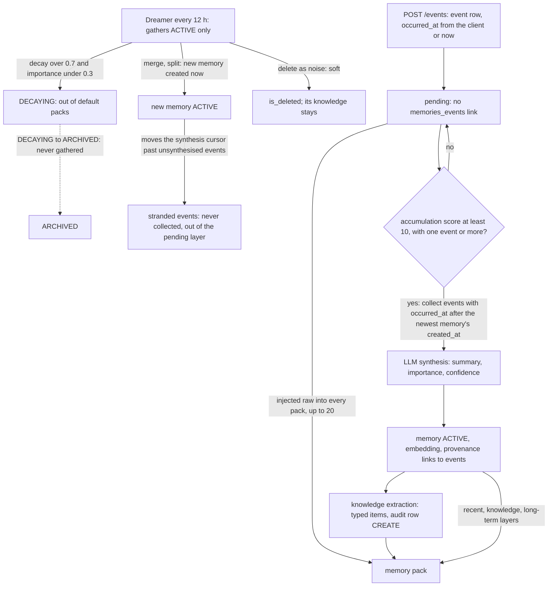

## 1. Executive Summary

Elephantasm is a hosted memory service for agents, published as an
Apache-2.0 open-core server. An agent posts events; a threshold-gated LLM
pass turns a batch of them into one memory with provenance links; a second
pass extracts typed knowledge from each memory; and a curator called the
Dreamer merges, splits, rewrites and retires memories every 12 hours. What is
notable is the curation journal: every Dreamer and Meditator mutation stores
before and after snapshots and the model's reasoning. What is weak is the
tree itself, which imports modules it does not ship, and a synthesis cursor
that any other memory write moves forward.

A pack compiler assembles identity, recent memories, unsynthesised events,
knowledge and long-term memories into a markdown block for the system prompt.
The repository is an export. Its first commit is titled *"Sync from private
monorepo"*, and `app/api/deps.py` replaces the subscription checks with
pass-through stubs labelled *"OSS version"*. The stubbing stops there. Three
findings shape the rest of this report.

- **The server does not import from this tree.** `main.py:20` imports
  `get_billing_scheduler` from `app/services/scheduler`, whose package init
  loads `billing_scheduler.py`, which imports `app.config.overages`,
  `app.domain.usage_operations` and six other modules absent from the tree
  (`app/domain/billing_job_operations.py:16-24`). Event ingestion would fail
  separately: `EventOperations.create` calls `_track_event_usage`, which
  imports `app.domain.usage_operations` on every event
  (`app/domain/event_operations.py:80-89`).
- **A memory written by anything but synthesis strands pending events.**
  Synthesis collects events whose client-supplied `occurred_at` is later than
  the newest memory's `created_at` (`event_collection.py:37-38`,
  `event_operations.py:270`). A Dreamer merge or split, or a `POST /memories`,
  creates a memory stamped now. Events that arrived before it and were not yet
  synthesised are never collected, and they leave the pack's pending layer by
  the same cursor (`memory_retrieval.py:241-261`).
- **The lifecycle has one reachable transition.** The Dreamer gathers only
  `ACTIVE` memories (`app/services/dreamer/gather.py:101`), so the
  `DECAYING → ARCHIVED` branch in Light Sleep (`light_sleep.py:188-191`) never
  sees a candidate. Packs read `ACTIVE` by default, so `DECAYING` is the
  effective end of retrieval.

Two marks: `scope_enforced` and `audit_log`. The scope predicate is applied
by every read the context assembler makes, beneath Postgres row-level
security. `negative_eval` is withheld. The one must-not-retrieve case cannot
run from this checkout, for the import reason above, and it puts both animas
under one user, so it tests the anima predicate rather than the RLS it names.

## 2. Mental Model

A memory here is an interpretation, not a record. Events are the record:
messages and tool calls posted by the agent, kept verbatim and soft-deleted
only. A memory is an LLM's one-to-two-sentence summary of a batch of events,
with an importance and a confidence the same LLM assigns
(`app/workflows/memory_synthesis/prompts/synthesis.py`). Knowledge is a third
layer: atomic statements extracted from one memory, each typed as `FACT`,
`CONCEPT`, `METHOD`, `PRINCIPLE` or `EXPERIENCE` with its own confidence.
Identity is a fourth, a personality type and communication style that only the
`/identities` routes write.

A thing becomes a memory when the accumulation score crosses a threshold.
The score is hours since the last synthesis or memory, plus half a point per
new event, plus 0.0003 per token, against a default of 10. No event means no
synthesis, however much time passes. Until then the raw events are injected
into every pack as *"Recent Activity (Pending Synthesis)"*.

A memory stops being believed in four ways, and none of them is a
contradiction. Light Sleep moves an `ACTIVE` memory to `DECAYING` when its
decay score passes 0.7 and its importance is below 0.3, which at the 30-day
half-life is about 52 days after creation. Deep Sleep may merge it into a new
memory, split it into several, rewrite its summary or soft-delete it as noise.
A person may PATCH or DELETE it through the API. Nothing compares a new
memory with an old one for conflict, and knowledge extracted from a memory
outlives the memory.

The state field is an attention lifecycle, not an epistemic one. `ACTIVE`,
`DECAYING` and `ARCHIVED` say how much a memory should be recalled, and the
decay that drives them reads creation time only: `access_count=0` carries a
`TODO: add access tracking` at both call sites (`light_sleep.py:137`,
`memory_pack_compiler.py:443`).

## 3. Architecture

A single FastAPI process (`main.py`) serves 97 route handlers across 15
routers and runs APScheduler jobs in the same process when
`ENABLE_BACKGROUND_JOBS` is on. All state is in PostgreSQL with pgvector.
LangGraph-style workflows under `app/workflows/` run memory synthesis and
knowledge synthesis as plain function pipelines; migration `3905e5ae481a`
dropped the LangGraph checkpoint schema. Embeddings come from OpenAI
`text-embedding-3-small` at 1,536 dimensions. Synthesis uses Anthropic Haiku
4.5 by default. The Dreamer uses `gpt-4o-mini` for pairwise merges, Sonnet 4.6
for cluster consolidation and Opus 4.6 for review
(`app/services/dreamer/config.py:67-85`).

Tenancy is enforced in the database. Every route but health takes
`get_db_with_rls`, which sets `app.current_user` with `SET LOCAL` per
transaction (`app/core/database.py:248-284`). The `animas_org_access` policy
admits an anima whose organisation the caller belongs to, and every child
table's policy cascades through `animas`. Scheduled jobs run on a separate
engine under a `BYPASSRLS` role when `CRON_DATABASE_URL` is set. They resolve
an anima's owner through a `SECURITY DEFINER` function before opening an RLS
session for writes (`app/core/rls_dependencies.py:36-87`).

A middleware restricts the public SDK host, `api.elephantasm.com`, to
ingest, anima, latest-pack, semantic-search, identity and query paths
(`app/middleware/host_restriction.py:18-32`). It applies by `Host` header,
so a self-hosted deployment on any other name exposes every route to any API
key. `/api/query` is on that allowlist and its router is not registered in
`app/api/router.py`.

### Deployment and ergonomics

Running this needs Postgres with pgvector, an Anthropic key and an OpenAI key.
A memory is stored without an embedding when the embedding call fails, and
nothing is synthesised without the LLM. Authentication is a Supabase JWKS for
the dashboard or a bcrypt-hashed `sk_live_` key for SDKs. The README's
`docker compose up -d` names a compose file the tree does not contain; the
`Dockerfile` and `fly.toml` target Fly.io. The import failure in section 1
means the documented `python main.py` path needs the missing modules written
or stubbed first. The store is relational and inspectable with `psql`, and
every curation step is readable as rows with before and after JSON.

## 4. Essential Implementation Paths

**Capture.** `POST /api/events` (`app/api/routes/events.py:27-68`) calls
`EventOperations.create`, which validates the anima, defaults `occurred_at` to
now, derives a `dedupe_key` from `source_uri` when given, and inserts. It then
queues `check_and_enqueue_if_needed` as a FastAPI background task.

**Synthesis.** `run_memory_synthesis`
(`app/workflows/memory_synthesis/pipeline.py`) runs five nodes:
`calculate_accumulation_score` (`app/domain/synthesis_metrics.py:20-110`),
`check_synthesis_threshold` (`nodes/threshold_gate.py`),
`collect_pending_events` (`nodes/event_collection.py:37-38`),
`synthesize_memory`, and `persist_memory` (`nodes/memory_persistence.py`). The
last creates the memory, one `memories_events` row per collected event, and an
embedding, in one RLS transaction. The scheduler then fires
`trigger_auto_knowledge_synthesis`
(`app/services/scheduler/workflows/memory_synthesis_scheduler.py:116`).

**Knowledge extraction.** The knowledge pipeline prompts with the memory's
summary and content and persists each item with an audit row of action
`CREATE` and `source_id` set to the memory
(`app/workflows/knowledge_synthesis/nodes/knowledge_persistence.py:180-218`).
Re-running it for the same memory soft-deletes the earlier items first
(`:125-150`). After each run `trigger_auto_meditation_check` increments a
per-anima counter and starts the Meditator at its threshold
(`app/services/hooks/auto_meditation.py`).

**Context assembly.** `MemoryPackCompiler.compile`
(`app/services/memory_pack_compiler.py:192-280`) embeds the query once, then
reads identity (`:286`), session memories created in the last 24 hours
(`:317`), temporal context when that is empty (`:237`), pending events
(`:488`), knowledge by pgvector cosine (`:365`) and long-term candidates
(`:410`). It trims each layer to a fixed share of the token budget and renders
markdown in `to_prompt_context`.

**Curation.** `DreamerScheduler` runs every 12 hours per anima under an
advisory lock. `gather_dream_context` loads all `ACTIVE` memories, identity and
knowledge (`app/services/dreamer/gather.py:57-138`). `run_light_sleep` updates
decay, transitions state, builds similarity clusters with a pgvector
self-join and union-find, and flags review candidates
(`light_sleep.py:48-109`). `run_deep_sleep` merges pairs, consolidates larger
clusters and reviews flagged memories (`deep_sleep.py:81-232`). Every mutation
goes through `DreamerOperations` (`app/domain/dreamer_operations.py:312-660`).

**Correction.** `PATCH /api/memories/{id}` applies a partial update with no
audit row and no re-embedding (`app/api/routes/memories.py:203-212`,
`app/domain/memory_operations.py:117-138`). Knowledge PATCH, DELETE and restore
each write an audit row (`app/api/routes/knowledge.py:167-272`).

**Tests.** `tests/workflows/memory_synthesis/` covers threshold, collection and
persistence under RLS; `tests/services/test_cluster_consolidation.py` covers
the consolidation prompts and parser; `tests/integration/` drives the routes
through a `TestClient`.

## 5. Memory Data Model

`memories` (`app/models/database/memories.py`) holds `anima_id`, `content`,
`summary`, `importance`, `confidence`, `state`, cached `recency_score` and
`decay_score`, `time_start` and `time_end` from the source events'
`occurred_at`, `meta` JSONB, `is_deleted`, a 1,536-dimension `embedding`, and
UMAP map coordinates for a dashboard view. `events` holds the event type,
role, author, content, `occurred_at`, `session_id`, `source_uri`,
`dedupe_key` and `importance_score`. `memories_events` links the two with a
`link_strength` that synthesis always sets to 1.0.

`knowledge` (`app/models/database/knowledge.py`) has `knowledge_type`, an
LLM-chosen `topic`, `content`, `summary`, `confidence`, `source_type`
(`INTERNAL` or `EXTERNAL`), `is_deleted` and an embedding. It has no column
naming its source memory. That link lives only in the `CREATE` audit row's
`source_id`, which is how the replace strategy finds prior items.

Provenance after curation is in JSON. A merge writes `meta.merged_from` with
the source ids and soft-deletes the sources, and a split writes
`meta.split_from` (`dreamer_operations.py:386-395`, `:467-478`). The new
memory gets no `memories_events` rows, so `GET /memories/{id}/events` returns
nothing for it, and the trail runs through the soft-deleted originals.

Time is one axis with a label. `time_start` and `time_end` are the span of
source event times and label long-term lines in the pack. Nothing records
when a memory stopped being true, and nothing queries by either field except
ordering. `bitemporal` is withheld on that reading: event time defaulting to
the write clock, with no validity interval on knowledge and no as-of read.

Scope is `anima_id` on every table, plus `user_id` and `organization_id` on
`animas`. The models for `organizations`, `subscriptions` and usage are
absent from `app/models/database/`, while the migrations that create those
tables are present (`b2c3d4e5f6a7_add_pricing_infrastructure_phase_1.py`).

## 6. Retrieval Mechanics

The pack is deterministic given the store, the query and the clock. The
conversational preset asks for 5 session memories, 3 knowledge items and 3
long-term memories within 2,000 tokens. The self-determined preset asks Haiku
to choose types, limits, weights and a similarity threshold, clamped to
ranges, before compiling (`app/services/pack_presets.py:66-165`).

**Session memories** are `ACTIVE` memories created in the window, scored by
recency with a one-day half-life. Because recency reads `created_at`, a
memory the Dreamer merged or split this morning sits in "Current Session"
however old its events are.

**Long-term memories** are not a vector search. `get_with_embeddings` selects
the newest `3 × max_long_term_memories` embedded `ACTIVE` rows older than the
window, ordered by `created_at DESC` and capped at 200
(`memory_retrieval.py:165-212`). The compiler then computes cosine similarity
in Python, drops rows below the threshold, and scores the rest as a weighted
sum of importance, confidence, recency, inverted decay and similarity
(`memory_pack_compiler.py:389-473`). With the conversational preset, only the
9 newest older memories are considered at all.

**Decay at read time reads `updated_at` as last access**
(`memory_pack_compiler.py:436`). Light Sleep writes `decay_score` through the
ORM on most dreams, and `TimestampMixin` refreshes `updated_at` on every
update, so the read-time decay measures time since the curator last touched
the row.

**Knowledge** uses pgvector cosine in SQL with the anima, deletion, embedding
and threshold predicates (`app/domain/knowledge_retrieval.py:27-85`).
`RetrievalConfig.min_confidence` is declared and validated
(`app/models/dto/retrieval.py:78-83`) and no compiler call passes it.

**Budget.** Identity is charged a flat 150 tokens; the remainder splits 20%
session, 15% pending, 30% knowledge and 35% long-term, estimated at four
characters per token (`memory_pack_compiler.py:496-528`). The README states
25%, 35% and 40% across three layers.

**The no-query read is a cache.** `GET /animas/{id}/memory-packs/latest`
compiles fresh only when a `query` is given; without one it returns the newest
stored pack, with no comparison against later writes
(`app/api/routes/memory_packs.py:66-90`). A memory deleted after that pack was
stored is served until something compiles a new one. The README's integration
example calls `inject(anima_id=...)` with no query.

## 7. Write Mechanics

Synthesis is background and threshold-gated; the agent never blocks on an LLM
to write. The synthesis prompt formats each event as its summary or, failing
that, the first 200 characters of its content (`prompts/synthesis.py:44`), so
long tool results reach the synthesiser truncated. The LLM returns one memory
per batch, however many events the batch holds.

**The cursor is composed differently on each side.** Any memory insert moves
it; the reader compares it with event source time. `get_last_memory_time`
returns the newest memory's `created_at` (`memory_operations.py:268-293`),
and `get_since` keeps events with `occurred_at > since`
(`event_operations.py:248-285`). Three things break it: a Dreamer merge or
split, a manual `POST /memories`, and an event posted with an `occurred_at`
older than the newest memory. Each leaves events with no `memories_events`
link that synthesis will not collect. The pending layer filters
`Event.created_at >= baseline` against the same memory time
(`memory_retrieval.py:241-261`), so in the first two cases those events also
leave the pack. The Dreamer runs every 12 hours for every anima, so on an
active agent a dream routinely lands while events are pending.

**Knowledge is never deduplicated across memories.** Two memories that state
the same fact produce two rows; only the Meditator, at its counter threshold,
may merge them. Deleting a memory touches no knowledge:
`app/domain/memory_operations.py` and `app/domain/dreamer_operations.py` never
reference the knowledge table.

**Conflicts are not modelled.** No path compares a new memory or knowledge
item with an existing one for disagreement. The Meditator's prompt lists
*"contradictions"* as grounds for deletion
(`app/services/meditator/prompts.py:241`), which leaves it to the model.

### Operational cost

Ingest is one insert plus a background score check. A new memory is
retrievable after the threshold: at default weights, 20 events, or 10 hours
with at least one event, then one synthesis call and one embedding. Until
then the raw events are in the pack.

The Dreamer re-reads every `ACTIVE` memory of every anima every 12 hours and
runs an all-pairs pgvector self-join over them (`light_sleep.py:345-379`).
Deep Sleep calls a model once per cluster and in batches of 10 for review.
Two things recur at full cost. A pair the model declined to merge is
re-proposed at the next dream, because a refusal is only logged
(`deep_sleep.py:293-295`). Every memory with confidence below 0.4 is
re-reviewed by Opus each dream until its confidence changes, because `KEEP`
records nothing (`deep_sleep.py:571-573`).

Injection is a full pack each call, placed in the system prompt by the caller,
with a fixed identity block first and pending events whose content changes
every turn.

## 8. Agent Integration

The agent's surface is two SDK calls. `ingest` posts an event; `inject`
fetches the latest pack and renders it as a prompt. The SDKs are published to
PyPI and npm from repositories outside this tree, so what `inject` sends by
default is not checkable here. The endpoint's docstring says both SDKs send
`query` and `preset`.

The agent has no memory verbs. It cannot save, correct or delete a memory on
the SDK host, because those routes are off the allowlist; it shapes memory
only through what it posts as events. Correction is a dashboard and API
concern, under the same user's credentials. On a self-hosted deployment the
allowlist does not apply, and the same API key reaches every route.

Adapting this for another agent means posting messages and tool calls as
events and putting the pack in the system prompt. The work is in deployment,
not integration.

## 9. Reliability, Safety, and Trust

**Provenance is real and partial.** A synthesised memory links to its events
and a knowledge item to its memory, both written in the same transaction as
the row. A curated memory links to its predecessors through JSON only, and
`memories_events` rows can be hard-deleted through the `/memories-events`
routes with no record (`app/domain/memory_event_operations.py:288-328`).

**The curation journal is the strongest mechanism.** `DreamAction` rows hold
source and result ids, snapshots before and after, the phase and the model's
reasoning, with no `updated_at` (`app/models/database/dreams.py`). The model
docstring promises *"potential rollback"*; no route or function in the tree
restores from a snapshot.

**Prompt injection reaches memory unfiltered.** Event content goes to the
synthesis LLM as data, and nothing screens it. A tool result that tells the
model to remember something false becomes a memory with whatever confidence
the model assigns, and then knowledge.

**Uncertainty is a number.** Importance and confidence are LLM-assigned
floats used for ranking and review selection. No state withholds a memory
from being treated as true; `trust_state` is withheld. `human_review` is
withheld: no memory waits in any state for anyone. `negative_eval` is
withheld for the two reasons in section 10.

**Tenancy is strong on reads and absent on one trigger.** RLS on every
child table and the anima predicate on every assembler read make a
cross-tenant read unlikely through the API. Within an organisation, every
member reaches every anima. `POST /api/scheduler/workflows/{name}/trigger`
checks only that the caller is authenticated, then runs synthesis or the
Dreamer for the `anima_id` in the body, or for every anima when it is null
(`app/api/routes/scheduler.py:51-81`). The run resolves the owner and
executes under the owner's context, so any API key can spend another
tenant's model budget and set off rewrites of their memories.

**Deletion is soft everywhere.** `is_deleted` keeps the row and its embedding.
Hard deletion happens only through cascades from a deleted anima or user
(`migrations/versions/c4a8d2e1f3b7_auth_user_cascade_delete.py`). No
value-keyed rejection exists, so a deleted fact returns at the next synthesis
of an event that states it; `tombstone` is withheld.

## 10. Tests, Evals, and Benchmarks

The suite is broad and integration-heavy: 387 test functions across routes,
workflows, prompts, the advisory lock and the consolidation parser. Most
need a reachable Postgres and a user named
`test-integration-a@elephantasm.test`; without that user,
`tests/conftest.py:88-92` skips. Integration tests build the app from
`app.api.router`, whose events route imports `app.services.scheduler` and
therefore the missing billing modules.
`tests/integration/test_org_subscription_flow.py` imports absent modules at
its top. Nothing was run for this report.

The scope-boundary case in `test_rls_workflow_isolation.py:193-206` is the
near-miss for `negative_eval`, which is withheld. It asserts that collection
for one anima returns that anima's event and not another's, on a store holding
both, so an empty result fails. Two things keep it from the mark. Its event
fixture calls `EventOperations.create`, which imports
`app.domain.usage_operations`, absent from this tree, so the case cannot run
at the pin. And its fixture returns `user, user` (`:42`), so both animas
belong to one user and the case tests the anima predicate in `get_since`,
not the RLS its comment names.

Several assertions cannot fail.

- `test_compile_pack_with_limit` asserts inside `if "memories" in data:`
  (`tests/integration/test_pack_flow.py:103-104`); the pack response has no
  `memories` key.
- `test_list_memories_by_state` seeds one active memory and asserts
  `all(m["state"] == "active" ...)` (`test_memory_flow.py:112-130`), which
  holds on an empty list.
- `test_delete_memory_success` asserts the status code and never that the
  memory left a list or a pack.

No test covers the Light Sleep transitions against gathered input, the
synthesis cursor after a merge, the no-query pack cache, or knowledge
surviving a memory's deletion. No paper, benchmark harness or result file is
committed, and the README cites none.

## 11. For Your Own Build

### Steal

- **Journal every curator mutation with both snapshots and the reason.** A
  background rewrite that stores the rows before and after, the ids on both
  sides and the model's argument makes "why does it believe this" a query.
- **Split curation into a free pass and a paid pass.** Decay, transitions
  and clustering in SQL and arithmetic decide what the model sees, so the
  model is called on candidates, not on the store.
- **Inject what has not been consolidated yet.** Pending raw events in the
  pack close the gap between ingest and synthesis without making synthesis
  synchronous.

### Avoid

- **A cursor derived from the output table.** "Newest memory time" is moved
  by every writer of memories, not just the consumer of events. Keep a
  per-stream watermark advanced only by the step that consumed the input,
  and mark consumed rows explicitly.
- **Comparing a record clock with a source clock.** A client-supplied event
  time against a server insert time loses any event that arrives late.
- **A no-query read served from the last stored result.** If deletion does
  not invalidate the cache, deletion is not visible to the agent.
- **Derived rows that do not follow their source.** Knowledge extracted from a
  memory needs a source key and a delete path, or forgetting is partial.
- **A filter on states the gatherer never returns.** A transition from
  a state the input query never returns is dead code that reads as policy.

### Fit

This suits a team that wants a managed memory API and will run it as a
service, with Postgres, two model vendors and a scheduler, and that values an
inspectable curation record over correction semantics. Self-hosting from this
repository is not a supported path at this commit: the missing modules must
be written or stubbed before the server imports or an event can be stored. It
does not suit memory that must be correctable and defensible: there is no
review state, no rejection that survives re-extraction, and a deleted memory's
knowledge stays in the pack.

## 12. Open Questions

- Whether the private monorepo carries a different synthesis cursor, or a
  re-link pass, that the export dropped.
- What the published SDKs send as `query` on `inject`, and therefore how
  often the cached pack is what an agent sees.
- Whether the hosted service sets `CRON_DATABASE_URL`, or runs scheduled
  jobs on the RLS role.
- How the Meditator's knowledge merges interact with the replace strategy's
  lookup by `CREATE` audit rows when a merged item has no `source_id`.

## Appendix: File Index

- Storage and schema: `app/models/database/` (`memories.py`, `events.py`,
  `knowledge.py`, `knowledge_audit_log.py`, `dreams.py`, `animas.py`),
  `migrations/versions/`.
- Write path: `app/api/routes/events.py`, `app/domain/event_operations.py`,
  `app/workflows/memory_synthesis/`, `app/workflows/knowledge_synthesis/`,
  `app/domain/synthesis_metrics.py`.
- Retrieval: `app/domain/memory_retrieval.py`,
  `app/domain/knowledge_retrieval.py`, `app/domain/memory_operations.py`.
- Context assembly: `app/services/memory_pack_compiler.py`,
  `app/services/pack_presets.py`, `app/api/routes/memory_packs.py`,
  `app/api/routes/packs.py`.
- Background: `app/services/dreamer/`, `app/services/meditator/`,
  `app/services/scheduler/`, `app/services/hooks/`,
  `app/domain/dreamer_operations.py`, `app/domain/meditator_operations.py`.
- API and auth: `app/api/router.py`, `app/api/deps.py`,
  `app/core/rls_dependencies.py`, `app/core/database.py`,
  `app/middleware/host_restriction.py`.
- Tests: `tests/workflows/memory_synthesis/test_rls_workflow_isolation.py`,
  `tests/integration/`, `tests/services/test_cluster_consolidation.py`.

### Recorded searches

Checked against the checkout at the pinned revision, from the tree root.

- `git grep -hoE 'from app\.[a-zA-Z_.]+' -- app main.py tests | sort -u`, each module checked for a file or package — missing: `app.config.overages`, `app.domain.{billing_event,limit,organization,subscription,usage,user}_operations`, `app.models.database.{billing,organization,subscription,usage}`.
- `git grep -n -E 'archive_memory|MemoryState\.ARCHIVED|MemoryState\.DECAYING' -- app tests` — the one `archive_memory` call in `light_sleep.py`, the branch at `:188-190`, and counts in `memories.py`; no test.
- `git grep -n -E 'min_confidence' -- app` — the DTO field and the `get_by_time_window` parameter; no compiler reference.
- `git grep -n -i 'knowledge' -- app/domain/memory_operations.py app/domain/dreamer_operations.py` — no match.
- `git grep -n -E 'MemoryPackOperations\.create|persist_pack_async\(|_persist_pack\(' -- app` — writers in `memory_packs.py`, `pack_persistence.py` and the compiler; none on a delete path.
- `git grep -n -E 'IdentityOperations\.(update|create)' -- app` — the `/identities` routes only.
- `git grep -n -E 'KnowledgeAuditLog\(|KnowledgeAuditOperations\.|DreamAction\(' -- app` — the routes, synthesis persistence, the Meditator and `_record_action`; no update or delete of an audit row.
- `git grep -n -E 'session\.delete\(|delete\((Memory|Knowledge|Anima|Event|KnowledgeAuditLog|DreamAction|MemoryPack)\)' -- app` — packs, links, configs and API keys; no memory, knowledge or audit row.
- `git grep -n -i -E 'rollback|undo|revert' -- app | grep -v '\.rollback()'` — docstrings only; no restore from a snapshot.
- `git grep -n -i -E 'tombstone|blocklist|denylist|rejected' -- app` — no match.
- `git grep -n -i -E 'valid_from|valid_to|valid_until|invalid_at|expired_at' -- app migrations` — no match.
- `git grep -n -i -E 'pending_review|approve|approval|needs_review|quarantine' -- app` — no match.
- `git grep -n 'access_count' -- app` — the decay function and two `access_count=0` calls marked TODO.
- `git grep -n -E 'query\.router|routes import' -- app/api/router.py` — the import list names no `query` module.
- `git grep -n -E 'Depends|get_db_with_rls|AnimaOperations' -- app/api/routes/scheduler.py` — `require_current_user_id` on both routes; no RLS session and no anima lookup before `trigger_manual`.
- `git grep -n -i -E 'arxiv|bibtex|@article|@misc|citation|doi\.org'` — no match.
- `git ls-files | grep -i -E 'compose|\.github'` — no match.

## History

**2026-10-15** — [`3dc935e52b1b98e40f386194a5f2b39489e42b85`](https://github.com/kaminocorp/elephantasm-core/commit/3dc935e52b1b98e40f386194a5f2b39489e42b85) — first reading, at the head of `master`, a commit of 7 September 2026. Two marks: `scope_enforced`, `audit_log`; `negative_eval` withheld in section 10, and `trust_state`, `bitemporal`, `human_review` and `tombstone` in sections 5 and 9. Apache-2.0 with no rider. Screened before reading from a full clone: no auto-run surface, nothing inside the cooldown, no unpinned surface, and two build-time execution points (`tests/conftest.py`, `tests/integration/conftest.py`). Nothing was installed, built or run.
