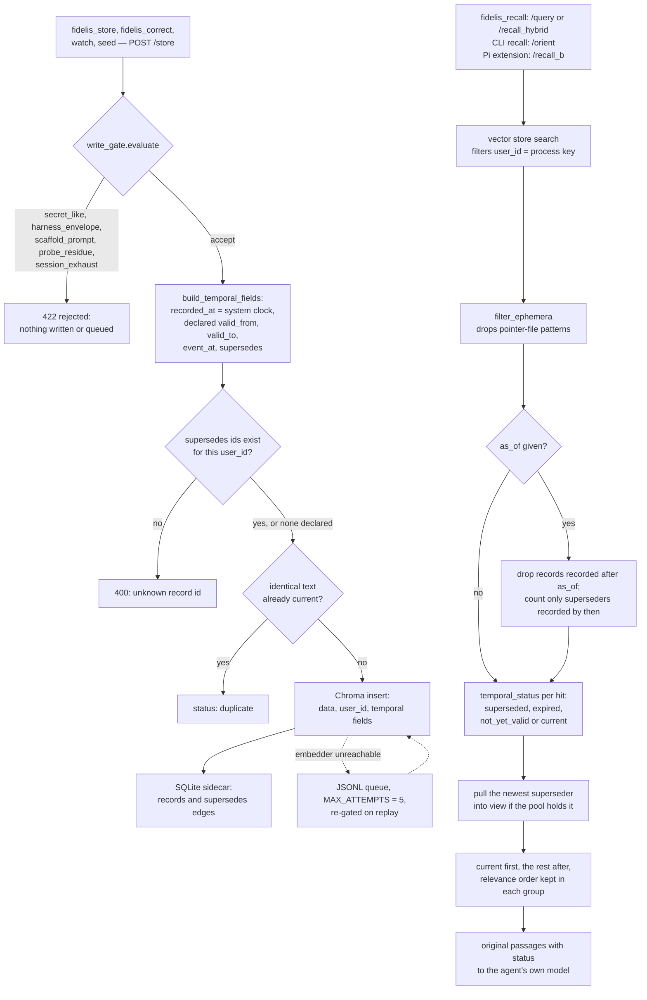

## 1. Executive Summary

Fidelis Memory is a local memory service for coding agents that stores the
passage you wrote and returns it unchanged. A correction is a new record that
names what it supersedes; the old one stays, is marked, and is ordered after
the current one. Time is a lookup rather than a rewrite: every record carries
a system-clock `recorded_at`, a caller may declare when the fact was valid,
and a recall can be asked `as_of` an instant.

**The reason this report exists is `WRITEUP-LONGMEMEVAL-20260423.md`,** whose
central section is titled *"Why this is NOT a leaderboard submission"* and
opens:

> "**The gap is not the issue. The metric is.**
>
> Mastra's published 94.87% is **QA accuracy (Task B)** — measured with
> gpt-4o-mini as both reader and judge… cogito-ergo's 96.4% is **retrieval R@1
> (Task A)**… These are different tasks. Retrieval R@1 is an upper bound on QA
> accuracy… Our measured QA accuracy with qwen-max is 54.2%…
>
> To make a legitimate leaderboard comparison we'd need to run `evaluate_qa.py`
> on our runP-v35 retrieval output using gpt-4o-mini. Estimated cost: ~$1.24.
> Blocked on OpenAI API key.
>
> **The path chosen is writeup**, not leaderboard. Honest about what we
> measured."

A project holding a 96.4% number declines to compare it to a competitor's
94.87%, explains why the comparison would be invalid, discloses its own worse
figure on the comparable metric, and prices the experiment that would settle
it. It then publishes three findings that are all negative results about
itself (section 10).

The 0.3.0rc1 release applies the same standard to its own redesign. Its
default-retrieval methodology measures the route MCP recall actually uses,
reports Hit@1 78.94% on whole-session records, and says the redesign "should
not inherit the historical headline as evidence".

**What the store will not do is withhold anything.** Superseded, expired and
not-yet-valid records are annotated and demoted; the only exclusion is the
`as_of` visibility cut. The agent that writes a memory can also supersede any
record in its namespace. Three marks: `bitemporal`, `scope_enforced` and
`negative_eval`.

## 2. Mental Model

Notes, sessions and agent writes go into one local Chroma collection, each
record stamped with the process's scope key and a small set of temporal
fields. A SQLite sidecar indexes content hashes and supersession edges so that
"is this a duplicate" and "what replaced this" are lookups. A query is answered
by vector or hybrid retrieval, and the hits are then annotated with a status
evaluated at now or at `as_of`, reordered current-first, and handed to the
agent's own model as the original passages.

## 3. Architecture

`src/fidelis/` holds 42 modules. The write side is `degrade.py` (`safe_add`,
the queue and replay), `write_gate.py`, `temporal.py` and `temporal_index.py`.
The read side is `server.py`'s HTTP lanes over `recall_b.py`,
`recall_hybrid.py`, `cogito_hermeneutics.py` and `inquiry.py`, with
`temporal_recall.py` applying the time view and `browse.py` serving `/get`,
`/recent` and `/stats`. `mcp_server.py` exposes six tools: `fidelis_recall`,
`fidelis_store`, `fidelis_correct`, `fidelis_get`, `fidelis_recent` and
`fidelis_health`. A Claude plugin, a Gemini extension manifest and a Pi
extension sit beside it.

Two retrieval paths are separated by workload, a decision section 10 shows was
learned the hard way:

- **Path A** — atomic-fact recall over short facts, "the production path".
- **Path B** (`/recall_hybrid`) — BM25 + dense + RRF with turn-level chunking,
  tuned on LongMemEval.

The repository is mid-rename. The product is **fidelis**, the writeup, the
store path (`~/.cogito/`) and most environment variables are **cogito-ergo**,
and the PyPI package is `fidelis-memory` because a different project holds
`fidelis` on PyPI. The licence is Apache-2.0.

Several modules are written and unreached. `sessions_cmd.py` implements
`fidelis sessions search`, `list`, `ingest`, `purge` and `stats`, and `cli.py`
defines lazy wrappers for each, but no subparser registers a `sessions`
command. `mcp_server.py` keeps `_tool_orient`, `_tool_recall_sessions` and
`_tool_recall_both` as importable functions; none is in `TOOL_HANDLERS`, and
`fidelis_orient` is listed in `_REMOVED_TOOLS`. A comment beside the table
says `fidelis_route` is dispatched dynamically when
`FIDELIS_ORIENT_ROUTE=notion`; `_handle` contains no such check. So `context.py`'s
`plan_context` has no reachable caller, and its successor is
`cogito_hermeneutics.plan_retrieval`, reached by `fidelis recall` through
`/orient`.

## 4. Essential Implementation Paths

**Write and gate** — `src/fidelis/degrade.py` (`_pre_write` `:125-184`,
`safe_add` `:359-467`, `replay_queue` `:470-586`), `write_gate.py`
(`evaluate` `:218-243`).

**Time and correction** — `src/fidelis/temporal.py` (`build_temporal_fields`
`:155-231`, `SupersessionIndex` `:242-304`, `temporal_status` `:307-369`,
`apply_temporal` `:399-445`), `temporal_index.py`, `temporal_recall.py`
(`temporal_view` `:252-373`), `browse.py`.

**Retrieve** — `src/fidelis/server.py` (`/query` `:1209-1251`, `/orient`
`:1321-1347`, `/get` `:1553-1568`), `recall_b.py` (`_pool_search`
`:310-360`), `recall_hybrid.py`, `cogito_hermeneutics.py`.

**MCP surface** — `src/fidelis/mcp_server.py` (`_REMOVED_TOOLS` `:242`,
`fidelis_recall` `:1362-1405`, `fidelis_correct` `:1408-1468`,
`TOOL_HANDLERS` `:1764-1776`).

**Report** — `WRITEUP-LONGMEMEVAL-20260423.md`,
`experiments/zeroLLM-FLAGSHIP-evidence/SUMMARY.json`,
`bench/DEFAULT-RETRIEVAL-METHODOLOGY.md`, `STATUS.md`.

## 5. Memory Data Model

A record is a Chroma row whose payload holds `data` (the text, verbatim),
`user_id`, and the temporal fields: `temporal_schema`, `recorded_at`,
`recorded_at_source` (`write`, `queue` or `replay`), `content_sha256`, and,
only when the caller declared them, `valid_from`, `valid_to`, `event_at`,
`source` and `supersedes_json`. With relation envelopes switched on, a
versioned JSON envelope of caller-declared relations rides in the payload too.

`build_temporal_fields` is explicit about who owns which clock. Its docstring
says `recorded_at` "comes from the system clock (`now`); callers cannot set it
through `declared`", and the code bears it out: the `recorded_at` parameter is
passed only by the replay path, which keeps the original enqueue time so a
write delayed by an outage does not look newer than it is. Instants are parsed
by an explicit shape gate; `"last week"`, numbers and empty strings raise
rather than being resolved on the caller's behalf.

**There is no stored status.** Currency is computed at read time from the
payload and the sidecar: `superseded` if any recorded superseder exists at the
reference instant, else `expired` past `valid_to`, else `not_yet_valid` before
`valid_from`, else `current`. That makes it a derived state rather than a
trust field, and nothing reads it to exclude a row (section 9).

The sidecar is a cache and says so. `temporal_index.py` keeps two tables,
`records` and `supersedes`, rebuildable from payloads; `reconcile_index`
compares id sets rather than counts, heals additively on any request, and
rebuilds only at boot, because "a sidecar that was deleted and recreated empty
... would report a superseded record as `current` with `index: ok` —
confidently wrong."

## 6. Retrieval Mechanics

`fidelis_recall` defaults to `mode="fast"`, which posts to `/query`: one
vector search, `filters={"user_id": user_id}`, over-fetched four times so that
`filter_ephemera` can drop pointer-file patterns without starving the result.
`mode="thorough"` posts to `/recall_hybrid`, BM25 plus nomic dense fused by
RRF at the `zero_llm` tier. The optional `filter` and `flagship` tiers call a
model only to select integer pointers; the server dereferences them to stored
text.

**The temporal view orders and never filters, with one exception.**
`temporal_view` takes the first `limit` hits in relevance order, so relevance
decides eligibility before recency reorders anything. A superseded hit in that
window then pulls its newest superseder into view, but only from records the
same request retrieved: the docstring records that a version which fetched the
missing superseder by id "was removed on review because it bypassed the
ephemera/user filters already applied to the pool". The result is ordered
current-first. The only drop is `as_of`, which removes records recorded after
the instant; `historical=true` returns pure relevance order, annotated.

A long passage is stored whole and embedded by prefix. `_embed_bounded` tries
the full text and then 6000, 4000, 2000, 1000 and 400 characters until the
embedder accepts one, so a note past nomic's context is retrievable by the
vector of its opening only.

**The orient path decides whether to search at all.** `/orient` runs Cogito
Hermeneutics V0.4: `plan_retrieval` classifies the utterance and the last four
turns by regex, and when it finds no memory intent the server returns with
`retrieval_method="not_invoked"` before any search. The plan carries an
entity, a purpose, a time scope and evidence needs, and a deterministic
refinement can issue one narrower second query. `fidelis recall` on the CLI
reaches it; the MCP `fidelis_recall` tool does not.

**The Fidelis Scaffold shapes the answer**, and its first listed element is
the one to steal:

> "**Calibrated hedge invitation:** *'If retrieval doesn't contain the answer,
> respond exactly: I cannot answer this from the retrieved memory.'* Overrides
> the prior pattern of forcing the LLM to guess."

It is a 140–180 token system prompt, versioned (`[FIDELIS-SCAFFOLD-v0.1.0]`),
idempotent, detectable and strippable, with an 8-check `preflight` static
validator returning `.passed`, `.failures`, `.warnings` and `.metrics`.

## 7. Write Mechanics

Every write goes through `safe_add`, and `_pre_write` runs before any
dependency call, outside the `try` that queues failures, so that "a rejected
write must never be queued, and an invalid temporal declaration must surface
as ValueError (HTTP 400)".

**The gate refuses by shape, not vocabulary.** `write_gate.evaluate` is pure
and deterministic and returns one of five stable codes. Harness tags count only
at the start of a turn; probe ids need an id body; secrets need a realistic key
body. `secret_like` runs first and survives `write_gate: false`, and the
docstring records why: "a prior, unrequested opt-out was removed for exactly
this reason". The rejection detail names the rule, offset and length and never
echoes the matched secret. The module opens with the reason it exists: an
audit found "the live store 60-70% machine exhaust".

**A correction is checked before it lands.** A declared `supersedes` id must
exist for the same `user_id`, or the write is a 400; a record belonging to
another user is reported as unknown "rather than leaking cross-user
existence". If the store cannot be reached for that check, the ids ride on the
queued record and replay re-verifies them, dead-lettering with a stated reason
if they are missing. An identical text is reported as a duplicate only while
some copy of it is current, so re-asserting a value that was superseded stores
it again (A, then B, then back to A).

**Writes are never silently lost.** `degrade.py` was written after a specific
incident, recorded in its docstring: Ollama's socket layer broke, "every
`cogito add` returned HTTP 500, and a full session of memory was silently
lost." A failed write is queued as JSONL, replayed later, re-gated on replay
and dead-lettered after `MAX_ATTEMPTS = 5`. Mem0's extraction path swallowing
an LLM failure and returning nothing is caught and degraded to the verbatim
insert. Seven test files guard that one failure mode.

## 8. Agent Integration

`fidelis init` installs a per-user launchd or systemd service, and
`fidelis mcp install` registers the server with Claude Code, Codex, Cursor,
Copilot CLI, Gemini CLI or OpenClaw, reading the client's configuration back
after each write and refusing to overwrite an entry that is not its own
without `--force`. The
agent receives six tools; `fidelis_store` and `fidelis_correct` accept
`supersedes`, `valid_from`, `valid_to` and `event_at`, and `fidelis_recall`
accepts `as_of` and `historical`.

`fidelis_correct` folds recall-copy-store into one call. It fetches the old id
through `/get`, refuses to supersede a record that is itself superseded and
names the current replacement instead, unless `force=true`, and reports a
queued correction as "NOT yet stored". Removed tool names answer with the name
that replaced them.

**The prompt-time assembler is honest about what it skipped.** The opt-in Pi
extension posts each user prompt to `/recall_b` with a one-second timeout and
injects at most three passages. `/recall_b` runs no temporal view, and the
header the extension writes says so: "untrusted recorded context, not
verified truth; temporal status was not checked; no memory was written". It
also strips its own injections before compaction, because "recall is a
transient search result, so it must not become durable summary."

## 9. Reliability, Safety, and Trust

**`bitemporal` is earned on the record payload.** Valid time is declared by
the caller and stored apart from `recorded_at`, which only the system clock
writes. An `as_of` read applies the record-time cut and evaluates the validity
window at the same instant, and `test_status_as_of_ignores_later_superseder`
pins the distinction: a record superseded in June is `current` as of March.
One reference instant drives both axes, so "what did the store hold in May
about March" is not expressible. And `/recall_b` and `/inquire` apply no
temporal view at all.

**`scope_enforced` is earned on every reachable read.** The server binds
`user_id` from config and no request field can change it. `/query`, the
`/recall` fallback and `_pool_search` filter on it; `/get`, `/recent` and the
hybrid path's linked-record fetch read by id and refuse another user's
payload; no MCP tool takes a scope argument. The comment at
`config.py:46-49` states the limit plainly: "it is not an access control
boundary and does not make fidelis multi-user", and the default value is the
literal `agent`. Outside retrieval, `reconcile_index` scans every user's
temporal rows, `/stats` counts the whole sidecar, and `/orient` can reach the
Codex task history under `~/.codex`, which carries no scope key. Session rows
are written with a hard-coded `USER_ID = "agent"` whatever the config says,
and `query_sessions` reads them with no key at all. No entry point reaches it.

**`negative_eval` is earned on that boundary.**
`test_user_id_namespace_isolation.py` puts two records with identical vectors
under two namespaces in one real Chroma collection. It proves with an
unfiltered search that both are present, then asserts each server sees only
its own. Its docstring states what it pins: "Drop that filter from
`server.py` and this test fails."

**`trust_state` is withheld, and the reason is the design's own rule.** The
module docstrings state it twice: the only exclusion is `as_of` visibility,
"everything else is annotate-and-demote", and supersession hits "are never
dropped on pull paths". `test_superseded_not_dropped.py` holds the system to
it. The status is a real four-valued field, and no read uses it to withhold a
row, so a reader that ignores the mark acts on a superseded passage.

**`tombstone` is withheld.** Supersession is keyed on record ids, and a
re-assertion of a superseded text is stored as a new current record by
design. The pointers file is the nearest thing: an operator-authored list of
regexes with a `RETRACTED`, `SUPERSEDED` or `CAVEATED` status, matched against
hit text at read time. It is value-keyed, but no write consults it, nothing in
the tree writes it, and it annotates rather than refuses.

**`audit_log` and `human_review` are withheld.** The fact store has no update
or delete, and corrections are new rows that name their predecessor, but
there is no named record of mutations, and the sidecar that holds the edges is
a cache with a `DELETE FROM` rebuild. The extraction path `/add` (CLI
`fidelis add --extract`) hands text to mem0's own `Memory.add`, whose update
phase is outside this reading. No write waits on anyone: the agent that
stores a record holds `fidelis_correct` and can supersede any record in its
namespace.

**The project names its own risks.** `STATUS.md` lists the verify-guard that
never activated, the workload divergence and an "Escalation rate: 80.2% actual
vs 10% intended", the optional flagship tier's cost miss. The user-fit guide
says `user_id` "is a namespace, not an identity or authorization boundary".

## 10. Tests, Evals, and Benchmarks

**This section is why the report exists.** The evidence is committed:
`experiments/zeroLLM-FLAGSHIP-evidence/` holds four raw result files and a
`SUMMARY.json`; `bench/runs/runP-v35/aggregate.json` holds the retrieval
aggregate; `bench/BENCHMARK_INTEGRITY_AUDIT.md` and `bench/RESULTS-SUMMARY.md`
sit beside them.

**The historical numbers**, from `SUMMARY.json`:

| metric | value |
|---|---|
| Retrieval R@1 (zero-LLM) | 83.2% |
| Retrieval R@5 | 98.3% |
| End-to-end QA accuracy | 73.04% (317/434), **Wilson 95% CI [68.7%, 77.0%]** |
| Retrieval cost | $0, ~90 ms zero-LLM stage |

A Wilson interval turns "we scored 73%" into "we graded 434 questions and the
true rate is probably between 69% and 77%". `SUMMARY.json`'s `_note` records
that 36 questions went ungraded and that the reader and grader
were the same model, Claude Opus 4.7.

**The ablation table publishes a change that made things worse.** Dense-only
56.0% → nomic prefixes 60.9% → BM25 hybrid 73.2% → **turn-level chunks 66.8%**
→ all three combined 83.2%. Turn-level chunking alone lost 6.4 points against
the BM25 hybrid and the row is in the table anyway, with an `LLM?` column so a
reader can see which gains cost money.

**The three "novel findings" are all negative results about itself:**

1. **The demotion problem** — "LLM reranker filters can demote gold sessions
   that retrieval already ranked #1… 15+ questions had gold at S1 position 1
   but were demoted to position 2+ by the LLM filter." And on the attempted
   fix: "the guard activation code did not fire in runC — **a bug, not a
   negative result**."
2. **Workload divergence kills transfer** — the configuration scoring 96.4%
   on LongMemEval scores "**54% on cogito's own 31-case atomic-fact eval**, vs
   75% for Path A."
3. **The escalation rate problem** — intended ~10%, actual 377/470 = 80%,
   diagnosed to a calibration sample whose confidence distribution differed
   from preference questions, with stratified sampling named as the remedy.

**The release benchmark refuses its own predecessor's headline.**
`bench/DEFAULT-RETRIEVAL-METHODOLOGY.md` measures the route the MCP tool uses
by default, `POST /query` at `limit=5`, over whole-session records with each
question isolated by the server's `user_id` filter. It reports Hit@1 78.94%
(371/470), Hit@5 94.68%, macro session recall@5 89.07% and all-answer-sessions@5
81.91%, keeps failures in the denominator as zero-credit rows, and binds the
result to source hashes, the embedder's digest and dependency versions. It
then states the limit: "The historical 83.2% result came from a different
benchmark pipeline… The redesign should not inherit the historical headline as
evidence."

**The test names are claims.** `test_public_install_truth.py`,
`test_telemetry_kill_actually_kills.py`, `test_zero_llm_regression.py`,
`test_superseded_not_dropped.py`, `test_write_truthfulness.py` and
`test_user_id_namespace_isolation.py` each assert a sentence the project
publishes, not only a function's output.

**I ran nothing.** Every figure above is read from the repository's committed
evidence files.

## 11. For Your Own Build

### Steal

- **Say which metric you measured, especially when the other reading flatters
  you.** Then give your own number on the comparable metric and price the
  experiment that would settle it.
- **Do not let a redesign inherit the old headline.** Measure the path users
  actually reach, bind the run to source hashes, and say in writing that the
  previous number came from a different pipeline.
- **Publish the ablation row where your change hurt**, and report a confidence
  interval on every accuracy.
- **Distinguish "the experiment didn't run" from "the experiment found
  nothing."**
- **Keep the record clock out of the caller's hands.** Take `recorded_at` from
  the system clock, let the caller declare validity, and make the replay path
  preserve the enqueue time.
- **Pull the replacement into view from the same pool.** When a superseded hit
  is in the window, surface its newest superseder only if this request already
  retrieved it, so the pull cannot bypass the filters the pool passed.
- **Gate writes by shape, and make the secret rule unconditional.** Return a
  stable reason code and never echo the matched secret.
- **Verify a correction's target against the same scope** and report another
  user's record as unknown.
- **Write the skipped check into the injected header**, as the Pi extension
  does with "temporal status was not checked".
- **Give the reader an explicit hedge string**, and treat the system prompt as
  a versioned, idempotent artifact with a static validator.
- **Never lose a write when the embedder is down**, and re-gate what you replay.

### Avoid

- **Do not let every status be advisory.** A superseded or expired passage that
  is only demoted reaches any reader that ignores the mark, including the
  project's own prompt-time assembler.
- **Do not give the producing agent an unconditional correct verb.**
  `fidelis_correct` with `force=true` supersedes even an existing correction.
- **Do not cite a specification you have not committed.** Seventeen files in
  the tree point at `docs/TIME-AWARE-SPEC.md`, which is not there.
- **Do not leave a command written and unregistered.** `fidelis sessions purge`
  is the only delete in the tree and no CLI path reaches it.
- **Do not grade with the same model that answered** without saying what that
  buys and costs.

### Fit

The right choice if you want your own notes retrievable by your agent, locally,
with the exact text you wrote, corrections that keep their history, and the
ability to ask what the store held at a past instant.

The wrong choice if a corrected or expired memory must be kept out of the
prompt rather than marked in it, or if the store needs more than one trust
boundary on one machine.

`WRITEUP-LONGMEMEVAL-20260423.md` is worth reading regardless of what you
build.

## 12. Open Questions

- **Where is `docs/TIME-AWARE-SPEC.md`?** The temporal modules cite its
  invariants by number, and no commit in the history adds it.
- **Is the `sessions` command meant to ship?** Its module, its purge
  contract and its CLI wrappers exist; the subparser does not.
- **Has `evaluate_qa.py` been run with gpt-4o-mini?** The writeup prices it at
  $1.24 and reports it blocked on an API key.
- **Is the 80% escalation fixed?** `STATUS.md` and `docs/RELEASE-SCOPE.md`
  record it as documented and not fixed.

## Appendix: File Index

**The writeup** — `WRITEUP-LONGMEMEVAL-20260423.md` (what it is `:9-18`, the
ablation history `:20-52`, "Why this is NOT a leaderboard submission"
`:54-68`, per-category R@1 `:70-84`, the three findings `:85-99`, compute
notes `:145-150`)

**Evidence** — `experiments/zeroLLM-FLAGSHIP-evidence/SUMMARY.json` (the
graded subset and the reader and grader `:148`), `F2-FULL-scaffold.json`,
`bench/DEFAULT-RETRIEVAL-METHODOLOGY.md`, `bench/results-default-0.3.0rc1.json`,
`STATUS.md` (the known findings `:60-75`)

**Write path** — `src/fidelis/degrade.py` (the incident `:1-9`,
`MAX_ATTEMPTS` `:29`, `_supersedes_targets_exist` `:91-122`, `_pre_write`
`:125-184`, `_find_duplicate` `:187-217`, the scope key in the payload `:405`,
`:442`, `:642`, `replay_queue` `:470-586`), `src/fidelis/write_gate.py`

**Time** — `src/fidelis/temporal.py` (`build_temporal_fields` `:155-231`,
`temporal_status` `:307-369`, `visible_as_of` `:372-382`, `apply_temporal`
`:399-445`), `src/fidelis/temporal_index.py`, `src/fidelis/temporal_recall.py`
(`reconcile_index` `:53-114`, `_replacements_from_pool` `:205-249`,
`temporal_view` `:252-373`), `src/fidelis/browse.py` (`_payload_for_user`
`:31-38`)

**Retrieval and scope** — `src/fidelis/config.py` (`:46-50`),
`src/fidelis/server.py` (`/query` `:1209-1251`, the fallback filter
`:1281-1284`, `/orient` `:1321-1347`, `/store` `:1454-1518`, `/get`
`:1553-1568`), `src/fidelis/recall_b.py` (`_pool_search` `:310-360`),
`src/fidelis/recall_hybrid.py` (`:258-262`, `:383`),
`src/fidelis/supersession.py`, `src/fidelis/recall_sessions.py` (the unscoped
session read `:226-276`), `src/fidelis/ingest_claude_sessions.py` (`USER_ID`
`:34`)

**Agent surface** — `src/fidelis/mcp_server.py` (`_REMOVED_TOOLS` `:242-254`,
`fidelis_correct` `:1408-1468`, `TOOL_HANDLERS` `:1764-1776`),
`src/fidelis/cli.py` (the unregistered session wrappers `:768-790`),
`extensions/fidelis-recall.ts`

**Scaffold** — `src/fidelis/scaffold/_core.py`, `preflight.py`,
`docs/scaffold.md` (the calibrated hedge invitation `:35`)

**Tests** — `tests/test_user_id_namespace_isolation.py`, `tests/test_browse.py`
(`:231-239`), `tests/test_temporal.py`, `tests/test_temporal_recall.py`,
`tests/test_superseded_not_dropped.py`, `tests/test_write_gate.py`,
`tests/test_graceful_degrade.py`, `test_dead_letter.py`,
`test_write_fallback_contract.py`, `test_public_install_truth.py`,
`test_telemetry_kill_actually_kills.py`, `test_zero_llm_regression.py`

### Recorded searches

Run from the root of the checkout at the pinned commit with `git grep`, which
does not honour `.gitignore`.

| Claim | Command | Result at this pin |
| --- | --- | --- |
| Every scoped vector read uses one filter shape | `git grep -n -E 'filters=\{"user_id": user_id\}' -- src` | Six sites: `calibrate.py:53`, `recall_b.py:345`, `server.py:940`, `:1231`, `:1283`, `snapshot.py:53` |
| Every store read, scoped or not | `git grep -n -E 'vector_store\.(get\|search)\(\|collection\.get\(\|get_all\(\|col\.get\(' -- src` | The scoped sites above, six id-addressed `vector_store.get` calls, each followed by a `user_id` comparison except the replay idempotency check and the temporal-field lookup, `reconcile_index`'s all-user scan, and the session reads in `recall_sessions.py` and `sessions_cmd.py` |
| The session reader has no reachable caller | `git grep -n -E 'query_sessions\|_cmd_sessions_\|_tool_recall_sessions' -- src extensions claude-plugin`; `git grep -n 'add_parser("sessions"' -- src` | Callers only in `mcp_server.py` functions absent from `TOOL_HANDLERS`, `sessions_cmd.py` and `recall_recent.py`; no `sessions` subparser |
| No read excludes on status | `git grep -n -E '"superseded"\|!= "current"\|== "current"' -- src` | Rendering in `cli.py` and `mcp_server.py`, the correct tool's refusal, the replacement pull at `temporal_recall.py:240`, the demotion rank at `temporal.py:439` and cue vocabularies; no filter |
| No value-keyed rejection that writes consult | `git grep -n -i -E 'tombstone\|retracted\|deny.?list' -- src` | The read-time pointers file in `supersession.py` and a project-name deny-list for session ingestion |
| No delete on the fact store | `git grep -n -E '\.delete\(\|vector_store\.update\|DELETE FROM' -- src` | `sessions_cmd.py:176` (unreachable) and the sidecar rebuild in `temporal_index.py:253-254` |
| The cited specification is absent | `git log --all --oneline -- docs/TIME-AWARE-SPEC.md`; `git grep -l TIME-AWARE-SPEC -- src tests` | No commit; cited in 17 files |
| Census | `git ls-files src \| grep '\.py$' \| xargs cat \| wc -l`; `git grep -c -E '^[[:space:]]*(async )?def test_' -- tests` summed | 22,055 package lines; 790 test functions in 64 files |

## History

**2026-10-15** — [`1b567a69339b75b5081ead1ae1ffdb30519a29ec`](https://github.com/hermes-labs-ai/fidelis/commit/1b567a69339b75b5081ead1ae1ffdb30519a29ec) — 65 commits on, version 0.3.0rc1, licence MIT to Apache-2.0. `bitemporal` gained upstream on caller-declared validity beside a system-clock `recorded_at` ([section 9](#9-reliability-safety-and-trust)), with read-time supersession, a write gate and `fidelis_correct`. `negative_eval` gained, wrong at 318a5cb: `test_user_id_namespace_isolation.py` was committed there. `scope_enforced` holds on every reachable read; the session reader ignores the key and nothing reaches it. Also wrong then: the README comparison with Mem0, Zep and Supermemory, the uncaveated 470, the census and line numbers ([appendix](../../appendix/#known-limitations)). `context.py`'s planner lost its MCP caller. Screened from a full clone: two MCP manifests launching the pinned package through `uvx`, one unpinned `pyproject.toml`, nothing inside the cooldown; Apache-2.0, no rider. Nothing was installed, built or run.

**2026-09-17** — [`318a5cbbe46286e15fcdc563338e2411f35e104b`](https://github.com/hermes-labs-ai/fidelis/commit/318a5cbbe46286e15fcdc563338e2411f35e104b) — re-read after 29 commits. `degrade.py` is byte-identical; `server.py` moved and the claim was re-counted rather than carried. `filters={\"user_id\": user_id}` occurs exactly six times across the package and no other `filters=` call exists, so the evidence record's \"all six readers\" still holds exactly. The mark stands. Nothing was installed, built or run.

**2026-09-11** — [`318a5cbbe46286e15fcdc563338e2411f35e104b`](https://github.com/hermes-labs-ai/fidelis/commit/318a5cbbe46286e15fcdc563338e2411f35e104b) — re-read, 21 files and 1,665 insertions past the previous pin in a single commit. **One mark added, and it is a first-reading miss rather than an upstream change.** The report asserted *"no scope key"* in section 9 and *"No scope key reaches the read path"* in section 6. `safe_add` writes `user_id` into the record payload at `degrade.py:125`, and all six store reads pass it back as a filter — `server.py:182` and `:222`, `recall_b.py:317`, `recall_hybrid.py:239`, `calibrate.py:53`, `snapshot.py:53` — with no lane exempt. `scope_enforced` is earned; the limit worth stating is that `config.py:46` defaults the key to the literal `agent`, so a default install checks a predicate that has one value. **New upstream**: `src/fidelis/context.py`, a deterministic planner that runs before any search and can decline to run one — it resolves a referent from the utterance and the last four turns, returns `disposition: "abstain"` when it finds neither a referent nor a historical-context cue, and otherwise routes to one of eight evidence lanes, all by regex and with the reason carried on the plan. `context_packet` binds the plan to records without altering them. It is wired at `mcp_server.py:159-177` and covered by `tests/test_context.py`, including a table of sentence starters that must not be mistaken for project names — the failure its own code comment names. Line numbers re-verified: `degrade.py`'s `MAX_ATTEMPTS` moved from `:22` to `:21` and the writeup's findings section from `:86` to `:85`; the rest hold. Suite 312 test functions over 39,279 lines of Python. Screened before reading: an MCP server manifest declaring a start command, one dependency manifest inside the cooldown with no lockfile, and an `AGENTS.md` read as data; nothing was installed or run.

**2026-08-09** — [`804e521f86e3c0056d3c89b4c7babd1eb086a6a7`](https://github.com/hermes-labs-ai/fidelis/commit/804e521f86e3c0056d3c89b4c7babd1eb086a6a7) — first reading. Screened before reading; the tree was read, never installed, and no benchmark was run. The figures in section 10 are read from the repository's committed evidence files.
