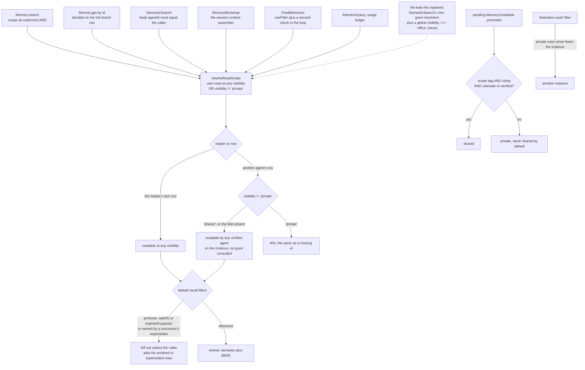

## 1. Executive Summary

Flair is a self-hosted identity and memory substrate for agents on Harper,
whose memory reads all resolve one scoping rule written after a scattered copy
of that rule leaked private memories. Private is the only value that withholds a
row from another agent; everything else on an instance is open to every
verified agent by design. The weak side is what sits under that rule: on a local
install every verified agent runs as the Harper super user, so the
resource-level checks are the whole boundary, and the memory feed bypassed them
until 30 September 2026.

It describes itself as "[t]he identity and memory substrate for AI agents.
Crypto-pinned. Federated. Self-hosted." — an Ed25519 keypair per agent, memory
searched by meaning, and a "soul" of personality, values and procedures. The
CLI installs and supervises Harper, writes a version-pinned stdio MCP adapter
into each detected client, and ships thirteen packages beside it.

**The read-scoping module exists because the rule was once scattered.** Its
header says so:

> "Before this module existed, SemanticSearch had its OWN inline
> grant-resolution + a `visibility === "office"` global OR-clause that leaked ANY
> authenticated agent's read of ANY other agent's memories … Scattering the
> scoping rule per path is exactly how that leak happened — this module exists
> so it can't happen again: one rule, one place, every path imports it."

`resolveReadScope` returns one Harper condition and one in-process predicate
with the same rule. Memory search and by-id get draw it through `makeReadScope`
from a record-type registry, with a tripwire test that compares the composed
resolver's mode and owner field against that registry. Semantic search, the
session bootstrap, the memory feed, the attention query and the usage ledger
call it directly ([section 4](#4-essential-implementation-paths)).

**The header's own list of paths is out of date.** It names "the by-id GET guard
in resources/auth-middleware.ts", which imports nothing from the module, and
omits the feed, the attention query and the usage ledger. The by-id check is in
the resource layer's `makeByIdReadGate`, and the middleware strips a non-admin's
selection before it (`resources/auth-middleware.ts:843-857`). The comment is a
claim about the code, and the call sites are the thing to read.

**Two leaks around the rule were closed upstream, and both fixes test the path
against the ordinary read.** The memory feed subscribed to the raw table for any
caller Harper admitted. A non-admin selection or property read was decided on
the value the selection shaped, which carries neither owner nor visibility. Both
are in [section 9](#9-reliability-safety-and-trust).

**The migration invariant is argued, not asserted.** The private exclusion is
`visibility != 'private'`, and the module explains why it is not
`visibility == 'shared'`: the second "would EXCLUDE them and silently
retroactively privatize every legacy row". Choosing a predicate by what it does
to rows written before the field existed is the habit worth taking from here.

**The dedup gate never suppresses a write**, with the bug that earned the
capitals: an earlier client-side gate returned the existing record, and "the
SECOND was silently dropped". The server computes a match signal, attaches it to
the response, and writes anyway.

Two marks: `scope_enforced` on that resolver and `negative_eval` on an
end-to-end search through the MCP tool that finds another agent's shared row and
not its private one. `trust_state`, `bitemporal`, `human_review`, `audit_log`
and `tombstone` are withheld, each for a reason in sections 5, 7 and 9.

## 2. Mental Model

A **memory** belongs to an agent and is open to the instance unless it says
private.

**Private** is the only word that withholds a row from another agent.
**Archived**, **expired** and **superseded** withhold it from default recall,
for everyone including the owner.

A **promotion** must cite its reason to be shared.

A **key** proves who is calling, not what was said.

A memory is written live, with a durability class that sets its default
visibility: `permanent` and `persistent` default to shared, `standard` and
`ephemeral` to private, and an ephemeral row cannot be shared. It is edited in
place unless the writer asks for a successor, which carries `supersedes` and
closes the predecessor's `validTo`. It leaves default recall when archived, when
its `validTo` or `expiresAt` passes, or when a successor names it. It leaves the
store when its owner deletes it, when maintenance reaps an expired ephemeral
row, or when an operator purges it.

Candidates are a separate table. Nightly distillation writes a claim as a
pending `MemoryCandidate`; promotion turns it into a persistent memory, private
unless a scope tag, a ruling and a rationale all survive re-verification.

## 3. Architecture

| Area | Role |
| --- | --- |
| `resources/Memory.ts` | The memory resource: writes, the dedup signal, supersession, scoped search and get |
| `resources/memory-read-scope.ts` | The one scoping rule |
| `resources/record-type-kit.ts` | `makeReadScope`, `makeScopedSearch`, `makeByIdReadGate` |
| `resources/SemanticSearch.ts`, `semantic-retrieval-core.ts`, `bm25-index.ts` | Hybrid retrieval and its filters |
| `resources/MemoryBootstrap.ts` | Session context assembly |
| `resources/MemoryFeed.ts` | The change feed and its ingest |
| `resources/auth-middleware.ts`, `agent-auth.ts` | Ed25519 verification and the Harper user an agent runs as |
| `resources/Federation.ts`, `src/commands/federation.ts` | Cross-instance sync and its push filter |
| `src/cli.ts`, `src/commands/` | init, doctor, upgrade, rem, federation |
| `packages/` | The stdio MCP adapter, the client, tool descriptors, a bench, and runtime bridges |

### Deployment and ergonomics

One npm install puts `flair` on the path; `flair init --agent ID` installs or
reuses Harper, creates the keypair, checks semantic search and wires detected
clients. Harper handles HTTP and persistence in one process over RocksDB. The
README warns that a root-owned install makes semantic search "silently degrade
to keyword-only", and that the install pulls roughly 130 MB of tooling Harper's
SQL engine never uses, with a warning not to fix it with `--omit=optional`.

Who an agent is to Harper depends on how the instance was made. A verified
non-admin agent runs as the `flair-agent` user when that user exists, and as the
admin super user otherwise (`resources/auth-middleware.ts:585-600`). Only the
Fabric branch of `flair init` creates it (`src/commands/init.ts:390`, `:430`),
so a local instance runs every agent as the super user.

## 4. Essential Implementation Paths

**Scope.** `resources/memory-read-scope.ts:129-152` builds the condition and
the predicate. `resources/Memory.ts:325-327` composes the search and by-id
helpers from `RECORD_TYPES.Memory`. `resources/record-type-kit.ts:243-310`
re-reads the full row for a shaped by-id target, at `:293-295`, before deciding
at `:307`. `resources/SemanticSearch.ts:109-130` refuses a mismatched body
`agentId` for a non-admin and forces the caller's own.
`resources/MemoryBootstrap.ts:378-388` does the same, then resolves the scope at
`:670` and re-checks `scope.isAllowed` on each bounded query (`:823`, `:895`,
`:964`).

**Feed.** `resources/MemoryFeed.ts:383` admits verified agents;
`:422-443` leaves admin and internal subscribers unfiltered and builds a
non-admin subscription from an allowlist of options with the scope as
`rowFilter`, then decides each event again in the loop.

**Write.** `Memory.post` and `Memory.put` redact credential-shaped text
(`resources/memory-redaction.ts`), apply the durability-keyed visibility default,
compute the dedup signal (`resources/Memory.ts:334-352`), and close a superseded
predecessor after the successor is written (`:939-943`).

**Promotion.** `resources/auto-promote-lib.ts:262-268` returns shared only when
all three justifications are present; `schemas/memory.graphql:358-364` states the
rule.

**Tests.** `test/integration/mcp-connector-principal-mapping.test.ts:256-283`
and `test/integration/feed-read-scope.test.ts` carry the must-not-appear cases.

## 5. Memory Data Model

Content, owning agent, durability, visibility, embedding and usage, with
`promotionStatus`, `archived`, `supersedes`, `validFrom` and `validTo`
(`schemas/memory.graphql:83-99`), `expiresAt`, a server-stamped `provenance`
blob and an opaque client `metadata` blob. A guard refuses an ephemeral row
flipped to shared on POST and on PUT, and its end-to-end file labels a
"POSITIVE CONTROL" and three "no over-fire" cases
(`test/integration/ephemeral-visibility-guard-e2e.test.ts:191`, `:204`, `:277`).

**`bitemporal` is withheld; the valid-time columns are there and the producers
use the write clock.** Retrieval honours an `asOf` against `validFrom` and
`validTo` (`resources/semantic-retrieval-core.ts:286-287`), and a successor
closes its predecessor's `validTo` at its own `validFrom`. `Memory.post` defaults
`validFrom` to `createdAt` (`resources/Memory.ts:1661-1662`), and the agent-facing
writers set `createdAt` to now: `flair memory add` (`src/commands/memory.ts:128`)
and the MCP and client successor paths, which delete `validFrom` from the copied
row (`resources/mcp-tools.ts:550-556`). Only the bridge importer carries a
foreign `validFrom` (`src/bridges/runtime/import-runner.ts:148`). The record
side is weaker still: `createdAt` may be backdated by the caller, and `updatedAt`
is overwritten by every update and by the close patch.

**`trust_state` is withheld, and every candidate field was checked.**
`visibility` filters, and it is writer intent resolved by the same predicate
that earns `scope_enforced`. `provenanceStatus` on the trust block is epistemic
and deliberately decides nothing: `resources/trust-block.ts:18-20` says it
"INFORMS THE READER ONLY" and "MUST NEVER enter an authority / scope /
attribution / dedup decision anywhere", enforced by
`test/unit/trust-block-zero-authority-tripwire.test.ts`. `promotionStatus` on a
memory has no read filter anywhere in `resources/`. `archived` filters default
recall, and the module that sets it calls it "a VISIBILITY flag, not a deletion"
— a retire switch the owner flips, with no claim about truth
(`resources/MemoryArchive.ts:9-14`). Superseded is derived from another row's
pointer rather than stored.

## 6. Retrieval Mechanics

Hybrid semantic and lexical, fused by rank, with a BM25 index beside the HNSW
vector index. The default scoring is raw, after a measured finding — recorded in
the comment beside it — that a composite durability and recency multiplier
outranked better matches. Archived rows, rows whose `validTo` or `expiresAt` has
passed, and predecessors named by a co-present successor are dropped unless the
caller asks for them (`resources/semantic-retrieval-core.ts:235`, `:295`). A
temporal word in the query only nudges recency; an incidental "today" once
emptied the result set when it filtered.

The README says the displayed percentage is a similarity with a keyword boost,
that hybrid ranking means the top result need not have the highest percentage,
and that it "is not a probability that the memory answers your question
correctly".

## 7. Write Mechanics

Write, then signal. The dedup gate compares the write against the single top
cosine candidate of the same agent — "never cross-agent" — and requires both a
cosine threshold and a Jaccard token overlap, with no fallback to the second
candidate. It rarely claims a duplicate and never acts on the claim
(`resources/Memory.ts:334-352`).

Credential-shaped text in `content`, `summary` and `trigger` is redacted on
every agent write and on the feed ingest, and the write response reports the
stored text (`resources/memory-redaction.ts:1-27`). Federated content is left
alone.

**`human_review` is withheld.** `POST /PromoteMemoryCandidate` admits any
non-anonymous caller, lets an agent promote its own candidate, and defaults
`reviewerId` to the caller; the only reviewer check refuses the reserved machine
namespace (`resources/PromoteMemoryCandidate.ts:17-36`,
`src/rem/promote-policy.ts:230-235`). The agent that owns a candidate can approve
it. **`tombstone` is withheld.** A rejected candidate is a status on a record,
and nothing consults a rejected value when the next distillation writes a claim.

## 8. Agent Integration

`flair init --agent ID` writes a keypair and wires every detected MCP client to
`npx -y @tpsdev-ai/flair-mcp@VERSION`, pinned to the CLI's own version. The
built-in `/mcp` endpoint is OAuth-guarded and off by default: an unset
`FLAIR_MCP_OAUTH` leaves it unregistered, and only the literal `true` turns on
both the route and the OAuth component. The README separates the two paths as
two trust situations, a local client and a remote connector.

## 9. Reliability, Safety, and Trust

**Within an instance the boundary between agents is the word private.** Per-owner
grants remain an inspectable relationship and gate no read; `private` is "the
ONLY owner-only exception"; the federation push filter keeps private rows on the
instance (`src/commands/federation.ts:204-207`). For a personal instance that is
the intended knowledge-refinement model. For a shared one, a careless agent
registration reads everything not marked private.

**On a local install, Harper's own role checks do not separate agents.** Every
verified non-admin agent resolves to the admin super user when `flair-agent`
does not exist ([section 3](#deployment-and-ergonomics)). Any resource left on
Harper's default `allowRead`, which admits the super user, is then open to every
agent. Every class in `resources/` that extends `Resource` and defines a read
method also defines `allowRead`, and every exported table has a resource class
that does.

**The feed was the resource that relied on that default.** Until
[`87bd59c50b432e39cea73967df363dc7cee0293b`](https://github.com/tpsdev-ai/flair/commit/87bd59c50b432e39cea73967df363dc7cee0293b)
on 30 September 2026, `FeedMemories` defined no `allowRead` and its `connect`
subscribed to the raw table. On a local instance a verified agent therefore
received every memory event, private rows included. The fix's test runs each case
both before and after `flair-agent` is provisioned, and compares the feed with the
by-id read.

**A shaped by-id read was decided on the shaped value.** Until
[`04e091c19bc0f984fe64ff267b9ddd26abd634dc`](https://github.com/tpsdev-ai/flair/commit/04e091c19bc0f984fe64ff267b9ddd26abd634dc)
on 27 September 2026, `makeByIdReadGate` passed the caller's target to Harper and
checked what came back. Harper reads `/Memory/ID.content` as a property selector,
so the gate saw a string with no owner and no visibility, which the predicate
admits. The middleware's own check looked up the raw path segment, `ID.content`,
which names no row. Read from the code; nothing was run.

**Supersession exists and editing defaults to overwrite.** `memory_update`
overwrites in place unless `preserveHistory` is set, in which case the successor
carries `supersedes` and the predecessor's `validTo` is closed. The close runs
after the successor is written, so a failure leaves two live rows rather than a
lost one (`resources/Memory.ts:939-943`).

**`audit_log` is withheld.** `MemoryDeletionHistory` records a deletion only for
`permanent` and `persistent` rows, records no update, and the purge path removes
its own rows (`resources/memory-deletion-history.ts:25-26`, `:54`,
`resources/MemoryPurge.ts:157`). The `doctor` audit-log check probes Harper's
engine audit log, which is the database's, not a named record of memory
mutations.

**The key proves the caller.** Memories are not encrypted with it, and losing it
"costs the identity, not the data". The federation receiver verifies a
per-record signature when a record carries one and merges an unsigned record by
default (`resources/Federation.ts:136-155`); no code in the tree produces that
signature, and the sync batch is signed as a whole. `attribution` on a usage row
is "OPAQUE — never parsed, never fed to an LLM, never rendered", to be trusted
as "nothing more than a label" (`schemas/memory.graphql:226-229`).

## 10. Tests, Evals, and Benchmarks

989 test files under `test/`, across unit, isolated, integration, heavy
integration and end-to-end suites, with a benchmark package and a recall
harness. Test names carry issue numbers and the vocabulary of controls.

The must-not-appear cases run on populated stores beside positive controls: the
MCP connector search (`test/integration/mcp-connector-principal-mapping.test.ts:256-283`),
the bootstrap (`test/integration/bootstrap-self-describing-1182.test.ts:218-219`),
the feed over SSE and WebSocket (`test/integration/feed-read-scope.test.ts:201`,
`:260`, `:352`) and the selected by-id read
(`test/integration/memory-visibility-scoping-e2e.test.ts:115-139`).

`test/data-scoping.test.ts` exercises a copy of the predicate defined in the test
file itself — its header says it "mirrors auth-middleware logic" — and imports
nothing from `resources/`. It pins the intended rule and cannot catch drift in
the code.

Nothing was built or run for this reading.

## 11. For Your Own Build

### Steal

Put the scoping rule in one module and make every read path import it, then add
the test that trips when a second copy appears.

Choose the predicate by what it does to old rows. `!= private` and `== shared`
differ only on records written before the field existed, and one of them
privatises your history silently.

Decide a by-id read on the stored row, never on what the caller's selection
shaped. A projection without the owner field is a record your predicate has not
seen.

Test a secondary path against the primary one. A feed test that asks "does the
feed deliver exactly what the by-id read returns" catches the next bypass;
restating the rule does not.

Never let a de-duplication gate drop a write. Compute the signal, return it, and
store the record.

### Avoid

A comment listing the call sites of a single-source module. The list here names a
guard that moved and misses three paths that arrived later; the importers are the
list.

A privilege fallback that elevates. Falling back to the super user when the
least-privilege user is missing makes every resource relying on the database's
default authorization open to every agent, which is how the feed leaked.

### Fit

For one person or one trusted team on one instance, the open-within-org model is
coherent and the scope code is carefully kept. For agents that must not read each
other, it does not fit without marking everything private. Provision
`flair-agent` by hand on a local instance before relying on Harper's roles at
all.

## 12. Open Questions

Whether `flair-agent` is meant to be absent on local installs. The fallback
comment calls such instances "pre-migration", and no local code path creates the
user.

Whether federation verification covers content. The receiver checks a record
signature when present, and nothing in the tree produces one.

What the soul costs at read time. It is central to the pitch and sits outside
the memory paths read here.

## Appendix: File Index

| Path | What to read it for |
| --- | --- |
| `resources/memory-read-scope.ts:4-47`, `:129-152` | The leak, the rule, the invariant argued from old rows |
| `resources/record-type-kit.ts:243-310` | The by-id gate deciding on the full stored row |
| `resources/MemoryFeed.ts:383-470` | The feed's admission, allowlisted options and two-layer filter |
| `resources/auth-middleware.ts:585-600`, `:843-857` | The Harper user an agent runs as, and the selection strip |
| `src/commands/init.ts:390-430` | The one provisioning of `flair-agent`, on the Fabric branch |
| `resources/Memory.ts:325-352`, `:939-943` | Scope composition, the dedup gate, supersession close |
| `resources/semantic-retrieval-core.ts:235-299` | Default recall filters and `asOf` |
| `resources/PromoteMemoryCandidate.ts:17-36` | Self-promotion by the owning agent |
| `schemas/memory.graphql:83-99`, `:226-229`, `:358-364` | The lifecycle fields, a label not to trust, a default that demands a reason |
| `test/integration/mcp-connector-principal-mapping.test.ts:256-283` | Both halves, through the real tool |
| `test/integration/feed-read-scope.test.ts` | The feed checked against the by-id read |

### Recorded searches

Run at the tree root of the pinned checkout with `/usr/bin/git grep`.

- `git grep -n -E 'resolveReadScope\(' -- resources ':!*.test.ts'` — `AttentionQuery.ts:173`, `MemoryBootstrap.ts:670`, `MemoryFeed.ts:443`, `SemanticSearch.ts:130`, `record-type-kit.ts:225`, and the definition; `usage-recording.ts:62` imports it as a default argument.
- `git grep -n -E 'resolveReadScope|memory-read-scope' -- resources/auth-middleware.ts` — no match.
- `git grep -n -E 'ensureFlairAgentUser\(' -- src resources ':!*.test.ts'` — the definition, the binding in `init.ts`, and one call at `src/commands/init.ts:430`, inside the branch opened at `:390`.
- For each `resources/*.ts` that `extends Resource` and defines `get`, `connect` or `search`, `grep -q allowRead` — no file lacks it.
- `git grep -n -E 'attribute: "promotionStatus"|record\.promotionStatus' -- resources ':!*.test.ts'` — no match; no read filter on promotion status.
- `git grep -n -E 'validFrom' -- src/commands/memory.ts resources/mcp-tools.ts src/bridges/runtime/import-runner.ts` — `mcp-tools.ts:556` deletes it; `import-runner.ts:148` carries a foreign one; the CLI sets none.
- `git grep -n -E 'signature:|\.signature =' -- resources src packages/flair-client/src ':!*.test.ts'` — batch and relay signing only; no per-record producer.
- `git grep -n -E 'removeMemoryDeletionRecords\(' -- resources ':!*.test.ts'` — the definition and `MemoryPurge.ts:157`.
- `git grep -n -E 'recordMemoryDeletion\(' -- resources src ':!*.test.ts'` — the definition and three callers, all deletes: `Memory.ts:2652`, `MemoryMaintenance.ts:125`, `MemoryPurge.ts:122`.
- `git grep -n -E '^import' -- test/data-scoping.test.ts` — `bun:test` only.
- `git grep -n -i -E 'tombstone' -- resources/Memory.ts resources/MemoryCandidate.ts src/rem` — two comments about write ordering; no rejected-value record.
- `git grep -n -E '"rejected"' -- resources src ':!*.test.ts'` — candidate status handling in `src/commands/rem.ts` and `src/rem/promote-policy.ts`; nothing consults a rejected claim on write.
- `git grep -n -i -E 'arxiv|bibtex|@article|@misc|doi\.org' -- README.md docs` — no match; no paper.
- `git grep -n -i -E 'anthropic|machine learning|not (be )?used (for|to)' -- LICENSE` — no match; the Apache-2.0 text carries no rider.

## History

**2026-10-15** — [`0777bda14699614556ef83a996abb0cd3745aedb`](https://github.com/tpsdev-ai/flair/commit/0777bda14699614556ef83a996abb0cd3745aedb) — 429 commits on, version 0.54.2 to 0.61.0. No mark moved at this pin. `scope_enforced` was wrong at `6fadb74`: the feed subscription and a shaped by-id read bypassed the rule until upstream fixed both ([section 9](#9-reliability-safety-and-trust)). Also wrong then: "no supersession" ([section 9](#9-reliability-safety-and-trust)), a mirror test cited as testing the predicate ([section 10](#10-tests-evals-and-benchmarks)), and the first entry below, which linked `6fadb74` for a reading made at `02512aa`. `bitemporal` and `human_review` are withheld on producers ([sections 5](#5-memory-data-model) and [7](#7-write-mechanics)). Overtaken: the middleware by-id guard, the README's MCP wording. Storage reclassified from delegated to key-value. Screened from a full clone: thirty-six files, no auto-run surfaces, twelve build-time execution points, five unpinned surfaces, twelve dependency files inside the cooldown, `AGENTS.md` read as data. Nothing was installed, built or run.

**2026-09-19** — [`6fadb74fe5f7adefb49c3cdc18e34cfd417bcc39`](https://github.com/tpsdev-ai/flair/commit/6fadb74fe5f7adefb49c3cdc18e34cfd417bcc39) — **`trust_state` withdrawn.** Re-tested against the narrowed line — a state answers whether a memory may be acted on and gets used for filtering — and the field the record rested on is the wrong one. `visibility` does filter, and the module applying it says what it is: writer intent, resolved inside `resolveReadScope`, which is the same single resolver and the same predicate that earns `scope_enforced`. One mechanism was being counted twice. The field that is epistemic is `provenanceStatus` on the trust block — `verified` when the record carries a server-attested `verified.agentId`, `unattributed` otherwise, with the self-reported `claimed` sub-object surfaced as a boolean and never as content. `resources/trust-block.ts` is explicit that it decides nothing: the block *informs the reader only*, is assembled after read-scope resolution, and *must never enter an authority / scope / attribution / dedup decision anywhere* — enforced by a source-scan tripwire asserting that the read-scope module, the dedup gates, the usage recorder, the MCP handler and the retrieval core never import it. That is a considered position and not a gap, and it is precisely not the thing this mark counts. The candidate lifecycle (pending / promoted / rejected) governs promotion rather than recall, and a pending candidate is not yet a memory. `scope_enforced` and `negative_eval` are unaffected and stand. COVERAGE_FLOOR 1160 to 1159. Screened again first; nothing was installed and no suite was run.

**2026-09-16** — [`02512aae1e859bcfa75d494f34b7a535a8caf0b5`](https://github.com/tpsdev-ai/flair/commit/02512aae1e859bcfa75d494f34b7a535a8caf0b5) — first reading, at a commit dated 15 September 2026. Screened before opening, from a shallow clone: thirty-five files scanned, no auto-run surfaces, twelve build-time execution points, five unpinned surfaces and sixteen dependency files inside the seven-day cooldown. Nothing was installed, built or run.
