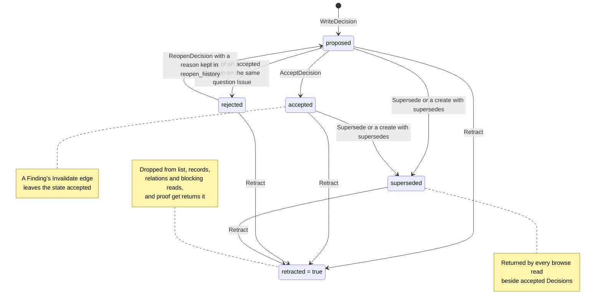

## 1. Executive Summary

Flatbread Proof is project memory for coding agents stored as typed Markdown
files in the repository itself. An agent records Issues, Findings, Decisions,
Constraints, Risks and Citations under an Effort, links them with typed edges,
and commits them beside the code, so the next session and a reviewer read the
same reasons. What is notable is the writer: one CLI command takes 17 validated
mutations, refuses cross-Effort edges, runs Decision lifecycles in code and
commits every touched file through a crash-safe journal. What is weak is that
the lifecycle stops at the writer. Every read returns rejected, superseded and
invalidated Decisions beside accepted ones, and the agent that proposes a
Decision also accepts it.

Proof lives in `packages/proof` of the Flatbread monorepo. Flatbread itself is
an older engine that turns Markdown and YAML files into a typed relational
graph queried over GraphQL; Proof is a preset of eight collections on that
engine plus a writer, a digest renderer and an Agent Skill. The `flatbread`
package ships the `flatbread proof` CLI and an optional 3D explorer. The
repository dogfoods it: `.flatbread-proof/` holds the project's own graph of
five Efforts, 33 Decisions and 32 Findings at this commit.

Four findings shape the rest of this report.

- **The state machine is enforced and not consulted.** `AcceptDecision`
  refuses a non-proposed target, refuses a second accepted Decision on the same
  `question` Issue, and rejects proposed siblings in the same transaction
  (`packages/proof/src/decision-lifecycle.ts:31-116`). The records read filters
  on `state` only when the caller passes `--state`
  (`packages/flatbread/src/proof/read.ts:581-602`).
- **The agent holds every verb.** Accept, reject, reopen, supersede and retract
  are values of one mutation union behind one command
  (`packages/proof/src/schemas.ts:123-141`), and the packaged skill tells the
  agent to preview and then commit acceptances. Review happens in the pull
  request, outside the code.
- **Retract shortens provenance.** Retracting a record strips its id from every
  other record's relations in the Effort, including `derives_from`, which is
  not among the keys that block a retraction (`packages/proof/src/planner.ts:66-131`,
  `:584-589`).
- **Effort is enforced and is not a scope mark.** The writer refuses edges into
  another Effort and three reads filter on it or fail closed on a foreign edge.
  An Effort is a thread of work inside a single repository rather than a user,
  project, agent or tenant boundary, and `proof get <id>` reads across Efforts,
  so `scope_enforced` is withheld.

## 2. Mental Model

A memory in Proof is a **record**: one Markdown file whose YAML frontmatter
holds an id, a kind, an owning Effort, a title, `created_at`, a lifecycle field
where the kind has one, and relation lists. The body is free prose. The skill
calls the store *"a map of durable reasons, not a work log"*, and the record
kinds follow that: a Finding is an observation, a Decision a commitment among
alternatives, a Constraint a boundary, a Risk a possible outcome with
likelihood and severity.

How a thing becomes a belief depends on its kind, and only some kinds have a
lifecycle at all.

- **Decision**: created `proposed` (`planner.ts:326`). `AcceptDecision` moves it
  to `accepted` and rejects proposed Decisions deriving from the same
  `question` Issue, plus any named in `rejects`. `ReopenDecision` returns a
  rejected Decision to `proposed` and appends the rejection to
  `reopen_history`. A `Supersede`, or a create carrying `supersedes`, moves the
  target to `superseded`. The schema admits `deprecated`
  (`schemas.ts:182`), and no mutation writes it.
- **Issue**: `open` until `ResolveIssue` sets `resolved`, `deferred` or
  `wontfix`, which requires at least one resolving record id.
- **Risk**: `open` until `MitigateRisk` names an accepted Decision, or
  `SetRiskState` records `realized` with at least one Finding as evidence, or
  `accepted`.
- **Finding, Constraint, Citation, Blob**: no lifecycle. A Finding can
  `invalidate` an older Finding or a Decision, which adds an `invalidates`
  edge and its `invalidated_by` reverse and changes no state
  (`planner.ts:428-440`).
- **Every kind but Effort**: `Retract` sets `retracted: true` with a time and
  reason and keeps the file. This flag, not any state, is what the browse reads
  exclude.

Memory is agent-controlled. The agent decides what to write, applies the
skill's four-part gate in its own reasoning, and runs every lifecycle
transition. A person's part is the Git workflow: the records land in a pull
request beside the code, and merging is the act of agreement. The system
treats a record as the team's account of its reasoning, not as a verified fact,
and it has no confidence field; the packaged evals use a Decision against
numeric confidence fields as their acceptance example.

## 3. Architecture

Proof is a TypeScript library and a CLI. `@flatbread/proof` holds the record
schemas, the mutation planner, the journaled writer, the digest renderer, the
content preset and the packaged skills. The `flatbread` package wraps them in
`flatbread proof` subcommands built with sade (`packages/flatbread/src/cli/proof.ts`)
and implements the read path over the Flatbread engine
(`packages/flatbread/src/proof/read.ts`).

Persistence is the filesystem. `proofContent()` registers eight collections
under one graph root, default `.flatbread-proof/`, with Flatbread `refs` from
each record to its Effort (`packages/proof/src/preset.ts`). Beside the records
sit two gitignored areas: `<root>/.journal/` holding the writer lock,
in-flight transactions and `generation.json`, and `.flatbread/proof/read-cache/`
holding rendered digests.

The write path never touches GraphQL. `createProofWriter` takes the lock,
recovers any pending transaction, builds a snapshot by reading and validating
every record file, plans the mutation against it and commits through the
journal (`packages/proof/src/writer.ts:15-105`). The read path constructs a
`FlatbreadProvider` from the loaded config on every call and issues
`all<Collection>(filter: $filter)` queries (`read.ts:331-432`). When
`flatbread start` runs a live GraphQL server, a bridge reindexes it after each
committed generation (`packages/proof/src/live.ts`,
`packages/flatbread/src/graphql/proofComposition.ts`).

There is no retrieval index, no embedding and no model call anywhere in the
package.

### Deployment and ergonomics

Nothing runs between commands. Adoption is `npx flatbread@latest proof install-skill`,
which pins the CLI version as a devDependency and copies the skill, then a
`proofContent()` entry in `flatbread.config.js` and two `.gitignore` lines;
`proof bootstrap --verify` checks all three and edits nothing. It runs fully
offline with no key. Node 20.19 or newer is required.

The store is human-readable and repairable: every record is a Markdown file
with deterministic frontmatter ordering (`packages/proof/src/frontmatter.ts:4-46`).
Bodies may be edited by hand. Frontmatter may not, and the writer enforces
that indirectly: the snapshot validates every file against its kind's schema
on each write, so one malformed record blocks every mutation until fixed
(`packages/proof/src/snapshot.ts:95-125`).

## 4. Essential Implementation Paths

**Capture and write.** `flatbread proof write '<json>'` reaches
`handleEffortWrite` (`packages/flatbread/src/cli/proof.ts:118-164`), which
parses the JSON and validates it against `ProofMutationSchema`, a Zod
discriminated union of 17 mutations (`packages/proof/src/schemas.ts:123-141`).
Non-strict object schemas strip unknown keys, so a create cannot smuggle a
`state` or `retracted` field. `createProofWriter().mutate` takes the lock,
recovers, snapshots and calls `planMutation`.

**Planning.** `planMutation` (`packages/proof/src/planner.ts:201-593`) returns
a list of `PlannedWrite`s, each with before and after bytes. Creates generate
an id of the form `<prefix>-<slug>--<16 random characters>` (`ids.ts:46-52`),
set the initial lifecycle field, check every `cites` and `derives_from` target
is live and in the same Effort (`:149-199`), and materialize `superseded_by`
and `invalidated_by` on targets. Lifecycle mutations delegate to
`decision-lifecycle.ts` for Decisions and inline checks for Issues, Risks and
Efforts.

**Commit.** `commitJournal` (`packages/proof/src/journal.ts:166-226`) writes
`intent.json` with every file's before image and after image plus its SHA-256,
then replaces each file by temp write, fsync and rename, verifying the lock
before each. It writes a `committed` marker, calls the publisher to reindex,
publishes the incremented generation and removes the transaction directory.
`recoverJournal` (`:86-164`) rolls back an uncommitted transaction from before
images, or completes a committed one from after images.

**Retrieval.** Each read handler in `proof.ts` (`:168-239`, `:386-401`) resolves the graph root
and calls a function in `read.ts`: `listEfforts` (`:623-665`), `effortRecords`
(`:552-621`), `relations` (`:667-745`), `blockingDecisions` (`:747-791`) and
`getRecord` (`:497-550`). Each waits for a requested generation if strict,
queries the engine, applies the Effort and retraction predicates in
application code, sorts by `created_at` then id, slices a page and hands it to
`renderDigest` (`packages/proof/src/digest.ts`).

**Context assembly.** There is none in code. The skill's session loop has the
agent run `proof list --status active`, then `proof records <effortId>
--kinds issue,decision` per Effort, then `blocking-decisions` where a blocker
is open (`packages/proof/skills/proof/SKILL.md`). Each read returns a JSON
envelope with a summary and an `artifact_path`; the agent reads the Markdown
digest at that path.

**Update, forget and conflict.** `Supersede` and `Invalidate` add an edge and
its reverse (`planner.ts:382-442`); a second supersession of the same target
is refused. `Retract` (`:541-593`) refuses Efforts, refuses a record that is
the sole closer of another record, strips relation keys from the retracted
record, sets the flag and strips the id from every other record in the Effort.

**Tests.** `packages/proof/src/__tests__/planner.test.ts` (43 cases) and
`writer.test.ts` (21) cover the mutation rules and journal;
`packages/flatbread/src/cli/proof.test.ts` (18) drives the handlers and the
spawned CLI end to end.

## 5. Memory Data Model

Frontmatter shapes are Zod schemas per kind (`schemas.ts:143-233`), all
`.passthrough()`, so extra keys survive a round trip. Common fields are `id`,
`effort`, `title`, `created_at`, optional `produced_in` and `created_by`.
Kind-specific fields are `kind` on Issue, Finding, Constraint and Blob,
`status` on Effort and Issue, `state` on Decision and Risk, `likelihood` and
`severity` on Risk, and `blob` and `role` on Citation.

Relations are lists of ids in frontmatter. Forward edges supplied by a payload
are `derives_from`, `supersedes`, `invalidates` and `cites`; the writer
materializes `superseded_by` and `invalidated_by`, and lifecycle mutations
write `resolved_by`, `rejected_by`, `mitigated_by` and `evidence`
(`planner.ts:66-77`). `derives_from` has no reverse projection.

**Scope.** The Effort id is required on every non-Effort record and every
edge is confined to it at write time (`planner.ts:149-199`, `:359`,
`:391-401`). The read side is covered in section 6.

**Time.** `created_at` is the only time field on a record, defaulting to the
write clock and accepted from the payload when supplied (`planner.ts:321`).
There is no validity interval. `retracted_at` and each `reopen_history`
entry's `at` record when the transition happened.

**Provenance.** `created_by` and `produced_in` are free strings the caller may
supply and nothing verifies. `cites` must point at live Citation records in the
same Effort, and a Citation may carry one Blob. The writer has no record of
which agent or session issued a mutation; the journal's intent file holds a
lock token and is deleted after publish.

**History.** Git is the version history. The system's own store keeps two
partial trails in frontmatter: `reopen_history` on a revived Decision, and
the retraction triple on a retracted record. The journal is a redo and undo
log for one transaction, not an audit, so `audit_log` is withheld. Retraction
deletes relation keys from both the target and its neighbours, so the current
files no longer say what a retracted record linked to; only Git does.

## 6. Retrieval Mechanics

Retrieval is structured lookup over the graph, invoked by the agent through
the CLI. There is no text search, no ranking and no relevance scoring.

**Filters.** `effortRecords` passes `state`, `status`, `kind` and a
`created_at` range to the engine as scalar predicates, then intersects with
the Effort and drops retracted rows (`read.ts:581-602`). The comment there
explains the split: the generated relation field materializes as an object,
so an `eq` on `effort` does not match. Default kinds exclude Blob.
`blockingDecisions` selects open `blocker` Issues and proposed Decisions in
the Effort that derive from one (`:754-774`).

**Scope on each read.** `effortRecords` and `blockingDecisions` apply the
Effort predicate. `relations` refuses a source outside the Effort and throws
`ProofCrossEffortRelationError` when a stored edge points into another one,
naming every such edge, rather than returning a short page (`:687-723`).
`listEfforts` spans Efforts by design. `getRecord` takes only an id and
returns any record, retracted or not, with `--resolve head` walking
`superseded_by` and reporting a fork or a cycle as an anomaly (`:497-550`).
The GraphQL endpoint and explorer that `flatbread start` serves return every
collection unfiltered.

**What the reads do not withhold.** No read filters on Decision `state` unless
the caller asks, and no read consults `invalidated_by`. A Decision that a
Finding invalidated renders with `state: "accepted"` and an `invalidated_by`
line under Relations (`digest.ts:192-223`), and the envelope summary counts it
among the accepted. The explorer computes an effective lifecycle from the edges
for display (`packages/explorer/src/web/presets/proof/lifecycle.ts`); the CLI
digest does not.

**Budget.** A page holds at most 25 records (`read.ts:459-464`); a digest at
most 50 edges and 64 KiB (`digest.ts:67-69`). Browse digests excerpt each body
to 600 characters and 12 lines; `get` renders the full body or a byte-cap
banner, never a silent excerpt. The header carries `complete`, `has_more` and
`cap_reasons`. Cursors are bound to the query hash and served generation, so a
write between pages invalidates the cursor (`read.ts:221-243`).

**Ordering.** Every read sorts oldest first (`read.ts:185-191`). On an Effort
with more than 25 matching records, the first page of the skill's resume
briefing holds the oldest and the newest arrive on the last page. The header
says the page is incomplete; the skill's fast path tells the agent to trust the
returned digest.

**Consistency.** Reads are eventual by default. With
`--strict-min-generation`, a read polls `generation.json` every 25 ms for up to
3,000 ms and fails with `PROOF_GENERATION_WAIT_TIMEOUT` rather than serve
older data (`read.ts:260-292`).

## 7. Write Mechanics

Writes are explicit, hot-path and synchronous: the agent issues a mutation and
the CLI returns after the files are renamed into place and the generation is
published. No model runs on the write path, and there is no extraction,
deduplication or consolidation. Two writes of the same claim produce two
records with different random suffixes.

**The gate is prose.** The skill requires a 4/4 score on future need, durable
effect, causal value and unique signal before any create or claim-adding body
edit, and says lifecycle transitions and `Retract` need no score. The README
says the CLI does not enforce it. `evals.json` holds four prompts, three
testing the gate's refusals and one an acceptance; nothing in the tree runs
them.

**Correction is typed.** Supersession is one record per kind, refused when the
target has a superseder. Invalidation is an edge from a Finding. Revival
keeps the rejection in `reopen_history`. `AcceptDecision` refuses a Decision
whose `reopen_history` names a rejector that is itself accepted
(`decision-lifecycle.ts:54-73`), so a rejected alternative cannot be accepted
while the Decision that beat it stands.

**Forgetting is a flag.** `Retract` is the only removal, and it refuses when
the target is the last record closing an Issue, mitigating a Risk, superseding
or rejecting a Decision, or the last live Finding evidencing a realized Risk
(`planner.ts:113-148`, `:553-569`). `derives_from` is not on that list. The
end-to-end case at `proof.test.ts:1250-1337` exercises exactly this: the
Decision that derived from the retracted Finding ends with no `derives_from`,
and its relations read returns an empty page.

**Concurrency.** One writer at a time per graph root, by an exclusive-create
lock file with a 120 s lease. An expired lock is taken over when its host
differs or its pid is gone (`packages/proof/src/lock.ts:13-70`). Concurrent
branches are reconciled by Git, which knows nothing of the invariants: two
branches can each supersede the same record, and the merged file then carries
two `superseded_by` ids, which `get --resolve head` reports as a fork.

### Operational cost

A write blocks on reading and validating every record file in the graph root,
then on fsyncs for the journal and each touched file. A read constructs the
Flatbread engine over the configured content on each CLI invocation. Both
scale with the graph, not with the change; at the dogfood graph's size this is
small, and nothing in the tree measures it. A write is visible to a strict read
as soon as the command returns. No background pass touches the store. Nothing
is injected per turn; the agent pays one digest read per command, capped at
64 KiB.

## 8. Agent Integration

The integration is an Agent Skill and a CLI. `install-skill` copies
`packages/proof/skills/proof/` into the project with the matching package
version, and two companion skills, `effort-modeling` and
`grill-with-efforts`, cover modelling a Decision before committing it. There
is no MCP server, no hook and no automatic injection; recall happens when the
agent runs a read. The 17 mutations and five reads are the whole surface, and
every command prints one JSON object, with errors as JSON on stderr and exit
status 1.

The agent has full agency over the graph: every create, every lifecycle
transition and every retraction is on the one command it uses. The
project's own history shows the shape in use. Commit
[`ff1d38c1b23a3264f9325374c3dae16cc2166cfd`](https://github.com/FlatbreadLabs/flatbread/commit/ff1d38c1b23a3264f9325374c3dae16cc2166cfd),
authored by Cursor Agent on 22 August 2026, adds a Decision file whose
frontmatter reads `state: accepted`, and supersedes a Constraint in the same
commit.

Adapting it to another agent costs nothing beyond shell access: any harness
that can run `npx flatbread proof ...` and read a file can use it. Session and
compaction boundaries do not exist for it, because nothing is held in memory
between commands.

## 9. Reliability, Safety, and Trust

**Crash safety is the strongest property.** A multi-file mutation is atomic
across a crash: either the before images are restored or the after images are
completed, verified by hash, and the generation advances only after publish.
Recovery runs on the next write or live-server start, and a read alone does
not run it, which the README states. `journal-recovery.test.ts` covers
rollback, completion, idempotence and a corrupt intent, and
`journal-barrier.test.ts` holds the live watcher until a transaction commits
or rolls back.

**Referential integrity fails closed.** A dangling `derives_from` is refused at
write, and a dangling id met on read raises `PROOF_DANGLING_RELATION` naming
the edge rather than dropping it (`packages/proof/src/read.ts:93-122`,
`packages/flatbread/src/proof/read.ts:703-721`). Cross-Effort
edges are refused at write and raise on read.

**Scope is withheld as a mark, and the Effort key is the near-miss.** Every
non-Effort record carries a required `effort` id (`schemas.ts:35`), and the
writer refuses any `derives_from`, `supersedes`, `invalidates`, `cites` or
`blob` target in another Effort (`planner.ts:149-199`, `:359`, `:391-401`).
The records and blocking-decisions reads keep only the named Effort's rows,
and the relations read throws with every foreign edge named
(`packages/flatbread/src/proof/read.ts:597-601`, `:687-723`, `:759-772`).
An Effort is a thread of work inside a single repository, not a user, project,
agent or tenant boundary. `proof get <id>` takes no Effort and reads across
all of them, `proof list` spans them by design, and the GraphQL endpoint
applies no predicate. No committed case writes to one Effort and lists
another.

**Human review is withheld.** The test is whether the agent that wrote a
Decision can clear it, and it can: `AcceptDecision`, `ReopenDecision` and
`Retract` are values of the union the agent submits through `proof write`, with
no actor argument and no check of who is calling. The pull request is a real
review surface for a team that requires one, and it sits outside the code,
after the write has landed in the working tree.

**Trust state is withheld.** Decision `state` is a discrete field with a
`rejected` value, and transitions are enforced in code. No read excludes a row
by it: the default browse read returns all states, and the summary counts
them. Findings, the kind that states facts, have no state, and invalidation
leaves its target's state unchanged. The one exclusion a read applies is the
`retracted` boolean, which is a removal flag rather than an epistemic status.
The [trust state machine](../../patterns/trust-state-machine/) page asks for a
state that is used for filtering, and this one is used for display.

**Bitemporal and tombstone are withheld.** `created_at` is the only time on a
record and is record time a caller may backdate. Retraction is keyed on the
record id; a new record with the same claim is a new id and walks past it.

**Prompt-injected memories.** Nothing distinguishes a claim the agent read in
a tool result from one a person stated. `created_by` is a free string. A
record's body is passed to the next agent verbatim inside a digest. The guard
is Git review and the skill's gate, both outside the code.

**Retracted records leak through two surfaces.** `get` returns a retracted
record by design, with the flag shown. The GraphQL endpoint and the explorer
read every record, and the explorer's lifecycle helper does not read
`retracted`, so a retracted record is drawn like a live one.

**Privacy and deletion.** Records are committed to Git, so a retracted body
persists in the working tree and in history, and removing it means rewriting
history. The skill tells the agent never to `git rm` a record.

## 10. Tests, Evals, and Benchmarks

I counted 143 AVA cases in 15 files under `packages/proof/src/__tests__/` and
26 Proof cases in three files under `packages/flatbread/src/`. CI runs
`pnpm test`, which builds and runs AVA, Vitest and the explorer's tests, on
Node 20.x and 22.x (`.github/workflows/pipeline.yml`). I ran none of them.

The planner suite is the core: supersession of the same kind only, refusal of
a second supersession, cross-Effort refusal for every edge type, sibling
rejection scoped to the shared `question` Issue, reopen and re-accept rules,
and the sole-closer checks on `Retract`. The recovery suite stages an
uncommitted and a committed transaction and recovers each. The CLI suite spawns the binary and
checks JSON errors without stack traces, paging and caps.

The must-not-retrieve case is `Retract drops a record from browse reads and
keeps get` (`proof.test.ts:1250-1337`). It holds a Finding and a Decision in
one Effort, retracts the Finding and asserts the records digest excludes the
Finding while including the Decision, which makes it a negative assertion with
a positive control on a populated read. The blocking-decisions case at
`:129-229` asserts a foreign Effort's Decision is absent, and that Decision
has no `derives_from`, so the blocker predicate excludes it without the Effort
check. No case writes to one Effort and lists another.

`packages/proof/skills/proof/evals/evals.json` defines four prompt-level
cases for the write gate with expected outputs and assertions; no runner,
result file or harness for it is in the tree. The skill cites a 12-run
experiment that halved recall tool calls, recorded as a Decision in the
project's own graph; no run artifact is committed. No paper is cited.

Tests I would want before relying on it: a records read across two Efforts
with matching kinds; a case that an invalidated Decision is either labelled
or withheld; a case that `Retract` keeps or records the dependents'
`derives_from`; and a merge of two branches that each supersede one record.

## 11. For Your Own Build

### Steal

- **Make every lifecycle transition a typed mutation with its preconditions in
  one planner.** Proof's `AcceptDecision` checks the target state, the
  one-accepted-per-question rule and the reopen history, and returns every
  file it will touch, which makes `dryRun` free.
- **Refuse cross-scope edges at write and fail closed on legacy ones at read.**
  A read that throws with the offending edges named is easier to repair than
  one that returns a short page.
- **Journal multi-file writes with before and after images and a published
  generation.** The generation doubles as a read-your-writes token, so an agent
  never polls.
- **Report incompleteness in the envelope.** `complete`, `has_more` and
  `cap_reasons` let an agent know a digest is a page, not the store.

### Avoid

- **A state machine the readers ignore.** If `rejected` and `superseded` are
  enforced at write, the default read should withhold or label them;
  otherwise the next agent re-reads an overturned Decision as a peer of the
  accepted one.
- **Retraction that edits the neighbours.** Stripping a retracted id from
  dependents keeps reads from failing, and erases the fact that a Decision
  rested on evidence later withdrawn. Mark the edge instead.
- **Oldest-first paging on a resume path.** A briefing capped at one page
  should show the newest records first, or fetch the last page.

### Fit

Proof suits a small team that reviews pull requests and wants the
reasons behind its code kept beside the code, readable without a server and
repairable in an editor. The cost is low: a devDependency, a config entry and
an agent willing to shell out. It assumes a person reads the records in review,
because nothing in the code stops an agent from accepting its own Decisions.
Walk away if the agent's writes must be gated before they count, if the store
must hold facts about users rather than about a codebase, or if retrieval by
meaning matters more than navigation by Effort and edge.

## 12. Open Questions

- How the read path scales: each CLI read builds the Flatbread engine over the
  whole configured content, and the cost on a graph of thousands of records is
  unmeasured here.
- Whether the explorer's comment that an inline supersession keeps
  `state: accepted` describes records written before the planner change, or a
  path the explorer has to tolerate; the planner sets `superseded` on both
  routes at this commit.
- How teams resolve merge conflicts in materialized reverse edges, which the
  writer cannot see.
- Whether the four skill evals were run, and against which models.

## Appendix: File Index

- **Schema and storage:** `packages/proof/src/schemas.ts`,
  `packages/proof/src/types.ts`, `packages/proof/src/preset.ts`,
  `packages/proof/src/ids.ts`, `packages/proof/src/frontmatter.ts`,
  `packages/proof/src/snapshot.ts`.
- **Write path:** `packages/proof/src/writer.ts`,
  `packages/proof/src/planner.ts`, `packages/proof/src/decision-lifecycle.ts`,
  `packages/proof/src/journal.ts`, `packages/proof/src/lock.ts`,
  `packages/flatbread/src/cli/proof.ts`.
- **Read path and digests:** `packages/flatbread/src/proof/read.ts`,
  `packages/proof/src/read.ts`, `packages/proof/src/digest.ts`.
- **Live server and explorer:** `packages/proof/src/live.ts`,
  `packages/proof/src/journalBarrier.ts`,
  `packages/flatbread/src/graphql/proofComposition.ts`,
  `packages/explorer/src/web/presets/proof/lifecycle.ts`.
- **Agent surface:** `packages/proof/skills/proof/SKILL.md`,
  `packages/proof/skills/proof/reference.md`,
  `packages/proof/skills/proof/glossary.md`,
  `packages/flatbread/src/cli/installSkill.ts`.
- **Tests and evals:** `packages/proof/src/__tests__/*.test.ts`,
  `packages/flatbread/src/cli/proof.test.ts`,
  `packages/flatbread/src/graphql/liveServerProof.test.ts`,
  `packages/proof/skills/proof/evals/evals.json`,
  `.github/workflows/pipeline.yml`.
- **Dogfood graph:** `.flatbread-proof/`.

### Recorded searches

Checked against the checkout at the pinned revision, from the tree root.

- `git grep -n -E "retracted" -- ':!*.md' ':!**/__tests__/**' ':!**/*.test.*'` — readers in `packages/flatbread/src/proof/read.ts`, `decision-lifecycle.ts`, `digest.ts`, `frontmatter.ts` and `planner.ts`; the only explorer hits are animation code in `growth.ts`.
- `git grep -n -i "retract" -- packages/explorer packages/core` — animation comments only; the explorer's Proof preset does not read the flag.
- `git grep -n -E "invalidated_by|superseded|state ===|state !==|'rejected'|deprecated" -- packages/proof/src packages/flatbread/src ':!*.test.ts' ':!**/__tests__/**'` — `state` is compared only in the planner and `decision-lifecycle.ts`; `invalidated_by` appears in read and digest field lists, and no read predicate uses it.
- `git grep -n -E "'deprecated'|deprecated:" -- packages ':!*.test.ts'` — the schema enum and the explorer's display set; no writer.
- `git grep -l -E "createProofWriter|mutate\(" -- packages ':!**/__tests__/**' ':!*.test.ts'` — `cli/proof.ts`, `live.ts`, `types.ts`, `writer.ts`; the GraphQL server exposes no write.
- `git grep -n -i -E "mutation|app\.(post|put)|router\.(post|put)" -- packages/flatbread/src packages/core/src ':!*.test.ts'` — the CLI's `proof write` and the live bridge only.
- `git grep -n -E "isTTY|isatty|created_by" -- packages ':!**/__tests__/**' ':!*.test.ts' ':!*.md'` — no TTY or actor check; `created_by` is copied from the payload.
- `git grep -n -i -E "hook|SessionStart|settings\.json|CLAUDE\.md|AGENTS\.md" -- packages/flatbread/src/cli/installSkill.ts packages/proof/scripts` — one prose mention of `AGENTS.md`; the installer writes no hook.
- `git grep -n -E "handleEffortRecords|effortRecords\(" -- '*.test.ts'` — three calls in `proof.test.ts`, each against a single Effort.
- `git grep -n -E "evals\.json|evals/" -- ':!.flatbread-proof'` — no match; nothing reads the eval file.
- `git grep -n -i -E "valid_from|valid_to|valid_until|as_of" -- packages` — no match.
- `git grep -n -i -E "arxiv|bibtex|@article|doi\.org|CITATION" -- . ':!.flatbread-proof'` — Proof's own `Citation` record kind only, and no `CITATION.cff`.
- `git grep -n -i -E "renamed|formerly" -- CHANGELOG.md README.md packages/proof/README.md` — no match.

## History

**2026-10-15** — [`0d506bc80eb376a00dff550b7ff67b3b7787ef02`](https://github.com/FlatbreadLabs/flatbread/commit/0d506bc80eb376a00dff550b7ff67b3b7787ef02) — first reading, at the head of `main`, a merge commit of 25 September 2026. One mark, `negative_eval`; `scope_enforced` is withheld because an Effort is a work thread inside a single repository and `get` reads across Efforts. MIT with no rider. Screened before reading from a full clone: two auto-run surfaces (`.cursor/rules/`, seven agent-directed rule files, and `.vscode/settings.json`, a TypeScript SDK path), both read; two build-time execution points (`preinstall` running `npx only-allow pnpm`, `prepare` running `husky install`); 11 unpinned manifest surfaces beside a `pnpm-lock.yaml` unchanged for 63 days; nothing inside the cooldown; `AGENTS.md` recorded as data. `.gitattributes` names a `weave` merge driver, inert without local git config. Read with `git grep` and `sed`; nothing installed, built or run.
