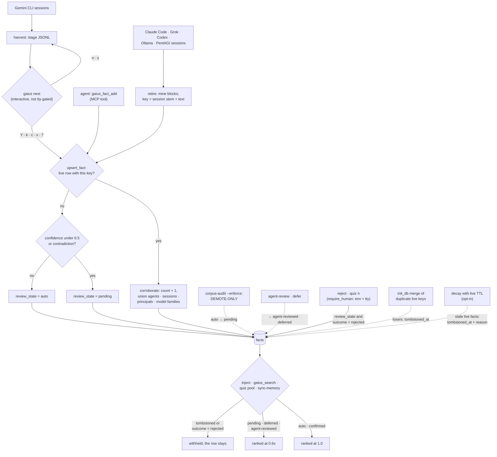

## 1. Executive Summary

gaius is an offline ops memory for coding agents: it mines facts from Claude
Code, Grok, Codex and other agents' sessions into one SQLite file and injects
them at the next session start with nobody approving them. Its two careful
mechanisms are a person's rejection, which withholds a fact from every
retrieval read while keeping the row, and an audit pass whose header bounds it
to demotion. Its weak side is that the rejection is keyed on a row rather than
on the value, the domain that looks like a scope is a topic label, and the hard
gates its README advertises ship as an example script.

It calls itself an "[o]ps memory lifecycle manager for AI coding agents", and
the README states the posture first:

> "**Runs unattended** — extract → promote → inject with no human in the hot
> path; correction is optional."

**A rejection withholds and a demotion discounts.** `gaius reject` and the
quiz's `n` answer write `review_state='rejected', outcome='rejected'`
(`gaius/review.py:649`, `:846`), and every retrieval read of facts selects
`outcome IS NULL OR outcome != 'rejected'` (`gaius/landscape.py:1119`,
`gaius/mcp_server.py:160`). The review state has six values. `auto` and
`confirmed` rank at full weight; `pending`, `deferred` and `agent-reviewed`
rank at 0.6x and stay injectable (`gaius/maturity.py:87-93`). A fact enters as
`pending` when its heuristic confidence is under 0.5 or it conflicts with an
existing one (`gaius/facts.py:537-545`).

**The audit pass states what it may not do.** `enforce_demote` reclassifies
flagged facts from `auto` to `pending`, and its docstring opens with the
bounds: "DEMOTE-ONLY — never tombstones, never DELETEs", "Touches ONLY
review_state", "Reversible — an operator flips review_state back to 'auto' to
undo" (`gaius/corpus_audit.py:49-66`). It runs only behind `--enforce` or
`CORPUS_AUDIT_ENFORCE`.

**The verbs that write a human verdict refuse an agent.** `require_human`
exits 2 when any of four agent environment variables is set or stdin is not a
tty (`gaius/review.py:63-81`), and `confirm`, `reject` and `quiz` call it. Its
own docstring bounds the claim: "a determined agent can still forge this on a
single-uid box." The machine verb, `agent-review`, can only lower a fact's rank.

**The hard gates are injection priority, not a block.** The README promises
"hard gates `exit:2` on force-push, unconfirmed live-trade, prod-delete". In
the tree, a hard gate is a feedback rule the injector selects deterministically
(`gaius/landscape.py:994-998`), and `docs/hard-gates.md:171-172` says of the
plugin's three hooks: "**None of them block tool calls.**" The `exit 2` hook is
an example for the operator to write.

**No review gate reaches the main paths.** Gemini harvests stage to JSONL and
wait for `gaius next`, but local Claude, Grok, Codex, Ollama and PentAGI
sessions promote straight into the corpus, and the agent's `gaius_fact_add`
tool writes a fact that injects at the next session. That is why no
`human_review` mark is claimed.

## 2. Mental Model

A **fact** is a short text with a key, a topic domain and the provenance of
every run that produced it. It is injected because it exists; nothing has to
approve it first.

A fact's standing has two axes. The **review state** says how far to trust it
in ranking. The **outcome** carries the one verdict that removes it from
retrieval, `rejected`, beside `confirmed`, `refuted` and `open_question`, which
only reweight it (`gaius/maturity.py:48-53`).

How a fact stops being guidance, in order of how often each applies:

- **Discounted.** Low confidence, a detected contradiction, a deferral, an
  agent review or the audit pass puts it at 0.6x. It is injected all the same.
- **Rejected.** A person at a terminal rejects it. The row stays and leaves
  every retrieval read. The same claim mined from a later session is a new
  row.
- **Merged.** A duplicate sharing its fact key is folded into the oldest row
  and tombstoned.
- **Expired.** With the live-TTL flag set, a `live` fact older than the TTL is
  tombstoned by the decay pass, with a reason, and restorable.
- **Never deleted.** No path removes a fact row.

The memory is treated as candidate evidence with a ranking discount. A person's
verdict is the only thing that turns a fact off, and the project measures how
rarely that happens: its own comment calls the human confirm verb "empirically
DEAD", with one human confirmation among about 17,637 injectable facts on 21
July 2026 (`gaius/maturity.py:72-75`).

## 3. Architecture

| Area | Role |
| --- | --- |
| `gaius/facts.py` | Schema and migrations, the one write path `upsert_fact`, confidence and contradiction checks, the duplicate merge |
| `gaius/retire.py` | Session mining for Claude Code and the event formats; Gemini harvest to staging |
| `gaius/review.py` | The human-only check, the verdict verbs, the staged-event review and the quiz |
| `gaius/landscape.py` | `gaius inject`: memory-file and corpus selection, ranking, hard-gate priority, the token budget |
| `gaius/maturity.py` | Weight tables, `decay` with the opt-in live TTL, `governor` and other reports |
| `gaius/corpus_audit.py` | The read-only audit and the demote-only enforcement pass |
| `gaius/kg.py` | Entities and triples indexed from each new fact |
| `gaius/mcp_server.py` | Seven MCP tools over the same database |
| `gaius/concord.py` | Single-winner resource claims for concurrent agents, enforced by a partial unique index |
| `hooks/`, `.claude-plugin/`, `.mcp.json` | The Claude Code plugin: session-start and prompt injection, a post-edit health check, the MCP server |

### Deployment and ergonomics

One Python package and one SQLite file under `~/.gaius`, opened in WAL mode
with a 15-second busy timeout because the stop hook, a nightly sync and a
Kubernetes CronJob can write together (`gaius/facts.py:94-100`). No API key is
needed to store anything. The `semantic` extra adds sentence-transformers and
sqlite-vec; without it, semantic deduplication and vector ranking switch off
and keyword ranking remains.

The plugin's `.mcp.json` and its session-start fallback launch
`gaius-memory @ git+https://github.com/jkubo/gaius@v0.2.0` through `uvx`, so
an installed plugin runs the tag from 25 August 2026. That tag's package
differs from this pin only in `gaius/mcp_server.py`, the MCP SDK 2 adapter. The
store is a plain SQLite file an operator can query and repair by hand.

## 4. Essential Implementation Paths

**Write.** Every writer ends in `upsert_fact` (`gaius/facts.py:468-601`). It
looks for a live row with the same key, then a semantic duplicate above 0.92
cosine when sqlite-vec is present, and corroborates either one. Otherwise it
scores confidence from hedge and observation patterns, runs the contradiction
check, and inserts with `ON CONFLICT(fact_key) WHERE tombstoned_at IS NULL DO
NOTHING`, so a writer that loses the race corroborates instead. A new fact is
embedded and indexed into the graph inside a savepoint.

**Mining.** `_promote_mined_to_facts` keys each block on
`sha256(f"{session_stem}:{block[:200]}")` and writes it as `auto-mined` at
injection weight 0.7 (`gaius/retire.py:285-355`). The Grok, Codex, Ollama and
PentAGI paths stage the events and promote them in the same call
(`gaius/retire.py:1416-1501`). `cmd_harvest` stages Gemini events and stops
(`gaius/retire.py:1304`).

**Injection.** The session-start hook runs `gaius inject` with a corpus budget
of 2,000 tokens and a skills budget of 1,500 (`hooks/session-start.sh:42-44`).
`cmd_inject` selects `tombstoned_at IS NULL AND (outcome IS NULL OR outcome !=
'rejected')`, drops facts carrying credential material, ranks, applies the
review-state weight and fits the budget (`gaius/landscape.py:1119-1146`,
`:1351-1360`).

**Verdicts.** `cmd_reject`, `cmd_confirm` and `cmd_quiz` call `require_human`
first (`gaius/review.py:615`, `:640`, `:802`). `cmd_defer` and
`cmd_agent_review` do not, and write only weighted states
(`gaius/review.py:655-707`).

**Audit.** `cmd_corpus_audit` opens a read-only connection for its statistics
and, behind the flag, a writable one for `enforce_demote`
(`gaius/corpus_audit.py:154-185`).

**Expiry.** `cmd_decay` with the live TTL set tombstones stale `live` facts
with a `tombstone_reason` beginning "live-ttl: last_seen age"
(`gaius/maturity.py:615-670`).

## 5. Memory Data Model

The `facts` table carries the text and key, the topic domain, first and last
seen, a confirmation count, JSON arrays of agents, sessions, principals, model
families and model versions, a provenance label, a score, an outcome, a fact
type, a heuristic confidence with its source, a review state, a conflict
pointer, Leitner quiz columns and `tombstoned_at` with `tombstone_reason`
(`gaius/facts.py:108-228`). A partial unique index allows one live row per
fact key (`gaius/facts.py:239-247`).

`outcome` does two jobs. The review flows write `confirmed`, `refuted`,
`open_question` and `rejected`; `retire --claude-shim` writes up to 2,000
characters of raw tool output into it (`gaius/parsers.py:74`,
`gaius/retire.py:397-423`). Only `rejected` withholds.

**No tombstone mark.** A rejection is a state on a row, and a later write finds
it only if the key matches. Infrastructure ingest keys on the lower-cased text
(`gaius/ingest.py:112`), so a rejected Ansible fact re-ingested corroborates
the rejected row and stays withheld. Session mining keys on the session stem
and the text, and `gaius_fact_add` on a 32-character hash of the
un-lowercased text (`gaius/mcp_server.py:384`). The same claim from a later
session or from the agent is a new live row, unless sqlite-vec is installed and
the semantic match lands on the rejected row. `tombstoned_at` has two writers,
the duplicate merge and the live TTL; neither records a rejected value.

**No bitemporal mark.** Triples carry `valid_from` and `valid_to`. Insert-time
indexing passes the write clock as `valid_from` (`gaius/facts.py:585-586`), a
re-index passes the fact's `first_seen` (`gaius/kg.py:497`), and `valid_to` is
set to the current time by the `kg invalidate` CLI (`gaius/kg.py:240-245`,
`:522`). Valid time is a record or observation time.

**No audit mark.** The telemetry database logs prompts, injections, tool calls
and gate events (`gaius/telemetry.py:42-140`). Corroboration, verdicts,
demotion and tombstoning overwrite columns in place and write no event.

## 6. Retrieval Mechanics

`gaius inject` is the context assembler. Memory files from the configured
memory directory go first, feedback rules before domain files, with hard gates
exempt from the per-type count cap. Corpus facts follow, scored by BM25 and
TF-IDF computed in Python, blended with sqlite-vec cosine when available,
boosted by stored score and confirmations, and multiplied by the review-state
weight (`gaius/landscape.py:1351-1360`). With `--session-dedup`, a per-session
file suppresses entries shown in recent turns, with a shorter window for hard
gates (`gaius/landscape.py:56-94`, `:564-566`).

`gaius_search` reads the same live, non-rejected set, scores keyword overlap
and sqlite-vec cosine, and returns the first 300 characters of each hit
(`gaius/mcp_server.py:146-235`). `gaius_kg_query` and `gaius_kg_timeline`
read triples with no join to the fact they came from, so relations extracted
from a rejected fact stay reachable there (`gaius/mcp_server.py:239-316`).

**No scope mark.** `domain` is a topic such as storage or networking.
Deduplication is "GLOBAL on fact_key" across domains
(`gaius/facts.py:474-476`). The injector appends the domain clause only when
`--domain` is passed (`gaius/landscape.py:1120-1123`), `gaius_search` takes
`domain` as an optional argument from the model, and `governor` builds
`"AND domain = ?" if parsed.domain else ""` (`gaius/maturity.py:407`). The
session hook passes no domain. Facts carry no project, user or tenant column.

## 7. Write Mechanics

Mining is a CLI pass over session files, run by hooks or a schedule; the agent
does not block on it, and a mined fact is retrievable at the next injection.
`gaius_fact_add` writes synchronously and its reply says the fact "[w]ill
appear in future inject outputs". Extraction is pattern-based: no model call
sits on the write path. Credential material is dropped at the mining boundary
and again at injection.

Each write reads every non-rejected fact in the domain for the contradiction
check (`gaius/facts.py:442-465`), so write cost grows with the domain. The
contradiction signal is five or more shared meaningful tokens plus an
asymmetric operational-negation word such as "removed" or "deprecated"; on a
hit both facts become `pending` at confidence 0.30. Injection is bounded by a
token budget, 2,000 for the corpus and 1,500 for skills at session start.

## 8. Agent Integration

The MCP server registers seven tools: search, two graph reads, stats,
session priming, skill recommendation and `gaius_fact_add`
(`gaius/mcp_server.py:145-453`). No verdict verb is on it. The agent can reach
the CLI through a shell: `defer` and `agent-review` are ungated, and
`gaius next` reads its answers from stdin, so piped input promotes a staged
cluster.

The plugin registers SessionStart injection, UserPromptSubmit injection that
is off unless `GAIUS_PROMPT_INJECT=1`, and a PostToolUse health check on edits
inside the memory directory (`hooks/hooks.json`). A standalone install's hooks
take precedence and the plugin yields to them.

## 9. Reliability, Safety, and Trust

The careful parts are the separation of withholding from demotion, a sweep that
cannot destroy, a merge that keeps every agent and session that agreed, and the
credential filter at two boundaries.

Rejection protects the corpus once. The mined-fact key includes the session,
so a rejected claim recurs at full weight when the next session repeats it.

The audit's second tier selects fact keys with more than one live row
(`gaius/corpus_audit.py:86-89`). `init_db` merges such rows and creates a
partial unique index on every open, and `main()` calls `init_db` before every
command, so that tier finds nothing on a production store. The audit's
contradiction counters are zero for the same reason. The first tier, and
the statistics, treat any non-null outcome other than `rejected` as verified
(`gaius/corpus_audit.py:91-92`), so shim-imported facts carrying raw tool
output are counted as outcome-verified and never demoted.

`require_human` stops the default agent path to a human verdict, by its own
account not a determined one. The safety claim most likely to mislead a reader
is the README's: an operator who installs the plugin for its force-push gate
gets a rule in context and no block.

## 10. Tests, Evals, and Benchmarks

749 test functions in 44 files, run in CI across two Python versions and both
MCP SDK majors. I read the suites named here; I ran none.

`test_inject_excludes_credential_facts_and_keeps_clean_ones` is the negative
evaluation (`tests/test_inject_credential_filter.py:70-87`). It seeds a
credential-bearing fact and a clean one, injects with a task both match, and
asserts the sentinel and the token absent while the clean marker is present.
The comment beside the task flag says why: without it "the control test proves
nothing". No committed case asserts a rejected fact absent from inject or
search.

`tests/test_reject.py:59-88` pins both refusals of `reject` and that the row
stays unrejected. `tests/test_corpus_enforce.py` covers the demote-only
guarantees on a table it builds itself, without the partial unique index, which
is how a contradiction tier that cannot fire in production has passing tests.

`benchmarks/bench_longmemeval.py` is the harness behind the README's
LongMemEval-S table; no result file is committed. Its docstring cites the
ranking at `_core.py:3488` and `:3502`, lines past the end of the 1,221-line
`_core.py` at this pin.

## 11. For Your Own Build

### Steal

Bound a maintenance pass downward in its own header: what it may not touch, and
how to undo it. "Never tombstones, never DELETEs" is what lets an operator run
it unattended.

Keep withholding and discounting as different states. A rejected fact leaves
every read; a doubtful one ranks lower. One number cannot say both.

Union provenance when merging duplicates: sum the counts and keep every agent,
session and model family, so independent agreement survives deduplication.

Make the human-verdict verbs refuse known agent environments and a non-tty,
test both refusals, and give the machine its own verb that can only lower rank.

### Avoid

A rejection keyed on a row whose key includes the session. Key the verdict on
the value, and check it on every write path.

A status column shared with free text. A predicate that treats any non-null
value as a verdict will count raw tool output as verification.

A test fixture that builds its own schema. The production index made the
contradiction tier unreachable, and the fixture's table did not have it.

A README feature the tree ships as a documentation example.

### Fit

This suits one operator's coding-agent fleet on one machine, where recall
matters more than correction and the operator accepts that facts inject
unreviewed. It assumes someone will run `reject` when a bad fact surfaces, and
that the same bad fact recurring from a later session is tolerable. Walk away if
memory must be isolated per project or user, if a rejection must stand, or if
the force-push gate is the reason for installing it.

## 12. Open Questions

Whether rejection is meant to stand against re-extraction. The Ansible key
makes it stand by accident; the session key defeats it.

Whether the contradiction tier is meant for databases opened without
`init_db`, such as a copy synced from another machine before its first open.

Whether the README's `exit:2` line describes a private harness. The project's
own hard-gates document says the shipped hooks do not block.

## Appendix: File Index

| Path | What to read it for |
| --- | --- |
| `gaius/facts.py:36-82` | The duplicate merge that unions provenance |
| `gaius/facts.py:239-247` | The partial unique index on live fact keys |
| `gaius/facts.py:468-601` | `upsert_fact`: corroboration, confidence, contradiction, the race-safe insert |
| `gaius/review.py:63-81` | `require_human` and its stated limit |
| `gaius/review.py:631-707` | Reject, defer and agent-review |
| `gaius/landscape.py:1119-1146` | Inject candidate selection: the rejected filter and the credential filter |
| `gaius/landscape.py:1351-1360` | The review-state weight in ranking |
| `gaius/maturity.py:48-93` | Outcome and review-state weight tables |
| `gaius/maturity.py:615-670` | The opt-in live-TTL tombstone |
| `gaius/corpus_audit.py:49-110` | The demote-only pass and its two tiers |
| `gaius/retire.py:285-355` | Session mining and its session-keyed fact key |
| `gaius/mcp_server.py:145-406` | The MCP search, graph and write tools |
| `docs/hard-gates.md:169-195` | What the hard gates do, and the example blocking hook |
| `tests/test_inject_credential_filter.py:70-87` | The must-not-inject case with its control |
| `tests/test_corpus_enforce.py` | The audit tests and their own schema |

### Recorded searches

Run at the tree root of the pinned checkout with `git grep`.

- `git grep -n -E "rejected" -- gaius ':!*.md'` — writers at `review.py:649` and `:846`; reads on `outcome` at `landscape.py:1119`, `mcp_server.py:160`, `:323`, `_core.py:714`, `review.py:723`, `maturity.py:414`, `:446`; `review_state != 'rejected'` only at `facts.py:443`.
- `git grep -n -E "SET review_state|review_state ?= ?'" -- gaius ':!*.md'` — `auto`, `pending`, `confirmed`, `rejected`, `deferred` and `agent-reviewed` are written; six values.
- `git grep -n -E "require_human\(|isatty" -- gaius` — `confirm`, `reject` and `quiz` in `review.py`, plus unrelated checks in `concord.py` and `spin.py`.
- `git grep -n -E "_promote_event\(" -- gaius` — `review.py:362` and `:408`, both inside the interactive staged review.
- `git grep -n -E "tombstoned_at ?=|tombstoned_at=" -- gaius` — `facts.py:75` (merge) and `maturity.py:668` (live TTL).
- `git grep -n -E "DELETE FROM facts" -- .` — no match.
- `git grep -n -E "fact_key ?=|\bfk ?=" -- gaius` — the key derivations: session stem plus text in `retire.py:325` and `:409`, lower-cased text in `ingest.py`, raw text at 32 characters in `mcp_server.py:384`.
- `git grep -n -E "domain ?= ?\?|domain = '" -- gaius` — unconditional only in `facts.py:443`, `corpus_audit.py:323` and `skills.py:716`; conditional in `landscape.py:1123` and `maturity.py:407`.
- `git grep -n -E "valid_from|valid_to" -- gaius/kg.py gaius/facts.py` and `git grep -n invalidate_triple -- .` — `valid_from` from the write clock or `first_seen`; `valid_to` from the CLI's clock.
- `git grep -n -E "CREATE (VIRTUAL )?TABLE" -- gaius` — no table records fact mutations.
- `git grep -n -E "GROUP BY fact_key HAVING" -- gaius` — the audit tier and counters at `corpus_audit.py:88`, `:133`, `:136`, `:188`, against the unique index at `facts.py:240`.
- `git grep -n -E "push --force|push -f|force-push" -- gaius hooks .claude-plugin skills` — no match.
- `git grep -n -E "sys\.exit\(2\)|exit 2" -- gaius hooks` — `concord.py:601`, `:727` and `review.py:77`, `:81` only.
- `git grep -n -E "assert .* not in " -- tests` — the credential case at `test_inject_credential_filter.py:85-86`; the others assert about files, commands, skills and graph names.
- `git grep -n -i -E 'arxiv|bibtex|@article|@misc|doi\.org' -- README.md docs CHANGELOG.md` — no match; no paper.
- `git grep -n -i -E 'anthropic|not (be )?used (for|to)' -- LICENSE` — no match; the Apache-2.0 text carries no rider.

## History

**2026-10-15** — [`520c2eb12627e2c7eb886999b5377a20ee31a7b8`](https://github.com/jkubo/gaius/commit/520c2eb12627e2c7eb886999b5377a20ee31a7b8) — 12 commits on, MCP SDK 2 support and dependency bumps; no memory path moved. `negative_eval` gained, earned at the first pin: the inject credential case asserts a fact absent beside a control that must appear ([section 10](#10-tests-evals-and-benchmarks)). Also wrong then: the withholding read is on `outcome`, not `review_state`; the review state has six values, not three ([section 2](#2-mental-model)); the hard gates ship as a documentation example, not code; `domain` is a topic label the injector and search make optional ([section 6](#6-retrieval-mechanics)). Screened from a full clone: four auto-run surfaces, one build-time execution point, no unpinned surfaces, nothing inside the cooldown. Nothing was installed, built or run.

**2026-09-19** — audited at the unchanged pin [`b720bdb6ba0f8d2b8e76f7e843493affad9cd329`](https://github.com/jkubo/gaius/commit/b720bdb6ba0f8d2b8e76f7e843493affad9cd329); nothing upstream moved, so the correction is ours. `human_review` is **withdrawn**, and section 2 already contained the fact that settles it: the read filters `review_state != 'rejected'`, so a `pending` fact stays retrievable under a ranking penalty. Nothing waits. The withdrawn record's own qualification said the same thing from the other side — the surface is one *"a person may use and not one the pipeline waits for"* — and the project's stated posture is that it runs unattended with correction optional. This reading also turned up `gaius/review.py`, which the previous record did not cite and which is worth more than the mark it cannot earn: the review command exits 2 off a terminal, promotion from staging takes an explicit outcome rather than a bare yes, and a human confirmation stamps `confidence_source='human'`. All three are now in section 2. `trust_state` stands on the same filter — `rejected` is the state that withholds. Screened again first; nothing was installed and no suite was run.

**2026-09-16** — [`b720bdb6ba0f8d2b8e76f7e843493affad9cd329`](https://github.com/jkubo/gaius/commit/b720bdb6ba0f8d2b8e76f7e843493affad9cd329) — first reading, at a commit dated 15 September 2026. Screened before opening, from a shallow clone: four auto-run surfaces, one build-time execution point, no unpinned dependency surfaces and two dependency files inside the seven-day cooldown. Nothing was installed, built or run, and no session transcript was extracted.
