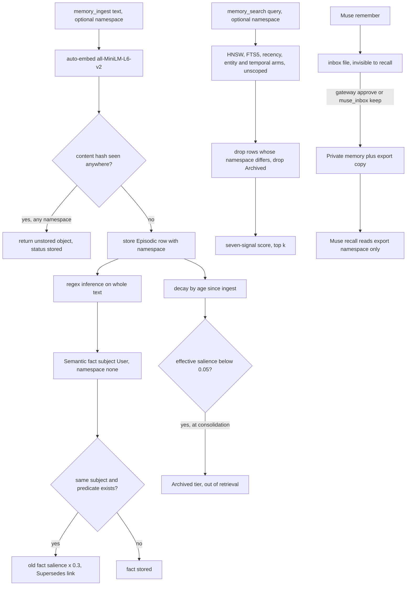

## 1. Executive Summary

Cortex is a local memory engine for personal agents, written in Rust and
shipped mainly as a stdio MCP server over one SQLite file. A memory is a typed
row in one of five tiers. Every ingest is embedded on-device, scanned by regex
for first-person facts and preferences, and recalled through a seven-signal
ranker over HNSW, FTS5 and entity expansion. It is unrelated to
[Cortex by CortexPrism](../cortex/), which shares the name.

What is notable is the Muse gateway: a second, deliberately narrow surface
through which Meta's Muse agent reads an explicit export and nothing else.
Every response is capped, redacted and audited, a revoke takes effect on the
next call, and what Muse asks to remember waits in an inbox until approved.
End-to-end tests assert what must not leak. The inbox misses `human_review`
because one of its two drains is an agent tool, described in section 9. What is weak is the main store
behind it, where the scope key is a filter on one read path and the
maintenance machinery runs on assumptions the write path never satisfies.

The engine is a library (`cortex-core`) wrapped by the MCP server, a REST
server, Python and WASM bindings, an OpenClaw plugin and an Obsidian plugin.
Optional sync replicates Shared and Public memories as encrypted, HMAC-signed
oplogs through a cloud folder the user owns. Cortex Cloud hosts per-tenant
copies of a user's Muse export.

Five findings shape the rest of this report.

- **Facts are not scoped and all have one subject.** Regex extraction writes
  `User lives_in X` with no namespace (`cortex-core/src/inference.rs:278-299`,
  `cortex-core/src/semantic.rs:55-83`). The resolver then supersedes any fact
  with the same subject and predicate. Two namespaces' users overwrite each
  other's location, and a namespaced context shows neither.
- **Exact dedup crosses namespaces and misreports.** The content hash ignores
  namespace (`cortex-core/src/types.rs:441-459`). A write identical to another
  namespace's memory returns `"status": "stored"` with an id that was never
  written (`cortex-core/src/lib.rs:811-823`,
  `cortex-mcp-server/src/tools.rs:774-785`).
- **Recall never refreshes a memory, so use cannot save one from decay.**
  `EpisodeStore::touch` has no product caller and retrieval writes nothing back.
  With default settings an episode at salience 0.5 falls below the 0.05 sweep
  line about 478 hours after ingest and is archived out of retrieval.
- **Declared tiers without producers.** `ProceduralStore::record_action` has no
  caller outside tests, so the Procedural tier and the context's Active Patterns
  section stay empty. The `links` table holding `Supersedes` and `PartOf` is read
  only by tests.
- **The REST server has no authentication and allows any CORS origin.**
  `GET /v1/export` returns the whole store, Private memories included
  (`cortex-http/src/main.rs:96`, `:108-112`).

## 2. Mental Model

A memory is a `MemObject`. Raw input becomes an `Episodic` text row. Regex
inference over the same text may add `Semantic` rows: facts as
subject-predicate-object triples at fixed confidences (0.85 for location and
employer, 0.80 for "I am a"), and preferences as key-value pairs. Repeated
episodes can be promoted into a new `Semantic` row by consolidation. Beliefs
are a separate table keyed by free text, each a probability updated by a
Bayesian rule from `Supports` or `Contradicts` evidence the agent supplies
through `belief_observe`.

Nothing in the store is epistemically graded except by floats. A fact's
confidence is its salience base score, a belief is a probability, and the only
thing that keeps a memory out of a result is the `Archived` tier or a namespace
mismatch. A superseded fact is multiplied by 0.3 and stays searchable. The
context assembler drops facts under 0.3, so a fact stored at confidence 1.0
lands exactly on the floor after supersession and stays in the injected block.

Memories die four ways. Decay lowers an episode's `decay_factor` by age since
`last_accessed`, and the consolidation sweep archives it below 0.05 effective
salience. `memory_delete` and compression hard-delete rows. Sync applies remote
deletes behind HLC tombstones. A memory classified `Permanent` by a temporal
regex has a 0.8 decay floor, so at default salience it is never swept.

The Muse inbox is the one place a memory waits. Muse's `remember` appends to a
file. The text becomes a memory only when the user runs `gateway approve`, or
when the local assistant calls `muse_inbox` with `keep`. The second door is why
the queue earns no review mark (section 9).

## 3. Architecture

Six crates share one engine. `cortex-core` owns storage, inference, retrieval,
consolidation, compression, sync and the plugin hooks. `cortex-mcp-server` is
the primary binary: a stdio MCP server plus CLI subcommands, with the Muse
gateway compiled in by default. `cortex-http` is an axum REST server with an
embedded dashboard. `cortex-cloud` hosts Muse exports for many tenants.
`cortex-python` (PyO3) and `cortex-wasm` are thin bindings.

Persistence is one SQLite file per database with a writer connection and a
reader pool (`cortex-core/src/storage/sqlite.rs:130-175`). With a passphrase
or raw key the file is opened through SQLCipher. The vector index is an
in-process `instant-distance` HNSW with a brute-force pending buffer, loaded
lazily from stored embeddings on first retrieval
(`cortex-core/src/storage/memory_index.rs:33-60`, `cortex-core/src/lib.rs:547-570`).
FTS5 is kept in step by triggers. A 64-entry LRU caches retrieval results
keyed on the query and invalidated by a write generation counter.

Background work is in-process and opportunistic. Consolidation runs every 100
ingests counted since the process started. Sync, when enabled, writes
per-device JSONL oplogs to a provider folder (iCloud Drive, Google Drive,
OneDrive or Dropbox) and pulls on a 30-second timer and a file watcher. Cortex
Cloud keeps each tenant in its own directory with an `export.db` under a raw
SQLCipher key derived from a master key and the tenant id.

### Deployment and ergonomics

Nothing has to run except the binary. `cargo build` or a Homebrew formula
produces `cortex-mcp-server`, and `claude mcp add` points it at a database path.
The first ingest downloads about 30 MB of embedding model from the Hugging Face
CDN unless `CORTEX_NO_EMBEDDINGS` is set, in which case recall is keyword and
recency only. No API key is needed to store or recall. An LLM inference hook
exists in the library (`Cortex::with_inference_fn`) and no shipped binary sets
it. The store is SQLite with JSON columns, readable and repairable with the
`sqlite3` shell when unencrypted, and `GET /v1/export` or the export module
dumps it as JSON.

## 4. Essential Implementation Paths

**Capture.** `memory_ingest` (`cortex-mcp-server/src/tools.rs:762-786`) calls
`Cortex::ingest_with_options` (`cortex-core/src/lib.rs:674-734`). `prepare_ingest`
(`:743-834`) refuses the reserved `muse-export` namespace, embeds, resolves the
caller's channel identity into the people graph, runs `extract_with_llm`, builds
an `Episodic` row and checks the global content hash. Near-duplicate merging is
off by default (`cortex-core/src/types.rs:472-488`). The row is stored, indexed,
emitted as an event for sync, and `finalize_ingest` (`lib.rs:889-985`) writes
derived facts, preferences and speculative relationships capped at 0.29
confidence.

**Extraction and correction.** `extract` (`cortex-core/src/inference.rs:106-126`)
runs prefix rules over the whole lowercased text, skipped when a negation word
appears. In `finalize_ingest` a new fact whose subject and predicate match an
existing one with a different object is added and the old one is passed to
`SemanticStore::merge_facts` (`semantic.rs:181-196`). That writes a
`Supersedes` link and multiplies the old salience by 0.3. `fact_add`
(`tools.rs:953-965`) calls `Cortex::add_fact`, which skips this step, so an
explicitly added correction leaves the old value at full weight.

**Retrieval.** `RetrievalEngine::retrieve` (`cortex-core/src/retrieval.rs:183-398`)
is described in section 6. `memory_search` passes the namespace through
`retrieve_with_namespace` (`lib.rs:1131-1197`).

**Context assembly.** `generate_context` (`cortex-core/src/context.rs:178-377`)
builds sections for preferences and facts, the conversation partner, recent
episodes, patterns and beliefs, then splits a character budget by weight in two
passes. `memory_context` and the OpenClaw auto-recall hook reach it.

**Delete and forget.** `Cortex::delete_memory` (`lib.rs:1572-1580`) deletes the
row, removes it from the index and records a sync delete when the memory had
been synced. The MCP handler first deletes Muse export copies with the same
text (`tools.rs:630-686`). Archival is `archive_memory` (`lib.rs:1453-1463`),
reversed by `memory_restore`.

**Consolidation.** `run_consolidation_cycle`
(`cortex-core/src/consolidation.rs:82-117`) decays episodes, promotes groups of
three or more by lowercased text or by greedy cosine clustering at 0.85
(`:119-240`), and archives episodes below 0.05 (`:288-318`).

**Muse gateway.** `export_rows` and `rank` (`cortex-mcp-server/src/gateway.rs:332-459`)
serve `recall_memory`; `call_remember` (`:626-694`) fills the inbox; the
`Approve` and `Reject` CLI arms (`:1239-1275`) drain it.

**Tests.** Retrieval and namespace cases sit in `cortex-core/tests/`; the
gateway's end-to-end cases spawn the binary in `cortex-mcp-server/tests/`.

## 5. Memory Data Model

The `memories` table (`sqlite.rs:479-494`, with migrations at `:594-650`) keeps
content, temporal, source, salience, privacy, tags, metadata and links as JSON
text, with materialised columns for `content_hash`, `namespace`,
`salience_score`, `fact_subject`, `fact_object`, `pref_key`, `source_channel`
and `source_identity_id`. `links`, `people`, `channel_identities`, `beliefs` and
`patterns` are separate tables, none with a namespace column.

`TemporalInfo` carries `event_time`, `ingestion_time`, `last_accessed`,
`access_count` and a durability class (`types.rs:96-105`). `event_time` is an
occurrence instant, set by compression to a session's start and by no ingest
path; there is no validity interval, and supersession closes nothing.

Scoping has three distinct mechanisms. `namespace` is an optional string on
memory rows. `PrivacyLevel` (`Private`, `Shared { scope }`, `Public`) decides
whether a mutation enters the sync oplog. The `Shared` scope string is stored
and never read for access. The reserved `muse-export` namespace is refused on
ingest and on sync merge, and is the only thing the gateway reads.

Provenance is thin. `MemSource` records a channel string and optional identity,
chat, thread and message ids. A derived fact gets `MemSource::new(channel)` and
no reference to the episode it came from, so deleting the episode leaves the
fact. Preferences get channel `system`.

## 6. Retrieval Mechanics

Retrieval is application- or tool-driven, and candidates come from five arms
in order (`retrieval.rs:204-279`). Every phase stops at 10,000 candidates or
250 ms.

- HNSW top `limit × 5` when the query has an embedding, or else the newest
  `limit × 3` episodic and semantic rows.
- Entity expansion: episodes matching the subjects, objects and predicates of
  facts that name a capitalised query token.
- A time-ordered list when regex detects "recently", "first" or sequence intent.
- A one-hop expansion from the top five candidates' fact entities.
- FTS5 BM25 over the JSON content.

The namespace and archived-tier filters run once, per candidate, after all
arms (`retrieval.rs:347-359`). Every arm is therefore covered, and every arm
spends its budget before the filter. The HNSW arm returns the global top
`limit × 5`, so a small namespace in a large store can lose its candidates to
other namespaces before the filter sees them.

Scoring is a weighted sum of similarity, temporal, salience, social, channel,
FTS and frecency terms (defaults 0.30, 0.18, 0.22, 0.08, 0.07, 0.15, 0.10),
reweighted multiplicatively by temporal intent and by a regex query type
(`retrieval.rs:284-337`). Frecency reads `access_count` and `last_accessed`,
which only near-duplicate reinforcement writes. With that off, frecency is a
function of age. "First" and "earliest" queries take the newest `limit × 3`
episodes and reverse them (`retrieval.rs:533-540`), so the oldest memory in the
store is not a candidate on that arm.

`memory_context` behaves differently from search. Semantic rows are filtered by
namespace through SQL (`context.rs:198-202`). Episodes are filtered by
namespace only when no channel is given (`:268-281`); with a channel they are
the newest rows on that channel from every namespace. Beliefs above 0.8 or
below 0.2, patterns and the conversation partner are global. A `for_remote_llm`
option drops Private memories from the block and is called only by a test, so
the MCP context sent to a hosted model includes them.

## 7. Write Mechanics

Writes are explicit tool calls, or every user message over 20 characters when
the OpenClaw plugin's auto-capture is on. No model runs on the write path by
default. Extraction is regex over English and Chinese templates. A text that
begins "I live in Paris" yields `User lives_in Paris` at 0.85, whoever wrote it
and in whatever namespace.

Dedup is exact and global by default. The hash covers content only, so a
second namespace writing the same sentence gets back a fresh, unstored object
and a `stored` status. Batch ingest dedups within the batch as well. Near
duplicates are kept unless the adopter opts in, under a comment that merging
"task 1" with "task 2" is worse than a duplicate.

Consolidation promotes and never retires. `promote_to_semantic`
(`consolidation.rs:242-285`) writes a new semantic row and `PartOf` links and
leaves the source episodes in place. `find_promotion_candidates` does not look
for an earlier promotion, so a qualifying group qualifies again at the next
cycle until decay archives its members; this is read from the code and was not
run. Compression groups episodes by channel and calendar day across
namespaces and privacy levels, writes one summary with no namespace, and
deletes the originals through `delete_memories_batch`, which emits no sync
event (`compression.rs:83-98`, `:176-207`).

### Operational cost

The write blocks the caller for an embedding and a regex pass; the README
quotes 156 µs per ingest from `cargo bench` with inference and about 3.9 ms
with real embeddings in its scale write-up. A memory is retrievable on return.
Consolidation every 100 ingests pages through every episodic row twice (decay,
then promotion) and clusters embeddings greedily, so its cost grows with the
store rather than with the day's writes. `memory_context` defaults to 2,000
tokens, and the OpenClaw hook injects 1,500 as a system message each turn;
where that message lands in the prompt is the host's choice.

## 8. Agent Integration

The MCP surface is 30 built-in tools: ingest, search, context, facts,
preferences, beliefs, people, consolidation, decay, compression, archive,
restore, delete, namespaces and sync, plus six `muse_` tools. With no
`capabilities.json` every tool is allowed. With one, the server is
deny-by-default by group (`read`, `write`, `sync`, `muse`, `plugins`) and fails
closed on a malformed file, or on a missing one named by `CORTEX_CAPABILITIES_FILE` (`cortex-mcp-server/src/capabilities.rs:1-140`).
The CLI and the REST server sit outside that policy.

The agent decides everything about memory: what to save, which namespace to
pass, whether to supply a salience, and when to consolidate, decay, compress or
delete. Nothing is injected automatically by the MCP server. The OpenClaw
plugin adds the two hooks, passing a channel and no namespace. Sharing with
Muse is two-step: `muse_connect` and `muse_share` return the exact list and an
eight-character code, and a second call with the code shares it. The code is
returned to the same agent that must present it, so the confirmation is a
request to show the user, not a constraint.

Adapting the engine to another agent is straightforward because the library
API mirrors the tools. A multi-user host would have to supply namespaces on
every call and could not rely on facts, beliefs or people being separated.

## 9. Reliability, Safety, and Trust

**The gateway is built to fail closed.** It reads only export rows
through SQL and checks each again for the namespace, `Private` privacy and the
`muse-export:` hash prefix that only `allow` writes (`gateway.rs:332-352`).
Snippets are capped at 500 characters and responses at 4 KiB after JSON
escaping. Email addresses are redacted, daily request and disclosure budgets
persist to disk, and a disclosure that cannot be audited is refused. Pending
inbox text is sealed under a derived key in Cortex Cloud and escaped for the
terminal when listed.

**The Muse inbox almost carries `human_review`, and the mark is withheld.**
Muse cannot clear its own queue: its tools are `recall_memory` and `remember`,
and recall reads only export rows, so a pending item is invisible to it
(`gateway.rs:626-694`). On the self-hosted path the only drain is the
`gateway approve` and `reject` CLI, and no MCP tool reaches the local inbox file
(`gateway.rs:1239-1275`). On the Cortex Cloud path the drain is the local
assistant's `muse_inbox` tool with `keep` (`muse_tools.rs:539-580`). That tool is
allowed when no capability file exists, and asking the user is stated only in its
description. A declared approve verb on an agent's tool surface fails the mark,
so the queue is a quarantine against Muse and not a person's gate.

**Scope in the main store is narrower than the tool descriptions suggest.**
`memory_ingest` documents namespace as "for isolation (optional, e.g.
'user_123')". The isolation holds on `memory_search`. It does not hold on
facts, which share one subject and no namespace, or on the episodes
`memory_context` returns when a channel is passed. Dedup, compression and
promotion also cross namespaces, and the latter two write rows the namespace
filter then hides.

**Privacy levels govern replication, not reads.** Private memories never enter
the oplog, and demoting a memory to Private records a retraction for other
devices (`lib.rs:1484-1527`). Every read path returns Private memories to the
MCP client, which is usually a hosted model.

**The REST server is open.** It binds to 127.0.0.1 by default with no
authentication and `CorsLayer` allowing any origin, method and header. Any
script that can reach the port may read `/v1/export` and write `/v1/import`
as far as CORS is concerned. The capability policy says in its header that the
HTTP surface is gated separately and lists input bounds only.

**Sync is careful.** Oplog lines and the manifest carry HMACs, keys rotate
through versioned envelopes, and remote upserts older than a tombstone are
refused. Tombstones are collected after 30 days, after which an old upsert
from a stale device could restore the row; this follows from
`gc_tombstones` and was not exercised.

Prompt-injected memories have no defence beyond the gateway's quarantine. A
`memory_ingest` from a poisoned transcript is stored, extracted into facts and
injected as "Known Facts" at its regex confidence.

## 10. Tests, Evals, and Benchmarks

I counted 797 `#[test]` functions across 64 Rust files. Of those files, 39 are
integration files under `tests/` in 15,066 lines. CI runs `cargo test` for the
workspace minus the bindings, clippy with warnings as errors, and a script
that checks for network egress. I did not run them.

The gateway suites carry the evidence the marks rest on. They spawn the binary,
seed a database through the CLI and speak HTTP. `http_privacy_gate_returns_only_export_namespace`
asserts the returned texts equal the export alone and that the body contains
none of three matching non-export memories. The revoke case asserts a revoked
export disappears while its sibling is returned. The remember suite covers
quarantine, approve, reject, caps, the kill switch and concurrent writers. Its
quarantine and reject absences carry no in-store positive control in the same
test; the approve case supplies it separately.

The core suite is broad and uneven. `test_retrieval_namespace_isolation` stores
three memories under one embedding and asserts exactly one result from the
requested namespace. `test_retrieve_with_namespace_filtering` asserts inside a
`for` loop over results, which passes when retrieval returns nothing.
`test_contradiction_flow.rs` pins the supersession contract on ranking only.
No test exercises `memory_context` with a namespace, extracted facts from two
namespaces, `fact_add` of a contradicting value, or the derived facts of a
deleted episode.

The README reports LoCoMo at 73.7% overall, the macro average of four
categories, from `bench/locomo_bench.py` on the v1.7 engine with Claude Sonnet
4 as answerer and judge. The script writes `locomo_results.json`, and no such
file is committed. Its docstring names Gemini for QA and judging while the code
calls Anthropic's API. `docs/scale-test-2026-06-13.md` reports 40% paraphrase
recall at about 5,000 memories, a cause traced to the HNSW `ef_search` default,
and a fix; its raw runs are not committed either. No paper accompanies the
project.

## 11. For Your Own Build

### Steal

- **A disclosure surface that reads one explicit export.** Copy chosen
  memories into a reserved namespace that ordinary writes and sync refuse, mark
  each copy with a hash prefix no ingest can produce, and re-check namespace,
  privacy and marker after the SQL. Delete the copies when the original is
  deleted.
- **Quarantine a third party's writes outside the store.** An inbox file the
  writing agent cannot read back, acknowledged with the same reply whether
  stored, full or dropped, so the writer learns nothing about the user's
  draining.
- **Charge, then audit, then store, and fail closed.** A write or disclosure
  that cannot be recorded is refused.
- **Test the leak end to end with a positive control.** Seed matching
  memories at every privacy level plus one allowed copy, then assert the
  response equals the allowed copy and the raw body contains none of the rest.

### Avoid

- **A scope key that only the search path reads.** Derived rows, dedup hashes,
  summaries and promotions need the key too, or the filter hides them and
  isolation fails on every path that skips it.
- **A fixed subject for extracted facts in a multi-user store.** "User" plus a
  per-subject supersession rule makes every user's correction overwrite every
  other user's value.
- **Decay keyed on last access with nothing writing access.** Usage-based
  forgetting without a usage signal is age-based deletion.
- **A success status for a write that did not happen.** Dedup should return the
  existing id, or say it skipped.

### Fit

This suits one person running one MCP client who wants fast local recall and,
specifically, a controlled way to let Meta Muse see a curated slice of memory.
The gateway is the reason to read the tree and the part to copy.
For several users or projects in one database, the namespace contract does not
hold beyond search, and an adopter would be rebuilding facts, beliefs and
maintenance around it. Anyone expecting the four-tier model to curate itself
should expect ordinary episodes to leave recall after a few weeks of
consolidation, whether or not they were used.

## 12. Open Questions

- Whether the auto-iteration branches (`origin/auto-iter/*`) and the
  `SECURITY_AUDIT_ITER_*` files come from an unattended agent loop, and whether
  anything reviews its commits before they reach `main`.
- Whether real deployments set `with_auto_consolidation_interval`, since a
  server process restarted per session rarely reaches 100 ingests.
- How browsers' private-network rules interact with the REST server's
  any-origin CORS in practice; this needs a running server.
- Whether the LoCoMo figures reproduce on the 2.4.0 engine, which the README
  says has not been re-run.
- Whether Cortex Cloud's inbox drain is meant to stay an agent tool or gain a
  person-only path like the local CLI, which would decide `human_review`.

## Appendix: File Index

- Storage and schema: `cortex-core/src/storage/sqlite.rs`,
  `cortex-core/src/storage/memory_index.rs`, `cortex-core/src/types.rs`.
- Write path: `cortex-core/src/lib.rs` (`ingest_with_options`,
  `prepare_ingest`, `finalize_ingest`), `cortex-core/src/inference.rs`,
  `cortex-core/src/semantic.rs`, `cortex-core/src/relationship.rs`.
- Retrieval: `cortex-core/src/retrieval.rs`.
- Context assembly: `cortex-core/src/context.rs`.
- Background: `cortex-core/src/consolidation.rs`,
  `cortex-core/src/episode.rs`, `cortex-core/src/compression.rs`,
  `cortex-core/src/sync/`.
- MCP, API and SDK: `cortex-mcp-server/src/tools.rs`,
  `cortex-mcp-server/src/capabilities.rs`, `cortex-mcp-server/src/gateway.rs`,
  `cortex-mcp-server/src/gateway/muse_tools.rs`, `cortex-http/src/`,
  `cortex-cloud/src/main.rs`, `openclaw-plugin/index.ts`.
- Tests and evals: `cortex-core/tests/`, `cortex-mcp-server/tests/`,
  `cortex-cloud/tests/`, `bench/`, `docs/scale-test-2026-06-13.md`.

### Recorded searches

Checked against the checkout at the pinned revision, from the tree root.

- `git grep -n -E 'record_action\('` — the definition at `cortex-core/src/procedural.rs:31` and calls in `cortex-core/tests/test_procedural.rs` only.
- `git grep -n -E '\.touch\(' -- cortex-core cortex-mcp-server cortex-http` — one hit, `cortex-core/tests/test_episode.rs:140`.
- `git grep -n -E 'access_count \+?=|last_accessed\s*=' -- '*.rs' ':!*/tests/*'` — `episode.rs:233-234` (`touch`), `lib.rs:874-875` and `:1043-1044`, both near-duplicate reinforcement.
- `git grep -n -E 'for_remote_llm\(|with_include_private\('` — the definitions in `context.rs` and one call in `cortex-core/tests/test_context.rs:143`.
- `git grep -n -E 'with_inference_fn\('` — the definition and `cortex-core/tests/test_cortex_full.rs:90`.
- `git grep -n -E 'get_links\(' -- '*.rs'` — the trait and SQLite definitions plus test calls; no reader in any `src/`.
- `git grep -n -E 'LinkRelation::Supersedes' -- '*.rs'` — one writer, `semantic.rs:185`, and two test references.
- `git grep -n -E 'namespace' -- cortex-core/src/belief.rs cortex-core/src/people.rs cortex-core/src/procedural.rs cortex-core/src/semantic.rs cortex-core/src/compression.rs` — no match.
- `git grep -n -A6 -E 'fn find_by_content_hash' -- cortex-core/src/storage/sqlite.rs` — `WHERE content_hash = ?1 LIMIT 1`, no namespace term.
- `git grep -n -i -E 'valid_from|valid_to|valid_until|invalid_at|as_of' -- '*.rs'` — only OAuth `invalid_token` strings.
- `git grep -n -i -E 'tombstone' -- '*.rs' | grep -v 'sync/'` — test references to sync tombstones only; no value-keyed record.
- `git grep -n -i -E 'audit' -- 'cortex-core/src/*.rs'` — one doc comment in `events.rs`; the event bus keeps no log.
- `git grep -n -E 'with_namespace|get_context_with_namespace|get_context_filtered' -- '*/tests/*'` — retrieval calls only; no context test passes a namespace.
- `git grep -n -i -E 'arxiv|bibtex|@article|@misc|doi\.org|CITATION' -- ':!bench/data'` — no match.
- `git ls-files | grep -iE 'result|score|\.jsonl$|bench'` — the bench scripts, the LoCoMo dataset and two Criterion benches; no result file.

## History

**2026-10-15** — [`951aca3e6bac84669dec65865dd6f774ca13b67e`](https://github.com/gambletan/cortex/commit/951aca3e6bac84669dec65865dd6f774ca13b67e) — first reading, at the head of `main`, a commit of 8 October 2026. Two marks: `scope_enforced`, `negative_eval`; `human_review` withheld because the cloud inbox drain is an agent tool. MIT with no rider. Screened before reading from a full clone: three auto-run surfaces (`.claude/settings.json` with `.claude/hooks/skeptic-suggest.sh`, a SessionStart hook that reads `git log` and `git status` and prints a directive addressed to the reading agent; `server.json`, an MCP registry manifest naming a Docker image), two build-time execution points (an npm `postinstall` and an openclaw `prepublishOnly`), nothing inside the cooldown, and three unpinned surfaces. `.claude/CLAUDE.md` and `.claude/agents/` were treated as data. Nothing was installed, built or run.
