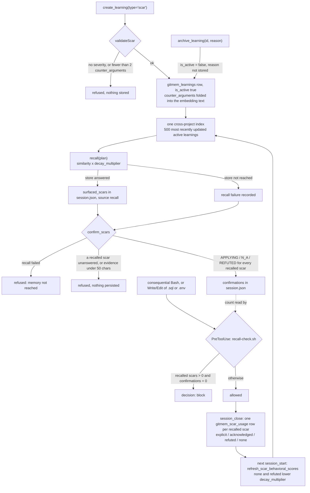

## 1. Executive Summary

GitMem is an MCP server that gives a coding agent a store of **scars**
(mistakes), wins, patterns and anti-patterns, and makes the agent answer for
them: a scar is refused at write time unless it carries at least two
counter-arguments, and a `PreToolUse` hook blocks a consequential command while
recalled scars have no accepted confirmation. The weak points are where those
two rules meet the store: the gate counts confirmations rather than matching
them to scars, the counter-argument rule counts strings without reading them,
and every scar read path draws from one cross-project index.

**At write time, a scar must argue against itself.**

```typescript
function validateScar(params: CreateLearningParams): string[] {
  const errors: string[] = [];
  if (!params.severity) {
    errors.push("Scars require severity (critical, high, medium, low)");
  }
  if (!params.counter_arguments || params.counter_arguments.length < 2) {
    errors.push("Scars require at least 2 counter_arguments");
  }
  return errors;
}
```

The counter-arguments are stored in a `TEXT[]` column, folded into the embedding
text on the Supabase path, and returned on every search result shape, so the
objection travels with the claim to the point of use. The rule is a count: the
Zod schema bounds each string at 2,000 characters and sets no minimum, so two
empty strings satisfy it.

**At read time, every recalled scar must be answered, once.** `confirm_scars`
implements what its docstring calls the refute-or-obey protocol — `APPLYING`
with past-tense evidence, `N_A` with a scenario comparison, `REFUTED` with a
risk acknowledgment. It refuses the whole batch if any recalled scar is left
unanswered, if any evidence is under 50 characters, or if the last recall never
reached the store. `hooks/scripts/recall-check.sh` turns that into a hard block
on `git push`, `npm publish`, deploys and writes to `.sql` or `.env` files. The
hook's condition is "recalled scars exist and the confirmation count is zero",
so a second recall after an accepted confirmation surfaces scars that the gate
does not hold (section 9).

**The loop closes in ranking.** At session close every recalled scar becomes a
`gitmem_scar_usage` row — `explicit`, `acknowledged`, `refuted`, or `none` for
one surfaced and ignored. The next `session_start` runs a SQL function that sets
each scar's `decay_multiplier` from its 90-day dismiss rate, and local recall
multiplies similarity by it.

## 2. Mental Model

A memory is a **learning**: a typed, structured lesson with a title,
description, severity, `counter_arguments`, `applies_when`, `why_this_matters`,
an `action_protocol` and `self_check_criteria`. The agent treats it as
something it must answer, and the answer, more than the learning, is what the
system tracks closely.

A learning has two lifecycle values and one grade that moves:

- **active** (`is_active` true or absent) — in the index and in every read.
- **archived** (`is_active = false`) — set by `archive_learning`, which the
  agent holds; excluded from the index load, the SQL search function, the
  free-tier BM25 path and `log`. The tool takes a `reason`, echoes it in its
  reply, and stores nothing of it (`src/tools/archive-learning.ts:162-165`,
  `:211-222`).
- **`decay_multiplier`** — a float from 0.1 to 1.0, rewritten by
  `refresh_scar_behavioral_scores()` as `1 − 0.8 × dismiss rate` for a scar
  surfaced at least three times in 90 days, where `none` and `refuted` count as
  dismissals (`schema/setup.sql:383-422`). A refuted scar sinks; it does not
  leave.

Nothing deletes a learning, and nothing moves one into a state that says it
was wrong. A learning written in error is archived with a reason that is
discarded, or left to decay as agents refute it.

Two further stores carry memory across sessions with their own lifecycles.
**Threads** are open work items with a six-value `status` (`emerging`, `active`,
`cooling`, `dormant`, `archived`, `resolved`), deduplicated by embedding against
the caller's own session's open threads. **Thread suggestions** are proposals
from session-embedding clusters, `pending` until `promote_suggestion` or
`dismiss_suggestion` — both registered tools the agent holds.



## 3. Architecture

A TypeScript MCP server on stdio (`gitmem-mcp` on npm) with thirty canonical
tools and short aliases. `src/` holds `tools` (the MCP surface), `schemas` (Zod
input schemas), `services`, `hooks`, `commands` and `diagnostics`. A Claude Code
plugin under `hooks/` registers shell hooks on `SessionStart`,
`UserPromptSubmit`, `PreToolUse`, `PostToolUse` and `Stop`.

Storage has two tiers. **Pro** is Supabase: Postgres with pgvector from
`schema/setup.sql`, reached over PostgREST only, with embeddings from OpenAI,
OpenRouter or a local Ollama. At start the server loads the 500 most recently
updated active learnings with their embeddings into one in-process index,
persists them to an on-disk cache keyed by store, and on later starts fetches
only rows whose `updated_at` moved. **Free** is JSON files under `.gitmem/`
(`~/.gitmem` unless `GITMEM_DIR` is set), searched by BM25 over title,
keywords and description.

### Deployment and ergonomics

- Free tier: nothing runs but the server; no API key; the store is plain JSON a
  person can read and repair.
- Pro tier: a Supabase project with `setup.sql` applied and an embedding
  provider. Without a provider `embed()` returns null and semantic search
  returns nothing.
- Install: `npx gitmem-mcp init` detects the editor and writes MCP config,
  hooks and a rules file; hook installation merges per event and keeps foreign
  hooks.
- The hooks need only bash and node; `jq` is used when present.

## 4. Essential Implementation Paths

**Refuse a weak scar** — `src/tools/create-learning.ts` (`validateScar`
`:40-52`, `buildEmbeddingText` `:57-72`, the early return `:83-97`), with the
same rule in `src/schemas/create-learning.ts:46-55`.

**Recall and record what was surfaced** — `src/tools/recall.ts` (project
resolution `:425`, free-tier BM25 `:439-460`, local index `:543-550`, RPC
fallback `:551-563`, `clearRecallFailure` `:572`, `setRecallFailure` `:766`),
`src/services/session-state.ts` (`addSurfacedScars` `:377-393`, written through
to `session.json`).

**Confirm** — `src/tools/confirm-scars.ts` (protocol docstring `:1-17`,
`MIN_EVIDENCE_LENGTH` `:41`, the past-tense check `:45`, `:64-69`, the
risk-language check `:79`, the failed-recall refusal `:196-220`, the
every-scar check `:296-306`, `persistConfirmationsToFile` `:140-159`).

**Block** — `hooks/hooks/hooks.json` (`PreToolUse` `:27-73`),
`hooks/scripts/recall-check.sh` (the consequential filter `:121-139`, the gate
`:147-166`), `hooks/scripts/credential-guard.sh`. The server-side counterpart,
`src/services/enforcement.ts:116-131`, matches scars to confirmations and only
warns.

**Close and feed back** — `src/tools/session-close.ts` (`decisionToRefType`
`:790-797`, the confirmation pass `:853-885`, unaddressed scars as `none`
`:916-930`), `src/services/behavioral-decay.ts`,
`schema/setup.sql:383-422` (`refresh_scar_behavioral_scores`),
`src/services/local-vector-search.ts:236-240` (similarity × multiplier).

**Archive** — `src/tools/archive-learning.ts:150-205`.

**Suggest and dismiss** — `src/services/thread-suggestions.ts`
(`SUGGESTION_MATCH_THRESHOLD` `:29`, the pending-only match loop `:91-108`, the
new suggestion `:117-127`, `dismissSuggestionById` `:157-168`,
`getPendingSuggestions` `:174-180`), `src/tools/dismiss-suggestion.ts:4-5`.

**Thread scope** — `src/services/thread-scope.ts` (`INACTIVE_STATUSES` `:90`,
`buildScopedThreadQuery` `:128-156`, `isInScope` `:165-180`).

## 5. Memory Data Model

`gitmem_learnings` (`schema/setup.sql:11-39`):

- `learning_type` `CHECK IN ('scar','win','pattern','anti_pattern')`;
  `severity` `CHECK IN ('critical','high','medium','low')`; `scar_type`,
  default `operational`, where `process`, `incident` and `context` set temporal
  decay in the SQL search function
- `counter_arguments TEXT[]`, `applies_when TEXT[]`, `problem_context`,
  `solution_approach`, `why_this_matters`, `action_protocol`,
  `self_check_criteria`
- `is_active`, `decay_multiplier`, `repeat_mistake`, `related_scar_id`,
  `repeat_mistake_details JSONB`
- `project`, `source_date`, `persona_name`, `embedding vector(1536)`,
  `created_at`, `updated_at`

`source_date` is the write date (`create-learning.ts:116`); nothing records when
a lesson became true separately from when it was written.

**`repeat_mistake` has a reader and no writer.** `services/analytics.ts:233`
selects learnings with `repeat_mistake: "eq.true"` and reports each against its
`related_scar_id` with the reason from `repeat_mistake_details`. Across the tree
the only other references are the schema and `migrate-local.ts`, which copies
the column between stores. A learning created through this package carries the
column default, `false`, so the report section that lists scars which failed to
prevent a recurrence is empty unless something outside the package sets the
flag.

`gitmem_scar_usage` (`schema/setup.sql:132-147`) is the half that is written:

```sql
reference_type TEXT CHECK (reference_type IN
  ('explicit', 'implicit', 'acknowledged', 'refuted', 'none')),
surfaced_at TIMESTAMPTZ, acknowledged_at TIMESTAMPTZ,
referenced BOOLEAN, execution_successful BOOLEAN, variant_id UUID
```

`session_close` writes one row per recalled scar. `APPLYING` maps to
`explicit`, `N_A` to `acknowledged`, `REFUTED` to `refuted`, and a scar with no
confirmation and no closing-reflection match to `none`.

`execution_successful` is the agent's account of compliance: `true` when the
end-of-session `reflect_scars` outcome is `OBEYED`, or when the confirmation
was `APPLYING` or `N_A`; unset for `REFUTED`; `false` for an unaddressed scar.
It does not observe whether the guarded action succeeded.

`variant_id` links a usage to an A/B wording of the scar, assigned in
`services/variant-assignment.ts` and gated by `hasVariants()` to the dev tier.

`gitmem_threads` (`setup.sql:165-185`) carries `project`, a `status` CHECK over
six values, `vitality_score` and an embedding. The local cache `threads.json`
is typed `ThreadObject`, which has no `project` field; the project's own
comment says *"one flat file holds every project's threads"*
(`src/services/thread-drift.ts:15-17`).

## 6. Retrieval Mechanics

Four read paths reach scars: `recall` (the one the gate watches), `search`,
`prepare_context`, and the `UserPromptSubmit` hook's quick retrieve. On the Pro
tier all four call `localScarSearch(query, k, project)` when the index is warm.
Its third parameter is declared `_project` and the body is
`getLocalVectorSearch().search(query, k)` over a singleton keyed `"__all__"`
(`local-vector-search.ts:325-342`, `:374-381`). The file states the design:
*"Unified cache — all scars loaded into single instance regardless of project.
At ~400 scars, semantic similarity handles relevance better than project
partitioning."*

**The index holds at most 500 learnings across every project.**
`INDEX_ROW_LIMIT = 500` (`startup.ts:108`) caps the bulk load, the delta
manifest and the health check's remote count alike, ordered by `updated_at`.
A store past that size serves recall from its 500 most recently touched active
learnings, and the health comparison cannot see the rest.

Ranking is cosine similarity × `decay_multiplier` (`:236-240`). `recall` then
drops results under 0.45 on Pro and under 0.4 on the free tier's normalised
BM25 scores. `search` over-fetches `matchCount * 3` when a severity or type
post-filter is set. `counter_arguments` come back in every result shape
(`search.ts:151`, `:269`, `:301`).

**The cold-index fallback.** While the index is not ready, recall calls a
PostgREST RPC. `setup.sql` defines `gitmem_scar_search` (`:322-376`), which
filters `is_active`, applies `scar_type` temporal decay and the multiplier, and
takes no project argument. `scarSearchCandidates()` tries it first for the
default table prefix and `match_<table>_weighted` second, falls through only
on PGRST202, and remembers the first that answers (`supabase-client.ts:641-711`).
Between 8 August and 22 September 2026 the fallback called only
`match_gitmem_learnings_weighted`, which no file in the tree defines. The
fix's commit message records that every cold recall on a store built from
`setup.sql` returned PGRST202 and nothing.

**Where a project predicate sits.** Session history at `session_start` filters
`{ agent, project }` (`session-start.ts:196`); the decision panel filters by
project in memory (`:354`); `log` filters by project on both tiers
(`log.ts:125`, `:219-222`). Threads in Postgres go through one query builder
that always sets `project` and excludes inactive statuses
(`thread-scope.ts:128-156`), with `isInScope` as its in-memory mirror. The
predicate is absent on every scar read, and on the free-tier `threads.json`,
which has no project to filter by. Free-tier `search` merges
`storage.query("decisions", {})` — every project's decisions — into its results
(`search.ts:157-165`).

## 7. Write Mechanics

`create_learning` validates, embeds, inserts, writes knowledge-graph triples,
and on the dev tier generates scar variants. A scar failing validation returns
`success: false` with `stored_in: null` and the errors, and writes nothing.
After the insert it awaits an index refresh and reports
`index_refreshed: false` if the reload failed; the learning is saved either
way.

Every write tool reports `durable` and `stored_in`, and a zero-row PATCH counts
as not durable (`src/services/write-result.ts`,
`archive-learning.ts:166-179`).

`session_close` is the heavy write: closing reflection, decisions, threads,
scar usage, transcript capture where the store has the tables, and relevance
data on the recall's metrics row. Columns the store lacks are probed and
skipped rather than sent (`src/services/store-columns.ts`).

The free tier writes whole JSON files. Past 10 MB a collection keeps its most
recent 80% and drops the rest, and a file that fails to parse is read as empty,
so the next write replaces it (`local-file-storage.ts:36-66`).

### Operational cost

- `create_learning` is synchronous: one embedding call, one insert, and an
  awaited index refresh that fetches only changed rows.
- `recall` on a warm index is in-process: one query embedding and a linear scan
  of at most 500 vectors.
- `session_start` fires the decay refresh and the index warm-up without
  waiting. The decay function touches only rows whose multiplier changes, so
  it does not invalidate every client's disk cache.

## 8. Agent Integration

The agent is expected to call `session_start`, `recall` before consequential
work, `confirm_scars`, `create_learning` when something goes wrong or right,
and `session_close` at the end. The hooks make three of those hard to skip:

- `SessionStart` tells the agent to call `session_start`, which shows the last
  session, open threads and recent decisions for the project.
- `UserPromptSubmit` classifies the prompt and injects matching scars.
- `PreToolUse` runs `credential-guard.sh` on `Bash` and `Read` and
  `recall-check.sh` on `Bash`, `Write` and `Edit`; the second also nags after
  ten tool calls without a recall, at most every 90 seconds.
- `Stop` blocks ending a meaningful session that has not run `session_close`.

The agent's tool surface includes every verb that changes memory state:
`create_learning`, `archive_learning`, `confirm_scars`, `reflect_scars`,
`record_scar_usage`, `promote_suggestion`, `dismiss_suggestion`,
`resolve_thread` and `cleanup_threads`.

## 9. Reliability, Safety, and Trust

**The gate counts; it does not match.** `recall-check.sh:93-99` reads the
number of recall-sourced scars and the number of confirmations from
`session.json`, and `:147` blocks only when the first is positive and the
second is zero. `confirm_scars` persists confirmations only when every recalled
scar is answered, so the first block is per-item. After that the confirmation
count stays above zero for the session, and scars from a later recall reach a
consequential command unblocked. The server's `enforcement.ts:116-131` does
match by id through `hasUnconfirmedScars()` (`session-state.ts:520-528`), and
it returns a warning, not a refusal.

**A failed recall cannot be confirmed past.** When no recall-sourced scars
exist and the last recall recorded a failure, `confirm_scars` returns
`valid: false` with *"Cannot confirm — institutional memory was not reached"*
(`confirm-scars.ts:196-220`). An empty result and an unreachable store are
different answers, and the protocol tells them apart.

**Scope enforced — withheld.** The predicate is real on threads in Postgres,
on session history and on the session-start decision panel, with isolation
tests on the thread builder. Every scar read path carries none, by design:
recall, search, `prepare_context`, the prompt hook, and the RPC fallback, whose
comment says `project_filter` is left out to match the cross-project index. The
free-tier thread cache cannot carry one. The mark needs the stored key applied
on the read path of the memory the system is about, and here that path is the
one deliberately left unscoped.

**Trust state — withheld.** The one axis that filters learnings is
`is_active`, a lifecycle flag set by archiving, whose reason is discarded, so
the stored state cannot say whether a learning was wrong, obsolete or a
duplicate. `severity` and `decay_multiplier` rank. Thread `status` filters
threads and describes work, not belief.

**Human review — withheld.** `promote_suggestion` and `dismiss_suggestion` are
registered at `src/tools/definitions.ts:740` and `:760` and dispatched at
`src/server.ts:264` and `:269`; `confirm_scars` is at `definitions.ts:53` and
`server.ts:169`. The agent that sees a pending suggestion can promote it, and
the agent shown a scar can confirm it and proceed.

**Audit log — withheld.** `gitmem_scar_usage` records what was surfaced and
what the agent said about it, which is retrieval feedback. Learnings are
updated in place by the archive PATCH and the decay `UPDATE`, and no table
records those mutations as events.

**Tombstone and bi-temporal — withheld.** An archived scar's text, resubmitted,
is a new active row; thread dedup consults open threads only. `source_date`
and the triples' `event_time` are both the write clock.

**Negative eval — earned, on the free-tier list path.** Section 10 has the
case.

**The dismissal counter cannot reach its own threshold.**
`dismiss_suggestion`'s header says *"Suggestions dismissed 3+ times are
permanently suppressed"*, and `getPendingSuggestions` filters
`s.status === "pending" && s.dismissed_count < 3`. `dismissSuggestionById` sets
`status = "dismissed"` and increments the count. The matcher that decides
whether a recurring topic matches an existing suggestion opens with
`if (suggestion.status !== "pending") continue;` (`thread-suggestions.ts:93`).
The recurrence creates a fresh suggestion with `dismissed_count: 0`, and no
writer returns a dismissed suggestion to `pending`. So `dismissed_count` never
exceeds 1, the `< 3` guard is unreachable, and dismissal suppresses a record
rather than a topic.

**Archive failed on customer stores until 20 September 2026.** The PATCH sent
`archived_at`, which `setup.sql` does not create, and PostgREST rejects a write
naming an unknown column, so on a store provisioned from `setup.sql` no
learning was archived. Commit `1ec20a359a9dc10bfa6d5e9e7de976c45fb2c3e0` probes
for the column first.

**Free-tier durability.** Section 7's eviction and parse-failure behaviour
means the free tier can lose learnings without an error the agent sees.

## 10. Tests, Evals, and Benchmarks

No paper and no retrieval benchmark. Five vitest configs — unit, integration,
e2e, perf and smoke — with CI running the unit suite, the free-tier smoke test,
four e2e files and the hook tests on Linux and on a stock macOS PATH. A
release gate runs `tests/e2e/blank-supabase.mjs` against a Supabase project
holding only `setup.sql`, at the v1.8.0 schema and the current one, and fails
on any 4xx or 5xx not on its expected list.

**The must-not case.** `tests/unit/services/local-file-storage.test.ts:163-237`
seeds three learnings — explicitly active, active by omission, archived. It
asserts that the active-only list returns exactly the two active ones, and that
adding `learning_type: "scar"` returns exactly the active scar while the
archived scar matches the type. It asserts the filter `log` passes on the free
tier; no case asserts exclusion of an archived learning from recall, search or
the index load. `tests/unit/services/thread-scope.test.ts:123-155` asserts that
the thread predicate rejects another project's thread and admits a same-project
sibling — a predicate test, not a read.

**The test that pinned the regression.** `scar-search-rpc-name.test.ts`
asserted `match_gitmem_learnings_weighted` for the default prefix from 8 August
to 22 September 2026, and the commit that fixed the fallback describes that
assertion as *"the bug itself"*. The test checked the name the code built
against the name a developer believed was deployed. The venue gate, which runs
against `setup.sql`, is what checks it against the schema.

`dismissSuggestionById`'s test asserts `dismissed_count` becomes 1
(`thread-suggestions.test.ts:271-278`), and nothing asks how it would become 3.

The measurement the usage table is built for is not committed: whether
`APPLYING` against `REFUTED` changes anything observable, beyond the agent's
own report in `execution_successful`.

I ran nothing.

## 11. For Your Own Build

### Steal

- **Require counter-arguments before you accept a lesson, and return them with
  it.** Two, minimum, enforced at write time, folded into the embedding and
  carried in every result. Then set a minimum length, which this one does not.
- **Make consultation per item.** Every surfaced item answered with an
  applies, does-not-apply or override verdict, each with its own evidence rule,
  and refuse the batch if any is missing.
- **Refuse to confirm after a failed retrieval.** "Nothing matched" and "the
  store was not reached" must produce different answers, or the gate certifies
  an outage.
- **Block on consequential actions only.** A `PreToolUse` hook matched to a
  short list of irreversible commands is the right blast radius.
- **Record `none` as a usage outcome, and feed it back.** A scar shown and
  ignored lowers its own rank; a refuted one sinks without being deleted.
- **Separate `surfaced_at` from `acknowledged_at`** so the ignore rate is
  measurable.
- **Give a lesson an `action_protocol` and `self_check_criteria`.**

### Avoid

- **Do not gate on a count when the rule is per item.** Store the set of
  confirmed ids and block on the difference, or the second batch walks through.
- **Do not let a comment name the deployed schema.** The fallback here was
  renamed to match one operator's store on the strength of a survey, and the
  test was written to the rename. Assert RPC names against the schema file the
  project ships.
- **Do not skip non-pending records in a dedup matcher when the non-pending
  state is what you are enforcing,** and do not key a suppression on a
  generated id.
- **Do not ship a column whose only consumer is a report.** `repeat_mistake`
  has an analytics reader and no writer.
- **Do not accept an archive reason you will not store.**

### Fit

For a team that wants an agent held to its lessons rather than merely shown
them, on a store of a few hundred scars shared across repositories on purpose.
The design assumes one team's lessons generalise across projects, and it
breaks down in two directions: a multi-client operator who needs one client's
scars kept from another's, and a store large enough that 500 recent rows stop
being the useful ones. The free tier is a different product — BM25 over JSON
with no embedding and silent eviction — and suits a single developer trying the
protocol.

## 12. Open Questions

- **Who sets `repeat_mistake`?** Nothing in the tree; whether the operator's
  own store has a writer outside this package is not visible here.
- **Does the decay loop help?** `refuted` and `none` lower a scar's rank; no
  committed analysis compares recurrence for decayed and undecayed scars.
- **What happens past 500 learnings?** The cap is fixed and the health output
  does not disclose it; whether any deployment has reached it is not recorded.

## Appendix: File Index

| Path | What to read it for |
| --- | --- |
| `src/tools/create-learning.ts:40-97` | `validateScar`, the embedding text, the refusal |
| `src/schemas/create-learning.ts:22`, `:46-55` | The counter-argument rule as a count, with no minimum length |
| `src/tools/confirm-scars.ts:41-89`, `:183-306` | Evidence rules, the failed-recall refusal, the every-scar check |
| `hooks/scripts/recall-check.sh:93-166` | The consequential filter and the count-based gate |
| `src/services/enforcement.ts:116-131` | The per-id check that warns |
| `src/services/session-state.ts:377-393`, `:520-528` | Surfaced scars written through; `hasUnconfirmedScars` |
| `src/tools/session-close.ts:790-930` | Confirmations to `reference_type`; `execution_successful` |
| `schema/setup.sql:11-39`, `:132-147`, `:165-185`, `:322-422` | Learnings, usage, threads, the search and decay functions |
| `src/services/local-vector-search.ts:236-240`, `:325-381` | Similarity × multiplier; the unified cache and `_project` |
| `src/services/startup.ts:108`, `:212`, `:329` | The 500-row cap; the cross-project load |
| `src/services/supabase-client.ts:484-489`, `:641-711` | Index filters; the RPC fallback and its history |
| `src/services/thread-scope.ts:80-180` | Thread statuses, the scoped query, the in-memory mirror |
| `src/tools/search.ts:131-231` | Free-tier BM25 and unscoped decisions |
| `src/services/local-file-storage.ts:36-92`, `:162-164` | Eviction, parse failure, list filter, BM25 active filter |
| `src/tools/archive-learning.ts:150-222` | The column probe, the zero-row check, the unstored reason |
| `src/services/thread-suggestions.ts:91-180` | The pending-only matcher and the unreachable guard |
| `src/services/analytics.ts:233-240`, `:363-367` | The `repeat_mistake` reader |
| `tests/unit/services/local-file-storage.test.ts:163-237` | The archived-exclusion case |
| `tests/unit/services/thread-scope.test.ts:123-155` | Thread isolation on the predicate |
| `tests/e2e/blank-supabase.mjs` | The venue gate against a `setup.sql`-only store |

### Recorded searches

Run at the tree root of the pinned checkout with `/usr/bin/git grep`; each was
also run at `d47a625f5c08fbd6b1c96f4d2bf4f1b3a15e98f6` with the same result
unless noted.

- `git grep -n -E 'repeat_mistake' -- src ':!*.test.ts'` — `analytics.ts` reads and `migrate-local.ts` copies; no writer.
- `git grep -n -i -E 'FUNCTION[[:space:]]+(public\.)?(match_|gitmem_scar_search|[a-z_]*_scar_search)' -- .` — `schema/setup.sql:322` `gitmem_scar_search` (and its v1.8.0 test fixture at this pin); no `match_*` function anywhere.
- `git grep -n -E 'status[[:space:]]*[:=]+[[:space:]]*"pending"' -- src ':!*.test.ts'` — the creation at `thread-suggestions.ts:123` and two reads; nothing returns a dismissed suggestion to `pending`.
- `git show HEAD:src/types/index.ts | awk '/export interface ThreadObject/,/^}/' | grep -c project` — `0`.
- `git grep -n -E 'localScarSearch|_project\?: Project' -- src ':!*.test.ts'` — four scar read paths pass `project`; every receiving signature names it `_project`.
- `git grep -n -E 'is_active' -- src ':!*.test.ts'` — the index load, the decay function, BM25, `log` and the archive writer; no other lifecycle value on learnings.
- `git grep -n -E 'CONFIRMATION_COUNT" -eq 0' -- hooks/scripts/recall-check.sh` — the gate at `:147` (`:150` at the old pin).
- `git grep -n -i -E 'tombstone|blocklist|denylist|rejected_(value|hash|text)|content_hash' -- src schema ':!*.test.ts'` — no match.
- `git grep -n -i -E 'audit|_events|_history|mutation' -- schema/setup.sql` — no match.
- `git grep -n -E 'directDelete|DELETE FROM|method: "DELETE"' -- src schema ':!*.test.ts'` — one hit, licence activations; no learning is deleted.
- `git grep -n -E 'valid_(from|to|until)|event_time:|source_date:' -- src ':!*.test.ts'` — `source_date` and `event_time` assigned from `new Date()` only.
- `git grep -n -E 'not\.toContain\("archived"\)' -- tests` — `local-file-storage.test.ts:213`.
- `git grep -n -i -E 'arxiv|bibtex|@article|@misc|doi\.org' -- README.md docs` — no match; no paper.
- `git grep -n -i -E 'anthropic|machine learning|not (be )?used (for|to)' -- LICENSE` — no match; the MIT text carries no rider.

## History

**2026-10-15** — [`430d7431be1c375a94b0050d7682c58f2c45f30b`](https://github.com/gitmem-dev/gitmem/commit/430d7431be1c375a94b0050d7682c58f2c45f30b) — 106 commits on, version 1.11.2. **`negative_eval` gained, earned at the previous pin** on an archived-exclusion case present then ([section 10](#10-tests-evals-and-benchmarks)). Wrong at that pin: the PGRST202 account, which took a code comment over `setup.sql` and reported the regression as the fix ([section 6](#6-retrieval-mechanics)); "no read path applies a project key"; a gate described as per-scar that counts ([section 9](#9-reliability-safety-and-trust)); `repeat_mistake` as recorded when nothing writes it, and `execution_successful` as an outcome ([section 5](#5-memory-data-model)). Overtaken: the fallback tries `gitmem_scar_search` first; archive probes for `archived_at`. Screened from a full clone: two auto-run surfaces, one build-time exec, two floating-range manifests, nothing inside the cooldown. Nothing was installed, built or run.

**2026-09-18** — re-read at the same commit; nothing upstream has moved.
**`human_review` is withdrawn**, leaving the report with no marks. The
suggestion pipeline is exactly as described — proposals land `pending` and take
effect only when promoted — but the promoting actor is the agent:
`promote_suggestion` and `dismiss_suggestion` are entries in
`src/tools/definitions.ts` (`:732`, `:752`) dispatched at `src/server.ts:267`,
and `confirm_scars` is at `definitions.ts:53` and `server.ts:172`. Nothing in
the tree restricts any of the three to a human caller. That is the fifth report
this week where a pending-until-approved design turned out to hand the approve
verb to the producer, after [RunarForge](../runar-forge/),
[sift-kg](../sift-kg/), [memsem](../memsem/) and [Monet](../monet/).

Worth keeping separate from the mark: the *protocol* is still the most careful
one in this corpus. A scar must be answered `APPLYING`, `N_A` or `REFUTED` with
minimum evidence lengths before a consequential command proceeds, and
`gitmem_scar_usage` records `surfaced_at` against `acknowledged_at`. An agent
answering to itself in that much detail is a better record than most systems
keep; it is not a second party. Evidence coverage floor 1248 -> 1247.

**2026-09-10** — [`d47a625f5c08fbd6b1c96f4d2bf4f1b3a15e98f6`](https://github.com/gitmem-dev/gitmem/commit/d47a625f5c08fbd6b1c96f4d2bf4f1b3a15e98f6) — read again, 19 commits past the previous pin, and **`scope_enforced` is withdrawn as a first-reading error**. The mark was awarded on `project` being resolved per call and passed into `localScarSearch(query, fetchCount, project)`; that third parameter is `_project` and the body calls `instance.search(query, k)`, so the key stops at the signature. The singleton it fetches is one cross-project cache — *"all scars loaded into single instance regardless of project… Project params kept in signatures for backward compat but ignored for cache lookup"* — filled by two `startup.ts` calls that pass `undefined` over a load labelled *"Load ALL scars from Supabase (cross-project unified cache)"*. The remote fallback omits `project_filter` deliberately so it matches the path it stands in for.

None of this moved between the pins: `src/services/local-vector-search.ts` is unchanged since the previous reading and its last commits date to February 2026, one of them titled *"fix: session refresh project context, cross-project recall, and thread cascade"*. The claim was wrong when written, in the direction of crediting a mechanism the code documents itself as not having.

`human_review` holds and carries an evidence record. Two defects in the mechanism paths were fixed upstream and are recorded here as the project's own history: the scar-search fallback had built its RPC name from the table prefix with a verb appended and *"returned PGRST202 on every call, on every deployment, since it was written"*, and `confirm_scars` could green-light a failed retrieval. The published `dismissed_count` defect was re-run and stands — dismissal sets the status as well as the counter, so the `< 3` guard is still unreachable. Test files went from 82 to 92. Screened before reading: two auto-run surfaces, no manifest inside the seven-day cooldown, one build-time execution path and two unpinned dependency surfaces; nothing was installed, built or run.

**2026-08-09** — [`c091a7589858e6e8cf0a6b3774a7e9d0ffbf0aa5`](https://github.com/gitmem-dev/gitmem/commit/c091a7589858e6e8cf0a6b3774a7e9d0ffbf0aa5) — first reading. Screened before reading; the tree was read, never installed, and no test was run.
