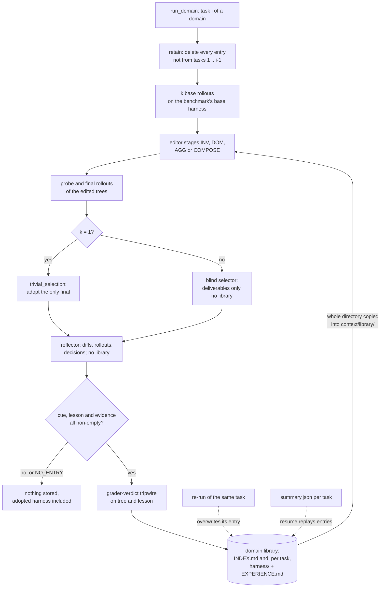

## 1. Executive Summary

Harness² is the code for a Google Research paper on refining an agent's
harness — prompts, rules, a memory file, skills, scripts, subagents and plugins —
per task, with model weights fixed and no ground-truth feedback. Each task runs
a contrastive Propose–Probe–Compose round, a blind selector picks one output,
and a reflector writes what the edits did. The adopted harness and that lesson
go into a per-domain library, which the editing sessions of every later task in
the domain read. That library is the memory this report is about.

What is notable is what a library entry is. It holds the whole adopted tree,
executable scripts and skills included, beside an `EXPERIENCE.md`, and a strict
prefix rule rebuilds the library so task *i* sees exactly the entries of tasks
1 to *i*−1. Grader verdicts and answer-key paths are refused before anything is
stored and again before anything is served. What is weak is everything after
admission. A lesson enters when three text fields are non-empty, no later task
can revise or remove one, and a re-run upstream task leaves the tasks that read
its old entry untouched.

Five findings shape the rest of this report.

- **Only the editor reads it.** The library directory is copied into the
  context of the invariant, domain and composition stages. The selector, the
  reflector, the base rollouts and the executor never receive it, and each task
  starts again from the benchmark's base harness. A lesson reaches execution
  only when an editor copies a component across (`harness2/core/schedule.py:617`,
  `:499`; `harness2/core/selection.py:296-330`, `:418-430`).
- **"Evidence-supported" is a prompt, and the code checks presence.** The
  reflector is told to prefer `confounded` and to decline on confounded rows.
  `_distil` keeps a lesson if `cue`, `lesson` and `evidence` are non-empty, and
  nothing parses the verdicts or the confidence
  (`harness2/core/prompts.py:1126-1147`; `selection.py:494-501`).
- **At `--k 1` there is no comparison before adoption.** The single final is
  adopted by `trivial_selection` without a selector session, and reflection
  runs anyway, so the default configuration admits a lesson whenever the
  reflector writes one (`schedule.py:514-517`, `selection.py:360-399`).
- **Forgetting is a reproducibility rule, not a correction.** `retain` deletes
  entries from tasks later in the stream, and it is the only caller of `forget`
  (`harness2/core/library.py:90-104`, `schedule.py:700-701`).
- **The paper's library experiments have no CLI path.** The sweep always builds
  a library, takes no flag to disable or import one, and passes an empty tag to
  the one function that could share one (`harness2/cli/run_sweep.py:148`,
  `:168`; `harness2/cli/_common.py:75-88`).

No marks. Section 9 names each one and the reason it is withheld.

## 2. Mental Model

A memory is an adopted harness with a reason attached. It comes into being at
the end of a task, in four steps, all model-driven and none graded.

1. **Propose and probe.** Editor sessions read the base rollouts and the domain
   library, write an edited harness tree, and each tree is executed on the same
   task (`harness2/core/recursion.py:343-449` parallel, `:452-566` sequential).
2. **Select.** At `k` above 1 a selector session sees anonymised final
   deliverables, with harnesses hidden, and picks one
   (`selection.py:268-357`). At `k = 1` the only final is adopted.
3. **Reflect.** `reflect_adoption` hands a reflector the base harness, the
   adopted harness, every candidate's diff and rollout, and the stage notes. It
   returns `<edits>` rows and one `<experience>` block, or `NO_ENTRY`
   (`selection.py:402-505`).
4. **Store or drop.** `Library.add` writes the tree and `EXPERIENCE.md` only if
   `has_experience` holds. A task whose reflector declined leaves nothing,
   harness included (`library.py:43-47`, `:106-152`; `schedule.py:555-563`).

**Nothing is ever doubted.** An entry has no status. It is in the directory or
it is not, and it leaves in two ways only: `retain` drops it because its task is
not earlier in the stream, or a re-run of the same task overwrites it. The
`confidence` line is copied into `EXPERIENCE.md` as text and no code reads it
back. The prompt carries the only epistemic instruction: an earlier task's
mapping or threshold *"is a hypothesis here, not a fact"* (`prompts.py:320-326`).

**The library is a projection of the task summaries.** On resume,
`_restore_libraries` re-adds every skipped task's entry from its saved
selection record and harness directory (`schedule.py:201-240`). A person who
deletes or edits an entry by hand sees it rewritten on the next run of the same
command. The correctable copy is the summary, and changing it means re-running
that task.

## 3. Architecture

Harness² is a Python package with seven console scripts and no service. The
sweep (`harness2`) runs domains in parallel threads and the tasks of one domain
in a seeded order. Every improvement stage is a separate model session, run
through OpenCode by default or through the Claude CLI, in a temporary directory
that receives a copy of the context tree (`harness2/core/proposer.py:126-208`).
Executors are OpenCode or Codex runs of each benchmark's own runner, vendored
with patches under `third_party/`.

The library is plain files. Its path is
`runs/library/<bench>/k<k>-<substrate>[-s<seed>]/<agg|seq>/<domain>/`, from
`library_root_for` and `run_domain` (`_common.py:75-88`, `schedule.py:686-689`).
Each entry is `harnesses/<task>/harness/` and `harnesses/<task>/EXPERIENCE.md`,
and `INDEX.md` is regenerated from disk after every add or forget
(`library.py:154-181`). The task summaries, selections and adopted harnesses
under `runs/adapt/` are the authoritative record.

Session calls are content-addressed. `_call_fingerprint` hashes the label, the
mission and every file of the context directory, the library copy included, so
a changed library misses the cache on any later editor call that is reached
(`proposer.py:507-534`). A resumed task with a complete summary is skipped
before any call is made (`schedule.py:350-421`).

### Deployment and ergonomics

The method needs model endpoints for an executor, an improver and a judge,
configured for Vertex AI, plus each benchmark's toolchain: Node.js, Bun and
OpenCode, Docker for WorkBuddy-Bench, Pandoc and Poppler for LAB. A local demo
runs the real recursion and library code with a scripted proposer and no model
(`harness2/demo.py`). The library itself needs nothing but a filesystem, and it
is human-readable: every entry is Markdown and source files a person can open.
It is not repairable by hand in the sense that matters, because a resume
rewrites it from the summaries. Executor network access is unrestricted in the
release, and the experiment guide records a Codex rollout downloading its
task's rubric (`docs/EXPERIMENTS.md`, *Web access*).

## 4. Essential Implementation Paths

- **Write.** `_run_one_mode` runs the recursion, selects, calls
  `reflect_adoption`, then `Library.add` when `has_experience` holds
  (`schedule.py:480-563`). `reflect_adoption` builds an evidence tree without a
  library and calls `_distil`, which parses `<edits>` and `<experience>` line
  by line on the first colon (`selection.py:402-505`). `Library.add` re-checks
  the fields, runs the grader tripwire on the tree and on the lesson text,
  replaces the entry directory and rebuilds the index (`library.py:106-152`).
- **Read.** `Library.context_dir` returns the domain directory once it holds an
  `EXPERIENCE.md` (`library.py:79-81`). `context.build` copies it to
  `context/library/` after `assert_no_leak_paths`, then runs
  `assert_no_grader_verdicts` over the whole tree
  (`harness2/core/context.py:160-169`). `_run_stage` builds that tree for every
  editor stage (`recursion.py:135-170`), and both drivers pass `library_dir` to
  the invariant, domain, aggregation and composition stages.
- **Forget.** `run_domain` calls `retain(task_ids[: i - 1])` on each mode's
  library before task *i*. `retain` hands every other entry to `forget`, which
  removes the directory and rebuilds the index (`schedule.py:700-701`,
  `library.py:90-104`).
- **Resume.** `_resume` validates the cached summary, the adopted run
  directory, its artifacts and the harness fingerprint, then
  `_restore_libraries` replays the entry (`schedule.py:350-421`, `:201-240`).
- **Admission guard.** `GRADER_VERDICT_MARKERS` lists seven grader strings.
  `assert_tree_has_no_grader_verdicts` refuses a harness file carrying one in
  its name or body, because *"files carrying these strings cannot be served as
  evidence to later tasks"* (`context.py:419-427`, `:493-518`).
- **Tests.** `tests/test_workflow.py`, against `harness2/demo.py`.

## 5. Memory Data Model

An entry has no schema beyond its files. `EXPERIENCE.md` is generated Markdown:
the task id, the adopted label and run id, a component census, *Why this was
chosen* from the selector, *What each edit did* from the reflector's rows, and
*Transferable lesson* with the four fields as bullets (`library.py:130-150`).
`INDEX.md` lists each entry's paths, census and cue, which `_field` reads back
from the bullet (`library.py:154-212`).

The harness tree is the substrate's editable surface. For OpenCode it is four
always-on files — `systemprompt.md`, `guardrails.md`, `LongTermMEMORY.md` and
`tool_descriptions/tool_guidance.md`, capped at 24,000 characters — plus
on-demand skills, subagents, scripts and plugins. For Codex it is one
`AGENTS.md` capped at 8,000 (`harness2/substrate/opencode.py:42-80`,
`harness2/substrate/codex.py:38-75`). `LongTermMEMORY.md` is a memory file
inside one harness. It travels to another task only if its harness is adopted
and a later editor copies it.

Scope is physical. Run identity, mode and domain are directory names, and no
record carries a key. The domain is `task_id.split("/", 1)[0]` for JobBench and
LAB and a manifest lookup for WorkBuddy-Bench
(`harness2/benchmarks/jobbench.py:647-648`, `harness2/benchmarks/lab.py:539-540`,
`harness2/benchmarks/workbuddy.py:696-697`). `domain_dir` turns separators into
`__`, so a domain named `a/b` and one named `a__b` would share a directory
(`library.py:50-54`).

No entry carries a timestamp. Provenance is the task id and the run id of the
adopted rollout, both of which resolve into `runs/adapt/`.

## 6. Retrieval Mechanics

There is no retrieval in the index sense. The whole domain directory is copied
into each editor session, and the mission tells the model to browse `INDEX.md`
first and open what looks relevant (`context.py:97-101`). Ranking, relevance and
budget are the editing model's own file reads. Nothing caps the entries copied,
so a domain's later tasks carry every earlier task's full tree into each of
their 3k editor sessions. LAB's full stream is 1,143 tasks
(`docs/EXPERIMENTS.md`, *Task selection and cost*).

Use is copy-in. The prompts say library files *"are NOT part of the harness you
are editing"* and must be copied into `context/harness/`, with any workspace
fact re-verified (`prompts.py:320-326`, `:579-586`). Validation rejects a tree
in which a skill invokes a script it does not ship, which is the failure the
prompt warns about (`harness2/core/tree.py:324-333`). Over-recall is the
expected failure, since the only filter is the domain directory.

The paper reports library provenance in 22% of modified files on LAB and
WB-office and 47% on JobBench (Appendix E.2). No committed artifact lets that
figure be recomputed.

## 7. Write Mechanics

Writes happen once per task per mode, after selection, in the task loop. The
reflector is a model session on the selector channel (`schedule.py:529-537`).
It is told to diff every candidate against the base, assign each changed
component `helped`, `hurt`, `no observed effect` or `confounded`, and write a
lesson only if the rows support one. The prompt's reason is that *"an invented
attribution poisons the library for every later task"*
(`prompts.py:1105-1163`).

The code enforces the shape, not the support. `_distil` keeps the four keys it
recognises, returns `{}` unless the three required ones are non-empty, and
attaches the edit rows as a string (`selection.py:494-504`). The evidence line
is not checked against the rows, the verdicts are not parsed, and a lesson
resting only on confounded rows is admitted if its fields are filled. The
selector that chose the adopted candidate saw no harness, so adoption records
which deliverable read best, as the reflector's prompt itself says.

Entries are never merged. Two tasks that learn the same lesson produce two
entries, and two that learn opposite lessons produce two entries the next
editor must reconcile. The paper's Appendix G names consolidating overlapping
components and revising outdated experience as future work, which matches the
code.

### Operational cost

The write blocks the domain's stream. Task *i*+1 starts only after task *i*'s
reflection and `add` return, so an entry is visible to the next task with no
lag. Reflection costs one extra session per mode per task, and there is no
background pass. The read cost is the copy, which grows linearly with stream
position and is paid by every editor session. It enters the session as files on
disk rather than prompt text, so it does not sit in a cached prompt prefix.

## 8. Agent Integration

The library is internal to the method. No tool, endpoint or flag exposes it;
the editor sees it as `context/library/` in the mission's evidence layout
(`context.py:59-102`). An editor's edits come back only from
`context/harness/`, which `Proposer.call` harvests, so an editor cannot write
the library (`proposer.py:178-181`, `recursion.py:192`).

Session isolation depends on the channel. The OpenCode channel sets
`OPENCODE_PERMISSION` to deny external directories outside the session's
temporary directory (`proposer.py:270-272`). The Claude CLI channel runs with
`--dangerously-skip-permissions` and no such restriction (`proposer.py:210-222`),
so on that channel the domain boundary is what was copied, not what is
reachable.

Adapting the library to another agent is easy in shape and hard in substance.
`library.py` is 222 self-contained lines over a tree type. Its value comes from
the Propose–Probe–Compose loop producing execution contrasts for the reflector
to cite, and that loop is most of the package.

## 9. Reliability, Safety, and Trust

**Contamination control is the strongest part.** Answer-key globs are checked
on the library before it is copied, grader markers are checked on the whole
context after, and an adopted tree or lesson carrying a marker cannot be stored
(`context.py:160-169`, `library.py:122-123`). Judging is a separate command run
after the sweep, so no grade reaches the library on any path the sweep runs.

**Correction does not propagate.** `test_recursion_budget_and_resume` alters
the first task's adopted script, re-runs the stream, and asserts that the first
task re-runs while the second is `skipped` (`tests/test_workflow.py:95-106`).
The second task's adopted harness was composed with the first task's old entry
in view. The sweep record keeps `library_entries_before`, a count, for each
task (`schedule.py:702`), and nothing compares the library a task read with the
one it would read on a fresh run.

**Prompt injection reaches memory through the reflector.** Rollouts and
deliverables are copied into the reflector's context in full, and the lesson is
the reflector's own text. Every mission carries an evidence-boundary block
telling the model not to obey instructions found in its files
(`prompts.py:56`, `:86-91`). Code checks only for grader strings.

**The marks, each withheld.**

- **`trust_state` — no.** An entry has no status field. `confidence` is free
  text written into `EXPERIENCE.md` and read by nothing, and `NO_ENTRY` is an
  admission outcome rather than a state on a stored row.
- **`tombstone` — no.** A `hurt` row is recorded as text inside the entry it
  came from and no code reads it, so a later proposal can repeat the rejected
  edit. The row is keyed on nothing.
- **`scope_enforced` — no.** Scope is a physical partition by run, mode and
  domain directory, with no key on an entry and no predicate on a read.
- **`audit_log` — no.** `Library.add` replaces the entry directory, `forget`
  deletes it, and `INDEX.md` is rewritten. The proposer's audit files record
  calls rather than memory mutations, and are rewritten for a repeated label
  and key (`proposer.py:362-387`).
- **`human_review` — no.** Selection and reflection are model sessions, and
  there is no queue or approval surface.
- **`bitemporal` — no.** Entries carry no time of any kind.
- **`negative_eval` — no.** Section 10 gives the near-misses.

## 10. Tests, Evals, and Benchmarks

I read the tests and did not run them. Five `unittest` cases run the real
scheduler, recursion, selection, reflection and library against `DemoAdapter`,
a two-task "accounting" domain whose executor runs a Python script on a CSV.
The demo selector picks the candidate whose total matches a sum it computes
from the source ledger, so it uses the ground truth the real selector lacks
(`harness2/demo.py:120-157`).

- **`test_complete_evidence_and_library_prefix`** asserts that the second
  task's context holds `library/harnesses/ledger-1` and nothing else
  (`tests/test_workflow.py:126-127`). It is the one assertion on what the
  library serves, and it cannot catch over-serving. The second task's own
  entry does not exist when that context is built, and the demo has one domain.
- The same test plants `reference_answer.txt` holding `"pass_rate": 1` among
  the task sources and asserts it appears nowhere under the work directory,
  beside required files that must be present (`:109-125`). That is a populated
  must-not case with a positive control. It guards the task-source copy rather
  than the library, so it does not earn `negative_eval`.
- **`test_no_entry_stays_out_of_library_on_resume`** asserts an empty library
  after a reflector that returns `NO_ENTRY` or fails (`:187-206`). It is a
  write-admission test, and a broken writer would pass it too; the positive
  control is in the previous test.
- The resume test pins the downstream-skip behaviour described in section 9.

No CI configuration is committed. No result is committed either, so the
README's gains — 11.5 points on WorkBuddy-Bench, 4.5 on JobBench, 11.8
percentage points on LAB's partial pass rate — and the paper's tables cannot be
recomputed from the tree.

The paper is [arXiv:2610.14224](https://arxiv.org/abs/2610.14224), submitted 9
October 2026. Its Table 3 removes the library at `k = 1` and reports
WorkBuddy-Bench falling from 77.5 to 74.4 and JobBench from 36.0 to 34.2. Its
Figure 7 transfers a JobBench-derived library to WorkBuddy-Bench, and Appendix
E.2 re-runs each task with its own entry excluded. The paper's description of
the library matches the code: per-domain directories, full trees, an index and
sequential reads. None of the three experiments has a CLI path at the pin; the
sweep's flags are listed in the appendix below.

**Related exclusion.** Harness-Zero
([arXiv:2609.24974](https://arxiv.org/abs/2609.24974)) is
[excluded in the appendix](../../appendix/#known-limitations) because its
`memory.md` is written offline and removed at deployment. Harness² differs on
that axis: its library is written during the sweep, read by the next task's
editors, and never distilled into weights. It also keeps the task and run id on
each entry, where Harness-Zero's clauses carry no attribution.

## 11. For Your Own Build

### Steal

- **Store the executable artifact, not a summary of it.** An entry that holds
  the adopted skill and its scripts lets the next task reuse a component that
  ran, instead of reconstructing it from prose.
- **Tripwire grader output at both ends of memory.** Refuse a write carrying an
  evaluation marker, and refuse a context build containing one. A leaked grade
  stored as a lesson poisons every later task.
- **Make the library a function of stream position.** Truncating to the prefix
  before every task makes "what did task *i* see" reproducible and makes a
  resumed run match an uninterrupted one.
- **Content-address model calls over their evidence, memory included.** A
  changed memory then invalidates exactly the calls that read it.
- **Drop the artifact when the reflection declines.** An adopted harness with
  no supportable lesson does not enter the library at all.

### Avoid

- **An evidence field nothing checks.** If a lesson must rest on
  non-confounded rows, parse the rows and reject the lesson in code; a prompt
  instruction is a request to the writer.
- **Derived state with no dependency record.** A downstream result built from
  an upstream entry needs that entry's fingerprint stored beside it, or a
  correction upstream leaves the result standing.
- **A memory whose only forget path is truncation.** Without a way for later
  evidence to demote or retire an entry, contradictory lessons accumulate and
  the reader is left to reconcile them.
- **Unbounded copy-in.** Serving every earlier entry in full makes read cost
  grow with history and pushes relevance onto the reader's browsing.

### Fit

Harness² is a research instrument for one benchmark sweep at a time, and its
library is the cross-task carry inside that sweep. It suits a reader studying
whether harness edits transfer within a task family, who can afford 4k
rollouts and 3k improver sessions per task and wants a reproducible prefix
library to ablate against. It does not suit anyone wanting a durable
experience store across runs, users or products. The library starts empty with
each stream, cannot be shared or imported from the CLI, and has no correction
path. A team that wants the paper's transfer result in production would be
building that store, not configuring this one.

## 12. Open Questions

- Which code produced the Table 3 no-library arm, the Figure 7 transfer arm and
  the Appendix E.2 leave-one-out runs, given that the sweep has no flag for any
  of them?
- Was a check of the `evidence` line against the `<edits>` verdicts
  considered, and is `confidence` meant to be read by anything?
- Should re-running an upstream task invalidate the summaries of the tasks that
  read its entry, which the resume test pins it does not do?
- How large does a domain's library grow over a full LAB stream, and does the
  copy-in cost show up in the paper's per-task cost figures?

## Appendix: File Index

- **Library and storage:** `harness2/core/library.py`,
  `harness2/cli/_common.py` (`library_root_for`).
- **Write:** `harness2/core/selection.py` (`run_selection`,
  `trivial_selection`, `reflect_adoption`, `_distil`),
  `harness2/core/schedule.py` (`_run_one_mode`, `_restore_libraries`).
- **Read:** `harness2/core/context.py` (`build`, `assert_no_leak_paths`,
  `assert_no_grader_verdicts`, `assert_tree_has_no_grader_verdicts`),
  `harness2/core/recursion.py` (`_run_stage`, `run_parallel`,
  `run_sequential`).
- **Forget and resume:** `harness2/core/schedule.py` (`run_domain`, `_resume`).
- **Prompts:** `harness2/core/prompts.py` (`_TTS_GENERALIZE`, `experience`,
  `propose`, `aggregate`, `compose_round`, `select`).
- **Sessions and surfaces:** `harness2/core/proposer.py`,
  `harness2/core/tree.py`, `harness2/substrate/opencode.py`,
  `harness2/substrate/codex.py`.
- **CLI:** `harness2/cli/run_sweep.py`, `harness2/cli/judge.py`.
- **Tests and demo:** `tests/test_workflow.py`, `harness2/demo.py`.

### Recorded searches

Run with `/usr/bin/git grep` in the clone, `PIN=1cfe254e8d25b15f37048c3730134686abe60335`, from the tree root.

- `git grep -n -E "\.forget\(|\.retain\(" ${PIN} -- .` — `library.py:104` and `schedule.py:701` only; no other forget path.
- `git grep -n -E "root_for\(" ${PIN} -- .` — `LIB.root_for` is called once, from `_common.py:86`, with `variant` and never with `tag`.
- `git grep -h -o -E '"--[a-z-]+"' ${PIN} -- harness2/cli/run_sweep.py harness2/cli/_common.py` — `--bench --dry-run --k --max-tasks --mode --modes --only-domains --seed --split --split-file --subset --substrate --workers`; no library, tag or transfer flag.
- `git grep -n -E "tag=" ${PIN} -- harness2/cli` — `run_sweep.py:168` passes `tag=""`.
- `git grep -n -E "confidence" ${PIN} -- harness2 ':!harness2/core/prompts.py'` — written at `library.py:146`, parsed at `selection.py:498`, set in `demo.py:152`; no reader.
- `git grep -n -E 'confounded|helped|"hurt"|verdict' ${PIN} -- harness2 ':!harness2/core/prompts.py'` — `demo.py:146` only, once grader-marker names are excluded; no code parses an edit verdict.
- `git grep -n -E "library_dir" ${PIN} -- harness2/core/selection.py` — no match; neither the selector nor the reflector receives the library.
- `git grep -n -i "library" ${PIN} -- harness2/substrate third_party/wb_runner third_party/jb_runner` — no match; no executor path reads it.
- `git grep -n -E "base_harness\(\)" ${PIN} -- harness2/core` — `schedule.py:617` and `selection.py:431`; every task starts from the base harness.
- `git grep -n -E "max_entries|MAX_ENTRIES|\[:[0-9]+\]|\[-[0-9]+:\]" ${PIN} -- harness2/core/library.py harness2/core/context.py` — four slices in `context.py`, over rollout names, error strings, images and leak hits; none over library entries.
- `git grep -n -E "datetime|time\.|created_at|valid_" ${PIN} -- harness2/core/library.py` — no match.
- `git grep -n -i -E "approve|review|human|interactive|input\(" ${PIN} -- harness2 | grep -v prompts.py` — benchmark prompt text only; no review surface.
- `git ls-tree -r --name-only ${PIN} | grep -i -E "judged|summary\.json|\.jsonl$"` — no match; no result is committed.
- `git ls-files | grep -E "^\.github|\.gitlab|ci\.yml"` — no match; no CI configuration.
- `git grep -n -i -E "arxiv|bibtex|@article|CITATION" ${PIN} -- .` — the README citation block for [arXiv:2610.14224](https://arxiv.org/abs/2610.14224); no `CITATION.cff`.

## History

**2026-10-18** — [`1cfe254e8d25b15f37048c3730134686abe60335`](https://github.com/google-research/harness2/commit/1cfe254e8d25b15f37048c3730134686abe60335) — first reading, at the head of `main`, 13 October 2026. No marks. LICENSE read in full: Apache-2.0 with no rider. Screened before reading from a full clone: no auto-run surface; one build-time execution finding, `harness2/cli/setup.py`, the `harness2-setup` console script that installs benchmarks when invoked rather than a setuptools file; nothing inside the cooldown; one unpinned surface, `pyproject.toml` with no lockfile. No `.gitmodules` and no agent-instruction file. The paper's library sections and ablation were read on arXiv. Read with `git grep` and `sed`; nothing was installed, built or run.
