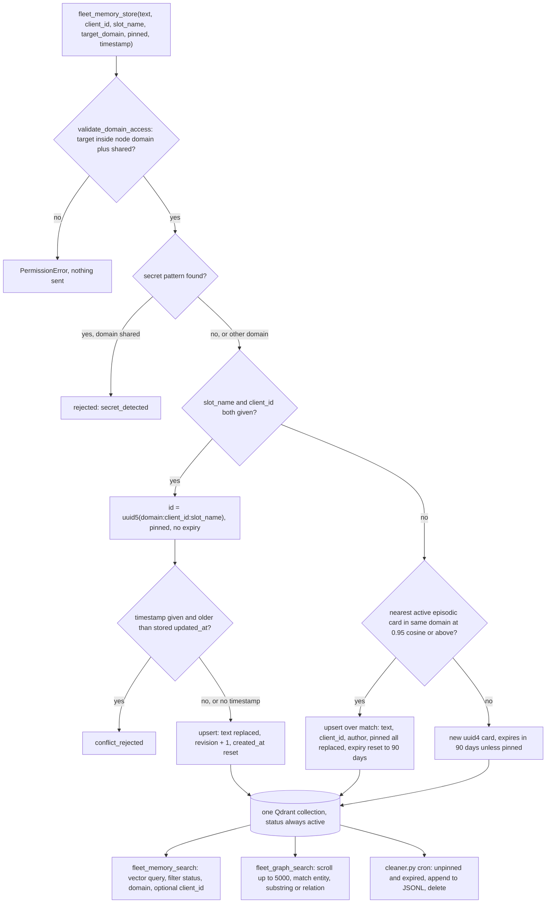

## 1. Executive Summary

Hermes Fleet Memory is a FastMCP stdio server that gives several machines
running [Hermes Agent](../hermes-agent/) one shared Qdrant collection of
memory cards. Each node is pinned to a domain — `work`, `personal` or `all` —
and the agent can store a card, search it by vector similarity, or walk
regex-extracted entity relations. Nothing is injected into the prompt:
the documented Hermes setting is `memory.provider: none`, and retrieval happens
only when the agent calls a tool.

What is notable is the domain firewall. The node's domain comes from its
environment, the agent's `target_domain` argument can only narrow it, and a
request for another domain raises before any network call. Slot cards get a
UUID5 id from domain, client and slot name, so a fact with one right value is
overwritten rather than duplicated. What is weak is everything after the
write: no correction keeps history, no tool deletes, the near-duplicate merge
crosses clients and clears pins, and every node holds the one Qdrant key that
reads every domain directly.

The repository also ships a remote desktop bridge, a SQLite task plane with
Ed25519 completion receipts and a setup wizard. Those are coordination and
remote execution rather than memory, and this report covers them only where
they touch the store.

Four findings shape the rest of this report.

- **The firewall binds the agent and not the node.** `validate_domain_access`
  refuses a cross-domain argument (`client/fleet_memory.py:255-292`), and both
  reads apply the result as a Qdrant filter. The credential underneath is one
  `QDRANT__SERVICE__API_KEY` for the whole collection
  (`server/docker-compose.yml`), which the wizard hands to every node. The
  boundary holds against a prompt-injected agent and not against anyone with
  a shell on a work machine.
- **Episodic dedup rewrites someone else's card.** The near-duplicate probe
  filters on domain, status and `memory_type` and not on `client_id` or
  `pinned` (`:593-599`). A match above 0.95 cosine is upserted with the new
  writer's text, client, author and pin flag, so an unpinned write silently
  unpins a pinned note and starts its 90-day clock.
- **Last-Write-Wins is opt-in.** A stale write is refused only when the caller
  passes `timestamp` (`:571`). No caller in the tree does outside the tests,
  so the model is the only party that can invoke the guard the threat model
  credits with preventing split-brain.
- **The tests cannot see a filter.** `MockQdrantStorage.query_points` in
  `tests/conftest.py:53-67` ignores `query_filter`, so no committed test
  observes the domain or status predicate excluding a row.

## 2. Mental Model

A memory is a **card**: a piece of Markdown text with a domain and two
optional names. The card has no epistemic state. `status` exists on every
payload and every read filters on `status = active`, but the only writer sets
`"active"` (`client/fleet_memory.py:648`), so the field withholds nothing.
What the card has instead is an identity rule that decides whether a new write
replaces an old one.

There are two identity rules, and the agent chooses between them by whether it
supplies both `slot_name` and `client_id`.

- **Slot cards** are addressed facts. The id is
  `uuid5(NAMESPACE_DNS, "domain:client_id:slot_name")` (`:553`), the card is
  forced pinned with `expires_at = 0`, and each write overwrites the previous
  value with `revision + 1`. The old text is gone; `created_at` is reset to
  the new write's time as well (`:655`).
- **Episodic cards** are addressed by similarity. The writer embeds the text
  and asks Qdrant for the nearest active episodic card in the same domain
  above 0.95 cosine (`:593-618`). A hit is overwritten in place; a miss gets a
  UUID4. Either way the card expires 90 days after this write unless the
  caller pins it (`:657`).

A card stops being a belief in one of three ways: a later write to the same
slot replaces it, a near-duplicate episodic write replaces it, or the cleaner
deletes it after `expires_at`. Nothing marks a card wrong, superseded or
disputed, and nothing the agent holds deletes one.

Who may move a card is decided by the node, not by the card. A work node may
write `work` or `shared`; a personal node `personal` or `shared`; an `all`
node anything. Writes are agent-controlled, there is no background
extraction, and the store is treated as ground truth: the skill file calls the
cards "authoritative state cards for all nodes".

## 3. Architecture

The memory runtime is one Python file, `client/fleet_memory.py`, run as an MCP
stdio server on each node. It embeds locally with fastembed
(`BAAI/bge-small-en-v1.5`, 384 dimensions, two threads by default) and talks
to Qdrant over HTTP with a ten-second timeout (`:96-102`, `:227-252`). There is
no local store on a node: every read and write goes to the shared collection.

The collection is created by `bootstrap_collection` with cosine distance,
INT8 scalar quantisation kept in RAM, HNSW `m=16`, and keyword payload indexes
on `domain`, `client_id`, `status`, `memory_type`, `pinned`, `revision` and
`entities` (`:1115-1146`). Two placements are documented. Option A runs Qdrant
1.13.2, a wstunnel server and Caddy on a VPS with Docker
(`server/docker-compose.yml`), and nodes reach it through an outbound
WebSocket tunnel. Option B points every node at a Qdrant Cloud URL.

`server/cleaner.py` is the only background process, meant for a weekly cron on
the hub. The rest of `server/` is a FastAPI task plane over SQLite
(`server/control-plane/`), with leases, retries, an outbox and Ed25519-signed
completion receipts. `client/desktop_bridge.py` is a loopback HTTP server
exposing allowlisted commands and jailed file reads on a workstation. Neither
reads or writes the memory collection.

### Deployment and ergonomics

- **What has to run:** a Qdrant instance reachable from every node, and the
  MCP server per node. The VPS option adds wstunnel and Caddy.
- **Offline:** a node with no Qdrant has no memory at all. A failed search
  returns one synthetic card with `slot_name` `connectivity_notice` and
  `pinned: True` carrying the error text (`:376-388`); a failed store returns
  `connectivity_error` and the card is lost unless the agent retries.
- **API keys:** no model key is needed. Qdrant needs its API key unless it is
  open on loopback.
- **First run:** `pip install` of four packages, then
  `client/fleet_memory.py --init --domain work`, which probes Qdrant, creates
  the collection and writes `client/.env` with mode 0600 (`:1342-1402`). The
  first search downloads about 130 MB of model unless `--warm` ran first.
- **Repair by hand:** only through Qdrant's own API or dashboard. Cards are
  JSON payloads; the expired-card archive is plain JSONL.

## 4. Essential Implementation Paths

**Write.** `fleet_memory_store` (`client/fleet_memory.py:505-696`) validates
the domain (`:526`), resolves `effective_domain` with an `all` node defaulting
to `shared` (`:527-529`), and runs `find_secrets` from `client/secret_scan.py`.
A finding in `shared` returns `rejected` before anything is embedded
(`:533-545`). The slot branch computes the UUID5, retrieves the existing point
and applies the timestamp check (`:552-582`); a retrieve failure is swallowed
under the comment "Fall open for test environments" (`:580-582`). The episodic
branch embeds the text, probes for a near duplicate and reuses its id
(`:583-630`). Both then embed again, run `extract_entities_and_relations`,
build the payload and call `upsert` (`:632-669`).

**Extraction.** `client/knowledge_graph.py` is 50 lines of regex: wikilinks,
backticked identifiers and capitalised phrases become up to 15 entities, and
nine fixed verbs between two entities become up to 15 relation triples.
It runs synchronously on every write and calls no model.

**Search.** `fleet_memory_search` (`:295-388`) validates the domain outside
its `try` block, so a `PermissionError` escapes to the caller (`:311`, re-raised
at `:376-377`). It embeds the query, builds a `must` filter of
`status = active`, the domain set and an optional `client_id`, and calls
`query_points`, falling back to the legacy `search` on any exception.

**Graph query.** `fleet_graph_query` (`:391-502`) applies the same
`status` and domain filter to a paginated `scroll`, capped at
`FLEET_GRAPH_SCAN_LIMIT` (5,000) and reported as `truncated` when the cap cuts
it short. Each payload is a hit if the entity is in its entity list, is a
substring of its text, or is an endpoint of one of its relations.

**Expiry.** `clean_expired_memories` (`server/cleaner.py:58-111`) filters
`status = active`, `pinned = False` and `0 < expires_at < now`, appends each
batch to `~/.hermes/archives/expired_episodic_memories.jsonl`, then deletes the
ids. Deleted points stop matching, so each pass rescrolls from the start.

**Integration.** The tools are registered at `:715-747`: `fleet_memory_search`,
`fleet_memory_store`, `fleet_graph_search`, and two deprecated aliases from the
project's five-day rename to Synapse (`fleet_synapse_search`,
`fleet_synapse_store`). `skills/fleet-memory/SKILL.md` tells the agent to call
search before inspecting a remote machine by shell.

## 5. Memory Data Model

The payload is a flat dictionary built at `client/fleet_memory.py:642-658`.

| Field | Written as | Read by |
| --- | --- | --- |
| `text` | caller text | both reads, embedding |
| `domain` | node domain or caller's narrower choice | both read filters, dedup probe |
| `client_id` | caller or `generic` | optional search filter |
| `slot_name` | caller or `episodic` | returned only |
| `memory_type` | `slot` or `episodic` | dedup probe filter |
| `status` | the constant `active` | every read filter, cleaner |
| `pinned` | forced true for slots, caller flag otherwise | cleaner filter |
| `revision` | previous plus one on overwrite | returned only |
| `entities`, `relations` | regex extraction | graph query |
| `author_node`, `author_profile` | `FLEET_NODE_NAME` or `HERMES_PROFILE` | returned only |
| `created_at`, `updated_at` | caller `timestamp` or the clock | LWW check |
| `expires_at` | 0 when pinned, else 90 days on | cleaner filter |

**Scope.** `domain` is the only enforced key. `client_id` names a subsystem
and is applied only when the caller passes it. There is no user, session or
agent key; a node is the principal.

**Provenance.** `author_node` is whatever the node's environment says, with a
platform-based default (`:638`). The episodic overwrite replaces it, so a card's
author is its last writer, not its first.

**Time.** `created_at` and `updated_at` are both set from one `now` on every
write, and `now` is the caller's `timestamp` when supplied. That parameter is
a replication clock for the LWW check, not a validity time, and the
overwrite discards whatever came before.

**Correction.** In-place overwrite with a revision counter and no prior
value. No tombstone, no supersession link, no history table.

## 6. Retrieval Mechanics

Retrieval is tool-mediated and on demand. Nothing is injected at session
start, and the documented Hermes configuration disables the provider slot
that would otherwise prefetch.

`fleet_memory_search` is plain dense retrieval: one embedding, one filtered
Qdrant query, top `limit` (default 5) by cosine. No query rewriting, no
lexical arm, no reranking and no recency term. The output carries the score,
domain, client, slot, text, pin flag, revision, entities and timestamps, so the
agent sees provenance and age and must judge them itself.

`fleet_graph_search` is not a graph traversal in the database sense. It reads
every authorised card up to the cap and keeps those mentioning the entity, then
returns one hop of relation triples and the neighbouring entity names. The
substring test makes it a lexical arm as much as a graph one: `"api"` matches
any card whose text contains those three letters. On a large collection it is
a full scan per call.

Failure modes follow from the shapes. Dense-only retrieval over short cards
will miss exact identifiers that the embedding does not separate, which the
graph tool's substring match partly covers. Overwritten cards are never stale
hits, because the old text no longer exists. Expired cards stay retrievable
until the cleaner runs, since no read filters on `expires_at`.

## 7. Write Mechanics

Every write is an explicit tool call from the agent. There is no extraction
from conversation, no session-end capture and no background consolidation.
Deduplication is the only merge, and it is a replacement rather than a merge:
the new text wins outright.

**Conflict handling** is the LWW check on slot writes. It compares a
caller-supplied `timestamp` against the stored `updated_at` and refuses an
older write (`client/fleet_memory.py:571-578`). An untimestamped write always
wins. The read-then-upsert is not atomic, so two concurrent slot writes both
read revision `n` and both store `n + 1`, and whichever lands second is kept.

**The episodic overwrite crosses two boundaries it should keep.** The probe
filter holds domain, status and `memory_type` (`:593-599`) but not `client_id`,
so a near-identical note from a different subsystem replaces the original and
takes its id. And the payload's `pinned` is the new writer's flag (`:584`,
`:649`), so a pinned note matched by an ordinary write loses its pin and gets an
`expires_at` 90 days out. Whether 0.95 cosine on bge-small separates
"X is enabled" from "X is not enabled" is not tested here; the example in
`tests/test_dedup.py:39-49` replaces "Wolf proxy healthy" with
"Wolf proxy healthy and verified".

**Filtering of inputs** is a credential scan. Ten named patterns cover hex-256
keys, the project's own `flk_`, `tok_` and `cfut_` tokens, OpenAI-style,
GitHub, AWS, Slack and Telegram tokens and PEM private keys
(`client/secret_scan.py:11-23`). A match refuses a `shared` write and stores a
`work` or `personal` write with a `secret_warning` saying anyone holding the
Qdrant key can read it. No filter addresses prompt-injected content.

**Deletion** is the cleaner only. Its client is built from
`FLEET_QDRANT_HOST`, `FLEET_QDRANT_PORT` and `FLEET_QDRANT_KEY`
(`server/cleaner.py:33-36`, `:59-60`). It reads neither `FLEET_QDRANT_URL`
nor `FLEET_QDRANT_HTTPS`, both of which the MCP server honours
(`client/fleet_memory.py:99-100`). On the Qdrant Cloud deployment that the setup wizard marks
recommended for two machines (`fleet_wizard.py:344`), the cleaner as written
connects to `127.0.0.1:6333` and expires nothing. Its collection name also comes from
`FLEET_COLLECTION_NAME`, which the server does not read.

### Operational cost

- **Blocking:** yes. A store embeds the text twice on the episodic path, once
  for the probe and once for the upsert, then makes up to three Qdrant round
  trips. Embedding runs locally in tens of milliseconds per the README's own
  figures; no model call is involved.
- **Lag:** none beyond the upsert. A stored card is searchable on the next
  query from any node.
- **Whole-store passes:** none for memory. `fleet_graph_search` scans up to
  5,000 cards per call, and the cleaner scans only expired cards.
- **Injection:** zero by default. Search returns at most `limit` cards as a
  tool result, so nothing sits in a cached prompt prefix.

## 8. Agent Integration

The server is registered as an MCP server in Hermes `mcp_servers`, Claude
Code, Claude Desktop or Cursor. Hermes is the intended host: the module loads
`~/.hermes/.env` or `HERMES_ENV_FILE`, stamps `HERMES_PROFILE` as the author
profile, and the docs require `memory.provider: none`. That takes the
[pluggable provider](../../patterns/pluggable-memory-provider/) slot out of
play and makes this a sibling of Hermes's own memory rather than a mounted
provider.

The agent has full agency over memory content and none over scope. It
decides what to store, which identity rule applies, whether to pin, and
whether to pass a timestamp. It cannot choose a domain outside its node's
set, and it has no delete.

Two documentation claims do not match the code. The README says `--init`
"registers `fleet-memory` in Hermes, and disables ambient prompt injection".
`cmd_init` writes `client/.env` and prints a `claude mcp add` line, and nothing
in the tree writes `~/.hermes/config.yaml` (`fleet_wizard.py:137` only checks
that it exists, `:557` prints a snippet). The skill file lists `python` and
`node` as allowlisted bridge binaries; `client/desktop_bridge.py:76-91`
removes them with a comment explaining why.

The same server registers six `desktop_*` tools and two `fleet_task_*` tools
beside the memory ones. An adopter wanting only the memory has to strip them,
or leave `FLEET_BRIDGE_KEY` and `FLEET_TASKS_URL` unset, in which case each
returns a configuration error.

## 9. Reliability, Safety, and Trust

**Scope.** The domain filter is the strongest mechanism here and it is
correctly placed: decided before any network call, applied on both reads, and
not widenable by a tool argument. Its limit is the trust boundary it assumes.
`ENFORCED_DOMAIN` is read from `client/.env`, which is loaded with
`override=True` and so beats the MCP client's own `env` block
(`client/fleet_memory.py:36-39`, `:93`). And every node holds the one Qdrant
key. The SECURITY.md threat it closes is the one it names — a prompt-injected
agent asking for another domain — and not a compromised node.

**Provenance and trust.** `author_node` and `revision` are the whole of it.
Neither is verified, the episodic overwrite replaces the author, and nothing
distinguishes a card a person wrote from one the agent inferred. The store
cannot represent uncertainty or a disputed value.

**Data loss.** Overwrites keep no prior value. A wrong slot write destroys the
right one, a near-duplicate write destroys a different client's note, and
the cleaner's archive holds only expired cards. Qdrant snapshots are the only
recovery path; `server/backup-and-export.sh` is the operator's script for
that.

**Concurrency.** LWW is advisory and non-atomic, as section 7 sets out.
Clock skew between nodes decides timestamped conflicts, since `updated_at` is
each writer's wall clock.

**Privacy.** Telemetry is opt-in: `send_anonymous_beacon` posts a hashed host
id, OS and domain mode to `fleet.republikus.my` only when `FLEET_TELEMETRY=1`
and `DO_NOT_TRACK` is not `1`, and only from `--init` (`:1149-1186`).
`PRIVACY.md` describes the same.

## 10. Tests, Evals, and Benchmarks

I did not run the suite. The tree holds 70 pytest functions in 10 files under
`tests/`, plus `server/control-plane/tests/smoke_test.py`, and
`.github/workflows/ci.yml` runs both on Ubuntu and Windows across Python 3.10
to 3.12. The workflow installs the MCP client extras explicitly and fails if
`HAS_MCP` is false, because without them the MCP tool tests skip themselves.

The memory tests cover the domain allowed sets and refusals
(`tests/test_domain_isolation.py`, 8), slot UUID5 identity and the LWW refusal
(`tests/test_lww_concurrency.py`, 3), the episodic dedup id reuse and author
stamping (`tests/test_dedup.py`, 2), the cleaner (`tests/test_cleaner.py`, 2),
regex extraction and graph pagination (`tests/test_knowledge_graph.py`, 4),
and the credential refusal with a clean-write control
(`tests/test_secret_guard.py`, 7).

**No test can fail on a retrieval filter.** `MockQdrantStorage.query_points`
returns every stored point regardless of `query_filter`, under a comment
reading "Simple domain match simulation" (`tests/conftest.py:53-67`). The
domain tests assert on `validate_domain_access` and on the `PermissionError`
from a cross-domain store; none seeds a `personal` card and queries from a
`work` node. That is why `negative_eval` is withheld: the must-not cases are
about a request being refused, not about a populated store keeping a row out
of a result.

**The cleaner test takes the wrong exit.** Its mock `scroll` returns the same
expired point on every call (`tests/test_cleaner.py:51-54`), so
`clean_expired_memories` runs all 200 batches and leaves through the
"stopped after" warning branch. The assertion checks the last delete's ids,
which pass on any batch, so the drain loop's normal exit is never exercised.

The README's test listing shows 22 passing cases, a subset of the tree at this
commit. Its benchmark tables — 8.4 ms indexed search, 68 years of capacity,
$0.00 per thousand turns — have no harness, raw output or script in the tree.
No paper is cited.

What I would want first: a populated-store test with cards in all three
domains asserting a `work` search returns no `personal` card and does return
the `work` and `shared` ones; a dedup test with two clients' near-duplicates
asserting both survive; and a cleaner test against a URL-configured Qdrant.

## 11. For Your Own Build

### Steal

- **Decide scope from the process, not the call.** Read the boundary from
  configuration the agent cannot edit, let a tool argument only narrow it,
  and raise before the network call. A prompt-injected request then fails
  loudly with nothing sent.
- **Give a fact with one right value an address.** A deterministic id from
  scope, owner and name turns "update my GPU profile" into an overwrite rather
  than a third near-identical card, without a similarity threshold.
- **Refuse credentials at the widest scope, warn at the narrow ones.** The
  scan is cheap and blocks the write that would expose a secret to every
  reader.
- **Report a scan cap instead of hiding it.** `fleet_graph_query` returns
  `scanned_points` and `truncated`, so a caller knows its answer was partial.

### Avoid

- **Dedup across owners.** A similarity merge has to stay inside every key the
  reads filter on, or the merge moves a record out of its owner's view. The
  same failure appears in [Synapse Layer](../synapse-layer/), keyed on content
  hash rather than cosine.
- **Copying flags from the newer writer during a merge.** A pin, a review mark
  or an expiry exemption describes the record, not the write; carry it
  forward or the merge undoes a decision someone made.
- **A conflict guard the caller must opt into.** If stale writes matter, stamp
  the time on the server side and require it, or the guard protects nothing in
  practice.
- **Writer and maintainer reading different connection settings.** The
  cleaner composes its own client from a subset of the variables; derive both
  from one function.

### Fit

This suits one person running Hermes or Claude Code on two or three machines
who wants a shared notebook, and wants a confused or injected agent on the
work laptop unable to pull personal notes by asking. It costs a Qdrant
instance and very little else, and the code is small enough to read in an
hour.

Walk away if the boundary has to hold against the machine rather than the
agent, if several people share the collection, or if a wrong memory must be
correctable with a record of what it said before. Walk away too if you want
memory captured for you: every card here exists because the agent chose to
call a tool.

## 12. Open Questions

- Whether `MatchValue(value=False)` on `pinned` and the range on `expires_at`
  select anything when `pinned` carries a keyword payload index and holds a
  boolean (`client/fleet_memory.py:1138-1143`, `server/cleaner.py:63-69`).
  Settling it needs a running Qdrant 1.13.
- How often bge-small puts a negation above 0.95 cosine of its positive, and so
  how often episodic dedup replaces a statement with its contradiction.
- Whether any deployment runs the cleaner against Qdrant Cloud, given the
  connection settings it ignores.
- Where the README's latency and parity figures were measured; no harness is
  committed.

## Appendix: File Index

- **Store, write, read:** `client/fleet_memory.py` (`validate_domain_access`,
  `fleet_memory_search`, `fleet_graph_query`, `fleet_memory_store`,
  `bootstrap_collection`, tool registration at `:715-747`).
- **Extraction and input filtering:** `client/knowledge_graph.py`,
  `client/secret_scan.py`.
- **Background:** `server/cleaner.py`.
- **Deployment:** `server/docker-compose.yml`, `server/Caddyfile.example`,
  `server/wstunnel-restrictions.yaml`, `client/.env.example`,
  `fleet_wizard.py`.
- **Agent surfaces:** `skills/fleet-memory/SKILL.md`, `AGENTS.md`,
  `CLAUDE.md`, `.cursorrules`.
- **Out of memory scope:** `client/desktop_bridge.py`,
  `client/fleet_startup_sync.py`, `server/control-plane/`.
- **Tests:** `tests/conftest.py`, `tests/test_domain_isolation.py`,
  `tests/test_lww_concurrency.py`, `tests/test_dedup.py`,
  `tests/test_cleaner.py`, `tests/test_knowledge_graph.py`,
  `tests/test_secret_guard.py`, `tests/test_mcp_tools.py`,
  `.github/workflows/ci.yml`.

### Recorded searches

Checked against the checkout at the pinned revision, from the tree root.

- `git grep -n -E '"status"|status=' -- client server/cleaner.py fleet_wizard.py` — the memory payload's only `status` value is `"active"` at `fleet_memory.py:648`; the other hits are tool responses.
- `git grep -n -E 'scroll\(|query_points\(|\.search\(|\.retrieve\(|\.upsert\(|\.delete\(|set_payload|overwrite_payload|delete_payload'` — Qdrant calls only in `client/fleet_memory.py`, `server/cleaner.py` and the test mock; the only `delete` is the cleaner's.
- `git grep -n -E 'superseded|archived|"deleted"|invalid|valid_from|valid_to|valid_until|tombstone' -- ':!*.md'` — no supersession, validity or tombstone field; `archived` hits are the cleaner and the bridge's zip tool.
- `git grep -n 'fleet_memory_store('` — the definition and an `AGENTS.md` example; every other call is under `tests/`.
- `git grep -n -E 'timestamp' -- client/fleet_memory.py` — the parameter, its docstring and its two uses; no internal caller passes it.
- `git grep -n -i -E 'offline|pending_writes|outbox|replay|flush' -- client/fleet_memory.py` — no client-side write queue.
- `git grep -n -E 'FLEET_QDRANT_URL|FLEET_QDRANT_HTTPS|FLEET_COLLECTION_NAME|COLLECTION_NAME ='` — `server/cleaner.py` reads only `FLEET_COLLECTION_NAME`; the URL and HTTPS settings are read by `client/fleet_memory.py` and written by the wizard.
- `git grep -n -E 'config\.yaml|provider|hermes mcp|mcp add|holographic|fact_store' -- '*.py' '*.sh' '*.ps1'` — `fleet_wizard.py:137` checks the Hermes config exists and `:557` prints a snippet; nothing writes it.
- `git grep -n -E 'MemoryProvider|prefetch|sync_turn|on_session|memory\.provider|provider: none'` — documentation only; no Hermes provider class and no context assembler.
- `git grep -l -i -E 'arxiv|bibtex|@article|@misc|doi\.org|CITATION'` — no match, and no `CITATION.cff`.
- `git log --format='%h %ad %s' --date=short | grep -i -E 'synapse|rename'` — the rebrand to `hermes-fleet-synapse` at `a395c2e` on 11 September 2026 and its reversal at `d754ec2` on 16 September.

## History

**2026-10-15** — [`87ce8978accdeb2e5a4252b51e7d02842c95ebd5`](https://github.com/amrlazw/hermes-fleet-memory/commit/87ce8978accdeb2e5a4252b51e7d02842c95ebd5) — first reading, at the head of `main`, the merge of 24 September 2026. One mark, `scope_enforced`. Screened before reading from a full clone: one auto-run surface, `.cursorrules`, setup instructions for a reading agent, treated as data with `AGENTS.md` and `CLAUDE.md`. Two build-time execution points, `setup.py`, which launches the wizard for any argument it does not recognise as a build command, and `tests/conftest.py`; nothing inside the cooldown; one unpinned surface, `pyproject.toml` with no lockfile. MIT with no rider. Read with `git grep` and `sed`; nothing installed, built or run.
