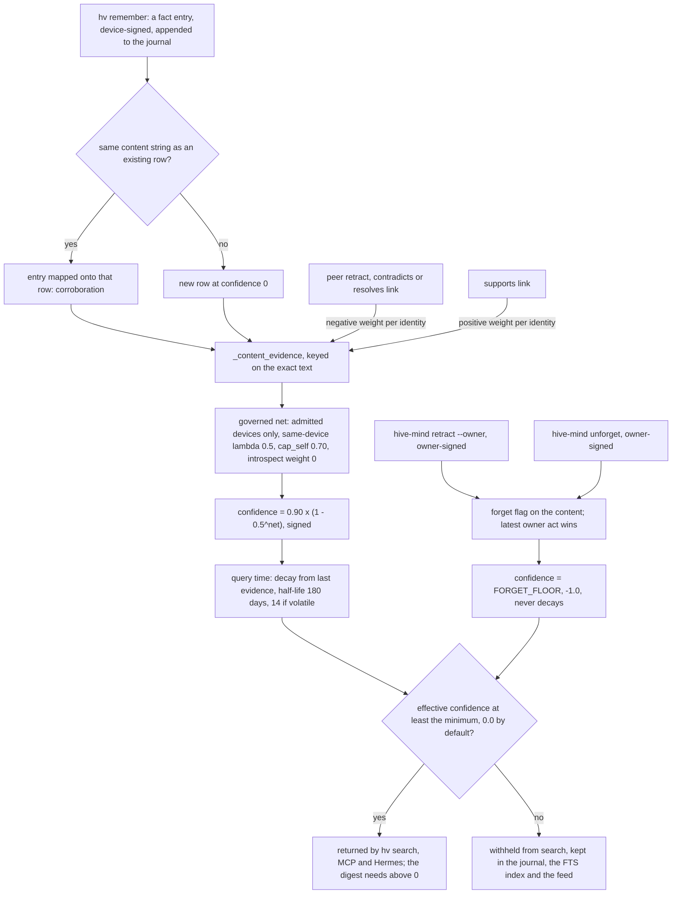

## 1. Executive Summary

HiveMind is shared memory for several AI agents on several machines. Each agent
writes facts, decisions and hypotheses through one CLI, `hv`, into an
append-only journal that devices copy to each other over Tailscale. Nothing is
stored as a confidence. A fact's confidence is recomputed from how many distinct
signed identities asserted the identical text, so an agent repeating itself
gains nothing.

What is notable is how far the corroboration rule is carried. Identities are
device keys, several agents on one device count for less, one person's devices
cap at 0.70, and an assertion on the `introspect` channel weighs zero by
default. The owner's key sits outside the agent's command entirely, and import
graph tests enforce that. The owner's forget is keyed on the text, so a
restatement stays forgotten. What is weak is that the corroboration rule
depends on adapters labelling reasoning honestly, and the Hermes adapter does
not. Forgotten text stays in every copy of the journal.

The project is a Python 3 standard-library program: `hv` is one executable that
executes 16 ordered part files into its own namespace, and `hive-mind` is the
owner's control plane over the same library. It runs on Linux, macOS, WSL and
Android under Termux. It is AGPL-3.0 with a contributor licence agreement, so a
modified copy offered over a network has to offer its source.

Four findings shape the rest of this report.

- **A forget follows the value, not the row.** `hive-mind retract --owner`
  names one fact entry. The projection resolves it to the fact's exact text and
  pins every row with that text to `FORGET_FLOOR`, and a later `hv remember` of
  the same string lands on the same row
  (`hivemind/parts/04_projection.py:55-67`, `:1158-1201`). That earns
  `tombstone`, on exact bytes.
- **The grounding rule has a hole in one adapter.** The Hermes plugin mirrors
  every built-in memory write and tags agent reasoning `speculation`, but sends
  no `--channel`. The core counts a missing channel as `sense`, so the model's
  own inferences corroborate at full weight
  (`integrations/hermes/__init__.py:900-922`).
- **Forgotten means hidden, not gone.** The journal is permanent and synced, the
  FTS index keeps the row, `/v1/feed` serves the entry, and
  `hv search --min-confidence -1` returns it with confidence -1.00.
- **A cross-device correction waits on a queue nothing drains.** A `supersedes`
  or `resolves` link from a device that neither holds the owner key nor wrote
  the target is downgraded to evidence. `hv doctor` lists it, and the owner's
  only remedy writes a new link, so the original stays listed.

## 2. Mental Model

A memory is a **journal entry**. Its kind is one of `fact`, `decision`, `idea`,
`entity`, `retract`, `link` or `governance`. Facts are identified by their text:
two entries with the same `content` string are one belief with two pieces of
evidence. Ideas are identified by their entry, so two agents proposing the same
hypothesis make two ideas. Decisions carry no confidence at all and are retired
by a `supersedes` link.

A fact's belief state is never written; it is a pure function of the journal and
the governance state. `_content_evidence` builds, per content string, a map of
positive and negative weights keyed by identity, `(device, app, instance)`
(`hivemind/parts/04_projection.py:1103-1258`). A peer `retract`, a `contradicts`
link and a `resolves` link add negative weight; a `supports` link adds positive
weight. `_governed_side` then drops devices the owner has not admitted, counts a
device's strongest identity in full and its others at 0.5, and
`_content_confidence` maps the net to `0.90 × (1 − 0.5^|net|)` with its sign
(`:1261-1297`). When every supporting device belongs to one principal the value
is capped at 0.70.

Two inputs never become evidence. An assertion or link on the `introspect`
channel weighs `introspect_support_weight`, default zero, and a channel outside
the vocabulary counts as `introspect` (`:157-163`). An idea's author cannot
support it. The owner's forget is not evidence either: it is a governance act
that overrides the arithmetic.

How a fact stops being believed, in order of force:

- **Decay.** Effective confidence halves every 180 days from the last evidence,
  every 14 days for a fact tagged `volatile`
  (`hivemind/parts/05_trust_validation.py:372-385`). A decayed fact passes the
  default filter while its value stays positive.
- **Contradiction.** Negative weight equal to the positive gives 0.0, which
  `hv search` returns, flagged `CONTESTED`, and the session digest drops.
  More negative than positive goes below zero and leaves default search.
- **Owner forget.** The content is pinned to -1.0, below every default floor,
  until the owner signs an unforget.

The **idea** is a separate type for hypotheses. `hv propose` stamps it
`introspect` and it starts at 0.0 (`hivemind/parts/07_data_commands.py:653-662`).
It earns confidence only from `sense`-channel `supports` links by another
principal, and `hv search --kind all` hides it until that happens (`:547-549`).
It never becomes a fact. The type is chosen at write time, so it is a genre
rather than an epistemic state the store moves a memory through, and
`trust_state` is withheld. So is it for `contested`, a flag every read displays
and none filters, and for the forget sentinel, a governance act stored as a
value in the confidence column.

## 3. Architecture

Two commands share one library. `hv` is the agent's data plane: an executable
Python file whose body is 16 part files under `hivemind/parts/`, compiled and
executed into one namespace by a loader that reads the list `PARTS`
(`docs/HV_ARCHITECTURE.md`). `hive-mind` is the owner's control plane:
`hivemind_ctl.py` loads the same library and runs `hivemind_owner.py` into it,
replacing each owner-step placeholder that `hv` refuses with exit 2.

Storage is two layers under `HIVE_HOME`:

- **`journal/YYYY-MM-DD.jsonl`**, the source of truth. Every local write goes
  through `append_journal`, which validates the payload, takes a lock, mints the
  next per-device `seq` with the previous entry's hash, signs with the device
  key and appends one line (`hivemind/parts/02_store_journal.py:969-1010`).
- **`store.db`**, SQLite in WAL mode with `facts`, `decisions`, `ideas`,
  `entities`, `entity_facts`, `links`, `journal_index` and an FTS5 table over
  fact content and tags (`:156-312`). `rebuild_db` empties it and replays the
  journal (`hivemind/parts/09_entity_store_ops.py:415-450`).

The sync daemon, `hive_sync_daemon.py`, serves `/sync/*` and `/hive/info` and
syncs with peers every 300 seconds by default (`:1019`). Peers compare Merkle
roots over 100-entry chunks of the journal read as a grow-only set, then fetch
missing ranges. `append_foreign_entries` admits a peer entry only after its
signature, its chain position and, once an owner exists, its device's admission
check out; content from an unadmitted device waits rather than lands
(`hivemind/parts/03_ingest.py:316-345`).

A second loopback listener, `hive_module_api.py`, serves modules: separate
processes admitted by the owner as module devices, which read through
`/v1/search`, `/v1/item` and `/v1/feed` and write entries they sign themselves,
under per-module quotas.

### Deployment and ergonomics

- **What has to run:** nothing for a single machine; the sync daemon and
  Tailscale for more than one. No database server, no embedding model, no API
  key.
- **Offline:** fully. Writes queue in the local journal and merge on the next
  sync.
- **Install:** a `curl | bash` installer that installs Tailscale and Python
  dependencies, clones the repository, initialises the store, starts the daemon
  under systemd, launchd or runit, and wires Hermes and Claude Code when present.
- **Repairable by hand:** the journal is readable JSONL and the store is
  disposable. A hand edit breaks the hash chain and the signature, which is the
  intended result.
- **Cost of a command:** every projection reads the whole journal. `hv search`
  calls `merkle.read_all_entries` and `_governance_state` per query, and
  `remember` re-reads the journal and recomputes `_content_evidence` over every
  content (`hivemind/parts/07_data_commands.py:229-262`, `:519`).
  `docs/INTERNALS.md` records 0.3 seconds per search on an 860-entry hive, and
  `tests/test_perf.py` holds the paths within the adapters' timeouts at 1,000
  signed entries.

## 4. Essential Implementation Paths

**Write.** `remember` in `hivemind/parts/07_data_commands.py:78-300`. Tags are
split, `_detect_volatile` adds `volatile` to transient-status claims, and the
optional `--resolves`, `--outcome-of`, `--supports`, `--contradicts` and
`--extends` targets are resolved and kind-checked before anything is written.
`append_journal("fact", …)` writes the entry, each relationship is one more
`link` entry, and then `persist_fact` projects the row
(`hivemind/parts/04_projection.py:45-90`). The whole journal is re-read, and
`_apply_content_confidence` writes the new confidence for the content and any
target.

**Retract and forget.** `retract` (`hivemind/parts/07_data_commands.py:309-356`)
appends a `retract` naming the target's journal ref. With `--owner`, available
only on `hive-mind`, `_owner_forget` writes the same entry with source
`owner:owner/owner` and an owner signature (`hivemind_owner.py:343-359`).
`unforget` writes `unretracts_ref` instead (`:368`).

**Projection.** `_content_evidence` (`hivemind/parts/04_projection.py:1103-1258`)
is the one function every reader trusts. Its fact loop keys on `content`; its
retract loop resolves `retracts_ref` to a content and either records owner acts
on a timeline or adds negative weight; its link loop folds `supports`,
`contradicts` and `resolves`. One statement writes `facts.confidence`, in
`_apply_content_confidence` (`:1300-1306`), called by the rebuild and inline by
the write commands.

**Read.** `search` (`hivemind/parts/07_data_commands.py:497-650`) runs
`_query_facts`, an FTS5 `MATCH` with every term quoted, falling back to `LIKE`
(`:373-386`). It computes effective confidence per row, drops rows below
`--min-confidence` (`:539`), ranks and keeps ten. `api_search`
(`hivemind/parts/08_read_api.py:43-160`) is the paginated twin the module API
and the dashboard module use.

**Context injection.** `nudge session-start`
(`hivemind/parts/10_agent_loop.py:373-385`) prints `_print_digest`: up to five
facts matching the repository name with effective confidence above zero, inside
a fenced block labelled as data (`:127-162`). It also prints open ideas, pending
admissions and the audit summary.

**Correction of decisions.** `decide --supersedes` or `--revoke` writes a
`supersedes` link. `_link_authority` returns `hard` only for an owner signature
valid at that journal position or for the target's own author
(`hivemind/parts/06_links_forget.py:19-40`), and only a hard link sets
`decisions.superseded_by` (`:43-47`).

**Audit.** `_compute_audit` (`hivemind/parts/10_agent_loop.py:442-585`) reports
same-identity duplicates, near-duplicate paraphrases by token Jaccard, contested,
decayed and negative facts, volatile facts past a 24-hour freshness window, and
corrections that cite a fact nothing has retracted. It changes nothing.

**Tests.** `tests/test_unforget.py`, `tests/test_forget_oracle.py` with
`tests/forget_corpus.py`, `tests/test_feed.py`, `tests/test_links.py`,
`tests/test_module_api.py` and `tests/test_s2_split.py` cover the paths above.

## 5. Memory Data Model

`facts` has `content`, `tags` as a JSON list, `importance`, `source_agent`,
`source_session`, `created_at`, `access_count`, `last_accessed`, `confidence`,
`contested`, `last_evidence_at`, `resolves`, `utility` and `last_link_at`. Every
column after `last_accessed` is written by a projection. `decisions` adds
`rationale`, `superseded_by`, `informed_by`, `outcome_score` and
`last_outcome_at`; `ideas` mirrors facts without the asserted importance.

Identity across nodes is the journal ref, `node_id:seq`, where `node_id` is
`k1:` plus 16 hex of the device key's hash. Local row ids change on every
rebuild, so 2.0 refuses them as input and every verb takes a ref or a short id,
`h:` plus ten hex of the ref's hash (`hivemind/parts/04_projection.py:20-28`).

**Scope.** No column holds a user, project, agent or tenant. The boundary is the
hive: one journal, shared by every agent on every admitted device. The source
string records who wrote a fact and feeds identity weighting; no read filters on
it. Tags are free text the caller may filter by. Modules get a name prefix,
`x-<module>:`, for link kinds and config keys, and the module API's docstring
says its per-module config is *"not a confidentiality boundary"*.
`scope_enforced` is withheld.

**Time.** `timestamp` is the writing device's clock, clamped to be monotonic per
chain and bounded once the owner freezes timestamps. `created_at` on a row is a
payload field when present and the entry timestamp otherwise, and nothing in the
product writes the payload field. No field records when a fact held in the
world, so `bitemporal` is withheld.

**Provenance.** Every entry carries its signer, and every row maps back to its
entries through `journal_index`. A decision's `informed_by` lists the refs it
relied on, and outcomes link back to decisions, which is what `utility` is
computed from.

## 6. Retrieval Mechanics

Retrieval is lexical. Facts go through FTS5 with each whitespace term quoted, so
the query is an implicit AND of literal tokens; decisions and ideas go through
`LIKE` on content, rationale and tags. There is no embedding and no query
rewriting.

Ranking is by effective confidence by default: the stored confidence decayed by
the class half-life from `last_evidence_at`, computed at query time with an
injectable `HIVE_NOW` so every node gets the same value. `--sort` offers recency,
importance and utility, both decayed from `last_link_at`. Importance is the
author's capped hint plus attention from other principals' links; a writer
cannot raise its own.

The filter is the part that decides what an agent sees. `hv search` keeps facts
with effective confidence at or above `--min-confidence`, default 0.0
(`hivemind/parts/17_cli.py:107`). That excludes owner-forgotten facts at -1.0
and facts with more negative than positive evidence, and keeps contested facts
at 0.0 with a flag. The session digest is stricter and needs a value above zero.
Decisions are returned whether superseded or not, flagged. Under `--kind all`,
an idea appears only once it has earned confidence above zero.

Ten facts are returned per query and the digest injects at most five, capped at
1,200 characters. The Hermes `prefetch` fires on error, uncertainty, knowledge
or long-word triggers in the user's message, takes the top five results, and
places both sides of any detected conflict in context, with an instruction not
to resolve it (`integrations/hermes/__init__.py:535-634`).

The failure mode to expect is under-recall. A literal-token AND over short
facts misses paraphrase, and the digest's "project" match is the repository
name appearing in a fact's text.

## 7. Write Mechanics

Every write is explicit and lands immediately. An agent runs `hv remember`, the
MCP server's `hive_remember`, or a Hermes tool, or Hermes mirrors a built-in
memory write. There is no extraction model; the content is stored as given.

Two gates sit in front of the store. `remember --gate` applies `_is_admissible`,
which rejects text under 15 characters, a bare question and a short greeting
(`hivemind/parts/07_data_commands.py:20-31`). It is opt-in. The Hermes adapter's
own gate, `_salience_gate`, returns `True` and has no caller
(`integrations/hermes/__init__.py:954-973`). The working filter is the Hermes
novelty gate, which skips content recalled this session.

**Deduplication is corroboration.** `persist_fact` looks up the exact content
and, on a hit, maps the new entry onto the existing row and bumps
`access_count` (`hivemind/parts/04_projection.py:55-67`). One identity
repeating itself adds a journal line and no weight. `hv audit` flags the
repetition as redundant.

**Correction is additive.** There is no edit. A correcting fact can carry
`--resolves h:…`, which writes a `resolves` link: negative weight on the old
fact from the corrector's identity, and provenance on the new row when the link
is hard. If the same identity asserted the old fact, the net is zero and the
old fact stays visible at 0.0, contested. A second identity's agreement is
needed to push it below the default floor.

**The channel decides weight, and one adapter omits it.** Hermes'
`on_memory_write` derives an epistemic tag: `observation` for a write to the
user profile, `speculation` for the agent's own `memory` target. It then runs
`remember content --tags … --source …` with no `--channel`
(`integrations/hermes/__init__.py:900-922`). The core reads an absent channel as
`sense`, and no core file reads the `speculation` tag. Agent reasoning therefore
enters at full observation weight, the case the grounding rule exists to
exclude.

### Operational cost

The write is synchronous and model-free. It appends one line, projects the row,
re-reads the whole journal and recomputes confidence for the touched contents
and importance for the store. The new fact is searchable on the writing device
when the command returns, and on peers after their next sync round, 300 seconds
by default. If the store is locked past ten seconds, the command reports the
entry as journaled and exits 0, and the next command catches the store up.

No background pass rewrites anything. A rebuild replays the journal when its
key-set signature does not match `meta.projected_journal_sig`, which is
proportional to the journal, not to new activity. Per turn, the Claude Code
integration injects the digest once at session start and a short nudge line
when a save phrase appears; Hermes injects up to five facts when a trigger
fires.

## 8. Agent Integration

- **CLI.** `hv` is the contract, versioned separately from the release
  (`docs/AGENT_INTEGRATION.md`, contract 4.2). Any agent that can run a shell
  command can use it.
- **Claude Code.** `integrations/claude-code/install.sh` registers hooks through
  `hv wire claude`: session start runs the digest, a user prompt containing a
  configured phrase runs a save nudge, and pre-compact and session end run an
  audit nudge. The turn-count nudge is off by default. The `hive-memory` skill
  carries the write discipline. `automode.py` adds lines to Claude Code's
  auto-mode environment so the operator's watchers are not refused.
- **MCP.** `integrations/mcp/hive_mcp.py` is a FastMCP stdio server that shells
  out to `hv` with `--source claude-ai` on every write and `--` before every
  positional. It registers lookup, search, remember, decide, propose, retract,
  entity and read-only status tools. No owner verb is reachable from it.
- **Hermes.** `integrations/hermes/__init__.py` is a memory provider with a
  prefetch, a system-prompt block, tools, and a mirror of the host's own memory
  writes queued on a single background writer.
- **Modules.** The loopback module API takes signed requests from devices the
  owner admitted as modules, refuses `min_confidence` below zero and
  `status=forgotten`, and serves the full journal through `/v1/feed` with a
  computed `forgotten` flag the module is told to honour.

The agent decides what to save, prompted by nudges, and is told to search
before writing and never to write back what it just read. It cannot raise a
belief alone, cannot hide another device's fact alone, and cannot sign as the
owner.

## 9. Reliability, Safety, and Trust

**The owner boundary is enforced by structure.** `hv` never imports `ownerkey`
or the control plane, and `tests/test_s2_split.py` checks the import graph
directly, transitively and through dynamic imports. The owner key is sealed at
rest with scrypt and ChaCha20-Poly1305 and unlocked from a terminal or
`HIVE_OWNER_KEY_PASSPHRASE`. An optional unlock agent signs only `admit`,
`revoke` and module `set-config` bodies, and refuses forgets and links
(`owner_agent.py:163-210`).

**A forget is a projection, not an erasure.** The forget is honoured on every
node that receives it, by every content-keyed reader. The text remains in each
copy of the journal, in `facts_fts`, and in `/v1/feed`. The CLI help itself
shows `--min-confidence -1`, which returns forgotten facts to the agent. For
memory that must be removed for privacy, this design cannot do it;
`docs/INTERNALS.md` says the same of its escrow tombstones.

**Before an owner exists, anyone can forget.** With no `owner` governance entry,
`_content_evidence` honours any `retract` whose source parses as the owner
class (`hivemind/parts/04_projection.py:1172-1185`), and `hv retract` accepts
`--source`. The installer makes the first machine the owner, so the window is
the bootstrap.

**Admission decides whose evidence counts.** Once an owner exists, a peer entry
from an unadmitted or revoked device does not land on other nodes, and local
content from such a device weighs zero. A purged device's content stops
counting; a retired one keeps its past entries.

**Cross-device correction needs the owner.** A `supersedes` or `resolves` link
from a third device weighs as evidence but does not supersede or record
provenance. `hv doctor` reports it as `link-authz` and tells the owner to
re-issue it owner-signed (`hivemind/parts/06_links_forget.py:408-440`). The
re-issue is a new entry with a new `from_ref`, and `_links_unauthorized` lists
every evidence-only link it finds, so the original never leaves the report.
This is the nearest thing to `human_review` in the tree, and it is not one: the
correction waits, but the decision or fact carrying it is live at once, and
nothing an owner does clears the item.

**Prompt injection.** Hive text injected at session start passes through
`_hive_text`, which keeps the first line, drops control, format and separator
characters, and caps length, inside a fence longer than any backtick run in the
data (`hivemind/parts/10_agent_loop.py:105-124`).

**Concurrency.** The journal append holds an exclusive `flock` and the sequence
is minted inside a separate mint lock, so two processes cannot mint one `seq`.
The store waits ten seconds for a writer, and a write that cannot reach it is
deferred, never retried into a duplicate.

## 10. Tests, Evals, and Benchmarks

The suite is large and adversarial in the places that matter to the trust
model. `tests/test_forget_oracle.py` freezes the 2.4 `_content_evidence` in
`tests/oracles/` and checks the live projection against it on a corpus of
eleven forget scenarios. It then rebuilds a mutant with the removed grandfather
arm restored and requires the differential to fail. `tests/test_s2_split.py`
and `tests/test_hv_parts.py` plant violations in a part file and show each
structural guard failing.

The `negative_eval` case is `tests/test_module_api.py:274-298`. One live fact
and two owner-forgotten facts are projected through the real `rebuild_db`. The
search for `backup` must return exactly the live one, and an empty query, which
browses everything, must not contain the forgotten text while reporting a total
of one. Eight more query shapes must not contain it, and the forgotten ref must
404 on `/v1/item`. The live fact is asserted present in the same test, so an
empty result fails.

What is not covered:

- No committed case writes a fact's text again after an owner forget and checks
  that it stays forgotten. The behaviour follows from `_content_evidence`, and
  `tests/test_feed.py:109-122` checks the cross-device half.
- No case exercises the Hermes mirror's channel, and none asserts that agent
  reasoning written through an adapter weighs zero.
- The `hv search` CLI has no committed case asserting a forgotten fact is
  absent beside a present one; the module API does.
- No retrieval quality evaluation. There is no paper, benchmark or recall
  measurement in the tree. `tests/test_perf.py` is a timing tripwire.

The integration tests under `tests/integration/` run real multi-node fleets and
are skipped unless `-m integration` is passed; several also need a LAN. I did
not run any test.

## 11. For Your Own Build

### Steal

- **Make confidence a projection over distinct identities.** Recompute it from
  evidence on every read instead of storing it, key the evidence on the
  asserting identity, and repetition stops mattering.
- **Weight evidence by where it came from.** A device discount for agents on
  one machine and a cap for one principal's devices make correlated agreement
  count for less than independent agreement.
- **Give reasoning a channel, and give that channel zero weight by default.**
  Map an unknown channel label to the weakest one, so a typo cannot earn
  observation weight.
- **Key a forget on the value and let the projection carry it.** A restatement
  then collides with the forgotten content instead of reviving it, with no
  separate tombstone table to keep consistent.
- **Put the owner's authority outside the agent's executable** and test the
  import graph, not the documentation.

### Avoid

- **A grounding rule enforced only in the core.** Every adapter that writes for
  an agent must set the channel, or the rule is advisory. A missing field
  defaulting to the strongest weight is the failure.
- **Treating hidden as deleted** when the store is replicated and append-only.
  Say plainly which kind of forget the system offers.
- **A review signal with no way to close it.** If a report lists items until an
  authority acts, the authority's action has to remove the item, or the list
  only grows.
- **Exact-string identity for corroboration and forgetting alike.** A trailing
  period makes a new belief and walks past a forget.

### Fit

This suits a person running several agents across their own machines who wants
them to share durable notes and wants agreement between agents to mean
something. It costs little to operate: no services, a file per day, and a store
that rebuilds itself. It is the wrong choice for anything that must forget for
legal or privacy reasons, for a team that needs per-project or per-user
isolation inside one store, and for recall by meaning. The whole-journal read
per command is fine at thousands of entries and has no answer yet at hundreds
of thousands.

## 12. Open Questions

- How large a journal does a typical hive reach, and where does the per-command
  full read start to hurt? `docs/INTERNALS.md` names persisted projections as
  the next step.
- Is the Hermes mirror's missing channel intended, given that the adapter's own
  docstring calls the `memory` target agent reasoning?
- How often do owners act on `link-authz` warnings in practice, and does the
  list grow unbounded on an active hive?
- Does the owner forget reach modules that cache text from `/v1/feed`? The
  contract asks them to honour the flag; nothing in the core can check it.

## Appendix: File Index

- **Journal and store:** `hivemind/parts/02_store_journal.py`, `merkle.py`,
  `hivemind/parts/09_entity_store_ops.py` (`rebuild_db`).
- **Ingest and sync:** `hivemind/parts/03_ingest.py`, `hive_sync_daemon.py`,
  `sync_client.py`, `sync_common.py`.
- **Projection and trust:** `hivemind/parts/04_projection.py`,
  `hivemind/parts/05_trust_validation.py`, `hivemind/parts/06_links_forget.py`.
- **Commands and reads:** `hivemind/parts/07_data_commands.py`,
  `hivemind/parts/08_read_api.py`, `hivemind/parts/10_agent_loop.py`,
  `hivemind/parts/17_cli.py`.
- **Control plane:** `hivemind_ctl.py`, `hivemind_owner.py`, `ownerkey.py`,
  `owner_agent.py`, `approvers.py`, `commandmap.py`.
- **Integrations:** `integrations/mcp/hive_mcp.py`,
  `integrations/hermes/__init__.py`, `integrations/claude-code/`,
  `hive_module_api.py`.
- **Tests:** `tests/test_module_api.py`, `tests/test_unforget.py`,
  `tests/test_forget_oracle.py`, `tests/forget_corpus.py`, `tests/test_feed.py`,
  `tests/test_links.py`, `tests/test_s2_split.py`, `tests/test_perf.py`,
  `tests/integration/test_s4_sync_three_nodes.py`.
- **Docs:** `docs/HV_ARCHITECTURE.md`, `docs/INTERNALS.md`, `docs/NAMESPACES.md`,
  `docs/THREAT_MODEL.md`.

### Recorded searches

Run from the tree root at the pinned revision with `/usr/bin/git grep`.

- `git grep -n -i -E 'valid_(from|to|at|until)|observed_at|event_time|occurred_at' -- '*.py' hv` — no match; no valid-time field.
- `git grep -n -i -E '(WHERE|AND)[^"]*\b(project|user_id|tenant|namespace|agent_id|scope)\b' -- hivemind hv hive_module_api.py` — no match; no scope predicate on any read.
- `git grep -n -E '_salience_gate\('` — the definition at `integrations/hermes/__init__.py:954` and a docstring mention at `:880`; no caller.
- `git grep -n -E 'speculation' -- hivemind hv` — no match; the core never reads the tag Hermes writes.
- `git grep -n -E 'open\(' -- merkle.py hivemind hv` — the journal is opened only in append mode (`02_store_journal.py:789`); the write-mode opens are key, pin, quarantine and nudge-state files.
- `git grep -n -E '(UPDATE|DELETE FROM) facts' -- hivemind hv` — projection writers and `rebuild_db` only; `access_count` at `04_projection.py:65` is the one write a projection does not derive.
- `git grep -n -E 'ratif' -- '*.py' hv` — two comments, `06_links_forget.py:410` and `13_doctor_status.py:392`; no ratify verb.
- `git grep -n -E 'FORGET_FLOOR' -- hivemind` — the readers that exclude forgotten rows in `08_read_api.py`, `09_entity_store_ops.py` and `10_agent_loop.py:518`, and the decay exemption in `05_trust_validation.py:378`.
- `git grep -n -i -E 'arxiv|bibtex|@article|@misc|citation|doi\.org'` — no match, and no `CITATION.cff`.

## History

**2026-10-15** — [`739b63e97e116b2ea43dd4bcaa6df79addd3fef7`](https://github.com/projectmentor/hive-mind/commit/739b63e97e116b2ea43dd4bcaa6df79addd3fef7) — first reading, at the head of `main`, a manifest re-signing commit of 15 October 2026 after the contract 4.3 merge. Three marks: `tombstone`, `audit_log`, `negative_eval`; `trust_state`, `scope_enforced`, `human_review` and `bitemporal` withheld, with the reasons in sections 2, 5 and 9. Screened before reading from a full clone: no auto-run surface; two `conftest.py` build-time execution points; `requirements.txt` inside the cooldown with one floating range, `requests>=2.32.4,<3`; `AGENTS.md` read as data. No licence rider. Nothing was installed, built or run.
