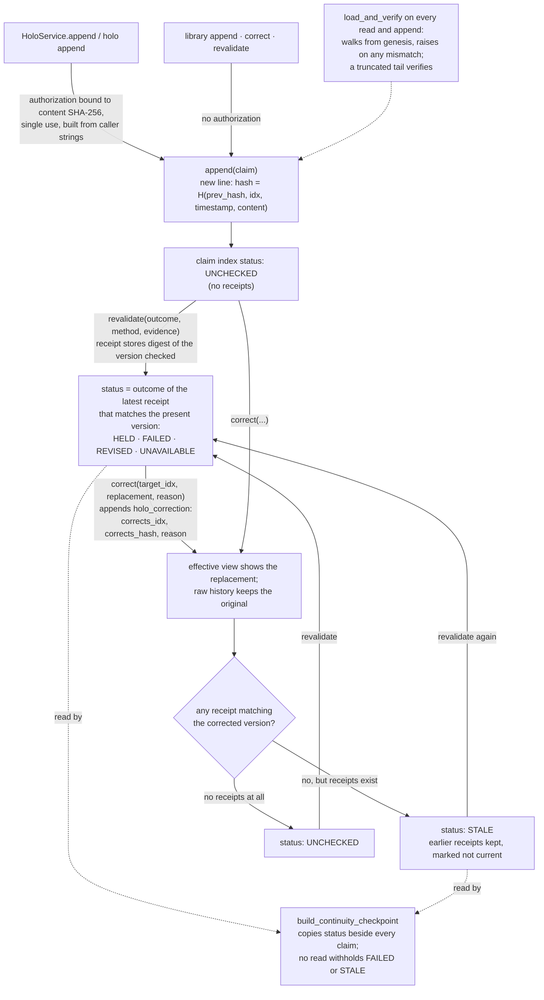

## 1. Executive Summary

HOLO-Invariant is a Python continuity framework whose memory primitive is
HoloChain: one JSONL file per chain, each line hash-linked to the one before,
where a correction or a re-check is appended as its own record rather than
written over the claim it concerns. The mechanism to take is the revalidation
receipt, which stores the digest of the exact version it checked, so correcting
a claim turns every earlier check on it `STALE` without anyone touching those
checks. The weak points are that nothing reads that status to withhold a claim,
and that the published benchmark scores two hand-written conditions rather than
the output of any store.

**The chain is the store.** `HoloChain.append` takes a file lock, re-reads and
re-verifies every line, writes one entry whose `hash` covers the previous hash,
index, timestamp and content, and fsyncs; `load_and_verify` walks from a genesis
hash of 64 zeros and raises on the first mismatch (`holosim/core.py:127-216`).
The class docstring calls it a "[t]amper-evident append-only chain for AI/human
continuity and long-term memory", and the package description says the same.
Nothing in `core.py` rewrites the file.

**A correction is a record, not an edit.** `correct(target_idx, new_content,
reason)` appends a `holo_correction` naming the target's index and hash, refuses
an empty reason, and refuses a target that is itself a correction, a
revalidation or an operational record (`holosim/core.py:374-437`). The
effective view folds the latest correction over each original and keeps the
whole correction history beside it (`:465-469`); raw history keeps the value
that was corrected. That is the README's row "[o]riginal, correction, and
target remain inspectable", and it holds in the code.

**A check knows what it checked.** `revalidate` appends an outcome from `HELD`,
`FAILED`, `REVISED` or `UNAVAILABLE`, a method, an evidence string, and the
digest of the effective version plus the index of the correction that produced
it (`:588-660`). The claim index reports the outcome of the latest receipt that
matches the claim's present version, `STALE` when receipts exist and none
matches, and `UNCHECKED` when there are none (`:703-741`). A correction
therefore invalidates prior checks by construction, and
`test_correction_makes_prior_revalidation_stale_until_rechecked` walks the
sequence HELD, corrected, STALE, re-checked, HELD
(`holosim/tests/test_core.py:144-171`).

**The status filters nothing.** Its one consumer outside `core.py` is
`build_continuity_checkpoint`, which copies it into the checkpoint beside every
other claim (`holosim/continuity_checkpoint.py:56-73`). A `FAILED` claim is
returned by the effective view, the checkpoint and the search exactly as a
`HELD` one is, so the status is a label for a reader rather than a gate.

**The benchmark scores declared answers.** The scorer is careful. The fixture is
hashed and "fixes the target before results are observed"; the condition schema
is closed "so undeclared fields cannot alter the scoring contract";
`passes_bounded_continuity_fixture` requires full recall of the latest claims
*and* zero resurrections of superseded ones, so the negative half cannot pass on
an empty answer (`holosim/continuity_baseline_benchmark.py:162-168`). But the
"CI-verified reference result" is that scorer applied to
`benchmarks/examples/passing-condition.json`, a twenty-three-line document listing the
fixture's correct claim ids by hand. The latest-value baseline it is compared
with is a dict literal that copies the fixture's `latest_justified_claim_ids`
into its recovered and current fields
(`tests/test_latest_value_continuity_baseline.py:51-65`). No code path turns a
HoloChain into a condition. The README's invitation — "Export a system-neutral
condition document, then score it" — leaves the export to the reader, and the
comparison establishes what the scorer does with two declared answers.

**Where a real chain does meet a scorer, it recorded failure.**
`cross_model_correction_handoff.py` builds a disposable chain holding an
original rule, a correction and a `REVISED` revalidation, hands its topology to
local Ollama models, and scores their JSON against the fixture. The committed run
records `all_checks_passed: 0` in all four cells, over eight attempts with one
request error, and the module's own docstring files it as a "PARTIAL model
handoff pilot".

**The write gate binds an approval to one write and does not establish who
approved.** `HoloService.append` — behind `holo append` and the `Collector` —
refuses without a `holo_operational_authorization` whose `target_sha256` equals
the canonical content's SHA-256, and refuses one whose id or hash already
appears in the chain (`holosim/service.py:101-217`). That single-use,
target-bound shape is the property [Anda DB](../anda-db/)'s approvals and
[Edda](../edda/)'s verdicts have. The record is built from caller strings: the
CLI takes `--reviewer` and `--approval-reference` and calls
`build_operational_authorization` itself (`holosim/holo_cli.py:581-637`), and
the module states it is "deliberately not proof of the issuer's identity". The
library's `append`, `correct` and `revalidate` take no authorization at all.

There is no scope over stored content, no ranking and no delete; the MCP server
exposes one read-only IDX packet check. The store is 863 lines in a repository
whose bulk is verifiers, receipts and a research layer — functional-consciousness
experiments, an i386 OS core, a game — that the README separates out as a
research layer with no runtime authority.

## 2. Mental Model

A **memory** is an entry in the chain. An original claim is any JSON value or
string; corrections, revalidations and `service_append` records are entries too,
distinguished by a `_holo_record_type` or `type` field and excluded from the
claim index.

A claim is never replaced. A **correction** supersedes it in the effective view
and leaves it in raw history. A **revalidation** records a verdict on one
version. The claim's **status** is not stored; it is folded from the receipts on
every read.

Nothing dies. There is no delete, no expiry, and no rejected value kept for
refusal; `needs_review` and `prune_suggestions` list entries older than 90 or
180 days and act on none of them.

Every mover is a caller of the library. No background process, model or agent
tool changes a claim's state; the service facade's authorization gates its own
appends and nothing else. The system treats every entry as a recorded claim, and
its payloads say so: admission returns `accepted_as_truth: false` and
`write_authority: "NONE"` (`holosim/core.py:788-798`).

## 3. Architecture

| Area | Role |
| --- | --- |
| `holosim/core.py` | `HoloChain`: append, verify, correct, revalidate, effective view, claim index, snapshot admission |
| `holosim/replay.py` | `ReplayEngine`: latest, timeline, substring search with a decoded-size cap |
| `holosim/service.py` | `HoloService`: the authorization-gated append facade, optional SQLite slot mirror |
| `holosim/typed_operational_authorization.py` | The closed, target-bound authorization record |
| `holosim/collector.py` | Intake: near-duplicate check, then a service append |
| `holosim/continuity_checkpoint.py` | A hashed checkpoint of the claim index for handoff |
| `holosim/continuity_baseline_benchmark.py`, `holosim/public_continuity_benchmark.py` | The continuity scorer and its closed public condition |
| `holosim/holo_cli.py`, `holosim/mcp_adapter.py` | The `holo` CLI; a one-tool read-only MCP server |
| `holosim/persistent_baseline_transition.py` | A separate store, on HoloChain, that commits authorized baseline promotions exactly once |

### Deployment and ergonomics

Nothing has to run. `pip install -e .` installs a package with no runtime
dependencies; MCP, sentence-transformers, `arxiv` and `pygame` are optional
extras. A chain is a text file a person can read line by line, and a damaged
tail can be diagnosed and its verified prefix copied out to a separate artifact
by `holochain_terminal_tail_diagnosis.py` and `verified_prefix_recovery.py`,
which never modify the source. No API key is needed to store anything; the
similarity model loads only when `HOLOSIM_ENABLE_EMBEDDINGS=1`.

## 4. Essential Implementation Paths

**Write.** `HoloChain.append` (`holosim/core.py:157-216`) runs
`load_and_verify`, an optional caller precondition, the hash, the write and an
fsync inside `_append_transaction`'s lock. `HoloService.append`
(`holosim/service.py:101-245`) validates the authorization, then appends with a
precondition that refuses a consumed authorization id or hash.

**Correct and recheck.** `correct` (`holosim/core.py:374-437`) and `revalidate`
(`:588-660`) each validate the target from one snapshot, then append with a
precondition that re-checks the target inside the lock and raises "Correction
target changed before append" or "Revalidation subject changed before append".

**Read.** `get_effective_state` (`:465-469`) folds corrections;
`_get_claim_index_from_verified_entries` (`:703-741`) computes the status per
claim; `ReplayEngine.search` (`holosim/replay.py:81-100`) matches decoded text.

**Hand off.** `build_continuity_checkpoint`
(`holosim/continuity_checkpoint.py:26-88`) takes a snapshot, admits it through
`_admit_verified_entries` (`holosim/core.py:743-798`), and refuses if the chain
changed between the read and the reconstruction.

**Score.** `score_continuity_condition`
(`holosim/continuity_baseline_benchmark.py:118-198`) and
`compare_continuity_conditions` (`:200-271`), which also refuses a result whose
hash or resurrection count does not match its own fields.

## 5. Memory Data Model

An entry is `{idx, timestamp, content, prev_hash, hash, type, original_size}`,
where `type` is `plain` or `compressed` (hex of a zlib stream, used only when
shorter than the original). The hash covers `idx`, `timestamp` and `content`
after the previous hash, so it covers the stored form, compressed or not.

A correction's content is `{_holo_record_type: "holo_correction", version: 1,
corrects_idx, corrects_hash, reason, replacement}`. A revalidation's is
`{_holo_record_type: "holo_revalidation", version: 1, target_idx, target_hash,
subject_hash, subject_correction_idx, outcome, method, evidence}`. A
claim-index row carries `idx`, `original_hash`, `content`, `content_hash`,
`correction_history`, `revalidation_history`, `status`, and `corrected_by` and
`revalidated_by` where they apply.

There is one time field, `timestamp`, the append time. There is no scope key,
no author field on the chain entry, and no confidence number. Provenance is
whatever the caller puts in the content; the service facade puts a provenance
packet and the authorization record there.

## 6. Retrieval Mechanics

`ReplayEngine.search` lowercases the query and returns up to `limit` (default
20) entries whose decoded content contains it, in chain order, after verifying
the whole chain (`holosim/replay.py:81-100`). A compressed entry is decoded with
a 1 MiB cap, and a malformed or oversized one raises `SearchDecodeError` rather
than returning a partial result (`:102-125`). Until 1 October 2026
([`945c98e121ec10c2f5e8666816839d35072e12a7`](https://github.com/Deathburgerz013/HOLO-Invariant/commit/945c98e121ec10c2f5e8666816839d35072e12a7))
search matched the stored form, so an entry the service facade had compressed —
it compresses by default — could not be found by its text.

Search returns raw entries, not the effective view: a corrected original and
its correction both match their own text, and nothing marks the first as
superseded in the result. A reader wanting the corrected value goes to
`get_effective_state` or the claim index, which have no query parameter.

There is no ranking, token budget or context assembly; the CLI prints results.

## 7. Write Mechanics

Writes are synchronous and call no model. The `Collector` skips text whose
similarity to any of the last 100 entries reaches 0.85 unless `force` is set,
then calls the service facade (`holosim/collector.py:42-116`); without both a
reviewer and an approval reference it returns `blocked` with
`external_approval_required`.

### Operational cost

Every append and every read re-reads and re-hashes the whole file, and the
claim index computes revalidations claim by claim over all receipts, so cost
grows with the chain on every operation. Nothing runs in the background and
nothing is injected into a prompt.

## 8. Agent Integration

No agent tool writes memory. The MCP server registers `idx_check`, which checks
a moving Spine packet against a frozen IDX text and returns a receipt, plus two
schema resources (`holosim/mcp_adapter.py:20-37`). The `holo` CLI covers
`append`, `replay --search`, `index`, `resume` from an operator handoff,
`verify`, `review`, `demo` and `benchmark continuity`. `correct` and
`revalidate` have no CLI verb; their production callers are the demo and the
cross-model pilot, each on a disposable chain.

## 9. Reliability, Safety, and Trust

**Interior tampering is detected; truncation is not.** `load_and_verify` checks
each link from genesis, so an edited line fails. A file whose last entries are
removed is a valid shorter chain: `create_checkpoint` returns the head hash and
"is not automatically persisted", and nothing in `core.py` records the head
anywhere else.

**Concurrent writers are serialized.** `fcntl.flock` on POSIX; on Windows a
non-blocking byte-range lock retried for 30 seconds, then `TimeoutError`
(`holosim/core.py:71-93`). Every precondition is evaluated inside that lock.

**Authorization is a contract on shape, not on identity.** It binds one action
to one content hash and is consumed once, which stops one approval licensing a
different write. Who supplied it is a string. The library's own write methods
are outside it.

**Uncertainty is representable and unused.** `UNAVAILABLE` and `STALE` exist as
statuses; no read path acts on them.

## 10. Tests, Evals, and Benchmarks

I installed and ran nothing for this reading; the results quoted are the
committed ones.

The store is tested directly: tamper detection, corrections that keep raw
history and update the effective view, the HELD-to-STALE sequence, malformed
references failing closed (`holosim/tests/test_core.py`). Other tests cover
corrections and revalidations refused when their target changes inside the append window
(`tests/test_correction_snapshot_consistency.py`,
`tests/test_revalidation_snapshot_consistency.py`), operational records refused
as correction targets and excluded from the claim index
(`tests/test_operational_record_target_boundary.py`,
`tests/test_claim_record_classification.py`), and compressed search with its
byte cap (`tests/test_replay_compressed_search.py`).

The continuity-benchmark tests test the scorer. `test_committed_reference_result_matches_current_scorer`
re-scores the committed condition file and compares it with the committed
result; `test_readme_exposes_ci_verified_benchmark` pins the README's metric
rows as literals; the baseline test scores a dict literal
(`tests/test_continuity_benchmark_ci.py:43-130`,
`tests/test_latest_value_continuity_baseline.py:31-167`). These keep the README,
the result file and the scorer consistent with each other. None of them runs a
store.

The `holo-reference` table reads correctly as a worked example of the scorer.
A test that exports a HoloChain into a condition and scores it is the one this
repository does not carry, and it is the test that would make the table a
result.

## 11. For Your Own Build

### Steal

Bind a check to the digest of the version it checked. A verdict that records
what it looked at expires itself when the thing changes, which is cheaper and
more honest than any re-validation schedule.

Append corrections with the target's hash and a required reason, and fold them
at read time. The original stays answerable, and the reason is in the record
rather than in a commit message.

Re-check a write's precondition inside the lock that serializes writes, not
before taking it.

Put the control inside the pass condition. Requiring full recall of current
claims alongside zero resurrections means a system that returns nothing fails.

### Avoid

Publishing a reference result computed from a typed answer under a benchmark
badge. A scorer test belongs in the scorer's suite; a system result needs a
system to have produced the condition.

Computing an epistemic status that no read consults. A `FAILED` claim served
like a `HELD` one is a label, and a reader of the claim index will assume it
filters.

Calling an unanchored hash chain tamper-evident without saying which tampering
it misses. Persisting the head somewhere the writer cannot rewrite is what
makes truncation visible.

### Fit

This is for someone building a correction-preserving claim log by hand, in
Python, for one process or a few, who wants the receipts and the fold rather
than a memory service. It is a poor fit for anything an agent writes to
directly — there is no tool surface, no scope, no ranking, and every operation
is linear in the chain — and for a reader who wants a benchmark number to
compare systems with, since the committed number is not a measurement of one.

## 12. Open Questions

Whether a HoloChain-to-condition exporter is intended. The scorer, schema and
README all assume one, and none is in the tree.

Whether the claim status is meant to gate `resume` or the checkpoint. The
handoff gates elsewhere in the repository (`continuity_current_gate.py`,
`continuity_head_binding.py`) block on a head's own `STALE` status, computed
from a supplied packet, and do not read the claim index.

Who writes to a chain in practice. The CLI's `append` and the `Collector` are the
only production writers of original claims, both through the authorization
facade, and the cross-model pilot suggests the intended reader is a model
handed a projection of the chain.

## Appendix: File Index

| Path | What to read it for |
| --- | --- |
| `holosim/core.py:127-216` | Verification from genesis, the locked append, fsync |
| `holosim/core.py:374-437` | A correction as an appended record, with an in-lock precondition |
| `holosim/core.py:588-660` | A revalidation bound to the digest of the version checked |
| `holosim/core.py:703-741` | The claim index and its STALE / UNCHECKED fold |
| `holosim/replay.py:81-125` | Substring search and the compressed-decode cap |
| `holosim/service.py:101-245` | The target-bound, single-use authorization gate |
| `holosim/typed_operational_authorization.py` | What the authorization record does and does not prove |
| `holosim/continuity_baseline_benchmark.py:118-198` | The scorer and a pass condition that cannot pass on silence |
| `benchmarks/examples/passing-condition.json` | The hand-written condition behind the reference result |
| `tests/test_latest_value_continuity_baseline.py:51-65` | The baseline as a dict literal |
| `holosim/tests/test_core.py:53-171` | Corrections, the effective view and the STALE sequence |
| `holosim/cross_model_correction_handoff.py` | The pilot that scores model output from a real chain |

### Recorded searches

Run at the tree root of the pinned checkout with `git grep`.

- `git grep -l -E 'score_continuity_condition|holo_continuity_condition|PUBLIC_CONDITION_TYPE' -- '*.py' '*.json' '*.yml'` — the scorer, the public wrapper, the fixture-derived longitudinal experiment, the schema, the example condition and four test files; nothing that builds a condition from a `HoloChain`.
- `git grep -n -E '\.(correct|revalidate)\(' -- holosim ':!holosim/tests'` — `continuity_demo.py:46,54` and `cross_model_correction_handoff.py:46-47` only; no CLI or MCP verb.
- `git grep -n -E 'truncate\(|os\.replace|open\([^)]*"w' -- holosim/core.py holosim/replay.py holosim/service.py` — no match.
- `git grep -n -E 'root_hash|expected_head|head_hash' -- holosim/core.py` — `:232` (`create_checkpoint`, not persisted) and `:791` (the admission result); no stored head.
- `git grep -n -i -E 'thread_id|scope' -- holosim/core.py holosim/replay.py holosim/service.py` — no match.
- `git grep -n -E 'get_claim_index|_admit_verified_entries' -- holosim ':!holosim/tests'` — `core.py` and `continuity_checkpoint.py:42`, which copies `status` and filters nothing.
- `git grep -n -E '"(HELD|FAILED|STALE|UNCHECKED|REVISED|UNAVAILABLE)"' -- holosim/continuity_checkpoint.py holosim/replay.py holosim/service.py holosim/api.py holosim/runtime.py holosim/holo_cli.py` — no match.
- `git grep -n -i -E 'tombstone|rejected_value' -- holosim ':!holosim/tests'` — no match.
- `git grep -n -E 'def (delete|forget|remove|purge|prune|erase)' -- holosim/core.py holosim/service.py holosim/replay.py holosim/api.py holosim/runtime.py` — `core.py:848`, `prune_suggestions`, which returns `needs_review` and deletes nothing.
- `git grep -n -E '@mcp\.tool' -- holosim` — `mcp_adapter.py:20`, `idx_check` only.
- `git grep -n -i -E 'arxiv\.org|bibtex|@article|@misc|doi\.org' -- README.md` — no match; the documents under `docs/` cite other authors' papers and no paper describes this project.
- `git grep -n -i -E 'anthropic|machine learning|not (be )?used (for|to)' -- LICENSE holosim/LICENSE` — no match; the MIT text carries no rider.

## History

**2026-10-12** — [`1dd96b3a3ec8f8491a77c411b1848fe76f0e8bab`](https://github.com/Deathburgerz013/HOLO-Invariant/commit/1dd96b3a3ec8f8491a77c411b1848fe76f0e8bab) — 307 commits on, package version 0.4.9 at both pins. Screened from a full clone: five files scanned, no auto-run surface, one build-time execution point (`experiments/os_core/Makefile`, added since the first pin), one unpinned surface, nothing inside the cooldown, `AGENTS.md` read as data. Nothing was installed, built or run. `audit_log` gained, earned at the first pin, where the report said there was no store, read path or mutation record. `negative_eval` kept on the effective-view tests, which carried it at both pins; the benchmark tests it cited score hand-written conditions. The write row conflated the library correction with the authorized baseline path. Upstream since: appends fsync, preconditions run inside the lock, search decodes compressed entries. See [section 1](#1-executive-summary).

**2026-09-16** — [`2d36396a060f28ec68110f7697b893d2c8cff859`](https://github.com/Deathburgerz013/HOLO-Invariant/commit/2d36396a060f28ec68110f7697b893d2c8cff859) — first reading, at a commit dated 15 September 2026. Screened before opening, from a shallow clone: four files scanned, no auto-run surfaces, no build-time execution points, one unpinned surface and one dependency file inside the seven-day cooldown. Nothing was installed, built or run, and no benchmark was executed.
