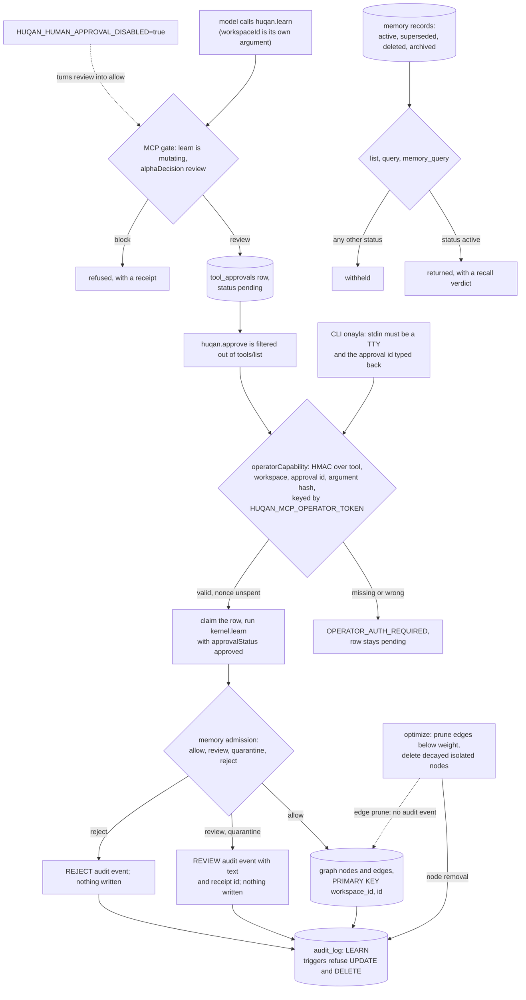

## 1. Executive Summary

HUQAN is a local gate between what an agent proposes and the state it would
change, and a memory write is one of the things it gates. The mechanism that
matters is that the model cannot clear its own proposal: the approve verb is
missing from the model's tool list and needs a capability signed with a secret
the model never sees. Its weaker side is naming and wiring. What it calls
quarantine is a refusal rather than a hold, the workspace is a model-chosen
argument on the shipped MCP server, and the identity-resolving review runtime
is a library component no binary constructs.

The licence file is AGPL-3.0-only with no rider. The README adds that a
commercial licence is "[r]equired for" production use inside companies and that
"this repository grants **no commercial rights**" until one is signed, which is
a statement of the project's position rather than a term in `LICENSE`.

**There are two memories behind the gate.** The graph is what `huqan.learn`
writes: a rule-based extractor turns a sentence into subject nodes and weighted
edges, keyed by workspace (`lib/learn-use-case.js:92`). The memory-record store
is a separate table of records with a lifecycle status, written by the
error-prevention engine and the CLI's lifecycle commands, and searched by
`huqan.memory_query` with BM25 and a read-time recall gate
(`lib/memory-query-read.js:118-159`).

**The approval is a credential, not a name.** `huqan.learn` is classified
`mutating` with `alphaDecision: 'review'`, so the call is persisted as a pending
row in `tool_approvals` and returns without writing
(`lib/mcp-gate-adapter-contract.js:76`). `huqan.approve` is one of five operator
tools filtered out of `tools/list`, and calling it needs an `operatorCapability`
HMAC-signed with `HUQAN_MCP_OPERATOR_TOKEN` from the server's environment and
bound to the approval id and argument hash (`lib/mcp/tool-surface.js:13`,
`lib/mcp/operator-authorization.js:24-43`). On the CLI, `onayla` refuses unless
stdin is a terminal and the approval id is typed back
(`lib/cli-operator-presence.js:52-55`).

**Admission has four outcomes and one of them writes.**
`MEMORY_ADMISSION_DECISIONS` is frozen to `allow`, `review`, `quarantine` and
`reject` with a severity order, and only `allow` reaches the graph. The other
three append a `REVIEW` or `REJECT` audit event carrying the text and a receipt
id, and return `learned: 0` (`lib/learn-use-case.js:50-75`).

**The oversight runtime is an option, not the default.**
`lib/human-oversight-approval-runtime.js` states that "[t]he runtime never
accepts an approver identity from the decision body", requires an injected
`resolveIdentity`, and refuses self-approval on the resolved identity. The
shipped MCP server passes `options.humanOversightApprovalRuntime || null`, and
`runStdio` calls `createServer()` with no options, so the runtime is engaged only
by a host that constructs it (`mcpServer.js:95`, `:124`).

## 2. Mental Model

A **proposal** is a pending approval row holding the call's arguments. Nothing is
in the graph until an operator approves it and the approved call runs.

**Admission** decides whether an approved learn may write. It returns one of four
outcomes; `allow` writes, and the other three write only an audit event. A
`quarantine` outcome is a severity, not a place: nothing is held for release.

A **graph fact** has a weight and a confidence, both floats, and no status. It
is reinforced by later writes and dies by decay and pruning, or never.

A **memory record** has a status. `active` is the only value the default reads
return; `superseded` marks a corrected record, `deleted` a tombstoned one and
`archived` a reversible hide. The record and its events are kept in every case.

A **recall verdict** — `admit`, `degrade` or `withhold` — is computed on each
read from the record's status, workspace, provenance, expiry and policy
version, and stored nowhere.

## 3. Architecture

| Area | Role |
| --- | --- |
| `mcpServer.js`, `lib/mcp/` | The stdio MCP server: tool surface, operator authorisation, dispatch, gate refusals |
| `lib/mcp-gate-adapter*.js` | Tool classification and the AB gates that decide allow, review, dry-run or block |
| `lib/mcp-approval-*.js`, `lib/storage/schema.js` | The `tool_approvals` queue, claim, execution and finalisation |
| `kernel.js`, `lib/learn-use-case.js`, `lib/kernel-learn-admission.js` | Learn: provenance, admission, extraction, graph write |
| `lib/memory-admission-gate*.js` | The four-outcome admission decision and its receipt |
| `graph.js`, `lib/graph-*.js` | Nodes, edges, audit log, candidate claims, mutation journal and receipts |
| `lib/memory-store*.js`, `lib/memory-*.js` | The memory-record store, its lifecycle, BM25 query and recall gate |
| `lib/human-oversight-approval-runtime*.js` | The optional identity-resolving review runtime |
| `lib/authority/`, `bin/huqan-authority.js` | The Windows approval-authority service (ADR-016) |
| `lib/cross-workspace-access-gate.js` | A pure decision over an actor workspace, a target workspace and grants |

### Deployment and ergonomics

Node 22.13 or newer. Storage is SQLite through `better-sqlite3` when it loads,
and JSON files otherwise; no service, no model and no API key are needed for the
gate. The package ships seven binaries — `huqan`, `huqan-mcp`, `huqan-gate`,
`huqan-authority` and three experiment labs — plus `server.js` for HTTP.

The MCP server approves nothing unless `HUQAN_MCP_OPERATOR_TOKEN` is set in its
environment. The CLI approves through an in-process call with a fresh random
secret per process (`cli.js:77`). The approval authority is a Windows service
with TOTP; elsewhere the approval boundary is the OS user, which the README
states.

## 4. Essential Implementation Paths

**Proposal.** `dispatchMcpTool` refuses a non-JSON `arguments` string, binds the
call to its arguments, and runs `evaluateMcpGate` with metadata the host
supplies, never the request (`lib/mcp/tool-dispatch.js:225-305`). A `review`
verdict is persisted by `respondToGateRefusal` as a pending approval.

**Approval.** `dispatchOperatorTool` checks the capability before anything else
and routes `huqan.approve` to `handleMcpApprovalDecision`
(`lib/mcp/tool-dispatch.js:141-187`). That handler requires the installed
authority's signed decision when one exists, refuses an expired row and a row
whose stored arguments no longer match the reviewed binding, then claims the
row and executes (`lib/mcp-approval-decision-handler.js:77-86`, `:92-117`,
`lib/mcp-approval-learn-execution.js:144`).

**Admission and write.** `buildLearnAdmissionRequest` takes `approvalStatus` and
`approvalRequired` from the kernel call's options. The MCP handler never fills
those from the model's arguments: `learnContextArgs` forwards only
`workspaceId` and `provenance` (`lib/learn-admission-request.js:21-100`,
`lib/mcp/tool-handlers.js:30-38`). `evaluateMemoryAdmission` takes the strictest
signal (`lib/memory-admission-gate.js:9-119`).

**Graph read.** `ask` resolves a subject in one workspace and reads its edges
(`lib/kernel-read-use-cases-ask.js:7`); `getNodes` and `getNode` take a
workspace (`lib/graph-read-methods.js:33-39`).

**Memory-record read.** `buildMemoryQueryRead` validates the request, calls
`MemoryStore.query` with `recall: true`, and shapes each item with its recall
verdict (`lib/memory-query-read.js:118-159`).

**Maintenance.** `optimize` prunes edges below the threshold and deletes decayed
isolated nodes (`lib/graph-optimize.js:7-44`).

## 5. Memory Data Model

The graph's SQLite schema holds `nodes` keyed `(workspace_id, id)` with weight,
timestamps, a term vector and provenance; `edges` unique on `(workspace_id,
from_id, to_id, relation)` with weight, confidence, a confidence history,
evidence and source; `audit_log`; `candidate_claims` with a `pending` default
status and reviewer fields; `mutation_journal`; and `mutation_receipts` with a
hash chain (`lib/graph-sqlite-schema.js:16-109`).

The memory-record store has `memories`, `memory_events` and `memory_links`
(`lib/memory-store-sqlite-schema.js:21-68`). A record carries content, a
content hash, `status`, metadata, provenance, a trust policy version,
`created_at`, `updated_at`, `deleted_at`, `archived_at` and supersession
pointers. Statuses are `active`, `superseded`, `deleted`, `archived` and
`unknown` (`lib/memory-schema-types.js:38-44`).

Time is the write clock throughout. The temporal query accepts `createdAt`,
`updatedAt`, `deletedAt` and `accessedAt` (`lib/memory-temporal.js:33-36`). An
`expiresAt` in metadata is a shelf life the recall gate reads, not a validity
interval.

## 6. Retrieval Mechanics

`huqan.ask`, `reason` and `compare` take a workspace that defaults to `default`.
The MCP `ask` handler passes none, so it reads the default workspace only
(`lib/mcp/tool-handlers.js:53`). Subject detection strips Turkish and English
interrogatives and resolves the remaining words against node labels.

`huqan.memory_query` requires `workspaceId`, defaults to BM25, and offers
substring and recency modes (`lib/memory-query-read.js:20`, `:63-64`). Its
header reports BM25 reaching 0.842 recall@10 against 0.037 for whole-query
substring, measured on 409 issue-title queries; that is a figure in a code
comment, and this reading did not reproduce it. The recall gate withholds records that are
inactive, unprovenanced, from another workspace or malformed, and degrades
stale ones (`lib/memory-recall-gate.js:122-157`).

The default list and query reads return `active` records only. `findById`, the
temporal reads and export hide `deleted` and `archived` but return a
`superseded` record, and the module states the split as deliberate
(`lib/memory-record-visibility.js:1-22`).

## 7. Write Mechanics

Writes are synchronous and model-free. An approved learn runs the extractor over
the text, checks conflicts and alternatives, and adds edges with provenance; no
LLM is called on the write path. A background edge from `dream` goes through the
same admission, so under the default `approvalRequired` it is logged as `REVIEW`
and not written (`kernel.js:253-275`, `lib/kernel-dream.js:41-60`).

Memory records are written by the error-prevention engine, which stores failure
records and prevention rules and supersedes a rule when it changes
(`lib/error-prevention/store.js:14-57`). The CLI's `memory tombstone`,
`supersede`, `archive` and `restore` write them too
(`lib/cli-memory-lifecycle.js:47-98`). `gate-signal-provider` consults that
store on live gate decisions (`lib/gate-signal-provider.js:228`).

### Operational cost

Nothing blocks on a model. The cost is the gate itself: every MCP call runs the
classification and its listed AB gates, and an approved write runs admission and
the blast-radius measurement before the extractor. `optimize` walks one
workspace's nodes when invoked; no default timer runs it.

## 8. Agent Integration

The model sees the tools `MODEL_VISIBLE_TOOL_SCHEMAS` lists, including `learn`,
`ask`, `verify`, `memory_query`, `search`, `dream`, `self-evolve` and
`ingest_execute`; every mutating one classifies as `review`. The five operator
tools are never listed to the model. `huqan-gate install` writes pre-execution
hooks for Claude Code, Codex, OpenHands, opencode, pi and Hermes, and the README
says "[t]he gate enforces only when the client calls it before executing."

## 9. Reliability, Safety, and Trust

**Quarantine holds nothing.** A `quarantine` admission produces a
`memory_quarantine_receipt` kind and the same `REVIEW` audit event a `review`
does, with the text in its details. No row, file or queue holds the content for
release (`lib/learn-use-case.js:50-75`, `lib/memory-admission-gate-contract.js:20`).
The distinction between held and refused is in the receipt kind, not in what
survives.

**The workspace is chosen by the caller.** Every read applies a workspace key,
but on the stdio server that key is the model's argument and no caller workspace
is bound. `buildAb11Input` returns `null` unless the host's `gateMetadata`
declares one, so the cross-workspace gate does not run for the shipped binary
(`lib/mcp-gate-adapter-inputs.js:142-157`, `mcpServer.js:89`). The dispatch
comment says so: "args.workspaceId is the target workspace, not evidence of the
caller's workspace or grants" (`lib/mcp/tool-dispatch.js:276-278`).

**The default approval records no resolved identity.** Separation of duties,
self-approval refusal and the distinct-approver count live in the oversight
runtime, which only an embedder constructs. A default approval proves that the
caller held the operator secret or sat at a terminal; it does not record who.

**Two switches weaken the queue.** `HUQAN_HUMAN_APPROVAL_DISABLED=true` turns
every `review` into `allow` and sets the kernel's default `approvalRequired` to
false. It leaves `block` alone and records `autoApproved` on the gate metadata
(`lib/human-approval-toggle.js:28-30`, `:89-117`). The operator secret lives in
the MCP server's environment, readable by anything running as the same user, a
limit `lib/cli-operator-presence.js:15-17` states for the terminal check too.

**Edge pruning is unaudited.** `prune` rewrites the edge list and runs `DELETE
FROM edges WHERE weight < ?` with no audit event, while node removal in the same
pass appends `DELETE` (`lib/graph-prune.js:5-16`,
`lib/graph-store-adapters.js:253-261`).

**`dream` is classified as a read.** It attempts edge writes that admission
holds by default; with approval disabled they land without a queue entry
(`lib/mcp-gate-adapter-contract.js:57`).

## 10. Tests, Evals, and Benchmarks

The suite is `node --test` over 1,353 test files, run through a wrapper that
sandboxes gate state (`scripts/run-tests.js:25-30`). I ran none of it.

The negative retrieval case is
`test/memory-tombstone-supersede-downstream-exclusion.test.js`. It stores a
surviving record beside the one it tombstones and asserts that `list`, `query`,
`findById`, `findByContentHash` and export miss the tombstoned one while
returning the survivor; `includeTombstoned` brings the count to two
(`:59-87`). The superseded case asserts `list` returns only `v2`
(`:173-198`). `test/memory-store-workspace-isolation.test.js` stores four
records in each of three workspaces and asserts every read returns its own four.

`lib/audit-log.test.js:110-142` asserts that an `UPDATE` and a `DELETE` on
`audit_log` both throw, and skips when `better-sqlite3` is unavailable.

`test/faz2-mcp-approval-persistence.contract.test.js:142-170` asserts that
`huqan.approve` is absent from `tools/list`, that `learn` queues a pending row,
and that a wrong secret is refused with the row left pending.

The README states scale "measured up to 10k graph nodes on one machine"; the
`benchmarks/` directory holds the scripts, and no result was checked here.

## 11. For Your Own Build

### Steal

Put the approve verb behind a credential the model's process never receives. A
hidden tool name is discovery hygiene; the HMAC capability bound to the approval
id and argument hash is what makes it a boundary.

Bind the approved call to the arguments the reviewer saw. Refuse execution when
the stored call drifts from the reviewed binding, and expire pending rows so an
old risk assessment cannot be approved later.

Make the CLI approve demand a terminal and an echo of the subject. It costs one
prompt and closes the pipe and heredoc paths an agent's shell would use.

### Avoid

Naming a refusal "quarantine". If nothing holds the content for release, the
word promises a recovery path the store does not have.

Letting the read scope be the caller's argument with the isolation gate wired
only for embedders. A pure, testable cross-workspace function does nothing on
the binary that never feeds it.

Shipping the strongest review mechanism as an option. Separation of duties that
only an embedder can turn on is absent from every default install.

### Fit

HUQAN suits a single developer or small team that wants an agent's writes,
memory included, to wait for a person, and accepts a large Node surface to get
that. The memory behind the gate is a rule-based graph and a rules store, not a
recall system. Anyone choosing agent memory for retrieval quality should choose
elsewhere and put a gate like this in front of it.

## 12. Open Questions

Whether a pending learn approval that is never decided is surfaced to a person
outside `huqan approvals`, or expires unseen at its TTL.

Whether the commercial-licence statement in the README is meant to qualify the
AGPL grant, which only the maintainer can answer.

How the approval authority's ledger and the local `tool_approvals` row reconcile
when the Windows service is installed after rows were queued.

## Appendix: File Index

| Path | What to read it for |
| --- | --- |
| `lib/mcp/tool-surface.js:13-32` | The operator tools and the model-visible split |
| `lib/mcp/operator-authorization.js:24-43` | The capability check |
| `lib/mcp-operator-capability.js:7-63` | HMAC, TTL and nonce |
| `lib/mcp-gate-adapter-contract.js:41-86` | Tool classification: every mutating tool is `review` |
| `lib/mcp-approval-decision-handler.js:33-277` | Authority, expiry, binding, claim, execution |
| `lib/cli-operator-presence.js:47-75` | The terminal check on the CLI approve |
| `lib/learn-use-case.js:46-75` | Admission outcomes other than `allow` write only an audit event |
| `lib/memory-admission-gate.js:9-119` | The four outcomes and their signals |
| `lib/graph-sqlite-schema.js:16-109` | Graph tables, the audit triggers, the receipt chain |
| `lib/memory-record-visibility.js:24-60` | The two default-read predicates |
| `lib/memory-recall-gate.js:122-157` | Read-time verdicts |
| `lib/graph-prune.js:5-16` | Edge pruning with no audit event |
| `lib/human-oversight-approval-runtime.js:1-60` | The optional identity-resolving runtime |
| `test/memory-tombstone-supersede-downstream-exclusion.test.js` | The must-not-retrieve cases |

### Recorded searches

Run at the tree root of the pinned checkout with `git grep`.

- `git grep -n -E 'createHumanOversightApprovalRuntime\(' -- ':!*.test.js'` — the definition and `test/helpers/mcp-identity-approval-fixture.js:106`; no binary constructs it.
- `git grep -n -w -E 'validFrom|valid_from|validUntil|valid_until|effectiveFrom|effective_from|occurredAt|occurred_at' -- '*.js' ':!*.test.js' ':!test/'` — no hit on a graph or memory-record field; no valid time.
- `git grep -n -i -E 'rejected(Hash|Value|Claim|Fact)s?|denylist' -- lib kernel.js graph.js ':!*.test.js'` — command-execution denylists only; no record keyed on a rejected value.
- `git grep -n -E "eventType: '(PRUNE|DECAY|REMOVE|DELETE)" -- lib graph.js` — one hit, node removal at `lib/graph-store-adapters.js:254`; edge pruning appends nothing.
- `git grep -n -E 'DELETE FROM (audit_log|memory_events|mutation_receipts)|UPDATE (audit_log|memory_events)' -- '*.js' ':!*.test.js'` — no match.
- `git grep -n -E 'gateMetadata' -- mcpServer.js bin` — the option pass-through at `mcpServer.js:89`; nothing sets it for `runStdio`.
- `git grep -n -i -E 'arxiv|bibtex|@article|doi\.org' -- README.md CITATION.cff` — no match; `CITATION.cff` cites the repository.
- `git grep -n -i -E 'anthropic' -- LICENSE NOTICE` — no match; no rider.
- `git grep -n -i 'quarantin' -- lib/learn-use-case.js kernel.js lib/kernel-learn-admission.js graph.js 'lib/graph-*.js' lib/storage` — no match; nothing on the learn path or in the graph or approval schema stores a quarantined write.
- `git grep -n -E 'approvalStatus|approvalRequired' -- lib/mcp-input-sanitizers.js lib/mcp/tool-handlers.js` — no match; the model's arguments cannot set either.
- `git grep -n -i -E 'llm|openai|anthropic|chat/completions' -- lib/learn-use-case.js lib/kernel-learn-admission.js lib/learn-admission-request.js lib/memory-admission-gate.js lib/mcp-approval-learn-execution.js` — no match; no model call on the write path.

## History

**2026-10-15** — [`26cf8e66332fbac982886216207de2d21692d208`](https://github.com/ali-ulu/huqan/commit/26cf8e66332fbac982886216207de2d21692d208) — 739 commits on, version 1.0.1. `negative_eval` gained, earned at the previous pin by a test file unchanged since ([section 10](#10-tests-evals-and-benchmarks)). Three records were wrong there: `human_review` and `audit_log` rested on the oversight runtime, which no binary constructs, and `trust_state` on admission outcomes, which are returned, not stored; the marks hold on the approval queue, the audit triggers and the record status ([section 9](#9-reliability-safety-and-trust)). Overtaken: seven binaries, the CLI terminal check, BM25 and the memory lifecycle CLI. Screened from a full clone: two auto-run surfaces (a devcontainer `npm ci`, Copilot instructions), one build-time execution point, one unpinned surface, two dependency files inside the cooldown; `AGENTS.md` read as data. Nothing was installed, built or run.

**2026-09-19** — re-pinned to [`844be5964f3fb5467c7df19beca82431e39e8d8d`](https://github.com/ali-ulu/huqan/commit/844be5964f3fb5467c7df19beca82431e39e8d8d), 136 commits on, and every anchor behind all four marks still resolves to the same line. `human-oversight-approval-runtime.js` is unmoved where it matters: the docstring at `:11`, the required `resolveIdentity` at `:63` and its refusal at `:78`, `decide({ …, approverContext, … })` at `:301`, the requester comparison and `SELF_APPROVAL_REJECTED` at `:348-354`, and the multi-approver dedup keyed on `identityRef:identityHash` at `:375-378`. `memory-admission-gate.js:5-21` still freezes the four-value vocabulary and `cross-workspace-access-gate.js` still opens on the crossing it exists for. This report's `human_review` record was already a producer test rather than an assertion — it names the failure mode the mark exists to catch and shows it closed — and it needed no rewriting in a sweep that has withdrawn the mark from two dozen other reports. Screened again first; nothing was installed and no suite was run.

**2026-09-16** — [`6f11b01476f019149cf5d56e961b5cb0b5d7a92e`](https://github.com/ali-ulu/huqan/commit/6f11b01476f019149cf5d56e961b5cb0b5d7a92e) — first reading, at a commit dated 16 September 2026. Screened before opening, from a shallow clone: no auto-run surfaces, one build-time execution point, one unpinned dependency surface and six dependency files inside the seven-day cooldown. `AGENTS.md` is addressed to a reading agent and was recorded as data. Nothing was installed, built or run, and the quickstart was not executed, so the gate described here is read from source rather than observed.
