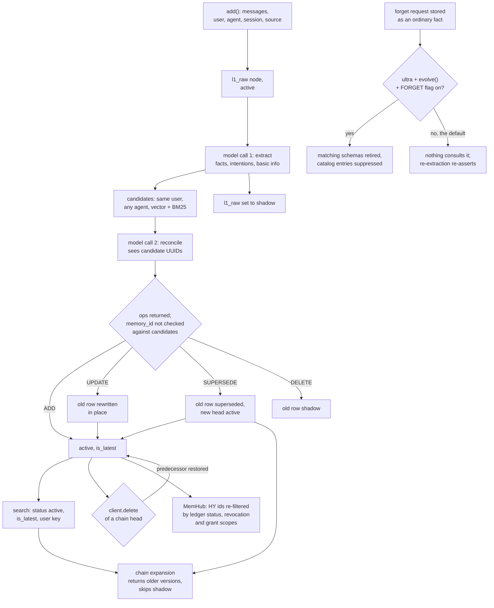

## 1. Executive Summary

Hy-Memory is Tencent Hunyuan's Python memory SDK, `hy-memory` 2.0.1, plus
MemHub, a local desktop and CLI product built on it in the same repository. The
SDK turns conversations into an eight-layer store and tool traces into fact and
experience records. One configured LLM extracts and then reconciles every write
against the user's existing memories. MemHub imports transcripts from coding
agents into its own evidence ledger, sends them through the SDK, and serves
recall to hosts through grant-checked MCP tools.

What is notable is MemHub's boundary. A broker writes the host's grant into a
header envelope, Core refuses any scope outside it, and the workspace comes from
the host process rather than from a tool argument. What is weak is the SDK
underneath: the model's chosen target ids are applied unchecked, deleting a
correction brings back the value it replaced, and the bundled HTTP server has no
authentication.

The repository is also where the Hugging Face model
[Hy-Memory-30B-A3B](https://huggingface.co/tencent/Hy-Memory-30B-A3B) points
for "Framework Code & Evaluation Utilities". The framework code is here. The
evaluation utilities are not: no harness for LoCoMo, LongMemEval, PersonaMem-v2,
the travel and shopping sets or the coding benchmark is committed, and no Mem0,
MemOS or EverMemOS adapter is either. The model is not named anywhere in the
code. It replaces the SDK's write path only through `MEMORY_LLM_MODEL`, which
also drives the read-side calls.

Five findings shape the rest of this report.

- **The writer model's target ids are trusted.** The reconcile prompt shows the
  model real memory UUIDs, and `_parse_ops` copies whatever `memory_id` comes
  back (`hy_memory/agent/reconciler.py:1671`). No step checks it against the
  candidate set before `update_payload` shadows or supersedes that row
  (`hy_memory/pipelines/writer.py:1602-1640`). The coding reconciler does
  scope its targets by user (`hy_memory/coding/reconciler.py:447-484`).
- **Deleting a correction restores the value it replaced.** When the deleted
  node heads a supersession chain, `_repair_evolution_chain_on_delete` sets its
  predecessor back to `active` and `is_latest`
  (`hy_memory/client.py:2234-2275`). Removing "the user drinks tea" brings back
  "the user drinks coffee".
- **The SDK's agent surfaces do not hold a scope.** The HTTP server answers any
  origin with no credential (`hy_memory/server.py:84-92`, `:114-121`). The
  OpenClaw tools take a model-supplied `userId` that replaces the configured
  one (`plugins/openclaw/tools/memory-search.ts:17-31`).
- **MemHub's MCP write tool has no route behind it.** `om_memory_write` posts to
  the broker's `memory-writes`, and `RecallBroker.handle` has no such route
  (`memhub/packages/host-bridge/src/broker-client.ts:291-306`,
  `recall-broker.ts:270-420`). Agent writes in production arrive only through
  transcript import.
- **Nothing is held for review.** Every SDK memory is `active` on arrival, and
  MemHub writes `confirmed`, converting legacy `candidate` rows to `confirmed`
  (`memhub/apps/core/src/one_memory/memory_governance.py:128-135`, `:340-342`).

Two marks: `audit_log`, held by the SDK's history table, and `negative_eval`.
Section 9 names the five withheld, `scope_enforced` among them: MemHub's
boundary is real, and the SDK's OpenClaw tools lift the scope it wraps.

## 2. Mental Model

A chat memory starts as the raw turn. `add()` writes it as an `l1_raw` node,
`active`, and a model call extracts facts, intentions with a deadline, and
basic profile fields from it (`hy_memory/agent/extractor.py:168`). A second
model call compares each extracted fact with candidates from the same user and
returns operations. The writer applies them and then shadows the raw turn,
whether or not anything was extracted (`hy_memory/pipelines/writer.py:3520-3541`).

**A belief is a row that is `active` and `is_latest`.** `MemoryStatus` has six
values (`hy_memory/models/memory.py:121-130`), and the read filters admit
`active` by default, with `superseded` admitted where a reader expands a chain.
Four operations move a fact:

| Op from the model | Effect on the old fact | New row |
| --- | --- | --- |
| `ADD` with no target | none | `active`, new chain |
| `UPDATE` with content | rewritten in place, re-embedded, original `memory_at` kept | none |
| `SUPERSEDE` | `superseded`, `is_latest=False`, linked by `superseded_by` | `active` head with `supersedes` |
| `DELETE`, or `UPDATE` with no content | `shadow`, `is_latest=False` | none |

`shadow` is also where dedup, replaced topic summaries and stale episode
capsules go. It is a logical delete, not a doubt. The field comment also calls
it a low-confidence inference state, and no writer in `hy_memory/` sets it for
that reason. `negated` and `conflicted` have no writer at all.

**Supersession keeps history; deletion can undo it.** A recalled fact whose
chain holds older versions is returned with the chain, oldest first, minus any
`shadow` member (`hy_memory/pipelines/_retrieval/evolution.py:204`). An API
delete of the chain head restores its predecessor as the current belief
(`hy_memory/client.py:2234-2275`). Nothing records that the deleted value was
rejected, so the next extraction can re-assert it.

**Forgetting is a fact that a later pass may honour.** A request such as "forget
that I like hiking" is extracted as an ordinary fact. In ultra mode, with
`MEMORY_EVOLING_FORGET_ENABLED`, System 2 retires schemas matching it, and the
balanced catalog and specific-supplement builders suppress entries matching its
terms (`hy_memory/pipelines/system2_agent.py:1236-1255`, `:1956-2030`,
`hy_memory/pipelines/balanced_catalog.py:76-237`). All three flags default to
`false`, and the System 1 extractor and reconciler never consult a marker.

MemHub keeps a second, stricter state. Its `governed_memories.status` has three
values, `confirmed`, `deleted` and `superseded`, and every recall drops a row
that is not `confirmed`. A person's delete or correction marks the evidence the
memory rested on as overridden, and a later model write resting on that
evidence is refused (`memory_governance.py:1848-1898`). The same fact from a new
conversation is remembered again, which a test asserts by name
(`memhub/apps/core/tests/test_hy_state_source.py:281`).

## 3. Architecture

`HyMemoryClient` (`hy_memory/client.py`, 6,100 lines) is the entry point. It
runs its own event loops on threads, so the sync API blocks the caller while
async work runs inside (`client.py:337-379`). A `PipelineRegistry` builds a
`MemoryWriter`, a `MemoryReader` that dispatches to the legacy vector reader or
the hybrid vector-and-BM25 one, and in ultra mode a `System2Writer`
(`hy_memory/pipelines/registry.py:90-195`, `reader.py:32-55`).

Three modes set the depth. `lite` stores raw turns with embeddings and calls no
model. `pro` adds extraction and reconcile and can project into a graph. `ultra`
always runs the graph and enables `evolve()`, which runs System 2 schema
induction and a cross-domain sweeper. Working and Coding writes go through a
separate pipeline in `hy_memory/coding/`, with a model call choosing the scene
when the caller does not.

Storage is several files. Chroma is the default vector store, with Qdrant and
FAISS as alternatives; Kuzu or Neo4j hold schemas and intentions. SQLite holds
history, a cache of pipeline logs and operations, coding experiences and facts,
recent coding traces capped at 100 per user and agent, and the diff-chain
threads (`hy_memory/data/history_store.py`, `cache_sqlite.py`,
`hy_memory/coding/store.py:73-131`, `chain_store.py:148-170`). MySQL can replace
the cache.

MemHub (`memhub/`) is a Python Core on FastAPI with its own SQLite database,
`one-memory.sqlite3`, holding evidence, governed memories, versions, grants and
processing queues (`memhub/apps/core/src/one_memory/memory_server/migrations.py`).
It loads `hy_memory.client` dynamically and keeps HY's stores beside its own
(`hy_memory_bridge.py:1153`, `:1585-1610`), with HY in ultra mode
(`hy_runtime_config.py:39`). A TypeScript host bridge runs the MCP server, a
loopback recall broker and host installers; an Electron desktop app, a web UI
and a CLI sit on top.

### Deployment and ergonomics

The SDK needs an OpenAI-compatible chat endpoint and an embedding endpoint for
anything above `lite`; the defaults are `gpt-4.1-nano` and
`text-embedding-3-small` (`hy_memory/config.py:179-181`, `:272`). Everything
else is local files: `pip install hy-memory` brings Chroma and Kuzu as
dependencies. The stores are not hand-repairable in practice, since a fact lives
as a Chroma payload with a chain of UUID links, and Kuzu and Chroma files must
stay consistent with each other.

`python -m hy_memory.server` serves the SDK on `127.0.0.1:19527` with
`ThreadingHTTPServer`, for the OpenClaw plugin. MemHub is a desktop install
that runs Core, the broker and a scanner as local processes; a model profile is
required before memory processing does anything. Nothing was installed or run
for this report, and every dependency surface is inside the seven-day cooldown.

## 4. Essential Implementation Paths

**Chat write.** `HyMemoryClient.async_add` routes by scene and calls
`MemoryWriter.write` (`hy_memory/pipelines/writer.py:2528`). `_run_agent`
stores the raw node and calls `MemAgent.process_add`, which makes the extraction
call (`writer.py:3193`, `hy_memory/agent/mem_agent.py:134`).
`_reconcile_and_store_locked` takes a per-user `asyncio.Lock`, calls
`MemoryReconciler.reconcile`, embeds the op contents in one batch and applies
each op (`writer.py:76-87`, `:1223-2098`). Intentions are stored as
`l7_intention` nodes with the extracted `valid_until` (`writer.py:568-720`).

**Reconcile.** `reconcile` gathers candidates for each new fact by vector and
BM25 search across all of the user's agents, folds chains to their heads, and
builds one prompt listing each head's `memory_id`, content, owner and time
(`hy_memory/agent/reconciler.py:734-1340`). If the model fails or returns
unparseable JSON after retries, every new fact is added as-is and the result is
flagged `degraded` (`reconciler.py:1416-1485`).

**Chat read.** `async_search` requires `user_ids`, picks a scene, and calls the
reader (`hy_memory/client.py:2961-3131`). `_build_isolation_params` turns the
user, agent and session lists into an exact isolation key, a key list, or user
and agent filters (`hy_memory/pipelines/reader_base.py:3620-3672`). The Chroma
adapter adds `status = active` unless a status list is passed, and
`is_latest = True` unless `only_latest` is false
(`hy_memory/data/vector_store_chroma.py:215-286`).

**Update and delete.** `async_update` fetches by id, re-embeds and upserts, and
writes a history row (`client.py:3778-3858`). `async_delete` repairs the chain,
deletes the vector, clause and graph rows, cleans orphan tags and writes a
history row (`client.py:3928-4068`). `async_delete_all` purges by user, agent
or session across the vector store and the graph.

**Coding.** `hy_memory/coding/writer.py` extracts one fact and zero or more
experiences per traced session; `coding/reconciler.py` applies ADD, UPDATE,
DELETE or SKIP per draft. `coding/chain_store.py` records each replace or Git
diff as a round under a thread keyed by file, function block and branch, with
no model call. Search attaches the chain to returned facts.

**MemHub.** Source adapters under `memhub/apps/core/src/one_memory/imports/sources/`
read transcripts into `evidence`. `memory_processing.py` creates tasks, calls
`HyMemoryBridge.ingest` and writes HY's results into the ledger through
`MemoryGovernanceStore.write_from_hy` (`memory_governance.py:1245`). Recall goes
MCP tool, broker `authorizeHost`, Core `/api/v1/recall`, then
`GovernedRecallTarget`, with HY's semantic search as one candidate lane.

## 5. Memory Data Model

`MemoryNode` carries identity (`node_id`, `user_id`, `agent_id`, `session_id`),
a `source` naming the calling application, an `owner` of `user` or `agent`, a
layer, content, four time fields, chain links and status. It also holds a
confidence float and `source_type`, emotional valence, access counters, tags
with NER labels, an `episode_id` and free-form `custom`
(`hy_memory/models/memory.py:223-330`). `SchemaNode` adds a proposition,
evidence and a `schema_status` that nothing sets past its default;
`IntentionNode` adds trigger fields and an expiry.

**Time.** `gmt_created` and `gmt_modified` are the write clock. `memory_at` is
when the conversation happened, supplied by the caller and defaulting to the write clock.
`valid_from` defaults to the write clock in `__post_init__`
(`memory.py:330-345`). `valid_until` is the extracted deadline on intentions and
the retirement time on retired schemas and catalog nodes
(`hy_memory/pipelines/system2_tools.py:181`, `:844`).

**Scope keys.** The isolation key is `user::agent::session`, with
`default_session` when none is given; topics use `user::agent` so a topic spans
sessions (`memory.py:356-398`). Chat search filters on the key or on user and
agent ids. Coding records carry `workspace_id` and `branch` columns, and a
branch filter tolerates rows with a null branch
(`hy_memory/coding/store.py:96-118`, `tests/coding/test_search_scope_filter.py:115-118`).

**Provenance.** A fact keeps `source_raw_memory_id`, merged source raw ids in
`custom`, an evidence chain and the caller's `meta` list. A reconciled fact is
written with `source_type = inferred`; basic-profile fields with `explicit`.
No read filters on either.

MemHub's model is separate. `governed_memories` holds status, `scopes_json`,
`origin` and `deleted_at`; `governed_memory_versions` holds one row per
revision with action, status, content, scopes and a `by_model` flag.
`governed_memory_evidence` links each memory to the evidence rows it rests on,
and `source_grants` carries `revoked_at` (`migrations.py:845`, `:1718-1771`).

## 6. Retrieval Mechanics

Default chat search embeds the query, runs a vector search per layer with the
isolation filter, and optionally fuses BM25 through reciprocal rank in the
hybrid reader. Tag and entity matches boost scores, a local cross-encoder can
rerank, and episode membership can pull in neighbours
(`hy_memory/pipelines/reader_base.py`, `_retrieval/`). Results come back in
three channels: `profile`, `normal` and `proactive`.

`search_mode="agentic"` adds a model call that classifies the scene, rewrites
the query and extracts a time range (`client.py:3141-3200`). That call uses the
same `LLMProvider` and the same `MEMORY_LLM_MODEL` as the write path. A swap of
the writer model therefore also swaps the read-side model, unless the caller
holds `search_mode` at `default` with a single query.

Chain expansion returns the whole supersession chain under a hit, oldest to
newest. A user's search under agent A can surface the current head that lives
under agent B, because reconcile is user-wide and the chain is followed by id
(`tests/test_reconcile_candidate_user_scope.py:1-18`). `include_sources` and
`exclude_sources` are honoured by the expansion
(`tests/test_source_filtering.py:161-180`).

The by-id fetch, `async_get`, reads the vector and graph stores by primary key
with no user check and returns rows in any status. It refuses only `l1_raw`
nodes (`client.py:3653-3710`). `list_memories` requires a user and filters
`active` (`client.py:4360-4400`, `vector_store_chroma.py:428-452`).

## 7. Write Mechanics

Writes are explicit `add()` calls. In the OpenClaw plugin an auto-capture hook
sends each turn, and in MemHub the scanner sends imported transcript windows.
There is no ingestion filter for injected content beyond the extraction prompt's
own instructions. Reconcile is serialised per user inside one process by the
lock; two processes writing the same store are not coordinated.

A model failure never drops content: unparseable reconcile output falls back to
adding every extracted fact. That keeps recall and defeats dedup and
supersession for that batch, and the result is visible only as `degraded` in
the response and the log.

### Operational cost

`add()` blocks the caller on at least two model calls, extraction and
reconcile, plus an optional search-query generation call
(`reconciler.py:647-690`). A fact is retrievable when `add()` returns. Episode
summaries and graph projection are scheduled as tasks afterwards
(`writer.py:956-1123`). No pass rewrites the whole store on its own;
`evolve()` reads a user's active facts in batches of up to 24 when called
(`system2_agent.py:57`). MemHub calls neither `evolve()` nor `sweep()` in its
core source. Read-side injection in the OpenClaw plugin is a
`<relevant-memories>` block prepended to the prompt each turn, bounded by `topK`
(`plugins/openclaw/index.ts:600-660`).

## 8. Agent Integration

The OpenClaw plugin registers `memory_search`, `memory_add`, `memory_get`,
`memory_update`, `memory_delete` and `memory_list`, and adds auto-recall and
auto-capture hooks (`plugins/openclaw/tools/index.ts:20-25`). `memory_delete`
takes `all` and `confirm` together, so the model can bulk-delete any user it
names. The tool descriptions tell the model to search before deleting.

MemHub's MCP server exposes recall, ask, conversations, matters, context, a
diagnostic trace and the memory write and its status, each under `om_` and
`MemHub_` names (`memhub/packages/host-bridge/src/mcp-session.ts:180-291`). No
tool deletes, corrects or approves. A Claude Code adapter adapted from
[memmy-agent](../memmy-agent/) installs hooks in sync-only mode by default, and
WorkBuddy hooks inject an id-only notice of new evidence at session start
(`memhub/apps/core/src/one_memory/workbuddy_boundary.py:76-95`). The host bridge
also installs into Cursor, Codex and other harnesses.

## 9. Reliability, Safety, and Trust

**The SDK server.** `hy_memory/server.py` sets
`Access-Control-Allow-Origin: *` on every response and answers preflight for
GET, POST, PUT and DELETE, with no credential check on any route. It binds to
loopback by default. Whether a web page can reach it then depends on the
browser's private-network policy, not on the server.

**Model-chosen ids.** The chat reconciler applies the returned `memory_id`
without a membership check (search 8). A hallucinated id that does not exist is
harmless. An id copied from injected text into the model's output would shadow
or supersede that row for whichever user owns it.

**MemHub's boundary** is the strongest mechanism here. `authorizeHost` verifies
a per-installation secret, checks the requested scope against the grant, and
writes the grant's own scopes into the envelope. Core parses it strictly and
refuses partial envelopes (`recall-broker.ts:1149-1199`,
`external_memory_access.py:116-169`). Recall and ask drop memories outside the
grant. Revoking a source hides its memories without deleting evidence, and
re-granting makes them readable again
(`memhub/apps/core/src/one_memory/imports/grants.py:111`, `:150-157`).

**Withheld marks.**

- **`scope_enforced`.** The repository ships an agent surface that lifts the
  scope. The OpenClaw plugin's `memory_search`, `memory_list`, `memory_add` and
  `memory_delete` take a model-supplied `userId` that replaces the configured
  user (`plugins/openclaw/tools/memory-search.ts:17-31`,
  `memory-delete.ts:15-39`). Its `memory_get`, `memory_update` and
  `memory_delete` by id reach `async_get`, `async_update` and `async_delete`,
  which fetch by primary key with no user check (`hy_memory/client.py:3653-3710`,
  `:3778-3800`, `:3928-3960`). MemHub's envelope, described above, is the part
  of this repository a builder should copy; it does not make the SDK's own agent
  surface scoped.
- **`trust_state`.** `shadow` and `superseded` filter, and both are lifecycle:
  one is a logical delete, the other a replaced version. No path marks a fact
  as doubted, and MemHub converted its `candidate` state to `confirmed`.
- **`tombstone`.** The forget marker is keyed on the value's terms and
  consulted by two derived-artifact builders, behind flags that default off and
  outside the System 1 path that would re-assert the value. MemHub's block is
  keyed on evidence ids.
- **`bitemporal`.** Valid-time start is the write clock and the caller's
  `memory_at` is observation time. `valid_until` is an intention's deadline in
  one place and a retirement timestamp in another.
- **`human_review`.** Nothing waits. MemHub's person routes are edits after the
  write, behind a bearer token or UI session.

**`audit_log` scope.** `memory_history` records the client's add, update and
delete, which are the person- and API-driven mutations. The reconciler's own
mutations reach it only as the parent `ADD` row, and their detail lives in
`pipeline_logs_v2` and the off-by-default `memory_operations_v2`. MemHub's
version table would be the richer record, and its migrations 046 and 047
rewrite stored content in place (`migrations.py:2250-2256`, `:2336-2340`).

## 10. Tests, Evals, and Benchmarks

The SDK suite runs in CI with `uv run pytest tests/` and the faiss and qdrant
extras (`.github/workflows/ci.yml:39-40`). Most cases use real Chroma, Qdrant
or FAISS in a temp directory with a mock embedder. The negative cases cited in
the frontmatter are exact-list assertions beside a positive control in the same
test. Two integration files, `tests/test_vector_search_isolation.py` and
`tests/test_vector_search_adversarial.py`, are marked `integration` and
excluded by the default `-m 'not integration'`. They never insert their
fixtures and use a `graph_store_neo4j_fixture` that no conftest defines.

MemHub's Core suite is larger than the SDK it wraps. Its recall tests run the
FastAPI app through `ASGITransport` with HY's ranking stubbed, and assert that a
revoked, deleted or superseded memory leaves the result while a survivor stays
(`memhub/apps/core/tests/test_recall_hy_primary.py:245-285`, `:660-706`).
`test_recall_scope_control.py` asserts that `*`, `private` and unrelated scopes
are refused with 403.

**The model and its numbers.** The technical report,
[arXiv:2610.22196](https://arxiv.org/abs/2610.22196) (15 October 2026), trains
a 30B mixture-of-experts writer with about 3B active parameters in two stages.
On-policy distillation runs inside the deployed harnesses; reinforcement
learning then scores each chunk's bank by downstream answerability. The model
card reports a 55.49 macro average across four harnesses against 54.62 for
Claude Opus 5. Each harness score averages six benchmarks, every benchmark on a
fixed 20% subsample, with the answer model, judge, retrieval and prompts held
fixed, and EverMemOS held out of training.

What that measures is narrow. It changes only the writer, so it says nothing
about this repository's retrieval. Several per-benchmark gaps are within a few
points on a 20% subsample, and no interval is reported. The Hy-Memory column is
the harness in this tree; the [Mem0](../mem0/), [MemOS](../memos/) and
[EverMemOS](../everos/) columns ran against code that is not here. None of it
can be recomputed from the repository, which holds no harness, configuration or
result file for any of the six benchmarks. The CMB paper ships as a PDF under
`docs/papers/`. The chat architecture is described in
[arXiv:2606.09483](https://arxiv.org/abs/2606.09483) (8 June 2026).

Missing tests worth having: a reconcile op naming an id outside the candidate
set; deleting a superseding fact and asserting the replaced value stays out;
and the SDK server refusing a cross-origin request.

## 11. For Your Own Build

### Steal

- **Build the scope envelope in the broker, from the grant.** The model may name
  a narrower scope; the headers carry what the grant allows, and the server
  intersects. A scope argument is then a request, never a grant. Here it holds
  only in MemHub: the SDK's OpenClaw tools pass the model's `userId` straight
  through, which is why the mark is withheld.
- **Take the working directory from the host process.** MemHub's comment says
  why: a model can name a directory it is not in.
- **Refuse a model write that rests on overruled evidence.** Keying the refusal
  on evidence ids is weaker than a value tombstone and cheap to add to any
  extract-and-reconcile pipeline.
- **Record code versions without a model.** A diff chain keyed by file, block
  and branch keeps reverted versions that a summary drops.

### Avoid

- **Applying model-returned ids without a membership check.** Map candidates to
  short local indices, or reject any id not in the set the prompt showed.
- **Restoring a predecessor when its replacement is deleted.** A delete of a
  correction is usually a request to forget both; if not, ask.
- **One model setting for writing and reading.** It makes a writer comparison
  also a query-rewriter comparison unless the harness pins the read side.
- **A local HTTP API with `Access-Control-Allow-Origin: *` and no token.**

### Fit

The SDK suits a team that wants a layered, model-curated personal memory and can
pay two synchronous model calls per write. It assumes a trusted caller: it is a
library whose scope is whatever the application passes, and its bundled server
and OpenClaw tools hold no boundary of their own. MemHub is a different
proposition, a governed single-user desktop memory across coding agents with a
real grant model, and a large one to operate or fork. Anyone choosing a
long-term memory writer from the published table needs their own harness; this
repository does not hold one.

## 12. Open Questions

- Was the model card's Hy-Memory harness this tree at this commit, in which
  mode, and with `search_mode` and query rewrite off?
- Does any MemHub path depend on the SDK's unscoped `get` by id, or is every id
  re-checked by the ledger first?
- Which harness configuration produced the 20% subsamples, and are their ids
  published anywhere?
- Is `om_memory_write` meant to land through the broker in a later release, or
  is transcript import the only intended write?

## Appendix: File Index

- **Model and storage:** `hy_memory/models/memory.py`,
  `hy_memory/data/vector_store_chroma.py`, `vector_store_qdrant.py`,
  `graph_store_kuzu.py`, `history_store.py`, `cache_sqlite.py`,
  `hy_memory/coding/store.py`, `coding/chain_store.py`.
- **Write path:** `hy_memory/pipelines/writer.py`, `hy_memory/agent/extractor.py`,
  `agent/reconciler.py`, `agent/mem_agent.py`, `hy_memory/coding/writer.py`,
  `coding/reconciler.py`.
- **Read path:** `hy_memory/pipelines/reader_base.py`, `reader_hybrid.py`,
  `reader_legacy.py`, `pipelines/_retrieval/evolution.py`.
- **Background:** `hy_memory/pipelines/system2_agent.py`, `system2_tools.py`,
  `balanced_catalog.py`, `specific_supplement.py`, `agent/episode_summary.py`.
- **API and integration:** `hy_memory/client.py`, `hy_memory/server.py`,
  `plugins/openclaw/tools/`, `plugins/openclaw/index.ts`.
- **MemHub:** `memhub/apps/core/src/one_memory/api.py`,
  `external_memory_access.py`, `memory_governance.py`, `hy_memory_bridge.py`,
  `memory_server/migrations.py`, `memhub/packages/host-bridge/src/recall-broker.ts`,
  `mcp-session.ts`, `host-grants.ts`.
- **Tests:** `tests/coding/test_search_scope_filter.py`,
  `tests/test_evolution_chain_shadow_filter.py`, `tests/test_source_filtering.py`,
  `tests/test_vector_search_isolation.py`,
  `memhub/apps/core/tests/test_recall_hy_primary.py`,
  `test_hy_state_source.py`, `test_recall_scope_control.py`.

### Recorded searches

Run from the clone root with `PIN=fba347ad8d04eefbc51a466fa4cbd7d4e1936109`.
Each returned nothing unless a result is stated.

1. `git grep -n -E '(UPDATE|DELETE FROM)[[:space:]]+memory_history' $PIN` —
   no statement mutates a history row.
2. `git grep -n -E 'os\.remove|\.unlink\(|rmtree' $PIN -- hy_memory` — nothing
   in the SDK removes a store file.
3. `git grep -n -E 'MemoryStatus\.(NEGATED|CONFLICTED)' $PIN -- hy_memory` — no
   writer or reader of either status.
4. `git grep -n -E 'SchemaStatus\.|schema_status' $PIN -- hy_memory ':!hy_memory/models/memory.py'`
   — `schema_status` is never set or read outside the model file.
5. `git grep -l -i -E 'locomo|longmemeval|personamem|evermem' $PIN` — four
   files: two MemHub workbench strings and two SDK unit tests naming LoCoMo in
   a comment or a session id. No harness.
6. `git ls-tree -r --name-only $PIN | /usr/bin/grep -i -E '(^|/)(evals?|bench(mark)?s?)(/|$)|eval_|_eval|benchmark'`
   — the CMB paper PDF, one retrieval module and MemHub retrieval and scale
   tests. No benchmark directory or result file.
7. `git grep -n -i -E '30b-a3b|hy-memory-30b' $PIN -- hy_memory memhub plugins`
   — the writer model is not named in code.
8. `git grep -n -E 'in candidate_map' $PIN -- hy_memory/agent/reconciler.py hy_memory/pipelines/writer.py`
   — five hits, all building or iterating the map at `reconciler.py:860-1264`;
   none checks a returned op id.
9. `git grep -n -E 'actor_id=' $PIN -- hy_memory/client.py` — no history call
   passes an actor.
10. `git grep -n -i -E 'authorization|api_key|token' $PIN -- hy_memory/server.py`
    — three hits: the CORS allow-header list at `:119` and the health check's
    model key and token limit at `:353` and `:360`.
11. `git grep -n -E '\.(async_)?(evolve|sweep)\(' $PIN -- memhub/apps/core/src`
    — MemHub never triggers System 2.
12. `git grep -n -E 'memory-writes' $PIN -- memhub/packages/host-bridge/src/recall-broker.ts`
    — the broker has no route for the MCP write tool's request.
13. `git grep -n -E '(om|MemHub)_(approve|accept|reject|delete|correct|forget)' $PIN -- memhub/packages/host-bridge/src`
    — no MCP verb approves, deletes or corrects a memory.
14. `git grep -n -i -E 'pending_review|needs_review|approve' $PIN -- hy_memory`
    — no review state in the SDK.

## History

**2026-10-16** — [`fba347ad8d04eefbc51a466fa4cbd7d4e1936109`](https://github.com/Tencent-Hunyuan/Hy-Memory/commit/fba347ad8d04eefbc51a466fa4cbd7d4e1936109) — first reading, at the head of `main`, the repository's only commit, dated 16 October 2026. Two marks: `audit_log` on the SDK's history table and `negative_eval`; `scope_enforced` withheld, since the OpenClaw plugin takes a model-supplied `userId` and the SDK's by-id reads are unscoped. Read from a full clone. Screened before reading: no auto-run surface; three `conftest.py` build-time execution points; 15 dependency surfaces inside the seven-day cooldown, which is every one, since the whole tree is a day old; 11 unpinned surfaces. The LICENSE was read in full: Apache-2.0 under a Tencent preamble, no rider. Nothing installed, built or run, and no model weights downloaded.
