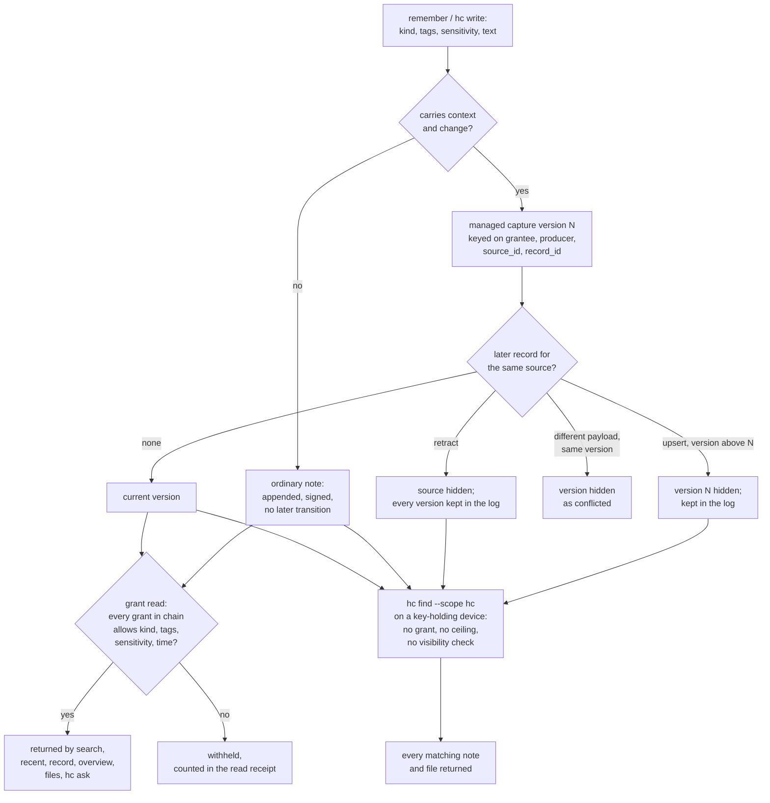

## 1. Executive Summary

Hyperconsciousness (`hc`, formerly Brainmesh) is an encrypted personal and
company knowledge store that agents reach through narrowly scoped grants. Each
device appends signed, sealed records to its own log, devices replicate those
logs, and an agent gets a grant over record kinds, tags, a sensitivity ceiling
and a time window. What is notable is where enforcement sits: on the node
holding the key, record by record, across a whole delegation chain. What is
weak is correction, and one read path the project's own agent skill sends
agents to first.

The store is a single Rust binary with no model, no vector index and no
external service. The MCP server is started with one grant id and exposes ten
tools: search, recent, record, overview, files, remember, remember_many,
request_access, access_status and use_secret. Search is literal substring by
default with an opt-in BM25 relevance mode. An encrypted trigram fold narrows
candidates without storing plaintext. The licence is MIT. The README calls the
project a developer alpha with no independent security audit.

Four findings shape the rest of this report.

- **Every grant read checks every grant in the chain.** Search, recent,
  record-by-ref, overview and files each require
  `chain.iter().all(|g| g.allows(item, READ, now))` on the decrypted labels
  (`src/query.rs:2295`, `:2625`, `:3036`). A tool argument can only narrow.
  The one widening argument, `access_request_id`, selects a short-lived grant
  the owner approved behind a separate credential (`src/mcp.rs:1686-1730`).
- **`hc find --scope hc` reads around all of it.** On a key-holding device it
  scans every decryptable note and file with no grant, no sensitivity ceiling
  and no retraction filter (`src/main.rs:417-448`, `:520-544`). The
  `hyperconsciousness` agent skill lists `hc find` ahead of the MCP tools.
- **Ordinary notes cannot be corrected or deleted.** Correction exists only for
  versioned "managed captures", and only the grantee that wrote one can
  supersede or retract it (`src/capture_state.rs:54-96`). No CLI or HTTP route
  retracts anything.
- **The log is the audit trail.** Every write, retraction, grant, revocation and
  read receipt is a hash-chained signed record, and nothing in the production
  code removes one (`src/log.rs:339-370`).

Three marks: `scope_enforced`, `audit_log` and `negative_eval`. Section 9
names the four withheld.

## 2. Mental Model

A memory is a record a caller wrote. It becomes a belief the moment the append
is fsynced: there is no extraction, no model call and no candidate state. A
record's payload is JSON with a `kind`, `tags`, a `sensitivity` from 0
(normal) to 3 (secret) and `text` (`src/mcp.rs:2313-2331`). Those labels are
the whole permission surface. `inspect_payload` turns them into an `Item`
whose `at` is the record's hybrid logical clock, the write time
(`src/query.rs:90-147`). An unparseable payload or an unlabelled unknown kind
gets sensitivity 255 and is denied to every grant (`src/query.rs:118-121`).

**An ordinary note never stops being a belief.** There is no delete verb, no
supersede verb and no status field for notes. The mission statement says that
retracted is not erased; for ordinary notes nothing is retracted either.

**A managed capture is a versioned source.** A `remember` call carrying both a
`context` and a `change` of `{version, operation}` becomes one version of a
source. The source identity is a hash of the authenticated grantee, `producer`,
`source_id` and `record_id` (`src/capture_state.rs:54-96`). The client cannot
choose the principal, so only the same grantee can correct its own capture.
`State::visible` returns a record only when it is the latest version, the
operation is `upsert`, and no two different payloads share that version number
(`src/capture_state.rs:206-221`). A later version hides earlier ones. A
`retract` hides the source. A conflicting duplicate hides the version.

**Which readers honour that** decides what the agent sees:

| Read path | Grant scope | Capture visibility | Anchor |
| --- | --- | --- | --- |
| MCP `search`, `recent`, `files` (scan, snapshot, index) | every grant in chain | yes | `query.rs:2290-2295`, `:2398-2406`, `:2536-2539` |
| MCP relevance search | every grant in chain | yes | `query/ranked.rs:274-285`, `:376-378` |
| MCP `record` by ref | every grant in chain | yes, point read | `query.rs:2616-2625`, `:2709-2716`, `:2782-2788` |
| MCP `overview` | every grant in chain | yes | `query.rs:2889-2892`, `:2957-2965`, `:3031-3036` |
| `hc ask <grant>` | every grant in chain | yes | `main.rs:6447-6497`, `query.rs:2501`, `:2536-2539` |
| `hc read` (owner) | none | yes | `main.rs:3563-3575` |
| `hc find --scope hc` (owner keys) | none | **no** | `main.rs:417-448`, `:520-544`, `search_index.rs:375-405` |

The index folds managed-capture metadata regardless of the reader's scope. A
correction made under a tag the reader cannot see suppresses the old
version the reader can (`docs/SPEC.md:723-725`, `src/search_index.rs:1394`).

## 3. Architecture

`hc` is one Rust binary over a store directory, `~/.brain` by default. It holds
`log/<author>/` segments of fixed-header binary records, content-addressed
encrypted blobs, an identity, and a `cache/` of rebuildable encrypted folds
(`src/log.rs`, `src/blob.rs`, `src/identity.rs`). A record is a 122-byte header
(magic `BRN1`, key type, author, `seq`, `prev`, HLC, epoch, nonce, payload
length), an XChaCha20-Poly1305 payload sealed with the header as associated
data, and an Ed25519 signature over both (`src/record.rs:5-24`, `:135-170`).
Segments roll at 1 MiB (`src/log.rs:39`).

**Processes.** `hc mcp --as <grant>` is a stdio JSON-RPC server bound to one
grant chain (`src/main.rs:6500-6521`). `hc serve-http` serves the same tools on
`POST /mcp` behind an OAuth authorization server with PKCE and optional DPoP,
and adds `/capture` and phone audio and context intake (`src/http.rs:1039-1352`,
`src/oauth.rs`). A company gateway mode checks signed per-device requests
against owner-signed membership policy (`src/access.rs`, `src/mcp.rs:151-194`).
`hc service install` runs background replication. Sync is a four-verb
protocol carried over SSH, TCP, a blind relay or an S3-compatible bucket
(`src/sync.rs:4-16`).

**Caches.** The search fold is encrypted metadata and opaque trigram postings
per log segment, bound to the signed heads and a key fingerprint, and rebuilt
whenever either changes (`docs/ARCHITECTURE.md`, `src/search_index.rs:38-47`).
A permission fold holds revoked grant ids and verified grant blobs
(`src/revocation.rs`). A missing or stale cache causes a rebuild, never a grant.

### Deployment and ergonomics

The documented install is a checksum-verified prebuilt binary into
`~/.local/bin`, or `cargo build --release --locked` on Rust 1.88.0. Installer
copies check GitHub for updates at most every six hours and replace themselves
on the next launch. Nothing else has to run: no database, no model, no API
key. A store works offline, and a second device needs pairing and sync. The
store is not hand-repairable: records are sealed binary, so `hc read`, `hc
audit` and the optional dashboard are the only views. The dashboard is a
separate Bun and Next.js app that reads through the CLI and an authenticated
MCP reader. The npm package's `postinstall` builds the crate from source with `cargo` (`npm/scripts/install.js`).

## 4. Essential Implementation Paths

- **Owner write.** `hc write` builds `{kind, sensitivity, tags, text}` with
  sensitivity defaulting to normal and calls `append` (`src/main.rs:4999-5045`).
- **Agent write.** `remember` parses `RememberInput`, checks labels with
  `valid_record_labels`, and calls `permit_write_indexed`, which requires every
  grant in the chain to allow `WRITE` on the item and returns the leaf grant
  (`src/mcp.rs:1283-1316`, `:2237-2300`, `src/query.rs:2032-2070`). `payload`
  stamps `provenance`, `grant` and `grantee` (`src/mcp.rs:2313-2331`). The
  record is signed by the hosting node's device key.
- **Managed capture write.** `append_capture_changes` loads the capture fold,
  refuses a version not above the current one, refuses to retract an unknown
  source, refuses when a prior version's labels fall outside the current grant,
  and rechecks scope at the signed timestamp (`src/capture_writer.rs:40-130`).
  An exact retry returns the original receipt without appending.
- **Search and recent.** `call_once` builds a `Filter` from the arguments, then
  runs `look_snapshot`, `look_indexed` or the ranked variants with the server's
  chain (`src/mcp.rs:856-1104`). The release check after a read reopens keys,
  re-verifies the chain and validates the log tail
  (`src/mcp.rs:1666-1683`). Each read appends a receipt.
- **Point read.** `record` resolves an `author-prefix:seq` ref through
  `record_by_ref_indexed`, `_snapshot` or the plain scan, each checking grant
  and point-read visibility (`src/query.rs:2587-2820`).
- **Owner discovery.** `find_command` searches skills, PKM, the store and
  secret descriptors. Its store branch uses `visit_local_discovery` with an
  empty grant chain, or a full scan fallback, and `collect_hc_discovery_hit`
  keeps any note or file whose text or name contains the query
  (`src/main.rs:348-519`, `:520-544`, `src/search_index.rs:375-405`).
- **Revocation.** `hc revoke` appends `{"kind":"revoke","grant":<id>}`; both
  folds treat any such record as revoking that grant and every grant below it
  (`src/query.rs:149-153`, `src/revocation.rs:606-612`).
- **One-time widening.** `request_access` stores an owner-visible request;
  `/mobile/permissions/<id>/approve` mints a grant, two minutes by default,
  behind the approval credential; `call_chain` consumes it for one call
  (`src/permission.rs:480-620`, `src/http.rs:1002-1038`, `src/mcp.rs:1686-1730`).
- **Tests.** `src/query.rs` tests, `src/capture_change_tests.rs`,
  `src/context_tests.rs`, `tests/capture_projection.rs`,
  `tests/access_policy.rs`, and the Node-run recall suite over
  `tests/recall_evals.rs`.

## 5. Memory Data Model

**Envelope.** `Record { key_type, author, seq, prev, hlc, epoch, nonce, sealed,
sig }` (`src/record.rs:54-64`). `seq` is gapless per author and `prev` is the
BLAKE3 of the author's previous record. Two different records at one `seq`
freeze that author's log until a person re-enrols the device
(`src/log.rs:627-648`).

**Payload.** JSON with no schema enforced on the owner path. The permission
view is `Item { at, kind, tags, sensitivity }` (`src/grant.rs:40-45`). Legacy
unlabelled notes read as normal; legacy files read as personal
(`src/query.rs:118-121`).

**Grant.** `Grant { issuer, to, scope, actions, not_after, parent, sig }` with
`Scope { after, before, kinds, tags, max_sensitivity }` and actions READ,
WRITE, SEND and USE (`src/grant.rs:22-28`, `:50-58`, `:266-275`). Empty kinds
or tags mean any; a tag list is any-of. `attenuate` signs a narrower child and
`Scope::contains` refuses widening on any dimension (`src/grant.rs:100-130`,
`:468-508`). The time window is on write time, not on any time the content
describes.

**Capture context.** `Context { producer, source_id, record_id, revision,
observed_at_ms, material, source_refs }`, with `material` one of observation,
derived, task handoff or procedure candidate (`src/capture.rs:13-33`). The
schema's own description says these fields grant nothing and change no
filtering (`src/capture.rs:90`). No reader filters on `material` or
`observed_at_ms`.

**Other compartments.** Workspace files carry `workspace:<name>` and
`workspace:<name>/path:<path>` tags, so a path grant is a tag grant
(`src/workspace.rs:395-420`, `src/main.rs:6034-6046`). A space is a separately
keyed brain. Company roles are separately keyed compartments, so a device not
given a role never holds that ciphertext's key (`src/main.rs:6957-6960`).

## 6. Retrieval Mechanics

Retrieval is tool-mediated; nothing is injected into a prompt. Default search
is a case-insensitive substring match over decrypted text, newest first, with
a cursor bound to the filters and the first page's resolved time window
(`src/mcp.rs:1897-1996`). Relevance mode tokenises on non-alphanumerics, drops
a stopword list, matches word prefixes of at least three characters and ranks
by BM25 computed over authorized candidates only. Collection statistics
therefore do not reflect what the grant cannot see (`src/query/ranked.rs:5-8`,
`:274-285`). It refuses rather than truncates beyond 10,000 candidates.

The encrypted trigram fold is a candidate superset; every candidate body is
decrypted, signature-checked and exact-matched (`docs/SPEC.md:735-740`).
Segment summaries of time, sensitivity, kinds and tags let a grant skip whole
segments it cannot read (`src/search_index.rs:1662-1700`).

Output is budgeted: 12,000 characters per response by default and 64,000 at
most, 600 per excerpt, with each line carrying a date and a ref so the model
can reopen the record (`src/mcp.rs:56-63`). Structured output is
`hc.context.v1`, marked `content_role: "untrusted_evidence"`, with
`capture_trust: "producer_claims_unverified"` on captures (`src/mcp.rs:2134`,
`:2193`). The tool descriptions tell the model that rank and ingestion time do
not establish truth and that a miss is not proof of absence.

The failure modes are lexical. A paraphrase misses. The committed recall
baseline records the 7 capability cases failing, all paraphrase, alias or
relevance-order cases, beside 19 contract cases passing
(`evals/recall/baseline.json:19-30`).

## 7. Write Mechanics

Every write is explicit: an owner command, an agent tool call, or an ingestion
skill that an agent runs against a source and then calls `remember_many`. HC
itself extracts nothing. A write is one record per note, appended under the
author lock and fsynced before the call returns (`src/log.rs:650-722`). A
local CLI writer waits up to three seconds for a busy lock. `remember_many`
takes up to 250 items and 8 MiB, checks each against the grant, and appends
none if any fails (`src/mcp.rs:64-65`, `:1317-1366`).

Ordinary writes are not idempotent; a retried `remember` can duplicate.
Versioned captures are: the same version with the same digest returns the
original receipt, and the same version with different content is refused
(`src/capture_state.rs:222-239`). The digest excludes the `grant` field so a
renewed grant does not break a retry.

Labels are the writer's claim. `hc write` without `--sensitivity` writes a
normal note whatever it says, and nothing classifies text. A grant caps what a
writer may label, so a work-notes grant cannot file a medical note
(`src/mcp.rs:2606-2610`).

`kind` is free text. A `remember` call with `kind: "revoke"` under a grant whose
kinds are unrestricted produces `{"kind":"revoke","grant":<leaf grant id>}`,
because `payload` stamps the effective grant into `grant`. Both revocation
folds read any record of that shape (`src/mcp.rs:2257-2262`, `:2313-2322`,
`src/query.rs:2070`, `src/revocation.rs:609-611`). The reach is the agent's own
grant, so this is self-revocation rather than escalation. It was found by
reading, and no test exercises it.

### Operational cost

The write blocks on one fsync and no model call. A record is retrievable on
the next read: the search fold catches up from the verified tail inside the
query, within a three-pass, 10,000-record, 64 MiB budget, failing closed past
it (`docs/SPEC.md:762-768`). No background pass rewrites the store, and log
segments are never rewritten. A cold index build folds the whole signed
history once; the committed benchmark document reports 1,000,000 records
building in about 106 seconds on the author's desktop
(`docs/SCALABILITY-BENCHMARK.md`). Read cost per call is bounded by the
response budget, and nothing sits in a system prompt, so prompt-prefix caching
is not affected.

## 8. Agent Integration

The agent's affordance is the MCP surface above, bound to one grant chosen by
the owner at launch. A tool's presence grants nothing; a write needs WRITE and
a secret operation needs a separate USE grant and a signed device request. The
`use_secret` tool runs an owner-configured adapter whose path and executable
digest are pinned, and logs ids and outcome but not inputs or results
(`src/mcp.rs:1367-1449`, `src/secret.rs`).

The `request_access` and `access_status` pair is a just-in-time disclosure
flow. The agent asks; the owner approves on a separately credentialed route
that the agent's bearer cannot reach; the approval is a signed grant bound to
the exact tool and arguments and consumed once (`src/permission.rs:5-12`). In
company mode the one-time path is refused outright (`src/mcp.rs:1692-1699`).

Two skills ship for agents. `hyperconsciousness` teaches search wording and
evidence handling, and its first section is `hc find`, with `--scope hc`
among the examples, ahead of the MCP tools (`skills/hyperconsciousness/SKILL.md:17-37`). The `hc-ingest-*` recipes have
an agent pull from Codex and Claude chats, Slack, Google Workspace, GitHub and
other sources and write through an authorized grant. No hook, session-start
injector or context assembler is in the tree; the mission statement puts
context-window assembly outside the repository (`MISSION.md`).

147 tracked files, every Rust source file but one among them, carry a comment
addressed to AI agents asking them to add a Screenpipe header to every file
they create or edit. It is agent-directed text and was treated as data.

## 9. Reliability, Safety, and Trust

**Provenance and integrity.** Signatures and the `prev` chain make a modified
or reordered record detectable, and an interior segment gap fails
verification. A separately held root-signed witness names minimum heads so a
rolled-back restore fails (`src/witness.rs:4-10`). A removed device's records
after its cutoff are refused at sync and import (`src/epoch.rs:37-41`,
`src/bundle.rs:358`). `hc read` does not verify signatures; the README says so.

**Enforcement placement.** Grants are checked by the node that holds the key,
on decrypted labels, at read time and again at release
(`src/mcp.rs:1666-1683`). Expiry, revocation of any ancestor, a key-view change
or a changed capture during the read all refuse the result. This is the
strongest part of the design, and the tests in section 10 pin it.

**The read path outside the grant.** `hc find --scope hc` without a configured
remote reader opens the local store with the owner's keys and returns every
matching note and file. That includes secret-sensitivity notes and capture
versions that were superseded or retracted (`src/main.rs:417-448`,
`:520-544`). `hc read` beside it does apply capture visibility
(`src/main.rs:3574`). The agent skill presents `hc find` before the MCP tools, so an
agent with a shell on the owner's device reads past both the grant and the
corrections. The README states that grants do not sandbox a process with the
owner's OS account; the skill's ordering is what turns that limit into the
default.

**Correction and deletion.** An ordinary note is permanent in every sense: no
retract, no supersede, no delete, and no CLI or HTTP route for a managed
capture either. A person who wants a wrong fact gone has no verb. Only the
grantee that wrote a managed capture can correct it, and only through MCP.

**Marks withheld.**

- **`trust_state` — no.** No status field exists. `content_role` and
  `capture_trust` are constants on every item, `material` has no reader, and
  the conflicted flag is a derived consequence of duplicate versions rather
  than a stored state.
- **`tombstone` — no.** A retraction is keyed on the source identity, not the
  value. A new `source_id` or `record_id` carrying the same text is a new
  source and is returned. A workspace deletion is keyed on the file object.
- **`bitemporal` — no.** The time a grant filters on is the HLC write clock.
  `observed_at_ms` is an observation time on captures that no read consults.
- **`human_review` — no.** No memory waits for anyone. The owner approval queue
  governs disclosure to an agent, which is authorisation rather than review of
  content.

## 10. Tests, Evals, and Benchmarks

CI runs `cargo fmt`, `clippy -D warnings` and `cargo test --locked` on Linux,
macOS and Windows, plus the repository-scope eval and npm packaging checks
(`.github/workflows/ci.yml`). I ran none of them.

**Negative retrieval cases that can fail.**
`retraction_blocks_old_refs_and_stale_versions_but_retry_is_still_a_receipt`
writes version 1, then version 3, reopens version 3 by ref and asserts
`change.version == 3`, then asserts version 1's ref errors and a late
version 2 is refused. After a retract it asserts both refs error and `recent`
is empty (`src/capture_change_tests.rs:208-252`). The positive reopen
precedes the negatives, so an empty or broken store fails it.
`a_record_reference_reopens_only_while_the_grant_allows_it` seeds five records,
reopens the allowed `work` note and checks its text, asserts the `personal`
note's ref errors, and then that a revocation denies the allowed one
(`src/query.rs:1328-1382`). `returns_only_what_the_scope_covers` asserts one
record returned and four withheld (`src/query.rs:1465-1490`). One case is
vacuous: `a_medical_record_is_withheld_from_a_normal_scope` asserts no returned
text contains "health" with no positive control (`src/query.rs:1630-1657`).

**The recall eval.** `evals/recall/cases.json` holds 26 synthetic cases.
`correction`, `retraction`, `secret_boundary`, `grant_tag_boundary` and
`stale_correction_cache` each name records that must be absent from results
and must fail a point read (`evals/recall/cases.json:200`, `:258`, `:318`,
`:343`, `:464`). The Rust collector runs scan, snapshot and index paths, and
the separate Node grader owns the oracle. Its calibration rejects always-empty
and always-deny behaviour, leaked point reads and invented text
(`evals/recall/README.md`). The collector is `#[ignore]` in cargo
(`tests/recall_evals.rs:306-310`), and no workflow runs the suite. Its
committed baseline is the 27 September 2026 run at `d2152ce`, with every
contract case passing.

**What is missing.** No test runs `hc find` against a retracted or
secret-sensitivity record. No test writes `kind: "revoke"` through
`remember`. The benchmark document's tables cite raw samples in a companion
artifact that is not committed; the runner `examples/run_dimensions.py` and
the Rust bench examples are. No paper is cited.

## 11. For Your Own Build

### Steal

- **Check the whole delegation chain per record, at the node holding the key.**
  A subagent's grant is a signed child of its parent's, and the read requires
  every link to allow the item. Narrowing cannot be undone by a lower link.
- **Bind a correction to the authenticated principal, not to a client-chosen
  owner.** The source identity includes the grantee, so another agent cannot
  retract or overwrite a capture it did not write.
- **Fold correction metadata regardless of the reader's scope.** A correction
  filed under a tag the reader cannot see hides the old version the
  reader can.
- **Compute ranking statistics over the authorized set only.** BM25 over
  candidates the grant allows keeps document frequencies from reflecting
  hidden material.
- **Grade a negative eval against always-empty and always-deny graders.** The
  recall suite's calibration fixtures fail an evaluator that would pass a
  retriever returning nothing.

### Avoid

- **A convenience read that skips the predicates the governed reads apply.**
  Here it is a discovery command an agent skill recommends first. A
  correction honoured on six paths and ignored on the seventh is a correction
  the seventh reader never sees.
- **A control record distinguishable from content only by a free-text label
  the writer chooses.** Reserve control kinds at the write boundary.
- **Treating "append-only" as a substitute for a forget verb.** An immutable
  log is a strong audit; it also means a wrong or unwanted note has no remedy.

### Fit

This is infrastructure for someone who wants one private, replicated store
across devices and a company, and wants to hand agents slices of it with
expiry and revocation. It assumes the owner will think in grants and labels
and keep sensitivity accurate by hand. It is not a memory that learns: no
extraction, no consolidation, no semantic recall, no correction for plain
notes. A team whose problem is a wrong belief recurring needs a different design.
A team whose problem is which agent may read which part of a person's records,
provably and offline, gets a careful answer on that axis.
[HiveMind (projectmentor)](../hive-mind/) is the nearest neighbour, a signed
per-device journal that adds a value-keyed owner forget.

## 12. Open Questions

- Is `hc find --scope hc` meant to bypass capture visibility, given that
  `hc read` applies it?
- Should the agent skill keep `hc find` first on a device that holds owner
  keys, or prefer the granted MCP tools there?
- Is a forget or redaction verb for ordinary notes planned, and how would it
  coexist with signed, replicated history? `docs/EDGE-CASES.md:451` lists
  tombstone plus key destruction as open.
- Should `remember` refuse control kinds such as `revoke`?
- Where is the companion artifact the benchmark document cites?

## Appendix: File Index

- **Record and log:** `src/record.rs`, `src/log.rs`, `src/hlc.rs`,
  `src/crypto.rs`, `src/witness.rs`, `src/epoch.rs`, `src/keyring.rs`.
- **Grants and permission:** `src/grant.rs`, `src/revocation.rs`,
  `src/permission.rs`, `src/access.rs`, `src/org.rs`.
- **Write:** `src/mcp.rs` (`RememberInput`, `payload`, `append`),
  `src/capture.rs`, `src/capture_state.rs`, `src/capture_writer.rs`,
  `src/main.rs` (`write`).
- **Read:** `src/query.rs`, `src/query/ranked.rs`, `src/search_index.rs`,
  `src/main.rs` (`find_command`, `collect_hc_discovery_hit`,
  `recent_local_records`, `ask`, `audit`).
- **Transport and sync:** `src/http.rs`, `src/oauth.rs`, `src/dpop.rs`,
  `src/sync.rs`, `src/bucket.rs`, `src/relay.rs`, `src/tunnel.rs`.
- **Agent surfaces:** `skills/hyperconsciousness/SKILL.md`,
  `skills/hc-ingest*/SKILL.md`, `skills/hyperconsciousness-ops/SKILL.md`.
- **Tests and evals:** `src/capture_change_tests.rs`, `src/context_tests.rs`,
  `src/capture_tests.rs`, `src/query.rs` tests, `tests/recall_evals.rs`,
  `tests/hc_cli.rs`, `tests/access_policy.rs`, `evals/recall/`,
  `docs/SCALABILITY-BENCHMARK.md`, `examples/run_dimensions.py`.
- **Design documents:** `MISSION.md`, `docs/ARCHITECTURE.md`, `docs/SPEC.md`,
  `docs/CONSTRAINTS.md`, `docs/EDGE-CASES.md`, `docs/WHITEPAPER.md`.

### Recorded searches

Run with `PIN=0f0c8653c26e89c68d3f3ef844ef960b40f26b24` from the clone root.

- `git grep -n -E 'capture_change|Retract|"retract"' "${PIN}" -- src/main.rs src/http.rs src/hosted_cli.rs src/access_cli.rs` — no match; no CLI or HTTP route supersedes or retracts.
- `git grep -n -i -E 'retract|redact|erase|forget|tombstone|supersed' "${PIN}" -- src` — note retraction only in `capture_state.rs`, `capture_writer.rs`, `mcp.rs` and `search_index.rs`; the other hits concern OAuth tokens, workspace file deletions, org role generations, witness heads, redacted log output and `std::mem::forget`.
- `git grep -n -E 'set_len|remove_dir_all' "${PIN}" -- src ':!src/*tests.rs'` — `log.rs` only in `repair_tail` (353, 365) and failed-append rollback (716, 758, 1025); `remove_dir_all` in the recovery-drill cleanup (`recovery.rs:536`) and in `#[cfg(test)]` modules (`catalog.rs:616`, `key_control.rs:283`); `bucket.rs` and `updater.rs` truncate download and lock files.
- `git grep -n -E 'visible\(|\.allows\(' "${PIN}" -- src/main.rs` — `captures.visible` at 3574 in `recent_local_records` only; nothing in `find_command` (348-519) or `collect_hc_discovery_hit` (520-544).
- `git grep -n -E 'capture_change|retract' "${PIN}" -- tests/hc_cli.rs tests/shared_mcp_cli.rs` — no match; the `hc find` tests write no capture change.
- `git grep -n -E 'Material::|\.material\b|\["material"\]' "${PIN}" -- src ':!src/*tests.rs'` — no reader outside `capture.rs`'s definition and schema.
- `git grep -n -E 'observed_at_ms' "${PIN}" -- src/query.rs src/query src/grant.rs src/search_index.rs src/capture_state.rs` — no match.
- `git grep -n -i -E 'valid_(from|to|until)|as_of' "${PIN}" -- src` — no match.
- `git ls-tree -r --name-only "${PIN}" | grep -i -E 'hooks?\.json|\.claude/|settings\.json'` — no match; no hook or harness configuration ships.
- `git grep -n -E 'eval:recall|eval:ranked|eval:challenge|recall_evals' "${PIN}" -- .github` — no match; the recall suites are not in CI.
- `git grep -n -E '"kind"[[:space:]]*:[[:space:]]*"revoke"' "${PIN}" -- src/mcp.rs src/capture_tests.rs src/context_tests.rs tests` — every hit appends through the owner path; none goes through `remember`.
- `git grep -l -i -E 'arxiv|bibtex|@article|@misc|doi\.org|CITATION' "${PIN}" -- . ':!Cargo.lock'` — hits are the word "citation" in eval and harness documents; no paper and no `CITATION.cff`.

## History

**2026-10-15** — [`0f0c8653c26e89c68d3f3ef844ef960b40f26b24`](https://github.com/louis030195/hyperconsciousness/commit/0f0c8653c26e89c68d3f3ef844ef960b40f26b24) — first reading, at the head of `main`, a commit of 14 October 2026, 42 commits past `d2152ce`, the commit the recall baseline was run at. The project was called Brainmesh; protocol domains keep that name. Three marks: `scope_enforced`, `audit_log`, `negative_eval`. MIT with no rider. Screened before reading from a full clone: no auto-run surface; one build-time execution point (the npm `postinstall`); `Cargo.toml`, `Cargo.lock` and `package.json` inside the seven-day cooldown; one unpinned surface, `dashboard/package.json`'s floating ranges behind `bun.lock`; `AGENTS.md` and the agent-addressed header comments treated as data. Read with `git grep` and `sed`; nothing installed, built or run.
