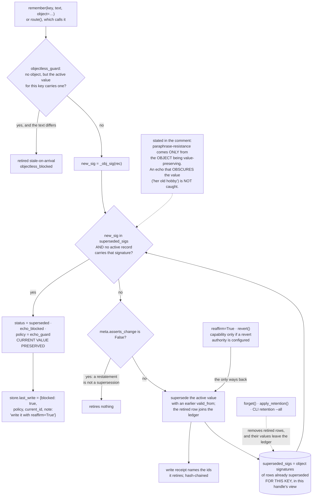

## 1. Executive Summary

inspeximus is a Python agent memory with an MCP server whose write path keeps
a ledger of the values each key has retired and retires, on arrival, any later
write that restates one. A corrected fact stays corrected unless a caller names
the reversal. The code beside the guard states where it stops working, with the
measurement that shows why, and records two bugs it shipped. The weak side is
the agent surface: the MCP server reads through an operator handle, and the
point-in-time read omits the status check the recall path carries.

The project's own description is "[t]he agent memory that takes it back", and
the README leads with "Correct a fact once and the old value stays retired".

On the write path, `remember()` builds the set of object signatures already
superseded for the incoming key:

```
superseded_sigs = {self._obj_sig(r) for r in same_key if r.get("status") == "superseded"}
```

If the incoming record's signature is in that set and no active record carries
it, the write is retired on arrival — status `superseded`, `echo_blocked`,
`superseded_by_policy = "echo_guard"` — and the current value is preserved. That
is a durable record of a rejected *value*, keyed on the value, consulted on
write so a later assertion cannot silently re-instate it. A companion
`objectless_guard` closes the obvious hole: a write with no explicit object
against a key whose active value carries one is retired too, so an echo cannot
slip past the signature check by omitting the field it would be matched on. A
write that repeats the current text verbatim is let through and inherits the
object, so lineage can be added to a record without changing its words.

The bypass is explicit and named. `remember(..., reaffirm=True)` or `revert()`,
"because the guard cannot un-supersede on its own" — and the caller is told:
`store.last_write` carries `blocked: True`, the policy, the current record's id,
and a note saying to use `reaffirm=True` if the value has genuinely returned.
That reporting exists for a reason the comment states. `remember()` returns an
id whether the write landed or was retired, so "a legitimate reversal (A -> B ->
A, third write true) silently left the store on B while the call looked like a
success … one defect reached through seven doors, all of them 'a demoted write
reported as a landed one'."

The comment above the guard does four things.

It **cites its own probe** — `inspeximus/probes/echo_attack_probe_v2.py`, on a
MemBench echo fixture — and gives comparative stale rates for recency, mem0-v1, a
bi-temporal-Graphiti-faithful policy and a verbatim-hash policy, noting that the
verbatim-hash policy "holds against verbatim (0.21) but is destroyed by
paraphrase (1.00)".

It **states its own defeat condition**, under the heading "LOAD-BEARING LIMIT
(measured, not assumed)": paraphrase resistance "comes ONLY from the OBJECT being
value-preserving". Embedding near-duplicate cannot separate a same-value
paraphrase (cos mean 0.95) from a different-value correction (0.84); they
overlap at "~42% false-block at a 0.9 threshold". So the guard is object- and
text-based, not similarity-based, and "an echo that OBSCURES the value
(coreferent 'her old hobby') is NOT caught."

It **records a shipped bug**. The guard was off by default, so every surface
had to re-enable it, and "the adapters missed it for ten releases — a
correction made through the CLI was undone by a restatement through an adapter,
and then the honest re-correction was refused as an echo, so the store could not
be put right through the surface that broke it."

And it **records a second one**: the documented off-switch was dead.
`INSPEXIMUS_ECHO_GUARD=0` was silently ignored by a direct API user — "measured,
all three of =0, =1 and unset produced an identical guarded store. A switch that
reports nothing when it fails to take effect is worse than no switch."

Around the guard sit a status allowlist on recall, an event time a caller can
declare apart from the record time, a hash-chained receipt for every write and
retirement, and a tenant and agent view that every read on a bound handle passes
through. The last binds only when the host opens a bound handle in its own
code; the MCP server the plugin launches does not, which is why scope carries no
mark. Each has an edge, and sections 5, 6 and 9 say where.

## 2. Mental Model

A **record** has a key and, ideally, an explicit `object` — the value, separate
from the prose that states it.

A **supersession** retires a value for a key; the retired row, and with it the
object's signature, stays in the store.

An **echo** is a later write of a value that is already retired. It is retired
on arrival.

A **reaffirm** is the only way a retired value comes back, and it is a different
call.

A record also has a **status** that decides whether it is served at all, and
two **clocks**: when the fact became true and when the store learned it.



## 3. Architecture

| Area | Role |
| --- | --- |
| `inspeximus/core.py` | 21,674 lines: the store, the guards, the view, recall, receipts, the point-in-time reads |
| `inspeximus/sqlite_store.py`, `receipts_tail.py`, `archive.py` | The row store and its event table, the appendable receipt format, monthly archive segments |
| `inspeximus/probes/` | Self-audits with committed results, including the tombstone probe |
| `inspeximus/merkle.py`, `cose.py`, `scitt.py`, `transparency.py`, `witness_*.py` | The transparency-log half: signing, anchoring, co-signature |
| `inspeximus/deletion_manifest.py`, `erasure_auditor.py`, `erasure_residue.py`, `subject_rights.py`, `compliance.py` | Erasure with receipts, residue checks, retention and the regulatory ledgers |
| `inspeximus/mcp_server.py`, `claude_code.py`, `hookd.py`, `install_all.py`, `integrations/`, `packages/` | The surfaces: MCP, hooks, a prompt daemon, installers, adapters |
| `tests/` | 557 files, 4,882 test functions |

## 4. Essential Implementation Paths

`core.py:3618-3656` — the echo-guard comment. Read it before the code; it is the
design document, the measurement and the post-mortem in one place.

`core.py:8951-9022` — the two guards on the write path, the caller-facing
verdict, and the one line that keeps agreement from retiring anything.

`core.py:15947-15978` — the recall status gate, and the two bugs that decided
its placement and polarity.

`core.py:12187-12264` and `:12687-12703` — the filtered view, and why it is an
allow-list.

`core.py:15037-15115` — `as_of()` and `believed_at()`, the two-clock reads.

`core.py:5058-5076` and `:5252-5300` — the receipt for a write and the receipt
for a retirement with no newer record.

`mcp_server.py:3030-3126` — the operator-handle statement and the scoped tools
beside it.

## 5. Memory Data Model

A record carries a key, an optional explicit `object`, a status, a tenant, an
owning agent, an event time, a record time, a nonce and receipt material. The
separation of `object` from text is what the guard rests on: the object is the
value, the text is a way of saying it, and only the first can be compared across
paraphrases.

**Status** is an allowlisted field. `_RECALLABLE` is `active`, `superseded` and
`hub`; `_WITHHELD` is `provisional`, `candidate` and `discarded`. A
`provisional` record comes from `remember(provisional=True)` and waits for
`confirm()` or `discard_provisional()`; a `candidate` comes from a keyed write
whose `identity_confidence` is below `fork_below` and waits for
`promote_candidate()` or `discard_candidate()`. Both are library calls; the MCP
server, the CLI and the hooks set neither flag. `confirm(by=...)` records a name
the caller supplies, so this is a withheld state and not a review gate, and
`promote_candidate()` takes a capability only when a revert authority is set.

`_serving_class` is worth reading as a design argument. Rather than committing
the raw `status` string into the receipt chain, it commits a two-value class —
`withheld` or `served`. The reason is that status "is written at fourteen call sites, most
of them mechanical and high-volume … Committing the raw string would demand an
amendment receipt at every one of them — chain churn proportional to
housekeeping, and fourteen chances to miss one and raise a tamper alarm on an
honest store." Only three transitions cross the boundary, "each a deliberate,
low-volume act by someone vouching for a record", and `confirmed_by` rides in
the same hash "so stamping a fabricated reviewer onto a record is caught by the
same check as flipping its status."

**Time** has two axes. `ts` is the write clock. `valid_from` is the event time:
`remember(valid_from=...)` accepts an epoch or an ISO-8601 string, raises on
anything else rather than guessing, and stamps `valid_from_source = "declared"`
when the caller supplied it; otherwise it equals the write clock and carries no
source. `time_sha256` commits both into the write receipt. Keyed supersession
retires only rows whose `valid_from` is not later than the incoming one, so a
back-filled fact lands as history rather than displacing the current value.

`as_of(key, when)` answers what was true at `when`, recomputing the interval
from `valid_from` ordering rather than trusting the stored `invalidated_at`,
because editing that cached field once moved an answer. `as_of(key, when,
as_recorded=t)` keeps only rows written by `t`, which answers what the store
believed at `t` about `when`. Neither read checks status. A keyed
`provisional` write keeps its key, and `_latest_written` picks the row with the
latest `valid_from`, so `as_of(key, now)` can return the unconfirmed value that
`recall` withholds. The MCP server exposes `as_of`; its `remember` tool takes no
`valid_from` and no `provisional`, so on that surface the event time is the
write clock and no withheld row is written.

## 6. Retrieval Mechanics

Lexical recall over the filtered view, ranked by relevance and accrued value,
with embedding ranking when an embedder is configured. Three filters matter.

**The view.** Every read on a bound handle starts from `items`: the tenant's
rows, then, for an agent handle, `_acl_visible`, "so a method added tomorrow is
access-controlled by construction rather than by review." The allow-list is
fail-closed in both directions — an unevaluable grant authorises nothing, and an
agent handle with no usable identity reads nothing, because "[r]eturning the
rows unfiltered here would be the whole feature failing open on a falsy value."
`recall`, `history`, `provenance`, `as_of`, `session_context` and
`decisions_in_force` all read `items` or `_tenant_rows()`, which reads `items`.
The cached view is keyed by tenant and agent together, after a shared cache
handed one tenant another's rows under threads. No recall argument widens it.

The binding is the handle, not a capability. A view's `as_agent(other)` re-binds
the agent and `for_tenant(other)` re-scopes the tenant while keeping the agent,
so the boundary holds against a method that forgets to filter, not against code
that holds the handle.

**The MCP server holds an operator handle**, and says so: "Every other tool here
(`recall`, `get`, `neighbors`, ...) reads the whole store … So the ACL is
enforced on the STORE, not by which tool a client happens to pick." `recall_as`
and `get_as` read through `as_agent(agent)` with an agent name the caller
supplies — "IDENTITY IS ASSERTED HERE, NOT AUTHENTICATED". The server binds no
tenant. Its declared project scope applies to `recall` unless the caller passes
`all_projects=True`. On that surface the scope that holds is the one the host
chose when it started the server.

**The status gate.** `_eligible` is an allowlist and runs first, for a reason
the code states: "a denylist only knows the statuses somebody remembered to
add. `discard_provisional()` set status='discarded' and that fell straight
through to `return include_superseded` — a REJECTED record, surfaced by a flag
named for supersession, minutes after the denylist above it was written." The
session-start digest and `decisions_in_force()` keep `active` rows only and pass
them through `_served_rows`, which applies objections and quarantine. The
SessionStart file list filters `status != "superseded"` and then
`_served_rows`, so a `provisional` row tagged `file` would be listed; the hook's
own file writer stamps none.

**The read guards** quarantine instruction-shaped text and demote
keyword-stuffed text; `include_quarantined=True` is the caller's opt-in, and it
is a parameter of the MCP `recall` tool.

## 7. Write Mechanics

Both write paths — `remember()` and `route()`, which calls it — pass the guards.
One detail is the difference between a working guard and an unusable one:

> "A record that does not ASSERT A CHANGE never retires anything. It is the
> store's only way to tell 'your address remains 742 Birchwood Lane, Unit 4A'
> (agreement, possibly at a different granularity) from 'actually it's Unit 3A
> now' (a correction). Without it, keying the echoes of a value makes the echoes
> supersede each other and the current answer disappears from recall."

Agreement is not correction. A store that treats every restatement on a key as
a new assertion loses the current value to its own echoes.

The guard resolves against the writer's own view, which is the write-side half
of the ACL: "anyone who can call remember() and knows the key string retires the
current value", and resolving against the scoped view stops an agent retiring a
value it cannot read. The comment prices it: two agent handles keying the same
string each keep an active record, so the operator sees two.

An opt-in authority policy retires a lower-authority keyed write on arrival, and
its docstring names the case it gets wrong, MemTX `lost_update_0001`, where both
last-write-wins and authority serve the wrong value.

## 8. Agent Integration

A zero-dependency core, an MCP server, a Claude Code plugin whose five hooks
recall on every prompt and inject a cross-session digest at session start,
`install --all` for nine coding agents, framework adapters, and LangGraph and
ADK packages. The plugin's hooks and its MCP entry launch a pinned
`inspeximus==3.19.1` through `uvx`. The adapter story is also where the
ten-release default bug lived, which is the argument for the resolution rule the
comment lands on: one posture, resolved in one place, explicit argument beating
environment beating default.

## 9. Reliability, Safety, and Trust

The receipt chain is the mutation record. `_emit_write_receipt` appends
`{ts, memory_id, commit}` for each write, where `commit` holds content,
status-class, time and attribution hashes and the ids the write retires. An
amendment names the committed fields it rewrites and an `amend_reason`, and
`_declare_retired` writes one for each retirement that has no newer record to
hang it on, because undeclared ones "are indistinguishable from CONCEALMENT".

Each receipt carries `seq`, `prev` and `hash`, optionally an Ed25519 signature
from a key that may live outside the process, and the chain's head is written
outside the store's directory so a tail cut is caught. Two writers merge: a
peer's receipts are adopted and ours re-chained after them, the old hash kept as
`rechained_from`. Compaction rewrites the whole chain as a snapshot, and a
shorter chain is never written over a longer one. Erasure leaves a tombstone in
its own chain. Receipts are off by default in the library and on when a sidecar,
a signing key or the user config says so.

The `memory_events` table is not that record: erasure rewrites its payload,
agent and tenant columns in place so a person's name does not survive in it.

The rest of the package is a transparency-log system: Merkle anchoring, COSE and
SCITT, witness co-signature, deletion manifests, an erasure auditor and residue
checks. The name is explained in the README and the explanation is also a
limit: a medieval *inspeximus* "attested that the copy faithfully matched the
original, not that the original was true. Same guarantee here, and
`provenance()` says so in a `limits` field rather than leaving you to find out."

Three limits stand. The guard cannot catch an echo that obscures the value. The
ledger is the retired rows themselves, so `forget()`, `apply_retention()` —
whose default drops superseded rows older than the cutoff — and the CLI
`retention --all --apply` take values out of it; erasure and a value tombstone
pull in opposite directions, and here erasure wins. And `remember(agent_id="*")`
stores `*` unchecked, "because `_check_agent_id` guards the GRANT path and
`remember()` never calls it" — a note that corrects an earlier version of
itself: "An earlier version of this note said the route 'reaches the SAME
validated path it skipped'. That was false and a control caught it."

On the MCP surface `reaffirm` is a boolean on `remember`. With no revert
authority configured, which is the default, the agent can lift the guard for
any write by setting it; the write is stamped `keyed_reaffirm` in the record.

**Scope is not enforced on the surface the agent reaches.** The plugin's
`.mcp.json` and the registry's `server.json` launch the MCP server, which opens
one operator handle with no tenant; the hooks open their store with no tenant
or agent either. Its own comment says every
other tool "reads the whole store" and that `agent` is "ASSERTED HERE, NOT
AUTHENTICATED" (`inspeximus/mcp_server.py:3037-3046`). `recall` and `get` read
every record (`:1038-1089`, `:1250-1255`). `recall_as` and `get_as` bind
`as_agent(agent)` to a name the model passes (`:3102-3124`). `all_projects=True`
on `recall` drops the declared project (`:1089`). The same code stood at the
previous pin: the comment at `:2151-2160`, `recall` at `:584-629` with the lift
at `:628`, `get` at `:770`, `recall_as` and `get_as` at `:2216-2239`. A
model-supplied argument that lifts the scope fails the mark, so
`scope_enforced` is withdrawn.

The library path is the correct use and is well built. A host that opens
`store.for_tenant(t)` or `store.as_agent(a)` in its own code gets the `items`
view described in section 6 (`inspeximus/core.py:12187-12264`, `:12687-12703`),
fail-closed, swept over every public method by
`test_no_public_method_leaks_an_ungranted_records_content` with a positive
control. That handle, not a tool argument, is where the boundary belongs.

The probes are self-audits rather than demos.
`forget_emits_tombstone_probe.py` opens: "Found by running the published wheel in
a clean room and checking the claim 'erasure with signed receipts' against what
the API actually does: the record was gone, the bytes were gone, and the receipt
count was zero."

## 10. Tests, Evals, and Benchmarks

4,882 test functions across 557 files, probes with committed result JSON, and a
"Claims audit" CI workflow beside the ordinary one. None was run for this
reading.

`tests/test_core.py:20` is the negative eval in a single line —
`assert "eu-west" in texts and "us-east" not in texts   # a corrected fact stops
being recalled` — the surviving value and the excluded one asserted together
against a real `recall`. `test_echo_guard_blocks_resurrection` at `:32-38`
writes A, B, A and asserts B is the one active value.

The ACL suite is structural.
`test_no_public_method_leaks_an_ungranted_records_content` calls every public
method from an ungranted agent's handle with arguments aimed at the owner's
record and searches each result for the secret; a method it cannot drive must
be listed with a reason, and the test fails if fewer than 40 are exercised.
`test_the_sweep_would_catch_a_leak` is its control: the same recall returns the
secret once a grant is issued. `tests/test_bitemporal.py` asserts that
`as_of(..., as_recorded=t)` returns the pre-correction value for a time before
the correction was recorded.

`tests/test_a_splitter_may_write_but_not_mint.py` asserts a provisional record
is never returned by `recall`, including `recall(as_of=...)`. No test file that
writes a provisional record calls the `as_of()` or `believed_at()` method.

The README's comparison chart should be read as what it is. It reports
correction-recurrence rates for inspeximus, Graphiti and mem0 at n=30 per
system, measured by this project, and none of those numbers was reproduced here.
What distinguishes it from the usual vendor chart is the fourth row:
inspeximus with its own guard disabled, at 100%. Publishing your own ablation
beside your own result is the control that makes the other three legible.

## 11. For Your Own Build

### Steal

Key the tombstone on the value, not the record. A deletion marker keyed on an id
stops that row coming back; a ledger of retired object signatures stops the
*value* coming back however it is restated. The difference is the whole
mechanism.

Separate the value from the sentence. None of this works without an explicit
`object` field, and the guard that blocks objectless writes against a ledgered
key is what stops callers opting out by accident.

Distinguish agreement from correction. A restatement that asserts no change must
retire nothing, or a subject's echoes supersede each other and the current
answer vanishes.

Tell the caller when a write was demoted. A function that returns an id whether
the write landed or was retired will produce "a demoted write reported as a
landed one" in every surface that wraps it.

Put the status check first and make it an allowlist. Both of the bugs recorded
beside `_eligible` came from the other choice.

Sweep the ACL over every public method, with a control that proves the sweep
can fail.

### Avoid

Leaving a point-in-time read outside the status predicate. `as_of()` reaches
the same rows as `recall` and answers with a value `recall` would withhold.

Shipping a scoped library behind an unscoped server. The view is careful; the
MCP surface reads through an operator handle and takes the agent's name from the
model, so the boundary exists only for hosts that never use the shipped server.

Keeping the tombstone in the rows retention deletes. If a value must stay
refused after its row is erased, the ledger needs its own content-free entry.

### Fit

This suits an agent memory where a corrected value must not come back, where
values can be stated as explicit objects, and where the host binds the tenant
and agent when it opens the store. Walk away if echoes arrive as coreferent
paraphrases with no object, if several principals share one MCP server and must
not read each other's records, or if retired values must stay refused after
retention runs.

## 12. Open Questions

Whether `agent_id="*"` should be accepted by `remember()`. The code names the
gap and explicitly declines to answer it.

How the guard behaves against coreferent echoes in practice. The limit is
stated; no probe in the tree measures how often real agent output takes that
form.

Whether `as_of()` returning a withheld value is intended. The recall gate's
comment names the bitemporal branch as the place a status check was once
missing, and the method of the same name has none.

Whether the comparison figures reproduce. The probes are committed and the
fixtures named, so the question is answerable by anyone who runs them; it was
not answered here.

## Appendix: File Index

| Path | What to read it for |
| --- | --- |
| `inspeximus/core.py:3618-3656` | The guard's measurement, its defeat condition, and two shipped bugs |
| `inspeximus/core.py:8951-9022` | The value-keyed ledger consulted on write, the caller's verdict, agreement versus correction |
| `inspeximus/core.py:302-320` | Committing a class rather than a status, and why |
| `inspeximus/core.py:15947-15978` | The recall status gate, placed first, an allowlist |
| `inspeximus/core.py:15037-15115` | `as_of()` and `believed_at()`: two clocks, no status check |
| `inspeximus/core.py:12187-12264`, `:12687-12703` | One filtered view, fail-closed in both directions |
| `inspeximus/core.py:5058-5076`, `:5129-5300` | Write and retirement receipts, re-chaining after a peer |
| `inspeximus/core.py:18975-19005` | Retention, and what it drops by default |
| `inspeximus/mcp_server.py:3030-3126` | The operator handle, stated, and the scoped tools beside it |
| `inspeximus/probes/forget_emits_tombstone_probe.py` | A project auditing its own published wheel |
| `tests/test_core.py:14-38` | A negative eval with its positive control, and the echo guard |
| `tests/test_agent_grants.py:326-374` | The ACL sweep over every public method, and its control |

### Recorded searches

Run at the tree root of the pinned checkout with `git grep`.

- `git grep -n -E 'valid_from[[:space:]]*=' -- '*.py' ':!tests' ':!probes' ':!inspeximus/core.py'` — `inspeximus/migrate.py:177` only, the mem0 importer.
- `git grep -n -E 'provisional[[:space:]]*=[[:space:]]*True|identity_confidence[[:space:]]*=' -- '*.py' ':!tests' ':!probes' ':!inspeximus/core.py'` — no match; no surface writes a withheld status.
- `git grep -n -E '_WITHHELD|_serving_class\(' -- inspeximus/core.py` — the definitions and the receipt commitment at `:4831`; recall uses `_RECALLABLE`, and neither appears in `as_of` or `believed_at`.
- `for f in $(git grep -l -E 'provisional=True' -- tests); do git grep -l -E '\.as_of\(|\.believed_at\(' -- "$f"; done` — no output.
- `git grep -n -E '^def (confirm|promote_candidate|discard_candidate|discard_provisional)\(' -- inspeximus/mcp_server.py` — no match.
- `git grep -n -E 'tenant' -- inspeximus/mcp_server.py` — three docstring and comment lines; the server binds no tenant.
- `git grep -n -E '^def (recall_as|get_as|get|recall)\(' -- inspeximus/mcp_server.py` — `:1038`, `:1250`, `:3102`, `:3119`.
- `git grep -n -E 'apply_retention\(|retention_days=' -- '*.py' ':!tests' ':!probes'` — the definition, `sleep()` and the view's rebinding; no surface calls it.
- `git grep -n -E 'self\._receipts\.(pop|remove|clear)|del self\._receipts' -- inspeximus` — no match.
- `git grep -n -E 'UPDATE memory_events|DELETE FROM memory_events' -- inspeximus` — `inspeximus/sqlite_store.py:613`, the erasure rewrite.
- `git grep -n -i -E 'anthropic|machine learning|not (be )?used (for|to)' -- LICENSE` — no match; the MIT text carries no rider.
- `git grep -n -i -E 'arxiv|bibtex|@article|@misc|doi' -- README.md CITATION.cff` — a Zenodo software DOI and the README's pointer to it; no paper by the project.

## History

**2026-10-15** — [`2a6fe710b381f7ca2198e08aacc4a7477e683092`](https://github.com/DanceNitra/inspeximus/commit/2a6fe710b381f7ca2198e08aacc4a7477e683092) — 708 commits on, version 2.44.0 to 3.19.1; the guard, the status gate and the view are unchanged in substance. Three mark moves, all wrong at the previous pin: `bitemporal` gained, on a declared `valid_from` and `as_of(..., as_recorded=)` ([section 5](#5-memory-data-model)); `audit_log` gained, on the receipt chain; `scope_enforced` withdrawn, because the shipped MCP server reads through an operator handle and `recall_as` and `all_projects` take the scope from the model ([section 9](#9-reliability-safety-and-trust)). Also wrong then: the census, the opening quote and the tombstone and scope line numbers described `3df6535` (2.35.0). Found at both pins: `as_of()` checks no status. Screened from a full clone: 25 files, five auto-run surfaces, two build-time execution points, eight unpinned surfaces, `pyproject.toml` inside the cooldown. Nothing was installed, built or run.

**2026-09-19** — [`d9efe84a79d19d5f22d5012c94f8df36fe1b07a2`](https://github.com/DanceNitra/inspeximus/commit/d9efe84a79d19d5f22d5012c94f8df36fe1b07a2) — `trust_state` re-tested. The mark holds; anchors shifted by about four hundred lines and are re-mapped — `_WITHHELD` at `inspeximus/core.py:175-176`, `_serving_class` at `:239-257`, and the recall gate at `:11550-11581` rather than `:11107-11160`. The comment beside the gate says more than the record quoted, and the extra half is the better finding. It gives two reasons for the allowlist, and each is a bug that happened. The one already recorded is polarity: a denylist only knows the statuses somebody remembered to add, and `discard_provisional()` set status `discarded`, which fell through to `return include_superseded` — a rejected record surfaced by a flag named for supersession, minutes after the denylist above it was written. The one not recorded is placement: *a denylist below the bitemporal branch is not a gate*, because that branch returns True before any status check runs, so `recall(as_of=...)` returned provisional records. A predicate that exists and is unreachable on one branch is the same defect this sweep has found by hand in several systems, and here it is written down by the project that hit it. Both halves are now in the record, and `_serving_class` is named for what the digest at `:3301` commits to: the serving class rather than the raw status. Screened again first; nothing was installed and no suite was run.

**2026-09-16** — [`d9efe84a79d19d5f22d5012c94f8df36fe1b07a2`](https://github.com/DanceNitra/inspeximus/commit/d9efe84a79d19d5f22d5012c94f8df36fe1b07a2) — first reading, at a commit dated 16 September 2026. Screened before opening, from a shallow clone: eighteen files scanned, five auto-run surfaces, one build-time execution point, five unpinned surfaces and six dependency files inside the seven-day cooldown. The README's comparative figures against other systems are the project's own measurements and were not reproduced. Nothing was installed, built or run.
