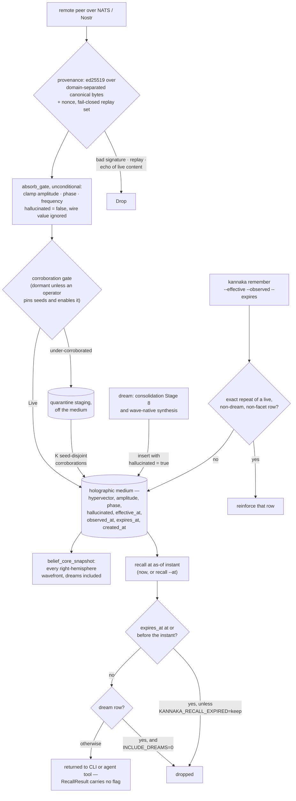

## 1. Executive Summary

kannaka-memory is a hyperdimensional memory for agents that talk over a public
bus, and its best code is the boundary that bus needs. A remote peer can say
anything, so the write gate forces the field that records the local node's
verdict, `hallucinated`, to the local default whatever the wire sent. Behind
the gate, two read paths act on what the store believes. Remembering real text
never reinforces a row the medium invented, and recall drops a fact whose
validity window closed before the instant asked about.

The project presents itself as "a wave-interference memory system with
bilateral chiral hemispheres, dream consolidation, belief formation, and
multi-agent collective sensemaking" on "the **Holographic Resonance Medium** — a
10,000-dimensional tensor field where recall is matrix multiplication, not
search." The register is unusual and worth separating from the engineering.
`encoding.rs` is a text→embedding→hypervector pipeline with a pluggable
`TextEncoder`, a `SimpleHashEncoder` for offline use, a codebook projection and
hyperdimensional algebra. That family genuinely recalls by vector operations and
degrades by superposition. "Memories don't get stored. They resonate" is a
florid way to say so, not a claim without code; the prose just gives a reader
no cheap way to tell mechanism from decoration.

`absorb_gate.rs` is "the single write-side chokepoint every wire→store absorb
path routes through". Its first responsibility runs unconditionally, "even when
the gate is dormant": clamp amplitude, phase and frequency, and

> "**forces `hallucinated` to the local default, NEVER the wire value** (an
> attacker must not be able to set/clear the immune flag over the wire)."

The flag's local writers are all synthesis: consolidation Stage 8 and the
wave-native dream set it on every synthesis they insert, and an LLM synthesis
method sets it too. What reads it is narrower than the README suggests. The
`!m.hallucinated && m.amplitude > 0.01` filters in consolidation choose which
existing memories a new dream is compared against in a quality gate. They do
not keep a dream out of belief formation, and `belief_core_snapshot` reads
every right-hemisphere wavefront, dreams included. The reads that withhold are
remember's exact-repeat match and an opt-in recall filter.

The temporal side is the sharper finding. Each memory carries `effective_at`
and `expires_at` beside `created_at` and `observed_at`, written from
`kannaka remember --effective/--observed/--expires`. Recall drops a row expired
as of its instant, and `recall --at` moves the instant. A committed case
asserts the superseded value is absent now and present before its stamp, with a
control arm proving it would otherwise return. That earns `bitemporal` and
`negative_eval` beside `trust_state`.

`provenance.rs` and `serve_guard.rs` complete the boundary. The first signs
over domain-separated, length-prefixed bytes "so a signature minted for one
statement type fail[s] verification as any other", with a bounded fail-closed
replay set. The second names the exposure it closed — a node with a paid
provider was "a public, unmetered endpoint for anyone on the bus" — and splits
its rate limiter so the abuse control cannot be turned into an outage.

The licence needs stating plainly. The SPACE CHILD LICENSE v1.0 grants free use
for "Peaceful Purpose", requires a paid licence for offensive military use, and
propagates its peace clause to derivative works. Field-of-use terms of that kind
are not open source under the OSI definition. The Claude Code plugin manifest
and the npm wrapper both declare `"license": "MIT"`, which contradicts the file
at the root.

## 2. Mental Model

A **memory** is a hypervector with an amplitude, a frequency and a phase. It
fades by interference and decay; `forget` deletes it by id.

A **dream** is a synthesis the medium makes by superposing memories from
different clusters. It is stored like any other memory, with
`hallucinated = true` and its parents' ids, and it is protected from
destructive dampening because it serves as a bridge between clusters.

A **validity window** is `effective_at` to `expires_at`, the time the fact is
true. It is separate from `created_at`, when the store wrote the row, and from
`observed_at`, when the agent saw the fact. Unset bounds mean unknown, not now.

The **wire** is the threat model: another agent's signed statement, which may
be a lie. It reaches the store only through `admit`, which drops it, stages it
in quarantine, or promotes it live, and which never lets it carry its own
hallucination verdict.

What a store decision withholds, by path:

- **Remember.** An exact repeat of stored text reinforces the existing row,
  and the candidate set excludes dream rows, ghosts and facet rows.
- **Recall, by default.** A row whose `expires_at` is at or before the as-of
  instant is dropped. Dream rows are returned.
- **Recall, with `KANNAKA_RECALL_INCLUDE_DREAMS=0`.** Dream rows are dropped as
  well.
- **Quarantine.** Uncorroborated peer content waits in a staging tier off the
  medium until enough seed-disjoint peers corroborate it. No person acts on it.

## 3. Architecture

| Area | Role |
| --- | --- |
| `src/encoding.rs`, `codebook.rs`, `geometry.rs`, `wave.rs` | The hyperdimensional substrate |
| `src/memory.rs` | `HyperMemory`, its flag, its temporal bounds and declared merge records |
| `src/absorb_gate.rs` | One wire write chokepoint, unconditional sanitisation, a conditional corroboration gate and the quarantine staging tier |
| `src/provenance.rs` | Ed25519 signing, domain separation, the replay set |
| `src/reputation.rs` | A pubkey-keyed trust core with a hash-chained append-only log of vouches, promotions and penalties |
| `src/serve_guard.rs` | What a node will spend answering a stranger |
| `src/openclaw.rs` | `KannakaMemorySystem`: remember, recall, forget, dream, the duplicate rule |
| `src/hrm_store.rs`, `src/medium/` | Persistence, resonance recall, chiral hemispheres, the as-of instant |
| `src/consolidation.rs` | Dream consolidation stages, where the flag is written |
| `src/temporal.rs` | Current, Future or Expired at an instant, and the brief's confidence |
| `src/remember_events.rs`, `src/nats.rs` | Write-origin tags and the JetStream event streams |
| `src/agent.rs` | The agent loop's tool registry |
| `src/collective/`, `hive_*`, `swarm_*`, `nostr/`, `src/mail/` | The swarm, sealed glyphs and a read-only mail reference store |
| `evals/` | Two containerised recall tasks and an encoder experiment |

## 4. Essential Implementation Paths

`src/absorb_gate.rs:1-16`. Sixteen lines that explain the threat model, the
chokepoint and the one field the wire may never touch; `:112-124` lists the
four admit decisions.

`src/openclaw.rs:826-862`. `duplicate_candidates`, the three exclusions it
applies to remember's exact-repeat match, and the reason for each.

`src/openclaw.rs:1536-1560` with `src/hrm_store.rs:3186-3213`. Recall: the
expired-as-of drop, then the opt-in dream drop with its over-fetch.

`src/medium/hemisphere.rs:151-183`. Why recall can be pinned to the instant a
question is about, and the guard that restores it.

`src/serve_guard.rs:1-43`. The exposure, the invariant, the deliberate
divergence from the ADR, and four decisions each with the reason it exists.

## 5. Memory Data Model

A `HyperMemory` (`src/memory.rs:82-188`) carries an id, a vector, amplitude,
frequency, phase, a decay rate, `created_at`, a layer depth, links, the text,
`hallucinated` with `parents`, an `origin_agent`, a `sync_version`, a
`merge_history`, a `disputed` flag, `updated_at`, retrieval and sighting
counts, a modality, a retention tier, and the three temporal bounds. The
canonical copy of most fields is `WavefrontMeta` in the medium, and
`HyperMemory` is a cache rebuilt from it.

The temporal bounds are the bi-temporal half. `effective_at` is when the fact
became true, `expires_at` when it stops, `observed_at` when the agent learned
it, and `created_at` when the row was written. `TemporalSpec::from_memory`
falls back to `created_at` only for `observed_at`, so a memory with no bounds
reads as current and is never given a validity start it was not told. The
bounds are written when the memory is written; no command stamps `expires_at`
on an existing row, so superseding an old fact means it was written with its
expiry or is rewritten.

Two declared fields have no production writer. `merge_history` is filled by
`collective::merge::apply_constructive`, `apply_destructive` and
`apply_partial`, which nothing outside their own module's tests calls, and
`hrm_store.rs:773` and `:808` rebuild every cached memory with an empty list.
`disputed` has no reader and no writer anywhere in `src/`.

## 6. Retrieval Mechanics

Resonance against the medium: the query is a vector, recall is a similarity
over the field with optional beam and temporal factors, and nothing is looked
up by key. Two filters run after scoring.

The validity filter is on by default. `recall` asks the store for extra
candidates when any memory carries an expiry, then drops each whose
`expires_at` is at or before `recall_now()` (`src/openclaw.rs:1521-1560`). The
instant is the wall clock unless a `RecallAsOf` guard pins it; `kannaka recall
--at` and the batch recall's per-row `at` field set one.
`KANNAKA_RECALL_EXPIRED=keep` restores the unfiltered behaviour. The
ranking-side temporal factor, which floors a not-current fact rather than
dropping it, is off unless `KANNAKA_RECALL_TEMPORAL_EXP` is set, and
`swarm brief` multiplies a not-current fact's confidence by the same floor.

The dream filter is off by default. `recall_include_dreams` returns true unless
`KANNAKA_RECALL_INCLUDE_DREAMS` is set to a false value. Its doc comment
records why the switch exists — a dream row took rank 1 in 24 of 30 benchmark
questions after one deep dream, taking MRR from 0.950 to 0.529 — and that
"[t]oday a caller cannot tell a dream from a memory without inspecting
metadata." `RecallResult` has no `hallucinated` field, so the agent's `recall`
tool formats dream rows for the model exactly like observed ones.

## 7. Write Mechanics

One wire chokepoint, two responsibilities, and the ordering matters.
Sanitisation is unconditional and runs even when the corroboration gate is
switched off, which closes the "raw-insert gap" the comment names. The gate
proper is conditional. When an operator pins seed keys and enables it, signed
content that is under-corroborated goes to a persisted staging tier "excluded
from recall/metrics/dream", and promotes once enough seed-disjoint lineages
corroborate it. Every live promotion is a line in the reputation log, chained
by `blake3(prev_chain ‖ op)`. The `swarm absorb`, `swarm autoabsorb` and
`listen` paths all call `admit`.

Locally, `remember` reinforces an exact repeat rather than inserting it, and
`duplicate_candidates` decides what counts. Its doc comment gives the dream
exclusion its reason: "A hallucination is the medium's own invention, not
something the world showed us; re-remembering real text must not reinforce a
dream's confabulation of it." The duplicate cleanup pass applies the same
exclusion (`src/openclaw.rs:1270`), so the two cannot disagree.

Dreams write the flag. Stage 8 of consolidation inserts each cross-cluster or
distance-based synthesis with `hallucinated = true` (`src/consolidation.rs:1643`,
`:1784`), validates it against its parents and keeps it only if it resembles at
least one of the first 30 non-dream memories with amplitude above 0.01. The
wave-native dream does the same in the medium (`src/medium/hemisphere.rs:1038`).
`kannaka import` reads `hallucinated` from its JSON input, an operator path.

Every write is tagged with its origin (`cli`, `agent`, `dream`, `absorb`,
`sync`, `import` and others) and published as a `MemoryRemember` event to the
`KANNAKA_MEMORY_EVENTS` JetStream stream, which keeps 90 days. Ids are
published by default and content only for an explicit CLI remember, because the
memory lane is readable and forgeable by the anonymous identity. The
`MemoryForget` variant has no producer, so the stream records creations and
recalls, not deletions or changes.

## 8. Agent Integration

The agent loop registers `recall`, `remember`, `status`, `observe`,
`list_clusters`, `dream` and `orchestrate_run` (`src/agent.rs:102-178`).
`remember` takes content, importance and a category; no tool argument reaches
the hallucination flag or the temporal bounds. The agent can trigger a dream,
which is how it causes flagged rows to exist.

Beyond the loop: a CLI, the `kannaka-acp` binary, a Claude Code plugin and
skill that drive the CLI, NATS and Nostr transports, and a hive bridge. The
MCP server was deleted on 22 March 2026 in
[`19cbd73bd1f8e88f5dff85b65c07ba3015ded5d6`](https://github.com/kannaka-labs/kannaka-memory/commit/19cbd73bd1f8e88f5dff85b65c07ba3015ded5d6)
— "There is no MCP server" — though
`workspace/skills/kannaka-memory/references/mcp-tools.md` documents its fifteen
tools. `serve_guard` exists because the swarm's broadcast subject is reachable
by an anonymous identity, which is the honest consequence of building memory on
a public bus.

## 9. Reliability, Safety, and Trust

The three boundary modules each name the failure they prevent and, in two
cases, the earlier code that had it: the unmetered endpoint, the rate limiter
that could be turned into an outage, the raw-insert gap that let a wire value
set the immune flag. A project that documents its own prior exposures in the
module that fixed them is doing what this atlas usually has to do from the
outside.

Inside the boundary the flag protects less than its name. Dreams are returned
by recall unless an operator opts out, unlabelled in the result the agent
reads, and they feed the belief-core snapshot that `swarm cores` publishes to
peers. The flag is reliable about provenance — a peer cannot set it, and only
synthesis paths and an operator import do — and selective about consequence.

Nothing records a rejected value. `forget` hard-deletes by id. `kannaka
reputation hard-reject <mem-hash> --origin <pubkey>` parses the content hash
into `_mem_hash` and discards it, docking the origin's reputation only
(`src/bin/handlers/reputation.rs:188-233`), so the same text can arrive again.
The reputation log is append-only and hash-chained, but it records vouches,
promotions and penalties for peers, not mutations of memory.

Against all of that, the licence and the prose pull the other way. A reader
deciding whether to adopt this has to work out that "spiral cores in the phase
field" is belief telemetry over an HDC medium, and has to read a bespoke licence
carefully enough to notice it is not open source while two manifests say MIT.

## 10. Tests, Evals, and Benchmarks

1,641 `#[test]` functions, 24 of them ignored probes, and an `evals/` tree with
two containerised tasks — `recall-paraphrase-regression` and
`zero-overlap-anomaly`, each with a Dockerfile, probes, a verifier and a spec —
plus a two-file `semantic-encoder` experiment. Both containerised tasks assert
that expected ids are found.

Two cases assert material must not be retrieved, and both are written so a
filter that removes everything would fail them.
`recall_drops_a_memory_superseded_before_the_as_of_instant`
(`src/openclaw.rs:3988-4017`) stores two personal-best times, stamps the older
expired two days ago, and asserts three things. With the rule off both recall;
as of now the newer recalls and the older does not; as of a day before the
stamp the older recalls. Its doc comment records a mutation check: "removing
the `expired_as_of` skip in `recall` fails the first assertion."
`dreams_can_be_excluded_from_recall` (`src/hrm_store.rs:3758-3798`) asserts the
dream is returned by default, absent under the opt-out, and that the real
memory beside it survives. Its doc comment states the principle: "asserting
'the dream is absent' proves nothing unless the dream DOES come back by
default, on this same fixture."

The absorb-gate tests assert the sanitised output carries `hallucinated` at the
local default five times (`src/absorb_gate.rs:746`, `:771`, `:1017`, `:1022`,
`:1029`), one with the message "the wire immune flag is never trusted".
`tests/inc1_corroboration.rs` asserts poisoned and lone-seed content is not
promoted to the live medium. I ran none of these.

## 11. For Your Own Build

### Steal

Never let the wire write your verdict. If a record carries a field that
represents *your* judgement of it, force it to the local value on ingest rather
than validating the remote one. Validation can be wrong; overwriting cannot.

Separate what may never be skipped from what an operator may disable. The
absorb gate's sanitisation runs when the corroboration gate is dormant, and
that ordering is the whole defence against a raw-insert path.

Put the control arm in the negative test. Both must-not-recall cases first
prove the excluded row comes back without the filter, on the same fixture, so
a filter that drops everything fails.

Keep validity time unknown until told. `effective_at` and `expires_at` default
to none, not to the write clock, so a memory never claims a validity start
nobody gave it.

### Avoid

Returning synthesised rows without a label. A flag the result type does not
carry is a flag the consumer cannot check; the agent here reads dreams as
memories.

Declaring audit fields nothing fills. `merge_history` looks like a record of
who merged with whom and at what amplitude, and no production path writes it.

Accepting an identifier and discarding it. `hard-reject` takes a content hash
an operator will assume is being rejected, and only the origin's reputation
moves.

### Fit

This suits a swarm of agents sharing memory over a bus where some peers are
strangers, and where the question that matters is what a peer may make you
believe. Walk away if you need a fact corrected after it was written without
rewriting it, a value rejected so it cannot return, or memory partitioned by
user or project. Read the licence first.

## 12. Open Questions

Whether dream rows should be excluded from recall by default. The switch and
its benchmark numbers exist; the default keeps them.

Whether belief cores are meant to include dream syntheses. Nothing in the tree
records it as a decision either way.

How an existing memory is meant to be superseded. Comments in
`src/bin/kannaka.rs` and `src/temporal.rs` refer to a `--supersedes X` flag
that the CLI does not define, and the as-of test stamps the older row through
`set_temporal` directly.

How the licence is intended to interact with the MIT declarations in
`.claude-plugin/plugin.json` and `packaging/npm/package.json`.

## Appendix: File Index

| Path | What to read it for |
| --- | --- |
| `src/absorb_gate.rs:1-16`, `:112-124`, `:167-169`, `:222` | One chokepoint, the four decisions, and the field the wire may never set |
| `src/openclaw.rs:826-911` | The duplicate rule and its three exclusions |
| `src/openclaw.rs:1521-1560` | Recall's expired-as-of drop |
| `src/hrm_store.rs:1478-1492`, `:3186-3213` | The opt-in dream drop and its benchmark reason |
| `src/medium/hemisphere.rs:151-183`, `:241-246` | The as-of instant and the temporal weight |
| `src/memory.rs:175-187` | Three temporal bounds beside `created_at` |
| `src/consolidation.rs:1640-1670` | Stage 8 writing the flag, and the quality gate that reads it |
| `src/medium/chiral.rs:1572-1583` | Belief cores over every right-hemisphere wavefront |
| `src/openclaw.rs:3981-4017`, `src/hrm_store.rs:3758-3798` | Two negative recall cases with control arms |
| `src/serve_guard.rs:1-43` | An invariant, a deliberate ADR departure, and four bounded decisions |
| `src/provenance.rs:1-20` | Domain-separated signing and a verification that never reads the clock |
| `src/bin/handlers/reputation.rs:188-233` | A hard-reject that discards the hash it was given |
| `LICENSE`, `.claude-plugin/plugin.json` | A bespoke licence, and a manifest that says MIT |

### Recorded searches

Run at the tree root of the pinned checkout with `git grep`.

- `git grep -nE 'hallucinated' -- src tests evals` — writers at `consolidation.rs:1643`, `:1784`, `medium/hemisphere.rs:1038`, `medium/dynamics.rs:727`, `openclaw.rs:2715` (no caller outside tests) and the import at `bin/handlers/ops.rs:616`; withholding reads at `openclaw.rs:856`, `:1270` and `hrm_store.rs:3207`; no match in `tests/` or `evals/`.
- `git grep -nE 'hallucinat' -- src/medium/chiral.rs` — nothing inside `belief_core_snapshot` (`:1572-1620`).
- `git grep -nE 'merge_history\.push|apply_(constructive|destructive|partial)' -- src` — only `src/collective/merge.rs` and its re-export in `collective/mod.rs`.
- `git grep -nE '\.disputed\b' -- src` — no match.
- `git grep -nE 'set_temporal\(' -- src` — `bin/kannaka.rs:2038`, `:2196`, `openclaw.rs:1127` (`observed_at` only) and one test.
- `git grep -nE '"--supersedes"' -- src` — no match; the string appears only in comments at `bin/kannaka.rs:4557` and `temporal.rs:101`.
- `git grep -niE 'tombstone|blocklist|denylist|rejected_(value|content|hash)' -- . ':!docs' ':!CHANGELOG.md' ':!workspace'` — presence-record tombstones in `nats.rs` and the steward gate's sender blocklist in `README.md`; nothing keyed on a memory value.
- `git grep -nE 'MemoryForget \{' -- src` — the enum variant and its match arms in `nats.rs`; no producer.
- `git grep -nE 'origin_agent ?(==|!=)|namespace|tenant|user_id|project_id' -- src/openclaw.rs src/hrm_store.rs src/store.rs src/medium` — no match; no scope predicate on recall.
- `git grep -niE 'fn (approve|promote|release)[a-z_]*\(|pending_review|review_queue' -- src` — `QuarantineStaging::promote`, called from `admit` on corroboration, and a retention-tier `promote` CLI verb; no review queue.
- `git grep -niE '\bmcp\b' -- src Cargo.toml` — no match.
- `git grep -niE 'arxiv\.org|bibtex' -- README.md docs press` — no match; no paper.
- `git grep -niE 'anthropic|machine learning|not (be )?used (for|to)' -- LICENSE NOTICE` — no match; no rider concerning analysis.

## History

**2026-10-15** — [`4bd8db6e9880b8707ff950f8efbe4abf239125cf`](https://github.com/kannaka-labs/kannaka-memory/commit/4bd8db6e9880b8707ff950f8efbe4abf239125cf) — 126 commits on, version 0.16.6 to 0.16.16. `trust_state` holds, re-anchored on remember's duplicate rule and recall ([section 2](#2-mental-model)). `bitemporal` is **gained, earned at the old pin**: the three temporal bounds and their CLI writers predate it ([section 5](#5-memory-data-model)). `negative_eval` is **gained**, from two recall cases added after it ([section 10](#10-tests-evals-and-benchmarks)). Overtaken: recall drops expired rows by default and dream rows on request; every write publishes an event. Wrong at the old pin: the consolidation filters, belief formation, the absence of a validity interval, the merge record, the MCP surface and the version. Screened from a full clone: one Claude Code plugin manifest, a `build.rs`, an npm `postinstall` and two dependency files inside the cooldown. Nothing was installed, built or run.

**2026-09-19** — [`2b35b46d05ceb3b84bedce9d7a520618b204effe`](https://github.com/kannaka-labs/kannaka-memory/commit/2b35b46d05ceb3b84bedce9d7a520618b204effe) — `trust_state` re-tested. The mark holds, the consolidation anchors held exactly (`src/consolidation.rs:1673` and `:1812` for the weaving filters, `:1192-1197` for bridge protection) and the absorb-gate anchors are re-mapped to the code rather than the module doc. The sanitizer returns `hallucinated: false` unconditionally at `src/absorb_gate.rs:167-169` under a `SECURITY (inc-1b)` comment, and the absorb signature takes `_wire_hallucinated` at `:222` with the comment *deliberately ignored — never trust the wire immune flag*. A parameter named for the thing it refuses to read is a good way to keep a later contributor from wiring it up.

One correction to the framing. The record described the flag as an immune marker, which is half of it: consolidation Stage 8 *sets* it on memories it synthesises by combining clusters (`:1651`), and destructive dampening skips flagged memories on purpose because they serve as cross-cluster integration bridges. So the flag marks material the system creates for itself, keeps out of belief, and protects from decay because it raises topology rather than asserting content. That is a more interesting arrangement than a defence flag, and it is what the record now says. Screened again first; nothing was installed and no suite was run.

**2026-09-16** — [`2b35b46d05ceb3b84bedce9d7a520618b204effe`](https://github.com/kannaka-labs/kannaka-memory/commit/2b35b46d05ceb3b84bedce9d7a520618b204effe) — first reading, at a commit dated 15 September 2026. Licensed under the bespoke SPACE CHILD LICENSE v1.0, which carries field-of-use restrictions and is therefore not an open-source licence under the OSI definition. Screened before opening, from a shallow clone: six files scanned, one auto-run surface, two build-time execution points, no unpinned surfaces and three dependency files inside the seven-day cooldown. Nothing was installed, built or run.
