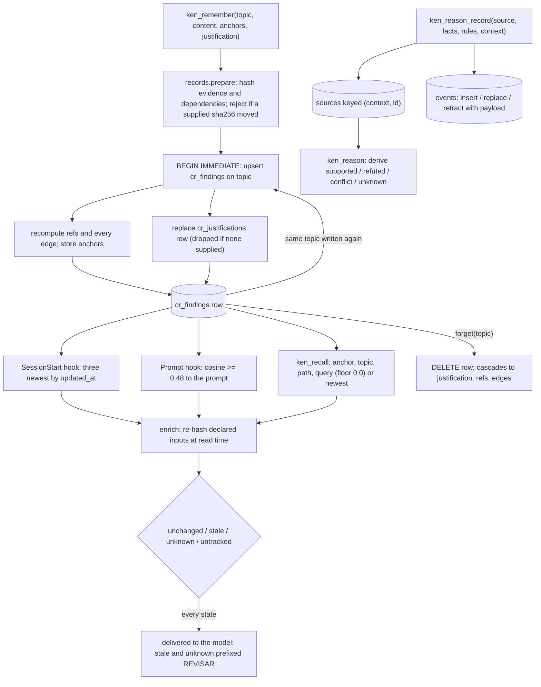

## 1. Executive Summary

ken is a per-project code index for Claude Code, Codex and OpenCode that ranks
files before each prompt and keeps three memories beside the index: findings the
agent writes with `ken_remember`, a log of prompts, replies and file touches that
biases later rankings, and a store of formal premises for rule inference. What is
notable is the justification on a finding. Declared file and tree dependencies are
hashed when it is saved and re-hashed on every read, so a recalled conclusion
arrives labelled `unchanged`, `stale`, `unknown` or `untracked`. What is weak is
that the label is all it does: no read path withholds a stale finding, and the
anchored recall the README describes as firing with no query fires only when the
model passes the anchor itself.

The package is `ken-rank` 0.17.0, MIT-licensed, by Infinibay LLC. Most of the
tree is not memory. A tree-sitter parser for nineteen languages feeds a file and
symbol index, a ranker fuses lexical, semantic, predictive and graph signals, and
a structural query language (KQL2) with a design-pattern catalogue takes the bulk
of the code and tests. This report covers the three memories and the hooks that
deliver them.

Five findings shape the rest of this report.

- **Validity is a label and never a filter.** `records.enrich` attaches the live
  state to every finding a read returns (`src/ken/knowledge/records.py:126-180`).
  The session brief, the prompt hook and `ken_recall` print it, and a test
  asserts that a stale finding cannot be hidden from the ranked block
  (`tests/test_justified_memory.py:385-393`). A finding whose evidence changed is
  therefore injected into the next session exactly like a fresh one, behind a
  `REVISAR` prefix.
- **Anchors are pulled, not pushed.** `recall_by_anchor` has one production
  caller, `_select_memories` behind `ken_recall`
  (`src/ken/mcp/server.py:1517-1527`). The tool hook posts the call to the
  daemon and prints nothing (`src/ken/hook.py:69-71`), so a memory anchored to
  `database is locked` reaches the agent only if the agent asks with that string.
- **The agent-facing recall has no floor.** `ken_recall` defaults `min_score` to
  `0.0` (`src/ken/mcp/server.py:1466`) and passes it through, while the library
  and the `ken recall` CLI default to `0.25` (`src/ken/memory.py:14`,
  `src/ken/cli.py:331-333`). A query through MCP returns the nearest five
  findings whatever their similarity.
- **Findings correct by overwrite and delete; premises keep a log.** Re-using a
  topic replaces the row in place and `forget` is a hard `DELETE`
  (`src/ken/memory.py:82-93`, `:166-167`). The premise store appends an
  `events` row for every insert, replace and retract, which earns `audit_log`
  for that store and not for the findings.
- **The premise store's context is a namespace the caller picks.** `ask` filters
  sources on `context = ?` (`src/ken/reasoning/store.py:98-99`), and the context
  is a `ken_reason` argument defaulting to `main`. It isolates experiments; it
  does not bound a reader.

Two marks, `audit_log` and `negative_eval`, both carried mainly by the premise
store. The [section 10](#10-tests-evals-and-benchmarks) evidence for
`negative_eval` includes one findings case, guarding a default the MCP tool
overrides.

## 2. Mental Model

ken holds three kinds of durable state, and each becomes a belief differently.

**A finding is whatever text the agent last wrote under a topic.** `remember`
upserts on the unique `topic` column, so a topic is the identity and the content
is replaceable (`src/ken/memory.py:82-93`). A finding exists from the commit of
that transaction and is retrievable at once: the embedding is computed inline
before `BEGIN IMMEDIATE` (`:57-65`). It stops existing only two ways. A write to
the same topic replaces content, tags and embedding, and drops a justification
the caller did not resupply (`src/ken/knowledge/records.py:104-114`). A `forget`
deletes the row, and foreign-key cascades remove its justification, references
and edges (`src/ken/memory.py:147-175`, `src/ken/db.py:40`).

Two classifications ride on a finding, and neither moves it. The `kind` is a
reserved `kind:` tag drawn from `finding`, `persistent_rule`,
`experimental_finding` and `hypothesis` (`src/ken/memory.py:15`, `:46-55`). The
justification has its own `kind`: `observation`, `decision`, `hypothesis` or
`derivation` (`src/ken/knowledge/records.py:19-26`). The only reader that
branches on either appends `; hipótesis` to a hook line
(`src/ken/knowledge/context.py:140-141`).

**Validity is computed per read, from the worktree.** A justification stores a
SHA-256 for each declared file and, for a tree, a digest over the sorted paths
and hashes of every file matching a pattern
(`src/ken/knowledge/dependencies.py:95-147`). On each read `assess` re-hashes
within a shared budget of 256 files, 16 MiB, 10,000 entries and 200 ms. It
returns `stale` if any hash moved, `unknown` if any input was missing or the
budget ran out, `unchanged` otherwise, and `untracked` when nothing was declared
(`:165-190`). Tree digests cover membership, so a new file inside the declared
scope invalidates an absence claim. Nothing is stored about the outcome; a
reverted edit returns the finding to `unchanged`.

**Interaction memory is a log the ranker reads.** Hooks write each prompt and
each final reply into `cr_contexts`, and each read, edit, write, citation and
dismissal into `cr_interactions` (`src/ken/schema.sql:105-128`). At session end
the daemon snapshots a per-file productivity score with a pattern label such as
`read_edit` (`src/ken/ranker/snapshot.py:17-63`). A later prompt that embeds
close to an earlier one inherits a boost toward the files that session found
productive, and a penalty on files it dismissed
(`src/ken/ranker/boosts.py:262-293`). These rows have no correction path beyond
the daemon dropping the last interaction of a failed tool call
(`src/ken/daemon/server.py:263-283`).

**A premise is a fact or rule bundle under a source id, in a named context.**
`ken_reason_record` stores ground atoms — predicate, subject, object, a negation
flag and an opaque scope string — and rules of one to three premises
(`src/ken/reasoning/model.py:20-92`). Re-recording a source replaces its bundle,
`retract=true` removes it, and every change appends an `events` row
(`src/ken/reasoning/store.py:62-81`). `ken_reason` derives `supported`,
`refuted`, `conflict` or `unknown` with proofs and source evidence, and stores
nothing about the answer except an inference checkpoint (`:85-148`). Premises
and findings never mix: without a `goal`, `ken_reason` returns `ken_recall` hits
labelled as candidates, not premises (`src/ken/mcp/server.py:1433-1436`).

## 3. Architecture

ken is a Python package with a CLI, a per-project daemon, a stdio MCP server and
hook shims. `ken install .` creates `.ken/`, writes `meta.json` with a random
auth token, initialises `ken.db`, and wires hooks and an MCP entry for each
requested host: Claude Code by default, `--codex`, `--opencode` and `--deepseek`
on request (`src/ken/install.py:133`, `src/ken/cli.py:79-92`).

Each hook invocation is a short `ken hook ...` process that walks up to the
project root and POSTs the event to the daemon, spawning it if needed
(`src/ken/hook.py:33-90`). The daemon binds localhost and checks
`Authorization: Bearer` against the token in `meta.json`
(`src/ken/daemon/server.py:401-404`). It holds one writer connection behind a
`threading.Lock`, watches the tree with `watchfiles`, reindexes through a
coalescing queue, and exits after its sessions end or an idle timeout. The MCP
server is a separate process that opens its own connection per call
(`src/ken/mcp/server.py:323-326`); SQLite's write lock and a 5-second busy
timeout arbitrate between them (`src/ken/db.py:23-42`).

Three stores sit under `.ken/`. `ken.db` is SQLite in WAL mode with the code
index, the session tables, the findings tables and an FTS5 mirror of file bodies
(`src/ken/schema.sql`). Code vectors live in memory-mapped segment files under
`.ken/vectors/`, with slots allocated in SQLite; finding embeddings are an inline
BLOB on `cr_findings`. `reasoning.sqlite` holds premises, events and checkpoints
(`src/ken/reasoning/store.py:18-33`).

Embeddings default to a distilled static table committed in the tree,
`src/ken/embedder/data/ken__static-qwen3-r512-v2.npz` (23 MB), with fastembed
ONNX and an optional torch backend as alternatives (`src/ken/embedder/`).
Nothing calls a hosted model on any memory path.

### Deployment and ergonomics

Nothing has to run beyond the hooks: the daemon starts on demand and stops
itself. No API key is needed to store or recall. Installation is `uv tool
install ken-rank`, `pip install ken-rank` or the repository's `install.sh`, then
`ken install .` per project. The dependency list pins `tree-sitter` below 0.26
and `mcp` to the 2.x line, with a `uv.lock` in the tree. Everything is local and
offline once the embedding table is present.

The findings store is inspectable with `ken findings`, `ken recall` and any
SQLite client, and a person can repair it by hand. It is not a document store: a
finding is a row, and the hook output is the only rendered view.
`ken uninstall .` removes the hooks, the MCP entries and the whole `.ken/`
directory, including both memory stores, unless `--keep-db` is passed
(`src/ken/install_uninstall.py:145-150`).

## 4. Essential Implementation Paths

**Capture of a finding.** `ken_remember(action="save")` validates non-empty
content, optionally converts a `ken_check` receipt into justification evidence,
and calls `_impl_ken_remember`, which drops empty anchors and calls
`memory.remember` (`src/ken/mcp/server.py:1537-1607`, `:504-525`). `remember`
validates the justification through `records.prepare`. That bounds every field,
confines paths to the project, refuses symlinks and captures hashes, and a
caller that supplies `sha256` for an input gets the whole write rejected if the
file changed since it was read (`src/ken/knowledge/records.py:13-84`,
`src/ken/knowledge/dependencies.py:150-162`). The embedding is computed, then
one `BEGIN IMMEDIATE` transaction upserts the finding, replaces its
justification, recomputes its references and every edge inside a savepoint, and
writes anchors (`src/ken/memory.py:80-117`).

**Capture of interactions.** The prompt hook stores the prompt with its
embedding (`src/ken/daemon/server.py:467-490`). The tool hooks map Read, Edit,
Write and shell calls to `cr_interactions` rows. The Stop hook stores the last
assistant text, capped at 8,000 characters, as a `turn_end` context
(`:812-828`), and session end snapshots scores (`:698-710`).

**Retrieval.** `ken_recall` dispatches in a fixed order: any `anchor_*`
argument goes to `recall_by_anchor`; else `topic` to the findings graph; else
`path` to `file_findings`; else `query` to cosine recall; else the newest
findings (`src/ken/mcp/server.py:1517-1535`). With `detail="answer"` and an exact
topic it reads only that row (`:1504-1509`). Each result passes through
`knowledge.context.recall_view`, which enriches it with validity and applies the
`summary` or `answer` projection and the character budget
(`src/ken/knowledge/context.py:101-126`).

**Context assembly.** Session start calls `build_session_brief`: the newest
prompt across all sessions, that session's last reply, its five most-touched
files, and the three newest findings, each enriched
(`src/ken/session_brief.py:128-188`). The prompt hook ranks files, then renders a
`<ken-knowledge>` block for the findings the ranker selected, skipping any whose
content and state the session has seen, inside a 3,500-character budget
(`src/ken/daemon/server.py:492-525`, `src/ken/knowledge/context.py:153-179`).

**Correction and deletion.** `ken_remember(action="forget")` calls
`memory.forget`, which deletes by exact topic and recomputes the remaining edges
(`src/ken/memory.py:147-175`). `ken_remember(action="dismiss")` posts a path to
the daemon, which records a `dismissed` interaction on the latest-started
session (`src/ken/daemon/server.py:885-920`). `ken_reason_record(retract=True)`
removes a premise bundle and logs it (`src/ken/reasoning/store.py:57-81`).

**Schema.** `src/ken/schema.sql:97-208` for sessions, interactions, findings,
references and edges; `src/ken/knowledge/records.py:97-101` for
`cr_justifications`, created lazily on first write;
`src/ken/reasoning/store.py:23-33` for the premise store.

**Tests.** `tests/test_justified_memory.py`, `tests/test_findings_graph.py`,
`tests/test_session_brief.py`, `tests/test_reasoning_memory.py`, and the
remember, recall and forget cases in `tests/test_search_cli.py:566-758`.

## 5. Memory Data Model

`cr_findings` has `id`, a unique `topic`, `content`, `tags` as a JSON array,
an `embedding` BLOB, and `created_at` and `updated_at` in milliseconds
(`src/ken/schema.sql:154-164`). The embedded text is the topic plus the first
1,024 characters of content (`src/ken/memory.py:57`). There is no author, no
session id, no source harness and no scope column; a finding written from Codex
and one written from Claude Code are indistinguishable.

`cr_justifications` holds one JSON payload per finding: version, kind,
rationale, evidence paths and notes, dependencies with their hashes,
assumptions, a recheck note and optional check-run ids
(`src/ken/knowledge/records.py:73-84`, `:97-101`). Evidence files become
dependencies automatically, so a changed evidence file makes its finding stale.

`cr_finding_refs` bridges findings to code. Paths, tracebacks and identifiers
are extracted from the prose with regular expressions and resolved against the
index, grouped on a durable text key with the resolved ids kept as an advisory
cache. Declared anchors are rows with `method = 'anchor'` and kinds `file`,
`symbol`, `tool` and `error` (`src/ken/schema.sql:184-196`,
`src/ken/findings_graph.py:262-298`). `cr_finding_edges` stores typed undirected
edges — `semantic` above cosine 0.60, `shared_file`, `shared_symbol`,
`shared_tag` — with evidence JSON. Its `directed` column is reserved in a schema
comment for supersession and contradiction edges that nothing writes
(`src/ken/schema.sql:198-208`).

Temporal fields are record time only: `created_at` and `updated_at` on a
finding, `created_at` on interactions and contexts, and `CURRENT_TIMESTAMP` on
premise events. A premise's `scope` field defaults to `present` and is compared
as an opaque string; the reasoning README states that no interval calculus is
implemented (`src/ken/reasoning/README.md`).

The premise store has `contexts(id, revision)`, `sources(context, id, payload)`,
`events(seq, context, source, action, payload, created)` and
`checkpoints(context, world, rules_hash, state)`
(`src/ken/reasoning/store.py:23-33`). A context is created on first use by any
caller; there is no list of who may read or write one.

## 6. Retrieval Mechanics

**Query recall is brute-force cosine.** `memory.recall` loads every finding with
an embedding, stacks the vectors, skips any written by a model of a different
dimension, and ranks by cosine against the query embedding
(`src/ken/memory.py:213-254`). The floor is `DEFAULT_RECALL_MIN_SCORE = 0.25` in
the library and the CLI. The MCP tool passes its own default of `0.0`
(`src/ken/mcp/server.py:1466`, `:1533-1534`), so the agent receives the top
`limit` findings by similarity with no floor unless it asks for one.

**Anchors match stored keys.** A `file` anchor matches the stored key, a longer
path ending in it, or a stored key ending in the caller's basename. An `error`
anchor matches when the stored key is a substring of the message passed, and
`tool` and `symbol` match exactly. Results come back newest first, OR across
kinds (`src/ken/findings_graph.py:324-388`). The basename clause means an anchor
on `src/a.py` also fires for any other path whose last segment is `a.py`.

**Topic and path recall read the graph.** `related_findings` resolves a topic by
exact match or else the top cosine hit, and returns neighbours ranked
evidence-backed first (`src/ken/findings_graph.py:751-805`). `file_findings`
returns findings whose prose or anchors reference the file, optionally one hop
out (`:807-852`).

**The prompt hook uses a separate floor.** The ranker's findings channel keeps
findings above cosine 0.48 and scales them into the fused score
(`src/ken/ranker/channels.py:1321-1350`). The ranker suppresses its whole block
when the top score falls under a confidence gate
(`src/ken/ranker/__init__.py:44-47`, `:233-238`). Selected topics then pass
through `render_brief`, which prints a status before content so clipping cannot
remove a warning (`src/ken/knowledge/context.py:129-150`).

**Budgeting keeps conclusions whole.** `compact` adds records while the
serialised JSON fits the budget. A record that does not fit is replaced by a
reference with `conclusion_omitted` and an `expand` pointer rather than a
clipped prefix (`src/ken/knowledge/context.py:61-98`). The session brief, by
contrast, truncates the whole block at 1,800 characters
(`src/ken/session_brief.py:185-187`).

**Failure modes.** Over-recall through MCP is the default, given the zero floor.
The session brief selects by recency alone, so the three newest findings are
injected whether or not they concern the task. Stale and `unknown` findings are
returned and injected on every path.

## 7. Write Mechanics

Findings are written only by explicit calls: `ken_remember` from the agent, or
`ken remember` and `ken tools remember` from a shell. Nothing extracts a finding
from a conversation. The design document states that a passing test does not by
itself establish a general conclusion, and the code matches
(`docs/design/justified-memory.md`, `src/ken/memory.py`). The bundled skills ask
the agent to write back root causes, unstated constraints and traps
(`src/ken/skills/bundled/`).

Deduplication is by topic only. Two findings with different topics and the same
content coexist and are linked by a `semantic` edge. A topic collision
overwrites without warning, which the README instructs the agent to treat as the
update path.

Validation is strict at the justification boundary and absent at the content
boundary. `records.prepare` caps rationale at 4,000 characters, assumptions at
16, evidence at 16 and dependencies at 32, refuses traversal and symlinks, and
rejects a check receipt whose recorded inputs no longer match
(`src/ken/knowledge/records.py:13-84`). Content has no length cap and no
screening; whatever the agent writes is injected into later sessions.

Interaction capture is unconditional while hooks are installed: every prompt,
every final reply up to 8,000 characters, and every file touch. Premise writes
are bounded at 500 facts and rules per source and 2,000 sources per context
(`src/ken/reasoning/store.py:53-72`).

### Operational cost

A finding write blocks the tool call on one embedding, a reference extraction
over the prose, and a full recompute of every edge. The recompute includes an
O(N²) cosine pass that is skipped above 2,000 findings
(`src/ken/findings_graph.py:60`, `:548-566`). With the static table the
embedding is a lookup; with torch it is a model call. There is no lag: the
finding is retrievable at commit.

No background pass rewrites findings. `ken reembed` rewrites every stored
embedding when the model changes, findings included (`src/ken/reembed.py:328-332`).
Per turn, the prompt hook injects at most 3,500 characters, the knowledge block
counted inside that budget, and the session brief at most 1,800. Both are
user-prompt content, so they vary per turn and sit after any cached system
prefix.

## 8. Agent Integration

The MCP surface is twelve tools (`src/ken/mcp/server.py:936-1607`). Memory is
`ken_remember` with `save`, `forget` and `dismiss` actions, `ken_recall`, and
the premise pair `ken_reason_record` and `ken_reason`. A source comment explains
why `ken_remember` is separate from `ken_recall`: hosts gate read-only agent
tiers by tool, so folding writes into the read tool would grant them to every
read-only tier (`:930-933`). The README's instruction block says the server
describes six tools; the registry holds twelve.

The model has full agency over findings. It chooses what to write, overwrites by
topic, deletes by topic, and decides whether to pass anchors and a floor on
recall. The hooks give it the newest three findings at session start and any
selected by the ranker on each prompt, without a call. Anchored findings require
a call. The README's promise that an anchored memory reaches whoever next
touches the same thing with no query describes `ken_recall(anchor_file=...)`
issued by the agent, and the `ken-investigate-bug` skill tells it to make that
call (`src/ken/skills/bundled/ken-investigate-bug/SKILL.md:99`).

Every harness installed in a project shares one store. A finding Codex writes is
injected into the next Claude Code session, which the tool description presents
as the point (`src/ken/mcp/server.py:1474-1476`).

Adapting ken to another host means writing a hook shim that posts the same five
events. The daemon API is plain JSON over localhost HTTP, and `ken tools`
exposes every tool to a host without MCP.

## 9. Reliability, Safety, and Trust

**Provenance.** A justified finding records which files support it and their
hashes, and a check receipt binds it to a KQL2 contract run. Nothing records who
wrote a finding or from which session, and an unjustified finding carries no
provenance at all. The design document is explicit that `unchanged` proves
neither the conclusion nor its assumptions.

**Uncertainty is represented and not enforced.** `hypothesis` is a kind,
`assumptions` are listed as pending in hook output, and stale inputs are flagged.
The `answer` projection adds `reuse: review_inputs_before_reusing` to any state
other than `unchanged` (`src/ken/knowledge/context.py:39-58`). That is advice to
the model. Nothing prevents a stale, unverified hypothesis from being the first
line of the next session's brief.

**False memories.** The agent writes findings without review, and any text in a
finding is injected into later prompts across harnesses. A prompt-injected
instruction saved as a finding persists until someone runs `forget` on its exact
topic. There is no screening, no quarantine state and no human approval surface.

**Concurrency.** Writes go through SQLite's write lock. `remember` and `forget`
use `BEGIN IMMEDIATE`, the daemon serialises its own writes behind a lock, and
the premise store opens `BEGIN IMMEDIATE` for both `record` and `ask`.
`tests/test_reasoning_memory.py:151-158` runs eight concurrent record-and-ask
jobs and asserts all eight answers survive. Dismissals attach to the latest-started
session, so with two hosts open the attribution is a heuristic
(`src/ken/daemon/server.py:885-899`).

**Graph failures cannot cost a finding.** Reference and edge recomputation run
in a savepoint; a failure rolls back only the graph work and marks the graph
dirty for repair (`src/ken/findings_graph.py:714-748`).

**Deletion.** `forget` removes the row and its cascades. It does not touch the
prompts, replies and dismiss reasons in `cr_contexts` that may quote the
finding, and those tables have no delete path short of uninstalling. The
premise store's `events` table keeps every retracted bundle's content in its
insert or replace row for good.

**Path safety.** Tool path arguments are confined to the project root, with
traversal and escaping symlinks rejected (`src/ken/_paths.py:51-66`,
`src/ken/mcp/server.py:329-334`). Dependency capture applies the same rule and
refuses internal symlinks (`src/ken/knowledge/dependencies.py:45-63`).

## 10. Tests, Evals, and Benchmarks

The suite is large and mostly about the structural engine. CI runs `uv run
pytest` and `mypy` on Ubuntu and macOS with the locked environment, then builds
and smoke-tests the wheel (`.github/workflows/ci.yml`). I did not run it.

**Justified memory.** `tests/test_justified_memory.py` covers reuse across
sessions, a relevant edit making a finding stale while an unrelated edit does
not, and evidence tampering. It covers a new file invalidating a tree-scoped
absence claim while a file outside the pattern does not, budget exhaustion
yielding `unknown`, and rejection of evidence whose supplied hash moved. It also
covers atomic rejection of invalid dependencies, an overwrite dropping the old
justification, and hook delivery once per session with a warning after a
dependency changes. Each of these asserts the label;
`test_verbose_rank_cannot_hide_a_stale_memory` asserts that a stale finding is
shown (`:385-393`).

**`negative_eval` — awarded, on the premise store.**
`test_source_replacement_and_rule_replacement` replaces a source's rule and
asserts the old conclusion `q` is `unknown` while the new one `z` is
`supported` (`tests/test_reasoning_memory.py:79-84`).
`test_world_context_and_time_isolation` records `p` in context `one`, asserts
`unknown` in context `two`, `unknown` under the `past` scope, and `supported` in
`one` (`:87-95`). `test_retraction_alternate_support_and_cycles` retracts two
supporting sources in turn and asserts support survives the first and is gone
after the second, with zero facts (`:67-76`). Each case asserts exclusion on a
populated store with a positive control in the same test, and each runs on
SQLite with no embedder.

**The findings cases are weaker.** `test_recall_filters_weak_matches_by_default`
stores one finding, asserts recall at the default floor is empty, and asserts
the same finding returns at `min_score=0` (`tests/test_search_cli.py:585-597`).
That is a sound pair, and it guards the library default that the MCP tool does
not use. `test_an_unanchored_lookup_returns_nothing` asserts a `tool: npm`
lookup misses a finding anchored to `pytest`, with its positive control in a
sibling test (`tests/test_findings_graph.py:463-468`, `:518-523`).
`test_forgetting_removes_the_anchors_too` asserts absence after deleting the
only finding, which an empty retriever would also pass (`:526-531`).

**Evaluations.** `docs/validation/coding-memory-2026-09-21/` holds eight Codex
CLI sessions on copies of ken's own database, with 275 findings, comparing plain
and justified memory on a fixed note selection. Its README states that the runs
showed no consistent token saving or accuracy gain, and that it tested memory
use rather than hook activation or ranking. `scripts/evaluate_coding_memory.py`
regenerates it. `docs/benchmark-evidence/2026-09-07-*` and
`docs/codex-ken-benchmark-2026-09-07.md` record task runs with and without ken
on code-navigation tasks, which concern the index, not memory. I read the
committed summaries and recomputed nothing.

**No paper.** The tree has no arXiv link, BibTeX block, DOI or `CITATION.cff`.

**Tests I would want.** A stale finding withheld, or demoted below fresh ones, on
some read path; an MCP-level recall at the tool's default floor; an anchored
finding delivered by a hook with no agent call; a `forget` followed by a recall
with a surviving control finding.

## 11. For Your Own Build

### Steal

- **Fingerprint the inputs a conclusion depends on and re-check them on read.**
  Store a hash per declared file and a digest over sorted path and hash pairs for
  a declared tree, and recompute at retrieval. Tree membership is what makes an
  absence claim checkable; a new file in scope changes the digest.
- **Bind the observation to what was read.** Let the writer supply the hash it
  saw, and reject the whole write if the file changed between reading and
  recording.
- **Return `unknown`, never `unchanged`, when the check runs out of budget.**
  A bounded re-check that fails open is a stale check; ken's fails closed.
- **Drop the old justification when the claim is rewritten.** An overwrite that
  keeps the previous evidence attaches it to a conclusion it never supported.
- **Budget by whole records.** When a conclusion does not fit, send a reference
  and an expansion handle instead of a prefix that may have lost its negation.
- **Log premise changes with the payload, in the same transaction.** The events
  row makes a replaced bundle recoverable without a separate history table.

### Avoid

- **A validity state nothing filters on.** If the label is the whole mechanism,
  the injection paths need a demotion or an exclusion, or the stale memory
  arrives first because it is newest.
- **A different relevance floor on the agent's tool than in the library.** The
  test suite guards one default and the agent runs on the other.
- **Documenting push delivery for a pull mechanism.** Anchors are a good index;
  without a hook that calls them, they are a search the agent must think of.
- **Session-start selection by recency alone.** The newest three findings are
  the ones last written, not the ones about the task.
- **Retaining raw prompts and replies with no delete path.** A forgotten finding
  survives in the transcript it was derived from.

### Fit

ken suits one developer, or a small team sharing a checkout, who wants a local
code ranker for Claude Code or Codex and would value a project notebook the
agent writes into and reads from automatically. The memory is a modest addition
to a large code-intelligence package; adopting it means adopting the daemon, the
hooks and the index. It does not suit a reader who needs findings withheld when
wrong, separated by author or tenant, reviewed before use, or deleted along with
their traces. For those the justification contract is the part to study and the
store around it is the part to replace.

## 12. Open Questions

- How often a stale finding misleads an agent in practice, given that it arrives
  labelled; the committed evaluation fixes note selection and does not measure
  this.
- Whether the MCP `min_score=0.0` default is deliberate. It arrived with the
  0.12.0 consolidation from thirty tools to six, commit
  `80a32a0a445eac16fa2f6c80e655f35bf30f05a3`, dated 30 July 2026.
- Whether a hook-side anchor lookup is planned; the tool hook has the tool name,
  the input paths and the error text in hand.
- How the premise store is used outside the demos; no committed evaluation
  exercises `ken_reason` on project knowledge.

## Appendix: File Index

- **Schema and storage:** `src/ken/schema.sql`, `src/ken/db.py`,
  `src/ken/knowledge/records.py` (`ensure_schema`), `src/ken/vectors.py`,
  `src/ken/reasoning/store.py`.
- **Write:** `src/ken/memory.py` (`remember`, `forget`),
  `src/ken/knowledge/records.py` (`prepare`, `save`),
  `src/ken/knowledge/dependencies.py` (`Fingerprints`, `capture`),
  `src/ken/findings_graph.py` (`apply_remember`, `set_finding_anchors`,
  `recompute_finding_edges`), `src/ken/checks/integration.py`.
- **Read:** `src/ken/memory.py` (`recall`, `recall_by_anchor`,
  `list_findings`), `src/ken/findings_graph.py` (`find_by_anchor`,
  `related_findings`, `file_findings`), `src/ken/knowledge/dependencies.py`
  (`assess`), `src/ken/knowledge/context.py`, `src/ken/ranker/channels.py`
  (`finding_scores`), `src/ken/ranker/boosts.py`.
- **Context assembly:** `src/ken/session_brief.py`,
  `src/ken/knowledge/context.py` (`render_brief`, `brief_line`),
  `src/ken/daemon/server.py` (`_handle_session_start`, `_handle_prompt`).
- **Interaction log:** `src/ken/daemon/server.py` (`record_context`,
  `record_interaction`, `_record_dismiss`, `_handle_turn_end`),
  `src/ken/ranker/snapshot.py`, `src/ken/hook.py`.
- **Premises:** `src/ken/reasoning/model.py`, `src/ken/reasoning/kernel.py`,
  `src/ken/reasoning/store.py`, `src/ken/reasoning/README.md`.
- **MCP and CLI:** `src/ken/mcp/server.py`, `src/ken/cli.py`,
  `src/ken/install.py`, `src/ken/install_uninstall.py`,
  `src/ken/skills/bundled/`.
- **Tests and evaluations:** `tests/test_justified_memory.py`,
  `tests/test_findings_graph.py`, `tests/test_session_brief.py`,
  `tests/test_reasoning_memory.py`, `tests/test_search_cli.py`,
  `docs/validation/coding-memory-2026-09-21/README.md`,
  `scripts/evaluate_coding_memory.py`, `docs/design/justified-memory.md`,
  `.github/workflows/ci.yml`.

### Recorded searches

Run from the tree root against the pinned revision, with
`PIN=6286d91032a973ab5b3001df272e870ebd922281`.

- `git grep -n -E 'recall_by_anchor|find_by_anchor' "${PIN}" -- src` — definitions in `memory.py` and `findings_graph.py`; one caller, `mcp/server.py:1524-1527`.
- `git grep -n -i 'anchor' "${PIN}" -- src/ken/hook.py src/ken/daemon src/ken/hooks_template.py src/ken/codex_hooks_template.py src/ken/opencode_template.py src/ken/deepseek_template.py` — turn-anchor and context-id comments only; no anchor lookup on a hook path.
- `git grep -n -E 'FROM events|INTO events|UPDATE events|DELETE FROM events' "${PIN}" -- .` — one match, the insert at `reasoning/store.py:80`.
- `git grep -n -E 'DELETE FROM (cr_|events|sources)|UPDATE (cr_|events)' "${PIN}" -- src scripts` — `cr_findings` deleted only at `memory.py:167`; `cr_interactions` only at `daemon/server.py:277`; `cr_session_scores` only at `ranker/snapshot.py:51`; `cr_contexts` updated only for embeddings at `reembed.py:320`; no `DELETE FROM cr_contexts`.
- `git grep -n -E "\"stale\"|'stale'|state *(==|!=|in) *[\"'{(]" "${PIN}" -- src/ken/knowledge src/ken/memory.py src/ken/session_brief.py src/ken/ranker src/ken/daemon src/ken/mcp src/ken/findings_graph.py` — the state is produced in `dependencies.py` and `records.py` and branched on at `context.py:46`, `:135` and `:145` for labels; no read drops a row on it.
- `git grep -n -E 'hypothesis' "${PIN}" -- src/ken ':!src/ken/skills' ':!src/ken/kql2' ':!src/ken/structural'` — kind vocabularies, the CLI choice list, label derivation, and the one label branch at `context.py:140`; the `responsibility/` hits belong to `ken_who`.
- `git grep -n -i -E 'project_id|user_id|tenant|namespace|workspace_id' "${PIN}" -- src/ken/memory.py src/ken/schema.sql src/ken/findings_graph.py src/ken/knowledge src/ken/session_brief.py src/ken/reasoning` — no match.
- `git grep -n -i -E 'valid_(from|to|until)|as_of|effective_(at|from)|observed_at' "${PIN}" -- src/ken/memory.py src/ken/knowledge src/ken/reasoning src/ken/schema.sql src/ken/findings_graph.py` — no match.
- `git grep -n -i -E 'approv|pending|quarantin|review_state|needs_review' "${PIN}" -- src/ken/memory.py src/ken/knowledge src/ken/findings_graph.py src/ken/reasoning src/ken/session_brief.py src/ken/mcp/server.py` — embedding-upgrade notices, a graph backfill comment and an inference job counter; no review state.
- `git grep -n -i -E 'tombstone|reject(ed)?_|blocklist|denylist|suppress' "${PIN}" -- src/ken/memory.py src/ken/knowledge src/ken/findings_graph.py src/ken/reasoning src/ken/ranker src/ken/daemon` — the ranker's confidence-gate suppression only.
- `git grep -n -i -E 'min.score' "${PIN}" -- src/ken/mcp/server.py src/ken/cli.py src/ken/memory.py` — `0.25` at `memory.py:14`, in `_impl_ken_recall` at `mcp/server.py:544` and as the `--min-score` default at `cli.py:331-333`; `0.0` in `ken_recall` at `mcp/server.py:1466`, passed through at `:1533`.
- `git grep -l -i -E 'arxiv|bibtex|@article|@misc|doi\.org' "${PIN}" -- .` — no match; `git ls-tree -r --name-only "${PIN}" | grep -i citation` — no match.

## History

**2026-10-15** — [`6286d91032a973ab5b3001df272e870ebd922281`](https://github.com/Infinibay/ken/commit/6286d91032a973ab5b3001df272e870ebd922281) — first reading, at the head of `main`, a commit dated 22 September 2026, version 0.17.0. Two marks, `audit_log` and `negative_eval`, both on the premise store, with one findings case under `negative_eval`. Screened before reading from a full clone: no auto-run surface, nothing inside the cooldown, no unpinned surface (`uv.lock` unchanged for 23 days), three build-time execution points (`tests/conftest.py`, `tests/parsers/conftest.py`, `tests/ranker/conftest.py`), and an `AGENTS.md` read as data. MIT with no rider. Read with `git grep` and `sed`; nothing installed, built or run.
