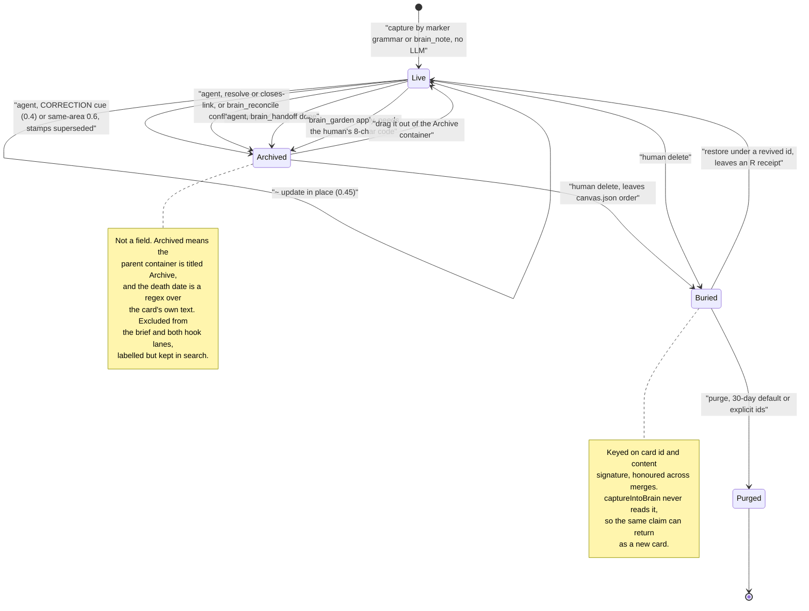

## 1. Executive Summary

Klypix MCP is a shared project brain for several coding agents: one
`brain.klypix` file, a ZIP of JSON committed beside the code, that Claude Code,
Codex, Cursor and other hosts read and write over MCP. Its recall surfaces and
its injection surfaces are kept apart and tested in both directions, and its
benchmarks call themselves inconclusive when a control fails. Its weak side is
that a card's lifecycle is the title of its container plus a regex over its
text, and the agent that writes a card can also retire one.

It is not an agent runtime. It holds the decisions, corrections, open questions,
standing rules and session handoffs a project has accumulated, and it is
published to npm as `klypix-mcp` and listed in the MCP registry through
`server.json`. The premise is stated plainly in the README: *"Codex does not know
what Claude learned an hour ago."* The answer is a format rather than a service:
a plain ZIP any tool can parse, with the parser shipped under the same licence,
so the memory outlives the session and the vendor.

**A card has no status field.** Whether it is current, superseded, resolved or
consolidated is decided by two things: the title of the container it sits in,
and a marker stamped into its own prose. `isArchived` is
`/^archive$/i.test(c.area || '')`, and the same literal test appears on 63 lines
across four source files. A death date for time-travel queries is recovered with
a regex over the card body. That is why a human can retire a wrong belief by
dragging a rectangle in the desktop app, and why renaming one container would
make every archived decision read as current fact.

The discipline around claims is the strongest part. The lock benchmark runs
unlocked writers first, and if they lose nothing the run reports `inconclusive`
rather than a pass. A coordination bench grades real agents by hidden tests,
prints every rate with its n and a 95% Wilson interval, and publishes the
scenarios KLYPIX loses. The session brief and both per-prompt hook lanes exclude
archived cards, while `read_canvas`, `search_canvases` and `brain_ask` return
them labelled; `test/archived-visibility.mjs` and `test/hook-unified-lane.mjs`
assert the exclusion, and `test/brain-ask.mjs` asserts the time-travel
exclusions beside a positive control.

The weak side is authority over the lifecycle, and the README's description of
its own reach. The agent can archive cards through `brain_note` (a `CORRECTION`
cue or a `✓` resolve), through `brain_reconcile`'s `confirm` array and through
`brain_handoff` `done`. A human approval code guards `brain_garden`'s bulk
consolidation and nothing else. No mutation record is append-only. The README
also understates the code in two places: it says the MCP tools compute no
evidence freshness, when `brain_ask` and `brain_sync` print each card's source
status (section 9), and it calls the capture lock fail-open, when both write
paths fail closed (section 7).

## 2. Mental Model

A memory is a **card**: one text item in a canvas, belonging to an **area**, the
container it sits inside. Capture parses a small set of side-fields off the
text: `evidence` (records of `{kind, ref}` with a captured working-file
SHA-256 or a legacy HEAD blob OID), `closes:`, `verify:`, and the provenance
fields `createdBy`, `createdVia` and `author`. Everything else about a card's
meaning, its lifecycle included, lives in the prose.

Capture is a marker grammar, not an extraction model. No LLM runs on the write
path; the model that decides what is worth remembering is the agent in the
conversation. It writes `🧠 BRAIN [Area]: <decision>` in its transcript, or
calls `brain_note`, and a prefix selects the transition: `?` opens a question,
`!` records a milestone, `+` or 🛠 defines a standing skill, `✓` resolves an
open card, `~` updates one in place. A decision carrying the case-sensitive cue
`CORRECTION`, `OBSOLETE` or `was WRONG` supersedes its stale counterpart in any
area (`hasCorrectionCue`, `src/klypix-format.mjs:5609`).

The transitions are gated by named overlap thresholds, set at the top of
`captureIntoBrain` (`src/klypix-format.mjs:6616-6617`) except the exported
cross-area bar at `:5610`. `SUPERSEDE_AT` is 0.6 for a same-area supersede and
`CORRECTION_SUPERSEDE_AT` 0.4 for the cue-gated cross-area one. `RESOLVE_AT` is
0.3 with a ±0.1 near-tie band capped at three; `UPDATE_AT` is 0.45, and
`CLOSE_COVER_AT` and `QUESTION_MERGE_AT` are 0.6. `docs/BRAIN_THRESHOLDS.md`
tabulates each against its function. Its header is stamped `v1.18.0` against a
package at 1.102.0, but its rows carry 1.86.1 additions such as
`UPDATE_MIN_WORDS`, so the stamp is stale and the table is maintained.

**A card dies by being moved and stamped.** A supersede reparents the old card
into a container titled `Archive`, prepends `↩︎ superseded <date>` to its text
and draws a `superseded by` arrow to the new one
(`src/klypix-format.mjs:7356-7400`). A resolve stamps `✅`; consolidation stamps
`⤵ consolidated`. Every later read reconstructs the state from those strings and
that title.

**Who may move a card is the part that matters, and the agent may.** Three verbs
on the agent's own tool surface archive cards with no person involved. The first
is `brain_note`, through a correction cue or a `✓`. The second is
`brain_reconcile`'s `confirm` array, whose schema says *"Each confirmed card is
stamped ✅, archived, and arrowed 'closed by' to its evidence"*
(`bin/klypix-worker.mjs:726`). The third is `brain_handoff` with
`action: "done"` (`src/klypix-core.mjs:2330`). The one human gate is on
`brain_garden`'s apply, which archives dormant cards in bulk behind an
eight-character code (section 9). The judgment sidecar states the consequence in
its own schema: the strongest actor class a current verdict can carry is
`agent-human-adjacent`, and `human-ui` is *"reserved — no writer may claim it
today"* (`src/provenance.mjs:56`).

A decision that returns to an earlier stance is recognised, not refused. When a
new card supersedes B and closely matches an archived ancestor A in B's
supersede chain, capture appends `↪ re-adopts <date>: <A's headline>` and draws a
`re-adopts` arrow (`findReadoptedAncestor` and `reAdoptionReceipt`,
`src/klypix-format.mjs:5917`, `:5960`). That is a provenance receipt for a round
trip, keyed on the chain, and it admits the card.

Deletion is a separate and stronger act. `brain-graveyard.mjs` moves a deleted
card's bytes to `graveyard/`, removes the id from `canvas.json.order`, and
records an entry in `graveyard.json`. The bin is honoured across merges, but it
is keyed on card id plus content signature (`fullEntryRid`,
`src/klypix-format.mjs:408`), and `captureIntoBrain` never reads it. A buried
claim can return as a fresh card with nothing to stop it, so the bin is the
closest the design comes to a
[rejected-value tombstone](../../patterns/rejected-value-tombstone/) without
being one.

## 3. Architecture

Nothing has to be running. A brain is a file in a repository, and every
mechanism in the package operates on that file directly.

**Storage.** `brain.klypix` is a ZIP (`FORMAT.md` v4) holding `manifest.json`,
`canvas.json`, `items/<shard>/<id>.json` one file per card, an optional
`assets/` tree, and `graveyard.json` plus `graveyard/` once anything is deleted.
Item geometry lives in `canvas.json.positions`, so moving a card never rewrites
its content. A brain is distinguished from a plain canvas by
`manifest.kind === "brain"` or a `brain.*` basename, and only a brain gets
union-merge on save under a capture lock and receipt-only deletes.

**Processes.** The MCP entry point is a stdio supervisor that holds the host's
connection open while a replaceable worker (`bin/klypix-worker.mjs`) serves the
tools. A staged update is integrity-checked, compatibility-gated and swapped in
between requests. The updater checks npm once per machine per 6 hours
(`AUTO_UPDATE_TTL_MS`, `src/mcp-auto-update.mjs:68`), backs off after a failure,
holds a deliberate rollback, and installs same-major releases only.
`KLYPIX_AUTO_UPDATE=0` turns it off. Plugin mode (`KLYPIX_PLUGIN=1`) turns off
updates, project-file writes and the semantic runtime together.

**Project files are written by background paths, not only by `link`.**
`brain_sync` at `phase: "start"` registers the project in
`~/.claude/project-brain/registry.json` (`bin/klypix-worker.mjs:1193`). It then
creates or rewrites any of the 14 KLYPIX-managed files that are missing or out of
date. That includes `.mcp.json`, whose entry starts `npx -y klypix-mcp` with no
version pinned when no installed bundle exists. The updater repeats the pass for
every project registered in the last 14 days, after each update and at most once
a day otherwise.

**Retrieval stack.** Lexical scoring is plain JavaScript over the parsed struct.
The semantic arm runs `Xenova/bge-small-en-v1.5` on device through
`@huggingface/transformers`. That package is a devDependency, installed
separately into `~/.claude/project-brain/semantic/` from a pinned manifest
(`transformers` 4.2.0, `sharp` 0.35.5; `src/semantic-install.mjs:16-25`).
`npx klypix-mcp install` does that by default from an interactive terminal, about
150 MB once, and skips it for CI, scripts, agents and plugin mode unless
`--semantic` is passed. A cross-encoder reranker stays behind `KLYPIX_RERANK=1`,
off by default because the README records that it *"reduced precision and added
latency"*. Every semantic failure degrades to lexical rather than erroring.

**Sidecars.** Several files sit outside the brain. The capture ledger is
`<project>/.claude/brain-capture-log.jsonl`, ring-capped at 1000 entries. A
hook-health log is capped at 500 rows. The presence lane and session mailbox
live in the home directory. A judgment sidecar and a rejected-prompt pool sit
under `~/.claude/project-brain/provenance/`, count-capped at 4096 and 2048.
Restore points live under `~/.claude/project-brain/history/`, never beside the
brain.

**The Windows app bridge.** On Windows, with the proprietary KLYPIX app running
and its AI-tools switch on, `read_canvas`, `add_to_canvas` and `brain_lens` can
route to the app over a named pipe, and three app tools (`klypix_status`,
`read_card_contents`, `show_in_klypix`) appear. Writes to a canvas open in the
app go through the app's lease and are refused when a box is frozen or locked
from AI tools.

### Deployment and ergonomics

The floor is a single file and no service: `parseKlypix` is exported, the
format is documented, and `npx klypix-read <file>` prints a brain as markdown.
There is no database, queue, vector service or API key, and nothing needs the
network to store or retrieve. Without the semantic runtime, ranking degrades to
lexical rather than to nothing.

The cost is in the home directory and in other projects. `install` writes the
engine into `~/.claude/project-brain`, five hooks into `~/.claude/settings.json`
(*"written even if Claude Code is not installed"*), a guidance block into
`~/.codex/AGENTS.md`, and Codex's MCP entry into `<cwd>/.codex/config.toml`.
`link` writes 14 files into a project; `brain_sync` and the updater keep them
current afterwards. Uninstall is machine-global, and per-project files are
removed one project at a time. The store itself is repairable by hand: `unzip`
it and edit JSON, where the lifecycle states are strings a person can read.

## 4. Essential Implementation Paths

- **Capture (automatic).** `src/global-brain-hook.mjs`, the Claude Code Stop
  hook: marker scan, `splitMarkerSuffixes`, capture under the cross-process lock,
  `captureIntoBrain`, `tidyBrain`, `atomicWrite`, then `appendJsonl(LEDGER, …,
  1000)` (`:4646`).
- **Capture (explicit).** `brain_note` (`bin/klypix-worker.mjs:808`) →
  `opBrainNote` (`src/klypix-core.mjs:1929`) → `withCanvasWriteLock` → the same
  `captureIntoBrain`. Same engine, no ledger entry.
- **Lifecycle transitions.** `captureIntoBrain`, `src/klypix-format.mjs:6616`
  onward: resolve, update, question-merge, supersede (`:7356-7400`) and
  `closes:`, each with its own threshold and guards. 🛠 skills are excluded from
  supersede and from fuzzy resolve.
- **Agent-side retirement.** `opBrainReconcile` `confirm`
  (`src/klypix-core.mjs:1054`, outcomes at `:1493`) and `opBrainHandoff` `done`
  (`:2195`, `:2330`).
- **Retrieval, whole brain.** `rankForQuestion` (`src/klypix-format.mjs:4187`):
  lexical scoring, reciprocal-rank fusion with the semantic arm (`:4336-4342`),
  then correction and fulfilment overlays. `opBrainAsk`
  (`src/klypix-core.mjs:797`) adds each hit's evidence status (`:889`).
- **Retrieval, per prompt.** The hook routes each prompt to one of two lanes
  (`src/global-brain-hook.mjs:5060-5112`). A prompt with at least
  `HOOK_MODEL_MIN_TOKENS` (6) unique content tokens takes `rankHookFused` when
  warm vectors exist; anything else takes `rankHookWords`
  (`src/klypix-format.mjs:3959`, `:4019`).
- **Context assembly.** `structToBrief` (`BUDGET_CHARS` 13,500, written to
  `.claude/brain-brief.md`) and `structToUltraBrief` (`ULTRA_BUDGET_CHARS` 1,800,
  the SessionStart tier), `src/klypix-format.mjs:3169`, `:3412-3413`.
  `statusContextToMarkdown` (`:4732`) computes a status section with a
  4,200-character budget that structural lines bypass.

**The per-prompt lane decides whether to speak, and silence is a recorded
outcome.** The 1.87 redesign replaced the earlier lexical lane and its semantic
fallback with two lanes whose four constants are the policy
(`src/klypix-format.mjs:3909-3912`). The words lane ranks live cards by BM25-style
rarity with a title boost and shows only at `HOOK_WORDS_BAR` 1.8. The model lane
fuses cosine with a small rarity term and shows only at `HOOK_FUSED_SHOW_BAR`
0.65. A below-bar model decision is final: *"below-bar is a DECISION, never
rescued by words"* (`src/global-brain-hook.mjs:5095`). Each prompt writes a
health row naming the lane and its deciding evidence, silent rows included, so
the refit data contains the refusals.

**The bars are priced, and the prices stay in the source.** The comment above
`HOOK_LEXICAL_MIN_SCORE` (`src/klypix-format.mjs:3853-3873`) carries the 1.86
sweep over 110 real founder prompts against a 2,695-card brain, with the
rejected alternatives and the one-gold cost called *"inside noise"*. That
constant survives as the version-skew fallback and for MCP consumers; the 1.87
header (`:3886-3908`) records the dev and held-out split the new bars came from.
`rankLexicalMissFallback` (`:3828`) keeps its unit tests in
`test/hook-fallback.mjs` and has no production caller.

- **Correction detection.** `detectContradictions` and `correctionOverlaysFor`,
  both keyed on `hasCorrectionCue`, the predicate capture uses.
- **Delete and restore.** `src/brain-graveyard.mjs`: `restoreFromGraveyard`
  (`:132`), `purgeGraveyard` (`:227`), `listGraveyard`.
  `src/brain-history.mjs`: whole-file restore points.
- **Merge.** `src/merge-brains.mjs` (one engine for the git driver and the
  app's Brain Sync) and `src/klypix-merge-driver.mjs`.
- **Evidence.** `src/brain-evidence.mjs`: `prepareBrainEvidence` at capture,
  `inspectCardEvidence` (`:134`) on read. Its callers are the hook's
  `computeFreshness` (`src/global-brain-hook.mjs:352`), `opBrainTaskContext`
  and `opBrainAsk` (`src/klypix-core.mjs:685`, `:889`).
- **Human gate.** `gardenApprovalCode` and `opBrainGarden`,
  `src/klypix-core.mjs:1533`, `:1601`; the human half is
  `bin/klypix-worker.mjs:193-209`.
- **Coordination.** `src/agent-presence.mjs`, `src/mcp-presence.mjs`,
  `src/session-handoff.mjs`, `src/presence-relay.mjs`.
- **Tests.** 142 files under `test/`, 133 chained in `npm test`.

## 5. Memory Data Model

A card's JSON is small: `type` (of which `text` carries memory), `content`,
presentation fields, and provenance. `createdBy` is `user | agent`, `createdVia`
names the harness, and `author` comes from `git config user.name` so brain
attribution matches commit attribution. `updatedAt`, `zIndex` and `editedAt`
are declared volatile and excluded from every meaning comparison
(`VOLATILE_ITEM_FIELDS`, `src/klypix-format.mjs:160`). A document's saved
reading (`derivedText` and its siblings) is part of a card's identity but not
its meaning, so a reading made on one machine never resurrects a card another
machine deleted.

Everything epistemic sits outside that schema. The area is the parent
container's title, resolved through `positions[id].parentId`. The lifecycle
state is a stamp in `content`. The correction chain is an arrow in
`canvas.json.connections` labelled `superseded by`, or a `conflicts_with`
relationship. A dismissed false-positive contradiction is a persisted
`not_contradiction` arrow, and a wrong fulfilment hint a `not_fulfilled` one, so
the pair never resurfaces. Both are keyed on two card ids, and the agent can
draw them through `brain_connect`.

**Scoping is the file.** No user, tenant, agent or session key is stored on a
card or applied as a read filter. One brain per project directory is the whole
boundary, the same answer as [Graphify](../graphify/)'s `graphify-out/` and
[Engram Alpha](../engram-alpha/)'s one graph per directory. The boundary is
chosen by arguments the model supplies. `canvas` accepts an absolute path, and
`resolveCanvasDetailed` returns it if the file exists
(`src/klypix-core.mjs:146-148`); `project` on `brain_sync`, `brain_handoff` and
the project-map tools names any root. `search_all_brains` crosses projects from
the registry, and the A2A face gates that one skill behind
`--allow-cross-project` (`bin/klypix-a2a.mjs:289`).

**A scope lock exists for the canvas tools and not for the brain tools.** A
person can lock a box in the app so AI tools cannot see inside it
(`scopeLocked`, `scopeLockState` and `scopeLockedView`,
`src/klypix-format.mjs:1105`, `:1170`). The view is applied by `read_canvas`,
`search_canvases`, `canvas_view`, `read_card_contents` and `klypix-read`
(`src/klypix-core.mjs:379`, `:418`, `:935`, `src/app-tools.mjs:503`,
`bin/klypix-read.mjs:39`). `opBrainAsk`, `opBrainTaskContext`, `structToBrief`
and the hook lanes parse the brain without it. A card in a locked box inside a
brain therefore reaches `brain_ask` answers and the session brief.

Temporal fields are `createdAt` and the volatile `updatedAt`, plus the dated
death stamps parsed out of text. That supports `as_of` time travel on one axis.
`rankForQuestion` drops cards created after the cut-off and archived cards whose
death date is at or before it. It excludes an archived card with no dated stamp,
because it cannot prove the card was live then. Correction overlays are
suppressed in time-travel mode because *"a correction is a PRESENT fact"*
(`src/klypix-format.mjs:4350`). Both dates are write clocks, so this
reconstructs past belief and is not
[bi-temporal](../../patterns/bi-temporal-fact-validity/).

## 6. Retrieval Mechanics

`rankForQuestion` is the whole-brain path. Query tokens are split into content
and status tokens first, so a word like "remaining" *"must never lexically select
the stale cards that say 'remaining:'"* (`src/klypix-format.mjs:4189`); a
status-shaped question is answered from a computed section. A question may end
with an `Also: <words>` line, the caller's guess at a card's wording, which joins
the meaning query only (`splitAskWords`).

When the embedder is present the arms are combined by reciprocal-rank fusion.
The semantic term is `100/(61 + rank)`. The lexical term is `15/(61 + rank)` and
is added only when the query carries an exact identifier, path, version or
commit-shaped anchor, because otherwise *"fresh keyword noise displaced the
correct paraphrase even with a tiny weight"*. Lexical is a precision escape hatch
rather than a co-equal arm, which survives a model upgrade better than a fixed
blend; compare [hybrid retrieval fusion](../../patterns/hybrid-retrieval-fusion/).

Archived cards are demoted rather than excluded on this path, `-1.5` in the
lexical score and `-0.1` after fusion (`:4253`, `:4342`), because *"history
matters for 'what did we…'"*. Exclusion happens on the injection surfaces
instead.

Three overlay passes then run over the top-k only. A **correction overlay**
attaches a stale card's live corrector. A **fulfilment overlay** hints that a
shipped milestone may have closed an open question. An **obsolescence overlay**
warns that a standing skill asserts a limitation a newer milestone appears to
have removed. All three are hedged in the rendered text and respect persisted
dismissals. Each carries its incident in a comment; the skill overlay exists
because *"Chat has no tools"* kept outranking the same-day milestone that shipped
chat tools (`:4446`).

**Truncation has a rule of its own.** In `statusContextToMarkdown`,
headers, counts and overflow notices go through `pushAlways` and bypass the
budget, under the comment's law that *"a warning is never subject to the
budget/width it warns about"* (`:4746`, `:4768`). The incident behind it is
recorded inline: an open-items list cut by the budget whose "…and N more" line
was cut by the same budget, under a header telling the agent to answer from that
section first. [token-optimizer](../token-optimizer/) reaches the same
conclusion from the other direction.

Three failure modes follow. The correction machinery is lexical, so a correction
sharing no vocabulary with the card it corrects never fires. `brain_challenge`
then returns *"No deterministic contradiction SIGNAL found"*, which the README is
careful to call no signal rather than consistency. `search_canvases` is a
substring scan, three points for a title hit and one for a body hit
(`src/klypix-core.mjs:534`), much weaker than `brain_ask`. And without the
semantic runtime, the README's own measurement puts paraphrase recall far below
the semantic path (section 10).

## 7. Write Mechanics

**No LLM runs on the write path.** This is
[zero-LLM capture](../../patterns/zero-llm-capture/) in its plain form: the
model that decides what to remember is the agent in the conversation, and the
engine places a marked line correctly. It dedupes, decides whether the line
resolves, updates or supersedes something, draws the arrow and writes the file.

Writes block, briefly. Every path is read-modify-write, so two lock layers are
required and both are present. An in-process promise chain keyed on the resolved
path (`withWriteLock`) exists because *"five parallel opAddToCanvas calls
reported five successes and left ONE card on disk"*
(`src/klypix-core.mjs:1541-1543`). A cross-process advisory lock shared with the
hooks and the desktop app is the second (`src/brain-write-lock.mjs:67-71`, 60
tries × 60 ms, heartbeat-refreshed, token-checked on release). A write is a temp
file and an atomic rename.

**On lock timeout both paths fail closed, and the README says the lock is
fail-open.** The MCP tools return *"Nothing was overwritten; retry the same
operation"* (`src/klypix-core.mjs:1578`). The Claude Code hook queues the batch
durably, logs `lock-timeout — batch QUEUED for the next capture; brain
untouched` (`src/global-brain-hook.mjs:4276`), and drains the queue under the
lock at the next capture. The README's limitations list says *"The capture lock
is fail-open past ~3.6 seconds of contention"*. The code is stricter than its
caveat.

Lag before a memory is retrievable is effectively zero on the lexical path,
since the file is the index. The semantic path embeds lazily on the next query
through a model-keyed, atomically written cache. No background pass rewrites the
brain; the gardener rewrites in bulk and cannot apply without the human's code.

Deletion has three tiers. Archive reparents and stamps, and the card stays in
`order` and in search. Bury moves the bytes into `graveyard/`, restorable, with a
30-day default retention (`DEFAULT_RETENTION_DAYS`, `src/brain-graveyard.mjs:42`).
Purge replaces the entry with a content-free receipt carrying a random identity,
so every synced copy drops the bytes too. Restore writes the card back under a
revived id and leaves a restore receipt (`:132-250`). The graveyard header tells
the caller that purge cannot remove the bytes from git history.

Above all of it sit restore points: a snapshot of the previous bytes before
every brain write, throttled to one a minute except when a write shrinks the
file. Retention keeps the newest 20 plus the oldest of each of the last 14 days,
and every snapshot prunes the rest (`src/brain-history.mjs:44-45`, `:113`,
`:201`).

Nothing filters malicious input. A card is whatever text an agent wrote, and
the brief injects cards into the next session. `createdVia` records which
harness wrote a card and the app renders it as a badge, but the brief carries no
trust tier and no fence marking agent-authored text.

## 8. Agent Integration

The server registers 26 tools, and 27 on Windows, where `show_in_klypix` is
added. That is the count of `registerTool` and `registerAppTool` names in
`bin/klypix-worker.mjs` and `src/app-tools.mjs`, and it matches the README's
*"Exactly 26 on Linux and macOS and 27 on Windows"*. `canvas_view` registers
once, as an MCP Apps tool when the host supports it and as a plain tool
otherwise.

Integration is stratified, and the README's host table says so. Claude Code
gets five lifecycle hooks: session-start brief, per-prompt recall, turn-end
capture, live presence after a tool call, and a pre-edit guard. Codex gets native
MCP plus presence, and six optional hooks behind `--codex-hooks` that Codex must
approve. The Codex hook *"never reads Codex's unstable transcript format and
never modifies the brain"* (`src/codex-brain-hook.mjs:2-3`), and no write call
appears in it. Cursor, Cline, VS Code, Gemini CLI, Antigravity, Windsurf, Aider
and Claude Desktop get rules files and, mostly, an MCP config; the model must
call `brain_sync` for context and `brain_note` to record anything. The README
states that only the config-writing side is tested for those hosts.

The agency split is legible from the registry. `brain_doctor`, `brain_lens` and
`brain_insights` are read-only. `brain_garden`, `brain_connect` and
`brain_reconcile` propose before they apply, and only `brain_garden`'s apply
needs anything the agent does not hold. `brain_reconcile`'s contradiction pass
only lists candidates, while its claims and release passes take a `confirm`
array that archives. `brain_reopen` asks the human through an in-chat prompt or a
native dialog before reopening a closed Claude Code or Codex session so a waiting
note reaches it.

`brain_sync` is the portable substitute for lifecycle hooks: one call returns a
bounded task capsule, active peers, exact-path and same-folder overlap between
declared file sets, and one-time messages. `brain_handoff` writes a 🤝 card the
next session sees at its first `brain_sync`, from any agent. The coordination
half is outside this atlas's scope, and the honesty about it is not. Overlap is
advisory: *"one severity string in the payload reads `blocking`; the mechanism is
not"*. The stale-note checker in `docs/STALE_NOTES.md` reports
`canOverrideInstructions: false` on every result.

## 9. Reliability, Safety, and Trust

**Provenance** is recorded on every card and split usefully: `createdBy` says
what wrote it, `createdVia` which harness, `author` whose machine. The judgment
sidecar adds who settled a verdict and through which surface, and it is honest
about its ceiling. Its actor classes run from `agent` to `agent-human-adjacent`
(*"a machine-turn-guarded human prompt sat above the marker"*). The module
header says *"Never describe any current record as 'human-confirmed' in product
copy"* (`src/provenance.mjs:32`).

**Verification against the subject** is the evidence record. Capture snapshots
the working file's SHA-256, or, for legacy hook anchors, the HEAD blob OID, and
a read re-checks it. `inspectCardEvidence` (`src/brain-evidence.mjs:134`) returns
`source-unchanged`, `changed`, `missing` or `unverified` per source, never
inferring a state it could not observe. `formatCardEvidence` heads its output
*"current source status is not claim verification"*. It runs on every MCP host:
`opBrainTaskContext` (brain_sync) and `opBrainAsk` call it
(`src/klypix-core.mjs:685`, `:889`). The hook adds an aggregated drifted list and
a self-heal footer to the brief (`computeFreshness`,
`src/global-brain-hook.mjs:352`), which is the Claude Code-only part. The
README's *"the MCP tools do not compute freshness"* understates the code.
`test/evidence-anchors.mjs` builds a real git fixture and asserts the failure
directions, so a deleted, renamed or unresolvable path goes visibly stale. This
is an instance of
[verify memory against its subject](../../overview/#verify-memory-against-its-subject),
opt-in per card.

**Concurrency** has the most engineering behind it, and the benchmark is the
evidence (section 10). The merge driver asserts before returning that the merged
brain contains every surviving card from both sides and refuses otherwise. A
machine without the driver falls back to git's ordinary binary conflict.

**The audit surface is real, narrow and bounded.** The capture ledger records
every capture decision, including the negative ones (`skipped-seen`,
`skipped-example`), with a timestamp, area and preview. It is written only by
the Claude Code hook, and it keeps the newest 1000 entries by rewriting the file
(`appendJsonl`, `src/global-brain-hook.mjs:561-572`). A `brain_note` from another
host records nothing there, and the window rolls. Restore points are pruned on
every snapshot. The graveyard records deletes, and a purge or restore overwrites
the entry with a receipt. The judgment sidecar dedupes repeats into a count and
prunes the oldest past 4096 (`src/provenance.mjs:275-279`). Each of these answers
part of "what changed", and none is an append-only record of mutations.

**The human gate is real and covers one path.** `brain_garden`'s apply is refused
unless `approve` equals `gardenApprovalCode(areas)`: an unsalted SHA-1 of the
sorted candidate ids plus the ISO date, truncated to eight characters
(`src/klypix-core.mjs:1533-1534`, `:1650`). The dry run withholds it, and the
person obtains it with `npx klypix-mcp garden-code`. The comment records what it
replaced: a bare flag *"the dry-run TEXT invited the agent to set — a
model-proposes-model-approves loop with zero human in it."* The code expires when
the candidate set or the day changes.

What the gate does not do is stand between the agent and the Archive container.
The proposal is never stored, so nothing waits in a pending state. The archive
transition it guards is one the agent reaches card by card through `brain_note`,
`brain_reconcile` `confirm` and `brain_handoff` `done`. And the code is a
checksum over ids that `brain_reconcile` and `read_canvas` print, not a secret.

**Where uncertainty is representable.** The system can say *this card was
superseded on this date*, *this cited file changed*, *this status claim is over
six hours old* (`DECAY_STALE_MS`), and *these two cards may contradict*. It
cannot say *this card is probably wrong*: there is no confidence and no state
between live and archived.

**Privacy and injection.** The engine sends no telemetry. Network use is the
updater's npm check, the one-time semantic runtime install, and, outside this
package, the app's opt-in relay of presence frames and note text. Against
prompt-injected false memories there is nothing beyond the provenance badge.

## 10. Tests, Evals, and Benchmarks

142 test files sit under `test/`, 133 of them chained in `npm test` behind a
`pretest` step that checks the publish workflow; the suite is plain Node, each
file printing `[ok]` lines and exiting non-zero. `test/` is excluded from the
tarball, and `.github/workflows/publish.yml` runs a `gate` job that `publish`
declares `needs: gate`. The README's *"89 test files: 83 listed directly in
`scripts.test`"* is stale against this tree. I did not run the suite.

**The lock benchmark runs its negative control first.** `npx klypix-mcp bench`
measures concurrent-write safety across real processes, coordination latency, a
soak with first-decile against last-decile p50, and crash safety under SIGKILL.
Before any of it, ten writers bypass the lock; `BENCHMARKS.md` records 22 cards
attempted and 17 lost, then 46 written through the lock and none lost. If the control ever
loses nothing, the verdict is `inconclusive` (`src/bench.mjs:150-168`). A
no-loss number from a harness that cannot detect loss is not evidence, and this
one is built so it cannot report one. The committed table is stamped 1.58.0
against a package at 1.102.0 and has not changed since 6 August 2026.

**The coordination bench publishes its losses.** `bench/coordination/` runs real
Claude Code and Codex sessions on scripted repositories across ten scenarios and
up to six conditions, from no channel through a tidy `AGENTS.md` to KLYPIX with
and without hooks. Hidden tests are written into the repo after the agent
finishes, and graders run the agent's code rather than searching its text. Each
scenario ships a passing and a failing scripted answer that the self-test
separates before any model is called. Every rate carries its n and a 95% Wilson
interval, and invalid runs are excluded by named reason. The round-2 report
(`results/2026-10-12-round2-report.md`) puts KLYPIX without hooks at 40% on "a
decision changed today" against 100% for a kept notes file at n=5, and behind
the kept notes file on the stale work-in-progress note. Raw JSONL is committed
beside each report.

**Negative evaluations assert both halves.** `test/archived-visibility.mjs`
asserts that the brief excludes an archived card and per-prompt recall refuses
to inject it, while `read_canvas` and `search_canvases` return it labelled
`⛔ archived`. Its header records why: three read paths had rendered archived
cards like live ones, and the project's own brain *"announced '2013 cards' for
1605 live"*. That file has no same-path positive control for the two exclusions.
`test/hook-unified-lane.mjs` has one: the end-to-end hook run recalls the right
card for one prompt and stays silent for a prompt matching only an archived card
(`:336`, `:350`). `test/brain-ask.mjs` asserts exact time-travel sets beside
present-day controls (`:79-81`, `:124`, `:136-139`).

Beyond that, `test/concurrent-writes.mjs` and `test/lock-interop.mjs` cover
locking, and `test/merge-brains.mjs` and `test/git-tools.mjs` drive a real `git
merge` through the driver. `test/brain-graveyard.mjs` and
`test/brain-history.mjs` cover the two delete tiers, and `test/brain-quality.mjs`
covers supersede, re-adoption and its precision cases. Several files are named
for the incident that produced them, such as `field-report-2026-07-04.mjs`.

**There is no paper.** Grepping the markdown files and `docs/` for `arxiv`,
`bibtex`, `@article`, `@misc` and `doi.org` returns nothing, there is no
`CITATION.cff`, and the README says nothing here is published or independently
validated.

**The retrieval numbers come from a committed runner over private data.**
`scripts/eval-retrieval.mjs` runs a frozen question set through the production
ranker and writes a hashed receipt, with the brain and questions *"supplied by
the caller and never bundled"*. The README's sentence that the harness *"is not
in this repo"* is stale against that file; the data is what stays private. The
published figures carry their n and their caveats. On 107 frozen questions over
the project's 2,695-card brain, `brain_ask` reached 63% recall@5 (95% CI
53–71), with paraphrase questions at 44% and lexical-only at 0%. Earlier figures,
including "15% → 40% with the reranker", are listed as retired with the reason.

What is missing before trusting this at scale: nothing tests the lifecycle
regexes against a renamed `Archive` container, nothing tests that a buried claim
cannot be re-captured because nothing prevents it, and nothing tests that a
scope-locked box stays out of `brain_ask` because it does not.

## 11. For Your Own Build

### Steal

- **Run the negative control first, and let it invalidate the run.** Before
  reporting that a lock lost nothing, run writers without the lock and check the
  harness can see a loss; report `inconclusive` if it cannot.
- **Separate recall surfaces from injection surfaces, and test both directions.**
  Retired material should stay findable and labelled when someone asks what was
  tried, and be excluded from anything auto-injected. Assert the exclusion and
  the labelled inclusion, or a refactor will collapse them into one policy.
- **Let the injection lane decide to say nothing, and log the silence.** A bar
  below which the per-prompt lane injects nothing, recorded with its deciding
  evidence, turns refusals into tuning data.
- **Exempt the truncation notice from the budget it describes.** Headers, counts
  and "…and N more" go outside the budget, or a partial list renders as a
  complete one.
- **Make lexical a precision escape hatch, not a co-equal arm.** Add the lexical
  rank term only when the query holds an identifier, path or version.
- **Keep volatile fields out of the comparator.** One exported `sameMeaning`
  used by merge, bin and conflict detection stops a re-save from reading as an
  edit.

### Avoid

- **Do not encode epistemic state in the text of the memory.** The regexes are
  shared and documented, and three read paths still rendered a superseded
  decision like a current one until a test caught it. A field cannot be broken by
  renaming a folder.
- **Do not gate one path to a state the agent reaches by three others.** An
  approval code on bulk consolidation is a sound mechanism; with `confirm` arrays
  and correction cues on the same tool surface, the archive is the agent's to
  write.
- **Do not let a bin substitute for a tombstone.** A merge-propagating record of
  which row a human deleted still admits the same claim tomorrow as a new row.
  Key the record on the value if re-assertion is what you want to stop.
- **Do not apply a visibility lock on some read paths only.** A box hidden from
  `read_canvas` and served by `brain_ask` is hidden from the person checking, not
  from the agent.
- **Do not describe your own safety properties more pessimistically than the
  code.** A fail-open caveat on a fail-closed lock, and a single-host claim about
  a check every host reaches, are caveats a reader will design around.

### Fit

This suits a small team, or one developer running several agents, that treats
the repository as the unit of truth and wants project intent versioned the way
code is. The maintenance budget is close to zero: no service, no key, one file
per project. The recovery story is three delete tiers, restore points before
every write and a merge that refuses to lose a card. Claude Code gets the whole
design; other hosts join a shared file through explicit calls.

Budget for the footprint before adopting it. The installer writes into the home
directory, and `brain_sync` and the updater rewrite 14 files in each registered
project, including an `.mcp.json` that can start an unpinned `npx` package.
Plugin mode is the setting that turns all of that off. Walk away if memory must
be multi-user or multi-tenant: there is no scope key, and coordination is
machine-local and OS-user-local. Walk away also if retiring a belief needs a
person's consent, since the agent holds that verb. The inspection surface the
design leans on, *"a brain nobody can inspect is a database with good
marketing"*, is a proprietary Windows application.

## 12. Open Questions

- What happens on every read path if a user renames the `Archive` container in
  the desktop app? `isArchived` is a literal match on the title, so the expected
  result is that every archived card reads as current; confirming the app's
  behaviour needs the proprietary application.
- Is the scope lock meant to cover brains? The comment scopes it to *"the canvas
  read tools"*, and a brain opened in the app can carry a locked box.
- Does the private eval measure the brief, whether the 1.8 KB session-start tier
  changes what an agent does, or only `brain_ask` recall?
- How often does the lexical correction machinery miss a genuine contradiction?
  The thresholds are tuned on the project's own brain.
- Does the graveyard grow without bound? Retention defaults to 30 days, but
  `purgeGraveyard`'s only caller is the `brain-deleted purge` CLI.
- Has the A2A face been exercised against a third-party client? The README says
  no.

## Appendix: File Index

| Path | What to read it for |
| --- | --- |
| `src/klypix-format.mjs:6616-6617`, `:7356-7400` | `captureIntoBrain`, its thresholds, and the supersede that archives |
| `src/klypix-format.mjs:5917`, `:5960` | Re-adoption detection and its receipt |
| `src/klypix-format.mjs:3169-3178`, `:3412-3417` | The briefs and their archived exclusion |
| `src/klypix-format.mjs:3886-4060` | The 1.87 per-prompt lanes and their four constants |
| `src/klypix-format.mjs:4187-4360` | `rankForQuestion`: `as_of`, fusion, demotion, overlays |
| `src/klypix-format.mjs:1105-1204` | Scope lock and freeze |
| `src/global-brain-hook.mjs:5060-5112` | Hook lane routing and the silent decision |
| `src/global-brain-hook.mjs:352`, `:561-572` | `computeFreshness`; the ring-capped ledger |
| `src/brain-evidence.mjs:134-213` | Per-card evidence status and its wording |
| `src/klypix-core.mjs:146-148` | Absolute-path canvas resolution |
| `src/klypix-core.mjs:1520-1666` | The garden gate, and the write-lock layers |
| `src/klypix-core.mjs:1054`, `:2195-2340` | `brain_reconcile` confirm; `brain_handoff` done |
| `bin/klypix-worker.mjs:712-750` | `brain_reconcile` and `brain_garden` schemas |
| `src/brain-graveyard.mjs`, `src/brain-history.mjs` | Bin, receipts, restore points and retention |
| `src/provenance.mjs` | Judgment sidecar and its actor classes |
| `src/mcp-auto-update.mjs:1-40`, `:68` | Updater cadence and project reconciliation |
| `src/semantic-install.mjs`, `bin/klypix-install.mjs:155-190` | The default semantic runtime install |
| `src/bench.mjs:140-170`, `BENCHMARKS.md` | Negative control and its verdict |
| `bench/coordination/README.md`, `bench/coordination/results/` | Coordination bench and raw results |
| `test/archived-visibility.mjs`, `test/brain-ask.mjs`, `test/hook-unified-lane.mjs` | The negative cases |

### Recorded searches

Run at the tree root of the pinned checkout with `git grep`.

- `git grep -cF '/^archive$/i' -- src bin` — 52 lines in `src/klypix-format.mjs`, 8 in `src/klypix-core.mjs`, 2 in `src/global-brain-hook.mjs`, 1 in `src/merge-brains.mjs`.
- `git grep -nE "graveyard" -- src/klypix-format.mjs` — hits at `:147-2851` (parser, bin identities, arrange); none at or after `captureIntoBrain` (`:6616`).
- `git grep -niE "valid_?from|valid_?to\b|valid_?until|effective_?(from|at)|occurred_?at|event_?time|valid_?time" -- src bin` — no match.
- `git grep -nE "scopeLockedView\(" -- src bin` — `bin/klypix-read.mjs:39`, `src/app-tools.mjs:503`, `src/klypix-core.mjs:379`, `:418`, `:935`, and the definition; not in `opBrainAsk`, `opBrainTaskContext` or the hook.
- `git grep -nE "inspectCardEvidence\(" -- src bin` — the definition, `src/global-brain-hook.mjs:360`, `src/klypix-core.mjs:685`, `:889`.
- `git grep -nE "appendJsonl\(LEDGER" -- src` — `src/global-brain-hook.mjs:4111`, `:4242`, `:4646`, each with a 1000-line cap.
- `git grep -nE "purgeGraveyard\(" -- src bin` — the definition and `bin/klypix-brain-deleted.mjs:128`.
- `git grep -nE "pruneBrainHistory\(" -- src bin` — the definition, `src/brain-history.mjs:201` after every snapshot, and the CLI.
- `git grep -nE "await archiveCard\(best\.id\)" -- src/klypix-format.mjs` — `:6879`, `:7386`, `:7430`, all inside `captureIntoBrain`.
- `git grep -nE "actor: ['\"]human-ui['\"]" -- src bin` — no match; no writer claims the human class.
- `git grep -nE "captureIntoBrain|atomicWrite|opBrainNote" -- src/codex-brain-hook.mjs` — no match.
- `git grep -nE "rankLexicalMissFallback" -- src` — the definition only; the callers are in `test/hook-fallback.mjs`.
- `git grep -niE "renam[a-z]*[^\n]{0,40}archive|archive[^\n]{0,40}renam" -- test` — no match.
- `git grep -ln "scopeLocked" -- test`, then `git grep -nE "opBrainAsk|brain_ask|rankForQuestion"` over those four files — no match; no test puts a locked box in front of `brain_ask`.
- `git grep -lnE "graveyard" -- test`, then `git grep -nE "captureIntoBrain|opBrainNote"` over those files — no match; no test re-captures a buried claim.
- `git grep -niE "arxiv|bibtex|@article|@misc|doi\.org" -- '*.md' docs` — no match; no `CITATION.cff`.
- `git grep -niE "anthropic|machine learning|not (be )?used (for|to)" -- LICENSE NOTICE` — no match; the Apache-2.0 text carries no rider.

## History

**2026-10-15** — [`1f133014fff2e931ce7c4566b35d4231f5a1d7ef`](https://github.com/dahshanlabs/klypix-mcp/commit/1f133014fff2e931ce7c4566b35d4231f5a1d7ef) — 95 commits on, 1.86.2 to 1.102.0. Two marks withdrawn, both wrong at the previous pin: `human_review`, because `brain_note`, `brain_reconcile` `confirm` and `brain_handoff` archive cards with no person and the garden code guards one path ([section 9](#9-reliability-safety-and-trust)); `audit_log`, because the ledger, restore points and graveyard each prune or rewrite. Also wrong then: that no MCP tool reports evidence drift, that only the hook writes the registry, and the tool and test counts. Overtaken: the 1.87 hook lanes ([section 4](#4-essential-implementation-paths)), the default semantic install, the 6-hour updater, the scope lock ([section 5](#5-memory-data-model)), the coordination bench. Screened: one auto-run surface (`server.json`), no build-time execution, two dependency files inside the cooldown. Nothing was installed or run.

**2026-09-19** — re-pinned to [`43e7c5cfa3cc5eb317a63fea802ceaa6d23ed5f3`](https://github.com/dahshanlabs/klypix-mcp/commit/43e7c5cfa3cc5eb317a63fea802ceaa6d23ed5f3). **All four marks hold.** The first reading was made on 2026-09-17, a day before the `human_review` wording narrowed, so the approval code was re-tested against the current rubric. The design still answers the producer question the way it was built to: apply refuses unless `approve` matches, the dry-run response withholds the code and says so — *"the approval code is NOT given to you … Never guess or fabricate the code"*. The comment records what it replaced, a bare flag *"the dry-run TEXT invited the agent to set — a model-proposes-model-approves loop with zero human in it."*

One limit is now stated in the record rather than left implicit: `gardenApprovalCode` is an unsalted `sha1` over the sorted candidate ids and the ISO date, truncated to eight characters, so it is a checksum over inputs rather than a secret. What keeps it standing is that the dry run prints candidate *text* and not ids, and the candidate rule is computed inside the tool — an agent would have to reconstruct the exact id set from a search result, which does print ids, to derive the code without asking. Worth the project's attention; a salt from the vault would close it. Screened again first; nothing installed or run.

**2026-09-17** — [`a2b85fd76d0c26b82989dd9321f3421f3c3792f2`](https://github.com/dahshanlabs/klypix-mcp/commit/a2b85fd76d0c26b82989dd9321f3421f3c3792f2) — re-read eleven commits on, 40 files and +5,435 lines, across releases 1.85.0 and 1.86.0. Marks unchanged at `trust_state`, `audit_log`, `human_review` and `negative_eval`. `brain-graveyard.mjs`, `brain-history.mjs` and the three tests behind those marks — `archived-visibility.mjs`, `brain-graveyard.mjs`, `brain-history.mjs` — are byte-identical by blob sha, so the audit rows, the archived-visibility exclusion and the negative case rest on unmoved evidence. Eight anchors moved with the new code and are corrected; `structToBrief` also gained `freshness` and `summary` parameters.

The release worth the re-read is 1.86.0, and section 4 records it. The per-prompt hook lane runs on every prompt of every session and had never been measured, because its semantic fallback ranking lived inline in the hook where no harness could import it. Two consequences were measurable once someone looked: its cosine floor of 0.30 *"had never trimmed once in 165 logged prompts"* — a guard in the path that had never been observed refusing anything — and the enrichment sidecar meant to teach cards the asker's language was 36% questions and 18% acknowledgements *"like \"300mb is ok\""*.

`rankLexicalMissFallback` is that lane as a primitive the production hook calls and the harness imports. That is what ties the measured number to the shipped one — stated in the module as *"[t]he harness reads these exports, so the number it measures is the number the hook ships."*

Both new bars are priced rather than chosen: the sweep table sits above `HOOK_LEXICAL_MIN_SCORE` with the rejected alternatives and their costs, over 110 real founder prompts against a real 2,695-card brain, and the one-gold cost of the change is reported as *"inside noise"* rather than as zero. The two bars the sweep could not justify — `minTop` and `margin` — ship as `null` with the reason written down, and the unit suite still proves they can fire. Screened again before reading: one auto-run surface, no build-time execution surface, one unpinned surface, two dependency files inside the seven-day cooldown. Nothing was installed and nothing was run.

**2026-09-09** — [`ea6beaadb75f2d4b447f7d7105a8e02da1c19657`](https://github.com/dahshanlabs/klypix-mcp/commit/ea6beaadb75f2d4b447f7d7105a8e02da1c19657) — second reading, 142 commits on at `v1.84.0`: 232 files, 34,523 insertions, of which 4,026 land inside the seven paths this report's appendix names. Screened before reading: one auto-run surface (the MCP server manifest's start command), two manifests inside the seven-day cooldown, one unpinned surface with a lockfile beside it; nothing was installed and no suite was run.

All four marks hold, and the report gains the `capability_evidence` block it was written before. Two of the records say something the prose did not.

`trust_state` rests on a split that is easy to miss and is the right one. Archived containment withholds on the **injected** read path — `structToBrief`, which builds the always-on session-start context, drops archived cards and reports the count as withheld — while the **explicit search** path keeps and labels them, on the stated ground that an archived card can be the right answer to "what did we try?". `structToMarkdown` now prefixes a banner reading "N card(s) below are marked archived — superseded, consolidated or retired. Read them as history, not as the current state." A state that withholds where the agent is not asking and labels where it is is a better answer than either alone.

`human_review` is one of the stronger instances in this corpus, and the code says why. Consolidation's apply step requires an approval code derived from the exact candidate set plus the day, and the code is deliberately not printed in the dry-run response: the human obtains it out of band and pastes it in. The comment records what it replaced — apply "used to be a bare flag the dry-run TEXT invited the agent to set — a model-proposes-model-approves loop with zero human in it" — and the property that closes it: "an agent that never showed the human the plan never gets the code."

New since the previous pin, and the most instructive thing in the diff: the lifecycle state machine gained a **line-1 precedence rule**. A card's state glyph is a regex over its own prose, which invites the trap the comment names — a shipped milestone quoting "❓" ranks forever as an open question. Line 1 now decides when it carries a state glyph, with a whole-text fallback when it does not, and `🛠` exempted because a skill is additive and applying precedence to it "demoted 7 live skill cards to milestones, silently retiring 7 standing rules". The change is reported with measurements on the project's own brain: open 26 to 20 with six false positives removed and none lost, skills 97 to 97, milestones 303 to 309.

Two published version figures are corrected. `docs/BRAIN_THRESHOLDS.md` is still stamped `v1.18.0` and every constant it tabulates still matches the code, so that observation stands with the package number updated to 1.84.0. `BENCHMARKS.md` is still stamped 1.58.0 and untouched since 6 August, so the gap between the committed benchmark and the code that would reproduce it widened from seven minor versions to twenty-six.

One documentation defect, which changes no mark. `src/brain-graveyard.mjs`'s header states that `read_canvas` and `search_canvases` "have no archive awareness at all" and that "`brain_ask` includes archived cards by design". The first half is no longer true of this tree: `structToMarkdown` — which is `read_canvas` — carries the archived banner and marks each card, and the archived-visibility suite exists to keep it that way. The comment explains a correct decision (why deletes go to a graveyard rather than to the Archive container) with a premise the code has moved past.

**2026-08-10** — [`9b1542691ea6c47b03826454f574818721cbeb5a`](https://github.com/dahshanlabs/klypix-mcp/commit/9b1542691ea6c47b03826454f574818721cbeb5a) —
first reading, at 174 commits. Screened before reading: 1 auto-run surface
(`smithery.yaml`, a stdio start command naming `bin/klypix-mcp.mjs`), 2 dependency
surfaces inside the seven-day cooldown (`package.json` changed 2 days before the
read, `package-lock.json` 3), 6 floating ranges against a present lockfile;
nothing was installed and nothing was executed. Every claim here comes from
reading the tree — including the benchmark, whose committed `BENCHMARKS.md` was
inspected rather than reproduced.
