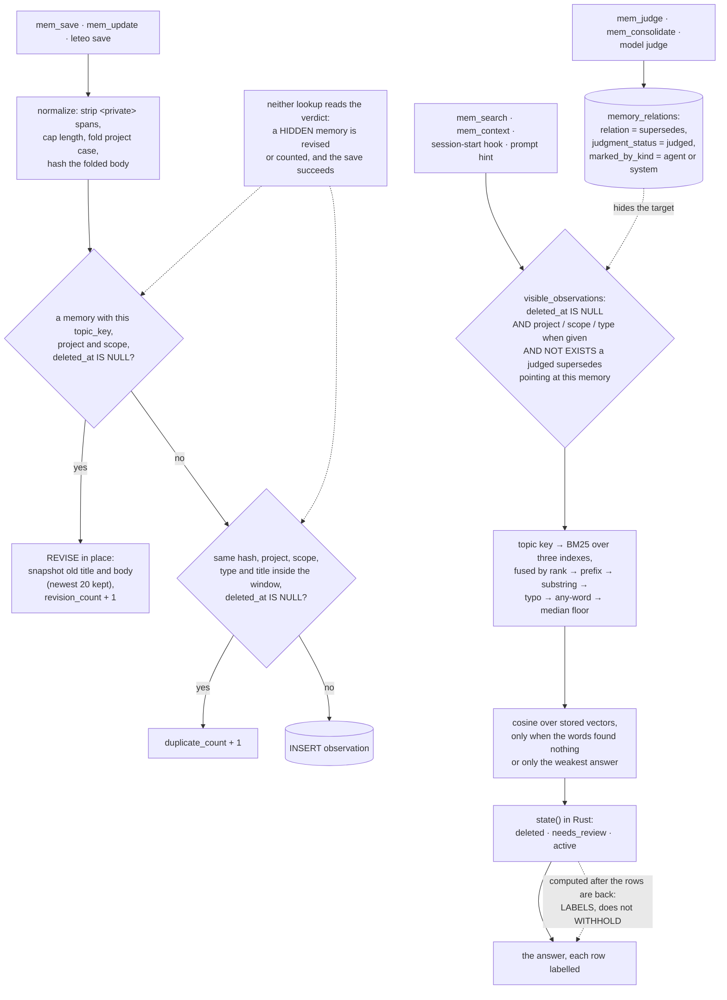

## 1. Executive Summary

Leteo is a local-first memory for coding agents — one Rust binary over one
SQLite file, reached through MCP, lifecycle hooks and a CLI — whose search is a
lexical cascade over three full-text indexes with a small static embedding model
behind it for questions the words cannot answer. Its distinguishing feature is
a codebase that writes down what each decision cost to find out, in numbers,
and a single visibility predicate that every retrieval stage reads. Its weakest
point is that the predicate governs reads only: the verdict that hides a
superseded memory from every listing is invisible to the save path, and the
review date that marks a memory stale labels it without withholding it.

**The commentary is the thing worth reading, and it leads.** Most codebases
record what a decision was. This one records the measurement and the bug behind
it. The function that reads two of the indexes together does not say "added an
exact index"; it says what each tokenizer can do and what the pair measured:

> "six words lifted straight out of a memory find it first 78% of the time here
> against 84% unstemmed."

Fused by the rank position each index gave a memory, the pair reaches 84.3% on
quoted words and 37.0% on re-inflected ones, against 78.0% and 37.3% from the
stemmed index alone. The semantic floor carries its cost in the same breath: at
a cosine of 0.30 it "keeps 43% of what can be rescued at 43% precision and
answers 24% of the controls", with the alternatives on either side measured.

**The recurring bug this project names is a rule written in more than one
place**, and the visibility predicate is its answer. `not_superseded` is "[t]he
hiding rule, written once and read by every door that lists memories", and the
comment on `visible_observations` records that the semantic stage "was the
first to be tempted to restate it". A memory a judged `supersedes` verdict
points at drops out of search, the opening context, the pinned list and the raw
listings together, and a test walks each of those doors.

**What the predicate does not reach is the write path.** `add_observation`
looks a memory up by topic key and by content hash with `deleted_at IS NULL`
alone, so a save keyed to a memory a verdict has hidden revises the hidden row,
and an identical re-save increments a hidden row's duplicate count. Both report
success. The hiding is reversible by design — changing the verdict restores the
source — but nothing on the write side knows a memory is hidden.

**Two marks land.** `negative_eval`, on tests that assert a replaced title, a
deleted memory, another project's identical copy and a superseded memory are
each absent from a populated store's answers. `audit_log`, on the optional cloud
server, which keeps every replicated upsert and delete in a sequenced table no
production statement updates or deletes. The local store has no such record: its
sync outbox is pruned a week after acknowledgement and its version table keeps
twenty bodies per memory. The project scope is filled from the working directory
for the agent's reads and is lifted by one argument or by an ambiguous
directory, so `scope_enforced` is withheld.

## 2. Mental Model

A memory is an observation an agent saved, and it is ground truth until
something says otherwise. Three things can say otherwise, and they differ in
whether they withhold.

- **Deletion withholds.** `deleted_at IS NULL` is in every listing.
- **A judged supersedes verdict withholds.** A relation row with
  `judgment_status = 'judged'` and `relation = 'supersedes'` hides its target
  from every listing through `not_superseded()`. A pending relation hides
  nothing, and re-judging the pair with another verb, or removing the row,
  restores the memory. Consolidation is this verdict applied to several sources
  at once.
- **A review date labels.** `state()` returns `needs_review` when
  `review_after` has passed, in Rust, after the rows are back from SQLite, so a
  stale decision is returned with a label beside it.

The state machine is short. A save inserts an `active` memory; a topic-key save
or an update revises it in place and snapshots the replaced text; a review date
passes and the row reads `needs_review` until an agent marks it reviewed; a
verdict hides it; a delete stamps it or removes it. Nothing expires —
`expires_at` sits in the schema with no writer and no reader.

## 3. Architecture

| Area | Role |
| --- | --- |
| `src/store/` | The SQLite layer: observations, prompts, sessions, relations, search, the semantic stage, wire and diagnostics, with `Narrowing`, the column lists and the version retention bound shared across them |
| `src/semantic/` | The static embedding model: file hashes compiled in, the width, the token cap, the cosine floor, and `leteo model install` |
| `src/memory/` | The model types, normalisation, the review windows, the refusal rules and the relation vocabulary |
| `src/mcp/` | Twenty-three tools, the agent and admin profiles, and the loopback HTTP API in `serve.rs` |
| `src/hooks/` | Session-start, prompt, compaction and subagent hooks, with a spool for learnings that arrive while the store is busy |
| `src/cli/` | Twenty-six commands, including `consolidate`, `conflicts`, `doctor`, `serve` and `model` |
| `src/sync/`, `src/cloud/` | The outbox, chunked transfer, autosync, and the feature-gated PostgreSQL cloud server with grants and a dashboard |
| `migrations/` | Four baseline files and five numbered ones, each carrying the argument for what it does |

### Deployment and ergonomics

One binary and one SQLite file under `~/.leteo`, with no network on the memory
path and no API key. The embedding model is three files beside the binary —
12.6 MB of int8 weights and a gzipped tokenizer — carried in release archives
and the Docker image and fetched by `leteo model install` otherwise; each file
must match a SHA-256 compiled into the binary or the semantic stage stays off
and search is lexical. Plugins for Claude Code, Codex, OpenCode, Pi and ZCode
register `leteo mcp --tools=agent` and the hooks. The cloud server is a separate
build behind the `cloud-server` feature and needs PostgreSQL. The store is
SQLite and readable with any client; `doctor --repair` rebuilds indexes and
backfills vectors.

## 4. Essential Implementation Paths

- `src/store/observations.rs:331-524` — `add_observation`: the refusal, the topic-key lookup at `:358-365`, the version snapshot, the hash lookup at `:459-464`, and the insert.
- `src/store/observations.rs:202-236` — `snapshot_observation_version_tx`, which inserts the replaced text and deletes everything past the newest twenty.
- `src/store/observations.rs:526-629` — `consolidate_observations`: one replacement, one judged `supersedes` per source, all in one transaction.
- `src/store/relations.rs:62-83` — `not_superseded`, the hiding rule.
- `src/store/search.rs:154-176` — `visible_observations`, the predicate every stage reads.
- `src/store/search.rs:417-638` — `search_limited`, the cascade from topic key to semantic stage.
- `src/store/search.rs:874-955` — `fused_observations`, the three-index rank fusion with its measurements.
- `src/store/semantic_stage.rs:92-146` — `semantic_candidates`, a cosine scan under the same predicate.
- `src/semantic/mod.rs:39-89` — model identity, file hashes, width, token cap and `FLOOR`.
- `src/memory/model.rs:108-123` — `state()`.
- `src/store/relations.rs:389-431`, `:758-804` — the judgement writes, with actor, kind and model.
- `src/mcp/tools.rs:8-18`, `:423-506` — `read_project` and `mem_search`, the working-directory default and `all_projects`.
- `src/mcp/serve.rs:34`, `:80-87`; `src/cli/mod.rs:959-963` — the loopback HTTP API and the tool list it exposes.
- `src/cloud/cloudstore/mod.rs:915-935`, `:764-800` — the cloud mutation log's writer and its latest-state read.
- `src/store/wire.rs:682-703` — the local journal prune.

## 5. Memory Data Model

An observation carries `type`, `title`, `content`, `tool_name`, `project`,
`scope` (defaulting to `project`, with `personal` beside it), `topic_key`,
`normalized_hash`, `revision_count`, `duplicate_count`, `last_seen_at`,
`pinned`, `review_after`, `expires_at`, `prompt_sync_id`, `created_at`,
`updated_at` and `deleted_at`. The `embedding*` columns inherited from Engram,
the project Leteo reimplements, are written by nothing; vectors live in
`observation_vectors`, keyed by the local id, with the model name and a source
key built from the content hash and title, so a changed memory is found stale in
SQL without reading its text. They are derived, local and never replicated.

`observation_versions` holds the title and body a content-changing write
replaced, keyed by the memory's `sync_id` and revision, replicated, and cut to
the newest twenty per memory on every insert. `mem_get_observation` with
`include_history` returns them.

`type` is a write-time genre and the input to the review clock:
`REVIEW_WINDOWS` gives `decision` six months, `policy` twelve and `preference`
three, counted in calendar months on the stated ground that a decision "is good
for six months, not for a hundred and eighty days".

A relation row carries a verb, a reason, evidence, a confidence, a
`judgment_status` of `pending`, `judged` or `orphaned`, and `marked_by_actor`,
`marked_by_kind` and `marked_by_model`. Every timestamp is a record time; there
is no validity interval and no as-of read, so `bitemporal` is withheld.

## 6. Retrieval Mechanics

`search_limited` runs a cascade in which each stage fires only when everything
before it came back empty. A query shaped like a topic key is looked up exactly.
Then the strict pass: BM25 over the Porter, unstemmed and Snowball indexes,
fused by `1 / (k + rank)` rather than by score, with body text weighted half a
title word on a measurement over 253 real prompts. Then prefixes, then
substrings, then a typo correction that must place every unknown word or none,
then any of the words, then the median-relative floor the per-prompt hint uses.
Every relaxed result is marked `partial`.

The semantic stage is last. It embeds the question as a mean of int8 token
vectors, scans every stored vector under the shared predicate, and answers an
empty result only above a cosine of 0.30, or merges its best candidate by rank
beside a `nearest` answer, which is the weakest lexical claim the cascade makes.
It is on unless a setting turns it off.

Every stage reads `visible_observations`: not deleted, inside the type, project
and scope the caller gave, and not the target of a judged `supersedes`. The
clauses are `(?n IS NULL OR …)`, so an omitted value narrows nothing — the
test `a_blank_narrowing_narrows_nothing` pins *"an empty scope is not a scope
filter"*. `Narrowing`, which the context listings use, writes a clause when
there is a value and nothing when there is not, for a plan reason measured at
5.7 ms against 0.015 ms.

At the agent's surface the project is rarely omitted. `mem_search` and
`mem_context` fill it from `read_project` — a process override, then a
`.leteo/config.json`, the git remote, the git root or the directory name — and
the session-start hook and the prompt hint always pass one. Three things widen
it: the caller names another project, the caller sets `all_projects`, or
detection is ambiguous because the directory holds several repositories, in
which case the fallback is empty and the read covers every project, labelled
`all_projects`. Writes in the same ambiguous directory refuse. When a
project-narrowed search finds nothing, a second, unscoped search counts the
matches elsewhere and reports the count alone.

## 7. Write Mechanics

A save normalises first: `<private>` spans are stripped by regex, the body is
capped, the project is case-folded and reduced from a path to its last segment,
and a title-less or empty memory is refused. Then three outcomes: a revision
in place for a matching topic key, project and scope, with the replaced text
snapshotted when it changed; a duplicate count on a matching hash, project,
scope, type and title inside a configurable window; or an insert. Both lookups
read `deleted_at IS NULL` and not `not_superseded()`.

After the commit, `embed_written` computes the vector, loading the model on the
first write in a process; a failure leaves the memory saved and the backfill
thread catches it up. Saving blocks on no model call. Consolidation is
synchronous and transactional: every source is read and checked for project
before the first write.

### Operational cost

The write path is a SQLite transaction and a mean over at most 128 tokens. The
read path is a handful of FTS5 queries and, when it fires, a linear scan of one
kilobyte per memory. The opening context is bounded by a size setting, and the
pinned list is held to the same ceiling after a 47 KB opening was measured.

## 8. Agent Integration

Twenty-three MCP tools. The agent profile the plugins install holds twenty —
save, update, review, consolidate, search, get, context, pin, judge, compare,
timeline, session tools, passive capture and doctor among them — and
`mem_delete`, `mem_merge_projects` and `mem_stats` sit behind `admin`.
`leteo serve` exposes the same handlers over HTTP on `127.0.0.1:7437` with
`McpOptions::default()`, so every tool including `mem_delete` is reachable by
any local process without a token.

Hooks open each session with an index of the project's recent and pinned
memories, recover after compaction, name memories relevant to each prompt, and
keep a subagent's learnings, spooling them when another process holds the write
lock. `mem_review` lists due memories and marks one reviewed; `mem_judge`
records a verdict on a pair. Both are on the agent's own surface.

## 9. Reliability, Safety, and Trust

**Trust state — withheld.** `needs_review` is computed per row after the query
and filters nothing. The supersedes verdict does withhold, through a predicate
every listing shares — and the state it expresses is *replaced*, not
*disbelieved*: it is a relation between two memories, set when one overtakes
another, and no verdict withholds a memory for being wrong on its own. The
mark is withheld on that shape.

**Scope enforced — withheld, on a read that fails open.** The project reaches
the agent's search by default, from the working directory rather than from the
model. It is dropped by one argument the agent holds, `all_projects`, and by an
ambiguous directory, where reads cover every project while writes refuse. The
mark needs the predicate on the read path whatever the caller passes or fails
to resolve. The cloud server's pull feed and dashboard filter by per-principal
project grants held on the server; the agent never retrieves from it.

**Audit log — earned, on the cloud server only.** `cloud_mutations` records
every pushed upsert and delete with its full payload under a sequence number,
and the server's reads derive current state from it. Locally, `sync_mutations`
is an outbox pruned seven days after acknowledgement — "an unpruned journal
roughly doubles the size of the database" — and `observation_versions` keeps
twenty replaced bodies per memory without recording who replaced them or why.
A user without a cloud server has no mutation record.

**Human review — withheld.** `marked_by_kind` has three writers: `mem_judge`
and the recall path write `agent`, and `judge_relation_tx`, which consolidation
uses, writes `system` with actor `leteo`. A person running `leteo consolidate`
is recorded as `system`. The CLI lists, shows and scans conflicts, and its
scan can hand pairs to a model judge; no verb lets a person settle one.

**Tombstone — withheld.** A deleted memory is excluded from both save lookups,
so the same content can be written back unnoticed. `prompt_deletions` is
consulted before a replicated prompt is accepted and drops a copy not newer than
the deletion — keyed on the prompt's `sync_id`, so it settles a race between
replicas rather than remembering a rejected claim.

**Negative evaluation — earned.** See section 10.

**What is defended well** is the content: `<private>` spans are stripped before
storage, and tests assert the secret is absent from the stored body, a summary
and the replicated copy. The embedding model is verified by hash before it is
loaded.

## 10. Tests, Evals, and Benchmarks

1,077 test attributes, 22 ignored and run in CI against a PostgreSQL service
container. The negative cases sit across several suites.
`the_full_text_triggers_follow_every_write` asserts that after an update a
search for the replaced title returns nothing while the new title returns one,
and that a hard-deleted memory is not found.
`a_project_whose_name_the_tokenizer_splits_still_finds_its_memories` saves one
memory into three projects and asserts a narrowed search returns exactly the one
in its own project. `a_consolidation_hides_its_sources_and_a_reversal_restores_them`
asserts a superseded memory is absent from search, the context's recent and
pinned lists and the raw listing while the replacement and an unrelated pin are
present, then reverses the verdict and removes a relation and asserts each source
returns; `an_unjudged_supersedes_relation_hides_nothing` is its control, and
`a_superseded_memory_is_left_out_of_search_results` repeats it through the MCP
tool. On the cloud server, `browsing_reads_the_current_state_of_one_project_at_a_time`
asserts a replaced title, a deleted memory, a soft-deleted one and another
project's memory are each absent.

A seeded invariant sweep mixes verdicts with topic-key saves and checks that
each key has one live memory; no test asserts what a save into a superseded
memory should do. The retrieval
figures quoted in comments come from a Python harness under `tools/memory-bench`
that drives the built binary; I did not run it, and no figure here is mine.

## 11. For Your Own Build

### Steal

- **Put the measurement in the comment.** A tokenizer with its survival rates,
  a clause shape with its milliseconds, a floor with its false-answer rate on
  controls. Each is a decision a reader can check rather than accept.
- **One visibility predicate, interpolated everywhere.** Write the hiding rule
  once and make every stage — including the one that reads vectors instead of
  an index — call it, then test each door it is meant to close.
- **Hide by relation, reverse by verdict.** Consolidation that records a
  judged supersedes per source loses nothing and is undone by changing one row.
- **Calibrate a semantic floor on held-out answers and report the controls.**
  "Answers 24% of the controls" is the number that tells you what the stage
  costs.

### Avoid

- **A hiding rule the write path does not read.** If a verdict withholds a
  memory from reads, the save that matches it by key or hash has to see the
  same verdict, or a revision lands somewhere nobody will find it.
- **A read that widens when it cannot resolve its scope.** Refuse, as the write
  beside it does.
- **A provenance column whose writers are all machines.** A `marked_by_kind`
  that stamps a person's CLI action `system` answers nothing about review.
- **An HTTP surface broader than the agent's.** A loopback API with every tool
  and no token gives any local process the admin profile.

### Fit

A single developer who wants a fast, local, inspectable memory across several
agent clients, and who reads code, is well served. A team that needs to know
who changed a memory, or that a project boundary holds in a workspace of many
repositories, needs the cloud server and more besides.

## 12. Open Questions

- Should the save lookups read `not_superseded()`? A topic-key save into a
  hidden memory could revise it, open a new row, or refuse; which one the
  project intends is not written down.
- Is the unscoped read in an ambiguous directory deliberate? Writes refuse
  there with a recovery token; reads widen and label the answer.
- Will a person ever be a judge? The schema records the kind of actor, and no
  path records a person.
- What is `expires_at` for? It has no writer and no reader.

## Appendix: File Index

| Path | What lives there |
| --- | --- |
| `src/store/mod.rs` | `Narrowing`, the column lists, `BM25_WEIGHTS` and the version retention bound |
| `src/store/search.rs` | `visible_observations`, the cascade, the three-index fusion |
| `src/store/semantic_stage.rs` | Vector freshness, the cosine scan and the merge |
| `src/semantic/mod.rs` | The model's identity, hashes, width and floor |
| `src/store/observations.rs` | The save path, version snapshots, consolidation, listings |
| `src/store/relations.rs` | `not_superseded`, judgement writes, the conflicts listing |
| `src/store/wire.rs` | The sync apply path, the prompt tombstone and the journal prune |
| `src/memory/model.rs` | `Observation` and `state()` |
| `src/mcp/tools.rs`, `src/mcp/mod.rs`, `src/mcp/serve.rs` | The tools, the profiles, the HTTP API |
| `src/cloud/cloudstore/mod.rs` | The append-only mutation log and its reads |
| `migrations/0019_observation_versions.sql` – `0022_stems_keep_their_language.sql` | Versions, vectors and Snowball stems, each with its argument |
| `src/store/tests/search.rs`, `src/store/tests/consolidate.rs` | The negative cases |

### Recorded searches

Run at the tree root of the pinned checkout with `git grep`.

- `git grep -nE "marked_by_kind: \"|marked_by_kind = '" -- 'src/*.rs' ':!*tests*'` — `src/mcp/tools.rs:1172` and `src/recall.rs:939` write `agent`; `src/store/relations.rs:783` writes `system`.
- `git grep -nE 'valid_from|valid_to|as_of' -- 'src/*.rs'` — no match.
- `git grep -nE 'expires_at' -- src migrations ':!*tests*'` — the column in `migrations/0001_baseline_tables.sql:37` and the schema list at `src/store/schema.rs:861`; the remaining hits are cloud session tokens and MCP recovery tokens.
- `git grep -nE 'not_superseded\(\)' -- 'src/*.rs'` — the definition and eight call sites, all listings; none in `add_observation`.
- `git grep -nE 'review_after|needs_review' -- 'src/*.rs' ':!*tests*'` — writers, the Engram import and the `REVIEW_DUE` listing; no retrieval predicate.
- `git grep -nE 'DELETE FROM sync_mutations' -- 'src/*.rs'` — the retention prune at `src/store/wire.rs:698` and two removals of a project's unacknowledged rows in `src/store/projects.rs`.
- `git grep -nE 'DELETE FROM cloud_|UPDATE cloud_mutations' -- src ':!*tests*'` — `src/cloud/cloudstore/mod.rs:524`, project grants only.
- Test functions under `src/store/tests/`, `src/mcp/tests.rs`, `src/hooks/tests.rs` and `tests/` whose body holds both a supersedes verdict or `consolidate_observations` and a topic-key save, found with an `awk` pass over each file split at `#[test]` — four: the seeded sweep `no_order_of_operations_leaves_the_store_disagreeing_with_itself`, a replication test, `a_topic_key_lookup_does_not_hand_back_a_superseded_memory` (a read) and a hook test; none asserts the outcome of the save.
- `git grep -niE 'anthropic|machine learning|not (be )?used (for|to)' -- LICENSE LICENSES NOTICE` — no match; no rider.

## History

**2026-10-12** — [`78bc1738b7b73a5ec7e0e03c561ff4986214e12a`](https://github.com/asanabrial/leteo/commit/78bc1738b7b73a5ec7e0e03c561ff4986214e12a) — 246 commits on, version 0.2.1 to 0.3.0. Overtaken: a static-embedding stage, a third index, version history, and judged supersedes verdicts that hide their targets ([section 2](#2-mental-model)). Two marks gained, both earned at the first pin: `negative_eval`, on a trigger test and a cross-project test present then ([section 10](#10-tests-evals-and-benchmarks)), and `audit_log`, on the cloud server's append-only log ([section 9](#9-reliability-safety-and-trust)). Also wrong then: the agent's reads default the project rather than omit it, and CI provided the PostgreSQL the ignored tests need. Screened from a full clone: twenty files, two auto-run surfaces, one new build-time `build.rs`, five dependency files inside the cooldown, `AGENTS.md` and `CLAUDE.md` read as data. Nothing was installed, built or run.

**2026-09-16** — [`f49917e4b9ffdf842e8f656a82867098487f789a`](https://github.com/asanabrial/leteo/commit/f49917e4b9ffdf842e8f656a82867098487f789a) — first reading, at a commit dated 13 September 2026. Screened before opening, from a shallow clone: thirteen files scanned, two auto-run surfaces, no build-time execution point and no unpinned dependency surface, with seven dependency files inside the seven-day cooldown and `Cargo.lock` present. `AGENTS.md` and `CLAUDE.md` are addressed to a reading agent and were recorded as data. Nothing was installed, built or run, and no benchmark was reproduced — the retrieval figures quoted are the project's own, from the migration comments that publish them.
