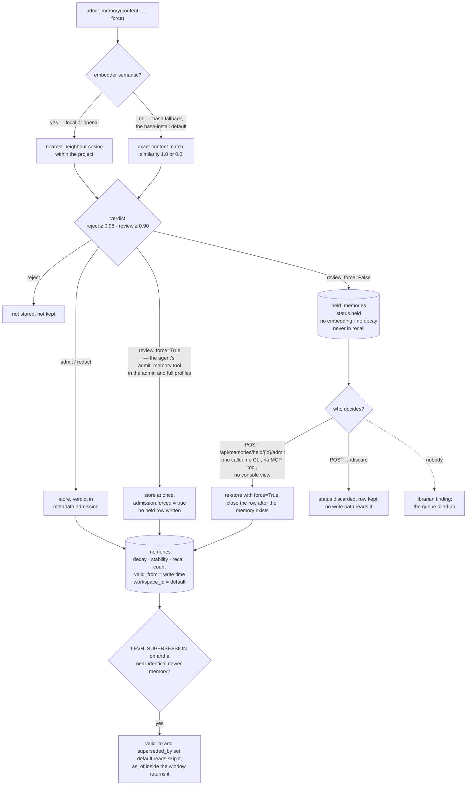

## 1. Executive Summary

LEVH is a local-first memory layer for MCP agents in which every memory decays
unless something reinforces it, and whose admission gate separates rejecting a
candidate from declining to judge it. The second verdict has a table behind it,
`held_memories`, and a held candidate stays out of recall until a person admits
or discards it. The weakness is at both ends of that queue. The agent's own
`admit_memory` tool takes `force=True` and stores what the gate would hold. And
in the documented base install, the gate cannot return the verdict that fills the
queue.

**A refusal to store and a refusal to judge are different things.** The gate
returns one of four verdicts — admit, redact, review, reject — and the docstring
insists the last two not share a path:

> "``review`` and ``reject`` are not the same refusal and must not share a path.
> ``reject`` is the gate deciding — too short, or a near-exact duplicate of
> something already remembered, so nothing is lost by dropping it. ``review`` is
> the gate declining to decide: the candidate is close to an existing memory but
> not identical, which is exactly the case where the difference may be the part
> worth keeping. Discarding it would throw away content on the strength of a
> judgement the gate itself refused to make."

The schema comment on the table says what happened before it existed: "Without
it the verdict had no store behind it and the content was dropped, which is the
one thing a memory layer must not do quietly." A held candidate has no
embedding, no H-score and no decay. The decision path keeps the promise.
`admit_held_memory` re-stores with `force=True` because "[t]he decision being
recorded here is the human's, and it overrides the gate by design". The row
closes only after the memory exists, since "losing it here would reintroduce
exactly the bug this table was added to fix". A discard leaves the row standing,
and the transition is a compare-and-set that answers `already_decided` to a
second caller (`server/core/engine/ingest.py:216-272`,
`server/core/db/held.py:85-104`).

**The agent can skip the queue it would be waiting in.** The MCP tool
`admit_memory` takes `force: bool`, documented as "Store even if the gate would
reject/hold it", and passes it to the same engine call
(`server/tools/admission.py:37-74`). With `force=True` a review verdict is
stored at once, flagged `forced`, and no held row is ever written
(`ingest.py:115-145`). The tool is tiered `admin` (`server/tools/profiles.py:104`).
The stdio and SSE servers advertise the `full` profile when `LEVH_MCP_PROFILE`
is unset (`server/mcp_stdio.py:147`, `server/mcp_sse.py:65`). The profiles
module states that a profile is "a tool-discovery filter, NOT a security
boundary" (`profiles.py:18`). The quick start's generated client config selects
`work`, which leaves the tool out; that is a client setting, and the server's own
default carries the verb. The not-stored message from `store_memory` points at
it: "Use the admin admit_memory tool with force=true only when an audited
override is intended" (`server/tools/store.py:62`).

**In the documented install the queue cannot fill.** The duplicate probe runs
on vectors only when the embedder is semantic (`ingest.py:51`). The default
embedder resolves to a local sentence-transformers model and falls back to
hashing when the library is absent (`server/core/embedder.py:37-105`). The
library ships in the `local` extra, which the README's `pip install levh` and
the Dockerfile's `pip install --no-cache-dir .` both omit. Under the fallback
the probe is an exact-content match returning similarity 1.0 or 0.0
(`ingest.py:64-68`), against thresholds of 0.98 to reject and 0.90 to review
(`server/core/admission.py:86-87`). A duplicate is rejected and anything else is
admitted; nothing is held. The comment above the branch states the reason in the
project's own terms: under hashing, distinct facts "would be held for review,
i.e. lost, which is the one failure the gate exists to prevent". The held-queue
suite reaches the review path by stubbing `evaluate_admission`
(`tests/test_admission_held_queue.py:78-82`).

**When it fills, nothing shipped drains it.** `admit_held_memory` and
`discard_held_memory` each have one caller, an HTTP route
(`server/routes/memories.py:154-177`). No CLI command, MCP tool or console
component calls them. The console reports held counts on its connector and
federation panels, capture prints "Held for review: N", and the librarian
raises a finding when the backlog crosses a threshold. The generated TypeScript
SDK carries the three endpoints as descriptors and no client code around them.

One mark, `negative_eval`, on two committed recall assertions with their
controls: a retired fact and another workspace's memory stay out of a populated
result. `human_review` is withheld on the `force` flag above. Scope, validity,
trust state, audit and tombstone are each withheld for reasons stated in
sections 5 and 6.

## 2. Mental Model

A **memory** decays unless something reinforces it.

A **verdict** is one of four, and two of them mean "no" for different reasons.

A **held candidate** is content nobody has judged yet. It is not a memory and it
is not gone. The producing agent can bypass the hold by asking again with
`force=True`.

A **retired memory** has a closed validity window. Default reads skip it, and an
`as_of` read inside the window returns it. Retirement runs only when
`LEVH_SUPERSESSION` is set.

A **finding** is a report. Nothing acts on it by itself.

## 3. Architecture

| Area | Role |
| --- | --- |
| `core/engine/ingest.py` | The gate's probe, the four verdicts, the hold queue, admit and discard |
| `core/admission.py` | The deterministic verdict function and its thresholds |
| `core/embedder.py` | Local, OpenAI or hash embedding, and the `is_semantic` switch the gate reads |
| `core/engine/recall.py` | Workspace and validity filters before ranking, `as_of` reads |
| `core/engine/write.py` | Store, update through the gate, interference and opt-in retirement |
| `core/engine/decay.py` | Decay, reinforcement, SM-2 feedback, the review queue |
| `core/hscore.py` | H(x,ψ) = α·(1−similarity) + β·(1−decay) + γ·(1−importance) + δ·(1−frequency) |
| `core/tenancy.py` | Principal, workspace and role, bound per request through a context variable |
| `core/db/schema.py` | One file holding every table and its reasoning |
| `core/librarian/` | Watches, and writes findings it cannot act on |
| `core/team_memory.py` | Handoffs and a decision ledger with a contested state |
| `tools/`, `tools/profiles.py` | The MCP tool surface and the four profiles that filter it |
| `routes/` | The HTTP API, including the only callers of the held-queue decisions |
| `connectors/`, `core/federation.py` | Source connectors and signed peer exchange, all routed through the gate |

### Deployment and ergonomics

One SQLite file, opened by every MCP client process on the machine. The quick
start is `pip install levh`, `levh setup --profile work` and `levh serve`, which
brings up the API and the console on one port. Semantic embedding needs the
`local` extra, which pulls in sentence-transformers and torch. Without it,
recall ranks on word overlap and the gate detects exact duplicates only.

## 4. Essential Implementation Paths

`server/core/engine/ingest.py:23-69` — the probe, with the comment on why the
hash fallback narrows it.

`server/core/engine/ingest.py:74-162` — the four verdicts and where each goes,
including the `force` branch.

`server/core/engine/ingest.py:216-272` — admit and discard, and the ordering
comment that explains why the row closes last.

`server/tools/admission.py:37-74` and `server/tools/profiles.py:18-23`, `:104` —
the agent-facing tool that carries `force`, and the profile that does and does
not hide it.

`server/core/db/schema.py:184-238` — the held queue and the findings table, each
with a comment stating what it refuses to do.

## 5. Memory Data Model

One `memories` table with a decay factor, a stability in hours and a recall count
beside the usual fields, plus `pinned` as an exemption. Two later column groups
sit on it.

**A validity window.** `valid_from`, `valid_to` and `superseded_by`, described in
the schema as *world* time against `created_at` as *system* time
(`schema.py:61-70`). Its one writer sets `valid_from` to `created_at`
(`server/core/engine/write.py:172`), and a pre-existing row is backfilled the same
way (`server/core/database.py:147`). `valid_to` is the wall-clock instant of the
supersession that retired the row (`write.py:263-276`). Both edges are record
times, so `bitemporal` is withheld: no path records that a fact became true
before LEVH stored it.

**A workspace id.** Stamped by the store from the bound principal rather than
taken from the payload, a property a test asserts
(`tests/test_workspace_tenancy.py:396-417`). Around both: `entities` and
`memory_entities`, and `memory_conflict_candidates` labelled a "review signal,
never a verdict". `attachments` flip to `missing` or `changed` on a failed hash
check. `memory_trust_scores` is a "deterministic reliability signal, NOT truth",
and `violations` records which learned rule was broken.

`held_memories` carries `status` `held|admitted|discarded` (`schema.py:194-212`).
A discarded row is kept and never read again by any write path, so it is a
decision record and not a value-keyed tombstone.

`team_decisions` carries `active|contested|superseded` with a resolver that
needs the `configure` action (`server/core/team_memory.py:648-702`). The one
reader that serves it to agents lists contested decisions beside active ones and
counts them (`server/core/agent_tracker.py:163-181`). The state labels rather than
withholds, and this ledger is separate from `memories`. The validity window
withholds but is an interval rather than a status field, and is off by default.
`trust_state` is withheld on both.

## 6. Retrieval Mechanics

Vector similarity under a semantic embedder, word overlap under the hash
fallback, then H(x,ψ) ranking. Filters run before ranking, so a filtered recall
returns a full set rather than the survivors of a truncation.

**The validity filter keeps retired rows out of every default read.**
`_valid_at` passes only rows with `valid_to` null unless the caller asks for an
`as_of` instant, which admits a row whose window contains it, or for
`include_superseded` (`server/core/engine/recall.py:240-261`). The cost is that
retirement is opt-in: with `LEVH_SUPERSESSION` unset no row is ever retired, and
a replaced fact is weakened rather than hidden (`write.py:44-61`).

**The workspace predicate is mandatory and single-valued.** Recall drops any
candidate whose `workspace_id` differs from the bound one (`recall.py:270`), and
the storage queries carry the same clause. The only principal any transport binds
is the local one, `workspace_id="default"` with role `admin`: the HTTP middleware
binds it for every request (`server/middleware.py:244-249`), and the MCP
transports run on the context variable's default (`server/core/tenancy.py:86-91`).
The two other binders re-bind a row's own workspace inside maintenance passes.
Every row and every read therefore carries `default`. `scope_enforced` is
withheld because the boundary has one side, and the module calls itself "Phase 1".
The second scope key, `project`, is an optional argument to `recall` with a `None`
default.

## 7. Write Mechanics

The gate, then a store that records the verdict in `metadata.admission`. The
record includes `forced`, set when a review or reject was overridden by the
agent's tool or by a person's admit. The flag makes the two indistinguishable
after the fact.

Updates run through the gate for content safety only. A duplicate verdict on an
edit is recorded and does not block, and `use_gate=False` is "the audited
administrative override, mirroring ``admit_memory(force=True)``"
(`write.py:318-389`). No prior content is kept.

Feedback is SM-2 shaped with one asymmetry worth copying: `helpful=False` weakens
stability without resetting the decay clock (`server/core/engine/decay.py:36-60`).
A test pins the matching invariant — "negative feedback is not a successful
recall" (`tests/test_v2_features.py:279`).

## 8. Agent Integration

MCP over stdio and SSE, with four cumulative profiles — minimal, work, admin,
full — that decide which tools are advertised. The generated client config
selects `work`, which carries capture, recall, briefing, trust and conflict reads
and an advisory `check_action`. `admin` adds update, forget, feedback, import,
export, backup, `evaluate_admission` and `admit_memory`. `full` adds the
connectors. A server started without `LEVH_MCP_PROFILE` advertises `full`.

The HTTP API mirrors the tools and adds the held-queue routes. Every request runs
as the local admin principal, and an optional `X-LEVH-Token` guards the API as a
whole. Signed federation pulls a peer's envelope, verifies it, and imports it
through the same gate. The concurrency claim — many agent processes, one SQLite
file — has a test asserting no own-write vanishes from recall under concurrent
external sync (`tests/test_cross_process_coherence_concurrency.py:32-61`).

## 9. Reliability, Safety, and Trust

Secrets are redacted at the gate rather than after storage, on create, on
update and before the text reaches the embedder. Attachments are verified by
hash, and a mismatch raises a conflict candidate. Findings are fingerprinted so
one recurring problem is one row with a rising count, and the schema states the
boundary: "Nothing in this table reaches the outside world (a GitHub issue, say)
without an explicit human step."

`check_action` matches a proposed action against recorded mistakes and returns
an advisory verdict. Its module states that `block` "is never returned here", so
enforcement stays with the caller (`server/core/action_gate.py:22-25`).

The roles in `tenancy.py` give `admit` to editors and admins alike
(`tenancy.py:35-63`), so the role check cannot separate the agent that writes
from the person who decides. A viewer can neither admit nor discard, which a test
asserts (`tests/test_admission_held_queue.py:226-259`). No transport binds a
viewer.

The librarian's held-queue count reads the table without the workspace clause
(`server/core/librarian/activity.py:70-72`). With one workspace this changes
nothing.

## 10. Tests, Evals, and Benchmarks

The held-queue suite reads as a specification: a review verdict holds the content
instead of dropping it, a held candidate is not a memory, a rejected candidate is
dropped, admitting reproduces the original memory, a candidate is decided once,
and the routes answer 409 and 404 on a decided or missing id. Every case reaches
the review path through a stub of `evaluate_admission`
(`tests/test_admission_held_queue.py:78-82`). No case exercises the gate's own
similarity under either embedder. No case asserts anything about `force=True`
from the tool surface.

The mark rests on two read-path assertions with their controls. The supersession
suite asserts a retired fact is absent from default recall while its replacement
is present, then that an `as_of` read and an `include_superseded` read return it
(`tests/test_superseded_demotion.py:89-132`). It also asserts retirement is off
by default (`:270`). The tenancy suite asserts another workspace's memory is
absent from a default recall and present when that workspace is bound
(`tests/test_workspace_tenancy.py:260-273`). `test_a_held_candidate_is_not_a_memory`
asserts an empty recall with its control in the next test, and is not counted.
I ran none of the suites.

## 11. For Your Own Build

### Steal

Separate the two refusals. "I decided no" and "I will not decide" are different
answers and deserve different destinations.

Close the row after the write, not before. The two-line comment explaining that
ordering is worth more than the code it guards.

Retire, do not delete, and test both directions: the replaced fact absent from
the default read, present at an instant inside its window.

Weaken without resetting. Negative feedback that touches the decay clock rewards
a memory for being wrong.

### Avoid

An override flag on the producer's own write tool. If `force` must exist, put it
on a surface the agent does not hold, or make it create the held row and refuse.

A verdict whose producer depends on an optional extra. A gate that cannot say
"review" in the default install makes the queue behind it dead code there.

A queue with no drain. A watcher that reports the backlog is not a substitute for
a list view and two buttons.

Calling write time world time. A `valid_from` with one producer, the write clock,
cannot answer "when was this true".

### Fit

This suits one person running several agents against one local store, who wants
forgetting and is content to curate by hand. Walk away if a person must approve
what an agent remembers, if two people or teams must not see each other's
memories, or if the store must say when a fact became true rather than when it
was written.

## 12. Open Questions

Whether the `force` flag on `admit_memory` is meant for the agent. The not-stored
message from `store_memory` addresses it to the reader of the tool result, and
the profile tiering suggests it is meant for an operator session.

Whether the held queue is meant to work in the base install. The comment on the
hash branch treats a hold as a loss, which suggests the narrowing was chosen
knowing it disables the verdict.

Which client was expected to list the queue. The routes, the counts, the SDK
descriptors and the librarian finding all assume one exists.

Whether a held candidate expires. Nothing ages the queue out.

## Appendix: File Index

| Path | What to read it for |
| --- | --- |
| `server/core/engine/ingest.py:23-69` | The probe, and why hashing narrows it to exact match |
| `server/core/engine/ingest.py:74-162` | Four verdicts, and the `force` branch that skips the hold |
| `server/core/engine/ingest.py:216-272` | The human decision, and the ordering that protects it |
| `server/core/db/held.py:85-104` | The workspace-scoped compare-and-set |
| `server/tools/admission.py:37-74` | The agent-facing `admit_memory` and its `force` |
| `server/tools/profiles.py:18-23`, `:104` | Profiles as discovery filters, and the tool's tier |
| `server/mcp_stdio.py:141-148` | The server's default profile |
| `server/core/embedder.py:37-105` | The fallback to hashing and `is_semantic` |
| `server/core/db/schema.py:61-76`, `:184-238` | Validity and workspace columns; the held queue and findings |
| `server/core/engine/recall.py:240-270` | Validity and workspace filters before ranking |
| `server/core/engine/write.py:44-61`, `:172`, `:195-276` | Retirement flag, `valid_from`, the supersession pass |
| `server/core/tenancy.py:35-91`, `server/middleware.py:244-249` | Roles, the local principal, and its one binding |
| `tests/test_superseded_demotion.py:89-132`, `:270` | Retirement asserted both ways, and off by default |
| `tests/test_workspace_tenancy.py:260-273` | The cross-workspace recall assertion |
| `tests/test_admission_held_queue.py:78-259` | The held-queue specification, through a stubbed gate |

### Recorded searches

Run at the tree root of the pinned checkout with `git grep -n -E`.

- `git grep -n -E 'admit_held_memory|discard_held_memory' -- server ':!server/dashboard'` — the two engine methods and one route each in `server/routes/memories.py`; no CLI, no tool.
- `git grep -n -E 'memories/held' -- frontend/src server/commands server/cli_parsers.py server/tools` — one hit, the hint string in `server/tools/store.py:54`.
- `git grep -n -E 'force: bool' -- server/tools` — `server/tools/admission.py:43` only.
- `git grep -n -E '"admit_memory": ' -- server/tools/profiles.py` — `:104`, tier `admin`.
- `git grep -n -E 'LEVH_MCP_PROFILE", "full"' -- server` — `server/mcp_sse.py:65` and `server/mcp_stdio.py:147`.
- `git grep -n -E 'bind_principal\(' -- server ':!server/core/tenancy.py'` — `server/middleware.py:249` binding `LOCAL_PRINCIPAL`, and two maintenance passes re-binding a row's own workspace.
- `git grep -n -E "status ?= ?'discarded'|\"discarded\"" -- server ':!server/dashboard'` — the one writer at `ingest.py:268`; no reader.
- `git grep -n -E 'valid_from = ' -- server` — `write.py:172` from `created_at`, and the backfill at `database.py:147`, also from `created_at`.
- `git grep -n -E 'sentence-transformers' -- pyproject.toml Dockerfile` — the `local` extra only.
- `git grep -n -i -E 'CREATE TABLE IF NOT EXISTS [a-z_]*(audit|event|history|mutation)' -- server` — no match; no mutation log.
- `git grep -n -i -E 'arxiv|bibtex|@article|@misc|doi\.org' -- README.md docs` — no match; no paper.
- `git grep -n -i -E 'anthropic|machine learning|not (be )?used (for|to)' -- LICENSE` — no match; the AGPL text carries no rider.

## History

**2026-10-12** — [`95dec5b41957347c07cfc6ab0abe14065ec438b5`](https://github.com/ali-ulu/levh/commit/95dec5b41957347c07cfc6ab0abe14065ec438b5) — 203 commits on, version 2.31.0 to 2.34.0. `human_review` withdrawn, wrong at the old pin: the agent's `admit_memory` tool carried `force` there too, advertised under the server's default profile ([section 1](#1-executive-summary)). `negative_eval` gained on new supersession and tenancy suites ([section 10](#10-tests-evals-and-benchmarks)). Overtaken: under the hash fallback the gate cannot return review, so the base install never fills the queue; a validity window and a single-valued workspace boundary were added ([section 6](#6-retrieval-mechanics)). The census had described the first-reading pin. Screened from a full clone: ten files, no auto-run surfaces, `tests/conftest.py` as build-time execution, one unpinned surface, five dependency files inside the cooldown, `AGENTS.md` read as data. Nothing was installed, built or run.

**2026-09-19** — re-pinned to [`9bdcb25f52387814f389c7cf816959b297d74d59`](https://github.com/ali-ulu/levh/commit/9bdcb25f52387814f389c7cf816959b297d74d59), 13 commits on. The mark stands. Its anchors were re-resolved — the `held_memories` table and the comment block that states its invariant now run `schema.py:168-195`, and `admit_held_memory` and `discard_held_memory` are at `ingest.py:196` and `:238` — and the record gained the half of the producer test it was missing. The previous version established that each has exactly one caller, an HTTP route; what it did not check is whether the agent reaches that surface. It does not: `server/mcp_stdio.py` contains neither `admit` nor `held`, so the stdio tools the agent is given carry no verb that resolves a held candidate. The compare-and-set in `held.py:77` is unchanged. Screened again first; nothing was installed and no suite was run.

**2026-09-16** — [`6802ac81397abdf596cf8392b54dee461ec54226`](https://github.com/ali-ulu/levh/commit/6802ac81397abdf596cf8392b54dee461ec54226) — first reading, at a commit dated 16 September 2026. Screened before opening, from a shallow clone: six files scanned, no auto-run surfaces, one build-time execution point, two unpinned surfaces and three dependency files inside the seven-day cooldown. Nothing was installed, built or run.
