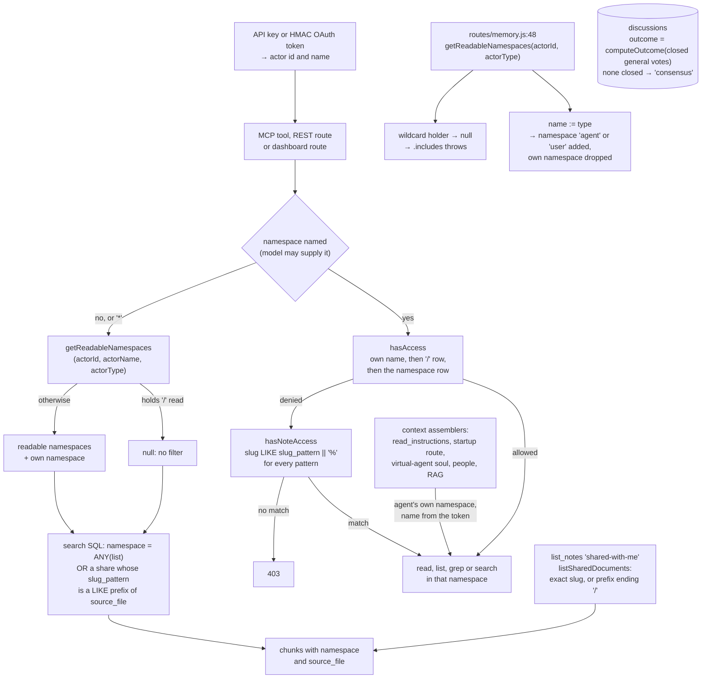

## 1. Executive Summary

LLM Memory is a self-hosted Postgres memory and multi-agent collaboration
service whose namespace permissions gate every retrieval path, and whose
second, finer permission — sharing one note — is matched as a prefix where
its own contract says exact. An agent holding a share of the note `plan` can
read `plan-2027` and `planning/budget` from the same owner by naming them, and
a wildcard search returns their chunks unasked.

It is a Node API with an MCP server, a REST API and a web dashboard,
presented as working with Claude Code, claude.ai, Cursor, Windsurf and any MCP
client. The distinctive part is **deliberation**: `discussions` with
participants, ballots and votes, a `mode` constrained to `realtime` or
`async`, and an `outcome` constrained to `consensus`, `deadlock`, `partial` or
`abandoned` (`docs/schema.sql:529-544`).

The outcome is derived, not declared. `computeOutcome` reads the closed
general votes and returns `deadlock` when none passed and `partial` when some
did (`node/api/src/services/discussion.js:163-203`). It also returns
`consensus` when there were no closed votes at all (`:173-175`), and any
joined participant may conclude an active discussion
(`discussion.js:517-548`). A discussion nobody voted in is recorded as
agreement.

The memory model is simpler than the collaboration model. A memory is a
markdown document in a namespace, chunked for indexing, with a `kind`, a
client-supplied `metadata` object and a `deleted_at` stamp
(`docs/schema.sql:571-585`). There is no epistemic status, no validity
interval and no supersession link. Deletion is soft and restorable, a daily
cron soft-deletes notes whose decay factor falls below a threshold, and
retired conversations are emptied to content-free rows so that the sync
client does not upload them again.

**Access control** is `namespace_permissions`: a row per actor and namespace
with separate `can_read`, `can_write` and `can_delete`, `/` as a wildcard,
and an implicit grant on the namespace named after the actor
(`node/api/src/services/namespace-permissions.js:45-66`). The service has two
shapes. `requireAccess` throws a 403 for a named namespace, and
`getReadableNamespaces` returns the list a wildcard query is filtered to, or
`null` when the actor holds the wildcard (`:82-104`).

**Note sharing** sits beside it. A `note_permissions` row grants one actor,
or every actor, read, write or delete on a `slug_pattern`. The service's own
comment defines that pattern as "either an exact slug or a folder prefix
ending in '/'" (`node/api/src/services/note-permissions.js:7-8`). Three readers
consult the table, and they disagree:

- `listSharedDocuments` applies the contract: an exact slug, or a prefix when
  the pattern ends in `/` (`note-permissions.js:162`). The dashboard's share
  badge does the same (`node/api/public/admin/notes.js:93-94`).
- `hasNoteAccess`, the fallback behind `read_note`, `save_note`, `edit_note`
  and `delete_note` on MCP and behind the dashboard's read, save and delete,
  matches `$2 LIKE slug_pattern || '%'` for every pattern
  (`note-permissions.js:130`).
- The wildcard search filter matches
  `mc.source_file LIKE np.slug_pattern || '%'` for every pattern
  (`node/api/src/services/memory.js:273-279`).

The dashboard creates a share of a single note with the note's own slug as
the pattern (`notes.js:963`). Both prefix readers leave `_` and `%` in the
pattern live as LIKE wildcards, although `escapeLikePattern` exists in the
same codebase and is applied to the search's slug-prefix filter
(`memory.js:142`, `:295`). The slug in `read_note` is the model's argument, so
the widening is reachable from the agent's tool surface, and a share with all
actors widens for the whole deployment. `scope_enforced` is withheld on this.

The second defect is one call. `getReadableNamespaces` has eight call sites;
seven pass `(actorId, actorName, actorType)`, and the ingest-status listing
passes `(actor.actorId, actor.actorType)`
(`node/api/src/routes/memory.js:48`). The type lands where the name belongs,
so the implicit grant adds a namespace named `agent` or `user` and drops the
caller's own. For a wildcard holder the function returns `null`, and three
lines further on `readable.includes(...)` throws (`memory.js:51`). The listing
returns file names and chunk counts, not content.

No committed test exercises either permission service. `mcp.test.js` loads
the namespace module and replaces `hasAccess` with a stub that returns `true`
(`node/api/src/routes/mcp.test.js:33`).

No capability marks.

## 2. Mental Model

An **actor** is a user or an agent. An agent authenticates with an API key or
an HMAC OAuth token whose payload is its name; a user with a dashboard
session.

A **namespace** is a string. An actor's permissions are rows keyed to it, `/`
means all, and the namespace named after the actor is implicitly theirs.
Registration refuses a name that matches an existing namespace
(`node/api/src/services/actors.js:123-139`).

A **document** is markdown in a namespace, chunked into `memory_chunks`. A
**share** grants one actor or all actors access to a slug pattern in one
owner namespace.

A **discussion** is a deliberation: participants who join, defer or leave,
votes of type `general` or `conclude` with a `majority` or `unanimous`
threshold, ballots, a timeout, and an outcome derived when it ends.

## 3. Architecture

| Area | Role |
| --- | --- |
| `migrations/` | The schema as it is built: 279 up and down files |
| `docs/schema.sql` | A snapshot from 24 July 2026; the root `schema.sql` is older and lacks the share, usage and roster tables |
| `node/api/src/services/namespace-permissions.js` | `hasAccess`, `requireAccess`, `getReadableNamespaces`, the two-minute cache |
| `node/api/src/services/note-permissions.js` | Shares: create, revoke, the three readers |
| `node/api/src/routes/mcp.js`, `memory.js`, `documents.js`, `admin.js` | The read and write surfaces |
| `node/api/src/services/memory.js` | Ingest, search and its namespace filter, ingest status |
| `node/api/src/services/` | Chunker, embeddings, enrichment, cleanup, dream, discussion, virtual agents |
| `go/`, `node/client/` | The sync client and the discussion launcher |
| `install.sh`, `deploy.sh`, `infrastructure/` | Self-hosting; the API binds to 127.0.0.1 unless `MEMORY_API_HOST` says otherwise |

## 4. Essential Implementation Paths

- `node/api/src/services/namespace-permissions.js:45-104` — the fence, the
  `null` convention and the implicit own-namespace grant.
- `node/api/src/services/note-permissions.js:125-170` — `hasNoteAccess` and
  `listSharedDocuments`, the two readings of one pattern.
- `node/api/src/services/memory.js:260-296` — the wildcard search filter, its
  share clause, and the escaped slug-prefix filter beside it.
- `node/api/src/routes/mcp.js:802-1040` — `search`, `list_notes`, `read_note`
  and `grep`, each with its namespace check.
- `node/api/src/routes/memory.js:36-83` — the ingest-status call with two
  arguments at `:48` and the search call with three at `:79`.
- `node/api/src/services/discussion.js:163-203` — `computeOutcome`.
- `node/api/src/services/cleanup.js:114-331` — decay soft-delete and
  conversation retention.

## 5. Memory Data Model

Documents and chunks, with chat messages, mail and discussions beside them. A
document carries `kind` (`note`, `task`, `learning`, `reference`,
`instruction`, `conversation`, `dream`), a `metadata` object in which
enrichment stores a `cognitive_type`, `last_accessed`, and `deleted_at`
(`docs/schema.sql:571-585`). `kind` and `cognitive_type` choose a decay
half-life and a ranking weight; neither withholds a document.

Deletion keeps the row. `deleteNote` sets `deleted_at` and removes the chunks,
and `restoreNote` clears the stamp (`node/api/src/services/documents.js:481-565`).
It does not re-ingest: a restored note is readable and absent from search
until it is saved again, which the code comment at `:552-553` says and the MCP
`restore_note` description, "Recovers the most recently deleted version and
its vector chunks", does not (`node/api/src/routes/mcp.js:117`). Conversation notes
past `conversation_retention_days` are soft-deleted, then emptied a further
window later: content set to `''`, `purged_at` written into the metadata, the
row kept (`cleanup.js:245-331`). `restoreNote` refuses such a row with a 410
(`documents.js:541-542`).

The kept row is what the sync client is checked against. The conversation
upload diff treats any row for a session id — live, soft-deleted or purged —
as present, so a retired session is not offered back for upload
(`node/api/src/routes/agent.js:975-994`). That is a delete-sync marker keyed
on the session, not on a value, and it is not the tombstone mark.

## 6. Retrieval Mechanics

Search embeds the query and fetches a candidate pool from pgvector, then adds
a BM25 boost gated on vector similarity above 0.3, a filename boost, a
time-decay factor chosen by `cognitive_type` or by `kind`, an access boost, and
a dream-weight factor, with an optional relevance floor that is off by default
(`memory.js:146-210`).

Scope is applied before ranking. A named namespace is checked with
`requireAccess`, or on `read_note` with `hasAccess` and then the share
fallback. A wildcard query passes the readable list into the SQL, where a
chunk qualifies by namespace or by a share whose pattern is a prefix of its
`source_file` (`memory.js:260-282`). An omitted namespace on MCP defaults to
the agent's own (`mcp.js:1511`).

The grep tool applies the same namespace list and has no share clause, so a
shared note is found by search and not by grep (`documents.js:759-777`).

A `sim-shared` agent keeps many villagers' memories in one namespace, and the
REST search narrows to one villager only when the caller passes `slug_prefix`
(`node/api/src/routes/memory.js:63`, `memory.js:290-296`). That partition is
the caller's choice, and the engine that calls it is not in this repository.

The context assemblers read the agent's own namespace by the name taken from
its token: `read_instructions` appends `context/soul` (`mcp.js:1043-1080`),
the startup route does the same (`agent.js:488-495`), and a virtual agent
loads its soul and per-person notes, and for a discussion five search hits,
from its own namespace (`node/api/src/services/virtual-agent.js:1081-1135`).

## 7. Write Mechanics

Writes go through `requireAccess` with `write`, deletes with `delete`, and on
MCP and the dashboard each falls back to `hasNoteAccess` with the same
operation — so the prefix reading reaches writes too. An agent holding a
write share on one note can create a sibling whose slug extends it in the
owner's namespace with `save_note` (`mcp.js:825-834`).

A model-supplied `agent` argument on the discussion and messaging tools is
compared with the authenticated name and refused on a mismatch, so the
argument can narrow and never substitute (`mcp.js:614-622`).

Admin routes rewrite an actor's namespace permissions wholesale, `DELETE` then
re-insert, and clear that actor's cache entry afterwards
(`node/api/src/routes/admin.js:2349-2363`). A share is created by a user with
write on the owner namespace (`admin.js:2984-3003`); no MCP tool creates one.

## 8. Agent Integration

An MCP server alongside the REST API, with per-agent API keys and HMAC OAuth
tokens. For claude.ai the server accepts public PKCE-only OAuth clients, a
client-ID metadata URL on an allowlisted origin or a dynamically registered
client, and has the user log in on `/authorize`
(`node/api/src/services/oauth-public-clients.js:1-21`). The `read_instructions` tool is the bootstrap: its
description, and the server's `instructions` field, tell the model to call it
first. The discussion tools let several agents convene, vote and conclude in
one store.

## 9. Reliability, Safety, and Trust

**The share predicate is the finding that reaches content.** Its contract is
written in three places — the service comment, `listSharedDocuments`, and the
dashboard badge — and the two readers that grant access do not implement it.
A one-character difference in the SQL, `LIKE` against equality, separates
"this note" from "every note whose slug begins with this one".

**The ingest-status listing is the finding that reaches metadata.** Its fix is
one argument. The underlying hazard is the convention: a function that returns
`null` for "everything" and an array for "these" asks every caller to handle
two shapes, and here one caller passes the wrong arguments into it besides.

**Two listings are wider than their callers.** `/admin/shares/list` with
`all: true` returns every active share in the deployment, with owner, grantee
and granter names, to any actor holding `notes:read`
(`admin.js:3025-3032`). `/admin/actors/namespaces` returns every namespace
name to any actor holding `agents:read` (`admin.js:2522-2527`). Registration
grants both to every new account (`node/api/src/routes/registration.js:244-253`).

**Revocation is not immediate.** Namespace permissions are cached per actor
for two minutes (`namespace-permissions.js:9`); the admin write path clears
the entry, and a change made any other way waits for expiry. HMAC OAuth tokens
"never expire" (`node/api/src/middleware/mcp-auth.js:3-4`), so withdrawing an
agent's access means changing its permissions, not its token.

**Background maintenance reads outside the fence.** The dream service and the
people-context rebuild read an agent's own namespace by name, and the reindex
route reads every document; none is a retrieval path.

## 10. Tests, Evals, and Benchmarks

27 `node:test` files and 8 script tests under `node/api/scripts`. They cover
agents and the sync diff, simulations and soul distillation, the memory
service's query preprocessing and LIKE escaping, cleanup windows, the chunker,
dream and the shared dream cron, virtual-agent rate limiting, OAuth and public
clients, registration, account linking, the attempt limiter, password login,
the signup funnel and five provider adapters.

None exercises `namespace-permissions.js` or `note-permissions.js`; the one
file that loads the first replaces `hasAccess` with a stub returning `true`.
There is no retrieval case asserting that material must not be returned, so
`negative_eval` is withheld. `dream.test.js` asserts that a malformed villager
prefix does not resolve to an unscoped path (`dream.test.js:580-603`), which
guards a write location rather than a read.

## 11. For Your Own Build

### Steal

- **Split read, write and delete into three flags.** Deletion is the one that
  cannot be undone, and it deserves its own grant.
- **Derive a deliberation's outcome from its votes**, and constrain the
  vocabulary in the schema. Then decide what zero votes means: here it means
  `consensus`.
- **Refuse a tool argument that names a different identity** rather than
  ignoring it, as `validateIdentity` does.
- **Keep a deleted conversation's row** so a sync client cannot re-upload it,
  if your client syncs from local files.

### Avoid

- **One grant table, three matchers.** Put the pattern match in one SQL
  function or one helper, and escape LIKE metacharacters on every pattern that
  reaches LIKE.
- **A permission helper that returns `null` for "allow everything".** Return
  the expanded list or a sentinel type, so a caller cannot crash on the
  permissive case.
- **Shipping the fence untested.** The arity slip and the prefix reading are
  each caught by one test with a populated store and a must-not case.

### Fit

Reach for this if multi-agent deliberation over a shared store is what you
need and you will audit the share paths yourself. Look elsewhere if you need
memory that models belief, validity or correction, or a fence with tests
behind it.

## 12. Open Questions

- Is the prefix reading of an exact share intended? The comment, the
  dashboard badge and `listSharedDocuments` say no.
- Is `memory.js:48` meant to pass `actorName`? The calls at `:43` and `:79`
  suggest yes.
- Should a discussion concluded with no closed vote record `consensus`, or a
  value that says no vote was taken?

## Appendix: File Index

| Path | What to read it for |
| --- | --- |
| `docs/schema.sql:529-544` | Discussions and their `CHECK`s |
| `docs/schema.sql:726-734`, `:773-784` | The namespace and share rows |
| `node/api/src/services/namespace-permissions.js` | The fence and its two shapes |
| `node/api/src/services/note-permissions.js` | The share contract and its readers |
| `node/api/src/services/memory.js:260-296` | The search filter |
| `node/api/src/routes/memory.js` | The correct and incorrect calls |
| `node/api/src/routes/mcp.js:802-1080` | The agent's read tools and the context assembler |
| `node/api/src/services/discussion.js` | Deliberation and `computeOutcome` |
| `node/api/src/services/cleanup.js` | Decay soft-delete and conversation retention |

### Recorded searches

Run at the tree root of the pinned checkout with `git grep`.

- `git grep -nE 'getReadableNamespaces\(' -- node/api/src` — the definition and eight calls: `admin.js:383`, `:1188`, `:1206`, `documents.js:168`, `mcp.js:811`, `:1009`, `memory.js:48`, `:79`; only `memory.js:48` passes two arguments.
- `git grep -nE "slug_pattern \|\| '%'" -- node/api/src` — `memory.js:276`, `note-permissions.js:114`, `:130`, `:162`; only `:162` guards the prefix with `LIKE '%/'`; `:114` is `getSharesForSlug`, which has no caller.
- `git grep -nE 'escapeLikePattern\(' -- node/api/src ':!*.test.js'` — the definition and one call, on the slug-prefix filter.
- `git grep -lE 'namespace-permissions|note-permissions|hasNoteAccess|getReadableNamespaces' -- '*.test.js' 'node/api/scripts/test-*.js'` — `mcp.test.js` only, which stubs `hasAccess`.
- `git grep -nE "return 'consensus'" -- node/api/src` — `discussion.js:174` (no closed general votes) and `:195`.
- `git grep -niE 'tombstone|supersed|valid_from|valid_to|valid_until' -- node/api/src migrations docs/schema.sql` — retention tombstones in `cleanup.js`, `documents.js`, `agent.js` and migration `MEM-145`, keyed on a document or a session id, and `invalid_token` in `mcp-auth.js`; no validity or supersession column.
- `git grep -niE '(approve|approval|pending_review|needs_review|quarantin)' -- node/api/src docs/schema.sql` — access requests, OAuth auto-approval, actor-name moderation and a vote prompt; no memory review state.
- `git grep -nE 'FROM (public\.)?(documents|memory_chunks)' -- node/api/src/routes` — `admin.js:380`, `:1198`, `:1230`, `:1234`, `:2524`, `:2713`, `:2714`, `agent.js:988`; counts, the reindex, the namespace dropdown, actor deletion and the sync diff.
- `git grep -nE "INSERT INTO request_log|DELETE FROM request_log" -- node/api` — the request logger and the seven-day purge in `scripts/db-cleanup.sh`; no mutation log of documents.
- `git grep -niE 'arxiv|bibtex|@article|@misc|doi\.org' -- README.md docs` — no match; no paper.
- `git grep -niE 'anthropic|machine learning|not (be )?used (for|to)' -- LICENSE` — no match; the MIT text carries no rider.

## History

**2026-10-15** — [`36eb2fb2a4157e54e94681d184a2b33837ccd2dc`](https://github.com/jeffdafoe/llm-memory-api/commit/36eb2fb2a4157e54e94681d184a2b33837ccd2dc) — 37 commits on: OAuth public clients and a connect page for claude.ai, account linking, a signup funnel, dream from notes, a 127.0.0.1 bind and dependency bumps; no permission, search or discussion file changed. No mark moved. Wrong at the first pin: `scope_enforced` was withheld for want of a test, which the rubric does not require; the reason that holds is the share prefix reading ([section 1](#1-executive-summary)). Also wrong then: discussion outcomes said to be unforgeable as agreement, the root schema named as the model, fifteen test files for twenty-three, and deletion said to keep nothing ([section 5](#5-memory-data-model)). Screened from a full clone: six files, no auto-run or build-time execution, one unpinned surface, two dependency files inside the cooldown, `CLAUDE.md` read as data. Nothing was installed, built or run.

**2026-09-16** — [`630843156595138031f13f1b559de541ad37aa97`](https://github.com/jeffdafoe/llm-memory-api/commit/630843156595138031f13f1b559de541ad37aa97) — first reading, at a commit dated 15 September 2026. Screened before opening, from a shallow clone: six files, no auto-run surfaces, no build-time execution points, one unpinned surface, three dependency files inside the cooldown, and `CLAUDE.md` read as data. Nothing was installed, built or run.
