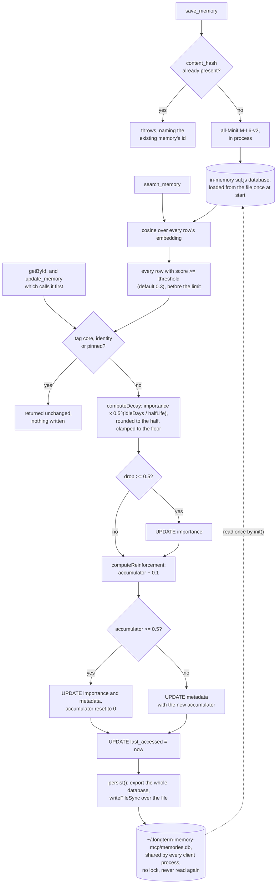

## 1. Executive Summary

LongtermMemory-MCP is a fully local MCP memory server in TypeScript whose
forgetting policy is a six-row half-life table with floors and protected tags.
Its storage contradicts the economy the policy is built for. Every read of an
unprotected memory exports and rewrites the entire SQLite file, once per
search candidate, and two server processes on the default shared file silently
overwrite each other.

It states its lineage in a comparison table: inspired by `mcp-mem0`, but
SQLite through a `sql.js` WASM build instead of Postgres, `all-MiniLM-L6-v2`
in process instead of an embeddings API, cosine in memory instead of a vector
database, and no LLM at all. It is installed by `npx`, or as a Claude Code
plugin that adds a companion skill.

**The decay policy is the part to take.** `DECAY_CONFIG` holds a half-life per
memory type — `ephemeral` 10 days, `task` 30, `conversation` 45, `general` 60,
`preference` 90, `fact` 120 — a floor per type, and the protected tags `core`,
`identity` and `pinned`. `computeDecay` is exponential on days since last
access, rounded to the nearest half point and clamped up to the floor. A user
can read the table, argue with it and change one number.

**The write threshold governs a column, not the write.** `shouldWriteDecay`
lets a decay reach `importance` only when it drops half a point, and
reinforcement banks 0.1 per access until 0.5. But the same function
unconditionally writes the accumulator into `metadata`, writes
`last_accessed`, and calls `persist()`, which exports the database and writes
the whole file (`src/memory-store.ts:438-456`). `search` runs it for every row
above the similarity threshold before slicing to the limit (`:209-216`).

**Two processes, one file, last writer wins.** `init()` reads the file once
(`:47-49`); nothing reads it again, and nothing locks it. The README's
default is "every project and every MCP client shares the same memory pool",
and a stdio MCP server is one process per client session. A search in one
session therefore writes back a copy that lacks whatever another session saved
since it started.

**The schema version discards rather than migrates.** On open, a file with no
`schema_meta` table, or with any version other than the code's, has its
`memories` table dropped and recreated (`:67-95`). The design note says
"preserving data across schema upgrades is not required", and
`schema-migration.test.ts` asserts the wipe. With an unpinned `npx -y` launch,
a future version bump would empty the shared file for whichever client opens
it second, in either direction.

Nothing here is epistemic. `memory_type` is a genre chosen at write time,
`importance` is a continuous weight that the semantic search does not read,
and there is no status, provenance, supersession, validity interval or change
record. The one mark is `negative_eval`, on a type-filter exclusion test
(section 10).

## 2. Mental Model

A **memory** is content, an embedding, a type, some tags, an importance
between 1 and 10, and a free metadata object.

**Decay** lowers importance by the type's half-life on the days since the last
access, unless a tag protects it or the floor stops it.

**Access** raises it by a banked tenth, and resets the idle clock whether or
not the decay was written.

**Persisting** means exporting the whole in-memory database and writing it
over the file, which happens on every save, update, delete and unprotected
read.

## 3. Architecture

| Area | Role |
| --- | --- |
| `src/memory-store.ts` | Schema and version check, dedup, the five reads, decay and reinforcement on access, persist, backup trigger |
| `src/decay.ts` | The half-life table, the floors, the protected tags, both thresholds |
| `src/embeddings.ts` | MiniLM through `@xenova/transformers`, and cosine |
| `src/server.ts` | Eleven MCP tools |
| `src/backup.ts` | A database copy plus JSON export, ten kept |
| `src/index.ts` | Paths from `MEMORY_DB_PATH` and `MEMORY_BACKUP_PATH`, stdio transport |
| `skills/long-term-memory/SKILL.md` | The companion skill: when to recall, when to save, how to format |
| `tests/` | Unit, integration and benchmark suites |

### Deployment and ergonomics

The plugin's `.mcp.json` and `.vscode/mcp.json` both launch
`npx -y longterm-memory-mcp` with no version, so an installed plugin runs
whatever the npm registry serves at launch rather than the code at this
commit. The embedding model, about 30 MB quantized, is downloaded on first use
and cached; after that nothing leaves the machine. There is no API key
anywhere.

## 4. Essential Implementation Paths

`src/decay.ts` in full: sixty-five lines holding the whole forgetting policy
and both thresholds.

`src/memory-store.ts:422-459`, `applyDecayAndReinforcement`, read beside
`:191-217`, `search`. The pair is where the threshold design and the write
behaviour part company.

`src/memory-store.ts:36-56` and `:124-128`: one read of the file at start, one
whole-file write per persist.

`src/memory-store.ts:58-95` with `docs/plans/2026-03-09-schema-migration-design.md`
and `tests/unit/schema-migration.test.ts`: the version check, its stated
intent, and the test that holds it.

## 5. Memory Data Model

Eleven columns and five indexes, in one `memories` table beside a one-row
`schema_meta`. `metadata` is free JSON from the caller, and it doubles as the
store's own state: `reinforcement_accum` is written into it on every
unprotected access (`:439-450`). The value is returned to the agent in
`search_memory` and `get_all_memories` output. An `update_memory` that passes
`metadata` replaces the object and resets the accumulator with it.

`schema_meta` holds version 1, and `initializeSchema` compares it on open. A
missing table or any other value drops `memories` and recreates it empty
(`:67-75`, `:89-94`). No backup is taken first. The snapshots in `backups/`
survive the wipe, so recovery is possible by hand from the newest one.

Provenance, if a caller supplies any, goes in `metadata`. The tool contract
does not ask for it.

## 6. Retrieval Mechanics

Five reads, and they treat importance differently.

`search` embeds the query, reads every row, parses every stored embedding from
JSON, keeps rows whose cosine clears the threshold, runs decay and
reinforcement on each, and sorts by cosine alone (`:191-217`). Importance does
not affect the ranking, so a memory decayed to its floor ranks exactly as it
did at full strength.

`searchByType` and `searchByTags` order by stored `importance DESC`
(`:298`, `:320`), and neither applies decay, so the order is by importance as
last written. A memory that has not been read in months keeps its saved
importance in these listings. `searchByTags` matches with `LIKE '%"tag"%'`
over the JSON array. `searchByDateRange` filters `created_at`, the record
time, and `getAll` orders by it.

`getById` applies decay and reinforcement, so `update_memory`, which calls it
first, also counts as an access.

## 7. Write Mechanics

`save` computes a SHA-256 of the exact content, looks for a matching row, and
throws `Duplicate content detected (existing memory: <id>)` on a hit
(`:141-151`). The companion skill tells the model to take that id to
`update_memory`. The same check runs on an update that changes content. The
same fact in other words is a second row, and nothing reconciles the two.

`update` overwrites every column in place with no prior version kept
(`:278-282`). `delete` and `deleteAll` are SQL deletes followed by a persist.

**Decay below the step is forgiven, not banked.** `computeDecay` measures idle
days from `last_accessed`, and every unprotected access resets
`last_accessed` whether or not the decay was written (`:455`). A `general`
memory at importance 5 needs about four and a half idle days before its decay
rounds down by half a point. Read more often than that, it never decays, and
gains a banked tenth on every read. Reinforcement is the opposite: its
accumulator persists across accesses. The README's "Protected and frequently
accessed memories resist decay" is true, and this asymmetry is the reason.

The README also says "Higher importance decays more slowly". In
`computeDecay` importance is a multiplier and the half-life comes from the
type alone, so every importance loses the same fraction per half-life.

## 8. Agent Integration

Eleven tools: `save_memory`, `search_memory`, `get_all_memories`,
`update_memory`, `search_by_type`, `search_by_tags`, `search_by_date_range`,
`delete_memory`, `delete_all_memories`, `memory_stats` and `create_backup`.
Both delete tools are on the agent's surface. Their descriptions ask the model
to delete only on the user's explicit request, and nothing checks it.

The companion skill drives the loop. At session start the model calls
`search_memory` twice, once with the project name and task keywords and once
with `"preference workflow"`. After a debugging, design, planning, review or
testing task it searches for a duplicate, then saves or updates. Memories are
written as `[{category}] [{project}] {insight}` with the project as a tag too.
That prefix is the only project boundary, and it reaches retrieval as words in
an embedding, not as a filter.

The skill also tells the model to keep memory invisible: "Integrate silently",
"Never surface raw memory content to the user", and on failure "Do not mention
that memory is unavailable". A user has no prompt-level signal of what was
recalled or saved.

## 9. Reliability, Safety, and Trust

**Concurrency.** Each server process holds a private copy of the database and
writes the whole of it on every persist. With the default shared path, any two
concurrently running clients lose writes to each other, and a read is enough to
cause it. `MEMORY_DB_PATH` per client avoids it by giving each client its own
file.

**Crash safety.** `persist()` is a `writeFileSync` over the live file, with no
temporary file and rename. A crash mid-write leaves a partial file that the
next `init()` will try to open.

**Deletion.** Deletion is a hard delete from the live file. The automatic
backup copies the database and writes a JSON export on the first save in each
process, then every 24 hours or when the count reaches a multiple of 100, and
keeps the ten newest (`src/backup.ts:60-84`). A deleted memory therefore
persists on disk until ten later snapshots have been taken.
`delete_all_memories` triggers no backup of its own.

**Schema.** The version check protects the code from a file it cannot read by
emptying the file's memories, and it does so on a mismatch in either direction.

There is no scope, authentication or audit, because the design is one local
user. The risks above are what that design leaves to the deployment.

## 10. Tests, Evals, and Benchmarks

101 vitest cases across six files — the store, decay, embeddings, backup, the
schema check and an MCP integration suite driven through an in-memory client —
and 29 benchmarks across cosine, decay and the store. CI runs build and test
on Ubuntu and Windows under Node 20 and 22. I did not run them.

The decay tests assert the threshold functions in isolation. No test asserts
how many writes an access produces: `fs` is mocked in the store and
integration suites, and no assertion inspects `writeFileSync`. The schema
tests assert that a mismatched or missing version wipes the data
(`tests/unit/schema-migration.test.ts:42-74`), and one asserts that a matching
version keeps it.

`negative_eval` is awarded on the type facet. The integration case saves a
`fact` and a `preference` through `save_memory`, calls `search_by_type` for
`fact`, and asserts exactly one result of type `fact`
(`tests/integration/mcp-server.test.ts:222-240`). The populated preference
must stay out, beside a positive control in the same output. The unit case
seeds two facts and a preference and asserts two results, every one a fact
(`tests/unit/memory-store.test.ts:279-287`).

The facet is one the caller chooses, and the SQL predicate is the only thing
that can exclude a row, since the listing has no relevance step. No case
asserts an exclusion from `search_memory`, the read the companion skill uses
at session start, and no case concerns a corrected value or a scope boundary.

## 11. For Your Own Build

### Steal

Put the decay policy in one table. Six half-lives and six floors with the type
names beside them is something a user can read and tune. A constant inside a
scoring function is neither.

Give protected tags to what must not fade. A short exempt list lets the decay
model be aggressive everywhere else.

Throw on a duplicate with the colliding id. The caller learns what to update
instead of receiving a silent no-op.

### Avoid

A write threshold that guards one column while the same function writes two
others. If a read must not write, make the read path free of writes and batch
the bookkeeping, and assert the write count in a test.

Reinforcing every candidate above a similarity threshold. The rows a search
touched are not the rows the agent saw; reinforce what was returned.

A single-file store loaded once per process and written back whole, behind a
default that shares it across clients. Either lock and reload, or give each
client its own file by default.

A version check that drops the table. If the format must change, back up first
and refuse to open a higher version rather than wiping it.

Resetting the idle clock on an access that did not apply the decay. Bank the
remainder, or decay from the last write rather than the last read.

### Fit

This suits one person running one client at a time who wants recall without a
service, an API key or a model. Walk away if two sessions may run at once
against the default file, if a release could change the schema under a store
you care about, or if a corrected or deleted memory must be accountable.

## 12. Open Questions

Whether the shared default path and the per-process copy were weighed
together. The README promotes sharing across clients, and nothing in the tree
discusses concurrent processes.

Whether the per-candidate reinforcement in `search` is intended. The README
says "Every time a memory is accessed via search, its importance increases",
which matches the code only if a candidate counts as accessed.

What happens to the shared file when `SCHEMA_VERSION` first moves to 2. The
design note accepts data loss; it does not discuss clients pinned to different
versions through the npx cache.

## Appendix: File Index

| Path | What to read it for |
| --- | --- |
| `src/decay.ts` | The whole forgetting policy, and both thresholds |
| `src/memory-store.ts:422-459` | Decay and reinforcement on access, and the unconditional writes and persist |
| `src/memory-store.ts:191-217` | Search: every row, cosine-only ranking, decay on every candidate before the limit |
| `src/memory-store.ts:36-56`, `:124-128` | One file read at start, one whole-file write per persist |
| `src/memory-store.ts:58-95` | The schema version check that drops the table |
| `src/memory-store.ts:141-151` | Dedup that throws with the id it collided with |
| `src/memory-store.ts:295-351` | Type, tag and date listings; importance order without decay |
| `src/backup.ts:22-84` | Snapshot, JSON export, ten kept, the auto-backup rule |
| `src/server.ts` | The eleven tools, both deletes included |
| `skills/long-term-memory/SKILL.md` | Silent recall and save, and the project prefix |
| `docs/plans/2026-03-09-schema-migration-design.md` | Wipe-on-mismatch as the stated decision |
| `tests/integration/mcp-server.test.ts:222-240` | The type-facet exclusion case |
| `tests/unit/schema-migration.test.ts:42-74` | The wipe, asserted |

### Recorded searches

Run at the tree root of the pinned checkout with `git grep`. The `src/` and
`tests/` trees are identical at both pins (`e162816c037b245567ca0fa1687fb6ac2383fa23`
and `c4d52a0a81bdd70c8fd715884b3e0aaaa3846323`), so each result holds at both.

- `git grep -n -E 'readFileSync|writeFileSync|persist\(\)|lock|flock|rename|watch' -- src` — one `readFileSync` in `init`, one `writeFileSync` in `persist` and one in the backup export, the `persist()` definition and six calls; no lock, rename or watch.
- `git grep -n -E 'applyDecayAndReinforcement' -- src` — defined at `:422`, called from `search` (`:210`) and `getById` (`:232`).
- `git grep -n -E 'UPDATE memories' -- src` — `update` at `:279` and four in `applyDecayAndReinforcement` (`:435`, `:446`, `:450`, `:455`).
- `git grep -n -E 'DROP TABLE|DELETE FROM' -- src` — the two schema drops (`:69`, `:90`), the two deletes, the `schema_meta` reset and a test-only helper.
- `git grep -n -E 'json_extract|WHERE.*metadata' -- src` — no match; nothing filters on metadata.
- `git grep -n -E 'WHERE' -- src` — no predicate on a user, project, tenant or status column.
- `git grep -n -i -E 'valid_from|valid_to|valid_at|validFrom|invalid_at|effective|expires?_at|observed_at|event_time' -- . ':!package-lock.json' ':!CHANGELOG.md'` — two README hits on the word "effectively"; no validity time.
- `git grep -n -i -E 'user_?id|tenant|namespace|scope|project_?id|session_?id|agent_?id|owner' -- . ':!package-lock.json' ':!CHANGELOG.md'` — the plugin manifest owner, the README's "user-scoped location", commit-message scope and registry ownership; no scope key.
- `git grep -n -i -E 'history|audit|changelog|journal|event_log|append' -- . ':!package-lock.json' ':!CHANGELOG.md'` — release tooling and `*.db-journal` in `.gitignore`; no mutation record.
- `git grep -n -i -E 'tombstone|reject|blocklist|denylist|suppress|forbid' -- . ':!package-lock.json' ':!CHANGELOG.md'` — the duplicate-content rejection and its tests; no value-keyed rejection.
- `git grep -n -i -E 'status|verified|trusted|pending|quarantine|disputed|candidate|approve|confirm' -- . ':!package-lock.json' ':!CHANGELOG.md'` — response `status` strings, the README's "Verified information" gloss on `fact`, the local `candidates` array in `search`; no state column.
- `git grep -n -E 'writeFileSync\)?\.(toHaveBeenCalled|mock)|toHaveBeenCalledTimes' -- tests` — no match; no test counts writes.
- `git grep -n -i -E 'arxiv|bibtex|@article|@misc|citation|doi\.org' -- . ':!package-lock.json'` — no match; no paper.
- `git grep -n -i -E 'anthropic|machine learning|not (be )?used (for|to)' -- LICENSE` — no match; the MIT text carries no rider.

## History

**2026-10-15** — [`7f7f064d31f348dcc7f074e11c291a3f9ed5e046`](https://github.com/MarcelRoozekrans/LongtermMemory-MCP/commit/7f7f064d31f348dcc7f074e11c291a3f9ed5e046) — 21 commits on, all dependency updates; only `package-lock.json` changed. Wrong at the first pin and corrected: decay and reinforcement were said to be written only past half a point, when every unprotected read writes and rewrites the file ([section 1](#1-executive-summary)). The schema version was called a migration, when it drops the table ([section 5](#5-memory-data-model)); backup was called manual; importance was said to order nothing; 109 tests were 101; and `negative_eval` was earned ([section 10](#10-tests-evals-and-benchmarks)). Added: concurrent processes overwrite the shared file ([section 9](#9-reliability-safety-and-trust)). Screened from a full clone: nine files, four auto-run surfaces, one build-time exec point, one unpinned surface, `package-lock.json` inside the cooldown. Nothing was installed, built or run.

**2026-09-16** — [`5955730d50f0e1d999b28007271205d3e6c0dc37`](https://github.com/MarcelRoozekrans/LongtermMemory-MCP/commit/5955730d50f0e1d999b28007271205d3e6c0dc37) — first reading, at a commit dated 16 September 2026. Screened before opening, from a shallow clone: eight files scanned, three auto-run surfaces, one build-time execution point, one unpinned surface and two dependency files inside the seven-day cooldown. Nothing was installed, built or run.
