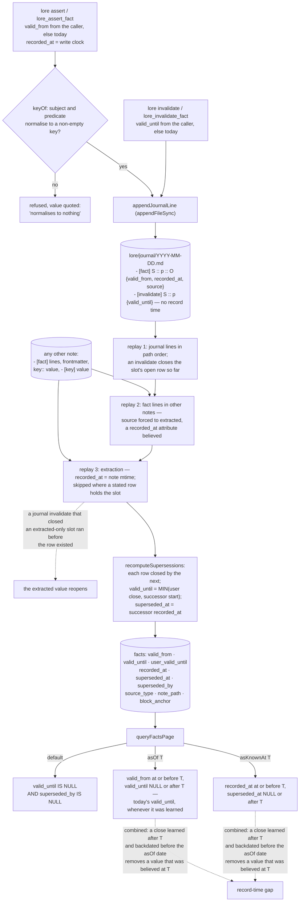

## 1. Executive Summary

Loreweave is a temporal knowledge engine over a markdown vault in which the
journal of fact lines is the durable record and the SQLite index is a replay
that can be wiped and rebuilt. Facts can be queried as of a valid date or as
known at a record date, and the record-time half is the weaker one: a close
learned later rewrites the one `valid_until` column, an invalidate records no
time of its own, and an extracted fact's record time is its note's last edit.

It describes itself as "[a] temporal knowledge engine for markdown vaults" that
"indexes, links, remembers, forgets, and dreams — locally, over files you own."
Its diagnosis is that most knowledge tools are write-only: "nothing ever
resurfaces on its own, and nothing notices when what you wrote last year stopped
being true."

**The architectural decision worth taking is which artifact is authoritative.**

> "Fact lines in markdown are the durable record; DB fact rows are a replay."

Every assertion appends `- [fact] Subject :: predicate :: Object {valid_from=…}`
to a dated file under `lore/journal/`, every closure appends
`- [invalidate] Subject :: predicate {valid_until=…}`, and "[r]ebuild wipes and
replays ALL fact rows deterministically, so the index stays a pure cache of the
vault." The journal line is written before the row, and nothing in the tree
rewrites a journal file (audit log). A fact an agent got wrong is corrected by
editing a line in a file the user already owns.

`queryFactsPage` takes `asOf` and `asKnownAt` as separate parameters over
separate column pairs, and valid time comes from the caller's `--valid-from`, a
line's own `{valid_from=…}` or a note's frontmatter rather than the clock
(bitemporal). The comment on the record-time clause states the case it handles:

> "Known at T: recorded by then, and not yet superseded by then. A fact asserted
> afterwards was not available to anyone reasoning at T, however early its
> validity was backdated to start."

That holds for a backdated assertion and not for a backdated close, as
[section 6](#6-retrieval-mechanics) sets out. Committed tests assert that an
invalidated fact and a late-recorded one stay out of fact queries beside a
control that returns them, and that out-of-vault content stays out of search
(negative evaluation).

## 2. Mental Model

A **fact line** in markdown is the record; the row is a copy. Fact lines come
from three places, in the order a replay reads them: the engine's own journal
under `lore/journal/`, `- [fact]` lines written into any other note, and fields
extracted from note structure — frontmatter, `key:: value`, `- [key] value`.

A **valid window** is when the fact was true. **`recorded_at`** is when the
vault learned it: the write clock for an assertion, carried into the journal
line, and the note's modification time for an extracted fact.

A fact stops being current in two ways, and neither deletes it:

- **Superseded.** Within a slot, every row is closed by the next one ordered by
  valid time; `superseded_at` takes the successor's `recorded_at`. A different
  value links `updates`, the same value `extends`.
- **Closed.** An `[invalidate]` line sets `valid_until` and `user_valid_until`
  on the slot's current row. It sets no record time.

A fact's **source type** is `stated`, `extracted` or `inferred`. A `source=`
attribute counts only under `lore/journal/`; elsewhere the row is `extracted`.
A slot holding a `stated` row is closed to extraction. Nothing filters on source
type at read time.

A **rebuild** wipes the fact table and replays everything, and runs whenever an
index sees an added, changed or removed note.

## 3. Architecture

| Area | Role |
| --- | --- |
| `src/facts/journal.ts` | The fact-line grammar, lossless escaping, the replay and the supersession recompute |
| `src/facts/model.ts` | Assert, invalidate, the bitemporal query and the aggregate |
| `src/facts/extract.ts` | Deterministic extraction from frontmatter and field syntax |
| `src/temporal/` | Date parsing for notes and queries, and the entity timeline |
| `src/store/` | Eleven tables plus an FTS5 index, migrations, and version stamps that refuse a newer index |
| `src/retrieve/` | Lexical, vector and graph retrieval, expansion and rerank |
| `src/dream/` | Consolidation, link proposals, digests and the fitted forgetting curve |
| `src/mcp/server.ts` | Fifteen `lore_*` tools |
| `eval/` | LoCoMo, LongMemEval, BEIR, generated-question and scale harnesses against a committed baseline |

### Deployment and ergonomics

One Node package with `better-sqlite3`; version 0.39.0 requires Node 22 or
later. Nothing has to be running and no API key is needed to store anything;
embeddings are optional and default to none in the generated config. The store
is a directory of markdown the user owns, so it is readable and repairable by
hand, and `.lore/` can be deleted and rebuilt at the cost of the usage history
described in [section 5](#5-memory-data-model). The MCP manifest launches the
published package through `npx`.

## 4. Essential Implementation Paths

**Assert.** `assertFact` validates fields and dates, stamps
`recordedAt = new Date().toISOString()` and takes `validFrom` from the input or
today (`src/facts/model.ts:140-142`). It refuses a read-only index before either
write, appends the rendered journal line, then inserts the row, recomputes
supersession, indexes the journal note and stamps the block anchor the replay
would derive (`:145-247`). An identical assertion appends the line and inserts
no row (`:195-215`).

**Invalidate.** `invalidateFact` refuses a close before the current row's
`valid_from`, appends `- [invalidate] S :: p {valid_until=…}` and updates the
slot's open row (`src/facts/model.ts:262-306`).

**Replay.** `rebuildFactsFromNotes` deletes every fact row, reads blocks
containing `[fact]` or `[invalidate]` journal-first, inserts facts and applies
invalidates as it goes, then calls `extractStructuredFacts` and a final
supersession pass (`src/facts/journal.ts:229-359`). The indexer calls it after
any index that adds, updates or removes a note (`src/index/indexer.ts:324-327`).

**Query.** `queryFactsPage` builds the slot, `asOf`, `asKnownAt` and term
clauses, caps at 200 and returns the matched total when the cap is hit
(`src/facts/model.ts:372-435`). `lore ask` maps a past-tense date in the
question to `asOf` (`src/cli/main.ts:366-367`).

**Search.** Blocks are dated from their own prose or the note's frontmatter
(`src/store/db.ts:530-532`), and a query window also boosts blocks whose facts'
validity meets it (`src/retrieve/search.ts:748-752`). The graph adds an edge
per current fact (`src/graph/build.ts:311-321`).

## 5. Memory Data Model

The `facts` row carries `subject`, `predicate`, `object`, `subject_display`,
`valid_from`, `valid_until`, `recorded_at`, `superseded_at`, `superseded_by`,
`source_type`, `note_path`, `block_anchor` and `confidence`, and a migration adds
`user_valid_until` so a user's close survives the supersession recompute
(`src/store/schema.ts:142-157`, `:251-252`). `fact_links` records `updates` and
`extends` between rows. Around it sit notes, blocks, links, entities, mentions,
edges, embeddings and an access log. All but the access log, the per-block
stability and access counts, and the decay fitted from them are derived from the
vault; an incremental reindex carries those across, and deleting `.lore/` loses
them.

Valid time has four producers that are not the clock: the CLI's `--valid-from`
(`src/cli/main.ts:595`), the MCP tool's `validFrom`
(`src/mcp/server.ts:250`), a line's own `{valid_from=…}`
(`src/facts/extract.ts:170`), and the note's frontmatter `valid_from`, `date` or
`created`, in that order, as a fallback for lines that state none
(`src/facts/extract.ts:184-192`, `:278`). A separate function reads `date`,
`event_date`, `created` and `valid_from` to date blocks for search windows
(`src/temporal/dates.ts:204-216`); it does not write facts.

Record time has three producers: the write clock on assert, carried as
`recorded_at=` in the journal line; a `{recorded_at=…}` attribute on a fact line
in any note (`src/facts/journal.ts:300-302`); and the note's modification time
for extracted facts (`src/facts/journal.ts:419`). The third moves every time the
note is edited.

## 6. Retrieval Mechanics

The default fact query returns rows with no `valid_until` and no successor.
`asOf T` returns rows whose start is at or before T and whose `valid_until` is
empty or after T. `asKnownAt T` returns rows recorded by T and not superseded by
T. The MCP description offers the two together for "what was true then, as far
as we knew then" (`src/mcp/server.ts:329-342`).

The combination is correct for a backdated assertion and wrong for a backdated
close. `valid_until` is a single column that `recomputeSupersessions` and
`invalidateFact` rewrite in place, with no record of when the close was learned
(`src/facts/journal.ts:181-218`, `src/facts/model.ts:295-302`). Take a value
recorded in January 2024, superseded or invalidated in March 2025 with an end
date of June 2024. Asked `asOf` September 2024 and `asKnownAt` December 2024,
the query applies the June end learned in March and returns nothing, though in
December the value was believed to hold. The committed combined test uses a
successor that starts after the `asOf` date, so it does not reach this case
(`tests/facts.test.ts:345-358`). I read the predicate; I did not run it.

Extracted facts weaken the record axis further. Their `recorded_at` is the
note's modification time, so editing a note re-dates every fact extracted from
it, and `asKnownAt` before the edit excludes values the vault held for a year.
The same column drives `lore_resume`'s "facts asserted" list
(`src/resume.ts:75-80`).

Search is lexical over blocks with an FTS5 index, optional embeddings, and a
personalised walk over entity mentions, co-occurrence and current-fact edges,
followed by a rerank stage that is skipped on temporally scoped queries. A
retrievability decay is fitted from the vault's own retrieved-then-used history,
and `lore review` lists what has faded below a threshold.

`lore review` is a listing, not a gate, and nothing else gates either.
`lore_propose_facts` returns candidates *"for you to adjudicate"* and says it
*"keeps judgement with you and out of the index"*, but it is an MCP tool
description, so the "you" is the model (`src/mcp/server.ts:471-475`). A person
can edit the journal line an agent wrote, and the next rebuild replays the
corrected file; that is correction after the write, not review before it.

## 7. Write Mechanics

A write is refused rather than accepted quietly when it cannot be made
meaningful. A subject or predicate that normalises to an empty key is refused
with the value quoted, because "[t]hree unrelated subjects contradicting one
another through a key none of them had" is what happened when it was not
(`src/facts/model.ts:31-49`). A `validUntil` before its `validFrom` is refused,
because "[a]ccepted silently this produced intervals like (2025-01-01 →
2024-06-01), which no query can answer and nothing flags" (`:150-157`).

The journal line goes first, then the row. A read-only index is refused before
both, "or the next rebuild replays a fact the user was told was refused"
(`src/facts/model.ts:145-148`). `capture` appends a timestamped bullet, and
because the stamp precedes the text it cannot form a fact line
(`src/capture.ts:72-97`). Its target is `lore/inbox.md` by default and any
indexable vault note on request, through `lore_capture`'s `to` argument as well,
where the README says the engine appends "only under `lore/`".

By reading the replay order, a close on a slot held only by an extracted fact
does not survive the next index. The live `invalidateFact` closes the extracted
row. A replay applies the journal's `[invalidate]` before extraction has
inserted that row, finds nothing open, and extraction then inserts it open
(`src/facts/journal.ts:259-288`, `:356`). The slot is closed until any note in
the vault changes. No committed test invalidates an extracted fact.

## 8. Agent Integration

Fifteen MCP tools: `lore_search`, `lore_context_pack`, `lore_read_note`,
`lore_assert_fact`, `lore_invalidate_fact`, `lore_resume`, `lore_review`,
`lore_timeline`, `lore_query_facts`, `lore_aggregate_facts`, `lore_capture`,
`lore_mark_used`, `lore_dream_report`, `lore_propose_facts` and `lore_index`.
The CLI exposes the same operations, and a file watcher re-indexes on change.
`lore_context_pack` and `lore_query_facts` return a `truncated` field naming
what a capped list left out and which tool returns the rest. The server exits
when its client closes stdin, flushing the watcher and the index first.

## 9. Reliability, Safety, and Trust

Provenance is concrete: every fact keeps the note path and block anchor it came
from, and an asserted fact's anchor is stamped to match what a replay derives.
A corrupted index is a re-index rather than data loss, and an index stamped by a
newer version is refused rather than read.

The vault boundary holds on reads and writes. A symlink named `.md` whose
target is not a note, and a symlinked note or folder whose real location is
outside the vault, are neither indexed, searched nor readable unless the owner
sets `followExternalSymlinks` in `.lore/config.json`. Writes are held to the
real vault root with symlinks resolved (`src/capture.ts:43-66`).

Source type is guarded on one attribute and not the other. A `source=` attribute
counts only under `lore/journal/`, so note content cannot label itself `stated`
(`src/facts/journal.ts:320-335`). A `recorded_at=` attribute counts in any note,
so a clipped article can backdate its own record time and enter an `asKnownAt`
answer for a date before it existed.

There is no scope and no epistemic status separate from supersession.

## 10. Tests, Evals, and Benchmarks

About 520 vitest cases in 70 files; the README states 546. I read them and ran
none. Test names state the regression they hold, such as "one use does not
relabel a week of ignored retrievals as successes"
(`tests/decay-fit.test.ts:102`).

Two fact-query cases assert absence with a control on the same store.
`invalidate closes open facts` expects the default query to return nothing for
the slot and `asOf` inside the window to return the fact
(`tests/facts.test.ts:166-174`). `excludes facts recorded after the date`
expects `asKnownAt` 2021 to return nothing for a fact valid from 2020 and `asOf`
2021 to return it (`:332-343`). The CLI journey repeats the first through
`lore facts` and `--history` (`tests/cli.test.ts:84-102`).

Search carries the same shape for out-of-vault content. A key file linked in as
`leak.md` is asserted absent from `searchLexical` beside a genuine note that is
indexed (`tests/note-gate.test.ts:132-176`). A row an older version indexed
through such a link is asserted searchable first and absent after the next open
(`:254-289`), and an out-of-vault diary is asserted absent from search
(`tests/symlink-containment.test.ts:97-103`). All but the last were in the tree on
15 September 2026.

`tests/facts.test.ts:176-210` asserts that a full reindex from the journal
reproduces the same fact rows, and `:438-480` round-trips 300 generated fact
lines. The `eval/` directory runs LoCoMo, LongMemEval, BEIR, generated
questions and a scale harness against `eval/baseline.json`.

## 11. For Your Own Build

### Steal

Decide which artifact is authoritative and make the other one disposable. Being
able to wipe and replay the index is what makes every other correction cheap,
and a test that rebuilds and compares rows keeps it true.

Refuse a normalised key that is empty, and quote the value. Any normalisation
that can produce an empty string will collapse unrelated records into one slot,
and the failure is silent.

If an aggregate or list is capped, return the total. An opt-in total is the
same design as no total.

Honour a provenance attribute only on the path that writes it. The `source=`
rule is the template: content may state a fact, and may not say who stated it.

### Avoid

One `valid_until` column for a store that offers a record-time query. If a
close can be learned after the fact, the close needs its own record time, or
"true then, as known then" answers with later knowledge.

A note's modification time as a fact's record time. It moves on every unrelated
edit to the same file.

Applying journal closes before the rows they close exist. A replay should apply
closes after every source of rows has inserted, or key them on something
extraction will produce again.

### Fit

This suits one person's vault, where the user owns the files, edits them by
hand, and wants facts with a history. It is a poor fit for several agents or
people who must not see each other's facts, or for an audit question about what
was believed at a past date when closes were backdated.

## 12. Open Questions

Whether a vault is the intended boundary once several agents share one. Nothing
carries a scope key, so a fact asserted for one project is visible to every
query.

Whether `source_type` was meant to influence retrieval. `inferred` is offered
to the model as "your deduction", and an inferred fact is returned exactly like
a stated one.

Whether `{recorded_at=…}` outside the journal is intended. It is the same shape
as the `source=` forgery fixed in `8ac4b34`, on the other axis.

## Appendix: File Index

| Path | What to read it for |
| --- | --- |
| `src/facts/journal.ts:1-11` | Markdown as the record and the database as a replay |
| `src/facts/journal.ts:147-223` | Supersession: every row closed by the next, user closes as an upper bound |
| `src/facts/journal.ts:229-359` | The replay order, the invalidate pass, and which attributes are believed where |
| `src/facts/model.ts:31-49` | A normalisation that refuses to produce an empty key |
| `src/facts/model.ts:121-306` | Assert and invalidate: journal first, then row |
| `src/facts/model.ts:372-435` | The two time axes as two parameters, and the returned total |
| `src/facts/extract.ts:170-192` | Where an extracted fact's valid time comes from |
| `src/mcp/server.ts:471-475` | The adjudication step addressed to the model |
| `tests/facts.test.ts:166-174`, `:292-364` | Absence after invalidate, and the record-time cases |
| `tests/note-gate.test.ts:132-289` | Out-of-vault content kept out of the index and search |

### Recorded searches

Run at the tree root of the pinned checkout with `/usr/bin/git grep -n -E`.

- `'appendFileSync|writeFileSync|unlinkSync|rmSync|renameSync|truncateSync' -- src` — the journal append at `src/facts/model.ts:78`, capture's append, `lore init`'s config, `graph export --out`, the dream digest and review queue, and `rmSync` on the index database files; nothing rewrites or deletes a journal file.
- `'superseded_at\s*=' -- src` — `src/facts/journal.ts:162` and `:183` only; `invalidateFact` does not set it.
- `'recorded_at' -- src/facts/journal.ts` — `:301` reads the attribute with no journal check, beside `:334`, which checks the path for `source`.
- `'source_type|sourceType' -- src` — the CLI label, the timeline heuristic, the MCP schema, and the stated-slot lock at `src/facts/journal.ts:383`; no read filter.
- `-i 'tenant|agent_id|user_id|project_id|workspace_id' -- src` — no match.
- `-i 'tombstone|reject|blocklist|denylist' -- src/facts src/store` — two comments; no value-keyed rejection.
- `"'(pending|verified|disputed|candidate|approved|rejected|unverified|quarantine)'" -- src` — no match; no review state.
- `'asKnownAt' -- tests` — `tests/facts.test.ts` only; no case closes a fact after the `asKnownAt` date.
- `'invalidateFact\(' -- tests` — `facts.test.ts`, `fact-invariants.test.ts`, `fact-key.test.ts`; none on an extracted fact.
- `-i 'anthropic|machine learning' -- LICENSE` — no match; the MIT text carries no rider.

## History

**2026-10-15** — [`303a4183cf1ee420fcc50c6318d0969b9a3bbd6d`](https://github.com/lets-order-some-fries/loreweave/commit/303a4183cf1ee420fcc50c6318d0969b9a3bbd6d) — 38 commits on, version 0.37.1 to 0.39.0. `negative_eval` gained, earned at the old pin: an invalidated and a late-recorded fact were asserted absent from fact queries, and out-of-vault content from search ([section 10](#10-tests-evals-and-benchmarks)). `bitemporal` and `audit_log` hold at both pins. Wrong then: the frontmatter keys and anchor for valid time, `source_type` having one reader, every table being derivable, and backdated closes being handled ([section 6](#6-retrieval-mechanics)). Overtaken: `source=` counts only under the journal, a line's own `valid_from` and `valid_until` survive extraction, and symlinked notes outside the vault are not indexed. Screened from a full clone: four files, one auto-run surface (`server.json`), one build-time execution point, one unpinned surface behind `package-lock.json`, nothing inside the cooldown. Nothing was installed, built or run.

**2026-09-19** — audited at the unchanged pin [`8fe4c5a2961f46732aa60ce9d8753f0c7818ddc7`](https://github.com/lets-order-some-fries/loreweave/commit/8fe4c5a2961f46732aa60ce9d8753f0c7818ddc7); nothing upstream moved, so the correction is ours. `human_review` is **withdrawn**, and the withdrawn record had already found the decisive fact and filed it as a limit instead of a disqualification: `lore_propose_facts` keeps judgement *"with you"*, but it is a tool description, so the reviewer it addresses is the model. The rest of the surface is correction rather than review — `facts`, `timeline` and `invalidate` act on facts already in the index, and because the vault is markdown a person can edit the journal line directly, which the next rebuild replays. Nothing in `src/` holds a fact pending anyone. `bitemporal` and `audit_log` stand. Screened again first; nothing was installed and no suite was run.

**2026-09-16** — [`8fe4c5a2961f46732aa60ce9d8753f0c7818ddc7`](https://github.com/lets-order-some-fries/loreweave/commit/8fe4c5a2961f46732aa60ce9d8753f0c7818ddc7) — first reading, at a commit dated 15 September 2026. Screened before opening, from a shallow clone: four files scanned, one auto-run surface, one build-time execution point, one unpinned dependency surface and two dependency files inside the seven-day cooldown, with `package-lock.json` present. Nothing was installed, built or run.
