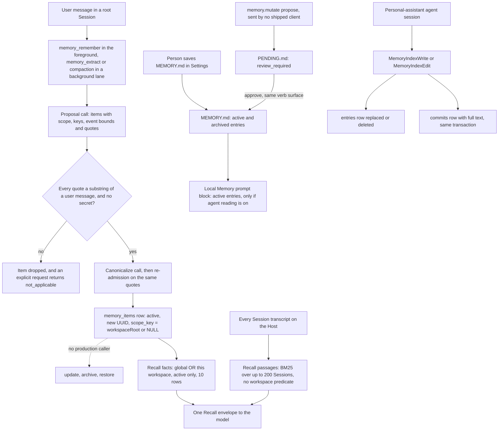

## 1. Executive Summary

Apache Maka is a local agent workspace: one Runtime Host, written in
TypeScript, serves an Electron desktop app, a TUI, a CLI and an ACP agent, and
records every model message and tool call as an append-only RuntimeEvent. Its
memory is three stores. A fact store in `memory.sqlite` holds statements the
model extracts and must back with exact quotes from user messages. A
`MEMORY.md` file belongs to the user. An index network, in the opt-in personal
assistant, holds documents an agent maintains over history sources. What is
notable is the fact store's admission and the workspace predicate on its read.
What is weak is that nothing in production corrects or forgets a fact.

The RuntimeEvent log is the product's headline, and it is a record of what
happened rather than memory that can turn out false. This report reads the log
only where the memory paths read it: as evidence for extraction, and as the
transcript layer of the `Recall` tool.

Five findings shape the rest of this report.

- **A fact is admitted only on user-authored evidence.** Each proposed item
  must cite at least one quote, and each quote must be a substring of a user
  message in the frozen range. Tool and assistant output never qualify as
  evidence (`packages/runtime/src/memory-extraction-proposal.ts:307-353`,
  `memory-extraction-evidence.ts:95-118`).
- **The fact store cannot be corrected in production.** `applyMutations`
  carries update, archive and restore with compare-and-swap, and its only
  caller outside tests is the facade that forwards it
  (`packages/storage/src/long-term-memory-store.ts:134`). No statement deletes
  an item.
- **Scope holds on facts and not on the transcripts beside them.** The fact
  read filters to global or the active Session's workspace in SQL. The same
  `Recall` call returns BM25 passages from every Session on the Host
  (`packages/core/src/recall.ts:991-1010`).
- **The MEMORY.md review queue is a protocol with no producer.** `propose`,
  `approve` and `reject` exist on `memory.mutate`, no shipped client sends
  them, and an ACP client that could send one can send the others.
- **The index network logs every write it makes.** Each document write or edit
  appends its full text to an append-only `commits` table in the same
  transaction (`packages/runtime-host/src/assistant/memory-network/corpus.ts:478-511`).

Two marks: `audit_log` and `negative_eval`. They sit on two different
stores, and section 9 names the five withheld, `scope_enforced` among them.

The licence is Apache-2.0. The podling's `DISCLAIMER-WIP` records that the
review of the authorization basis for the retained initial code is open
(issue 3268), which matters to anyone redistributing the code, not to reading
it.

## 2. Mental Model

**A fact becomes a belief when it commits, and stops being one never.** The
extraction engine runs a proposal call, an optional localization call and a
canonicalization call, with a budget of three model calls
(`packages/runtime/src/memory-extraction.ts:267`, `:823`). Each surviving
candidate is re-admitted against the same evidence and written `active`, with
`origin` set to `user_requested` for a `memory_remember` request and
`agent_extracted` otherwise (`memory-extraction.ts:1876-1907`). There is no
candidate state and no review. Because `applyMutations` has no production
caller, the row then stays `active` and unchanged for good.

**Identity is a random UUID, not the content.** `#createItem` takes
`randomUUID()` for every write, and the store's own test is named
`stores duplicate assertions independently within one batch`
(`packages/storage/src/sqlite-long-term-memory-store.ts:921-955`,
`__tests__/sqlite-long-term-memory-store.test.ts:1216`). The engine has no
port that reads existing items (`memory-extraction.ts:143-190`), so the same
preference extracted twice is two rows, and a later contrary statement is a
third.

**The extraction model chooses where a fact applies.** Each proposed item
carries `scope: 'global' | 'workspace'`
(`memory-extraction-proposal.ts:44-56`). A workspace item takes the Session's
`workspaceRoot` as its key; a global item has none and is returned in every
workspace (`memory-extraction.ts:1895-1896`). The model also supplies
`statementType` (fact, plan, prediction) and event bounds, validated as a
shape and stored.

**MEMORY.md is the user's document, with a review state machine beside it.**
An entry is `active`, `archived`, `review_required`, `draft`, `rejected` or
`unknown`, and the prompt builder injects only `active` ones
(`packages/core/src/local-memory.ts:39-45`, `:291-313`, `:735`). A proposal is
written to `PENDING.md` as `review_required`; `approve` moves it into
MEMORY.md as `active` with `approvedBy=user`, and `reject` marks it `rejected`
in `PENDING.md` (`local-memory.ts:386-417`, `:489-571`).

**An index document is whatever the assistant agent last wrote.** The
assistant creates an index from a natural-language criterion and a history
cursor, and an agent session writes free-form documents whose
`memory-original:` links cite original messages. A write replaces the
document; the previous text survives only in the `commits` log.

## 3. Architecture

Every client is a thin front end over one Runtime Host process, which owns
storage through a lease on a storage root and serves operations over a local
socket. The fact store opens `memory.sqlite` under that root through
`openInteractiveLongTermMemoryStoreForWrite`, which refuses a forged lease or
writer facade (`packages/storage/src/long-term-memory-store.ts:64-112`). The
database runs WAL with `synchronous = FULL` and foreign keys on, and refuses a
schema newer than version 5 (`sqlite-long-term-memory-schema.ts:21`,
`:423-440`).

Extraction calls the Session's own model connection through
`createHostMemoryExtractionModel` and runs in `MemoryExtractionSessionLane`,
one lane per Session
(`packages/runtime-host/src/server/execution-composition.ts:1243-1272`). The
MEMORY.md bundle is a separate store with its own revision and backup files
(`packages/storage/src/memory-bundle-io.ts:57-59`). The personal assistant
keeps its index network in `network.sqlite` under its own control directory,
and is off until enabled in Settings (`execution-composition.ts:449-484`).

Retrieval is lexical throughout. Facts match on normalized keys, exact or by
prefix range over an index; transcripts are scored with Okapi BM25; index
documents are read by key or by literal substring. There is no embedding
anywhere on these paths.

### Deployment and ergonomics

- **What has to run:** the Maka desktop app or CLI, which starts the Runtime
  Host. SQLite is Node's built-in `node:sqlite`. No service, vector store or
  queue.
- **Local and offline:** the stores are local files. Extraction needs a model:
  a cloud API, a local model or a compatible gateway.
- **An API key to store anything:** a fact needs a model call, so a model
  connection; MEMORY.md does not.
- **Install:** a signed source release or a packaged desktop build; a source
  checkout runs `npm ci` and `npm run dev`. Nothing was built for this report.
- **Repairable by hand:** MEMORY.md is Markdown with one HTML-comment metadata
  line per entry. `memory.sqlite` is readable with any SQLite client, and the
  store checks each row's `content_hash` on read, so a hand edit that misses
  the hash fails the read (`sqlite-long-term-memory-store.ts:1704-1715`).

## 4. Essential Implementation Paths

- **Capture triggers.** `buildMemoryExtractionTriggerTools` registers
  `memory_remember` and `memory_extract`, both with no arguments
  (`packages/runtime/src/memory-extraction.ts:290-338`). Automatic extraction
  runs when a history-compaction checkpoint is recorded, if memory is enabled
  and the Session is neither a subagent nor archived
  (`packages/runtime/src/ai-sdk-turn.ts:750-819`,
  `packages/runtime-host/src/server/execution-model-composition.ts:442-454`).
- **Extraction.** `MemoryExtractionEngine.execute` reads the Session's
  RuntimeEvents past the cursor, plans evidence from user messages only, calls
  the model, admits candidates and commits (`memory-extraction.ts:346`).
  Secrets in content, keys or quotes reject the item; for an explicit request
  the whole batch becomes a `sensitive_information` no-op
  (`memory-extraction-proposal.ts:359-365`, `memory-extraction.ts:984-1000`).
- **Commit.** `commitExtraction` checks the cursor and any pending failure,
  creates every item, writes a receipt and advances the cursor in one
  `BEGIN IMMEDIATE` transaction
  (`packages/storage/src/sqlite-long-term-memory-store.ts:293-495`).
- **Retrieval.** The `Recall` tool calls `runRecall`, whose `readFacts` passes
  the active Session id to `searchFacts`, which resolves the workspace and calls
  `searchByKeys` (`packages/runtime/src/recall-tools.ts:55-150`,
  `packages/core/src/recall.ts:541-616`, `:1012-1031`,
  `execution-composition.ts:877-895`). The UI's `recall.query` runs the same
  function with no active Session, so it sees global facts only
  (`packages/runtime-host/src/server/recall-coordinator.ts:52`).
- **Context injection.** `readPromptProjection` builds the MEMORY.md body when
  memory and agent reading are both enabled and incognito is off, and the run
  composer wraps it as untrusted Local Memory
  (`packages/runtime-host/src/server/memory-coordinator.ts:162-190`,
  `interactive-run-composer.ts:801-818`). No path injects facts.
- **Correction.** Facts: `#updateItem` and `#changeLifecycle` exist, unreached
  (`sqlite-long-term-memory-store.ts:962-1046`). MEMORY.md: whole-file save,
  reset and backup restore from the desktop
  (`apps/desktop/src/main/runtime-host-memory-ipc-main.ts:86-118`).
- **Index network.** The assistant's tools are registered in
  `packages/runtime-host/src/assistant/memory-network/host.ts:83-579`, and
  `CorpusStore.write` is the one writer of documents (`corpus.ts:478-511`).
- **Tests.** `packages/storage/src/__tests__/sqlite-long-term-memory-store.test.ts`,
  `packages/runtime-host/src/__tests__/memory-extraction-coordinator.test.ts`,
  `packages/core/src/__tests__/recall.test.ts` and
  `packages/runtime-host/test/assistant/memory-network/test/`.

## 5. Memory Data Model

`memory_items` is the fact table
(`packages/storage/src/sqlite-long-term-memory-schema.ts:38-87`). Its columns
are `item_id`, `version`, `content` (at most 2,000 code points), `kind` (one of
six), `statement_type`, `temporal_type`, `scope_type`, `scope_key`,
`event_started_at`, `event_ended_at`, `observed_at`, `lifecycle_state`,
`origin`, `content_hash`, `created_at` and `updated_at`. `CHECK` constraints
tie `scope_key` to `scope_type` and the event bounds to `temporal_type`.
`observed_at` is the latest cited event's timestamp, rounded to the minute
(`memory-extraction.ts:1899`).

Keys live in `memory_item_keys`, up to 16 per item, each with a type and an
origin of `deterministic`, `llm` or `user`. Provenance lives in
`memory_item_sources` as the `(session_id, run_id, turn_id, event_id)` of each
cited event. `memory_write_operations` holds one row per operation with a
request hash and the per-mutation results; `memory_extraction_cursors`,
`_receipts`, `_failures` and `memory_compaction_policy_denials` hold the
extraction state machine (`schema.ts:92-149`, `:213-220`).

**Two clocks, one of them unread.** The event bounds are the time a statement
refers to, kept apart from `created_at` and `observed_at`. They are validated
and stored, and no read path filters, ranks or returns them:
`searchFacts` projects `content`, `kind` and `observedAt`
(`execution-composition.ts:890-894`).

MEMORY.md entries carry their metadata in a `<!-- maka-memory: ... -->` line:
id, origin, source, status, scope, an optional `sessionId`, timestamps,
`approvedBy`, `approvalSurface`, tags and an unread `decayTtlMs`
(`local-memory.ts:642-733`). The file is capped at 128 KiB and the prompt body
at 12,000 characters (`local-memory.ts:249-250`).

The index network stores imported originals as `documents` and `fragments`,
external references in `memory_references`, each index's definition as JSON
in `indexes`, documents in `entries`, citations in `links`, and an
autoincrementing `commits` log (`memory-network/store.ts:52-60`, `:97-112`).

## 6. Retrieval Mechanics

**Facts.** `buildSqliteMemoryKeySearchQuery` matches normalized key terms by
equality, or by a half-open range for prefix mode, then joins items under the
scope clause and `lifecycle_state = 'active'`. It groups by item and orders by
distinct matched terms, then `updated_at`, then id
(`sqlite-long-term-memory-store.ts:1232-1290`). Recall asks for 10 in prefix
mode (`recall.ts:83`). The match is on keys the extractor chose, never on
content, so a term the model did not anticipate misses. The fact text is
redacted again on the way out, and a store failure reads as no facts rather
than an error (`recall.ts:1012-1031`).

**Transcripts.** The same call lists every Session on the Host, archived ones
included because the tool passes `includeArchived: true`, except fake-backend
ones, newest first, up to 200 (`recall-tools.ts:125-129`,
`recall.ts:991-1010`, `packages/core/src/transcript-search.ts:40`). A
candidate source narrows which to read, the predicate runs per message on
redacted text, and BM25 with a quota per Session picks anchors expanded to
four neighbours. The envelope is capped at 96 KiB (`recall.ts:74-98`,
`:541-616`). The model may narrow to one `session_id` or a time window; it
cannot narrow by workspace, because no workspace argument exists.

**MEMORY.md.** Injected whole, active entries only, session-scoped entries
only into their Session, truncated at 12,000 characters with a marker
(`local-memory.ts:291-313`). Agent reading is off by default
(`packages/core/src/runtime-policy.ts:263`).

**Index network.** `MemoryIndexContent` returns a directory, one document, a
batch or full text, with an optional literal search over keys and bodies;
`MemoryIndexLinks` walks one hop from a document to originals and to other
documents citing the same original; `MemoryOriginal` resolves a citation
(`memory-network/host.ts:418-579`).

## 7. Write Mechanics

A fact is created only by extraction. `memory_remember` is
`exclusive_step` and blocks its tool call until the lane finishes;
`memory_extract` returns `accepted` and runs after the turn; compaction-time
extraction runs in the background lane (`memory-extraction.ts:298-336`,
`packages/runtime-host/src/server/memory-extraction-coordinator.ts:123-164`).
The cursor is per Session, so each range of RuntimeEvents is evaluated once. A
failed range is retried once, on the next trigger, and then settled as
`discarded` with a receipt (`sqlite-long-term-memory-store.ts:607-832`).

The extractor sees bounded user-message evidence plus assistant text for
interpretation, and may ask for a history search
(`memory-extraction-proposal.ts:88-120`). Canonicalization may rewrite an
item's content; the rewritten item is checked again against the original
citations, which constrains the quotes and not the paraphrase
(`memory-extraction.ts:1084-1116`).

There is no deduplication, no update and no conflict handling. Two statements
that contradict each other are both `active` and are returned in update order.

MEMORY.md is written by a person: a whole-file save through a chunked,
hash-checked upload, after `redactSecrets` (`memory-coordinator.ts:310-343`).
The protocol's `remember` verb appends an entry as `user_authored`; nothing in
the desktop or CLI sends it.

An index document is written by the assistant agent, foreground or as a
background maintenance session, with optimistic concurrency on the index
revision. A write is refused if it cites an original outside the index's
sources (`corpus.ts:478-491`).

### Operational cost

- **Blocking:** only `memory_remember` blocks, for up to three model calls.
- **Lag:** an extracted fact is retrievable when its commit lands, after the
  turn for `memory_extract` and after the compaction checkpoint for automatic
  extraction. Nothing here measures it; an estimate is seconds after the turn.
- **Whole-store passes:** none for facts. The index network re-evaluates each
  maintained index every 12 hours by default, at the cost of an agent session
  per index (`memory-network/host.ts:399-416`).
- **Per turn:** at most 12,000 characters of MEMORY.md, in a block the
  composer builds per run. Facts reach the model only when it calls `Recall`.

## 8. Agent Integration

Root Sessions get `memory_remember`, `memory_extract`, `Recall`, `RecallMore`
and `RecallMaterial`; child sessions get neither the recall tools nor
extraction, and plan-mode Sessions get no extraction
(`execution-composition.ts:901-912`, `execution-model-composition.ts:442-445`).
The tool descriptions ask the model to call `memory_remember` only when the
user explicitly asks, and `memory_extract` for durable information the user did
not ask to keep. Neither takes an argument, so the model chooses when to
extract and never what.

Incognito blocks recall and extraction, and disabling memory blocks
extraction (`recall.ts:553-569`, `memory-extraction-coordinator.ts:166-190`).
The `Recall` tool itself does not consult `memory.enabled`.

The ACP agent exposes `_maka/memory/query` and `_maka/memory/mutate` as
extension methods, checking only that a session-scoped mutation names a
Session the client owns (`packages/cli/src/acp/maka-acp-agent.ts:247-256`,
`session-registry.ts:669-678`).

Personal-assistant Sessions get nineteen `Memory*` tools, including the write,
edit, create, maintain and control verbs (`memory-network/host.ts:83-579`).

## 9. Reliability, Safety, and Trust

**Admission is the strongest part.** Evidence is projected only from text
events whose role and author are both `user`, and a quote must appear in one
of them (`memory-extraction-evidence.ts:95-118`). A prompt injection in a
fetched page cannot cite itself into the store. It can steer the
paraphrase of a fact that quotes the user, and choose its scope.

**Commits are atomic and replay-safe.** Every write takes `BEGIN IMMEDIATE`
and an operation id whose request hash must match on replay, and the test
suite injects failpoints at each write boundary
(`sqlite-long-term-memory-store.ts:246-291`, test `:1159-1215`).

**Forgetting does not exist for facts.** No production path archives an item,
nothing deletes one, purging a Session leaves the facts quoted from it, and
the Settings reset touches MEMORY.md only. The only way to remove a fact is to
delete `memory.sqlite`.

Withheld marks, and the reason for each:

- **`trust_state` — withheld.** Facts have `active` and `archived`, a lifecycle
  axis with no production writer. MEMORY.md's `review_required` and `rejected`
  are produced only into `PENDING.md`, which no prompt reader opens, so the
  status filter in `buildLocalMemoryPromptBody` never sees them; the rows it
  excludes in practice are archived.
- **`human_review` — withheld.** No shipped client sends `propose`, `approve`
  or `reject`, so the queue is empty. Over ACP, the client that proposes can
  also approve, and the approver is recorded as the literal `user`
  (`memory-coordinator.ts:378-442`, `local-memory.ts:377`).
- **`bitemporal` — withheld.** Event bounds are model-extracted valid time,
  distinct from record time, and nothing reads them.
- **`tombstone` — withheld.** A rejected proposal is a status on a row in
  `PENDING.md`, keyed on its proposal id, and no write consults it;
  `content_hash` is an integrity check.

- **`scope_enforced` — withheld, on the `Recall` path.** The fact layer has a
  real boundary: `searchByKeys` filters in SQL to global or the active
  Session's `workspaceRoot`, and the key comes from the Session header on both
  the write and the read side (`sqlite-long-term-memory-store.ts:1266-1281`,
  `execution-composition.ts:877-895`, `ai-sdk-turn.ts:747`). The same `Recall`
  response joins those facts with BM25 passages from every Session on the
  Host, archived ones included, and `recall.ts` has no workspace term
  (`recall.ts:991-1010`, `recall-tools.ts:125-129`). Memory from another
  workspace reaches the agent through that call, so the agent's read path is
  not scoped. Whether a fact is global, and so visible in every workspace, is
  also the extraction model's choice (`memory-extraction-proposal.ts:53`).

## 10. Tests, Evals, and Benchmarks

The store suite has 49 cases, including concurrent migrations, cross-connection
compare-and-swap, crash failpoints at every write boundary, corrupt receipts
and child-cardinality limits. The extraction coordinator suite has 33,
covering replay, retry-then-discard and policy denial. `recall.test.ts` has
61. The memory-network suite under `packages/runtime-host/test/assistant/`
runs through `test:assistant`. I ran none of them.

The `negative_eval` case is the scope test at
`sqlite-long-term-memory-store.test.ts:302-353`. A workspace item is absent
from a global-only prefix search for `runtime`, and the next assertion returns
it for `workspace-maka`, so the absence cannot pass on an empty search. The
archive case at `:948-976` has the same shape, on verbs production does not
call.

Missing cases: a second workspace key that must not see the first's item; a
`Recall` call from one workspace that must not return another's transcript, if
that is the intent; a test that a `commits` row carries the text written; and
any test that a contradicted fact stops being returned, which the design
cannot pass.

`docs/eval/` holds Terminal-Bench 2.1 runs comparing Maka with other harnesses
on the same model. They measure task completion, not memory, and no committed
case exercises recall quality. No paper describes the memory design.

## 11. For Your Own Build

### Steal

- **Admit a fact only on a quote from the user.** Check every citation as a
  substring of a user message the model saw, and refuse tool and assistant text
  as evidence by construction rather than by prompt.
- **Derive the scope key from the session on both sides.** Maka reads
  `workspaceRoot` from the Session header at write and at read, so the two
  cannot drift and the model is never asked for it.
- **Give extraction a cursor and a one-retry rule.** A per-session watermark
  with a frozen coverage hash, one retry and a receipted discard means a range
  is never re-extracted and never silently lost.
- **Log the full text of every agent write in the same transaction.** The
  index network's `commits` table is the cheapest audit that answers what the
  document said before.

### Avoid

- **Shipping the correction verbs without a caller.** A store with
  compare-and-swap update and archive that nothing calls is an append-only
  store with extra code; contradictions accumulate as peers.
- **A scoped layer beside an unscoped one in the same answer.** If the facts
  are scoped and the transcripts they quote are not, the boundary costs
  latency and protects nothing.
- **A review queue whose producer and approver share a verb.** Put approve on
  a surface the proposer cannot reach before writing the queue.

### Fit

Maka suits a single user who wants a local agent that remembers a few stable
preferences and project facts and can search its own history, and who will
accept that a remembered fact is permanent. It does not suit anyone who must
honour a deletion request, correct a stale fact, or keep two clients' projects
apart in what the agent can recall. The memory is one subsystem of a large
workspace product; adopting it means adopting the Runtime Host.

## 12. Open Questions

- Is the transcript layer's reach across workspaces intended, given that the
  tool description promises what this workspace knows, and the facts
  layer reads "workspace" as `workspaceRoot`?
- Is a correction surface for facts planned, and would it reach the model or
  only the desktop?
- How often does compaction-time extraction fire in practice, and what does it
  cost per Session? This needs running the system.
- Does the memory network's visibility gate (`controller.ts:49-80`) hold for
  every source adapter, including external ones? It was read, not traced
  through each adapter.

## Appendix: File Index

- **Storage and schema:** `packages/storage/src/sqlite-long-term-memory-schema.ts`,
  `sqlite-long-term-memory-store.ts`, `long-term-memory-store.ts`,
  `memory-bundle-io.ts`, `memory-bundle-store.ts`,
  `packages/runtime-host/src/assistant/memory-network/store.ts`, `corpus.ts`.
- **Contracts:** `packages/core/src/long-term-memory.ts`,
  `packages/core/src/local-memory.ts`.
- **Write path:** `packages/runtime/src/memory-extraction.ts`,
  `memory-extraction-proposal.ts`, `memory-extraction-evidence.ts`,
  `packages/runtime-host/src/server/memory-extraction-coordinator.ts`,
  `memory-extraction-session-lane.ts`, `memory-coordinator.ts`.
- **Read path:** `packages/core/src/recall.ts`, `packages/runtime/src/recall-tools.ts`,
  `packages/runtime-host/src/server/execution-composition.ts`,
  `recall-coordinator.ts`, `interactive-run-composer.ts`.
- **API and integration:** `packages/runtime-host/src/protocol/memory.ts`,
  `packages/cli/src/acp/maka-acp-agent.ts`, `session-registry.ts`,
  `apps/desktop/src/main/runtime-host-memory-ipc-main.ts`,
  `packages/runtime-host/src/assistant/memory-network/host.ts`, `controller.ts`.
- **Tests:** `packages/storage/src/__tests__/sqlite-long-term-memory-store.test.ts`,
  `sqlite-long-term-memory-crash.test.ts`,
  `packages/runtime-host/src/__tests__/memory-extraction-coordinator.test.ts`,
  `packages/core/src/__tests__/recall.test.ts`,
  `packages/runtime-host/test/assistant/memory-network/test/index-navigation.test.ts`.

### Recorded searches

Run from the clone root with `PIN=d14cec5719352f77d324e1065e0c1943c33772c7`.
The clone was shallow (`--depth 1`). Each returned nothing unless a result is
stated.

1. `git ls-tree $PIN .gitmodules` — no submodules.
2. `git grep -n -E 'DELETE FROM memory_(items|write_operations)([^_]|$)' $PIN`
   — nothing deletes a fact or a write receipt.
3. `git grep -n -E '\.applyMutations\(' $PIN -- packages apps ':!**/__tests__/**'`
   — one hit, the facade forwarding at `long-term-memory-store.ts:134`.
4. `git grep -n -E '\.readItem\(' $PIN -- packages apps ':!**/__tests__/**'` —
   one hit, the facade at `long-term-memory-store.ts:156`.
5. `git grep -n -E '\.searchByKeys\(' $PIN -- packages apps ':!**/__tests__/**'`
   — two hits: `execution-composition.ts:884` and the facade.
6. `git grep -l -E 'eventStartedAt|event_started_at|eventEndedAt' $PIN -- packages apps ':!**/__tests__/**'`
   — five files: the contract, the proposal schema, the engine, the schema and
   the store. No reader in recall, the host or the desktop.
7. `git grep -n -E "kind: '(propose|approve|reject)'" $PIN -- packages apps ':!**/__tests__/**'`
   — the memory protocol's type and decoder, plus unrelated `reject` kinds in
   `quiescent-session-snapshot.ts`. No client builds a memory proposal.
8. `git grep -n -i -E 'propose|approve' $PIN -- apps/desktop/src/main/runtime-host-memory-ipc-main.ts apps/desktop/src/renderer/settings`
   — three hits, all in permission and subagent settings pages.
9. `git grep -n -E 'workspaceRoot|workspaceKey|projectId' $PIN -- packages/core/src/recall.ts`
   — no workspace predicate in recall.
10. `git grep -n -E '(DELETE FROM|UPDATE|DROP TABLE)[[:space:]]+commits' $PIN`
    — no statement mutates the index network's log.
11. `git grep -n -E 'FROM commits' $PIN -- packages/runtime-host/test packages/runtime-host/src/__tests__`
    — three hits in `index-navigation.test.ts`, all `count(*)`.
12. `git grep -n -E 'memory\.sqlite|LONG_TERM_MEMORY_DATABASE_NAME' $PIN -- packages apps ':!**/__tests__/**'`
    — the facade and `storage-footprint.ts`, which only measures the file.
13. `git grep -n -E 'arxiv\.org' $PIN` — two hits, a blog footnote citing a
    serverless-computing paper. No memory paper.

## History

**2026-10-17** — [`d14cec5719352f77d324e1065e0c1943c33772c7`](https://github.com/apache/maka/commit/d14cec5719352f77d324e1065e0c1943c33772c7) — first reading, at the head of `main`, from a shallow clone. LICENSE, NOTICE and DISCLAIMER-WIP were read in full; no rider. The project's proposal names its earlier home, `maka-agent/maka-agent`, and the atlas had no report under that name. Screened before reading: one auto-run surface, `.github/copilot-instructions.md`, read as data; three build-time execution points; 29 surfaces inside the cooldown, a count the shallow clone inflates; nine unpinned surfaces. Two marks: `audit_log`, `negative_eval`; `scope_enforced` withheld because `Recall` returns transcripts from every workspace beside the scoped facts. Nothing was installed, built or run.
