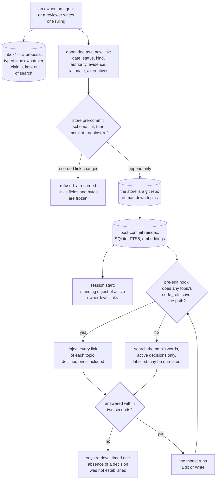
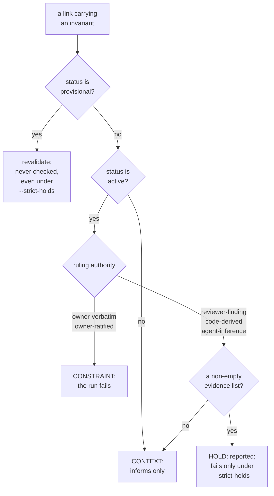

## 1. Executive Summary

MemContinuum is a decision store for Claude Code projects in which a ruling,
once committed, cannot be edited: the store's own `pre-commit` hook diffs every
recorded link against the last commit and refuses any change outside three
forward-only lifecycle fields. The authority stamped on a ruling then decides
what it may do — only the owner's own or ratified words can fail a drift check
or ride in every session's opening digest. The weak side is that the store
delivers decisions and enforces nothing about their use: a declined option is
shown to the model and never checked against, and the authority is whatever the
writer typed.

The README states the problem as two failures at once: decisions that scroll
out of context and get re-litigated, and an agent working file-locally that
writes a helper which exists two directories away.

**The unit is a question, and the answer is a chain nothing can rewrite.** One
markdown file per topic; its body is an ordered list of links, newest first;
each link is one ruling with its own date, status, kind, authority, evidence
and rationale. A change of mind is a new link carrying `reverses` and a
`reason_for_change`, and the link it reverses keeps its text.

`memlint.py --against-ref REF` enforces that (`memlint.py:2077-2155`,
`:2404-2680`). It compares every link against the same link at a git ref and
reports any changed field outside `{link, status, superseded_by, promoted_by}`.
That is a set difference, so a field added to the schema later is frozen
without anyone listing it. A link whose parsed fields survive but whose raw
bytes changed is refused as a reformat. So is a removed link, a deleted record
file, and a new link inserted below a recorded one. Three lifecycle fields may
each move forward once, only into a terminal state, and only as the sole change
on that link.

The store's `pre-commit` hook runs the schema lint and then that check, and
exits 1 on either (`hooks/pre-commit-append-only.sh:161-169`, `:183`,
`:228-231`, wired by `scripts/repo-init.sh:1615`). `git commit --no-verify`
skips it, and the installer's documentation says the real guarantee for a
shared store is the same check in CI behind a protected branch
(`hooks/install-hooks.md:224-227`); no workflow, template or script in the tree
provides that job. Each link carries `recorded_by` and `recorded_at`, so the
chain is the store and the record of every ruling made in it, which earns
`audit_log`.

**Authority decides what a record may do.** Five values are allowed on a
ruling, and they collapse into three citation tiers: `owner-verbatim` and
`owner-ratified` are CONSTRAINT; the other three are HOLD when they carry
evidence and CONTEXT when they do not; anything not `active` is CONTEXT
whatever its authority (`memidx.py:4692-4711`). Search defaults to `active`, so
a superseded, declined or provisional link row is not returned unless asked for
(`:3122-3149`, `:3243-3247`). The session-start digest carries a standing link
only when it is active and owner-level (`:5536-5539`). A discrete status that
withholds a memory, applied as a filter, is what `trust_state` asks for.

One more mark. **`negative_eval`**: one search over three records planted with
the same term returns the real topic and asserts both inbox drops are absent,
then flips a single flag and asserts both are present
(`tests/test_memidx.py:3295-3359`).

**`human_review` is withheld.** Anything under `inbox/` indexes as `type: inbox`
whatever its frontmatter claims and stays out of search; a `provisional` link is
never checked by `drift`; the linter refuses a status edit back toward
`active`. What is absent is an actor the producing agent cannot be. The route
out of staging is appending a link whose authority is `owner-verbatim` or
`owner-ratified`, and the linter describes the second as *"the orchestrator's
own paraphrase"* (`memlint.py:126`). The agent writes the link with its own Edit
and Write tools; the linter checks the shape and never that an owner affirmed
it.

Three findings sit against the design. **The scope key can never exclude
anything:** one database holds one project, refused outright for a second
(`memidx.py:1046-1051`), so the `project` predicate guards a stamping accident
rather than partitioning anything. **A declined ruling is delivered, not
enforced:** the pre-edit chain hands every link to the model regardless of
status, and nothing keys on the rejected value. **Every hook but the commit gate
fails open:** a missing index, a missing interpreter or a slow lookup means the
edit proceeds, and a file changed from the shell gets no lookup at all.

## 2. Mental Model

A memory is **a question with a history of answers**, and the history is the
point. Asking "what do we do about hidden files in the processed count" returns
not the current answer but the chain that produced it: what was adopted, what
was declined and because of what, what reversed what and on which of three
stated grounds — new evidence, changed context, changed mind.

Belief is graded by **who said it**, per field. The same link can hold a ruling
the owner spoke verbatim and a rationale that is an agent's reading of why, and
the schema keeps them apart on purpose. There is no `paraphrase` value, and
`owner-ratified` exists so an inference can be promoted without being confused
with the owner's own words.

A memory is **used at the moment of an edit**, not when someone remembers to
ask. Before the Edit or Write tool touches a file, a hook resolves that path to
the topics whose `code_refs` cover it and injects their chains. When nothing
binds the file, it searches on the path's words and labels the result *"No
recorded decision binds this file. Nearest by search -- may be unrelated"*
(`hooks/mc-fallback-lib.sh:28`). The lookup is bounded at two seconds, and a
timeout says the absence of a matching decision was not established.

A few rulings apply everywhere. A topic may list some of its own links as
`standing`, and every session opens with a capped digest of those that are
active and owner-level, at most 24 links and 4,800 bytes
(`memidx.py:4605-4606`).

Nothing forgets. There is no decay, no consolidation and no summariser; a
ruling stops applying by being superseded, declined or marked historical, and
its text stays where it was written.

## 3. Architecture

Two Python programs and a shell layer around Claude Code.

- `memidx.py` (9,602 lines) — the indexer and every read command: `reindex`,
  `search`, `chain`, `for-path`, `why`, `drift`, `standing`, `unmapped`,
  `check`, `code-search`, `code-census`, `stats`. It owns the SQLite schema for
  both databases, the FTS5 tables, the embedding pipeline and its staleness
  fingerprint, and the three enforcement classes.
- `memlint.py` (3,007 lines) — validation in three parts: a schema and
  consistency pass over the tree, a citation check of cited commits and
  `file:line` references against `--code-root`, and `--against-ref`, the
  append-only check that compares links against a git ref.
- `mc_text.py` (124 lines) — the content-term vocabulary shared by the indexer
  and the prompt-query channel.
- `chunkers/` (2,515 lines) — a Python AST chunker, a Swift chunker and a
  tree-sitter backend with pinned grammars for JavaScript, TypeScript, Java,
  PHP, Rust and Lua.
- `hooks/` (7,890 lines of shell) — `pre-edit-chain.sh` is the retrieval hook,
  `mc-fallback-lib.sh` and `mc-query-lib.sh` its search fallback,
  `ledger-post-edit.sh` the edit ledger, `pre-commit-append-only.sh` the store's
  git gate, `post-commit-reindex.sh` the reindex, `sessionstart-remind.sh` the
  standing digest and session nudge, `userprompt-remind.sh` and
  `newfile-nudge.sh` the write-side nudges and the prompt search,
  `mc-watchdog.sh` the deadline wrapper.
- `scripts/` (6,450 lines of shell) — `repo-init.sh` installs and wires
  everything; `memcontinuum-update.sh` re-renders drifted installs; the
  `-decide`, `-state` and registry scripts manage a per-machine registry of
  which repositories have a store.
- `bench/` — a synthetic corpus, a query set, three runners and a scorer
  ([section 10](#10-tests-evals-and-benchmarks)).

The store itself is a git repository of markdown. The index is a projection and
is disposable; the pinned tree-sitter grammars are an explicit exception to the
project's own `>=` policy, because an unpinned grammar upgrade would change
chunk shapes without moving the index fingerprint.

### Deployment and ergonomics

- **What has to run:** Python with PyYAML for everything, plus `fastembed` and
  numpy only for the vector and hybrid modes, imported lazily so `for-path`,
  `chain` and `check` stay dependency-light. SQLite is embedded. CI and the
  installer install from `requirements.lock`, which pins exact versions with
  hashes; `requirements.txt` and `pyproject.toml` carry minimums.
- **Fully local and offline:** yes, including embeddings.
- **Hand-repairable:** the store is markdown in git, and the index rebuilds
  from it.
- **Install:** `memcontinuum-setup.sh` and `scripts/repo-init.sh`, which wire
  the Claude Code hooks, the two store-side git hooks and a registry row.

## 4. Essential Implementation Paths

- **Freeze a recorded link.** `_link_diff_errors` (`memlint.py:2082-2155`)
  takes one link as it was at a ref and as it is now, subtracts
  `{link, status, superseded_by, promoted_by}` from the union of both field
  sets, and reports every remaining field whose value moved. `status` may go
  from `active` or `provisional` to `superseded`, `historical` or `declined` and
  no further; `superseded_by` may be added only in that move; `promoted_by` may
  be added once. A lifecycle move bundled with any body edit produces an error
  for each.
- **Freeze its bytes and its place.** `_link_raw_spans` (`:2224`) locates each
  link's exact text span by indentation, and `check_append_only` refuses a link
  whose parsed fields are identical and whose bytes are not, treating a span it
  cannot extract as changed (`:2649-2680`). A new id following a recorded one
  is refused as out of order (`:2621-2636`); a removed link (`:2643-2648`) and
  a deleted or renamed record (`:2490-2509`) are errors.
- **Judge new links more strictly than old ones.** `_new_link_errors`
  (`:115-140`) refuses an unknown `kind` and an `owner-verbatim` ruling phrased
  as a question. Under `--against-ref` these are errors only for links absent at
  the ref; a plain lint reports them on recorded links as warnings, since frozen
  history cannot be repaired in place.
- **Gate the commit.** `hooks/pre-commit-append-only.sh` runs the schema lint,
  then `memlint.py --against-ref HEAD --staged ROOT`, and exits 1 on an error
  from either (`:161-169`, `:183`, `:228-231`). An unset root, a different
  repository, an unborn `HEAD`, a missing interpreter or an unrecognised linter
  result each exit 0 with a logged reason.
- **Classify a ruling.** `invariant_enforcement_class` (`memidx.py:4692-4711`)
  returns `context` for any non-`active` status, then `constraint`, `hold` or
  `context` by authority and evidence. "Evidence" here means a list holding at
  least one non-blank string (`:4666-4678`); the citation check is a separate
  lint pass and does not feed the class. `memlint.py:1338-1364` computes the
  same tiers from raw YAML and imports memidx's two authority sets.
- **Run the drift gate.** `cmd_drift` (`memidx.py:4821-4901`) checks each
  link's `invariant` against current source, sends a `provisional` link to
  `revalidate` unchecked, names skipped ones, and returns 1 on a constraint
  violation or, under `--strict-holds`, a hold violation. A person runs it; the
  store README template lists the command (`templates/store-README.md.tmpl:45`).
- **Resolve a path to decisions.** `topic_matches_for_path` (`:3716`) keeps the
  project's topics with a `code_refs` entry matching the file by prefix, glob or
  `path#symbol`; `topic_chain_lines` (`:3981-3994`) then selects every link for
  that topic by `topic_path`, ordered by sequence, with no status filter.
- **Fall back on a miss.** `pre-edit-chain.sh:684` and `newfile-nudge.sh:741`
  run `search --decisions-only --read-only --hydrate` on the path's words.
  `--decisions-only` restricts hits to topics, links, incidents and
  investigations (`memidx.py:3230-3241`); `--hydrate` renders each hit's chain
  under a byte cap that keeps the current link first (`:3378-3403`, `:4006`).
- **Deliver the standing digest.** `cmd_standing` (`:5432`) reads each topic's
  `standing` list, keeps a link only when it is `active` and owner-level, and
  refuses rather than truncates over the cap; `sessionstart-remind.sh` delivers
  it.
- **Stage a proposal.** `infer_type` (`:705-716`) returns `inbox` for anything
  whose first path segment is `inbox`, overriding the file's own `type:`;
  `cmd_search` excludes those records and their link rows unless
  `include_inbox` is set (`:3288-3296`).
- **Notice a shell edit.** `hooks/ledger-post-edit.sh` diffs the tree with
  `git status` after a Bash or unrecognised tool call and appends
  `{path, kind, content_sha256, seen_at, root, source}` rows to the session's
  ledger, which is what the nudges read.

## 5. Memory Data Model

A **topic** is a file with frontmatter — `type`, `id`, `title`, `area`,
`project`, `current`, `code_refs`, `standing`, `tags` — and a body of links.
`current` is hand-set to the newest active link and the linter errors, naming
the correct value, when it disagrees.

A **link** carries `link`, `date`, `status`, `kind`, an optional `reverses`
with a `reason_for_change` drawn from three values, a `ruling` and a
`rationale` each with `text` and `authority`, `alternatives` as a list of
`{option, rejected_because, authority}`, `evidence`, `revisit_if`, an optional
`invariant`, typed `edges`, `assumptions`, `recorded_by` and `recorded_at`.

A **concept** (`type: concept`) is the Anatomy layer: what the code already
contains, with `implemented_by`, `tested_by`, an owner boundary and
`governed_by` topics.

**Temporal:** `date` on the ruling and `recorded_at` on the recording are both
record times, and validity is positional — a ruling applies until a later link
supersedes it. There is no interval and no as-of query. `bitemporal` withheld.

**Trust:** five authorities and five statuses, read on the search default, the
standing digest and the drift gate. `trust_state` earned.

**Audit:** the link chain, frozen against the last commit. Topic frontmatter is
outside the guard: `code_refs`, which decides which files a ruling governs, and
`standing`, which decides what every session opens with, change with no event
beyond git history.

**Scoping:** a `project` column that one database can only ever hold one value
of. Withheld — see [section 9](#9-reliability-safety-and-trust).

**Tombstone:** a `declined` status and per-link rejected alternatives, frozen
once written and delivered on the write path, keyed on the topic rather than on
the value and enforcing nothing. Withheld — see section 9.

## 6. Retrieval Mechanics

Five surfaces, and the important one is not a query.

`for-path` is the automatic surface: a file path in, every topic whose
`code_refs` cover it out, each with its whole chain. Matching is by path
prefix, fnmatch glob or `path#symbol`, and only the last takes part in marker
verification. Concepts matching the path come too, and each brings the topics
that govern it.

The **search fallback** runs when `for-path` finds nothing for the file being
edited or created. It searches on the path's words with the default status
filter, restricted to decision records, takes at most two hits and labels them
as a guess. Each hit carries its chain, capped at 2,000 bytes by default.

The **standing digest** opens every session and every compaction with the
standing links of all topics — citation lines only, ordered and capped, and
refused rather than truncated over the cap.

`search` is FTS5 by default, with vector and hybrid modes behind a lazily
imported `fastembed`. Its defaults lean the same way as the mark: `status`
defaults to active, and inbox records are excluded. In hybrid mode, when the
FTS top hit shares no vocabulary with the query, the ranking steps aside to the
vector result and reports `fusion: vector-only`. The embedding fingerprint
covers the model name, dimension, pipeline version, prefix, normalisation and
fastembed's installed version.

An **opt-in prompt channel**, switched on per project by an environment
variable or a projects file, derives search terms from the user's prompt,
never from agent reports or task notifications, and makes at most one guess per
prompt (`hooks/userprompt-remind.sh:364-372`).

`why` is the reviewer's direction — from a file or symbol to the concept to the
topics that govern it — and it prints declined links on purpose, because the
question it answers is why the code is strange.

**Failure modes.** Every path but the commit gate fails open. A missing or
uninitialised index returns a named reply and no decision; a stale index
answers from what it has. The two-second timeout and the labelled fallback are
the two places where the model is told what was not established. A file edited
through Bash gets no lookup; the ledger records it afterwards from `git status`,
which does not show a file committed in the same call or one under an ignored
path.

## 7. Write Mechanics

**Nothing extracts.** There is no summariser, no consolidation pass and no
background writer; a memory exists because a person or an agent wrote a link
and committed it. No production code writes a topic file. The nudges are the
only push: one fires when files have been edited under no decision topic, the
other when the conversation has moved on shortly after real edits.

**Correction is an append.** The predecessor keeps its text and gains a
terminal status; the successor names it in `reverses` and states which of three
grounds applies. The linter refuses a `kind: reversed` link whose target is
active, and refuses `reverses` without a `reason_for_change`.

**Citations are checked when a code root is bound.** With `--code-root`, the
linter resolves a cited commit, subject or `file:line` against that tree; an
unresolvable one warns, and `--strict-citations` makes it an error. The commit
gate does not pass a code root.

**Concurrency** is git's. The store is a repository, the index is a
projection, and the post-commit hook rebuilds it.

### Operational cost

- A pre-edit lookup is one SQLite open and two queries; a miss adds one search,
  measured in the hook's own notes at under a second in hybrid mode. Both sit
  under the two-second watchdog.
- A commit pays the schema lint and the `--against-ref` pass over the staged
  records.
- A reindex is proportional to the store; embeddings are optional and lazy.
- No model call anywhere in the memory path.

## 8. Agent Integration

The model never calls a recall tool. The hooks put the standing digest in front
of it at session start, the governing chain or a labelled guess before an Edit
or a Write, and nudges when edits have accumulated under no topic. Two skills —
`memcontinuum` and `memory-search` — give it the deliberate surfaces. The
person's surfaces are the CLI, the markdown store itself, and `inbox/`.

The install decision is itself recorded per repository in a registry keyed by
the `origin` remote when there is one and the working tree path otherwise, so a
repository that declined is never asked again. That `declined` is a different
vocabulary from a link's `declined` status, and a reader grepping the tree will
meet both.

## 9. Reliability, Safety, and Trust

**Trust state — awarded.** Five authorities, five statuses, three enforcement
classes. The status excludes rows on three reads: the search default, which the
hook fallbacks and the `memory-search` skill use; the standing digest; and the
drift gate, where `provisional` withholds a link from enforcement entirely. The
classification exists twice, over YAML and over SQLite rows, with the authority
sets shared so the two cannot diverge. The limit is the producer: authority and
status are fields in a file the writing agent edits, and nothing verifies that
an `owner-verbatim` ruling came from the owner.

**Audit log — awarded.** The chain is the record of the rulings made in it:
each link names when it was ruled, who recorded it, when, what it reverses and
on what grounds. The append-only property is enforced by a linter whose frozen
set is a subtraction rather than a list, by a byte comparison that catches a
regenerated file, and by the store's own `pre-commit` hook. Two limits. The
hook is a local git hook that `--no-verify` skips, and the CI re-run the
documentation recommends is not shipped. And topic-level frontmatter —
`code_refs`, `standing`, `current` — changes with no event in the chain.

**Human review — withheld.** Inbox records are typed as such regardless of what
they claim and excluded from search; provisional links are never enforced; no
edit can move a status toward `active`. Promotion is an appended link at owner
authority, written with the same Edit and Write tools the agent holds, and the
linter checks its shape rather than who wrote it. No surface in the tree checks
an actor; the recorded search for `isatty` and `approve` finds three comments.

**Negative evaluation — awarded.** The inbox exclusion is asserted against a
populated result set with the flag as the only variable, and re-asserted in the
other direction. The FTS mode it uses needs no embedding model, so the positive
control runs with PyYAML alone.

**Scope — withheld, and the withholding is not a finding about isolation.**
Project isolation is enforced by construction: one decision database belongs to
one project, `records` is keyed by `path` alone, and `open_db` refuses to open a
store under a second `--project` rather than letting the two mix — *"opening
the SAME physical file for a different `--project` would silently
evict/overwrite that project's rows"* (`memidx.py:1046-1051`). `project=?`
appears 67 times in `memidx.py`, 11 of them in updates and deletes; the chain
read keys on the topic path alone. Nothing here leaks between projects.

What the mark asks for is narrower than isolation: a stored scope key that
partitions co-resident memory on the read path. A store that holds exactly one
scope cannot demonstrate that, because the predicate has nothing to exclude —
the same line drawn for [Agentic Context Engine](../agentic-context-engine/),
where one skillbook belongs to one agent. The code index is the multi-project
store, keyed `(path, project, code_root)`, and what it holds is chunks derived
from source rather than anything that could turn out to be false.

**Tombstone — withheld, and it is the closest miss here.** The schema is well
equipped for one: a `declined` status meaning considered and not adopted, a
`declined` kind, and per-link `alternatives` each carrying the option, the
reason it was rejected and its own authority — all frozen once committed. The
rejection is delivered on the write path: `topic_chain_lines` selects every link
for a topic with no status filter, so the model about to edit a governed file
receives what was declined along with what was adopted. Two things keep the
mark. It is keyed on the topic and reached by file path, not keyed on the value,
so the same rejected idea under another topic or in another file meets nothing.
And the delivery is text a hook hands to a model and cannot refuse: re-adopting
is a legitimate move the schema models with `kind: restored`.

**Bitemporal — withheld.** `date` and `recorded_at` are both record times and
validity is positional in the chain.

**What the fail-open discipline costs.** Every hook except the commit gate is
written never to block an edit, which is a defensible choice for a tool that
sits in front of someone else's work. The guarantee is about the *store* — a
recorded link cannot be rewritten through a commit that runs the hook — and not
about the *work*: nothing ensures a decision was consulted, only that it was
offered when the index was present and the path went through a tool the hooks
see.

## 10. Tests, Evals, and Benchmarks

2,059 test functions in 19 modules and 47,161 lines. `test_memidx.py` and
`test_memlint.py` carry the schema, the enforcement classes, the append-only
diff and the inbox exclusion; `test_memlint_citations.py` the citation check;
`test_hooks.py` and `test_write_hooks.py` the shell layer, including the search
fallback and the standing digest; `test_repo_init.py` and `test_update.py` the
installer and updater; `test_stats.py` the log parser. There are golden files, a
macOS smoke test and a bash-3.2 runner. CI runs the suite on Python 3.12 and
3.13 from the locked requirements. None of it was run for this reading.

`bench/` is a public retrieval benchmark. A synthetic 32-record corpus about a
fictional sync product, 69 queries — 20 by file path, 49 by question, sliced
into paraphrase, exact-term and plain — and three runners: no memory, a TF-IDF
keyword baseline, and MemContinuum in FTS, vector and hybrid modes. The scorer
reports Recall@1, @3, @10 and MRR per slice. A negative control reruns each
runner against a kind-preserving shuffle of query and expected answer, and
fails a runner whose gain does not clear one standard error.

The README's own limitations section is specific: the corpus is clean by
construction and its numbers are upper bounds; the answer key is one agent's
judgment; the control catches a stateless, deterministic runner that ignores
the query and is beaten by a counter or a random sampler, both kept as test
fixtures. No score file is committed, and a private gate over real incident
history depends on fixtures the repository does not publish.

The hook log carries a `topics=` field so that a matched edit becomes a
gradeable sample, and `stats` reports `pre_edit_topics_named`,
`topics_distinct` and `top_topics`. No analysis of that log is committed.

## 11. For Your Own Build

### Steal

- **Enforce append-only with a diff against a ref, not with a convention.**
  Comparing each record against itself at the last commit turns "we never edit
  history" into something a commit can fail.
- **Freeze by subtraction, and freeze the bytes.** Naming the four fields that
  may move and freezing everything else protects a field added next year; a
  byte comparison catches the YAML dumper that rewrites every record while
  changing no value.
- **Make a lifecycle move the only change on a record.** A status flip bundled
  with a text edit is how an append-only store quietly stops being one.
- **Tighten rules for new records only.** A stricter check that errors on new
  links and warns on frozen ones lets a schema improve without demanding edits
  the append-only rule forbids.
- **Grade authority per field, not per record.** A ruling can be the owner's
  words while the rationale beside it is an agent's guess.
- **Say what retrieval failed to establish.** A timeout that reports *the
  absence of a decision was not established*, and a miss that labels its
  nearest guess *may be unrelated*, keep a model from reading silence or a
  guess as a ruling.
- **Retrieve on the tool call, not on the model's discretion.** A hook that
  resolves the file being edited to the decisions that govern it needs no
  cooperation from the model.
- **Publish a negative control with the benchmark.** A shuffle that a
  query-blind runner cannot beat, and a written list of the runners that do
  beat it, is a benchmark that can say it measured nothing.

### Avoid

- **A scope column in a store that can hold only one scope.** The predicate
  reads like a partition and is a stamping guard; write down which it is.
- **Recording what was declined and never checking against it.** The reasons
  are captured, immutable and delivered, and nothing consults them as a
  precondition — the mechanism is one lookup short of a real tombstone.
- **An authority label the writer chooses.** A tier that decides what blocks
  work is only as strong as whoever can type `owner-verbatim`.
- **A guarantee that lives in a local hook.** A check `--no-verify` skips needs
  a server-side twin, and the twin has to ship, not be recommended.

### Fit

Right for a small team or a solo developer running agent-driven work on one
repository who wants the reasons to survive the session and the reasoning to be
citable afterwards. The append-only discipline is the strongest part and the
part that costs least to adopt. Wrong if you need one store across several
projects, memory about people rather than about code, a check that a proposal
contradicts a declined ruling, or any guarantee that a decision was actually
read.

## 12. Open Questions

- Will a declined ruling ever be checked rather than shown? The reasons are
  recorded and immutable; what is missing is a lookup on the way in.
- Can one store serve several projects? The refusal is honest about why it
  cannot — `records` keyed by `path` alone — and the code index shows the shape
  that would fix it.
- What do the benchmark numbers look like on real decisions? The private gate
  exists for that and its fixtures are unpublished.
- Should topic frontmatter be frozen too? `standing` puts a ruling in every
  session, and an edit to it leaves no event in the chain.

## Appendix: File Index

| Path | Lines | What it holds |
| --- | --- | --- |
| `memidx.py` | 9,602 | Both SQLite schemas, `reindex`, `search` (3155), `chain`, `for-path` (4196), `why` (4513), `drift` (4821), `standing` (5432); `invariant_enforcement_class` (4692), `topic_matches_for_path` (3716), `topic_chain_lines` (3981), `infer_type` (705) |
| `memlint.py` | 3,007 | The schema pass, `_new_link_errors` (115), the citation check, `_link_tier` (1338), and `--against-ref`: `_link_diff_errors` (2082), `_link_raw_spans` (2224), `check_append_only` (2404) |
| `mc_text.py` | 124 | The shared content-term vocabulary |
| `chunkers/` | 2,515 | Python AST, Swift and tree-sitter backends with pinned grammars |
| `hooks/pre-edit-chain.sh` | 916 | The retrieval hook, its search fallback and its timeout message |
| `hooks/mc-fallback-lib.sh`, `mc-query-lib.sh` | 270, 188 | The fallback labels, filtering and query building |
| `hooks/sessionstart-remind.sh` | 870 | The standing digest and the session nudge |
| `hooks/userprompt-remind.sh`, `newfile-nudge.sh` | 1,424, 862 | The write-side nudges, the opt-in prompt search and the new-file fallback |
| `hooks/ledger-post-edit.sh` | 802 | The session edit ledger, including the shell-diff path |
| `hooks/pre-commit-append-only.sh` | 237 | The store's git gate |
| `hooks/mc-watchdog.sh`, `memlib.sh` | 297, 815 | The deadline wrapper and the shared shell library |
| `scripts/repo-init.sh`, `memcontinuum-update.sh` | 1,859, 2,293 | The installer, the hook wiring and the updater |
| `bench/README.md`, `score.py`, `queries.jsonl` | 603, 1,044, 69 | The benchmark's method, scorer and query set |
| `docs/SCHEMA.md`, `INTERNALS.md`, `DESIGN.md` | 505, 3,380, 82 | The record schema, the internals, the design note |
| `tests/` | 47,161 in 19 modules | 2,059 test functions, goldens, a macOS smoke test, a bash-3.2 runner |

### Recorded searches

Run at the tree root of the pinned checkout with `git grep`.

- `git grep -n -i -E -e '--as-of|as_of|valid_until|valid_from|effective_from' -- '*.py' '*.sh'` — no match: no validity interval, no as-of query.
- `git grep -n -E '"declined"|status[^a-z]+declined' -- hooks` — no match: no hook reads a declined status.
- `git grep -n -E 'alternatives|rejected_because' -- memidx.py memlint.py` — `memidx.py:339` and `:502` index the text, `memlint.py:213-222` validates each alternative's authority; nothing reads them as a precondition.
- `git grep -n 'path TEXT PRIMARY KEY' -- memidx.py` — `:849`, the `records` table, keyed by path alone; the other three hits are other tables.
- `git grep -n 'this db keys rows by path alone' -- memidx.py` — `:1049`, the refusal.
- `git grep -n -E 'against-ref' -- .github templates scripts` — no match: no shipped workflow, template or script runs the append-only check.
- `git grep -n -w drift -- hooks scripts skills templates .github` — comments, and `templates/store-README.md.tmpl:45`, the manual command; no hook, skill or workflow runs it.
- `git grep -n -i -E 'isatty|approve' -- memidx.py memlint.py hooks scripts skills` — three comments; no actor check.
- `git grep -n -E 'write_text|open\([^)]*"(w|a)"' -- memidx.py memlint.py mc_text.py` — three log appends; no production write to a topic file.
- `git grep -n -i -E 'arxiv|bibtex|@article|@misc|doi\.org' -- README.md docs` — no match; no paper.
- `git grep -n -i -E 'anthropic|machine learning|not (be )?used (for|to)' -- LICENSE` — no match; the MIT text carries no rider.

## History

**2026-10-15** — [`16293db855d5bf6922360571acb027850e4bca50`](https://github.com/krakozavr/MemContinuum/commit/16293db855d5bf6922360571acb027850e4bca50) — 62 commits on, at version 0.2.0. All three marks re-verified at both pins. Added upstream: a byte and order freeze in the append-only guard ([section 4](#4-essential-implementation-paths)); a standing digest at session start, a labelled search fallback on a pre-edit miss and an opt-in prompt search ([section 6](#6-retrieval-mechanics)); a citation check. Wrong at the previous pin: that CI re-ran the append-only check, which the documentation recommends and nothing ships; a section 9 paragraph that awarded `human_review` after its withdrawal; "no benchmark", when `bench/` held a public harness ([section 10](#10-tests-evals-and-benchmarks)); the census and three `memidx.py` anchors, carried from the first pin. Screened from a full clone: sixteen hook scripts as the one auto-run surface, two unpinned surfaces, nothing inside the cooldown, MIT with no rider. Nothing was installed or run.

**2026-09-19** — audited at the unchanged pin [`e21bfa06c0201433742a657b222ad40c8f4d95f4`](https://github.com/krakozavr/MemContinuum/commit/e21bfa06c0201433742a657b222ad40c8f4d95f4); nothing upstream moved, so the correction is ours. `human_review` is **withdrawn**. Everything the record said about the staging is true and none of it is about an actor: `inbox/` material is typed `inbox` regardless of its frontmatter and excluded from search, and the linter refuses a status edit back toward `active`, so the promotion procedure really is the only route to constraint authority. But that route is an append the orchestrator performs, and `memlint.py:135-137` states what it contains — *"owner-ratified is the orchestrator's own paraphrase of what the owner affirmed, never a literal transcript."* The linter checks the ruling's shape and never that the affirmation occurred. The staging keeps its credit under `trust_state`, where the withholding belongs. `audit_log` and `negative_eval` stand. Screened again first; nothing was installed and no suite was run.

**2026-09-16** — [`e21bfa06c0201433742a657b222ad40c8f4d95f4`](https://github.com/krakozavr/MemContinuum/commit/e21bfa06c0201433742a657b222ad40c8f4d95f4) — re-read at a commit dated 2026-09-15, 115 commits past the previous pin. All four marks re-tested and held. The only change to the anchored file is a directory-pruning helper for the code walk; no mechanism behind a mark moved. Screened before reading, from a full clone: one auto-run surface, no build-time execution point, two unpinned dependency surfaces and one dependency file inside the seven-day cooldown. Nothing was installed, built or run.

**2026-09-08** — [`161f555d74d81532362a38e8f10657eac0c29e23`](https://github.com/krakozavr/MemContinuum/commit/161f555d74d81532362a38e8f10657eac0c29e23) — correction. The `scope_enforced` reasoning was accurate and its presentation was not: one decision database per project, with a second `--project` refused outright, was listed among the report's risks and named as the verdict's biggest risk. That is a property which prevents cross-project contamination, not one that causes it, and framing it as a cost invited exactly the misreading it received — that the withheld mark was a finding about leakage. The mark stays withheld, on the same line this atlas applied to Agentic Context Engine: a store holding exactly one scope cannot demonstrate partitioning on a read path. Sections 5 and 9, the frontmatter and the verdict now say that separation is enforced here and that the withholding is not a claim about isolation. Reported by the project's author; the facts were re-verified at this pin before the wording changed.

**2026-09-08** — [`161f555d74d81532362a38e8f10657eac0c29e23`](https://github.com/krakozavr/MemContinuum/commit/161f555d74d81532362a38e8f10657eac0c29e23) — first reading, at the head of `main`, on a commit from the same day. Screened before anything was read: one auto-run surface — fourteen hook scripts a plugin manifest can register — two dependency manifests inside the seven-day cooldown, two unpinned ranges, no build-time execution; nothing was installed or run, and the read was made from a full clone. Four marks. `trust_state` and `audit_log` rest on enforcement rather than on schema: the three citation tiers decide whether a violated invariant fails a run, and the frozen-body check runs from the store's own `pre-commit` hook. `human_review` rests on the inbox exclusion and on the linter's refusal to move a status toward `active`; the promotion procedure itself is documentation. `negative_eval` rests on the inbox test's populated positive control. `scope_enforced` and `tombstone` were each examined and withheld with the near-miss stated in section 9. The reading covers the decision store, its linter, the enforcement classes, the retrieval hooks and the ledger; the Anatomy code index, the chunkers, the installer's registry and the nudge heuristics were read as context rather than as subject.
