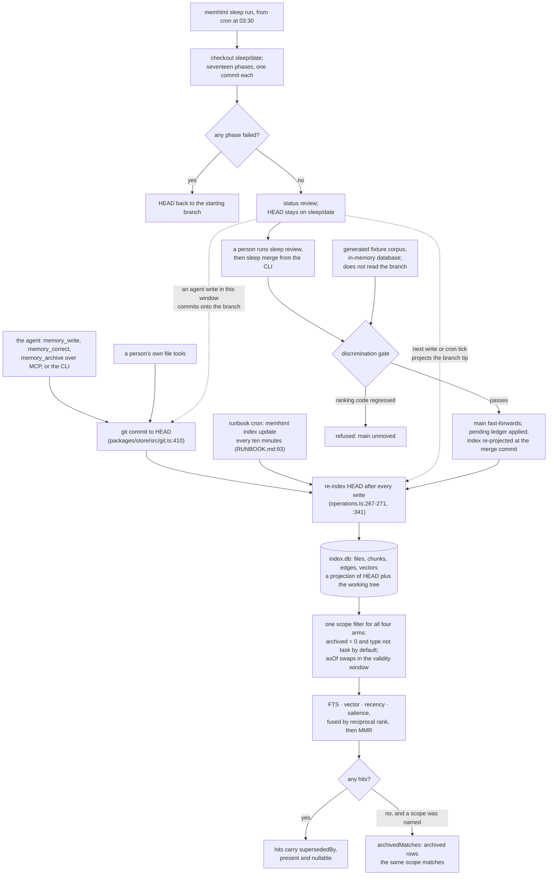

## 1. Executive Summary

memhtml stores an agent's long-term memory as a git repository of semantic
HTML5 files, one fact per file, with a SQLite index rebuilt from the tree. The
design is a division of labour written as a rule — the agent writes, a nightly
curation run works on a branch, a person merges — and the boundary between the
second and third actor is a git branch that the read path never consults.
Search reads an index projected from whatever `HEAD` names. A successful run
leaves `HEAD` on its branch, so the next write or the next scheduled re-index
serves unreviewed curation to the agent.

The rule, from the README:

> "Three actors share one tree. The agent writes facts, and it resolves only the
> conflicts it found itself. Sleep curates on a branch when a caller fires it,
> and it detects conflicts without resolving them. The human owns the gate and
> every one-way door."

Much of that holds in code. Sleep is absent from the fifteen MCP tools, each
committing phase makes its own commit, `trace-consolidation` lands one commit
per distilled memory, and phases that decline to decide open a task quoting
their evidence. The withholding does not hold: `run` returns `HEAD` to the
starting branch only when a phase failed (`packages/sleep/src/run.ts:249`),
and the project's own status code states the consequence. Between `sleep run`
and `sleep merge`, "HEAD is the sleep branch tip while the index describes
`main`", and the warning it prints prescribes `memhtml index update`
(`apps/cli/src/operations.ts:2705-2724`).

**The merge gate tests the code, not the run.** `memhtml sleep merge` re-runs
the discrimination evaluation before it fast-forwards `main`, and the README
says this means "a sleep run that degrades retrieval cannot land". The gate
builds its own generated corpus in an in-memory database and "never reads the
operator's `index.db`" (`packages/eval/src/harness.ts:34-37`). It refuses when
the ranking code regresses. A run that merged the wrong pair or archived the
wrong memory passes it.

**Three smaller mechanisms are worth taking on their own.** The scope filter
"is built ONCE and every arm receives the same string", because "[p]er-arm
filters would let a scope apply to three arms and not the fourth"
(`packages/index/src/scope.ts:9-12`). An empty scoped result reports
`archivedMatches`, so an agent "can tell 'never existed' from 'archived'"
(`packages/index/src/retrieval.ts:141-155`). And the evaluation's adversarial
controls are the merge veto read backwards: the three predicates that forbid
folding two memories together become text transforms "that turn a true claim
into a high-similarity WRONG one" (`packages/eval/src/controls.ts:7-23`).

Three marks are carried. Trust state: `archived` is a stored state the default
filter excludes on search, recall and list. Bi-temporal: an as-of lens over
event time and validity stamped at correction. Negative evals: retrieval tests
that assert archived, not-yet-valid and out-of-scope rows absent beside a
positive control. Review is withheld because the read path does not consult
the state the merge resolves; scope because the workspace key applies only
when a caller names it; audit because the mutation record is git; tombstone
because write-time checks read active rows only.

## 2. Mental Model

A **memory** is one HTML file in a git tree. Its `<mark>` is the claim, its
first `<time datetime>` is when the fact happened, and its head metas carry
type, status, confidence, validity and supersession. The index is a projection
and can be deleted.

A memory is **active** or **archived**, and the path decides which: a file
under `archive/` is archived. It reaches `archive/` three ways, each a
`git mv` in one commit:

- **corrected** — `correct` writes the replacement and archives the target with
  `memhtml-superseded-by`; the winner gains a `supersedes` link and a
  `memhtml-valid-from`, and the loser a `memhtml-valid-until`;
- **evicted** — retention triage, `memory_archive` or a finished task archives
  it with no validity stamp;
- **compressed** — a synthesized canonical supersedes the members it folded.

Nothing leaves the tree. A **task** is a memory of type `task` on its own
status axis (`todo`, `doing`, `blocked`, `done`), excluded from unscoped search.

A **sleep run** is a branch named `sleep/<date>` holding one commit per phase.
`sleep merge` fast-forwards `main` to it after a gate. Retrieval does not know
the branch exists: it reads the index, and the index describes `HEAD`.

## 3. Architecture

| Area | Role |
| --- | --- |
| `packages/html` | The closed element and meta vocabulary, parse, serialize, the format check |
| `packages/store` | The git tree: write, correct, supersede, archive, each one commit |
| `packages/index` | `index.db` and `state.db`, the indexer, the four arms and the one scope filter |
| `packages/domain` | Divergence predicates, merge decisions, retention scoring, confidence decay |
| `packages/sleep` | The seventeen phases, the run, review and merge, tasks |
| `packages/eval` | The discrimination gate, its fixture corpus and the write-path acceptance corpora |
| `packages/integrations` | Host installers, instruction block, hooks, skill, receipts, doctor |
| `apps/cli` | The `memhtml` binary and every operation the MCP server calls |
| `apps/mcp` | The fifteen tools and three resources over stdio |
| `apps/consolidator` | The transcript-reading agent `trace-consolidation` drives, with three read tools |

### Deployment and ergonomics

Node 24, one npm package, two binaries. Reading and writing need no
credentials; embeddings and the sleep phases' model calls go to Bedrock
through the default AWS chain, and `MEMHTML_EMBED=off` and `MEMHTML_LLM=off`
turn both off, leaving the lexical arm and the deterministic phases. The store
is a git repository of HTML a person can open in a browser and edit by hand;
the indexer projects uncommitted edits too. `memhtml init` scaffolds the tree,
the PARA directories and a merge driver. The runbook's cron runs `index update`
every ten minutes, `trace index` hourly and `sleep run` at 03:30, and leaves
`sleep merge` off the schedule (`RUNBOOK.md:93-100`).

## 4. Essential Implementation Paths

**Write.** `memory_write` → `writeMemory` (`apps/cli/src/operations.ts:335`)
decodes the agent's narrow type vocabulary, renders the template or takes
`article_html` verbatim behind the format check, asks the dedupe lookup, and
commits through `git commit` on whatever branch is checked out
(`packages/store/src/git.ts:410`). It then runs `reindex()`, which is
`indexer.update({ embed: true })` over the commit that `HEAD` names
(`operations.ts:267-271`, `:341`).

**Correct.** `correctMemory` (`packages/store/src/store.ts:1040-1129`) reads
the target, renders the replacement, computes its valid-from with
`validFromOf`, links `supersedes` to the target's archive path, stages the
archive move with `memhtml-status: archived`, `memhtml-superseded-by` and the
min-wins `memhtml-valid-until`, writes the replacement, and commits once. A
failure between the move and the commit is compensated from a journal of the
original bytes.

**Search and recall.** `retrieval.search` and `retrieval.recall`
(`packages/index/src/retrieval.ts:189-190`, `:596`) both call `fuse`, which
calls `assembleScope` once (`:333`) and substitutes the result into every arm.
Recall then folds disclosure under a character budget, with arcs in their own
envelope.

**Hooks.** `session-start` recalls on the working directory's last two path
segments as a query (`apps/cli/src/hook.ts:205-210`, `:245-253`), then lists
open tasks; `user-prompt-submit` searches on the prompt (`:226-232`);
`pre-compact` and `session-end` index transcripts into the trace tables.

**Sleep run.** `run` (`packages/sleep/src/run.ts:132-260`) creates and reads
back `sleep/<date>`, executes the phases with per-phase isolation, records the
run as `review` or `failed`, and calls `leaveRunBranch` only when a phase
failed (`:249`).

**Sleep merge.** The CLI arm (`apps/cli/src/run.ts:679-708`) composes
`discriminationGate()` in fake mode unless `--skip-gate`, then `merge`
(`packages/sleep/src/review.ts:256`) checks out `main`, refuses on an
overlapping advance, runs the gate, fast-forwards or merges a disjoint
advance, applies the pending-mark ledger, and re-projects the index.

## 5. Memory Data Model

`files` (`packages/index/migrations/0008_tasks.sql`, rebuilt from
`0001_files.sql`) holds per path: type from a closed list of nine plus `task`,
title, body, gist, a disclosure text recall may quote, PARA bucket,
`workspace`, `confidence`, `importance`, `archived`, `origin_path`,
`created_at`, `updated_at`, `event_at`, `archived_at`, `valid_from`,
`valid_until`, `reprieves`, `needs_revision`, author, session, prompt and turn.
Every column derives from a committed file plus its blob sha.

`archived` comes from the path, not the meta: "`archived` is read from the
path's PARA bucket, not from `memhtml-status`. The path is the state"
(`packages/index/src/project.ts:136-151`). `workspace` is the directory under
`projects/`, or null elsewhere (`:25`). Side tables carry tags, entities as
`type:name`, `<dl>` facets, citations, chunks, embeddings and edges; an edge
is `authored` or sleep-`derived`, and `supersedes` edges are authored.

`needs_revision` is parsed, serialized and projected, and nothing sets it true
or reads it in a query; the recorded search below shows both.

`state.db` is the one plane git cannot rebuild: access counts, an outcome EWMA
and corroboration counts for edges and entities, exported to a committed
append-only sidecar, `.memhtml/state/access.jsonl`. `sleep_runs` and
`sleep_phases` are, in the migration's words, "a reporting convenience the git
history can regenerate" (`packages/index/migrations/0006_sleep.sql:1-4`).

## 6. Retrieval Mechanics

Four arms in one SQL statement, fused by reciprocal rank with k=60: FTS at
weight 1.0 over one title-gist-body column, exact vector search at 1.0 grouped
by path, recency at 0.5 over `coalesce(event_at, updated_at)`, and salience at
0.4 from the access plane, which excludes tasks and `resources/people/`. MMR
diversifies afterwards. When no query vector is available or vector coverage
is under the floor, the vector arm is dropped and the result says
`degraded: true`.

The scope filter carries type, workspace, tags, one entity reference and
`<dl>` facets, AND across axes and OR within one. With no `asOf` it adds
`archived = 0` unless `includeArchived` is set; with `asOf` it replaces that
with the validity window and admits archived rows
(`packages/index/src/scope.ts:246-260`). Workspace is strict equality and a
null-workspace memory never matches a workspace scope. Nothing applies a
workspace on the agent's behalf: the session-start hook queries on path words
across every workspace.

An empty result with a named scope is explained. `scopeEmpty` is true only
when a scope narrowed the query and nothing survived, and `archivedMatches`
then counts the archived rows the same axes match, listing up to `limit` of
them with their `supersededBy` (`packages/index/src/retrieval.ts:470-497`).
It is zero under `asOf`, whose lens admits archived rows.

The as-of lens treats archiving as a record-time event. `archiveMemory`
stamps `memhtml-archived` and no `valid_until`
(`packages/store/src/store.ts:1131-1156`), so an evicted or finished memory
passes every as-of window after its start, including one set to the present.
A corrected memory carries its `valid_until` and drops out on time.

`memory_neighbors` walks one or two hops of authored and derived memory edges
and joins `files` with no archived predicate
(`apps/cli/src/operations.ts:1404-1482`). A node in `archive/` comes back as
path, title, hop and rel, with no flag saying it is archived.

## 7. Write Mechanics

Three doors land in one tree: the CLI (`write` for one memory, `apply` for a
JSONL batch validated before any op runs), the MCP tools (`memory_write`,
`memory_write_batch`, `memory_correct`, `memory_link`, `memory_archive`), and
a person's own file tools, which take on format, path, dedupe and the commit.
The agent's type vocabulary is narrower than the operator's: `arc` is refused
at the MCP schema.

Dedupe is structural: a partial unique index over the active content hash
(`packages/index/migrations/0008_tasks.sql:126-127`) makes a duplicate active
body impossible to index, and the write returns the existing path with
`deduped: true`. Every write-time lookup — exact hash, frame-key conflict,
embedding near-duplicate — filters `archived = 0`
(`packages/index/src/traces-persist.ts:196-201`, `:233-243`, `:274-285`).
Re-writing the exact text of a corrected claim is therefore a new active
memory, with no conflict or near-duplicate report naming the archived one.

Sleep's phases curate on the branch: dedup-merge folds near-duplicates unless
a negation, numeric or variant-qualifier predicate vetoes the pair; entity
resolution, edge typing, confidence decay, arc synthesis, retention triage,
compress, reprieve, trace consolidation, task detection, placement triage and
integrity follow. Detected tasks are authored `agent:sleep`, quote their
evidence, are capped at ten a night (`packages/sleep/src/tasks.ts:224`), and
close when their finding stops appearing.

### Operational cost

A write is synchronous and, with embeddings on, waits for one Bedrock
embedding call per new chunk inside the re-index. Search pays one query
embedding. The nightly run's model spend is bounded per phase and, for
`--deep`, by `--max-llm-calls`; `trace-consolidation` reads ten sessions a
run by default. The session-start hook injects a recall pack under a
character budget plus a capped list of open tasks, and the prompt hook
injects search hits, both at the top of the turn.

## 8. Agent Integration

The MCP server publishes fifteen tools — `memory_write`, `memory_write_batch`,
`memory_read`, `memory_search`, `memory_recall`, `memory_correct`,
`memory_link`, `memory_neighbors`, `memory_resolve`, `memory_archive`,
`memory_reinforce`, `memory_list`, `memory_status`, `trace_search`,
`trace_links` — and three resources (`apps/mcp/src/tools.ts:349-1026`). None
runs, reviews or merges sleep; the header gives the reason, "a sleep run
rewrites confidence across the corpus, archives memories, and creates a branch
a human is expected to read" (`:30-33`).

`memhtml integrations install` writes, per host, an MCP entry, hooks, a fenced
instruction block and a skill, each recorded with its SHA-256 so uninstall
removes exactly what install wrote. The block tells the agent its store is
reachable through five MCP tools "and the CLI", and that `manifest` "lists
every command" (`packages/integrations/src/render/block.ts:36-58`). The
manifest includes `sleep merge`, which carries no check on who runs it.

## 9. Reliability, Safety, and Trust

**Curation is visible before review.** After a successful `sleep run`, `HEAD`
is `sleep/<date>` until `sleep merge` checks out `main`; outside the failure
path, `packages/sleep/src/review.ts:274` is the only checkout back to `main`.
Three things project the branch tip into the index the agent searches in that
window: any write through any door, since each re-indexes `HEAD`; the
runbook's ten-minute `index update`; and, during a `--deep` run, compress's
mid-run re-index (`packages/sleep/src/phases/compress.ts:513-515`). The
stale-index warning `memory_status` prints names the same remedy. The indexer has no notion
of `main`; it projects whatever `HEAD` names. The runbook asks operators to
"[q]uiesce writes for the duration of a run" (`RUNBOOK.md:119`); the code's
window runs until the merge.

**An agent write in that window lands on the sleep branch.** The store commits
with a plain `git commit`, so a fact the agent writes at 07:00 is on
`sleep/<date>`, travels with the curation into `main` at merge, or is lost to
`git branch -D` when a person discards the run. The README's diagram has the
agent writing to `main` "at any hour".

**The gate is a code regression test.** It indexes a generated corpus into
`:memory:` and runs its probes through the real retrieval stack
(`packages/eval/src/harness.ts:24-37`, `:146`); the project's own reference
says it "does not read the run's branch". It catches a binary whose ranking
broke, and the merge is the moment it is least likely to have changed.
`--skip-gate` disables it with a logged warning, and merge does not read the
run's status, so a failed run can be merged.

**The mutation record is git.** Phase trailers, one commit per distilled
memory and install receipts live in a history a force-push rewrites. No table
in either database records memory mutations, and erasure means rewriting
history, since every exit is an archive move.

**Scope is advisory.** Workspace is stored and filters exactly when named, and
nothing names it for the agent. One store shared across projects returns every
project's memories to every session's recall.

What holds: a correction is atomic, archiving never destroys bytes, the
default filter keeps archived rows out of search, recall, list and the task and
entity listings, and the as-of lens answers with what was believed and what
replaced it.

## 10. Tests, Evals, and Benchmarks

The committed suite is large: 3,159 `it` and `test` calls in 161 Vitest files
outside the docs site, plus an integration tier and the eval tier, all run by
`pnpm check` (`package.json:27`) in CI. I ran none of it.

The retrieval tests in `packages/index/tests/retrieval.test.ts` seed a
seventeen-file repository and index it with a deterministic fake embedder.
Three assert exclusion with a positive control: an archived memory absent by
default and present with `includeArchived` (`:362-393`); a superseded pair
answered as-of 2024 with the later correction absent, and as of the present
with the superseded fact absent (`:469-540`); and an entity scope that drops a
rival the unscoped query returns (`:692-725`).

The discrimination gate (`packages/eval/eval/discriminate.test.ts`,
`packages/eval/src/discriminate.ts`) derives negation, numeric and qualifier
controls from each probe's target and requires the target to strictly
outrank every control, with mean reciprocal rank at or above 0.85 and one
inversion failing the run. A control that is returned below its target passes,
so this is an ordering assertion. `live` mode reports `skipped: true` without
credentials rather than passing.

No committed test runs `sleep run`, then a write or an `index update`, then a
search, and asserts that the branch's memories are absent before the merge.
That is the test the three-actor rule needs.

## 11. For Your Own Build

### Steal

Build the scope filter once and hand the identical string to every retrieval
arm. Put anything that narrows only one arm inside that arm, and say so
beside the filter.

Make an empty scoped result explain itself. A count of archived rows the same
scope matches, with a link to each replacement, separates "never existed" from
"archived last night".

Generate adversarial controls from the predicates that forbid merging
two records, and validate each control against its own predicate, not the
union.

Stamp validity at correction time: the winner's start from its stated event
time, the loser's end at that moment, the earlier bound winning.

### Avoid

Gating on a branch while serving from `HEAD`. If unreviewed work lives on a
branch, the index has to be pinned to the reviewed ref, or the review is a
formality the next write undoes.

Calling a fixture-corpus evaluation a guard on a data change. A gate that never
reads the change it guards tests the binary, and should be named that way.

Write-time dedupe that reads only active rows. A corrected claim then comes
back as a fresh active memory, and nothing reports that it was corrected
before.

### Fit

This suits one person who wants an agent's memory as files they can read,
diff and repair, and who will read a curation branch most mornings. It
assumes one writer at a time on one checkout, Bedrock for the vector arm and
the sleep phases, and the discipline to keep writes and re-indexes away from
the store between a run and its merge. Walk away if several agents or projects
share the store, if review must hold without that discipline, or if memory
must be erasable without rewriting git history.

## 12. Open Questions

Whether the indexer should pin to `main` and refuse to project a `sleep/`
branch, or whether `run` should check `main` back out on success, leaving the
branch for `sleep review` to read by ref.

Whether the merge gate is meant to measure the run. A probe set drawn from the
branch's own corpus would refuse a run that damaged retrieval; the generated
corpus cannot.

Whether `needs_revision` is planned to gate retrieval; it is projected and
unused.

Whether archiving should close the validity window for an eviction, or whether
eviction is deliberately a retention fact that leaves the claim valid.

## Appendix: File Index

| Path | What to read it for |
| --- | --- |
| `packages/index/src/scope.ts:6-27`, `:236-260` | One filter for every arm, the archived default and the as-of window |
| `packages/index/src/retrieval.ts:88-99`, `:141-155`, `:470-497` | `supersededBy` on every hit, and `archivedMatches` on an empty scope |
| `packages/index/src/project.ts:136-151` | Archived status taken from the path |
| `packages/store/src/store.ts:614-636`, `:1040-1129`, `:1131-1156` | Validity stamping, the one-commit correction, the archive move |
| `packages/index/src/traces-persist.ts:196-285` | Write-time hash, frame and near-duplicate lookups over active rows |
| `apps/cli/src/operations.ts:267-271`, `:341`, `:2705-2724` | Re-index after every write; the status warning about HEAD on the sleep branch |
| `packages/sleep/src/run.ts:236-249`, `:481-512` | The run's end: status `review`, HEAD restored only on failure |
| `packages/sleep/src/review.ts:240-260`, `:274` | Merge, and the comment that claims curation is invisible until it |
| `apps/cli/src/run.ts:679-708`, `packages/eval/src/harness.ts:24-37`, `:146` | The merge gate and the in-memory fixture corpus it measures |
| `packages/eval/src/controls.ts:7-23`, `packages/eval/src/discriminate.ts:8-21`, `:128-132` | Controls from the merge veto; the ordering the gate asserts |
| `packages/index/tests/retrieval.test.ts:362-393`, `:469-540`, `:692-725` | The must-not-retrieve cases and their positive controls |
| `apps/cli/src/hook.ts:205-253` | Session-start recall on path words, prompt search, transcript indexing |
| `apps/mcp/src/tools.ts:20-35`, `:349-1026` | The fifteen tools, and why sleep is not among them |
| `RUNBOOK.md:93-100`, `:119` | The cron schedule and the single-writer rule |

### Recorded searches

Run at the tree root of the pinned checkout with `git grep`; each returned the
same result at `a219190e6ca042d9efcdefe24e8eb621b4fcb37d`.

- `git grep -nE 'checkoutBranch\(' -- packages/sleep/src` — `review.ts:274` (merge, to `main`), `run.ts:427` (create the run branch), `run.ts:494` (inside `leaveRunBranch`, called only when a phase failed).
- `git grep -nE '"main"|refs/heads' -- packages/index/src` — no match; the indexer projects whatever `HEAD` names.
- `git grep -nE 'yield\* reindex\(\)' -- apps/cli/src/operations.ts` — eight call sites, every write door.
- `git grep -nE 'archived = 0' -- packages/index/src/traces-persist.ts` — lines 200, 241 and 283 in the three lookups, and two comment lines; every write-time lookup reads active rows.
- `git grep -niE 'tombstone|rejected_value|blocklist|denylist' -- packages apps/cli/src apps/mcp/src apps/consolidator/src ':!*/tests/*'` — no match.
- `git grep -nE 'CREATE TABLE' -- packages/index/migrations packages/index/state-migrations` — files and side tables, chunks, embeddings, edges, traces, sleep runs and phases, watermarks, trace consolidations, access and corroboration; no table of memory mutations.
- `git grep -nE 'workspace' -- apps/cli/src/hook.ts` — no match; no hook passes a workspace scope.
- `git grep -nE 'Tool\.make\("' -- apps/mcp/src/tools.ts` — fifteen tools, none for sleep.
- `git grep -nE 'needsRevision: true|needs_revision = 1|needs_revision = ?\?' -- packages apps ':!*/tests/*' ':!apps/docs'` — no match; nothing sets the flag or filters on it.
- `git grep -nE 'validFrom:' -- packages apps ':!*/tests/*' ':!apps/docs'` — `document.ts:53`, `parse.ts:137`, `template.ts:170`; no write door passes a valid-from.
- `git grep -nE 'writeMemory|batchWrite|correctMemory|archiveMemory' -- apps/cli/src/hook.ts` — no match; hooks write no memory.
- `git grep -niE 'arxiv|bibtex|@article|@misc|doi\.org' -- README.md docs` — no match; no paper.
- `git grep -niE 'anthropic|machine learning|not (be )?used (for|to)' -- LICENSE` — no match; the Apache-2.0 text carries no rider.

## History

**2026-10-15** — [`a8fa99506ea78bffae2bd252242ca2afe8a1d563`](https://github.com/memhtml/memhtml/commit/a8fa99506ea78bffae2bd252242ca2afe8a1d563) — 55 commits on, version 0.15.1: dependency bumps, docs corrections and a name scrub in fixtures; the memory code did not move. `human_review` is withdrawn, wrong at the earlier pin: a successful run leaves `HEAD` on its branch and every write and the runbook cron re-index `HEAD`, so curation is searchable before the merge ([section 9](#9-reliability-safety-and-trust)). Also wrong then: that the merge gate stops a run that degrades retrieval; it measures a generated corpus. `negative_eval` stands, re-grounded on retrieval tests present at both pins ([section 10](#10-tests-evals-and-benchmarks)). Screened from a full clone: 37 files, no auto-run or build-time execution, one unpinned surface, eighteen dependency files inside the cooldown, `AGENTS.md` and `CLAUDE.md` read as data. Nothing was installed, built or run.

**2026-09-19** — re-pinned to [`a219190e6ca042d9efcdefe24e8eb621b4fcb37d`](https://github.com/memhtml/memhtml/commit/a219190e6ca042d9efcdefe24e8eb621b4fcb37d). The mark stands, and its record has been re-grounded: every anchor behind it was a README line, which states a rule rather than enforcing one, and this sweep treats prose as a request to the model rather than a constraint on it.

Reading the code instead finds the constraint. The withholding is real — `review.ts:249-252` records that until the merge reprojects the index, "every memory the run distilled, rewrote, or archived is invisible to `search`" and a long-lived `serve mcp` over the same `index.db` "serves the pre-merge projection". And the producer cannot lift it: `sleep merge` is a CLI command, and the MCP toolkit publishes fifteen tools, none of which touches a branch. `memory_resolve` was checked rather than assumed from its name — it is declared `dependencies: READS()` and walks a supersession path forward. The README quotations stay as the stated division of labour; they are no longer the evidence. Screened again first; nothing was installed and no suite was run.

**2026-09-16** — [`4778735a5016ecaabd725df594729848334e9968`](https://github.com/memhtml/memhtml/commit/4778735a5016ecaabd725df594729848334e9968) — first reading, at a commit dated 16 September 2026. Screened before opening, from a shallow clone: no auto-run surfaces, no build-time execution points, one unpinned dependency surface and eighteen dependency files inside the seven-day cooldown, with `pnpm-lock.yaml` present. `AGENTS.md` and `CLAUDE.md` are addressed to a reading agent and were recorded as data. Nothing was installed, built or run, no integration installer was executed, and no AWS credential was present, so the sleep pipeline and the evaluation gate are described from source rather than observed.
