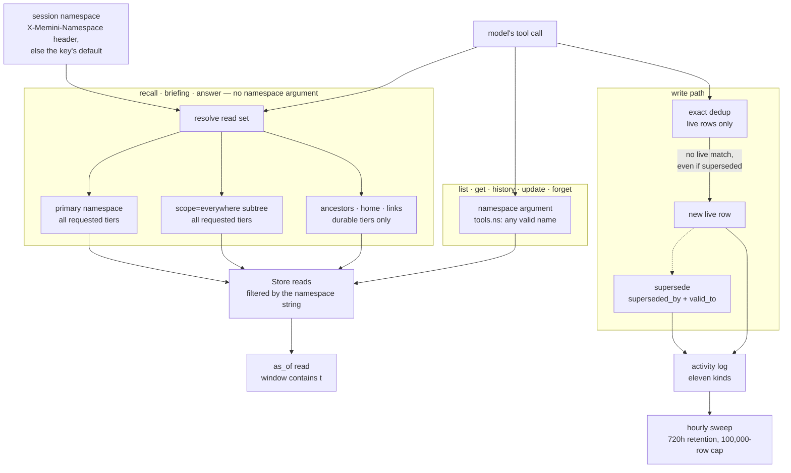

## 1. Executive Summary

memini is a memory service rather than a library: one Go binary that MCP-capable
agents share, holding tiered memories behind `remember` and `recall`. Its
retrieval is the strong side. The recall cascade bounds every namespace past
the primary to durable tiers, and the ranking composite multiplies relevance
instead of adding bonuses. The weak side is the boundary under that cascade:
five MCP tools take a namespace from the model and resolve any namespace on
the server, at every tier.

It boots with no configuration on an embedded SQLite file and runs the same
code against Postgres. The licence is AGPL-3.0, with the full text in the tree.

Two decisions shape the design. **An untiered write is classified by regex, not
by a model.** A caller who names no tier gets `working`, a 72-hour intake tier,
unless a deterministic marker heuristic raises it. The heuristic can only
raise, never touches a write whose caller picked a tier, and fails safe: a miss
leaves the memory in `working`, where it can earn durability later.

**The scope that widens a recall narrows it on another axis at the same time.**
A recall resolves the primary, then ancestors nearest-first, then the caller's
home, then stored links, and every leg past the primary is restricted to the
durable tiers (`internal/service/readset.go`). `scope="everywhere"` adds the
primary's subtree at the request's full tier filter, which the scoping document
states.

The report awards two marks, `bitemporal` and `negative_eval`, and section 9
gives the reason for each of the five it withholds. Three of those are near
misses with real mechanisms behind them: a namespace filter on every store read,
a supersession pointer, and an eleven-kind activity log.

## 2. Mental Model

Think of memini as a retrieval service with a lifecycle bolted to the front of
it, not as a database with search on top.

The lifecycle is four tiers on one horizon axis. `working` and `episodic` are
short-term — transient, TTL'd at 72 hours and 30 days — and `semantic` and
`procedural` are long-term, durable and curated, with no default expiry. The
mapping is a method on the tier itself (`internal/memory/types.go:48-56`), so
"is this short-term" and "when does this expire" have one answer each.

A memory moves up that ladder in one of three ways: a caller names its tier, the
regex classifier raises it at write time, or a later promotion pass raises it. It
moves down by expiring, by being demoted by the sweeper, or by being
superseded. Supersession does not delete: it stamps the end of the interval the
fact held and points at what replaced it.

A superseded fact is a record, not a rejected value. The exact-dedup lookup that
guards a write matches live rows only (`superseded_by IS NULL` in
`GetByFingerprint`), so a later write of the superseded content stores a new
live memory. Corroboration is a number used for ranking; no discrete state
decides whether a memory may be believed.

The retrieval side is where the design opinion lives. memini computes
`relevance × (0.80 + 0.20 × quality)` and leaves the standalone recency and
importance weights at zero. The documentation states this under the heading
*"Ranking, honestly"*, and the code agrees: `RerankWeights` has four fields and
`DefaultRerankWeights` sets two (`internal/search/rank.go:23-34`).

## 3. Architecture

One binary serves MCP over stdio or streamable HTTP, a REST API generated from
`api/openapi.yaml`, a CLI and a web UI. Behind them, `internal/service` holds
the write and recall pipelines and `internal/store` the `Store` interface, with
`sqlitevec` and `postgres` implementations.

The `Store` interface is the seam to study. Its method comments are the
contract the two backends are held to. `Upsert` states what happens to a
vectorless row and to a stale vector-index entry. `GetEmbedding` explains why a
vector is kept off `Get` (dims × 4 bytes on every read path) and warns that a
Get-then-Upsert round trip is therefore lossy. One shared conformance suite runs
those contracts, on SQLite under a plain `go test` and on Postgres when
`MEMINI_TEST_POSTGRES_DSN` is set.

### Deployment and ergonomics

Nothing has to be running for a first boot: SQLite is embedded, and a missing
or slow embedder degrades writes and recalls to keyword-only. Postgres, an
OpenAI-compatible embedder, a chat model for consolidation and distillation, and
a cross-encoder reranker are each optional. A chart under `charts/memini` and a
`compose.yaml` cover hosted deployment.

## 4. Essential Implementation Paths

- **Write:** `Service.Remember` (`internal/service/service.go:1370`) —
  validate, classify, route, scrub, sanitize, gate, `fingerprintHit` (`:1899`),
  embed, `runSplitDedup`, `Upsert`, auto-supersede.
- **Tier classification:** a pure regex pass bounded by `MinFactChars` (20) and
  `ClassifyMaxChars` (400) in `internal/extract/extract.go`, with transcript and
  hedge vetoes and five marker families.
- **Recall:** `Service.Recall` and `resolveReadSet`
  (`internal/service/readset.go`) — parallel legs, the semantic floor, double
  fusion, the composite, the adjustment sequence.
- **Addressing tools:** `tools.ns` (`internal/api/mcp/mcp.go:629-648`) and its
  five callers, `get`, `history`, `update`, `list` and `forget`
  (`:1197-1344`).
- **Supersession:** `applySupersede` and `asyncSupersede`
  (`internal/service/consolidate.go:352`, `:486`), `Service.Supersede`
  (`service.go:3775`) and the REST `SupersedeMemory` handler
  (`internal/api/rest/rest.go:418`), all reaching `Store.SetSuperseded`.
- **Activity log:** `internal/service/events.go`, the kind vocabulary at
  `internal/store/store.go:1125-1161`, and `PruneEvents` in both backends.
- **Maintenance:** `Sweeper.sweep` (`internal/maintenance/maintenance.go`)
  and the pass files beside it.

## 5. Memory Data Model

A `Memory` carries more axes than most records, and the type's comments say
what each one means when it is absent:

- **`Tier`** — `working`, `episodic`, `semantic`, `procedural`, with `Term()`
  and `DefaultTTL()` as methods on the tier.
- **`Level`** — `explicit` or `deduced`, recording whether a fact was stated or
  inferred. The type comment says the empty legacy value *"passes filters
  unconstrained"*. That holds only when no level filter is set: both backends
  render a level filter as `level IN (…)` or `level = ANY(…)`, so a legacy row
  is excluded by any level filter a caller sends.
- **`Confidence`** — a corroboration number in [0,1] that grows logistically on
  re-observation and decays without reinforcement. `nil` means untracked, and
  the comment says it is *treated as fully trusted so existing data is never
  retroactively penalized*.
- **`AssessedImportance`** — an LLM judgement in [0.1,0.9], cleared whenever a
  caller supplies an explicit importance, so a non-nil value refines a
  tier-seeded guess and never overrides what a user asked for.
- **`SupersededBy`**, **`ValidFrom`**, **`ValidTo`** — the correction axes,
  covered in sections 7 and 9.
- **`LinkedMemoryIDs`** — advisory links from the consolidator, with stale ones
  (target superseded or deleted) skipped at recall rather than at write.

## 6. Retrieval Mechanics

Read-set resolution runs concurrently with the query embedding. Each namespace
in the set gets a vector leg and a keyword leg in parallel, and failure is
isolated per leg. An unreachable ancestor is dropped and named in the
response's degradation note. A failed vector leg falls back to that namespace's
keyword results. Only losing the primary namespace's keyword leg fails the call.

Before fusion, an absolute semantic gate drops vector candidates below a raw
similarity floor (`MEMINI_RECALL_MIN_SEMANTIC_SCORE`, 0.46 by default). Without
an absolute bar, min-max normalization turns a batch of uniformly irrelevant
candidates into competitive-looking scores. A keyword hit with no vector score
is not gated, but one whose vector score is known and below the floor is dropped
from both legs.

Fusion happens twice. Per-namespace lists fuse into one ranking and **ties at
equal score break by first-seen order across the read set**, which is why the
cascade appends ancestors nearest-first. At equal relevance a memory in
`acme/phoenix` outranks the same-scored one in `acme`.

Then the composite, then a fixed sequence:

- a durable-tier reserve holding up to two top-k slots for semantic and
  procedural memories when they are relevance-competitive;
- a turn-echo guard dropping conversation turns captured inside the server's
  window, because a just-captured turn is in the caller's live context;
- dedup by normalized content;
- an optional reranker whose failure or timeout falls back to the composite
  order.

## 7. Write Mechanics

The pipeline is ten ordered steps, and three of them are decisions other
implementations tend to skip.

**Dedup runs twice, either side of the embedder.** An exact content match among
live rows in the same tier reinforces the existing memory instead of
duplicating it, before an embedding is paid for. Only a write that survives that
is vectorized. A vector search over the same tier then decides whether it should
supersede, hint at, or coalesce into an existing memory.

**A write can be accepted and not stored.** The value gate strips harness
boilerplate from auto-captured turns and drops low-signal episodic writes,
returning `stored: false` with the resolved tier. The documentation calls this
a feature rather than an error, which matters for a client that would otherwise
retry.

**Degradation is designed rather than incidental.** A slow or absent embedder
degrades the write to keyword-only, and the store keeps the row searchable with
no vector-index entry. `Upsert`'s comment states the matching invariant: a stale
vector-index entry from a prior upsert of the same ID is removed, and
`VectorSearch` never returns a vectorless row.

**Correction is supersession.** The predecessor keeps its row, gains a
`SupersededBy` pointer and a `ValidTo` stamp, and drops out of live recall
while staying reachable through `IncludeSuperseded`, `memory_history` and an
as-of read. A contradiction found by the lexical detector in
`internal/contradict` stamps the stale fact's `valid_to` at the write clock.
That records when the store learned of the change, not when the fact stopped
holding, unless a caller supplied the end.

**The pointer guards nothing on the way in.** `fingerprintHit` calls
`GetByFingerprint`, whose SQL requires `superseded_by IS NULL`
(`internal/store/sqlitevec/store.go:691-697`). A later write of the superseded
text therefore lands as a fresh live memory. The only reads that include
superseded rows are maintenance passes and `Stats` (Recorded searches).

## 8. Agent Integration

Nine MCP tools: `memory_remember`, `memory_recall`, `memory_get`, `memory_list`,
`memory_update`, `memory_forget`, `memory_history`, `memory_briefing` and
`memory_answer` (`internal/api/mcp/mcp.go:239-359`). Alongside them a REST API
generated from an OpenAPI document, a CLI, a web UI, and plugins for several
harnesses.

The tool surface splits on the namespace. `memory_remember`, `memory_recall`,
`memory_briefing` and `memory_answer` take no namespace argument; they use the
session namespace and are steered by `scope` or `visibility`. The other five
take an optional `namespace`. The comment on `tools.ns` says that value is
*"never a value the LLM chooses"*, and the tool description tells the model to
copy it from a prior result. The handler checks only that the string is a valid
namespace name and returns it, and the HTTP handler's comment says *"tool calls
may still override it per-call"* (`mcp.go:401`, `:629-648`).

Three pull surfaces have different reinforcement defaults. The session-start
briefing is query-less and **never reinforces**, because a fixed top-N served on
every session open would inflate the access counts that promotion and ranking
depend on. Explicit `memory_recall` reinforces: each served memory's access
count bumps and its expiry slides forward. An automatic caller can send
`reinforce: false`. All three appear in the activity log.

## 9. Reliability, Safety, and Trust

**Bitemporal — awarded.** `valid_from` and `valid_to` are settable through
`memory_remember` and REST, `resolveValidity` lets an explicit value win over
the write clock, and supersession stamps `valid_to` without overwriting a
caller's value. `Filter.AsOf` keeps the rows whose window contained the instant
and evaluates expiry at that instant (`internal/store/sqlitevec/helpers.go:179-205`).
`TestRememberTemporalValidity` backdates a window and asserts both an as-of
inside it and one before it.

**Negative evaluation — awarded.** `testVectorRanking` seeds a foreign-namespace
row with the query's exact vector and asserts the ranked same-namespace pair
and that no result leaks the foreign row. `TestHomeMergesDurableOnly` asserts
the durable home memory surfaces and the episodic one does not. Both run
against a populated store with a positive half (section 10).

**Scope enforcement — withheld.** The store filters by namespace on every read,
and `Upsert` refuses an id that exists under another namespace. The recall
cascade is bounded as section 1 describes. The mark fails on the addressing
tools: `memory_list` with a model-supplied `namespace` enumerates any namespace
on the server at every tier, and `memory_get` and `memory_history` fetch by id
in it (`internal/api/mcp/mcp.go:629-648`, `:1197-1223`, `:1283-1329`). Keys do
not close it. `docs/api-keys.md` says *"Any valid key — admin, named, or
file-sourced — can read **any** namespace"*, and `Principal` carries a home and a
default namespace but no grant. The isolation table in `docs/scopes.md` lists
*"Caller → another person's home"* as *"not expressible"*. Through
`memory_list` it is one argument.

**Tombstone — withheld.** Supersession is a pointer on the replaced record, and
the exact-dedup lookup that would meet a re-asserted value excludes superseded
rows (section 7). No store keyed on a rejected value exists for a later write to
consult (Recorded searches). `PurgeTombstones` hard-deletes superseded rows when
`MEMINI_TOMBSTONE_TTL` is set, and that TTL defaults to 0.

**Audit log — withheld.** The activity log has eleven kinds with a closed
validator, and `Forget` reads the row before the delete so the event can
describe it. It is not append-only. The hourly sweeper calls `PruneEvents`,
which deletes events older than `MEMINI_ACTIVITY_RETENTION` (default `720h`) and
beyond `MEMINI_ACTIVITY_MAX_ROWS` (default `100000`) in both backends
(`internal/store/sqlitevec/events.go:211-235`). The configuration reference
says the row cap, not the window, *"is usually what bounds the table"*. The
kind comment at `internal/store/store.go:1129-1134` says `pin`, `unpin` and
`settings` landed ahead of the paths that emit them and points at
`internal/api/rest/config_stubs.go`. Six handlers emit them, and that file is
not in the tree.

**Trust state — withheld.** The epistemic axis is a number: `Confidence` grows
on re-observation and decays without reinforcement, and feeds the quality term
in the composite. The `quarantined` metadata flag zeroes importance so a garbled
write sinks in ranking, and is not read as a filter. `Level` is a write-time
provenance genre.

**Human review — withheld.** No approval state gates what a memory may be used
for. API keys identify a writer (`metadata.author` is stamped from a named key),
and the only per-key authorization bits are `admin` and `read_only`.

## 10. Tests, Evals, and Benchmarks

**No paper.** `README.md`, `docs/` and `bench/README.md` cite LongMemEval and
another project's paper as sources and carry no paper of memini's own; there is
no `CITATION.cff`.

**The negative cases are controlled.** `testVectorRanking`
(`internal/store/storetest/conformance.go:1781-1804`) is the strongest: same
vector, foreign namespace, ranked-pair assertion first. `testIDsByPrefix`
(`:73-145`) asserts the short-id resolver returns exactly two same-namespace
collisions while a foreign row shares the prefix. `TestContradictionInvalidatesStaleFact`
(`internal/service/contradict_test.go:71`) asserts a contradicted fact leaves
live recall. `testCrossNamespaceUpsert` (`:1746`) is a write test: it asserts
`ErrConflict` and that the foreign namespace holds no copy.

**One isolation test lacks its positive half.** `TestRecallNamespaceIsolation`
(`internal/service/service_test.go:677`) writes to `alice` and asserts a recall
from `bob` is empty, with nothing establishing that `alice` sees the memory. A
recall broken for everybody passes it. The one MCP test that passes a
`namespace` argument checks that a 300-character name is rejected
(`internal/api/mcp/mcp_test.go:1238`); none exercises the override on
`memory_list`.

**The harness is committed and the results are not.** `bench/` holds a retrieval
harness behind a `bench` build tag, the README explains why a plain
`go test ./bench/` reports no test files, and three datasets ship. The large
public datasets are excluded with a comment saying so. The README's "Full
results" table is introduced as *"sourced from the committed `results/` JSON"*
and links it. `.gitignore` line 24 is `/bench/results/`, and no commit in the
clone's history ever added a file under it. No figure in the table recomputes
from a clone, including the README line 117 comparison of *"98.4% recall@5
against 95.2%"* with `agentmemory`'s LongMemEval-S numbers.

**The table's own reading disagrees with the table.** `bench/README.md:57-59`
says hybrid *"never trails either single leg on the saturated session sets (it
ties keyword on LoCoMo-session…)"*. On LoCoMo session-level the table gives
keyword 92.6 / 96.8 / 79.4 and hybrid 90.9 / 96.6 / 74.3, so hybrid trails on
recall@5, recall@10 and MRR.

## 11. For Your Own Build

### Steal

- **Put the cheap dedup before the embedder.** An exact content match in the
  same tier reinforces without paying for a vector, and the near-duplicate check
  runs afterwards on what survived.
- **Multiply the quality modifier by relevance instead of adding it.** An
  off-topic memory has almost no score to amplify, so a corroborated durable
  fact rises above comparably relevant chatter without beating something more
  relevant. Leave the unused weights at zero and say so.
- **Narrow one axis when you widen another.** A cascade that reaches ancestors,
  home and links leaks session chatter unless the legs past the primary are
  restricted, here to durable tiers.
- **Decide what counts as a use.** Log the briefing's serve and do not count it
  as reinforcement.

### Avoid

- **A bounded read path beside an unbounded one.** A carefully clamped recall
  cascade protects nothing if a list tool takes the namespace as an argument.
  Bind the namespace to the session or the credential and refuse an override.
- **A correction keyed on the record.** If the dedup lookup reads live rows only,
  the corrected value comes back on the next write. Record the rejected value
  and consult it on the way in.
- **An audit log with a row cap.** A cap sized for read telemetry deletes the
  mutation events with it; keep mutations in a table the sweeper does not touch.

### Fit

A good fit for a single team, or a single person across machines, running one
instance that every agent on the team may read in full, who want strong
retrieval with no LLM on the write path. It is the wrong fit where namespaces
are a boundary between people: the documentation says hard isolation means
separate instances, and the tool surface agrees.

## 12. Open Questions

- Is the `namespace` argument on the five addressing tools meant to reach
  namespaces outside the session's read set, or only to address a memory a
  cascade recall returned? The `tools.ns` comment and the handler disagree.
- Should a superseded value block a later identical write, or is
  re-assertion after supersession intended?
- Was the `bench/README.md` table written against a local `results/` directory
  from the start? No commit in the clone ever added one.

## Appendix: File Index

| Path | What to read it for |
| --- | --- |
| `internal/memory/types.go` | The `Memory` record, tiers, `Level` and the validity fields |
| `internal/store/store.go` | The store contract, `Filter`, the event vocabulary and `PruneEvents` |
| `internal/store/sqlitevec/`, `internal/store/postgres/` | Both backends, `GetByFingerprint`, `SetSuperseded`, the as-of clause |
| `internal/store/storetest/conformance.go` | The shared suite, including `testVectorRanking` and `testTemporalAsOf` |
| `internal/service/service.go` | `Remember`, `fingerprintHit`, `resolveValidity`, `Forget`, `Supersede` |
| `internal/service/readset.go` | The cascade and its durable-tier restriction |
| `internal/service/consolidate.go`, `internal/contradict/` | Supersession and the lexical contradiction detector |
| `internal/api/mcp/mcp.go` | The nine tools, `tools.ns`, the HTTP handler's namespace resolution |
| `internal/apiauth/apiauth.go`, `docs/api-keys.md` | Keys as identity, with no namespace grant |
| `internal/maintenance/maintenance.go`, `events.go`, `tombstone.go` | The hourly sweep, event pruning, tombstone purge |
| `internal/search/rank.go` | The composite and its weights |
| `bench/README.md`, `.gitignore` | The results table and the excluded `results/` directory |

### Recorded searches

Run at the tree root of the pinned checkout with `/usr/bin/git grep`.

- `git grep -n -E 'IncludeSuperseded: *true' -- internal ':!*_test.go'` — `maintenance/forget.go:15`, `reembed.go:44`, `renamespace.go:30`, `repair.go:51`, `tombstone.go:26`, `service/query.go:163` (`Stats`) and a conformance fixture; no write-path read.
- `git grep -n -i -E 'blocklist|denylist|suppress(ed|ion)?_(list|set|key)|rejected_(value|content|fact)' -- '*.go'` — no match.
- `git grep -n -i -E 'allowed_?namespaces|AllowedNS' -- '*.go'` — no match; no namespace grant on a key.
- `git grep -n -E 't\.ns\(' -- internal/api/mcp/mcp.go` — five callers: `get`, `history`, `update`, `list`, `forget`.
- `git grep -n -E '(UPDATE|DELETE FROM)[[:space:]]+memory_events' -- '*.go' ':!*_test.go'` — the four `PruneEvents` statements in `sqlitevec/events.go` and `postgres/events.go`; no update.
- `git grep -n -E 'ActivityRetention|ActivityMaxRows' -- internal/config/config.go` — `envDefault:"720h"` and `envDefault:"100000"`.
- `git grep -n -E 'LogConfigEvent\(' -- internal ':!*_test.go'` — six calls in `internal/api/rest/` (`apikeys.go:274`, `:402`, `pins.go:94`, `:160`, `selfsettings.go:89`, `settingsdefaults.go:76`) and the definition.
- `git ls-files -- internal/api/rest/config_stubs.go` — empty.
- `git grep -n -E 'Arguments: map\[string\]any\{[^}]*"namespace"' -- 'internal/api/mcp/*_test.go'` — one hit, `mcp_test.go:1238`, an over-long name rejected.
- `git ls-files | grep -c -E '(^|/)results/'` — 0; `git log --all --diff-filter=A --format=%h -- 'bench/results/*'` — empty.
- `git grep -n -i -E 'quarantin' -- 'internal/*.go' ':!*_test.go'` — the write-side flag and a consolidation guard; no read filter on it.
- `git grep -n -i -E 'approv' -- '*.go' ':!*_test.go'` — one comment in `cmd/memini/root.go:556` about embedder aliases; no review state.
- `git grep -n -i -E 'arxiv|bibtex|@article|@misc|doi\.org' -- README.md docs bench/README.md` — three citations of others' work in `bench/README.md`; `CITATION.cff` absent.
- `git grep -n -i -E 'anthropic|machine learning|not (be )?used (for|to)' -- LICENSE` — no match; the AGPL-3.0 text carries no rider.

## History

**2026-10-15** — [`72a7377b4c21eef5a453dcef540f2d10b4de092e`](https://github.com/eleboucher/memini/commit/72a7377b4c21eef5a453dcef540f2d10b4de092e) — v0.7.36, 99 commits on, nearly all dependency updates; the memory paths change by two string-splitting refactors and one embed call, now `EmbedQueryOne` for separate document and query prefixes. A separate distillation model and reranker query caps also arrived. Screened first: the same two auto-run surfaces, every manifest inside the cooldown; nothing installed, built or run. Three marks were wrong at the first pin and are withdrawn: `scope_enforced`, because five MCP tools resolve any model-supplied namespace ([section 9](#9-reliability-safety-and-trust)); `tombstone`, because supersession is record-keyed and dedup reads live rows only; `audit_log`, because the event log is pruned hourly by default. The negative case was misnamed `testCrossNamespaceUpsert`; it is `testIDsByPrefix`. The benchmark README's own reading contradicts its table ([section 10](#10-tests-evals-and-benchmarks)).

**2026-09-19** — [`452ff2299c185530c7010cb164d83cce8006f78a`](https://github.com/eleboucher/memini/commit/452ff2299c185530c7010cb164d83cce8006f78a) — first reading, at the head of `main`. Screened with `scripts/screen_repo.py` before anything was read: two auto-run surfaces (a Claude Code plugin manifest and a devcontainer with a `postCreateCommand`) and every dependency manifest inside the seven-day cooldown, which is an artefact of screening a `--depth 1` clone rather than a statement about the upstream. Nothing was installed, built or run; the reading is from the source and the committed documentation. Five marks. The reading covered the domain types, both store backends and the conformance suite they share, the write pipeline and its classifier, the recall pipeline and its ranking composite, the supersession and time-travel paths, the activity log, and the benchmark harness; the UI, the importer and the per-harness plugins were read as context rather than as subject. Three findings are worth the reader's time: the benchmark table's `results/` source is excluded by `.gitignore`, so no published figure recomputes from a clone; the service-level namespace isolation test asserts an absence with no positive control, though the store conformance suite carries a properly controlled equivalent; and the event vocabulary's comment describing the pin and settings kinds as unwired has been overtaken by six handlers that emit them.
